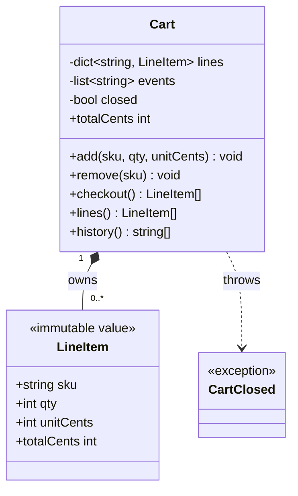
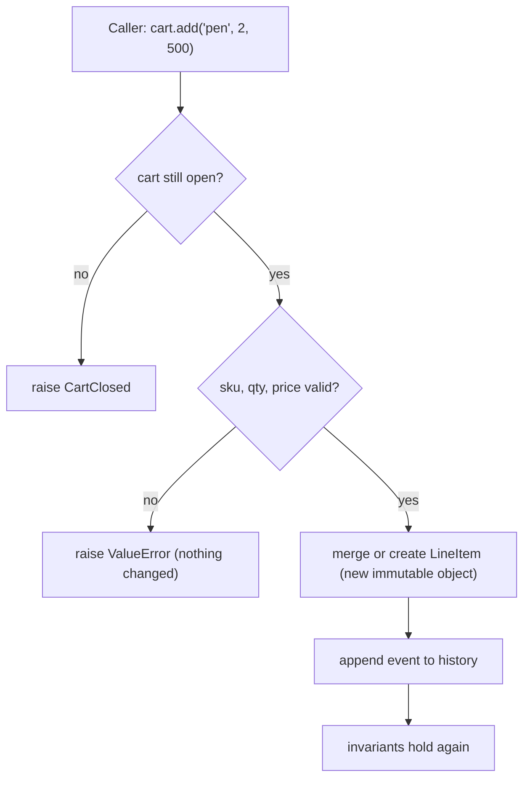

# OOP Pillar 1: Encapsulation

> **Prerequisites:** [01 · Classes & Objects](../01-classes-objects-and-oop-building-blocks/README.md) and [02 · OOP Foundations & UML](../02-oop-foundations-and-uml/README.md) — classes, methods, the four pillars at a glance.  
> **Reading time:** ~35 minutes  
> **Audience:** Beginners and early-intermediate developers who have read the Python basics and want to say "encapsulation" with confidence, in an interview and in real code

> [!NOTE]
> **In one line:** Encapsulation means **bundling data with the methods that guard it, and keeping the data behind a door** so that no object can ever be pushed into an illegal state from the outside.

> [!TIP]
> **Golden rule:** Ask of every class: *"What must always be true about this object, and who is allowed to change it?"* The answer to the first half is your **invariants**. The answer to the second half is your **public methods**. Nothing else should be able to touch the data.

> [!TIP]
> **Try it:** Solve [Encapsulated Wallet](/practice/code/oop-wallet-encapsulation/), then open [LLD Studio](/tools/lld-studio/) and sketch the `Cart` from section 15. Try to break each invariant from outside the class.

---

## 1. Roadmap: where this chapter sits

OOP rests on four pillars. This is the first one, and the other three lean on it.

| Pillar | Question it answers | Chapter |
| :--- | :--- | :--- |
| **1. Encapsulation** | *How do I stop my object from being broken?* | **This one** |
| 2. Abstraction | How do I let callers ignore the details? | [30](../30-oop-pillar-2-abstraction/README.md) |
| 3. Inheritance | How do I reuse and extend a type? | [31](../31-oop-pillar-3-inheritance/README.md) |
| 4. Polymorphism | How do I let one call do different things? | [32](../32-oop-pillar-4-polymorphism/README.md) |

**What you can do after this chapter**

- Explain encapsulation, information hiding and abstraction without mixing them up.
- Turn a "bag of public fields" into a class that protects its own rules.
- Use Python properties and C# properties correctly, including validation.
- Stop the classic **aliasing bug** where a getter hands out your internal list.
- Use immutable types (frozen dataclass, C# `record`) where they fit.
- Spot anemic objects, shared class attributes and leaky getters in a code review.
- Give a clear two-minute answer when an interviewer says "explain encapsulation".

The teaching order is: concept, explanation, code, diagrams, practice, project, interview.

---

## 2. The concept

> [!key]
> **Encapsulation** = (1) put the data and the code that works on that data **together in one class**, and (2) **restrict direct access** to the data so every change goes through methods that check the rules. The result: an object is **valid from the moment it is created until the moment it is thrown away**.

Think of a vending machine. You cannot reach in and take a can. You press a button and put in a coin. The machine decides whether to give you a can. The inside (coins, stock, motors) is hidden. The buttons are the **public interface**.

### Three words people mix up

| Term | Plain meaning | Question it answers | Example |
| :--- | :--- | :--- | :--- |
| **Encapsulation** | Data + the methods that guard it, in one unit, with controlled access | "Who may change this, and under which rules?" | `BankAccount` keeps `_balance` and only `deposit` / `withdraw` change it |
| **Information hiding** | Keep the *design decisions that may change* secret | "What can I change later without breaking callers?" | Callers never learn that the balance is stored as integer cents |
| **Abstraction** | Show only what the caller needs, as a simple contract | "What is this thing, from the outside?" | `PaymentGateway.charge(amount)` hides every network detail |

A short way to remember them:

- **Encapsulation** is the *mechanism* (a class with a door).
- **Information hiding** is the *goal* (secrets that can change).
- **Abstraction** is the *view* (a simple face for the caller).

They help each other, but they are not the same. You can have a class with private fields (encapsulation) that still leaks every detail through its method names (poor abstraction). Chapter [30](../30-oop-pillar-2-abstraction/README.md) covers abstraction in full.

---

## 3. The disaster: before encapsulation

```python
class BadAccount:
    def __init__(self, owner):
        self.owner = owner
        self.balance = 0
        self.history = []


acct = BadAccount("Asha")
acct.balance = -500          # nobody stops you
acct.history.clear()         # the past is gone
acct.owner = None            # now what?
print(acct.balance)
```

Output:

```text
-500
```

Nothing is wrong with Python here. The class made no promises, so nothing is broken. That is exactly the problem: **every line of code in the whole project** can now corrupt an account, and a bug can come from anywhere. To find it, you must search the entire codebase.

The "after" is the same idea with a door. The balance is private, and only `deposit` and `withdraw` change it, after checking the rules:

```python
class Account:
    def __init__(self, owner: str) -> None:
        if not owner:
            raise ValueError("owner is required")
        self._owner = owner
        self._balance = 0

    @property
    def balance(self) -> int:
        return self._balance

    def deposit(self, amount: int) -> None:
        if amount <= 0:
            raise ValueError("amount must be positive")
        self._balance += amount

    def withdraw(self, amount: int) -> None:
        if amount <= 0 or amount > self._balance:
            raise ValueError("invalid amount")
        self._balance -= amount


acct = Account("Asha")
acct.deposit(100)
try:
    acct.balance = -500
except AttributeError as exc:
    print("blocked:", exc)
```

Output:

```text
blocked: property 'balance' of 'Account' object has no setter
```

A bug in the balance can now only come from **two methods**. The search area shrinks from "the whole program" to "this one class".

---

## 4. Invariants: the rules that must never break

An **invariant** is a fact that is true whenever no method of the object is running. Encapsulation exists to protect invariants.

For `Account`, the invariants are:

1. `balance >= 0`.
2. `balance == sum(history)` (the history always explains the balance).
3. `owner` is never empty.

**Who enforces an invariant?** The class itself, in exactly two places:

| Place | Job |
| :--- | :--- |
| **Constructor** | Refuse to build an object that starts invalid |
| **Every method that changes state** | Check first, change second, so a failed call changes nothing |

Two habits that make this easy:

- **Validate, then mutate.** Do all checks at the top of the method. If any check fails, raise before touching a field. Then a failed call leaves the object exactly as it was.
- **One door per change.** If two methods can change the balance, you have two places to keep correct. Better: one private helper that every public method calls.

If you cannot write down the invariants of a class, you are not ready to decide which members are private. Write the invariants first. They tell you what to hide.

---

## 5. Access control: Python versus C#

The two languages have the same goal and very different attitudes.

| Level | Python | C# | Who enforces it |
| :--- | :--- | :--- | :--- |
| Public | `balance`, `deposit()` | `public` | Nobody; anyone can use it |
| Internal to the class | `_balance` (one underscore) | `private` (the default for class members) | Python: **convention**. C#: **compiler** |
| Name-mangled | `__balance` becomes `_Account__balance` | no equivalent | Python: avoids accidental clashes |
| Class and subclasses | `_name` by convention | `protected` | C# compiler |
| Same assembly (project) | module-level `_helpers`, `__all__` | `internal` | C# compiler |
| Subclass or same assembly | no equivalent | `protected internal` | C# compiler |
| Subclass in same assembly | no equivalent | `private protected` | C# compiler |

C# defaults: members of a class are `private` unless you say otherwise. A top-level class is `internal` unless you write `public`. **Start private and open up only what you must.**

### Python: "we are all consenting adults"

Python does not stop you. It trusts you. The single underscore is a sign on the door that says *"internal, please do not touch"*. Linters and code reviews enforce it.

```python
class Counter:
    def __init__(self) -> None:
        self._count = 0       # convention: internal
        self.__secret = 42    # name-mangled

    def hit(self) -> None:
        self._count += 1


c = Counter()
c.hit()
print(c._count)               # works, but you are breaking the sign
print(c._Counter__secret)     # works too: mangling is not security
print(hasattr(c, "__secret")) # False: the plain name does not exist
```

Output:

```text
1
42
False
```

**Why does Python work this way?** Python optimises for flexibility and for trusting developers. Real privacy would stop debuggers, test tools and serialisers from working. The price is that *you* must design the public surface so that the contract is easy to keep.

**What is name mangling for?** `__x` inside `class A` is renamed `_A__x`. Its purpose is to stop a **subclass** from accidentally using the same attribute name as its parent. It is **not** a security feature. Use `_x` for "internal" and keep `__x` for the rare clash case.

### C#: the compiler enforces it

```csharp
public sealed class Counter
{
    private int _count;               // only Counter can touch this

    public void Hit() => _count++;
    public int Count => _count;       // read-only to the outside
}

// var c = new Counter();
// c._count = 5;   // compile error CS0122: inaccessible due to its protection level
```

C# `private` is a guarantee at compile time. (Reflection can still reach private members, but ordinary code cannot.)

> **Say this aloud:** "In Python, private is a convention plus tooling. In C#, it is a compiler guarantee. Either way, I decide what the public surface is, and I keep it small."

---

## 6. Properties: controlled access with validation

A **property** looks like a field to the caller but runs code underneath. It is the tool that lets you start simple and add rules later **without changing a single caller**.

````carousel
```python
class Temperature:
    ABSOLUTE_ZERO_C = -273.15

    def __init__(self, celsius: float) -> None:
        self.celsius = celsius          # goes through the setter, so it is validated

    @property
    def celsius(self) -> float:
        return self._celsius

    @celsius.setter
    def celsius(self, value: float) -> None:
        if value < self.ABSOLUTE_ZERO_C:
            raise ValueError("below absolute zero")
        self._celsius = float(value)

    @property
    def fahrenheit(self) -> float:      # computed, read-only: no setter
        return self._celsius * 9 / 5 + 32


t = Temperature(25)
print(t.celsius, t.fahrenheit)
t.celsius = 100
print(t.fahrenheit)
for bad in (-300,):
    try:
        t.celsius = bad
    except ValueError as exc:
        print("rejected:", exc)
try:
    t.fahrenheit = 50
except AttributeError:
    print("fahrenheit is read-only")
```

<!-- slide -->

```csharp
using System;

public sealed class Temperature
{
    public const double AbsoluteZeroC = -273.15;
    private double _celsius;

    public Temperature(double celsius) => Celsius = celsius;   // validated via the setter

    public double Celsius
    {
        get => _celsius;
        set
        {
            if (value < AbsoluteZeroC)
                throw new ArgumentOutOfRangeException(nameof(value), "below absolute zero");
            _celsius = value;
        }
    }

    public double Fahrenheit => _celsius * 9 / 5 + 32;         // computed, get-only
}

public static class Program
{
    public static void Main()
    {
        var t = new Temperature(25);
        Console.WriteLine($"{t.Celsius} {t.Fahrenheit}");
        t.Celsius = 100;
        Console.WriteLine(t.Fahrenheit);
        try { t.Celsius = -300; }
        catch (ArgumentOutOfRangeException ex) { Console.WriteLine("rejected: " + ex.ParamName); }
    }
}
```
````

Notice three things:

1. The constructor assigns through the **setter**, so the rule lives in one place.
2. `fahrenheit` is **derived**, so it cannot go out of sync with `celsius`. No stored copy means no inconsistency.
3. The caller writes `t.celsius = 100` in both the "plain field" and the "validated" version. You can upgrade later.

### C# property flavours

| Syntax | Meaning | Use for |
| :--- | :--- | :--- |
| `{ get; }` | Set only in the constructor | Values fixed for the object's life |
| `{ get; private set; }` | Callers read; only the class writes | State the class manages itself |
| `{ get; init; }` | Set in the constructor or an object initializer, then frozen | Immutable data objects |
| `{ get; set; }` | Anyone reads and writes | **Rarely**. This is a public field with extra syntax |
| `required` modifier | Caller must set it at creation | Forcing valid construction with `init` |

Python equivalents: a read-only `@property` (no setter), a validating setter (above), and `@dataclass(frozen=True)` for init-only data.

> **Rule:** do not add a setter just because the language makes it easy. Ask whether callers truly need to set the value freely. Often the right answer is a **method with a meaningful name** (`rename`, `withdraw`, `ship`) and no setter.

---

## 7. Read-only views and defensive copies

This is the leak that catches the most people. The class has a private list and a getter. It *looks* safe.

```python
class Playlist:
    def __init__(self) -> None:
        self._songs: list[str] = []

    def add(self, song: str) -> None:
        if not song:
            raise ValueError("song required")
        self._songs.append(song)

    def songs(self):                 # BUG: returns the internal list itself
        return self._songs


p = Playlist()
p.add("Alpha")
leaked = p.songs()
leaked.append("")                    # the rule in add() is bypassed
leaked.clear()                       # the data is wiped
print(len(p.songs()))
```

Output:

```text
0
```

This is **aliasing**. `leaked` and `p._songs` are two names for **one** list in memory. Making the field private did nothing, because the getter handed out the key.

**Fix: never return the internal mutable object.** Return a copy, or a read-only view.

````carousel
```python
class Playlist:
    def __init__(self) -> None:
        self._songs: list[str] = []

    def add(self, song: str) -> None:
        if not song:
            raise ValueError("song required")
        self._songs.append(song)

    def songs(self) -> tuple[str, ...]:
        return tuple(self._songs)       # a snapshot: a new, immutable tuple


p = Playlist()
p.add("Alpha")
snapshot = p.songs()
try:
    snapshot.append("x")                # tuples have no append
except AttributeError:
    print("cannot change the snapshot")
p.add("Beta")
print(snapshot)                         # still the old content
print(p.songs())
```

<!-- slide -->

```csharp
using System;
using System.Collections.Generic;
using System.Linq;

public sealed class Playlist
{
    private readonly List<string> _songs = new();

    public void Add(string song)
    {
        if (string.IsNullOrWhiteSpace(song)) throw new ArgumentException("song required");
        _songs.Add(song);
    }

    // Live read-only view: cheap, but it reflects later changes.
    public IReadOnlyList<string> Songs => _songs.AsReadOnly();

    // Snapshot: safe to keep, costs a copy.
    public string[] Snapshot() => _songs.ToArray();
}
```
````

### Snapshot or live view?

A **snapshot** (`tuple(x)`, `ToArray()`) is safe to keep and costs O(n) per call. A **live read-only view** (`AsReadOnly()`, `MappingProxyType`) is O(1) but shows later changes. Choose on purpose and say which.

**Two traps**

- **Shallow copies.** A tuple of *mutable* objects protects the list, not the objects inside it. If the items can change, make them immutable too (next section), or copy them as well.
- **Returning `List<T>` typed as `IReadOnlyList<T>`.** In C#, a caller can cast it back to `List<T>`. `AsReadOnly()` wraps the list, so the cast fails. Prefer the wrapper or a snapshot.

The same rule applies on the way **in**. If a constructor takes a list, copy it: `self._items = list(items)`. Otherwise the caller keeps a second key to your private data.

---

## 8. Immutability: the strongest encapsulation

An **immutable** object cannot change after it is built. There is no door to guard, because there is no change. If you can make a class immutable, do it: you get thread safety, safe sharing and simple reasoning for free.

````carousel
```python
from dataclasses import dataclass, replace


@dataclass(frozen=True)
class Money:
    cents: int
    currency: str = "INR"

    def __post_init__(self) -> None:
        if self.cents < 0:
            raise ValueError("money cannot be negative")

    def plus(self, other: "Money") -> "Money":
        if other.currency != self.currency:
            raise ValueError("currency mismatch")
        return Money(self.cents + other.cents, self.currency)


a = Money(500)
b = a.plus(Money(250))               # a new object; a is untouched
print(a.cents, b.cents)
print(replace(a, currency="USD"))
try:
    a.cents = 1
except Exception as exc:
    print(type(exc).__name__)
```

<!-- slide -->

```csharp
using System;

public sealed record Money
{
    public long Cents { get; }
    public string Currency { get; }

    public Money(long cents, string currency = "INR")
    {
        if (cents < 0) throw new ArgumentOutOfRangeException(nameof(cents));
        Cents = cents;
        Currency = currency;
    }

    public Money Plus(Money other)
    {
        if (other.Currency != Currency) throw new InvalidOperationException("currency mismatch");
        return new Money(Cents + other.Cents, Currency);
    }
}
```
````

Output of the Python side:

```text
500 750
Money(cents=500, currency='USD')
FrozenInstanceError
```

Good candidates for immutability: money, dates, coordinates, ids, ledger entries, configuration. Poor candidates: things with a life story that really change (an order moving to "shipped"). For those, use encapsulated mutation with a validated door, and keep their *parts* immutable.

---

## 9. Tell, don't ask, and the Law of Demeter

### Tell, don't ask

If your code **asks** an object for its data and then **decides** outside, the rule has escaped the class.

```python
# Ask (rule lives in the caller, and will be copied into five callers)
if acct.balance >= 50:
    acct.balance = acct.balance - 50

# Tell (rule lives with the data)
acct.withdraw(50)
```

The first version only works if every caller remembers the check. The second makes it impossible to forget. Martin Fowler's [TellDontAsk](https://martinfowler.com/bliki/TellDontAsk.html) note explains the idea in a few paragraphs.

### The Law of Demeter in one page

*"Talk to your friends, not to strangers."* A method should only call methods on:

1. `self`,
2. its own fields,
3. its parameters,
4. objects it creates itself.

A "train wreck" shows the violation:

```python
city = order.customer.address.city      # you know Order has a Customer that has an Address...
```

The caller now depends on three classes and on how they are linked. If `Customer` stores `Address` differently tomorrow, this line breaks. Fix it by telling the nearest friend:

```python
class Order:
    def shipping_city(self) -> str:
        return self._customer.shipping_city()    # Order hides the path

city = order.shipping_city()
```

**Honest caveat:** this is a guideline. Chaining on **immutable values or fluent builders** (`text.strip().lower()`) is fine, because nothing is being reached into. The law targets reaching through objects to change or inspect their internals.

---

## 10. Encapsulation above the class: modules and packages

Encapsulation also works at the file and library level. Decide what a module **exports** and keep the rest internal.

```python
# pricing.py
__all__ = ["quote"]                    # the public surface of this module


def quote(base_cents: int, qty: int) -> int:
    return _apply_discount(base_cents * qty, qty)


def _apply_discount(total: int, qty: int) -> int:   # internal helper
    return total - (total // 10 if qty >= 10 else 0)


print(quote(1000, 12))
```

Output:

```text
10800
```

- `__all__` controls what `from pricing import *` brings in. It documents your intent.
- A leading underscore marks a name internal to the module. Tools and reviewers respect it.
- In a package, expose the public names in `__init__.py` and keep implementation files unexposed.

**C# equivalent:** `internal` makes a type visible only inside its assembly (project). A library exposes a few `public` types and keeps the rest `internal`. You can also nest a private class inside the class that uses it.

The principle is the same at every level: **a small public surface and a large hidden interior**. A small surface is easier to learn, test and change.

---

## 11. Getters and setters done wrong

Wrapping every field in a getter and a setter is not encapsulation. It is a public field wearing a costume.

```python
class AnemicOrder:                       # a data bag: only getters and setters
    def __init__(self):
        self._status = "new"
    def get_status(self): return self._status
    def set_status(self, s): self._status = s    # accepts "banana"


class Order:                             # behavior with rules
    def __init__(self):
        self._status = "new"

    @property
    def status(self) -> str:
        return self._status

    def ship(self) -> None:
        if self._status != "paid":
            raise ValueError("only a paid order can ship")
        self._status = "shipped"

    def cancel(self) -> None:
        if self._status == "shipped":
            raise ValueError("cannot cancel after shipping")
        self._status = "cancelled"
```

This is the **anemic domain model** anti-pattern: objects with data but no behavior, and "service" classes full of `if` statements that really belong inside the object. See Fowler's [AnemicDomainModel](https://martinfowler.com/bliki/AnemicDomainModel.html).

Use a plain getter for **reading**. For writing, prefer **named actions** over setters. Reserve a setter for the case where any value in a valid range is truly fine, and validate it (section 6).

---

## 12. Class attributes versus instance attributes

A hidden form of broken encapsulation: state that you thought belonged to one object but is shared by all.

````carousel
```python
class BadCart:
    items = []                      # class attribute: ONE list shared by every cart

    def add(self, item: str) -> None:
        self.items.append(item)


a, b = BadCart(), BadCart()
a.add("book")
print(b.items)                      # ['book']: b has an item it never added


class GoodCart:
    def __init__(self) -> None:
        self._items: list[str] = [] # instance attribute: one list per cart

    def add(self, item: str) -> None:
        self._items.append(item)


c, d = GoodCart(), GoodCart()
c.add("book")
print(d._items)                     # []
```

<!-- slide -->

```csharp
using System.Collections.Generic;

public class BadCart
{
    private static readonly List<string> Items = new();   // static: one list for the whole process
    public void Add(string item) => Items.Add(item);
}

public class GoodCart
{
    private readonly List<string> _items = new();          // instance: one list per cart
    public void Add(string item) => _items.Add(item);
}
```
````

Output of the Python side:

```text
['book']
[]
```

**Rules of thumb**

- Per-object state belongs in `__init__` (Python) or an instance field (C#).
- Class-level (`static`) members are for **constants**, pure helpers and factories.
- Be careful with assignment through an instance: `self.count = 1` creates an *instance* attribute that hides the class one. Mutating it with `.append` changes the shared object.
- Mutable defaults have the same smell: `def f(x, items=[])` shares one list across calls.

Practice this in [Class vs Instance Attributes](/practice/code/oop-class-vs-instance-attributes/).

---

## 13. Encapsulating change: hide the representation

The best reason to hide data is so that you can **change how it is stored** without touching callers.

```python
class Wallet:
    def __init__(self, opening: str = "0.00") -> None:
        self._cents = _to_cents(opening)       # stored as integer cents

    @property
    def balance(self) -> str:                  # callers see a string like "12.50"
        return f"{self._cents // 100}.{self._cents % 100:02d}"

    def add(self, amount: str) -> None:
        cents = _to_cents(amount)
        if cents <= 0:
            raise ValueError("amount must be positive")
        self._cents += cents


def _to_cents(text: str) -> int:
    whole, _, frac = text.partition(".")
    frac = (frac + "00")[:2]
    return int(whole) * 100 + int(frac)


w = Wallet("10.50")
w.add("2.25")
print(w.balance)
```

Output:

```text
12.75
```

Version 1 might have stored a `float`. Money as a `float` drifts (`0.1 + 0.2` is `0.30000000000000004`). Because callers only ever saw `balance` and `add`, switching the inside to integer cents changed **no caller**. If `_balance` had been public, every line that touched it would need a rewrite.

This is information hiding at work: *decide what is likely to change (the storage), and put a wall around it.*

---

## 14. Diagrams

The `Cart` we build in section 15. `-` means private, `+` public. The cart owns its lines; `LineItem` is an immutable value object.



Every call to a mutating method follows the same road. This is the "one door" idea:



---

## 15. Full worked example: a shopping `Cart`

**Requirements (small):** add items (merging repeats), remove items, show the total, show the lines and history safely, and check out once.

**Invariants:**

1. Every line has a non-empty `sku`, `qty >= 1` and `unitCents >= 0`.
2. One line per `sku`; repeated adds merge, and the price must match.
3. `totalCents` is always the sum of the lines (it is **computed**, never stored).
4. After checkout, nothing can change.
5. A failed call changes nothing.

````carousel
```python
from __future__ import annotations

from dataclasses import dataclass


class CartClosed(Exception):
    pass


@dataclass(frozen=True)
class LineItem:
    sku: str
    qty: int
    unit_cents: int

    @property
    def total_cents(self) -> int:
        return self.qty * self.unit_cents


class Cart:
    def __init__(self) -> None:
        self._lines: dict[str, LineItem] = {}
        self._events: list[str] = []
        self._closed = False

    # ---- commands: the only doors that change state ----
    def add(self, sku: str, qty: int, unit_cents: int) -> None:
        self._require_open()
        if not sku:
            raise ValueError("sku is required")
        if isinstance(qty, bool) or not isinstance(qty, int) or qty < 1:
            raise ValueError("qty must be a whole number >= 1")
        if isinstance(unit_cents, bool) or not isinstance(unit_cents, int) or unit_cents < 0:
            raise ValueError("unit_cents must be a whole number >= 0")
        existing = self._lines.get(sku)
        if existing is not None and existing.unit_cents != unit_cents:
            raise ValueError("price differs from the existing line")
        new_qty = qty + (existing.qty if existing else 0)
        self._lines[sku] = LineItem(sku, new_qty, unit_cents)
        self._events.append(f"add {sku} x{qty}")

    def remove(self, sku: str) -> None:
        self._require_open()
        if sku not in self._lines:
            raise KeyError(sku)
        del self._lines[sku]
        self._events.append(f"remove {sku}")

    def checkout(self) -> tuple[LineItem, ...]:
        self._require_open()
        if not self._lines:
            raise ValueError("cannot check out an empty cart")
        self._closed = True
        self._events.append("checkout")
        return self.lines()

    # ---- queries: safe to call any time, leak nothing ----
    @property
    def total_cents(self) -> int:
        return sum(line.total_cents for line in self._lines.values())

    def lines(self) -> tuple[LineItem, ...]:
        return tuple(self._lines.values())

    def history(self) -> tuple[str, ...]:
        return tuple(self._events)

    def _require_open(self) -> None:
        if self._closed:
            raise CartClosed("cart is closed")


# ---- tests ----
cart = Cart()
cart.add("pen", 2, 500)
cart.add("pen", 3, 500)                       # merges into qty 5
cart.add("book", 1, 24900)
assert cart.total_cents == 27400
for bad in [("", 1, 10), ("x", 0, 10), ("x", 1, -1), ("x", 1.5, 10), ("pen", 1, 600)]:
    try:
        cart.add(*bad)
        raise SystemExit("should have failed: %r" % (bad,))
    except ValueError:
        pass
assert cart.total_cents == 27400              # failed calls changed nothing
try:
    cart.lines()[0].qty = 99                  # frozen line
    raise SystemExit("frozen line was changed")
except AttributeError:
    pass
cart.checkout()
try:
    cart.add("pen", 1, 500)
    raise SystemExit("closed cart accepted an add")
except CartClosed:
    pass
print(cart.history())
print("all checks passed")
```

<!-- slide -->

```csharp
using System;
using System.Collections.Generic;
using System.Linq;

public sealed class CartClosedException : InvalidOperationException
{
    public CartClosedException() : base("cart is closed") { }
}

public sealed record LineItem(string Sku, int Qty, long UnitCents)
{
    public long TotalCents => Qty * UnitCents;
}

public sealed class Cart
{
    private readonly Dictionary<string, LineItem> _lines = new();
    private readonly List<string> _events = new();
    private bool _closed;

    public long TotalCents => _lines.Values.Sum(l => l.TotalCents);
    public IReadOnlyList<LineItem> Lines => _lines.Values.ToArray();   // snapshot
    public IReadOnlyList<string> History => _events.ToArray();          // snapshot

    public void Add(string sku, int qty, long unitCents)
    {
        RequireOpen();
        if (string.IsNullOrWhiteSpace(sku)) throw new ArgumentException("sku is required", nameof(sku));
        if (qty < 1) throw new ArgumentOutOfRangeException(nameof(qty), "qty must be >= 1");
        if (unitCents < 0) throw new ArgumentOutOfRangeException(nameof(unitCents));

        _lines.TryGetValue(sku, out var existing);
        if (existing is not null && existing.UnitCents != unitCents)
            throw new ArgumentException("price differs from the existing line", nameof(unitCents));

        var newQty = qty + (existing?.Qty ?? 0);
        _lines[sku] = new LineItem(sku, newQty, unitCents);
        _events.Add($"add {sku} x{qty}");
    }

    public void Remove(string sku)
    {
        RequireOpen();
        if (!_lines.Remove(sku)) throw new KeyNotFoundException(sku);
        _events.Add($"remove {sku}");
    }

    public IReadOnlyList<LineItem> Checkout()
    {
        RequireOpen();
        if (_lines.Count == 0) throw new InvalidOperationException("cannot check out an empty cart");
        _closed = true;
        _events.Add("checkout");
        return Lines;
    }

    private void RequireOpen()
    {
        if (_closed) throw new CartClosedException();
    }
}

````

The Python side prints the history tuple and then `all checks passed`.

**What each choice bought you**

| Choice | Invariant it protects |
| :--- | :--- |
| `_lines` private; commands are the only doors | Rules 1, 2 and 4 cannot be bypassed |
| Validation first, mutation last | A failed call changes nothing (rule 5) |
| `total_cents` computed from the lines | The total can never disagree with the lines (rule 3) |
| `LineItem` frozen / `record` | A returned line cannot be edited behind the cart's back |
| `lines()` / `history()` return a snapshot | Callers cannot reach the dictionary or the list |
| `_closed` flag checked in every command | Nothing changes after checkout (rule 4) |
| Integer cents | No floating point drift |

**Extension point.** Interviewer says "add a discount code." Add one method, `apply_discount(code)`. It goes through `_require_open()`, validates the code, and updates a private `_discount_cents`. `total_cents` stays computed, so it still cannot disagree with the lines. No caller changes and no invariant breaks, because there is still only one door. If they ask for persistence, return an immutable snapshot, never the internal dict.

---

## 16. Edge cases interviewers push on

| Edge | What goes wrong | What to say |
| :--- | :--- | :--- |
| **Leaky getter** | `return self._items` gives callers the real list | Return a tuple or copy (Python), `IReadOnlyList` wrapper or `ToArray()` (C#). Say whether it is a snapshot or a live view |
| **Leaky setter / constructor** | The constructor stores the caller's list without copying | Copy on the way in as well: `list(items)` |
| **Shallow copy** | Tuple of mutable objects; items can still change | Make the items immutable, or deep copy |
| **`__x` is not private** | `obj._Account__x` still works | Mangling avoids subclass clashes; it is not security |
| **Reflection and serializers** | JSON and ORM tools can set private fields | Fine at the boundary; keep the invariants inside constructors and factories that mappers use |
| **Validation only in the constructor** | Valid at birth, corrupted later through a setter | Every mutator re-checks the same rules |
| **Subclass breaks the rules** | A subclass touches `_balance` directly | Make fields private; give subclasses protected *methods*, not protected fields. Or seal the class |
| **Thread safety** | Check-then-act races: two threads both pass the balance check | Encapsulation is not thread safety. Put a lock *inside* the class (see [10](../10-concurrency-safe-design/README.md)) |
| **`with` on records / `replace` on dataclasses** | A copy can skip a custom setter or validation in some designs | Put validation in `__post_init__` (Python) or the constructor and make members get-only |
| **Mutable default argument** | `def f(items=[])` shares one list across calls | Use `None` and create the list inside |
| **Equality and hashing of mutable objects** | A mutable key changes inside a `dict` or `set` | Use immutable keys, or hash on an immutable id |

---

## 17. Anti-patterns

1. **Public mutable fields.** Every caller is a possible corrupter.
2. **Getter and setter for every field.** A public field in a costume (section 11).
3. **Anemic domain model.** Data in objects, rules in services. The rules get copied.
4. **Leaking collections.** Returning the internal list, dict or set (section 7).
5. **Half-built objects.** `obj = Thing(); obj.init(...)`: the object is invalid between the two lines.
6. **Shared mutable class state.** A class-level list or a `static` field holding per-object data (section 12).
7. **Protected fields in a base class.** Subclasses become a second group of people who can break your invariants.
8. **Over-hiding.** Hiding things nobody needs to protect, then adding twenty accessors. Encapsulation is about *rules*, not about the keyword `private`.
9. **Stored duplicates.** Keeping `total` next to `lines` and updating both by hand. Compute it.
10. **`float` for money.** Drift, and a different answer on every machine.

---

## 18. What you'd say in two minutes

> "Encapsulation means bundling data with the methods that operate on it, and restricting direct access so the object can protect its own rules. The rules are the invariants, for example a balance never goes below zero, and the object enforces them in the constructor and in every method that changes state. So I make fields private, expose read-only state through properties, and give callers named actions like `withdraw` or `ship` instead of setters.
>
> It is related to information hiding, which is the goal of keeping design decisions secret so I can change them later. For example, I store money as integer cents and no caller knows. And it is different from abstraction, which is about giving callers a simple contract.
>
> In Python privacy is a convention, a leading underscore, because the language trusts the developer. Double underscore is name mangling, not security. In C#, `private` is enforced by the compiler. In both I watch for leaks: I never return the internal list, I return a tuple or a read-only view, and I copy on the way in. Where I can, I use immutable types, like a frozen dataclass or a record. And I follow tell-don't-ask: the object does the work, the caller does not pull data out and decide."

---

## 19. One-page cheat sheet

| Topic | Remember |
| :--- | :--- |
| **Definition** | Data + guarding methods in one unit, with controlled access |
| **Goal** | Objects that are valid from construction to the end |
| **Invariant** | A fact always true between method calls; enforce it in the constructor and every mutator |
| **Validate, then mutate** | A failed call must change nothing |
| **Python** | `_x` convention; `__x` mangling (not security); `@property`; `__all__` |
| **C#** | `private` (default), `protected`, `internal`, `public`; `{ get; private set; }`, `init`, `record` |
| **Collections** | Never return the internal one. Snapshot or read-only view. Copy in as well |
| **Immutability** | Frozen dataclass or record. No door to guard |
| **Tell, don't ask** | `acct.withdraw(50)`, not "read balance, decide, write balance" |
| **Demeter** | Do not reach through `a.b.c.d`; ask the nearest friend |
| **Setters** | Prefer named actions. A setter must validate |
| **Class vs instance** | Per-object state in `__init__`; class-level only for constants and helpers |
| **Hide change** | Store the part that may change (cents) behind a stable API |
| **Not the same as** | Abstraction (the simple view) and thread safety (locks) |

```text
Interview opener: "What must always be true about this object, and who is allowed to change it?"
```

---

## 20. Practice

Do the exercises in order. Open the answer only after you have tried.

**Platform problems**

- [Encapsulated Wallet](/practice/code/oop-wallet-encapsulation/) — a wallet that cannot go negative.
- [Class vs Instance Attributes](/practice/code/oop-class-vs-instance-attributes/) — find the shared-state bug.
- [Rectangle Class](/practice/code/oop-rectangle-basics/) — validate width and height.
- [Movie Ticket Counter](/practice/code/oop-movie-ticket-counter/) — a counter that cannot oversell.
- [Bank Account With Overdraft and Freeze](/practice/code/lld-bank-account/) — one door, many rules.

**Concept check:** the [OOP four pillars questions](/practice/interview/oop-four-pillars/) interview set.

**Written exercises**

**Exercise 1.** `Rectangle` has public `width` and `height`. Make it reject zero or negative values, even when they are set after construction.

<details>
<summary>Answer</summary>

```python
class Rectangle:
    def __init__(self, width: float, height: float) -> None:
        self.width = width
        self.height = height

    @property
    def width(self) -> float:
        return self._width

    @width.setter
    def width(self, value: float) -> None:
        if value <= 0:
            raise ValueError("width must be positive")
        self._width = value

    @property
    def height(self) -> float:
        return self._height

    @height.setter
    def height(self, value: float) -> None:
        if value <= 0:
            raise ValueError("height must be positive")
        self._height = value

    @property
    def area(self) -> float:
        return self._width * self._height


r = Rectangle(3, 4)
print(r.area)
r.width = 5
print(r.area)
try:
    r.height = 0
except ValueError as exc:
    print(exc)
```

The constructor assigns through the setters, so the rule exists once. `area` is computed.

</details>

**Exercise 2.** What does this print, and how do you fix it?

```python
class Team:
    def __init__(self, members):
        self._members = members
    def members(self):
        return self._members

names = ["Asha", "Ben"]
t = Team(names)
names.append("Zed")
t.members().remove("Ben")
print(t.members())
```

<details>
<summary>Answer</summary>

It prints `['Asha', 'Zed']`. Two leaks: the constructor kept the caller's list (so `names.append` changed the team), and `members()` returned the real list (so `.remove` changed it). Fix both:

```python
class Team:
    def __init__(self, members):
        self._members = list(members)      # copy in
    def members(self):
        return tuple(self._members)        # copy out

names = ["Asha", "Ben"]
t = Team(names)
names.append("Zed")
print(t.members())                         # ('Asha', 'Ben')
```

</details>

**Exercise 3.** Fix the shared-state bug and explain it in one sentence.

```python
class Student:
    courses = []
    def enroll(self, c):
        self.courses.append(c)
```

<details>
<summary>Answer</summary>

`courses` is a class attribute, so every `Student` shares one list. Create it per instance:

```python
class Student:
    def __init__(self) -> None:
        self._courses: list[str] = []

    def enroll(self, course: str) -> None:
        self._courses.append(course)

    def courses(self) -> tuple[str, ...]:
        return tuple(self._courses)


a, b = Student(), Student()
a.enroll("Math")
print(a.courses(), b.courses())
```

</details>

**Exercise 4.** Rewrite using tell-don't-ask: `if cart.is_closed() == False and cart.item_count() < 10: cart.items.append(x)`.

<details>
<summary>Answer</summary>

Put the rule in the cart and expose one action:

```python
class Cart:
    MAX_ITEMS = 10

    def __init__(self) -> None:
        self._items: list[str] = []
        self._closed = False

    def add(self, item: str) -> None:
        if self._closed:
            raise ValueError("cart is closed")
        if len(self._items) >= self.MAX_ITEMS:
            raise ValueError("cart is full")
        self._items.append(item)


c = Cart()
c.add("pen")
```

Callers no longer need to know *how* "can add" is decided.

</details>

**Exercise 5.** Make `Point(x, y)` immutable, then produce a copy moved 5 to the right.

<details>
<summary>Answer</summary>

```python
from dataclasses import dataclass, replace


@dataclass(frozen=True)
class Point:
    x: int
    y: int


p = Point(1, 2)
q = replace(p, x=p.x + 5)
print(p, q)
```

In C#: `public sealed record Point(int X, int Y);` and `var q = p with { X = p.X + 5 };`.

</details>

**Exercise 6.** Predict the output.

```python
class A:
    def __init__(self):
        self.__v = 1
        self._w = 2

a = A()
print(hasattr(a, "__v"), hasattr(a, "_A__v"), hasattr(a, "_w"))
```

<details>
<summary>Answer</summary>

`False True True`. `__v` was renamed to `_A__v`; the plain `__v` does not exist. `_w` is an ordinary attribute with a convention sign on it.

</details>

---

## 21. Mini project: a `Wallet` that cannot be corrupted

**Goal:** Build a `Wallet` that no outside code can push into an illegal state, in Python (and in C# if you can).

**Requirements**

1. `Wallet(owner, opening_cents=0)` raises for an empty owner or a negative opening balance.
2. `balance_cents` is read-only.
3. `deposit(cents)` and `spend(cents)`: amounts must be whole positive integers; `spend` cannot exceed the balance. A failed call changes nothing.
4. A daily limit: `spend` total per `day` cannot exceed `limit_cents` (set in the constructor, default 50000). `spend(cents, day)` takes a day string.
5. `history()` returns a **tuple** of immutable entries (frozen dataclass: kind, cents, day). It cannot be used to change the wallet.
6. `freeze()` / `unfreeze()`: while frozen, `spend` and `deposit` raise `WalletFrozen`.
7. Invariant: `balance_cents == sum of deposits - sum of spends`, always.

**Acceptance tests (write these first)**

```python
w = Wallet("Asha", 1000)
w.deposit(500)
w.spend(300, "mon")
assert w.balance_cents == 1200
for bad in (0, -5, 2.5, True):
    for op in (w.deposit, lambda c: w.spend(c, "mon")):
        try:
            op(bad)
            raise SystemExit("accepted a bad amount")
        except ValueError:
            pass
assert w.balance_cents == 1200
h = w.history()
assert isinstance(h, tuple) and len(h) == 3
w.freeze()
try:
    w.deposit(1)
    raise SystemExit("frozen wallet accepted a deposit")
except WalletFrozen:
    pass
```

**Stretch goals**

- Add a lock so two threads cannot overspend.
- Store money as a `Money` value object.
- Write a test that proves `history()` cannot change the wallet.
- Compare your solution with the platform problem [Encapsulated Wallet](/practice/code/oop-wallet-encapsulation/).

**Self-review checklist:** no public mutable field; no setter; every mutator validates before it changes anything; no method returns an internal collection; the invariant is stated in a comment at the top of the class.

---

## 22. Interview questions

<details>
<summary><strong>1. What is encapsulation? [BASIC]</strong></summary>

Bundling data and the methods that act on it into one class, and restricting direct access to the data so the object can enforce its own rules. The aim is that an object is always in a valid state. Callers use a small public interface; the representation stays hidden.

</details>

<details>
<summary><strong>2. Encapsulation versus abstraction versus information hiding? [BASIC]</strong></summary>

Encapsulation is the mechanism: data and methods together, with guarded access. Information hiding is the goal: keep the decisions that may change secret. Abstraction is the view: expose a simple contract of *what* the thing does and hide *how*. A class can encapsulate well and still abstract badly, for example private fields but method names that expose the database schema.

</details>

<details>
<summary><strong>3. Are getters and setters encapsulation? [BASIC]</strong></summary>

Not by themselves. A setter that accepts anything is a public field with extra typing. Real encapsulation exposes behavior that preserves invariants (`withdraw`, `ship`) and read-only state. Setters should be rare, and when they exist they must validate.

</details>

<details>
<summary><strong>4. How does Python do "private"? [BASIC]</strong></summary>

By convention. A single underscore means "internal, do not touch". A double underscore triggers name mangling (`__x` becomes `_Class__x`), which avoids accidental clashes in subclasses but is not security. Python trusts the developer; reviewers and linters enforce the convention. `@property` gives controlled access.

</details>

<details>
<summary><strong>5. Why does a private list with a getter still leak? [TRICKY]</strong></summary>

Because the getter returns a reference to the same list. The caller holds an alias and can add, remove or clear items, bypassing every rule. Fix it by returning a copy (a tuple in Python, `ToArray()` in C#) or a read-only view (`AsReadOnly()`, `MappingProxyType`). Also copy collections passed *into* the constructor.

</details>

<details>
<summary><strong>6. Snapshot or live read-only view? [SCENARIO]</strong></summary>

A snapshot is safe to keep and to iterate while the owner changes, at O(n) cost per call. A live view is O(1) but shows later changes, and enumerating it during a change may fail. I choose deliberately and document which. Under concurrency I prefer a snapshot taken under the object's lock.

</details>

<details>
<summary><strong>7. When would you make a class immutable? [SCENARIO]</strong></summary>

When the object is a *value*: money, coordinates, dates, ids, ledger entries, configuration. Immutability removes the need for a door: no change, no corruption, safe sharing, safe use as dictionary keys, and no locking. I use a frozen dataclass in Python and a `record` or `init`-only properties in C#. Things with a real lifecycle (an order) stay mutable behind named methods, but their parts are immutable.

</details>

<details>
<summary><strong>8. Does encapsulation make a class thread safe? [TRICKY]</strong></summary>

No. It protects against *invalid* state, not against *concurrent* access. Two threads can both pass a balance check before either subtracts. Thread safety needs a lock, an atomic operation or immutability, placed inside the class so callers cannot forget it. Encapsulation makes this possible because there is one place to put the lock.

</details>

---

## Further reading

- [Python Data Model](https://docs.python.org/3/reference/datamodel.html) — attribute access, descriptors and `__slots__`
- [Python tutorial: Private Variables](https://docs.python.org/3/tutorial/classes.html#private-variables) — the underscore convention and name mangling
- [Python `property`](https://docs.python.org/3/library/functions.html#property) — getters, setters and read-only properties
- [Python `dataclasses`](https://docs.python.org/3/library/dataclasses.html) — `frozen=True` and `replace`
- [C# properties](https://learn.microsoft.com/en-us/dotnet/csharp/programming-guide/classes-and-structs/properties) — `get`, `set`, `init`
- [C# access modifiers](https://learn.microsoft.com/en-us/dotnet/csharp/programming-guide/classes-and-structs/access-modifiers)
- [C# records](https://learn.microsoft.com/en-us/dotnet/csharp/language-reference/builtin-types/record)
- [Martin Fowler: TellDontAsk](https://martinfowler.com/bliki/TellDontAsk.html)
- [Martin Fowler: AnemicDomainModel](https://martinfowler.com/bliki/AnemicDomainModel.html)

## Next

**[30 · OOP Pillar 2: Abstraction](../30-oop-pillar-2-abstraction/README.md)** — now that your objects guard themselves, learn how to give callers a simple contract and hide the details.
