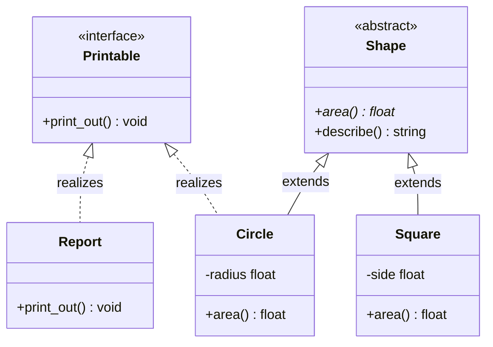
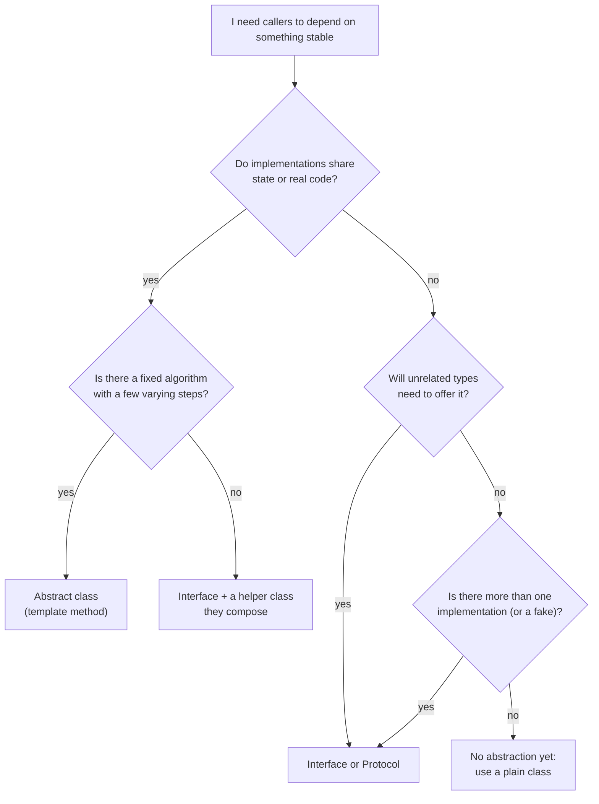
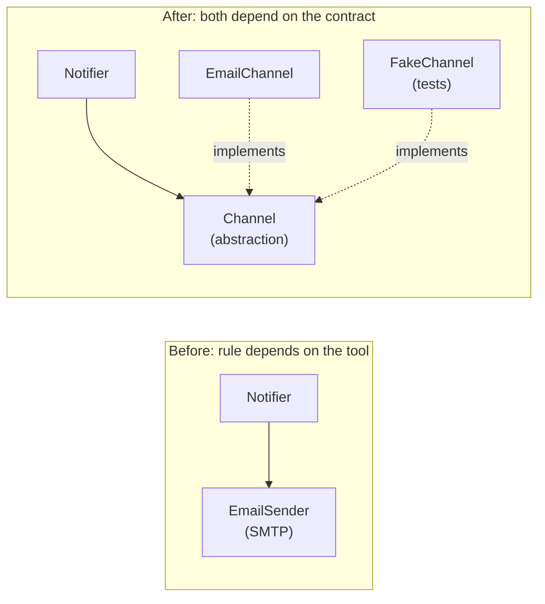
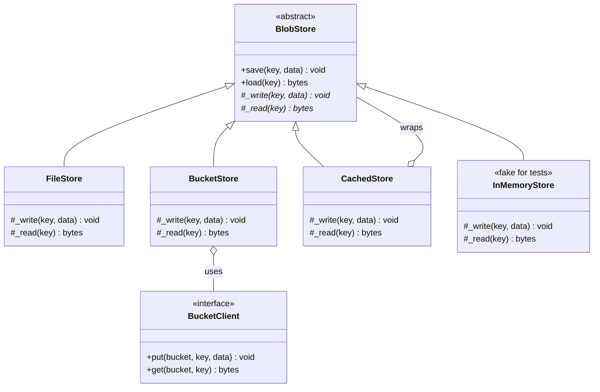

# OOP Pillar 2: Abstraction

> **Prerequisites:** [OOP Pillar 1: Encapsulation](../29-oop-pillar-1-encapsulation/README.md) and [OOP Foundations & UML Class Diagrams](../02-oop-foundations-and-uml/README.md).  
> **Reading time:** ~40 minutes (plus the exercises)  
> **Audience:** Beginner-to-intermediate learners who must explain abstraction, abstract classes, abstract methods and interfaces in an interview, and use them in real Python and C# code

> [!NOTE]
> **In one line:** Abstraction means showing a small, stable contract (*what* a thing does) and hiding the messy detail (*how* it does it), so callers stay simple and implementations can change.

> [!TIP]
> **Golden rule:** Name an abstraction by **what** it promises, not **how** it works. `Channel.send()` is a good abstraction. `SmtpChannel.open_socket_and_send()` is not. Add an abstraction when you have **two real implementations** (a fake for tests counts as one), not before.

> [!TIP]
> **Try it:** After section 5, open [LLD Studio](/tools/lld-studio/) and draw `Shape`, `Circle` and `Square` with `<<abstract>>`. Then add `Triangle` and check that the code that calls `area()` does not change.

---

## The smell: why interviewers ask this

Prompt: *"Send notifications by email today. SMS and push come next quarter. And I want to unit-test without sending anything."*

The smell in the first draft:

- `if channel == "email": ... elif channel == "sms": ...` inside the core class.
- `Notifier` builds `EmailSender()` itself, so a test sends real email.
- A method like `send(smtp_host, region, ...)` forces every caller to know one backend's details.

If you ignore it, every new backend edits core code and every test touches the network. The fix is a small contract the core depends on, with the details plugged in behind it.

---

## 1. Roadmap: what you will learn

You will go through the chapter in this order. Each step builds on the one before.

1. **Concept.** What abstraction is, and how it differs from encapsulation.
2. **Explanation.** Levels of abstraction. Abstract method, abstract class, interface, protocol.
3. **Code.** Abstract classes in Python and C#, the exact errors, template method, abstract properties.
4. **Design.** How to build a good abstraction. Leaky abstractions. Interface Segregation. Dependency inversion with a fake for tests. When *not* to abstract.
5. **Visual.** Two diagrams: a class diagram with `<<interface>>` and `<<abstract>>`, and a decision flowchart.
6. **Practice.** A full worked example, edge cases, anti-patterns, then exercises.
7. **Project.** Build a pluggable exporter.
8. **Interview.** A two-minute answer, a cheat sheet, and ten questions with model answers.

By the end you should be able to say, in your own words: *"Abstraction lets callers depend on a contract instead of an implementation, so I can swap, extend and test the implementation without touching the callers."*

---

## 2. The concept

> [!key]
> **Abstraction** is the act of exposing only the **essential** operations of something and **hiding the details** of how they are done. The caller learns *what* it can ask for. It does not learn, and does not need to learn, *how* the answer is produced.

### 2.1 The car dashboard

You drive a car with a steering wheel, two pedals and a gear stick. That is the **abstraction**. You do not touch the fuel injectors, the spark timing or the gearbox oil pump.

- A petrol car, a diesel car and an electric car have **very different** engines.
- You can drive all three after five minutes, because the **dashboard is the same**.
- A mechanic can swap the engine and you do not need to relearn driving.

Software works the same way. The dashboard is the **contract**. The engine is the **implementation**. When callers only touch the dashboard, the engine can change.

### 2.2 Abstraction in one tiny example

You call `sorted(items)` every day. You do not know if it uses merge sort, insertion sort or something else. You only know "give me a sorted list". That is abstraction. The people who maintain Python can improve the algorithm and your code keeps working.

### 2.3 Abstraction vs encapsulation

Beginners mix these up, and interviewers love to ask about it. They are **related but different**.

| | **Abstraction** | **Encapsulation** |
| :--- | :--- | :--- |
| **Question it answers** | *What* should the outside world see? | *How* do we protect the inside? |
| **Main idea** | Hide **complexity** behind a simple contract | Hide **data** and guard it with rules |
| **Works at** | Design level (what the class promises) | Implementation level (fields, access modifiers) |
| **Typical tools** | Abstract classes, interfaces, protocols, good names | `private` / `_name`, properties, validation |
| **Failure looks like** | A leaky contract that exposes the how | A public field anyone can set to garbage |
| **Example** | `PaymentMethod.pay(amount)` | `_balance` cannot go below zero |
| **Short phrase** | "Show the essentials." | "Protect the internals." |

> Encapsulation is how you **build** the wall. Abstraction is deciding what the **window** looks like. You normally need both.

---

## 3. Explanation

### 3.1 Levels of abstraction

Abstraction is not only about classes. You use it at every size.

| Level | What is hidden | What the caller sees | Example |
| :--- | :--- | :--- | :--- |
| **Function** | The steps inside | A name, inputs and an output | `calculate_tax(order)` |
| **Class** | Fields and helper methods | A few public methods | `Cart.add(item)`, `Cart.total()` |
| **Module / package** | Many classes and files | A small public API (`__init__.py`, public types) | `requests.get(url)` |
| **Service** | Databases, queues, servers | A network contract (HTTP, gRPC) | `POST /payments` |

The same rule applies at each level: **the contract should be smaller and simpler than the thing it hides**. If the contract is as complicated as the implementation, you have not abstracted anything. You have just renamed it.

### 3.2 Four tools you will meet

People say "abstract thing" loosely. Four tools exist and they are not the same.

- **Abstract method.** A method with a name and a signature but **no body** (or a placeholder body). Subclasses *must* supply one.
- **Abstract class.** A class that is **incomplete on purpose**. It cannot be instantiated. It may mix abstract methods, concrete methods and state.
- **Interface.** A **pure contract**: a list of members a type promises to offer. No constructors, no instance state.
- **Protocol (Python only).** A contract checked by **shape**. If your class has the right methods, it matches, with no inheritance.

### 3.3 Comparison table: Python and C#

| Idea | Python | C# |
| :--- | :--- | :--- |
| **Abstract method** | `@abstractmethod` inside a class that inherits `ABC` | `abstract` keyword, no body: `public abstract double Area();` |
| **Abstract class** | `class Shape(ABC):` with at least one `@abstractmethod` | `public abstract class Shape` |
| **When is "cannot instantiate" enforced?** | At **runtime**: `TypeError` when you call `Shape()` | At **compile time**: error `CS0144` |
| **Forgetting to implement a method** | `TypeError` when you create the subclass instance | Compile error `CS0534` |
| **Interface** | No keyword. Use an ABC with only abstract methods, or a `Protocol` | `interface IShape { ... }` |
| **Structural ("duck") matching** | Yes: `typing.Protocol` (checked by tools like mypy; `@runtime_checkable` allows `isinstance`) | No. A class must declare `: IShape` |
| **Multiple inheritance of contracts** | Yes (any number of bases) | Many interfaces, but **one** base class |
| **State and constructors** | ABC can have both. Protocol should not | Abstract class: yes. Interface: no instance fields, no constructor |
| **Default bodies in the contract** | Normal concrete methods on an ABC | Abstract class concrete methods, or **default interface methods** (C# 8+) |
| **Duck typing, no declaration at all** | Works. Just call the method | Not possible with static types (only `dynamic`) |

Two warnings to remember:

1. In Python, `@abstractmethod` only works if the class uses `ABC` (or `metaclass=ABCMeta`). Without it, the decorator does **nothing** and the class can be created.
2. A C# default interface method is only reachable through the interface type, not through the class variable. It is useful for evolving a library, but it does not turn an interface into an abstract class.

---

## 4. Code: the contract, side by side

### 4.1 The four tools in code

````carousel
```python
from abc import ABC, abstractmethod
from typing import Protocol, runtime_checkable


class Greeter(ABC):  # nominal: a class must inherit to count
    @abstractmethod
    def greet(self, name: str) -> str: ...


@runtime_checkable
class CanGreet(Protocol):  # structural: the right shape is enough
    def greet(self, name: str) -> str: ...


class Duck:  # no inheritance at all
    def greet(self, name):
        return f"Quack, {name}"


class Polite(Greeter):
    def greet(self, name):
        return f"Hello, {name}"


print(isinstance(Duck(), CanGreet))    # shape matches
print(isinstance(Duck(), Greeter))     # did not inherit
print(isinstance(Polite(), Greeter))
print(isinstance(Polite(), CanGreet))
```
<!-- slide -->
```csharp
using System;

public interface IGreeter
{
    string Greet(string name);

    // Default interface method (C# 8+): has a body, no fields allowed
    string Shout(string name) => Greet(name).ToUpper() + "!";
}

public class Polite : IGreeter
{
    public string Greet(string name) => $"Hello, {name}";
}

public class Program
{
    public static void Main()
    {
        IGreeter g = new Polite();
        Console.WriteLine(g.Greet("Ana"));
        Console.WriteLine(g.Shout("Ana"));
        Console.WriteLine(new Polite() is IGreeter);
    }
}
```
````

**Expected output (Python):**

```text
True
False
True
True
```

**Expected output (C#):**

```text
Hello, Ana
HELLO, ANA!
True
```

Notice the Python `Duck` has no relationship with `Greeter`, yet it matches the `Protocol`. C# has no such thing: `Polite` had to write `: IGreeter`.

### 4.2 An abstract class and the exact errors

An abstract class is a blueprint with a hole in it. You must fill the hole in a subclass before you can build anything.

````carousel
```python
import math
from abc import ABC, abstractmethod


class Shape(ABC):
    @abstractmethod
    def area(self) -> float:
        """Every shape must say how to compute its area."""

    def describe(self) -> str:  # concrete method, shared by all
        return f"{type(self).__name__} with area {self.area():.2f}"


class Circle(Shape):
    def __init__(self, radius: float) -> None:
        self.radius = radius

    def area(self) -> float:
        return math.pi * self.radius ** 2


class Square(Shape):
    def __init__(self, side: float) -> None:
        self.side = side

    def area(self) -> float:
        return self.side ** 2


class Broken(Shape):  # forgot to implement area()
    pass


for shape in [Circle(1), Square(2)]:
    print(shape.describe())

for cls in (Shape, Broken):
    try:
        cls()
    except TypeError as error:
        print("TypeError:", error)
```
<!-- slide -->
```csharp
using System;

public abstract class Shape
{
    public abstract double Area();  // no body

    public string Describe() =>      // concrete, shared by all
        $"{GetType().Name} with area {Area():F2}";
}

public class Circle : Shape
{
    private readonly double _radius;
    public Circle(double radius) { _radius = radius; }
    public override double Area() => Math.PI * _radius * _radius;
}

public class Square : Shape
{
    private readonly double _side;
    public Square(double side) { _side = side; }
    public override double Area() => _side * _side;
}

// public class Broken : Shape { }          // CS0534: does not implement 'Shape.Area()'
// var s = new Shape();                     // CS0144: Cannot create an instance of the abstract type

public class Program
{
    public static void Main()
    {
        foreach (Shape shape in new Shape[] { new Circle(1), new Square(2) })
        {
            Console.WriteLine(shape.Describe());
        }
    }
}
```
````

**Expected output (Python 3.13):**

```text
Circle with area 3.14
Square with area 4.00
TypeError: Can't instantiate abstract class Shape without an implementation for abstract method 'area'
TypeError: Can't instantiate abstract class Broken without an implementation for abstract method 'area'
```

**Expected output (C#):**

```text
Circle with area 3.14
Square with area 4.00
```

**The exact errors, in one place:**

| Situation | Python | C# |
| :--- | :--- | :--- |
| `Shape()` on an abstract class | `TypeError: Can't instantiate abstract class Shape without an implementation for abstract method 'area'` (Python 3.12+; older versions say `... with abstract method area`) | `error CS0144: Cannot create an instance of the abstract type or interface 'Shape'` |
| Subclass forgot a method | Same `TypeError`, raised when you write `Broken()` | `error CS0534: 'Broken' does not implement inherited abstract member 'Shape.Area()'` |
| Class claims an interface but misses a member | Not an error for a plain Protocol (a type checker complains). ABC: the `TypeError` above | `error CS0535: 'X' does not implement interface member 'IShape.Area()'` |

> [!NOTE]
> Python tells you at **runtime**, at the moment you create the object. C# tells you at **compile time**, before the program runs. This is a real difference in feedback speed. In Python, run a type checker (mypy or pyright) to get C#-style early warnings.

### 4.3 Abstract class with shared code: the template method

An abstract class is more than a list of holes. It can also hold the **fixed steps** and let subclasses fill in only the **varying steps**. This is the **template method** pattern. It is the main reason to choose an abstract class over an interface.

````carousel
```python
from abc import ABC, abstractmethod


class Report(ABC):
    def generate(self) -> str:  # the template: fixed order of steps
        lines = [self.title(), "-" * len(self.title())]
        lines.extend(self.body_lines())
        lines.append(f"({len(lines) - 2} rows)")
        return "\n".join(lines)

    @abstractmethod
    def title(self) -> str: ...

    @abstractmethod
    def body_lines(self) -> list[str]: ...


class SalesReport(Report):
    def __init__(self, sales: dict[str, int]) -> None:
        self.sales = sales

    def title(self) -> str:
        return "Sales"

    def body_lines(self) -> list[str]:
        return [f"{region}: {amount}" for region, amount in self.sales.items()]


print(SalesReport({"north": 120, "south": 80}).generate())
```
<!-- slide -->
```csharp
using System;
using System.Collections.Generic;

public abstract class Report
{
    public string Generate()  // the template: fixed order of steps
    {
        var lines = new List<string> { Title(), new string('-', Title().Length) };
        lines.AddRange(BodyLines());
        lines.Add($"({lines.Count - 2} rows)");
        return string.Join("\n", lines);
    }

    protected abstract string Title();
    protected abstract List<string> BodyLines();
}

public class SalesReport : Report
{
    private readonly List<(string Region, int Amount)> _sales;
    public SalesReport(List<(string Region, int Amount)> sales) { _sales = sales; }

    protected override string Title() => "Sales";

    protected override List<string> BodyLines()
    {
        var result = new List<string>();
        foreach (var (region, amount) in _sales) result.Add($"{region}: {amount}");
        return result;
    }
}

public class Program
{
    public static void Main()
    {
        var report = new SalesReport(new() { ("north", 120), ("south", 80) });
        Console.WriteLine(report.Generate());
    }
}
```
````

**Expected output (both languages):**

```text
Sales
-----
north: 120
south: 80
(2 rows)
```

The subclass never touches `generate()`. It cannot forget the title underline or the row count. The abstract class **guards the order**, and the subclass **fills the blanks**. Practise this in [Abstract Class With Shared Code](/practice/code/oop-abstract-report/).

### 4.4 Abstract properties

A contract can ask for **data**, not just actions. In Python you stack `@property` and `@abstractmethod`. In C# you declare an `abstract` property.

````carousel
```python
from abc import ABC, abstractmethod


class Vehicle(ABC):
    @property
    @abstractmethod
    def wheels(self) -> int: ...

    def describe(self) -> str:
        return f"{type(self).__name__} has {self.wheels} wheels"


class Bike(Vehicle):
    @property
    def wheels(self) -> int:
        return 2


class Trike(Vehicle):
    wheels = 3  # a plain class attribute also satisfies the contract


print(Bike().describe())
print(Trike().describe())
```
<!-- slide -->
```csharp
using System;

public abstract class Vehicle
{
    public abstract int Wheels { get; }

    public string Describe() => $"{GetType().Name} has {Wheels} wheels";
}

public class Bike : Vehicle
{
    public override int Wheels => 2;
}

public class Trike : Vehicle
{
    public override int Wheels { get; } = 3;
}

public class Program
{
    public static void Main()
    {
        Console.WriteLine(new Bike().Describe());
        Console.WriteLine(new Trike().Describe());
    }
}
```
````

**Expected output (both languages):**

```text
Bike has 2 wheels
Trike has 3 wheels
```

### 4.5 Abstract class vs a base class that raises `NotImplementedError`

Python programmers often write a "fake abstract" base: `def run(self): raise NotImplementedError`. A subclass that forgets `run()` can still be created. The error only appears when `run()` is **called**, maybe in production. With `@abstractmethod`, the same mistake fails at `B()`. C# has the same split: a `virtual` method that throws `NotImplementedException` compiles, while an `abstract` method that is not overridden gives CS0534.

| | Base with `NotImplementedError` | Real abstract method |
| :--- | :--- | :--- |
| **Error appears** | When the method is **called** (maybe in production) | When the object is **created** (Python) or the code is **built** (C#) |
| **Can you create the base itself?** | Yes, and it is useless | No |
| **Tools and IDEs** | Do not know the method is required | Mark it as required, list missing members |
| **Use it when** | A method is *optionally* overridable and the default is "not supported" (rare) | A method is **mandatory** (almost always) |

---

## 5. Visual diagrams

### 5.1 Class diagram: interface, abstract class, concrete classes



How to read it:

- `<<abstract>>` and the `*` after `area()` mean "abstract class, abstract method".
- A **solid** line with a hollow triangle (`<|--`) is **inheritance**: `Circle` is a `Shape`.
- A **dashed** line with a hollow triangle (`<|..`) is **realization**: `Report` and `Circle` promise to provide what `Printable` lists.
- `Circle` can extend one `Shape` and also realize `Printable`. That is "one identity, many capabilities". Try the drawing in [UML: Interface and Realization](/practice/code/uml-realization-printable/).

### 5.2 Flowchart: which tool do I need?



The last box is important. Not every class needs an interface in front of it.

---

## 6. Designing a good abstraction

### 6.1 Five habits

1. **Keep it small.** Fewer methods mean fewer ways to break and fewer things for implementers to write.
2. **Keep it stable.** The contract is the part that many callers depend on. Changing it costs everyone.
3. **Name by "what", not "how".** `store.save(key, data)` beats `store.write_to_disk(path, bytes)`.
4. **Talk in the caller's language.** Take and return domain values, not SMTP settings or SQL strings.
5. **Write down the promises.** Say what a method does when input is bad or the resource is missing. Implementers must all behave the same way.

### 6.2 Leaky abstractions

An abstraction **leaks** when callers must know the hidden detail to use it correctly.

````carousel
```python
from abc import ABC, abstractmethod


# LEAKY: the contract exposes how email works
class LeakyChannel(ABC):
    @abstractmethod
    def send(self, smtp_host: str, port: int, use_tls: bool, to: str, text: str): ...


# CLEAN: configuration lives inside the implementation
class Channel(ABC):
    @abstractmethod
    def send(self, to: str, text: str) -> None: ...


class EmailChannel(Channel):
    def __init__(self, smtp_host: str, port: int = 587, use_tls: bool = True) -> None:
        self.smtp_host, self.port, self.use_tls = smtp_host, port, use_tls

    def send(self, to: str, text: str) -> None:
        print(f"email via {self.smtp_host}:{self.port} to {to}: {text}")


class SmsChannel(Channel):
    def send(self, to: str, text: str) -> None:
        print(f"sms to {to}: {text}")


for channel in [EmailChannel("mail.example.com"), SmsChannel()]:
    channel.send("ana", "Your order shipped")
```
<!-- slide -->
```csharp
using System;

// LEAKY: the contract exposes how email works
public interface ILeakyChannel
{
    void Send(string smtpHost, int port, bool useTls, string to, string text);
}

// CLEAN: configuration lives inside the implementation
public interface IChannel
{
    void Send(string to, string text);
}

public class EmailChannel : IChannel
{
    private readonly string _host;
    private readonly int _port;

    public EmailChannel(string host, int port = 587) { _host = host; _port = port; }

    public void Send(string to, string text) =>
        Console.WriteLine($"email via {_host}:{_port} to {to}: {text}");
}

public class SmsChannel : IChannel
{
    public void Send(string to, string text) =>
        Console.WriteLine($"sms to {to}: {text}");
}

public class Program
{
    public static void Main()
    {
        IChannel[] channels = { new EmailChannel("mail.example.com"), new SmsChannel() };
        foreach (var channel in channels) channel.Send("ana", "Your order shipped");
    }
}
```
````

**Expected output (both languages):**

```text
email via mail.example.com:587 to ana: Your order shipped
sms to ana: Your order shipped
```

The leaky version cannot even be implemented by `SmsChannel`: SMS has no SMTP host. A contract that only fits one implementation is not an abstraction. It is that one class wearing a costume.

Other signs of a leak: methods that must be called in a secret order, exceptions that only one implementation throws, `isinstance` checks in the caller, and comments like "only works for the database version".

### 6.3 Interface Segregation: small contracts

The **Interface Segregation Principle** (the "I" in SOLID) says: **no class should be forced to depend on methods it does not use**. Prefer several small contracts over one fat contract.

````carousel
```python
from typing import Protocol


class Reader(Protocol):
    def read(self) -> str: ...


class Writer(Protocol):
    def write(self, text: str) -> None: ...


class Clock:  # can only be read
    def read(self) -> str:
        return "12:00"


class Notebook:  # can do both
    def __init__(self) -> None:
        self.text = ""

    def read(self) -> str:
        return self.text

    def write(self, text: str) -> None:
        self.text += text


def copy(source: Reader, target: Writer) -> None:
    target.write(source.read())


book = Notebook()
copy(Clock(), book)
print(book.read())
```
<!-- slide -->
```csharp
using System;

public interface IReader { string Read(); }
public interface IWriter { void Write(string text); }

public class Clock : IReader { public string Read() => "12:00"; }

public class Notebook : IReader, IWriter
{
    private string _text = "";
    public string Read() => _text;
    public void Write(string text) { _text += text; }
}

public class Program
{
    public static void Copy(IReader source, IWriter target) => target.Write(source.Read());
    public static void Main()
    {
        var book = new Notebook();
        Copy(new Clock(), book);
        Console.WriteLine(book.Read());
    }
}
```
````

**Expected output (both languages):** `12:00`

One fat `IReaderWriter` would force `Clock` to implement `Write` and throw "not supported". Small contracts keep every implementer honest.

### 6.4 Program to an interface

"Program to an interface, not an implementation" means: **declare your variables, parameters and fields with the abstract type**, and create the concrete object in only one place (often at the program start).

- Good: `def archive(store: BlobStore)` and `void Archive(IBlobStore store)`.
- Weak: `def archive(store: FileStore)`.

The first works with any store, today and tomorrow. The second welds your function to one.

---

## 7. Dependency inversion in one page

The **Dependency Inversion Principle** (the "D" in SOLID, by Robert C. Martin) has two parts:

1. High-level code should not depend on low-level code. **Both should depend on abstractions.**
2. Abstractions should not depend on details. **Details should depend on abstractions.**

"High-level" means your business rule (send a welcome message). "Low-level" means a tool (SMTP, a database, a file). Without the abstraction, your rule is chained to one tool. With it, the arrow flips: the tool plugs into a socket your rule defined.



### 7.1 Before and after, with a fake for tests

````carousel
```python
from abc import ABC, abstractmethod


# ---------- BEFORE: Notifier builds and depends on EmailSender ----------
class EmailSender:
    def send_email(self, to: str, text: str) -> None:
        print(f"SMTP -> {to}: {text}")


class NotifierBefore:
    def __init__(self) -> None:
        self.sender = EmailSender()  # hard-wired; a test would send real email

    def welcome(self, user: str) -> None:
        self.sender.send_email(user, "Welcome!")


# ---------- AFTER: Notifier depends on a Channel contract ----------
class Channel(ABC):
    @abstractmethod
    def send(self, to: str, text: str) -> None: ...


class EmailChannel(Channel):
    def send(self, to: str, text: str) -> None:
        print(f"SMTP -> {to}: {text}")


class FakeChannel(Channel):  # for tests: records, sends nothing
    def __init__(self) -> None:
        self.sent: list[tuple[str, str]] = []

    def send(self, to: str, text: str) -> None:
        self.sent.append((to, text))


class Notifier:
    def __init__(self, channel: Channel) -> None:  # injected from outside
        self.channel = channel

    def welcome(self, user: str) -> None:
        self.channel.send(user, "Welcome!")


NotifierBefore().welcome("ana@x.com")      # works, but untestable without SMTP
Notifier(EmailChannel()).welcome("bo@x.com")

fake = FakeChannel()                        # the test
Notifier(fake).welcome("cy@x.com")
assert fake.sent == [("cy@x.com", "Welcome!")]
print("test passed:", fake.sent)
```
<!-- slide -->
```csharp
using System;
using System.Collections.Generic;

// ---------- BEFORE ----------
public class EmailSender
{
    public void SendEmail(string to, string text) => Console.WriteLine($"SMTP -> {to}: {text}");
}

public class NotifierBefore
{
    private readonly EmailSender _sender = new EmailSender();   // hard-wired
    public void Welcome(string user) => _sender.SendEmail(user, "Welcome!");
}

// ---------- AFTER ----------
public interface IChannel
{
    void Send(string to, string text);
}

public class EmailChannel : IChannel
{
    public void Send(string to, string text) => Console.WriteLine($"SMTP -> {to}: {text}");
}

public class FakeChannel : IChannel   // for tests: records, sends nothing
{
    public List<(string To, string Text)> Sent { get; } = new();
    public void Send(string to, string text) => Sent.Add((to, text));
}

public class Notifier
{
    private readonly IChannel _channel;
    public Notifier(IChannel channel) { _channel = channel; }   // injected
    public void Welcome(string user) => _channel.Send(user, "Welcome!");
}

public class Program
{
    public static void Main()
    {
        new NotifierBefore().Welcome("ana@x.com");
        new Notifier(new EmailChannel()).Welcome("bo@x.com");

        var fake = new FakeChannel();
        new Notifier(fake).Welcome("cy@x.com");
        Console.WriteLine(fake.Sent.Count == 1 && fake.Sent[0] == ("cy@x.com", "Welcome!")
            ? "test passed: [(cy@x.com, Welcome!)]"
            : "test FAILED");
    }
}
```
````

**Expected output (Python):**

```text
SMTP -> ana@x.com: Welcome!
SMTP -> bo@x.com: Welcome!
test passed: [('cy@x.com', 'Welcome!')]
```

**Expected output (C#):**

```text
SMTP -> ana@x.com: Welcome!
SMTP -> bo@x.com: Welcome!
test passed: [(cy@x.com, Welcome!)]
```

What improved:

- **Testing.** The `Notifier` test needs no network, no SMTP server, no mail in someone's inbox.
- **Change.** Adding `SmsChannel` means adding one class. `Notifier` does not change.
- **Where the tool is chosen.** One place, at the edge of the program, instead of inside every class.

Dependency *inversion* is the principle. Dependency *injection* (passing the channel in through the constructor) is the technique that makes it easy. They are related, but they are not the same thing.

---

## 8. When NOT to abstract

Abstraction costs something: an extra file, an extra jump when reading, an extra name to learn. Pay that cost only when it buys something.

| Smell | What it looks like | What to do |
| :--- | :--- | :--- |
| **Premature abstraction** | `IUserService` with exactly one class `UserService`, and no tests that fake it | Delete the interface. Add it the day a second implementation or a fake is needed |
| **Speculative generality** | "We might add PayPal one day", so you build a plugin system for one provider | Build for today. Refactor when the second case arrives (it is cheap if the code is clean) |
| **Wrong abstraction** | Two classes look alike, so you force a shared base, then keep adding flags and `if` branches to it | Duplicate the code, wait for a third case, then abstract what is truly common |
| **Abstraction for its own sake** | Every class has an interface, a factory and a manager | Ask: "What breaks if I delete this layer?" If nothing, delete it |

A useful rule: **wait for the second real case**. One example tells you nothing about what varies. Two or three examples show you where the seams are. Many experienced engineers repeat this as "duplication is cheaper than the wrong abstraction".

---

## 9. Worked walkthrough: a storage abstraction

**Problem.** A reporting tool must archive reports. Today they go to disk, next month to a cloud bucket. We also want a cache layer, and tests must not touch the disk or the network.

**Design.**

- `BlobStore` is an **abstract class**. It checks the key (shared rule) and then calls two abstract steps, `_write` and `_read`. That is a template method, because every store must validate keys the same way.
- Three real implementations: `FileStore`, `BucketStore` (talks to any client with `put` and `get`) and `CachedStore` (wraps another store).
- One fake for tests: `InMemoryStore`.
- The caller, `archive_report`, only knows `BlobStore`.



````carousel
```python
import pathlib
import tempfile
from abc import ABC, abstractmethod


class BlobStore(ABC):
    def save(self, key: str, data: bytes) -> None:
        self._check_key(key)
        self._write(key, data)

    def load(self, key: str) -> bytes:
        self._check_key(key)
        return self._read(key)

    @staticmethod
    def _check_key(key: str) -> None:
        if not key or "/" in key or ".." in key:
            raise ValueError(f"bad key: {key!r}")

    @abstractmethod
    def _write(self, key: str, data: bytes) -> None: ...

    @abstractmethod
    def _read(self, key: str) -> bytes: ...


class InMemoryStore(BlobStore):  # the fake for tests
    def __init__(self) -> None:
        self.items: dict[str, bytes] = {}

    def _write(self, key: str, data: bytes) -> None:
        self.items[key] = data

    def _read(self, key: str) -> bytes:
        return self.items[key]


class FileStore(BlobStore):
    def __init__(self, folder: str) -> None:
        self.folder = pathlib.Path(folder)

    def _write(self, key: str, data: bytes) -> None:
        (self.folder / key).write_bytes(data)

    def _read(self, key: str) -> bytes:
        return (self.folder / key).read_bytes()


class FakeBucketClient:  # stands in for a real cloud SDK
    def __init__(self) -> None:
        self.objects: dict[tuple[str, str], bytes] = {}

    def put(self, bucket: str, key: str, data: bytes) -> None:
        self.objects[(bucket, key)] = data

    def get(self, bucket: str, key: str) -> bytes:
        return self.objects[(bucket, key)]


class BucketStore(BlobStore):
    def __init__(self, client, bucket: str) -> None:
        self.client, self.bucket = client, bucket

    def _write(self, key: str, data: bytes) -> None:
        self.client.put(self.bucket, key, data)

    def _read(self, key: str) -> bytes:
        return self.client.get(self.bucket, key)


class CachedStore(BlobStore):
    def __init__(self, inner: BlobStore) -> None:
        self.inner, self.cache = inner, {}

    def _write(self, key: str, data: bytes) -> None:
        self.inner.save(key, data)
        self.cache[key] = data

    def _read(self, key: str) -> bytes:
        if key not in self.cache:
            self.cache[key] = self.inner.load(key)
        return self.cache[key]


def archive_report(store: BlobStore, name: str, text: str) -> str:
    store.save(name, text.encode("utf-8"))  # knows only the contract
    return store.load(name).decode("utf-8")


with tempfile.TemporaryDirectory() as folder:
    stores = {
        "memory": InMemoryStore(),
        "file": FileStore(folder),
        "bucket": BucketStore(FakeBucketClient(), "reports"),
        "cached": CachedStore(InMemoryStore()),
    }
    for name, store in stores.items():
        print(name, "->", archive_report(store, "q1.txt", "revenue up"))

try:
    InMemoryStore().save("../secret", b"x")
except ValueError as error:
    print("ValueError:", error)
```
<!-- slide -->
```csharp
using System;
using System.Collections.Generic;
using System.IO;
using System.Text;

public abstract class BlobStore
{
    public void Save(string key, byte[] data)
    {
        CheckKey(key);
        Write(key, data);
    }

    public byte[] Load(string key)
    {
        CheckKey(key);
        return Read(key);
    }

    private static void CheckKey(string key)
    {
        if (string.IsNullOrEmpty(key) || key.Contains('/') || key.Contains(".."))
            throw new ArgumentException($"bad key: '{key}'");
    }

    protected abstract void Write(string key, byte[] data);
    protected abstract byte[] Read(string key);
}

public class InMemoryStore : BlobStore  // the fake for tests
{
    private readonly Dictionary<string, byte[]> _items = new();
    protected override void Write(string key, byte[] data) => _items[key] = data;
    protected override byte[] Read(string key) => _items[key];
}

public class FileStore : BlobStore
{
    private readonly string _folder;
    public FileStore(string folder) { _folder = folder; }
    protected override void Write(string key, byte[] data) =>
        File.WriteAllBytes(Path.Combine(_folder, key), data);
    protected override byte[] Read(string key) =>
        File.ReadAllBytes(Path.Combine(_folder, key));
}

public interface IBucketClient
{
    void Put(string bucket, string key, byte[] data);
    byte[] Get(string bucket, string key);
}

public class FakeBucketClient : IBucketClient  // stands in for a real cloud SDK
{
    private readonly Dictionary<(string, string), byte[]> _objects = new();
    public void Put(string bucket, string key, byte[] data) => _objects[(bucket, key)] = data;
    public byte[] Get(string bucket, string key) => _objects[(bucket, key)];
}

public class BucketStore : BlobStore
{
    private readonly IBucketClient _client;
    private readonly string _bucket;
    public BucketStore(IBucketClient client, string bucket) { _client = client; _bucket = bucket; }
    protected override void Write(string key, byte[] data) => _client.Put(_bucket, key, data);
    protected override byte[] Read(string key) => _client.Get(_bucket, key);
}

public class CachedStore : BlobStore
{
    private readonly BlobStore _inner;
    private readonly Dictionary<string, byte[]> _cache = new();
    public CachedStore(BlobStore inner) { _inner = inner; }

    protected override void Write(string key, byte[] data)
    {
        _inner.Save(key, data);
        _cache[key] = data;
    }

    protected override byte[] Read(string key)
    {
        if (!_cache.ContainsKey(key)) _cache[key] = _inner.Load(key);
        return _cache[key];
    }
}

public class Program
{
    public static string ArchiveReport(BlobStore store, string name, string text)
    {
        store.Save(name, Encoding.UTF8.GetBytes(text));   // knows only the contract
        return Encoding.UTF8.GetString(store.Load(name));
    }

    public static void Main()
    {
        string folder = Path.Combine(Path.GetTempPath(), "blobs-" + Guid.NewGuid());
        Directory.CreateDirectory(folder);
        try
        {
            var stores = new (string Name, BlobStore Store)[]
            {
                ("memory", new InMemoryStore()),
                ("file", new FileStore(folder)),
                ("bucket", new BucketStore(new FakeBucketClient(), "reports")),
                ("cached", new CachedStore(new InMemoryStore())),
            };
            foreach (var (name, store) in stores)
                Console.WriteLine($"{name} -> {ArchiveReport(store, "q1.txt", "revenue up")}");

            try { new InMemoryStore().Save("../secret", new byte[] { 1 }); }
            catch (ArgumentException ex) { Console.WriteLine("ArgumentException: " + ex.Message); }
        }
        finally
        {
            Directory.Delete(folder, true);
        }
    }
}
```
````

**Expected output (Python):**

```text
memory -> revenue up
file -> revenue up
bucket -> revenue up
cached -> revenue up
ValueError: bad key: '../secret'
```

**Expected output (C#):**

```text
memory -> revenue up
file -> revenue up
bucket -> revenue up
cached -> revenue up
ArgumentException: bad key: '../secret'
```

What this example shows:

- `archive_report` is **identical** for four stores. That is the whole point of abstraction.
- The key rule lives **once**, in the abstract class. A new store cannot forget it.
- Real SDK details (the bucket client) are hidden **inside** `BucketStore`. They never leak into the contract.
- `CachedStore` is both a `BlobStore` and *holds* a `BlobStore`. Abstraction makes this layering easy.
- Tests use `InMemoryStore`, so they are fast and need no disk.

**Extension point.** Interviewer says "now archive to S3." Write one new subclass that fills in `_write` and `_read`. `archive_report` does not change. If you had to edit it, the abstraction leaked. A second axis, such as compression, is another wrapper in the style of `CachedStore`, not a new branch in the base class.

---

## 10. Edge cases interviewers push on

1. **Can an abstract class have a constructor?** Yes, in both languages. You cannot call it with `new`, but subclasses call it through `super().__init__()` or `: base(...)`. It is the right place for shared validation and shared state.
2. **Can an abstract class have no abstract methods?** In C#, yes. It is still not instantiable, and it is a way to say "this is only a base". In Python, a class with `ABC` and *no* `@abstractmethod` **can** be instantiated, because there is nothing missing.
3. **Can an abstract method have a body?** In C#, no (use `virtual` for a default body). In Python, yes: the decorated function may contain code, and a subclass can call it with `super()`. It still must be overridden.
4. **Can you make an abstract method `private`?** In C#, no. An abstract member must be overridable, so it cannot be `private`. Use `protected` or `public`. In Python, privacy is by convention only, so `_write` works.
5. **Can an abstract class implement an interface without implementing all of it?** In C#, yes, if it re-declares the missing members as `abstract`. Subclasses then finish the job.
6. **Can a subclass of an abstract class also be abstract?** Yes. It may implement some methods and leave others abstract. Only the last concrete class must complete everything.
7. **What if two interfaces have a method with the same name?** C# lets you implement each explicitly (`void IA.Run()` and `void IB.Run()`). Python has no such feature, because one method name means one method.
8. **Static methods and abstract.** C# 11 allows `static abstract` members in interfaces (used by generic math). Python's `@staticmethod` can be stacked with `@abstractmethod`. Both are rare in interviews. Mention them only if asked.
9. **Interface with a default method.** In C#, the default method is only visible through the interface variable: `((IGreeter)polite).Shout("x")` works, `polite.Shout("x")` does not compile unless `Polite` declares its own `Shout`.
10. **Python `Protocol` and `isinstance`.** `isinstance(x, SomeProtocol)` only works if the protocol is decorated with `@runtime_checkable`, and it checks that the methods **exist**, not that their signatures match.

---

## 11. Anti-patterns

| Anti-pattern | Why it hurts | Better |
| :--- | :--- | :--- |
| **Interface for everything** (`IFoo` for each `Foo`) | Doubles the files and adds no flexibility | Add an interface when you have a second implementation or a fake |
| **God interface** with 20 methods | Implementers throw `NotSupported` for half of them | Split into small role interfaces (ISP) |
| **Leaky contract** (SMTP host in `send`) | Only one implementation can ever fit | Hide config inside the implementation |
| **Abstract method that most subclasses leave empty** | The contract lies about what is required | Make it a concrete no-op hook, or remove it |
| **Abstract class used only to share a helper** | Locks subclasses into one base (C#) and misuses inheritance | Put the helper in a small class and **compose** it |
| **`isinstance` checks on the abstract type** | The abstraction is not doing its job | Move the varying behaviour into the subclasses |
| **Forgetting `ABC` in Python** | `@abstractmethod` is silently ignored | Always inherit `ABC` and test that `Base()` raises `TypeError` |
| **Base class with `NotImplementedError`** | Errors show up late, in production | Use a real abstract method |
| **Deep abstract chains** (`A -> B -> C -> D`) | Nobody can tell where behaviour lives | Keep one level of abstraction, then compose |

---

## 12. The two-minute spoken answer

> "Abstraction means exposing only what a caller needs and hiding how it is done. Think of a car dashboard: the steering wheel and pedals are the same for petrol, diesel and electric engines. In code, the dashboard is a **contract**, and the engine is the **implementation**.
>
> It is different from encapsulation. Encapsulation protects the *data* inside an object with private fields and validation. Abstraction decides what the *outside* should see, using abstract classes, interfaces or protocols.
>
> An **abstract method** has a signature and no body. An **abstract class** can mix abstract methods, concrete methods, state and a constructor, but you cannot instantiate it. In Python I inherit from `ABC` and use `@abstractmethod`, and I get a `TypeError` at runtime if I try. In C# the compiler stops me with error CS0144. An **interface** is a pure contract with no state, and a class can have many. Python also has `Protocol` for structural typing.
>
> I choose an abstract class when subclasses share code or state, for example a template method. I choose an interface when unrelated types need to offer the same capability, or when I want to inject a dependency and fake it in tests. That is dependency inversion: my business logic depends on a small `Channel` contract, not on `EmailSender`.
>
> I keep contracts small, name them by what they do, and I do not add one until I have two real cases, because a wrong abstraction is more expensive than a little duplication."

---

## 13. Cheat sheet

```text
ABSTRACTION  = expose the essential contract, hide the how
vs ENCAPSULATION = protect the data inside (private + validation)

Abstract method : signature, no body (C#) / @abstractmethod (Python)
Abstract class  : can hold state, constructor, concrete + abstract methods; cannot be instantiated
Interface       : pure contract; many allowed; no instance state (C# 8+: default methods)
Protocol (Py)   : structural contract, no inheritance needed

Python  : class X(ABC) + @abstractmethod  -> TypeError at runtime when you create it
C#      : abstract class / interface      -> CS0144 (new abstract), CS0534 (missing override)

Choose  : shared code/state or template method -> abstract class
          capability across unrelated types, DI, fakes -> interface / Protocol
Design  : small, stable, named by "what", no leaks, wait for 2 real cases
SOLID   : I = small interfaces,  D = depend on the contract, inject the tool
Smells  : interface for everything, god interface, leaky signature, NotImplementedError base
```

---

## 14. Practice

Try each one before you open the answer. Then do the hands-on problems:

- [Abstract Payment Methods](/practice/code/oop-abstract-payment/): write an abstract `PaymentMethod` and three subclasses.
- [Abstract Class With Shared Code](/practice/code/oop-abstract-report/): write the template method from section 4.3.
- [UML: Interface and Realization](/practice/code/uml-realization-printable/): draw and code a realization.
- [Shipping Strategies](/practice/code/lld-shipping-strategies/): swap behaviour behind one contract.
- Interview sets: [Inheritance, Abstraction and Polymorphism](/practice/interview/oop-inheritance-and-polymorphism/) and [OOP four pillars questions](/practice/interview/oop-four-pillars/).

### Exercise 1: Abstraction or encapsulation?

For each sentence, say which pillar it mainly describes.

1. "A `Wallet` refuses to let `_balance` go below zero."
2. "Callers use `Logger.log(msg)` and never learn whether it writes to a file or the cloud."
3. "The `radius` field is private and only changes through `resize()`."
4. "Our code works with any class that has a `save()` method."

<details>
<summary>Answer</summary>

1. **Encapsulation** (guarding data with a rule).
2. **Abstraction** (a contract that hides the how).
3. **Encapsulation** (hiding a field, controlling change).
4. **Abstraction** (depending on a capability, like a `Protocol`).

</details>

### Exercise 2: What does this print?

```python
from abc import ABC, abstractmethod

class Tool(ABC):
    @abstractmethod
    def use(self): ...

class Hammer(Tool):
    def use(self):
        return "bang"

class Saw(Tool):
    pass

print(Hammer().use())
print(Saw().use())
```

<details>
<summary>Answer</summary>

It prints `bang`, then crashes on the next line with `TypeError: Can't instantiate abstract class Saw without an implementation for abstract method 'use'` (older Pythons: `... with abstract method use`). The error happens at `Saw()`, before `.use()` is called.

</details>

### Exercise 3: The silent decorator

This class is meant to be abstract. What is wrong, and what is the fix?

```python
from abc import abstractmethod

class Animal:
    @abstractmethod
    def speak(self): ...

print(Animal())
```

<details>
<summary>Answer</summary>

`Animal` does not inherit from `ABC`, so `@abstractmethod` is ignored and `Animal()` works (it prints an object). Fix: `class Animal(ABC):`. After that, `Animal()` raises `TypeError`.

</details>

### Exercise 4: Abstract class or interface?

Pick one for each case and say why.

1. Many unrelated types (`Invoice`, `Customer`, `Product`) must be exportable to JSON.
2. Three report types share a fixed layout (title, rows, footer) but differ in the rows.
3. You want to replace the real payment gateway with a fake in tests.

<details>
<summary>Answer</summary>

1. **Interface** (`IExportable`). The types share no identity, only a capability.
2. **Abstract class** with a template method. The fixed layout is shared code.
3. **Interface** (`PaymentGateway`). It is a dependency boundary you inject and fake.

</details>

### Exercise 5: Spot the leak

What is wrong with this contract? Rewrite it.

```python
class Storage(ABC):
    @abstractmethod
    def save(self, bucket_name: str, aws_region: str, key: str, data: bytes): ...
```

<details>
<summary>Answer</summary>

`bucket_name` and `aws_region` are details of one implementation (a cloud bucket). A `FileStore` has neither. Rewrite as `def save(self, key: str, data: bytes) -> None` and pass the bucket and region to the constructor of `BucketStore`.

</details>

### Exercise 6: Should this be abstract?

A teammate writes `IEmailValidator` and `EmailValidator`. There is one class, no tests that fake it, and no other validator planned. What do you say in code review?

<details>
<summary>Answer</summary>

Remove the interface for now. It is premature abstraction: one implementation and no fake. Callers can use `EmailValidator` directly. Introduce the interface the day a second validator or a test double is truly needed. The refactor is small.

</details>

---

## 15. Mini project: a pluggable exporter

**Goal.** Build a small program that exports a list of records in different formats, using abstraction so that new formats can be added without changing the caller.

**Requirements.**

1. Records are plain dictionaries, for example `{"name": "Ana", "score": 90}`.
2. Create an abstract class `Exporter` with:
   - a concrete method `export(records) -> str` that checks the input is not empty, calls the abstract steps below in order, and joins the result (template method);
   - abstract `header(records) -> str`, abstract `row(record) -> str`;
   - an abstract property `extension` (`"csv"`, `"json"`, `"md"`).
3. Implement `CsvExporter`, `MarkdownTableExporter` and `JsonLinesExporter`.
4. Write `save_report(exporter: Exporter, store: BlobStore, name, records)` that writes `name + "." + exporter.extension` through the `BlobStore` from section 9.
5. Write a `FakeExporter` and prove with a test that `save_report` works with it and an `InMemoryStore`.
6. Add a fourth format by adding **one new class only**. If you had to edit `save_report`, your abstraction leaked. Find the leak.

**Stretch.**

- Add a `Protocol` called `Sink` with one method `write(text)` and let `save_report` accept anything that matches, including `sys.stdout`.
- Draw the class diagram in [LLD Studio](/tools/lld-studio/) with `<<abstract>>` and `<<interface>>` stereotypes.
- Write a short note: which parts are template method, which are dependency inversion, and which parts you chose not to abstract, and why.

**Done when.** Adding a format touches one new class, the tests use only fakes, and `Exporter()` raises `TypeError` (Python) or fails to compile (C#).

---

## 16. Interview questions and model answers

<details>
<summary><strong>1. What is abstraction, and how is it different from encapsulation? [BASIC]</strong></summary>

Abstraction shows the essential contract and hides the complexity behind it. Encapsulation protects the internal data with access control and validation. Abstraction is about what the outside **sees** (a small, stable set of operations). Encapsulation is about what the outside **cannot touch** (private state). Car example: pedals and steering wheel are the abstraction. The sealed engine bay is the encapsulation.

</details>

<details>
<summary><strong>2. Abstract class or interface? And what is an abstract method? [BASIC]</strong></summary>

An **abstract method** is one operation with a signature and no body. An **abstract class** is incomplete on purpose and cannot be instantiated. It may mix abstract methods with concrete methods, state and a constructor. An **interface** is a pure contract: what a type **can do**, no instance state, and a class can implement many. Use an abstract class when implementations share code or state (template method). Use an interface for a capability across unrelated types or at a dependency boundary. C# allows one base class only. In Python the closest to an interface is a `Protocol` or an ABC with only abstract methods.

</details>

<details>
<summary><strong>3. Can you instantiate an abstract class? Can it have a constructor? [TRICKY]</strong></summary>

No to the first. C# rejects `new Shape()` with CS0144. Python raises `TypeError: Can't instantiate abstract class ...` when the class uses `ABC` and a method is still unimplemented. The same applies to a subclass that skipped one. You can hold a variable of the abstract type that refers to a concrete object: `Shape s = new Circle(1);`. Yes to the second: subclasses call it through `super().__init__(...)` or `: base(...)`, and it is the right place for shared validation. Follow-up: never call an abstract or virtual method from it, because the subclass is not built yet. One more trap: in Python, without `ABC` the `@abstractmethod` decorator is silently ignored.

</details>

<details>
<summary><strong>4. Does Python have interfaces? [BASIC]</strong></summary>

Not as a keyword, but it has three ways to get the same effect. **Duck typing**: call the method and trust the object. **ABCs** (`abc.ABC` plus `@abstractmethod`): nominal, you must inherit, and Python enforces the contract at instantiation. **`typing.Protocol`**: structural, a type checker verifies the methods without inheritance. With `@runtime_checkable`, `isinstance` works too, but it only checks that the methods exist.

</details>

<details>
<summary><strong>5. A teammate's `Storage.save(bucket_name, aws_region, key, data)` feels wrong. What is it, and how do you fix it? [SCENARIO]</strong></summary>

It is a **leaky abstraction**: callers must know a detail of one implementation, and a `FileStore` has no bucket or region. Other signs: `connect()` must be called first, or code does `isinstance(store, FileStore)`. Fix: make the contract speak the caller's language (`save(key, data)`) and push bucket and region into the constructor of `BucketStore`.

</details>

<details>
<summary><strong>6. How does abstraction help testing? [SCENARIO]</strong></summary>

If `Notifier` depends on a `Channel` contract and receives it through its constructor, a test passes a `FakeChannel` that records messages. The test is fast, with no network and no flakiness. If `Notifier` created `EmailSender` itself, you could not test it without side effects. This is Dependency Inversion: high-level code and low-level code both depend on an abstraction.

</details>

<details>
<summary><strong>7. A teammate adds `IEmailValidator` with one implementation and no fake. What do you say in review? [SCENARIO]</strong></summary>

Remove it for now. That is premature abstraction: one implementation, no test double, no realistic second case. It adds files and indirection with no flexibility. Introduce the interface the day a second validator or a fake is truly needed. A wrong abstraction is harder to fix than a little duplication.

</details>

<details>
<summary><strong>8. What is the template method pattern and why does it use an abstract class? [TRICKY]</strong></summary>

A base class defines a fixed algorithm in a concrete method (`generate()`) and leaves some steps abstract (`title()`, `body_lines()`). The order is guaranteed because subclasses do not control it. An abstract class fits because it can hold the algorithm, shared state and the abstract steps in one place. An interface cannot hold shared state, and a default method is a poor home for a real algorithm.

</details>

---

## 17. Further reading

- [Python docs: `abc` - Abstract Base Classes](https://docs.python.org/3/library/abc.html)
- [Python docs: `typing.Protocol`](https://docs.python.org/3/library/typing.html#typing.Protocol)
- [PEP 544: Protocols, structural subtyping (static duck typing)](https://peps.python.org/pep-0544/)
- [Microsoft Learn: Abstract and sealed classes and class members (C#)](https://learn.microsoft.com/en-us/dotnet/csharp/programming-guide/classes-and-structs/abstract-and-sealed-classes-and-class-members)
- [Microsoft Learn: Interfaces, define behavior for multiple types (C#)](https://learn.microsoft.com/en-us/dotnet/csharp/fundamentals/types/interfaces)
- [Dependency Inversion Principle (Robert C. Martin's SOLID principle)](https://en.wikipedia.org/wiki/Dependency_inversion_principle)
- [Refactoring Guru: Template Method](https://refactoring.guru/design-patterns/template-method)
- [Joel Spolsky: The Law of Leaky Abstractions](https://www.joelonsoftware.com/2002/11/11/the-law-of-leaky-abstractions/)

---

Previous: [OOP Pillar 1: Encapsulation](../29-oop-pillar-1-encapsulation/README.md) · Next: [OOP Pillar 3: Inheritance](../31-oop-pillar-3-inheritance/README.md)
