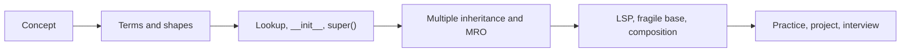
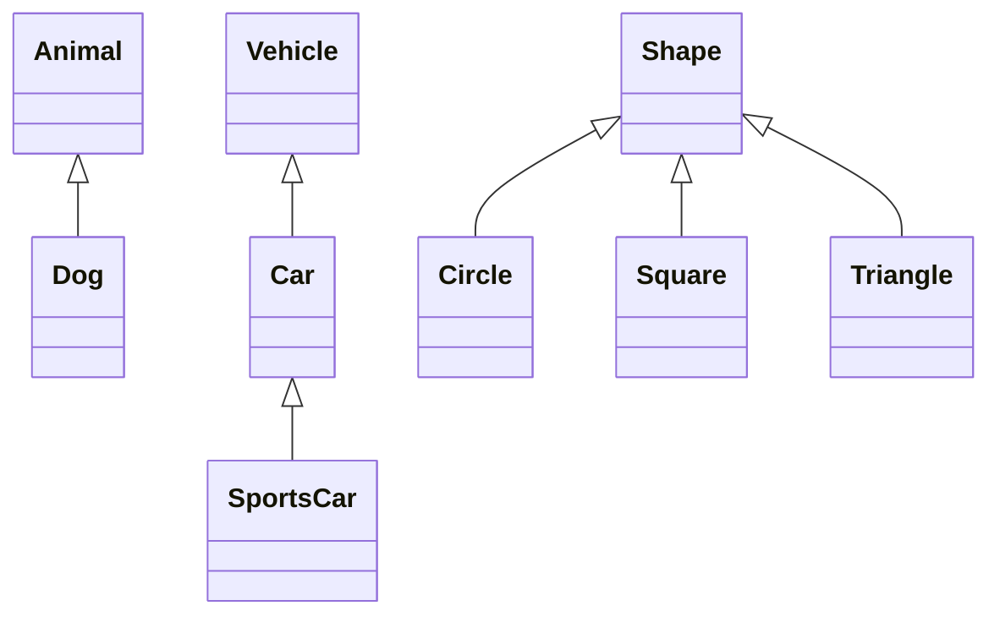
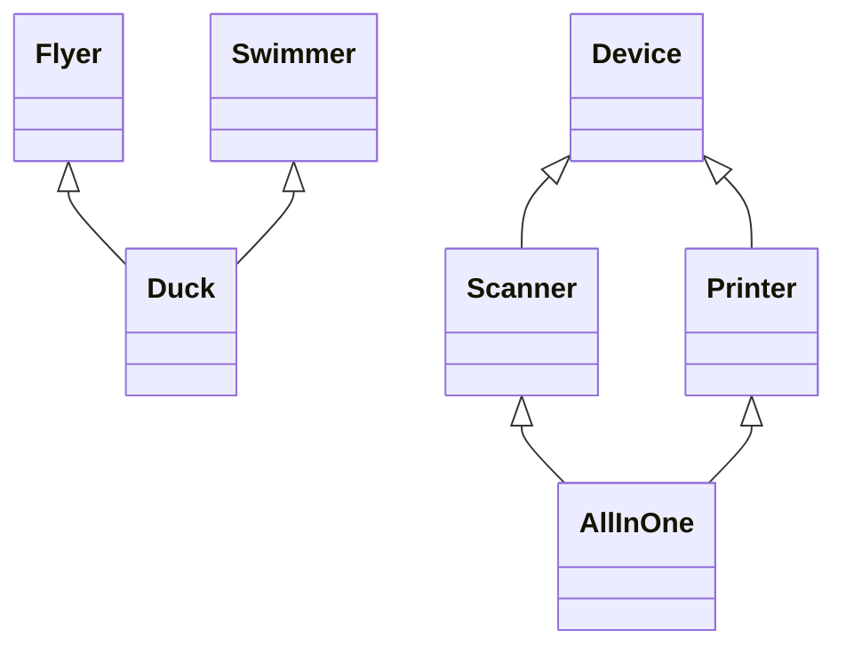
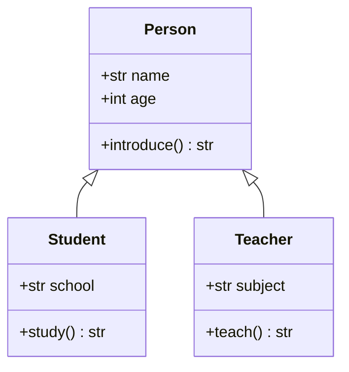
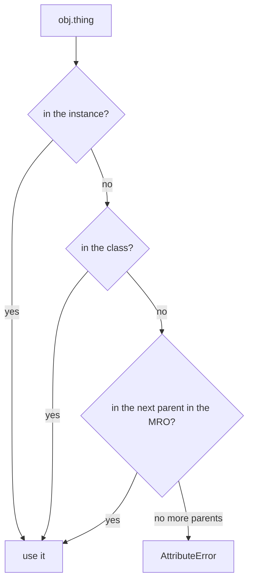
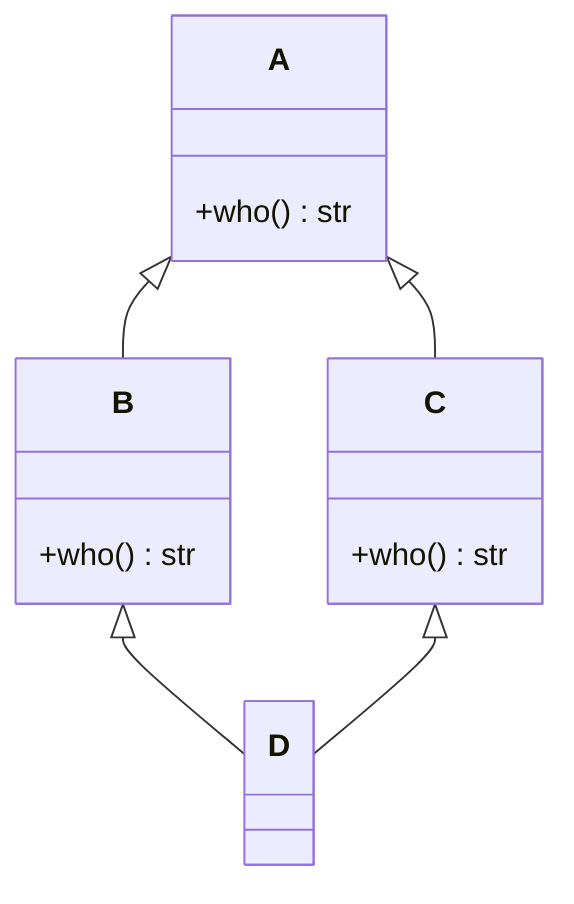
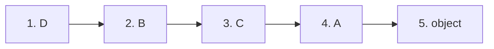
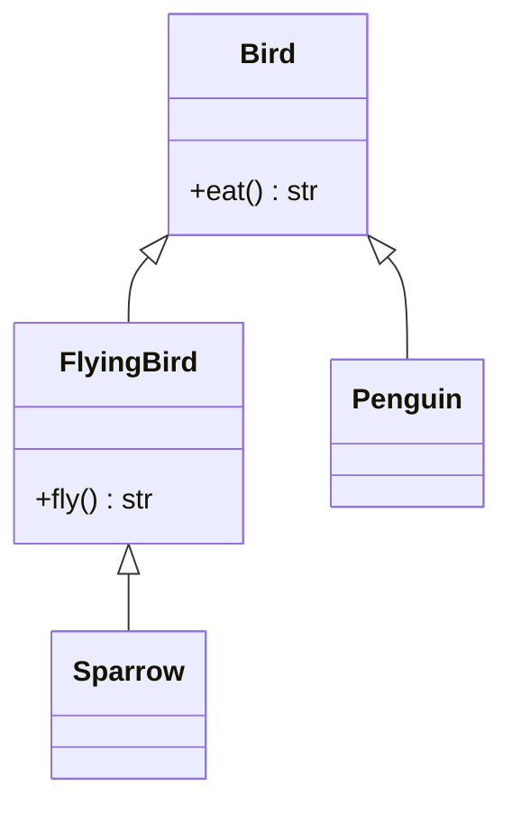
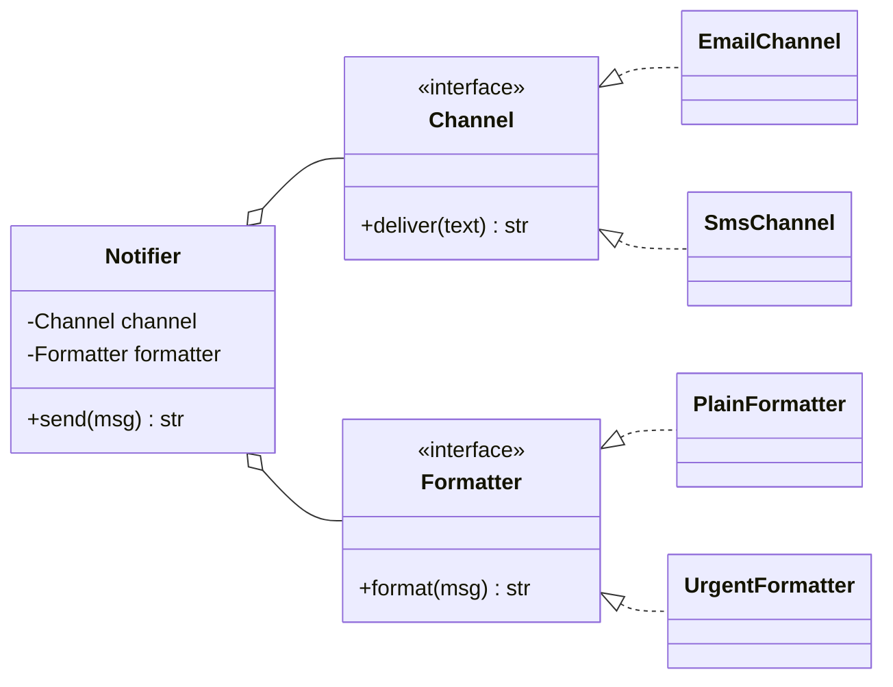
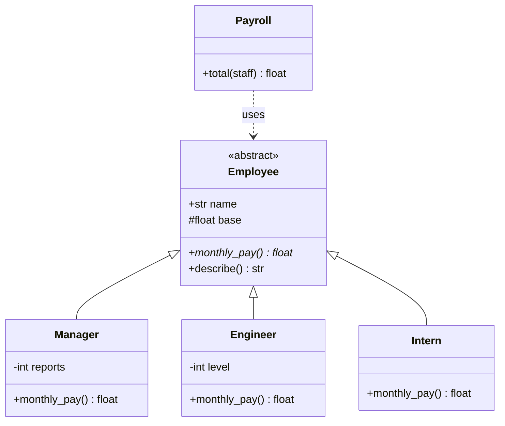

# OOP Pillar 3: Inheritance

> **Prerequisites:** [OOP Pillar 2: Abstraction](../30-oop-pillar-2-abstraction/README.md) and [OOP Foundations & UML](../02-oop-foundations-and-uml/README.md).  
> **Reading time:** ~35 minutes  
> **Audience:** Beginners and early-career engineers who must explain and use inheritance, `super()`, overriding and multiple inheritance, and who also need to know when to avoid it.

> [!NOTE]
> **In one line:** Inheritance lets a **child class** reuse the attributes and methods of a **parent class** and be used wherever the parent is expected. It is powerful, it is easy to overuse, and the skill is knowing the difference.

> [!TIP]
> **Golden rule:** Inherit only for a true **is-a** relationship where the child keeps *every promise* the parent made. If you only want to reuse code, or the child must refuse some parent behaviour, **compose** instead (hold the other object as a field).

> [!TIP]
> **Try it:** Solve [Person, Student and Teacher](/practice/code/oop-person-student-teacher/) first. It takes five minutes and makes the rest of this chapter concrete.

---

## The smell: when inheritance comes up

Two opposite prompts trigger this chapter:

- *"Model `Employee`, `Manager`, `Engineer`, `Intern`."* The smell is sibling classes with copy-pasted fields and the same constructor checks. A shared parent fixes it.
- *"Why is `class Stack(list)` a bad idea?"* The smell is a child that inherits methods it must not offer (`insert(0, x)`), throws `NotImplementedError`, or overrides something to do nothing.

If you ignore the first, rules get copied and drift. If you ignore the second, code written for the parent breaks on the child (Liskov), and a parent edit silently breaks children (fragile base class). Rule of thumb: **is-a and keeps every promise, inherit; otherwise compose.**

---

## 1. Roadmap

Here is the path through this chapter. Each step builds on the one before it.

1. **Concept:** what inheritance is, and why it exists (reuse and subtyping).
2. **Vocabulary and shapes:** parent and child, and the five shapes of a hierarchy.
3. **Mechanics:** how Python finds an attribute, how constructors chain, what `super()` really does.
4. **Multiple inheritance:** the diamond problem, C3 linearisation worked by hand, mixins, and how C# does it differently.
5. **Design:** abstract bases, the Liskov Substitution Principle, the fragile base class, and composition over inheritance.
6. **Practice:** a worked walkthrough, exercises, a mini project and interview questions.



---

## 2. The concept

> [!key]
> **Inheritance** is a relationship where a new class (the **child**) is defined in terms of an existing class (the **parent**). The child gets the parent's attributes and methods for free, may add new ones, and may **override** old ones. Because a child *is a* parent, you can pass a child anywhere a parent is expected. That second part is called **subtyping**, and it matters more than the code reuse.

Inheritance gives you two different things. Keep them apart in your head.

| Benefit | Plain meaning | Example |
| :--- | :--- | :--- |
| **Code reuse** | Write `name` and `greet()` once in `Person`. `Student` gets them. | No copy and paste. |
| **Subtyping** | A `Student` can be used wherever a `Person` is expected. | `def welcome(p: Person)` accepts a `Student`. |

Code reuse is the weaker reason. You can get reuse with composition. Subtyping is the strong reason, because it lets one function work with many kinds of objects. That is the bridge to the next pillar, polymorphism.

### The is-a test

Say the sentence out loud: "A Student **is a** Person." True. "A Car **is an** Engine." False, a Car **has an** Engine. If the sentence sounds wrong, you want composition.

But a true sentence is not enough. "A Square is a Rectangle" is true in maths and still gives bad code. We will see why in the Liskov section.

---

## 3. Terms and the five shapes

Parent, base class and superclass mean the same thing. So do child, derived class and subclass. To **override** is to replace a parent method; to **extend** is to add something new.

### The five shapes

**1. Single inheritance.** One child, one parent.

**2. Multilevel.** A chain: grandparent, parent, child.

**3. Hierarchical.** One parent, many children.

**4. Multiple.** One child, several parents. Python allows it. C# does not for classes (it allows several interfaces).

**5. Hybrid.** A mix of the shapes above, often with a diamond inside.





The arrow with a hollow triangle points from the child **to the parent**. Read it as "is a".

````carousel
```python
class Animal:                       # 1. single
    def eat(self): return "eating"
class Dog(Animal):
    def bark(self): return "woof"

class Vehicle: pass                 # 2. multilevel
class Car(Vehicle): pass
class SportsCar(Car): pass

class Shape: pass                   # 3. hierarchical
class Circle(Shape): pass
class Square(Shape): pass

class Flyer:                        # 4. multiple
    def fly(self): return "flying"
class Swimmer:
    def swim(self): return "swimming"
class Duck(Flyer, Swimmer): pass

class Device: pass                  # 5. hybrid (a diamond, see section 9)
class Scanner(Device): pass
class Printer(Device): pass
class AllInOne(Scanner, Printer): pass

print(Dog().eat(), Duck().swim())   # eating swimming
print([c.__name__ for c in SportsCar.__mro__])
# ['SportsCar', 'Car', 'Vehicle', 'object']
```

<!-- slide -->

```csharp
public class Animal { public string Eat() => "eating"; }      // 1. single
public class Dog : Animal { public string Bark() => "woof"; }

public class Vehicle { }                                       // 2. multilevel
public class Car : Vehicle { }
public class SportsCar : Car { }

public class Shape { }                                         // 3. hierarchical
public class Circle : Shape { }

public interface IFlyer { string Fly(); }                      // 4. "multiple":
public interface ISwimmer { string Swim(); }                   // interfaces only
public class Duck : IFlyer, ISwimmer
{
    public string Fly() => "flying";
    public string Swim() => "swimming";
}
```
````

---

## 4. The simplest example: Person, Student, Teacher

Both a student and a teacher have a name and an age, and both can introduce themselves. Instead of writing that twice, put it in `Person`.



````carousel
```python
class Person:
    def __init__(self, name, age):
        self.name = name
        self.age = age

    def introduce(self):
        return f"Hi, I am {self.name}, {self.age} years old."


class Student(Person):
    def __init__(self, name, age, school):
        super().__init__(name, age)   # let Person set name and age
        self.school = school

    def study(self):
        return f"{self.name} studies at {self.school}."


class Teacher(Person):
    def __init__(self, name, age, subject):
        super().__init__(name, age)
        self.subject = subject

    def teach(self):
        return f"{self.name} teaches {self.subject}."


s = Student("Asha", 16, "Green High")
t = Teacher("Mr Rao", 40, "Maths")
print(s.introduce())   # Hi, I am Asha, 16 years old.
print(s.study())       # Asha studies at Green High.
print(t.introduce())   # Hi, I am Mr Rao, 40 years old.
print(t.teach())       # Mr Rao teaches Maths.
```

<!-- slide -->

```csharp
public class Person
{
    public string Name { get; }
    public int Age { get; }

    public Person(string name, int age)
    {
        Name = name;
        Age = age;
    }

    public string Introduce() => $"Hi, I am {Name}, {Age} years old.";
}

public class Student : Person
{
    public string School { get; }

    public Student(string name, int age, string school)
        : base(name, age)            // call the parent constructor
    {
        School = school;
    }

    public string Study() => $"{Name} studies at {School}.";
}

public class Teacher : Person
{
    public string Subject { get; }

    public Teacher(string name, int age, string subject)
        : base(name, age)
    {
        Subject = subject;
    }

    public string Teach() => $"{Name} teaches {Subject}.";
}
```
````

`Student` has `introduce()` even though it never wrote it. That is inheritance doing its first job.

---

## 5. How lookup works

When you write `obj.thing`, Python searches in a fixed order and stops at the first hit:

1. The **instance** itself (`obj.__dict__`).
2. The object's **class**.
3. The class's **parents**, in the order of the **MRO** (Method Resolution Order, section 9).

If nothing is found you get `AttributeError`.



```python
class Base:
    colour = "grey"              # class attribute
    def hello(self):
        return "hello from Base"

class Child(Base):
    def hello(self):             # found in Child first
        return "hello from Child"

c = Child()
print(c.colour)    # grey  (found on Base)
c.colour = "red"   # creates an INSTANCE attribute only
print(Child.colour, Base.colour)  # grey grey  (class untouched)
print(c.hello(), "|", Base.hello(c))  # hello from Child | hello from Base
```

In C# the child's version runs through a parent variable only if the parent method is `virtual` and the child method is `override`.

Two things beginners miss. Assigning `c.colour = "red"` never changes the parent. And C# only calls the child's version through a parent variable if the method is `virtual` in the parent and `override` in the child.

---

## 6. Constructors and `super().__init__`

An object must be built from the top down. The parent part has to exist before the child part is added. If the child defines `__init__` and does not call the parent's, the parent part is never set up.

````carousel
```python
class Animal:
    def __init__(self, name):
        print("Animal init")
        self.name = name

class Dog(Animal):
    def __init__(self, name, breed):
        print("Dog init starts")
        super().__init__(name)      # forget this and self.name is missing
        self.breed = breed
        print("Dog init ends")

class Broken(Animal):
    def __init__(self):
        pass                         # parent never called

d = Dog("Rex", "lab")
# Animal init  (printed between the two Dog lines)
print(d.name, d.breed)   # Rex lab

b = Broken()
try:
    print(b.name)
except AttributeError as e:
    print("AttributeError:", e)
```

<!-- slide -->

```csharp
public class Animal
{
    public string Name { get; }
    public Animal(string name)
    {
        Console.WriteLine("Animal ctor");
        Name = name;
    }
}

public class Dog : Animal
{
    public string Breed { get; }

    // : base(name) runs the parent constructor FIRST,
    // then the body of this constructor.
    public Dog(string name, string breed) : base(name)
    {
        Breed = breed;
        Console.WriteLine("Dog ctor");
    }
}
// Order: Animal ctor, then Dog ctor.
// If the parent has no parameterless constructor, you MUST write : base(...).
```
````

**Constructor order in C#:** field initialisers of the child, then the parent constructor, then the child constructor body. **In Python** you decide the order by where you put `super().__init__()`. Usually call it first.

A common trap: a parent constructor that calls an overridable method. The child's override runs before the child's own fields exist. Avoid calling overridable methods from constructors, in both languages.

---

## 7. Overriding, extending, and `super()`

There are two ways to change a parent method.

- **Replace:** write a new body and ignore the parent's.
- **Extend:** call `super().method()` and add to the result.

````carousel
```python
class Employee:
    def __init__(self, name, salary):
        self.name = name
        self.salary = salary

    def pay(self):
        return self.salary

    def describe(self):
        return f"{self.name} earns {self.pay()}"


class Manager(Employee):
    def __init__(self, name, salary, bonus):
        super().__init__(name, salary)
        self._bonus = bonus          # leading _ means "internal, hands off"

    def pay(self):                   # EXTEND: reuse parent, add to it
        return super().pay() + self._bonus

    # describe() is NOT overridden, but it calls self.pay(),
    # so it picks up the Manager version automatically.


m = Manager("Ira", 1000, 250)
print(m.describe())   # Ira earns 1250
```

<!-- slide -->

```csharp
public class Employee
{
    public string Name { get; }
    protected decimal Salary { get; }          // visible to children

    public Employee(string name, decimal salary)
    {
        Name = name;
        Salary = salary;
    }

    public virtual decimal Pay() => Salary;
    public string Describe() => $"{Name} earns {Pay()}";
}

public class Manager : Employee
{
    private readonly decimal _bonus;

    public Manager(string name, decimal salary, decimal bonus)
        : base(name, salary)
    {
        _bonus = bonus;
    }

    public override decimal Pay() => base.Pay() + _bonus;   // extend
}
```
````

### Protected by convention

C# has `protected`: visible inside the class and its children. Python has no enforcement, only conventions:

| Python | Meaning |
| :--- | :--- |
| `name` | public |
| `_name` | "protected": for this class and its children, please do not touch from outside |
| `__name` | name-mangled to `_ClassName__name` so a child cannot clash by accident |

Prefer `_name`. Double underscore is for rare cases and surprises people.

### How `super()` really works

`super()` does **not** mean "my parent". It means "the **next class after me** in the MRO of the object's real type". For single inheritance these are the same thing. For multiple inheritance they are not, and that difference is what makes mixins work (section 10).

---

## 8. `isinstance`, `issubclass`, `object` and `__mro__`

````carousel
```python
class Person: pass
class Student(Person): pass

s = Student()
print(isinstance(s, Student))      # True
print(isinstance(s, Person))       # True   (a Student IS a Person)
print(type(s) is Person)           # False  (exact type check)
print(issubclass(Student, Person)) # True
print(issubclass(Person, Student)) # False
print(isinstance(s, object))       # True   (everything is)
print(Student.__mro__)
# (<class '__main__.Student'>, <class '__main__.Person'>, <class 'object'>)
print(Student.__bases__)           # (<class '__main__.Person'>,)
```

<!-- slide -->

```csharp
public class Person { }
public class Student : Person { }

var s = new Student();
bool a = s is Student;            // true
bool b = s is Person;             // true
bool c = s.GetType() == typeof(Person);        // false (exact type)
bool d = typeof(Person).IsAssignableFrom(typeof(Student)); // true
bool e = s is object;             // true
Person p = s;                     // upcast, always safe
// Student again = (Student)p;    // downcast, can throw InvalidCastException
```
````

Every class in Python 3 inherits from `object`, and every type in C# derives from `System.Object`. That is where `__str__`, `__eq__` and `__repr__` (Python) and `ToString()`, `Equals()` and `GetHashCode()` (C#) come from.

Prefer `isinstance` to `type(x) is ...` because it respects subclasses. And if you find yourself writing long `isinstance` ladders, that is a sign polymorphism is missing (next pillar).

---

## 9. Multiple inheritance and the diamond problem

Python lets a class have several parents. The danger appears when two parents share a grandparent: the **diamond**.



If `D` calls `who()`, which one runs: `B`'s, `C`'s or `A`'s? And if `B` and `C` both call `super().who()`, does `A` run once or twice? Languages that copy parents naively run `A` twice. Python solves it with the **MRO**, a single flat list of every ancestor with no repeats.

### C3 linearisation, by hand

Python builds the MRO with the **C3** algorithm. The rule:

`L[X] = X + merge(L[parent1], L[parent2], ..., [parent1, parent2, ...])`

`merge` repeatedly takes the first head that does **not** appear in the tail (the rest) of any list, adds it to the result, and removes it everywhere.

For `class D(B, C)` with `B(A)` and `C(A)`:

1. `L[object] = [object]`
2. `L[A] = [A, object]`
3. `L[B] = [B, A, object]` and `L[C] = [C, A, object]`
4. `L[D] = [D] + merge([B, A, object], [C, A, object], [B, C])`

Now merge:

| Step | Candidate (head of first list) | In some tail? | Action | Result so far |
| :--- | :--- | :--- | :--- | :--- |
| 1 | `B` | no | take `B` | `D, B` |
| 2 | `A` (first list now `[A, object]`) | yes, in tail of `[C, A, object]` | skip, try next list head `C` | |
| 2 | `C` | no | take `C` | `D, B, C` |
| 3 | `A` | no (tails are `[object]`) | take `A` | `D, B, C, A` |
| 4 | `object` | no | take `object` | `D, B, C, A, object` |

So the MRO is **D, B, C, A, object**. Two guarantees: a child always comes before its parents, and the order you wrote the parents in, `(B, C)`, is respected. If no such order exists, Python raises `TypeError` at class definition time.



````carousel
```python
class A:
    def who(self):
        return ["A"]

class B(A):
    def who(self):
        return ["B"] + super().who()

class C(A):
    def who(self):
        return ["C"] + super().who()

class D(B, C):
    def who(self):
        return ["D"] + super().who()

print(D().who())                          # ['D', 'B', 'C', 'A']
print([k.__name__ for k in D.__mro__])    # ['D', 'B', 'C', 'A', 'object']

# B's super() is C when the object is a D. That is cooperation.
print(B().who())                          # ['B', 'A']  (plain B: no C)

# An impossible order is rejected
try:
    class Bad(A, B):   # A before B, but B is a child of A
        pass
except TypeError as e:
    print("TypeError:", str(e)[:44])
```

<!-- slide -->

```csharp
// C# classes: ONE base class only. This does not compile:
// public class D : B, C { }   // error CS1721

// Interfaces CAN form a diamond. Default methods that clash
// must be resolved by the class.
public interface IA { string Who() => "A"; }
public interface IB : IA { string IA.Who() => "B"; }
public interface IC : IA { string IA.Who() => "C"; }

public class D : IB, IC
{
    // IB and IC both override IA.Who, so D must say which wins.
    string IA.Who() => "D";
}
```
````

> [!NOTE]
> C# avoids the diamond by design: one base class means one chain. You get the "many abilities" benefit from interfaces, and you resolve clashes yourself.

---

## 10. Mixins and cooperative `super()`

A **mixin** is a small class that adds one ability and is not meant to stand alone. You list it first, before the main parent. The trick that makes mixins combine safely is that **every class calls `super()`** and passes along what it does not understand.

````carousel
```python
import json

class JsonMixin:
    def to_json(self):
        return json.dumps(self.__dict__, sort_keys=True)

class LogMixin:
    def __init__(self, *args, **kwargs):
        self.log = []                       # own state, then pass the rest on
        super().__init__(*args, **kwargs)

    def note(self, text):
        self.log.append(text)

class Person:
    def __init__(self, name):
        self.name = name

class Customer(JsonMixin, LogMixin, Person):
    pass

c = Customer("Asha")
c.note("created")
print(c.to_json())   # {"log": ["created"], "name": "Asha"}
print([k.__name__ for k in Customer.__mro__])
# ['Customer', 'JsonMixin', 'LogMixin', 'Person', 'object']
```

<!-- slide -->

```csharp
// C# has no class mixins. Use interfaces plus composition,
// or default interface methods for small shared behaviour.
public interface IJsonable
{
    string ToJson() => System.Text.Json.JsonSerializer.Serialize(this, GetType());
}
public class Person { public string Name { get; set; } = ""; }
public class Customer : Person, IJsonable { }
// C# has no class mixins: use interfaces with default methods, or hold a helper.
```
````

Mixin rules of thumb:

- One job per mixin. No domain identity.
- Put mixins **before** the real base in the parent list.
- Always call `super().__init__(*args, **kwargs)` in mixin constructors.
- If a mixin needs something from the host (`self.name`), say so in a docstring.

---

## 11. C#: single inheritance, interfaces, `sealed`

C# gives you a clean split.

| Need | Tool |
| :--- | :--- |
| Share code and state along one chain | one base class |
| Promise an ability | any number of interfaces |
| Stop anyone inheriting or overriding | `sealed` |
| Force children to fill a gap | `abstract` |

````carousel
```python
# Python has no final keyword. Options:
from typing import final   # a hint for type checkers only

@final
class Money:
    pass

class Cheat(Money):        # runs fine; only mypy / pyright complain
    pass

# A runtime block, if you really need one:
class Locked:
    def __init_subclass__(cls, **kwargs):
        raise TypeError("Locked cannot be subclassed")

try:
    class Child(Locked):
        pass
except TypeError as e:
    print(e)     # Locked cannot be subclassed
```

<!-- slide -->

```csharp
public sealed class Money { }       // nobody may inherit from Money

public class Mid : Base
{
    public sealed override string Name() => "mid";   // no further overrides
}
```
````

Why seal? Every class you leave open is a promise that someone may inherit from it, and that you will not break them. Sealing by default is a sensible habit. Python trusts you: there is no final, so document your intent instead.

---

## 12. Abstract base class plus concrete children

An **abstract** class is incomplete on purpose. It declares what every child must provide and may share the rest. You cannot create an instance of it.

````carousel
```python
from abc import ABC, abstractmethod
import math

class Shape(ABC):
    @abstractmethod
    def area(self) -> float: ...

    def describe(self):                      # shared code uses the hole
        return f"{type(self).__name__} with area {self.area():.2f}"

class Circle(Shape):
    def __init__(self, r):
        self.r = r
    def area(self):
        return math.pi * self.r ** 2

class Rect(Shape):
    def __init__(self, w, h):
        self.w, self.h = w, h
    def area(self):
        return self.w * self.h

class Lazy(Shape):
    pass                                     # forgot area()

print(Circle(1).describe())   # Circle with area 3.14
print(Rect(2, 3).describe())  # Rect with area 6.00
try:
    Shape()
except TypeError as e:
    print("TypeError:", e)
try:
    Lazy()
except TypeError as e:
    print("TypeError:", e)
```

<!-- slide -->

```csharp
public abstract class Shape
{
    public abstract double Area();                 // no body
    public string Describe() => $"{GetType().Name} with area {Area():F2}";
}

public class Circle : Shape
{
    private readonly double _r;
    public Circle(double r) => _r = r;
    public override double Area() => Math.PI * _r * _r;
}

public class Rect : Shape
{
    private readonly double _w, _h;
    public Rect(double w, double h) { _w = w; _h = h; }
    public override double Area() => _w * _h;
}
// new Shape();   // compile error: cannot create an instance of abstract class
```
````

The abstract base is the safe, common form of inheritance. The shared `describe()` is a small **template method**: the parent fixes the steps and the children fill in one of them.

---

## 13. The Liskov Substitution Principle (LSP)

> If `S` is a subtype of `T`, you should be able to use an `S` anywhere a `T` is expected **without the program breaking**.

In plain words: a child must keep every promise the parent made. It may do **more**, never **less**, and it must not surprise callers.

### Example 1: Rectangle and Square

A Rectangle promises: "set the width and the height independently".

````carousel
```python
class Rectangle:
    def __init__(self, w, h):
        self.w, self.h = w, h
    def set_width(self, w):
        self.w = w
    def set_height(self, h):
        self.h = h
    def area(self):
        return self.w * self.h

class Square(Rectangle):             # "is a" in maths, wrong in code
    def __init__(self, side):
        super().__init__(side, side)
    def set_width(self, w):
        self.w = self.h = w          # keeps it square, breaks the promise
    def set_height(self, h):
        self.w = self.h = h

def stretch(r: Rectangle):
    r.set_width(5)
    r.set_height(2)
    return r.area()                  # a Rectangle user expects 10

print(stretch(Rectangle(1, 1)))   # 10
print(stretch(Square(1)))         # 4  <-- LSP violated
```

<!-- slide -->

```csharp
public class Rectangle
{
    public virtual double Width { get; set; }
    public virtual double Height { get; set; }
    public double Area() => Width * Height;
}

public class Square : Rectangle
{
    public override double Width
    {
        get => base.Width;
        set { base.Width = value; base.Height = value; }   // surprise!
    }
    public override double Height
    {
        get => base.Height;
        set { base.Width = value; base.Height = value; }
    }
}

static double Stretch(Rectangle r)
{
    r.Width = 5;
    r.Height = 2;
    return r.Area();      // Rectangle: 10, Square: 4
}
```
````

**Fix:** make them siblings under a read-only `Shape` with `area()`, or make both immutable so `Square(3)` and `Rectangle(3, 3)` have no setters to violate.

### Example 2: Bird and Penguin



If `Bird` has `fly()`, then `Penguin.fly()` must raise or do nothing. Both break callers who trust `Bird`. The fix is not a better exception. The fix is to move `fly()` down into `FlyingBird`, so a `Penguin` is simply not asked to fly.

**LSP smell checklist:** a child throws `NotImplementedError` or `NotSupportedException`; a child overrides a method to do nothing; a child tightens a precondition ("only positive numbers now"); a child weakens a result ("may return None now"); callers need `isinstance` to special-case it.

---

## 14. The fragile base class problem

A child depends on **how** the parent works, not just what it promises. When the parent changes an internal detail, children break, even though the parent's public interface is unchanged.

````carousel
```python
class Basket:
    def __init__(self):
        self.items = []
    def add(self, x):
        self.items.append(x)
    def add_all(self, xs):
        for x in xs:
            self.add(x)          # internal detail: calls self.add

class CountingBasket(Basket):
    def __init__(self):
        super().__init__()
        self.count = 0
    def add(self, x):
        self.count += 1
        super().add(x)
    def add_all(self, xs):
        self.count += len(xs)    # child assumes add_all does not call add
        super().add_all(xs)

b = CountingBasket()
b.add_all([1, 2, 3])
print(len(b.items), b.count)     # 3 6  <-- counted twice
```

<!-- slide -->

```csharp
public class Basket
{
    protected readonly List<int> Items = new();
    public virtual void Add(int x) => Items.Add(x);
    public virtual void AddAll(IEnumerable<int> xs) { foreach (var x in xs) Add(x); }
}

public class CountingBasket : Basket
{
    public int Count { get; private set; }
    public override void Add(int x) { Count++; base.Add(x); }
    public override void AddAll(IEnumerable<int> xs)
    {
        var list = xs.ToList();
        Count += list.Count;      // counted again inside Add
        base.AddAll(list);
    }
}
```
````

The child was correct against yesterday's parent and wrong against today's. Defences: document which methods call which ("self-use"), keep hierarchies shallow, seal or `@final` what you cannot promise to keep stable, and prefer composition (next section), which only touches the public API.

---

## 15. Composition over inheritance

**Composition** means an object holds another object and forwards work to it. You change behaviour by swapping the held object, not by writing another subclass.

### Before: a deep tree that multiplies

`Notifier` has `EmailNotifier` and `SmsNotifier`, which have `UrgentEmailNotifier` and `UrgentSmsNotifier`, and then `HtmlUrgentEmailNotifier`. Two axes, *channel* and *style*, make a class for every combination. Add push and you add three more.

### After: strategy by composition



````carousel
```python
class EmailChannel:
    def deliver(self, text):
        return f"EMAIL: {text}"

class SmsChannel:
    def deliver(self, text):
        return f"SMS: {text}"

class PlainFormatter:
    def format(self, msg):
        return msg

class UrgentFormatter:
    def format(self, msg):
        return f"URGENT! {msg}"

class Notifier:
    def __init__(self, channel, formatter):
        self._channel = channel
        self._formatter = formatter

    def send(self, msg):
        return self._channel.deliver(self._formatter.format(msg))

print(Notifier(EmailChannel(), PlainFormatter()).send("hi"))
# EMAIL: hi
print(Notifier(SmsChannel(), UrgentFormatter()).send("server down"))
# SMS: URGENT! server down
# Two channels x two formatters = 4 behaviours from 4 small classes.
```

<!-- slide -->

```csharp
public interface IChannel { string Deliver(string text); }
public interface IFormatter { string Format(string msg); }

public class EmailChannel : IChannel
{
    public string Deliver(string text) => $"EMAIL: {text}";
}
public class SmsChannel : IChannel
{
    public string Deliver(string text) => $"SMS: {text}";
}
public class PlainFormatter : IFormatter
{
    public string Format(string msg) => msg;
}
public class UrgentFormatter : IFormatter
{
    public string Format(string msg) => $"URGENT! {msg}";
}

public class Notifier
{
    private readonly IChannel _channel;
    private readonly IFormatter _formatter;

    public Notifier(IChannel channel, IFormatter formatter)
    {
        _channel = channel;
        _formatter = formatter;
    }

    public string Send(string msg) => _channel.Deliver(_formatter.Format(msg));
}
```
````

Adding push now means one new class. Nothing existing changes, and tests can pass in fakes. That is why the Gang of Four wrote "favour object composition over class inheritance".

### When inheritance IS the right tool

- **A framework asks for it.** Django `models.Model`, `unittest.TestCase`, ASP.NET `Controller`, `Exception`. The base class is designed to be extended.
- **A true, stable is-a with shared state.** `Employee` and `Manager` in one company model.
- **The exception hierarchy.** `class InsufficientFunds(PaymentError)` lets callers catch the specific error or the general family.
- **Template method.** A parent fixes the algorithm skeleton and children fill in steps.

```python
class AppError(Exception): ...
class PaymentError(AppError): ...
class InsufficientFunds(PaymentError): ...

try:
    raise InsufficientFunds("balance is 3")
except PaymentError as e:           # catches the whole family
    print(type(e).__name__, e)      # InsufficientFunds balance is 3
```

---

## 16. Full worked walkthrough: employees and payroll

Requirement: three kinds of employee. Everyone has a name and base salary. A manager gets a bonus per report. An engineer gets a level multiplier. An intern has a fixed stipend. A `Payroll` totals everything and does not care which kind it holds.



````carousel
```python
from abc import ABC, abstractmethod

class Employee(ABC):
    def __init__(self, name, base):
        if base < 0:
            raise ValueError("base must not be negative")
        self.name = name
        self._base = base

    @abstractmethod
    def monthly_pay(self):
        ...

    def describe(self):
        return f"{self.name}: {self.monthly_pay():.2f}"


class Manager(Employee):
    def __init__(self, name, base, reports):
        super().__init__(name, base)
        self._reports = reports
    def monthly_pay(self):
        return self._base + 100 * self._reports


class Engineer(Employee):
    def __init__(self, name, base, level):
        super().__init__(name, base)
        self._level = level
    def monthly_pay(self):
        return self._base * (1 + 0.1 * self._level)


class Intern(Employee):
    def monthly_pay(self):
        return 500.0


class Payroll:
    def total(self, staff):
        return sum(e.monthly_pay() for e in staff)


# ---- tests ----
staff = [Manager("Ira", 3000, 4), Engineer("Kai", 2000, 3), Intern("Zed", 0)]
assert Payroll().total(staff) == 6500          # 3400 + 2600 + 500
assert staff[0].describe() == "Ira: 3400.00"
try:
    Employee("x", 1)
    raise SystemExit("abstract class was instantiated")
except TypeError:
    pass
print("all payroll tests passed")
```

<!-- slide -->

```csharp
public abstract class Employee
{
    public string Name { get; }
    protected decimal Base { get; }
    protected Employee(string name, decimal baseSalary)
    {
        if (baseSalary < 0) throw new ArgumentOutOfRangeException(nameof(baseSalary));
        Name = name; Base = baseSalary;
    }
    public abstract decimal MonthlyPay();
    public string Describe() => $"{Name}: {MonthlyPay():F2}";
}

public sealed class Manager(string name, decimal b, int reports) : Employee(name, b)
{
    public override decimal MonthlyPay() => Base + 100 * reports;
}

public sealed class Engineer(string name, decimal b, int level) : Employee(name, b)
{
    public override decimal MonthlyPay() => Base * (1 + 0.1m * level);
}

public sealed class Intern(string name, decimal b) : Employee(name, b)
{
    public override decimal MonthlyPay() => 500m;
}

public class Payroll
{
    public decimal Total(IEnumerable<Employee> staff) => staff.Sum(e => e.MonthlyPay());
}
```
````

What to notice:

- `Payroll.total` never mentions a concrete kind. Add `Contractor` and it still works. That is subtyping paying off.
- `Employee` is abstract, so you cannot build a half-defined employee.
- Validation lives once, in the base constructor, and every child inherits it by calling `super().__init__`.
- Every child can stand in for `Employee`, so LSP holds: nobody throws "not supported".

**Extension point.** Interviewer says "add a `Contractor`." One new subclass that overrides `monthly_pay`; `Payroll` is untouched. If the contractor is paid hourly and needs a different constructor shape, stop. Inheritance is now straining, so compose a pay rule object instead (section 15).

---

## 17. Edge cases interviewers push on

- **Does Python call the parent `__init__` automatically?** No. If the child defines `__init__`, you must call `super().__init__()` yourself. If the child defines none, the parent's is used.
- **Is `super()` the parent?** No, it is the next class in the MRO. Under multiple inheritance it can be a sibling.
- **`virtual` forgotten in C#.** Defining the same method in the child *hides* it (`new`). Calls through a parent variable run the parent method. Always add `virtual` and `override` on purpose.
- **Calling an overridable method in a constructor.** The child override can run before the child's fields exist.
- **Diamond and `__init__` arguments.** Under cooperative `super()` every class must accept `*args, **kwargs` and pass them on, or the chain breaks.
- **`isinstance` versus `type()`.** `type(x) == Parent` is False for a child. Usually you want `isinstance`.

---

## 18. Anti-patterns

| Anti-pattern | Why it hurts | Better |
| :--- | :--- | :--- |
| **Inheritance for reuse only** (`Stack(list)`) | Stack now exposes `insert`, `sort`, and every list method. | Hold a list inside. |
| **Deep trees** (5+ levels) | You must read every level to know what a call does. | Keep to 2 or 3, or compose. |
| **Child that disables parent behaviour** | Violates LSP. | Move the method down, or compose. |
| **Type-checking ladders** (`if isinstance(x, A) ... elif isinstance(x, B)`) | Polymorphism is missing; every new child edits the ladder. | Put the behaviour on the class. |
| **Multiple inheritance of stateful classes** | Initialisation order and MRO surprises. | One real parent plus small stateless mixins. |

---

## 19. The two-minute spoken answer

> "Inheritance lets a child class build on a parent class: it gets the parent's attributes and methods, adds its own, and overrides what it needs. It gives code reuse and subtyping, so a child can be used wherever the parent is expected.
>
> In Python a lookup goes instance, class, then the parents in MRO order. I call `super().__init__()` so the parent half is built first. `super()` means 'the next class in the MRO', which is what makes mixins and the diamond work; C3 linearisation gives one flat order with children before parents. C# allows one base class plus interfaces, so it avoids the diamond by design.
>
> I inherit only for a true is-a where the child keeps every promise of the parent (Liskov). A Square that breaks Rectangle's setters or a Penguin that throws in `fly()` is a violation. Inheritance also couples children to the parent's internals, the fragile base class problem, so I keep trees shallow and prefer composition for has-a and for several axes of variation. I still use inheritance for framework bases, exception hierarchies and abstract bases with a template method."

---

## 20. Cheat sheet

| Topic | Python | C# |
| :--- | :--- | :--- |
| Declare | `class B(A):` | `class B : A` |
| Parent constructor | `super().__init__(...)` | `: base(...)` |
| Call parent method | `super().m()` | `base.M()` |
| Allow override | automatic | `virtual` / `abstract` |
| Override | redefine | `override` |
| Forbid override or inherit | `@final` hint only | `sealed` |
| Multiple parents | yes, MRO by C3 | classes no, interfaces yes |
| Abstract | `ABC` + `@abstractmethod` | `abstract` |
| Type check | `isinstance`, `issubclass` | `is`, `as`, `IsAssignableFrom` |
| Order of resolution | `Class.__mro__` | single chain |
| Protected | `_name` by convention | `protected` |
| Root class | `object` | `System.Object` |

**Five habits:** keep trees shallow; call the parent constructor; override with the same contract; make bases abstract; reach for composition when in doubt.

---

## 21. Practice exercises

Try each one before opening the answer. Then run it as code in the practice pages listed after the exercises.

**Exercise 1.** `Animal` has `speak()` returning `"..."`. Write `Dog` and `Cat` that override it, and a function `chorus(animals)` that returns all their sounds.

<details>
<summary>Answer</summary>

```python
class Animal:
    def speak(self):
        return "..."

class Dog(Animal):
    def speak(self):
        return "woof"

class Cat(Animal):
    def speak(self):
        return "meow"

def chorus(animals):
    return [a.speak() for a in animals]

print(chorus([Dog(), Cat(), Animal()]))   # ['woof', 'meow', '...']
```

`chorus` works for any `Animal`, including ones written later.
</details>

**Exercise 2.** `Vehicle(wheels)` stores `wheels`. `Car` is a vehicle with 4 wheels and a `doors` count; `Bike` has 2 wheels. Use `super().__init__`.

<details>
<summary>Answer</summary>

```python
class Vehicle:
    def __init__(self, wheels):
        self.wheels = wheels

class Car(Vehicle):
    def __init__(self, doors):
        super().__init__(4)
        self.doors = doors

class Bike(Vehicle):
    def __init__(self):
        super().__init__(2)

print(Car(4).wheels, Bike().wheels)   # 4 2
```
</details>

**Exercise 3.** Without running it, what is the MRO of `class X(A, B)` where `A(Base)` and `B(Base)`? Then check it.

<details>
<summary>Answer</summary>

`X, A, B, Base, object`. `merge([A, Base, object], [B, Base, object], [A, B])`: take `A`; `Base` is in the tail of the second list, so take `B`; then `Base`, then `object`.

```python
class Base: pass
class A(Base): pass
class B(Base): pass
class X(A, B): pass
print([k.__name__ for k in X.__mro__])   # ['X', 'A', 'B', 'Base', 'object']
```
</details>

**Exercise 4.** This code prints twice the right count. Find the bug and fix it without touching `Basket`.

```python
class Basket:
    def __init__(self): self.items = []
    def add(self, x): self.items.append(x)
    def add_all(self, xs):
        for x in xs: self.add(x)

class Counting(Basket):
    count = 0
    def add(self, x):
        self.count += 1
        super().add(x)
    def add_all(self, xs):
        self.count += len(xs)
        super().add_all(xs)
```

<details>
<summary>Answer</summary>

`super().add_all` calls `self.add`, which is the child's `add`, which counts again. Remove the extra count from `add_all` (let it just call `super().add_all`), or better, wrap a `Basket` instead of inheriting.

```python
class Counting(Basket):
    def __init__(self):
        super().__init__()
        self.count = 0
    def add(self, x):
        self.count += 1
        super().add(x)
    # no add_all override needed: the parent calls our add()

c = Counting()
c.add_all([1, 2, 3])
print(c.count)   # 3
```
</details>

**Exercise 5.** Make a `LoudMixin` that upper-cases the result of `speak()` of whatever class it is mixed into.

<details>
<summary>Answer</summary>

```python
class Dog:
    def speak(self):
        return "woof"

class LoudMixin:
    def speak(self):
        return super().speak().upper()

class LoudDog(LoudMixin, Dog):
    pass

print(LoudDog().speak())   # WOOF
```

The mixin comes first, so its `speak` runs first and `super()` reaches `Dog`.
</details>

### Practice problems on the site

Solve these in the browser. They run real tests.

- [Person, Student and Teacher](/practice/code/oop-person-student-teacher/)
- [Vehicle, Car and Bike](/practice/code/oop-vehicle-super/)
- [Multilevel Inheritance](/practice/code/oop-multilevel-inheritance/)
- [Multiple Inheritance and MRO](/practice/code/oop-multiple-inheritance-mro/)
- [Employees and Payroll](/practice/code/oop-employee-payroll/)
- [UML: Inheritance](/practice/code/uml-inheritance-vehicles/)

---

## 22. Mini project: a plugin-style report generator

Build a small system that uses inheritance where it fits and composition where it does not.

**Requirements**

1. An abstract `Report` with `title`, an abstract `body()` method, and a concrete `render()` that returns the title, a line of dashes, then the body (a template method).
2. Three children: `SalesReport`, `InventoryReport`, `AuditReport`, each with its own `body()`.
3. A mixin `TimestampMixin` that adds `generated_at` to the rendered output. Use a fixed clock in tests (inject a function, do not call the real time).
4. An `Exporter` held **by composition**: `TextExporter` and `JsonExporter`, so adding a format never adds a report subclass.
5. A test that renders every report with every exporter (3 x 2 = 6 combinations), and a test that `Report("x")` cannot be created.

**Stretch:** an `AppError` hierarchy (`ReportError`, `ExportError`) and a test that catches the family.

**Design check:** draw the class diagram. If any arrow means has-a but is drawn as inheritance, fix it.

---

## 23. Interview questions

<details>
<summary><strong>1. What is inheritance and why use it? [BASIC]</strong></summary>

It is a relationship where a child class reuses and extends a parent class. It gives code reuse and subtyping (a child can be used wherever the parent is expected). Subtyping is the more important benefit because it lets one piece of code work with many kinds of objects.
</details>

<details>
<summary><strong>2. What is the difference between overriding and extending? [BASIC]</strong></summary>

Overriding replaces the parent method. Extending overrides it but also calls `super().method()` (or `base.Method()` in C#) so the parent's behaviour still runs and the child adds to it.
</details>

<details>
<summary><strong>3. What does `super()` do in Python? [BASIC]</strong></summary>

It returns a proxy to the next class in the object's MRO after the current class. In single inheritance that is the parent. In multiple inheritance it may be a sibling, which is what lets mixins cooperate.
</details>

<details>
<summary><strong>4. Explain the diamond problem and how Python and C# handle it. [TRICKY]</strong></summary>

It is when `D` inherits from `B` and `C`, which both inherit from `A`, so a call could reach `A` along two paths, with possible double initialisation or an unclear winner. Python builds one flat, repeat-free MRO using C3 linearisation (children before parents, declared order kept), so each class appears once. C# avoids it by allowing one base class only; interfaces may form a diamond and clashing default methods must be resolved explicitly.
</details>

<details>
<summary><strong>5. Compute the MRO of <code>class D(B, C)</code>, with B and C both children of A. [TRICKY]</strong></summary>

`L[D] = D + merge([B, A, object], [C, A, object], [B, C])`. Take `B`. `A` is blocked (in the tail of the second list), so take `C`. Then `A`, then `object`. Result: `D, B, C, A, object`.
</details>

<details>
<summary><strong>6. State the Liskov Substitution Principle with an example. [BASIC]</strong></summary>

Objects of a subtype must be usable wherever the supertype is expected without breaking correctness. A `Square` that makes `set_width` also change the height breaks code written for `Rectangle` that sets width and height independently. A `Penguin` whose `fly()` throws breaks code that trusts `Bird`.
</details>

<details>
<summary><strong>7. What is the fragile base class problem? [TRICKY]</strong></summary>

A change inside a parent that keeps its public interface can still break children, because they depend on the parent's internal calls (for example `add_all` calling `add`). It happens because inheritance exposes the parent's implementation to the child. Shallow trees, documented self-use, sealing and composition reduce it.
</details>

<details>
<summary><strong>8. Why prefer composition over inheritance? When is inheritance still right? [SCENARIO]</strong></summary>

Composition couples only to a public interface, can be swapped at run time, is easy to test with fakes, and avoids class explosions when there are several axes of variation. Inheritance is right for a true stable is-a, framework base classes, exception hierarchies, and abstract bases with a template method.
</details>

Practise out loud with the interview sets [Inheritance, Abstraction and Polymorphism](/practice/interview/oop-inheritance-and-polymorphism/) and [OOP four pillars questions](/practice/interview/oop-four-pillars/).

---

## 24. Further reading

- [Python docs: `super()`](https://docs.python.org/3/library/functions.html#super), the built-in reference, including the note on multiple inheritance.
- [The Python 2.3 Method Resolution Order](https://docs.python.org/3/howto/mro.html), the official essay explaining C3 linearisation with worked examples.
- [Python tutorial: Inheritance](https://docs.python.org/3/tutorial/classes.html#inheritance) and [Multiple Inheritance](https://docs.python.org/3/tutorial/classes.html#multiple-inheritance).
- [Python docs: `abc`, Abstract Base Classes](https://docs.python.org/3/library/abc.html).
- [Raymond Hettinger: Python's super() considered super!](https://rhettinger.wordpress.com/2011/05/26/super-considered-super/), a practical guide to cooperative inheritance.
- [Microsoft Learn: Inheritance in C#](https://learn.microsoft.com/en-us/dotnet/csharp/fundamentals/object-oriented/inheritance), the official C# guide.
- [Microsoft Learn: `sealed` modifier](https://learn.microsoft.com/en-us/dotnet/csharp/language-reference/keywords/sealed) and [`base` keyword](https://learn.microsoft.com/en-us/dotnet/csharp/language-reference/keywords/base).
- [Wikipedia: Liskov substitution principle](https://en.wikipedia.org/wiki/Liskov_substitution_principle) and [Fragile base class](https://en.wikipedia.org/wiki/Fragile_base_class).

---

## Next

Inheritance lets many classes share a contract. The next pillar shows what that buys you: one call, many behaviours.

**Next:** [OOP Pillar 4: Polymorphism](../32-oop-pillar-4-polymorphism/README.md)
