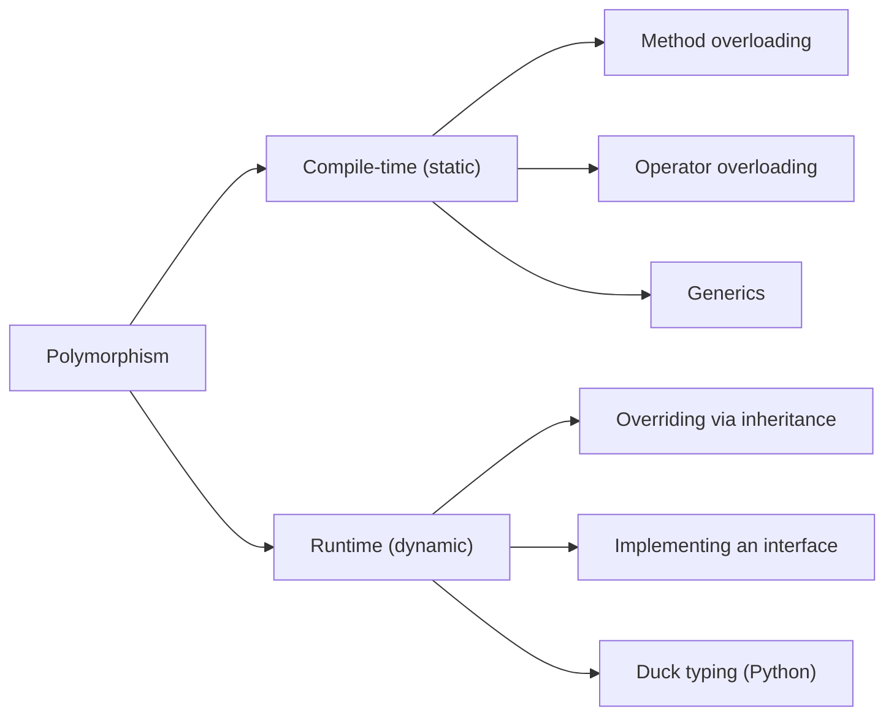
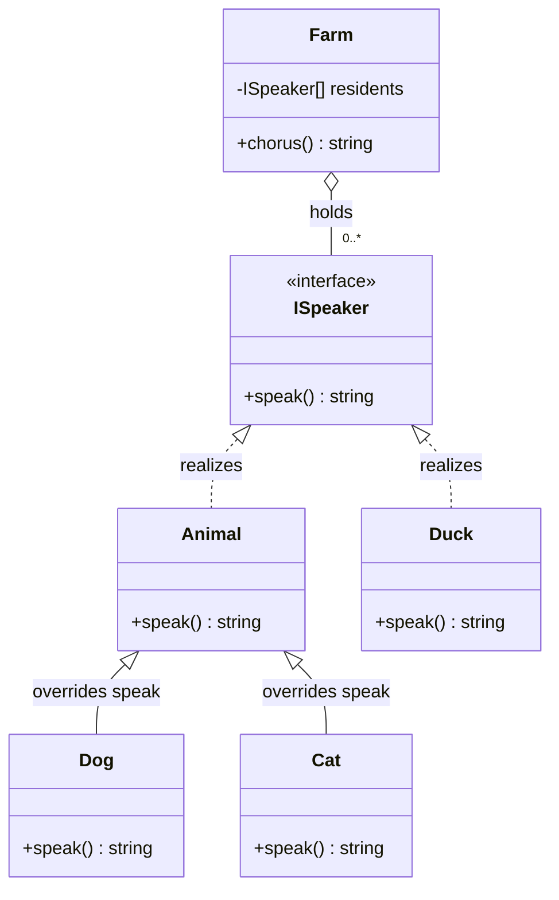
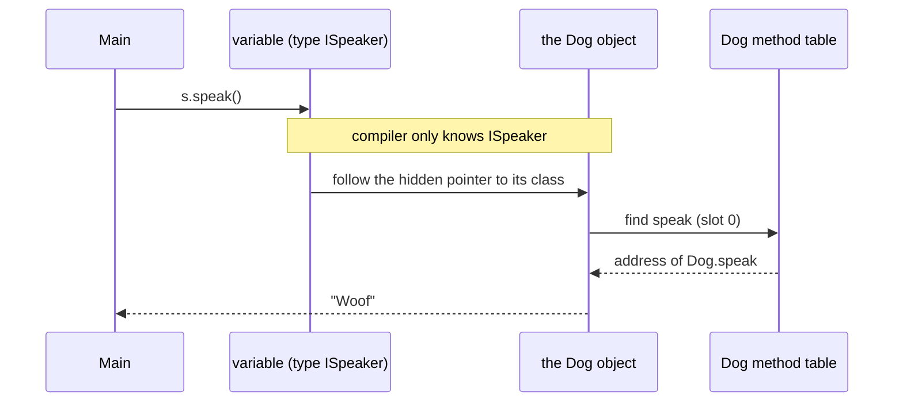

# OOP Pillar 4: Polymorphism

> **Prerequisites:** [OOP Pillar 3: Inheritance](../31-oop-pillar-3-inheritance/README.md) and [OOP Foundations & UML Class Diagrams](../02-oop-foundations-and-uml/README.md).  
> **Reading time:** ~40 minutes  
> **Audience:** Beginner-to-intermediate learners who must explain compile-time vs runtime polymorphism, overloading vs overriding, and use polymorphism to delete `if/else` ladders

> [!NOTE]
> **In one line:** Polymorphism means **one interface, many forms**: you write `animal.speak()` once, and each object answers in its own way, so adding a new kind of animal never forces you to edit the code that calls `speak()`.

> [!TIP]
> **Golden rule:** If you see an `if/elif` ladder that checks *what kind of thing* an object is, ask whether each branch should be a method on its own class. Callers should ask objects to *do* something, not ask objects *what they are*.

> [!TIP]
> **Try it:** Open [LLD Studio](/tools/lld-studio/), draw `Discount` with `Student` and `Vip` below it, then add `BlackFriday`. Notice that the `Checkout` box never changes. That is polymorphism paying you back.

---

## 1. Roadmap: what you will learn

The word "polymorphism" is Greek for "many forms". It sounds scary, but the idea is small. By the end of this chapter you will be able to:

1. Explain polymorphism in one sentence and with the `speak()` example.
2. Name the **two kinds**: compile-time (overloading, operators, generics) and runtime (overriding).
3. Explain why Python has no overloading and what you write instead.
4. Use `virtual`, `override`, `new` and `sealed` in C# and know what each one does to the call.
5. Describe **dynamic dispatch**: how the program finds the right method at runtime.
6. Overload operators (`+`, `==`, `<`, `len()`) on a `Money` class in both languages.
7. Use duck typing and `typing.Protocol` for polymorphism without inheritance.
8. Replace an `if/elif` ladder with classes, and connect it to the open/closed principle and the strategy pattern.
9. Avoid the classic traps: `isinstance` chains, LSP violations, and calling overridable methods in constructors.



Before this chapter, you learned that inheritance lets a subclass reuse and change what a parent class does. Polymorphism is the **payoff**: because a `Dog` *is an* `Animal`, any code that works with an `Animal` also works with a `Dog`, and the `Dog` gets to answer in its own way.

---

## 2. Concept: one interface, many forms

> [!key]
> **Polymorphism** lets the same call (`shape.area()`, `animal.speak()`, `a + b`) run **different code** depending on the **type of the thing you call it on**. The caller depends on a *contract* (the method name and meaning), never on a *concrete class*.

### The `speak()` example

Imagine a farm program. Every animal can `speak()`, but a dog says "Woof" and a cat says "Meow". Without polymorphism you would write:

```python
def make_noise(animal):
    if animal.kind == "dog":
        return "Woof"
    elif animal.kind == "cat":
        return "Meow"
    # add a cow? edit this function. Again. And again.
```

With polymorphism each class owns its own answer, and the caller is one line: `animal.speak()`. A new `Cow` class appears and `make_noise` stays exactly as it is.

### Two kinds of polymorphism

Languages decide *which code runs* at one of two moments. That moment is the whole difference.

| | Compile-time (static, early binding) | Runtime (dynamic, late binding) |
| :--- | :--- | :--- |
| **Decided** | Before the program runs, by the compiler (or never, in Python) | While the program runs, by looking at the real object |
| **Decided by** | The **declared types** of the arguments | The **actual type** of the object |
| **Main tools** | Method overloading, operator overloading, generics | Overriding (inheritance), interface implementation, duck typing |
| **Keyword (C#)** | Several methods with one name and different parameters | `virtual` / `override`, `abstract`, interfaces |
| **In Python** | No overloading; use default args, `*args`, `singledispatch`. Operators and generics exist | Every method call is dynamic, so it works out of the box |
| **Speed** | A direct jump, no lookup | One extra pointer hop (tiny) |
| **Example** | `Print(int)` vs `Print(string)` | `animal.Speak()` where `animal` is really a `Dog` |

A memory trick: **overload = same name, different parameters, picked by the compiler. Override = same name, same parameters, picked by the object.**

---

## 3. Explanation

### 3.1 Overloading in C#

C# lets one class hold several methods with the same name, as long as their **signatures** differ (number, types or order of parameters). The return type alone does not count.

The compiler picks the overload at compile time. It looks at the *declared* types of your arguments, finds every method that could accept them, and chooses the **best match**. Roughly: an exact match wins over a widening conversion (`int` to `long`), and a specific type wins over `object`.

Three facts that surprise beginners:

- **The compiler uses the variable's declared type, not the real object.** If `object o = "hi"`, a call `Show(o)` picks `Show(object)`, even though `o` really holds a string.
- **Ambiguity is a compile error.** `Log(null)` with `Log(string)` and `Log(Exception)` fails, because `null` fits both equally well. Cast it: `Log((string?)null)`.
- **Overloading is not inheritance.** It works inside one class, with no parent or child needed.

### 3.2 Overloading in Python (it does not exist)

A Python class body runs top to bottom and fills a dictionary. If you write two methods with the same name, the **second silently replaces the first**. So Python has no overloading. You get the same effect with these tools:

| Need | Tool | Use when |
| :--- | :--- | :--- |
| Optional input | **Default arguments** `def show(text, times=1)` | One behavior, some inputs optional (most cases) |
| Any number of inputs | `*args`, `**kwargs` | Sums, wrappers, pass-through |
| Branch on type | `isinstance` | One small function, two or three types |
| Many types, extensible | `functools.singledispatch` (functions) and `singledispatchmethod` (methods) | Real type-based dispatch that other code can extend |
| Help type checkers | `typing.overload` | Documenting signatures for tools; it changes nothing at runtime |

`singledispatch` looks at the type of the **first argument only**. It is real polymorphism: new types can register new handlers without touching old code.

### 3.3 Overriding in C#: `virtual`, `override`, `new`, `sealed`

In C# a method is **not** overridable by default. You opt in:

- `virtual` in the base class: "children may replace this."
- `override` in the child: "I replace it, and the replacement is used even through a base reference."
- `abstract`: "no body here; every concrete child must provide one."
- `sealed override`: "I replace it, and nobody below me may replace it again." Sealing also lets the runtime skip the lookup and call directly.
- `new`: "I am a **different** method that just happens to share the name." This is **hiding**, not overriding.

The tricky part is `new`. With `override`, the variable's declared type does not matter. With `new`, it does:

| Call | Method is `override` | Method is `new` |
| :--- | :--- | :--- |
| `Base b = new Derived(); b.M()` | Derived's version | **Base's version** |
| `Derived d = new Derived(); d.M()` | Derived's version | Derived's version |

So with `new`, the same object answers differently depending on the variable you hold it in. That breaks the promise of polymorphism, so treat a `new` warning as a bug until proven otherwise.

### 3.4 Overriding in Python: every method is virtual

Python has no `virtual`, no `override` keyword and no `new`. **Every method call is looked up at runtime on the real object.** You just define a method with the same name in the child. Two consequences:

- Hiding cannot happen. A variable annotated `Base` still finds `Derived`'s method, because the annotation is only a hint.
- `super().method()` calls the parent version when you want to extend rather than replace.
- You *can* ask for the parent version on purpose: `Base.hello(obj)`.

### 3.5 How dynamic dispatch works

**Dynamic dispatch** is the step where the program decides, at call time, which method body to run.

**In C# (and Java, C++).** Each class with virtual methods has a table of function addresses called a **vtable** (virtual method table). Every object carries a hidden pointer to its class's table. A virtual call does three small steps: follow the object's pointer to its table, read the entry at a fixed slot number (say slot 0 for `Speak`), and jump to that address. `Dog`'s table has `Dog.Speak` in slot 0; `Cat`'s has `Cat.Speak`. Same slot, different address. That is the whole trick. An `override` **replaces the entry in the inherited slot**. A `new` method gets a **fresh slot** and leaves the old one alone, which is exactly why a base reference still reaches the base method.

**In Python.** There is no fixed table. When you run `obj.speak()`, Python looks for `speak` on the object, then walks the class's **method resolution order** (`type(obj).__mro__`, for example `Loud, Derived, Base, object`) and uses the **first class that defines it**. The method is then bound to `obj` as `self`. Because `self.hello()` inside `Base.greet` also starts the search from the real class of `self`, a parent method can call a child's override. That is the idea behind the *template method* pattern.

### 3.6 Operator overloading

`a + b` is just a method call in disguise. In Python it runs `a.__add__(b)`; in C# it runs a `static operator +`. When you define these for your own class, the class feels built in.

| You write | Python calls | C# defines |
| :--- | :--- | :--- |
| `a + b`, `a - b`, `a * 2` | `__add__`, `__sub__`, `__mul__` | `operator +`, `-`, `*` |
| `3 * a` | `a.__rmul__(3)` | `operator *(int, Money)` |
| `a == b` | `__eq__` (and `__hash__`!) | `operator ==` and `!=` (plus `Equals`, `GetHashCode`) |
| `a < b` | `__lt__` (use `functools.total_ordering` for the rest) | `operator <` and `>` (pairs required) |
| `len(x)` | `__len__` | a `Count` property |
| `x[i]` | `__getitem__` | an indexer `this[int i]` |
| `x(...)` | `__call__` | a method or delegate |
| `str(x)`, `print(x)` | `__str__` (and `__repr__` for debugging) | `ToString()` |

**`NotImplemented` (Python).** If `__add__` receives something it does not understand, do **not** raise an error. Return the special value `NotImplemented`. Python then tries the *other* operand's reflected method (`__radd__`), and only if that also gives up does it raise `TypeError`. That lets two classes you never edited cooperate. For `==`, returning `NotImplemented` makes Python fall back to comparing identity, which gives `False`.

**Use operators only when the meaning is obvious** (money, vectors, dates, matrices). Never make `+` send an email.

### 3.7 Duck typing and structural typing

> "If it walks like a duck and quacks like a duck, it is a duck."

In Python you can pass **any** object to a function if it has the methods the function calls. No shared parent is needed. This is polymorphism with **no inheritance at all**. The risk is that a typo or a missing method only fails when that line runs.

`typing.Protocol` gives duck typing a name that tools can check. You describe the *shape* (`def speak(self) -> str`), and any class with that method matches, without writing `class Robot(Speaker)`. This is **structural typing**: a match by shape. C# interfaces are **nominal**: a class must say `: ISpeaker` on purpose.

### 3.8 Parametric polymorphism (generics)

Sometimes the same *code* works for many types: "return the first item of a list". **Generics** let you write it once with a type placeholder. In C# it is `T First<T>(IList<T> items)`; in Python you annotate with `TypeVar("T")`. The same function works for `int`, `str`, `Order`, and the type checker keeps the types straight: a list of `int` gives back an `int`. This is resolved at compile time (or by the type checker), so it belongs to the static family.

---

## 4. Code: seeing it work

### 4.1 One call, many forms

Notice that `Duck` has no parent class in Python and implements only an interface in C#. It still works in the same loop.

````carousel
```python
class Animal:
    def speak(self) -> str:
        return "..."


class Dog(Animal):
    def speak(self) -> str:
        return "Woof"


class Cat(Animal):
    def speak(self) -> str:
        return "Meow"


class Duck:  # no Animal parent at all
    def speak(self) -> str:
        return "Quack"


for creature in [Dog(), Cat(), Animal(), Duck()]:
    print(type(creature).__name__, "says", creature.speak())
```

<!-- slide -->

```csharp
using System;
using System.Collections.Generic;

public interface ISpeaker { string Speak(); }

public class Animal : ISpeaker
{
    public virtual string Speak() => "...";
}

public class Dog : Animal { public override string Speak() => "Woof"; }
public class Cat : Animal { public override string Speak() => "Meow"; }

public class Duck : ISpeaker   // not an Animal, still an ISpeaker
{
    public string Speak() => "Quack";
}

public class Program
{
    public static void Main()
    {
        var all = new List<ISpeaker> { new Dog(), new Cat(), new Animal(), new Duck() };
        foreach (var creature in all)
            Console.WriteLine($"{creature.GetType().Name} says {creature.Speak()}");
    }
}
```
````

**Output (both languages):**

```text
Dog says Woof
Cat says Meow
Animal says ...
Duck says Quack
```

### 4.2 Overloading: C# picks at compile time, Python needs tools

The Python side shows each substitute for overloading, and the trap of defining the same name twice.

````carousel
```python
from functools import singledispatch, singledispatchmethod


class Printer:
    def show(self, text, times=1, sep=" "):      # default arguments
        return sep.join([text] * times)

    def total(self, *numbers):                   # *args
        return sum(numbers)

    def size(self, thing):                       # isinstance (small cases only)
        if isinstance(thing, str):
            return len(thing)
        if isinstance(thing, (list, tuple)):
            return len(thing)
        if isinstance(thing, int):
            return thing
        raise TypeError(f"cannot size {type(thing).__name__}")


@singledispatch                                  # dispatch on the first argument
def describe(value):
    return f"something else: {value!r}"


@describe.register
def _(value: int):
    return f"an int: {value}"


@describe.register
def _(value: str):
    return f"a string of length {len(value)}"


@describe.register(list)
def _(value):
    return f"a list with {len(value)} items"


class Formatter:
    @singledispatchmethod                        # same idea for methods
    def fmt(self, value):
        return str(value)

    @fmt.register
    def _(self, value: float):
        return f"{value:.2f}"

    @fmt.register
    def _(self, value: bool):
        return "yes" if value else "no"


p = Printer()
print(p.show("hi"), "|", p.show("hi", 3, "-"))
print(p.total(1, 2, 3), p.total())
print(p.size("abc"), p.size([1, 2]), p.size(7))
print(describe(5))
print(describe("hello"))
print(describe([1, 2, 3]))
print(describe(2.5))
f = Formatter()
print(f.fmt(3.14159), f.fmt(True), f.fmt("text"), f.fmt(10))


class Oops:                                      # the trap: second go() wins
    def go(self, a):
        return "one arg"

    def go(self, a, b):
        return "two args"


try:
    Oops().go(1)
except TypeError as e:
    print("TypeError:", e)
```

<!-- slide -->

```csharp
using System;
using System.Collections.Generic;

public static class Overloads
{
    public static string Show(int x) => "int";
    public static string Show(long x) => "long";
    public static string Show(double x) => "double";
    public static string Show(string s) => "string";
    public static string Show(object o) => "object";

    // Overloads may also differ in count: this is the C# way
    // to give an "optional" argument without a default value.
    public static string Greet(string name) => Greet(name, "Hello");
    public static string Greet(string name, string word) => $"{word}, {name}";
}

public class Program
{
    public static void Main()
    {
        Console.WriteLine(Overloads.Show(5));              // int
        Console.WriteLine(Overloads.Show(5L));             // long
        Console.WriteLine(Overloads.Show(5.0f));           // float widens to double
        Console.WriteLine(Overloads.Show('a'));            // char widens to int
        Console.WriteLine(Overloads.Show("x"));            // string

        object o = "I am really a string";
        Console.WriteLine(Overloads.Show(o));              // declared type object wins
        Console.WriteLine(Overloads.Show(new List<int>())); // object

        Console.WriteLine(Overloads.Greet("Asha"));
        Console.WriteLine(Overloads.Greet("Asha", "Namaste"));

        // Show(null) compiles and picks string (the most specific match).
        // Log(string) vs Log(Exception) with null is a real ambiguity error,
        // because neither type is more specific than the other.
    }
}
```
````

**Python output:**

```text
hi | hi-hi-hi
6 0
3 2 7
an int: 5
a string of length 5
a list with 3 items
something else: 2.5
3.14 yes text 10
TypeError: Oops.go() missing 1 required positional argument: 'b'
```

**C# output:**

```text
int
long
double
int
string
object
object
Hello, Asha
Namaste, Asha
```

### 4.3 Overriding, and the `new` trap

````carousel
```python
class Base:
    def hello(self):
        return "Base.hello"

    def greet(self):
        # self.hello() is looked up on the REAL object at call time
        return "greet -> " + self.hello()


class Derived(Base):
    def hello(self):
        return "Derived.hello"


class Loud(Derived):
    def hello(self):
        return super().hello().upper() + "!"


for obj in (Base(), Derived(), Loud()):
    print(type(obj).__name__, obj.greet())

print([c.__name__ for c in Loud.__mro__])

# Python has no "new": a Base-typed variable still finds Derived's method
b: Base = Derived()
print(b.hello())
print(Base.hello(b))  # you can ask for the base version on purpose
```

<!-- slide -->

```csharp
using System;

public class Base
{
    public virtual string Who() => "Base.Who";
    public string Name() => "Base.Name";          // not virtual
    public string Greet() => "greet -> " + Who(); // Who() is virtual
}

public class Derived : Base
{
    public override string Who() => "Derived.Who";   // replaces the slot
    public new string Name() => "Derived.Name";      // a NEW method, hides
}

public class Loud : Derived
{
    // sealed: nobody below Loud may override Who() again
    public sealed override string Who() => base.Who().ToUpper() + "!";
}

public class Program
{
    public static void Main()
    {
        Base b = new Derived();
        Console.WriteLine(b.Who());                 // Derived.Who (override)
        Console.WriteLine(b.Name());                // Base.Name   (new: base ref!)
        Console.WriteLine(((Derived)b).Name());     // Derived.Name
        Console.WriteLine(b.Greet());               // greet -> Derived.Who

        Base l = new Loud();
        Console.WriteLine(l.Greet());               // greet -> DERIVED.WHO!
    }
}
```
````

**Python output:**

```text
Base greet -> Base.hello
Derived greet -> Derived.hello
Loud greet -> DERIVED.HELLO!
['Loud', 'Derived', 'Base', 'object']
Derived.hello
Base.hello
```

**C# output:**

```text
Derived.Who
Base.Name
Derived.Name
greet -> Derived.Who
greet -> DERIVED.WHO!
```

### 4.4 Operator overloading with `Money`

Store money as whole cents so you avoid floating-point surprises. In both versions `Money` is immutable: every operation returns a **new** `Money`.

````carousel
```python
from dataclasses import dataclass
from functools import total_ordering


@total_ordering
@dataclass(frozen=True)
class Money:
    cents: int
    currency: str = "USD"

    def __add__(self, other):
        if not isinstance(other, Money):
            return NotImplemented
        self._same(other)
        return Money(self.cents + other.cents, self.currency)

    def __sub__(self, other):
        if not isinstance(other, Money):
            return NotImplemented
        self._same(other)
        return Money(self.cents - other.cents, self.currency)

    def __mul__(self, factor):
        if not isinstance(factor, (int, float)):
            return NotImplemented
        return Money(round(self.cents * factor), self.currency)

    __rmul__ = __mul__  # so 3 * Money works too

    def __lt__(self, other):
        if not isinstance(other, Money):
            return NotImplemented
        self._same(other)
        return self.cents < other.cents

    def __str__(self):
        return f"{self.currency} {self.cents / 100:.2f}"

    def _same(self, other):
        if self.currency != other.currency:
            raise ValueError("currency mismatch")


a = Money(1050)
b = Money(250)
print(a + b, "|", a - b, "|", a * 2, "|", 3 * b)
print(a == Money(1050), a < b, a > b, a >= b)
print(sorted([a, b, Money(999)]))
print(a == 10.5)
try:
    a + 5
except TypeError as e:
    print("TypeError:", e)


class Basket:
    def __init__(self, *items):
        self._items = list(items)

    def __len__(self):
        return len(self._items)

    def __getitem__(self, i):
        return self._items[i]

    def __call__(self, extra):
        self._items.append(extra)
        return self

    def __str__(self):
        return "Basket(" + ", ".join(self._items) + ")"


bk = Basket("pen", "ink")
bk("paper")
print(len(bk), bk[0], bk[-1], list(bk), str(bk), "ink" in bk)
```

<!-- slide -->

```csharp
using System;

public readonly record struct Money(long Cents, string Currency = "USD")
    : IComparable<Money>
{
    // record struct already gives == and != based on both fields.

    public static Money operator +(Money a, Money b)
    {
        Same(a, b);
        return new Money(a.Cents + b.Cents, a.Currency);
    }

    public static Money operator -(Money a, Money b)
    {
        Same(a, b);
        return new Money(a.Cents - b.Cents, a.Currency);
    }

    public static Money operator *(Money a, int factor) =>
        new Money(a.Cents * factor, a.Currency);

    public static Money operator *(int factor, Money a) => a * factor;

    // Comparison operators must come in pairs: < with >, <= with >=.
    public static bool operator <(Money a, Money b) { Same(a, b); return a.Cents < b.Cents; }
    public static bool operator >(Money a, Money b) { Same(a, b); return a.Cents > b.Cents; }
    public static bool operator <=(Money a, Money b) => !(a > b);
    public static bool operator >=(Money a, Money b) => !(a < b);

    public int CompareTo(Money other) => Cents.CompareTo(other.Cents);

    public override string ToString() => $"{Currency} {Cents / 100m:F2}";

    private static void Same(Money a, Money b)
    {
        if (a.Currency != b.Currency)
            throw new InvalidOperationException("currency mismatch");
    }
}

public class Program
{
    public static void Main()
    {
        var a = new Money(1050);
        var b = new Money(250);
        Console.WriteLine($"{a + b} | {a - b} | {a * 2} | {3 * b}");
        Console.WriteLine($"{a == new Money(1050)} {a < b} {a > b} {a >= b}");
    }
}
```
````

**Python output:**

```text
USD 13.00 | USD 8.00 | USD 21.00 | USD 7.50
True False True True
[Money(cents=250, currency='USD'), Money(cents=999, currency='USD'), Money(cents=1050, currency='USD')]
False
TypeError: unsupported operand type(s) for +: 'Money' and 'int'
3 pen paper ['pen', 'ink', 'paper'] Basket(pen, ink, paper) True
```

**C# output (the `Basket` part has no C# twin in this snippet):**

```text
USD 13.00 | USD 8.00 | USD 21.00 | USD 7.50
True False True True
```

> [!NOTE]
> `"ink" in bk` works in Python even though `Basket` has no `__contains__`. Python falls back to `__getitem__` with 0, 1, 2 ... until `IndexError`. That is duck typing at work.

### 4.5 Duck typing, Protocol and generics

````carousel
```python
from typing import Generic, Iterable, Protocol, TypeVar


class Speaker(Protocol):
    def speak(self) -> str: ...


class Robot:  # no inheritance, but it fits the shape
    def speak(self) -> str:
        return "Beep"


class Parrot:
    def speak(self) -> str:
        return "Hello!"


def chorus(members: Iterable[Speaker]) -> str:
    return " / ".join(m.speak() for m in members)


print(chorus([Robot(), Parrot()]))

T = TypeVar("T")


def first(items: list[T]) -> T:
    return items[0]


print(first([10, 20]), first(["a", "b"]))


class Box(Generic[T]):
    def __init__(self, item: T) -> None:
        self.item = item

    def get(self) -> T:
        return self.item


print(Box(5).get(), Box("x").get())
```

<!-- slide -->

```csharp
using System;
using System.Collections.Generic;

public interface ISpeaker { string Speak(); }
public class Robot : ISpeaker { public string Speak() => "Beep"; }    // must say : ISpeaker
public class Parrot : ISpeaker { public string Speak() => "Hello!"; }

public class Box<T>
{
    private readonly T _item;
    public Box(T item) { _item = item; }
    public T Get() => _item;
}

public static class Util
{
    public static string Chorus(IEnumerable<ISpeaker> members) =>
        string.Join(" / ", System.Linq.Enumerable.Select(members, m => m.Speak()));

    public static T First<T>(IList<T> items) => items[0];

    // A constraint says what T must be able to do.
    public static T Larger<T>(T a, T b) where T : IComparable<T> =>
        a.CompareTo(b) >= 0 ? a : b;
}

public class Program
{
    public static void Main()
    {
        Console.WriteLine(Util.Chorus(new ISpeaker[] { new Robot(), new Parrot() }));
        Console.WriteLine($"{Util.First(new List<int> { 10, 20 })} {Util.First(new List<string> { "a", "b" })}");
        Console.WriteLine($"{new Box<int>(5).Get()} {new Box<string>("x").Get()}");
        Console.WriteLine($"{Util.Larger(3, 9)} {Util.Larger("pear", "apple")}");
    }
}
```
````

**Python output:**

```text
Beep / Hello!
10 a
5 x
```

**C# output:**

```text
Beep / Hello!
10 a
5 x
9 pear
```

---

## 5. Visual diagrams

### 5.1 The class model

`Animal` is a normal parent. `Duck` is not an `Animal`, but it fulfils the same `ISpeaker` contract. The `Farm` only knows the contract.



### 5.2 One dynamic dispatch call

The variable says `ISpeaker`, but the object is a `Dog`. The call goes through the object's own table.



---

## 6. Replacing an `if/elif` ladder

This is the refactor interviewers love. Start with the ladder:

```python
def price_before(kind, amount):
    if kind == "regular":
        return amount
    elif kind == "student":
        return amount * 0.9
    elif kind == "vip":
        return amount * 0.8
    else:
        raise ValueError(kind)
```

**What is wrong?** To add `"black_friday"` you must open this function and edit it. Every edit risks breaking the working branches, and the same ladder usually gets copied into reports, emails and invoices. The new feature touches many places.

### The refactor: one class per branch

````carousel
```python
from abc import ABC, abstractmethod


class Discount(ABC):
    @abstractmethod
    def apply(self, amount: float) -> float: ...


class NoDiscount(Discount):
    def apply(self, amount):
        return amount


class Student(Discount):
    def apply(self, amount):
        return amount * 0.9


class Vip(Discount):
    def apply(self, amount):
        return amount * 0.8


def checkout(amount: float, discount: Discount) -> float:
    return discount.apply(amount)


for d in (NoDiscount(), Student(), Vip()):
    print(type(d).__name__, f"{checkout(200.0, d):.2f}")


# NEW RULE: a new class, and nothing above is edited
class BlackFriday(Discount):
    def apply(self, amount):
        return max(amount - 50, 0)


print(f"{checkout(200.0, BlackFriday()):.2f}")
```

<!-- slide -->

```csharp
using System;

public interface IDiscount { decimal Apply(decimal amount); }

public class NoDiscount : IDiscount { public decimal Apply(decimal a) => a; }
public class Student : IDiscount { public decimal Apply(decimal a) => a * 0.9m; }
public class Vip : IDiscount { public decimal Apply(decimal a) => a * 0.8m; }

// Added later, in a new file. Checkout is untouched.
public class BlackFriday : IDiscount
{
    public decimal Apply(decimal a) => Math.Max(a - 50m, 0m);
}

public static class Checkout
{
    public static decimal Total(decimal amount, IDiscount d) => d.Apply(amount);
}

public class Program
{
    public static void Main()
    {
        foreach (IDiscount d in new IDiscount[] { new NoDiscount(), new Student(), new Vip() })
            Console.WriteLine($"{d.GetType().Name} {Checkout.Total(200m, d):F2}");

        Console.WriteLine($"{Checkout.Total(200m, new BlackFriday()):F2}");
    }
}
```
````

**Output (both languages):**

```text
NoDiscount 200.00
Student 180.00
Vip 160.00
150.00
```

The ladder was **replaced by the object's type**. The decision still happens, but it happens once (when you pick which `Discount` to create) instead of everywhere.

### Open/closed principle

> Software should be **open for extension** and **closed for modification**.

Adding `BlackFriday` was an *extension*: new code in a new class. Nothing already tested was *modified*. A ladder fails this principle, because every new case reopens old code.

### Strategy pattern: polymorphism in disguise

The **strategy pattern** is exactly what you just built: a family of interchangeable algorithms (`Discount`) behind one interface, with the caller holding one and not caring which. The only twist is that it is sometimes drawn as a named pattern with a context object (`Order` holds a `Shipping` strategy). In Python a strategy can even be a plain function, since functions are objects with a call shape:

```python
def sort_by(items, key_fn):
    return sorted(items, key=key_fn)

print(sort_by(["pear", "fig", "banana"], len))
print(sort_by(["pear", "fig", "banana"], lambda s: s[-1]))
```

Output:

```text
['fig', 'pear', 'banana']
['banana', 'fig', 'pear']
```

> [!NOTE]
> Where does the ladder go? Somewhere must still choose *which* class to create ("the user clicked VIP"). Keep that in **one** place: a factory function or a dictionary such as `{"vip": Vip(), "student": Student()}`. A single lookup at the edge of your program is fine. A type check in the middle of your logic is the smell.

### Worked walkthrough: shipping costs

**Requirement:** orders ship by Standard, Express or Pickup. Later, the business asks for Overnight. Show that adding Overnight edits no existing class.

```python
from abc import ABC, abstractmethod


class Shipping(ABC):
    @abstractmethod
    def cost(self, weight_kg: float) -> float: ...


class Standard(Shipping):
    def cost(self, weight_kg):
        return 5.0 + 1.0 * weight_kg


class Express(Shipping):
    def cost(self, weight_kg):
        return 12.0 + 2.5 * weight_kg


class Pickup(Shipping):
    def cost(self, weight_kg):
        return 0.0


class Order:
    def __init__(self, weight_kg, shipping: Shipping):
        self.weight_kg = weight_kg
        self.shipping = shipping

    def shipping_cost(self):
        return self.shipping.cost(self.weight_kg)


for s in (Standard(), Express(), Pickup()):
    print(type(s).__name__, Order(2.0, s).shipping_cost())


class Overnight(Shipping):   # added later; nothing above is edited
    def cost(self, weight_kg):
        return 30.0 + 3.0 * weight_kg


print(Order(2.0, Overnight()).shipping_cost())
```

```text
Standard 7.0
Express 17.0
Pickup 0.0
36.0
```

Walk through it step by step:

1. `Order` depends on `Shipping`, the abstraction. It never imports `Standard` or `Express`.
2. `Order.shipping_cost()` calls `self.shipping.cost(...)`. At that moment Python looks at the real object and runs its `cost`.
3. `Overnight` arrives. It inherits `Shipping`, fills in `cost`, and the old code never learns it exists.
4. `Shipping()` itself cannot be created, because `ABC` plus `@abstractmethod` blocks it. The base class is a contract, not a product.

---

## 7. Pitfalls, edge cases and anti-patterns

### Pitfalls

**1. `isinstance` chains.** This is the ladder in a different costume, and it has the same cost:

```python
def area_bad(shape):
    if isinstance(shape, Circle):
        return 3.14159 * shape.r ** 2
    elif isinstance(shape, Square):
        return shape.s ** 2
    raise TypeError("unknown shape")
```

Every new shape reopens `area_bad`. Give each shape an `area()` method instead.

**2. Liskov Substitution Principle (LSP) violations.** A child must work anywhere its parent works. If it cannot, the polymorphic call blows up in the caller:

```python
class Bird:
    def fly(self):
        return "flying"


class Penguin(Bird):
    def fly(self):
        raise NotImplementedError("penguins cannot fly")   # breaks callers


def launch(birds):
    return [b.fly() for b in birds]    # crashes when it meets a Penguin
```

The fix is in the model: do not put `fly()` on a base class that includes non-fliers. Make `FlyingBird` a separate type, or use composition.

**3. Overriding with a different meaning.** If `Stack.add()` pushes on top but `SafeStack.add()` appends at the bottom, the name lies. An override must keep the *meaning* (the contract), may accept more, and may promise more, but must never demand more or promise less.

**4. Calling an overridable method from a constructor.** The parent constructor runs *before* the child has set up its fields:

```python
class Report:
    def __init__(self):
        self.title = self.make_title()   # calls an overridable method

    def make_title(self):
        return "Report"


class SalesReport(Report):
    def __init__(self, region):
        super().__init__()
        self.region = region

    def make_title(self):
        return f"Sales for {self.region}"   # self.region is not set yet!
```

Running `SalesReport("EU")` raises `AttributeError: 'SalesReport' object has no attribute 'region'`. In C# it is even sneakier: the override runs, but the child's fields still hold their default values (`null`, `0`), so you get silent wrong results instead of a crash. Rule: **constructors should not call virtual methods.** Set data first, compute titles lazily or in a factory method.

**5. Forgetting `override` in C#.** Missing the keyword compiles with warning CS0108 and silently becomes `new`. A base-typed collection then runs the base code. Treat that warning as an error.

### Edge cases interviewers push on

- **Can you override a static method?** No. Static methods belong to the type, not an object, so there is no object to dispatch on. A child can only hide it.
- **Can you override a private method?** In C# no (it is invisible to the child). In Python a leading `__name` is mangled to `_Class__name`, so a child defining `__name` creates a different method.
- **Does the return type take part in overload resolution?** No in C#. Only the parameter list does.
- **Which overload runs when the object is a `string` stored in an `object` variable?** The `object` one, because overloads use the declared type. Runtime types only matter for `virtual` calls (or for `dynamic`).
- **What if both `__add__` and `__radd__` exist?** Python tries the left operand's `__add__` first. If that returns `NotImplemented`, it tries the right operand's `__radd__`. If the right operand's class is a subclass of the left's, the right's reflected method is tried first.
- **`__eq__` without `__hash__`.** Defining `__eq__` sets `__hash__` to `None`, so the object can no longer be a dict key or set member. Define both (a frozen dataclass does it for you).
- **Overloading and inheritance mix:** a derived class's overload does not hide the base's in C# unless the signatures match exactly, but the compiler prefers methods declared in the most derived class if they are applicable. This surprises people, so avoid mixing the two.

### Anti-patterns

| Anti-pattern | Why it hurts | Better |
| :--- | :--- | :--- |
| Type-code field (`kind == "vip"`) with a ladder | Every new kind edits old code | One class per kind |
| `isinstance` chains in business logic | Same as above, harder to spot | Method on each class, or `singledispatch` |
| Overriding to do nothing or throw | Breaks LSP | Re-model with smaller interfaces |
| `new` instead of `override` "to make it compile" | One object, two answers | Add `virtual`/`override`, or rename |
| Deep inheritance just to vary one behavior | Fragile and rigid | Strategy: compose the behavior |
| Clever operators (`db + query`) | Violates least surprise | A named method |
| "God" base class with 20 virtual methods | Children must override half and ignore the rest | Small interfaces |

---

## 8. Say it out loud

### The two-minute spoken answer

> "Polymorphism means one interface, many forms. I call the same method on different objects and each one responds in its own way, so my calling code depends on a contract rather than on concrete classes.
>
> There are two kinds. **Compile-time**, or static, polymorphism is decided before the program runs. Method overloading is the main example: same name, different parameters, and the compiler picks using the declared argument types. Operator overloading and generics also belong here. **Runtime**, or dynamic, polymorphism is decided while the program runs, from the real type of the object. That is overriding: a child class replaces a parent's method, or a class implements an interface, and a call through the base type reaches the child's code.
>
> The mechanism is dynamic dispatch. In C# each class has a virtual method table and each object points to it, so a call becomes: follow the pointer, read the slot, jump. `override` replaces the slot, but `new` creates a separate one, which is why `new` breaks polymorphism. Python has no table; it walks the method resolution order on the real object, so every method is already virtual and there is no `new`. Python has no overloading either, because a second `def` with the same name replaces the first. I use default arguments, `*args`, or `functools.singledispatch`.
>
> The practical payoff is replacing `if/elif` ladders. I give each branch its own class behind one interface, so adding a new case means adding a class and editing no old code. That is the open/closed principle, and the strategy pattern is the same idea. The danger is subclasses that break the parent's contract, which is a Liskov violation, and calling overridable methods from constructors."

### Cheat sheet

| Question | Answer |
| :--- | :--- |
| Polymorphism in one line | Same call, different code depending on the object |
| Compile-time kinds | Overloading, operator overloading, generics |
| Runtime kinds | Overriding, interfaces, duck typing |
| Overload vs override | Same name + different params (compiler) vs same name + same params (object) |
| Python overloading? | No. Defaults, `*args`, `singledispatch` |
| C# keywords | `virtual`, `override`, `abstract`, `sealed`, `new` |
| `new` does what? | Hides; the declared type decides which method runs |
| Dispatch in C# | vtable slot lookup |
| Dispatch in Python | Walk `__mro__`, first class with the name wins |
| Unknown operand in `__add__` | `return NotImplemented` |
| Polymorphism without inheritance | Duck typing, `typing.Protocol` |
| Generic function | `TypeVar` in Python, `<T>` in C# |
| Ladder refactor | One class per branch, one interface, registry at the edge |
| Constructor rule | Never call overridable methods |
| Smell | `isinstance` / type-code checks in business logic |

---

## 9. Practice

Try each one on paper first, then check your answer. Then do the coding practice online:

- [Animal Sounds](/practice/code/oop-animal-sounds/)
- [Discounts and Polymorphism](/practice/code/oop-discount-polymorphism/)
- [Overloading in Python](/practice/code/oop-overloading-in-python/)
- [Money With Operators](/practice/code/oop-money-operators/)
- [Employees and Payroll](/practice/code/oop-employee-payroll/)
- [Shipping Strategies](/practice/code/lld-shipping-strategies/)

### Exercise 1: predict the output (Python)

```python
class A:
    def who(self):
        return "A"

    def intro(self):
        return "I am " + self.who()


class B(A):
    def who(self):
        return "B"


class C(B):
    pass


print(A().intro(), "|", B().intro(), "|", C().intro())
```

<details>
<summary>Answer</summary>

`I am A | I am B | I am B`

`intro` is defined only in `A`, but `self.who()` is looked up on the real object. `C` has no `who`, so the MRO (`C, B, A`) finds `B.who` first.
</details>

### Exercise 2: predict the output (C#)

```csharp
public class A { public virtual string F() => "A"; public string G() => "A.G"; }
public class B : A { public override string F() => "B"; public new string G() => "B.G"; }

A x = new B();
Console.WriteLine(x.F() + " " + x.G() + " " + ((B)x).G());
```

<details>
<summary>Answer</summary>

`B A.G B.G`

`F` is virtual and overridden, so the real type wins. `G` is hidden with `new`, so through the `A` variable the compiler binds to `A.G`; after the cast to `B` it binds to `B.G`.
</details>

### Exercise 3: fix the fake overload

This was written by someone from C#. It breaks when you call `area(5)`. Make both calls work using the standard library.

```python
class Shapes:
    def area(self, side):
        return side * side

    def area(self, width, height):
        return width * height
```

<details>
<summary>Answer</summary>

The simplest fix is a default argument:

```python
class Shapes:
    def area(self, width, height=None):
        if height is None:
            height = width
        return width * height


print(Shapes().area(5), Shapes().area(2, 3))
```

Output: `25 6`. If the *types* differ (a circle radius vs a rectangle tuple), use `singledispatchmethod` instead. Note that default arguments are the cleanest answer when only the number of inputs varies.
</details>

### Exercise 4: delete the ladder

```python
def ship_cost(method, kg):
    if method == "standard":
        return 5 + kg
    elif method == "express":
        return 12 + 2.5 * kg
    elif method == "pickup":
        return 0
    raise ValueError(method)
```

Refactor so a new method needs no edit to existing code.

<details>
<summary>Answer</summary>

```python
from abc import ABC, abstractmethod


class Shipping(ABC):
    @abstractmethod
    def cost(self, kg): ...


class Standard(Shipping):
    def cost(self, kg):
        return 5 + kg


class Express(Shipping):
    def cost(self, kg):
        return 12 + 2.5 * kg


class Pickup(Shipping):
    def cost(self, kg):
        return 0


METHODS = {"standard": Standard(), "express": Express(), "pickup": Pickup()}


def ship_cost(method, kg):
    return METHODS[method].cost(kg)


print(ship_cost("standard", 2), ship_cost("express", 2), ship_cost("pickup", 2))
```

Output: `7 17.0 0`. The single dictionary lookup at the edge replaces the ladder. A new method is a new class plus one dictionary entry.
</details>

### Exercise 5: a `Vector` with operators

Write `Vector(x, y)` so that `Vector(1, 2) + Vector(3, 4)` gives `Vector(4, 6)`, `Vector(1, 2) * 3` gives `Vector(3, 6)`, `abs(Vector(3, 4))` gives `5.0`, and two equal vectors compare equal.

<details>
<summary>Answer</summary>

```python
import math
from dataclasses import dataclass


@dataclass(frozen=True)
class Vector:
    x: float
    y: float

    def __add__(self, other):
        if not isinstance(other, Vector):
            return NotImplemented
        return Vector(self.x + other.x, self.y + other.y)

    def __mul__(self, k):
        if not isinstance(k, (int, float)):
            return NotImplemented
        return Vector(self.x * k, self.y * k)

    __rmul__ = __mul__

    def __abs__(self):
        return math.hypot(self.x, self.y)


print(Vector(1, 2) + Vector(3, 4))
print(Vector(1, 2) * 3, 3 * Vector(1, 2))
print(abs(Vector(3, 4)))
print(Vector(1, 2) == Vector(1, 2))
```

Output:

```text
Vector(x=4, y=6)
Vector(x=3, y=6) Vector(x=3, y=6)
5.0
True
```

`@dataclass` writes `__eq__` and `__hash__` for you.
</details>

### Exercise 6: repair the constructor trap

Fix `SalesReport` from section 7 so it works, keeping the override.

<details>
<summary>Answer</summary>

Set the child's data **before** calling anything overridable, or compute the title when asked instead of in the constructor:

```python
class Report:
    @property
    def title(self):
        return self.make_title()   # computed on demand

    def make_title(self):
        return "Report"


class SalesReport(Report):
    def __init__(self, region):
        self.region = region

    def make_title(self):
        return f"Sales for {self.region}"


print(SalesReport("EU").title)
```

Output: `Sales for EU`. By the time `.title` is read, the object is fully built.
</details>

---

## 10. Mini project: Notification Hub

**Goal:** build a hub that sends one message through many channels, then add a new channel **without editing any existing class**.

**Requirements**

1. A `Channel` abstraction with `send(recipient, text) -> str` that returns a receipt string.
2. Three channels: `Email`, `Sms`, `Push`. Each formats its receipt differently (for example `email to ann: Hi`).
3. A `Hub` that holds a list of channels and has `broadcast(recipient, text) -> list[str]`.
4. If one channel raises an error, the others still run and the hub records `"<ChannelName> failed"` in that slot.
5. Add `Slack` last, as a new class only. Prove `Hub` and the old channels were not edited.
6. Add a `Message` class with `__str__`, `__len__` and `+` (joining two messages with a blank line).

**Steps**

1. Draw the class diagram first (use [LLD Studio](/tools/lld-studio/)).
2. Write `Channel` as an `ABC`, then the three channels.
3. Write `Hub`, depending only on `Channel`.
4. Write checks (below), then add `Slack`.

**Self-check**

```python
hub = Hub([Email(), Sms()])
assert hub.broadcast("ann", "Hi") == ["email to ann: Hi", "sms to ann: Hi"]
hub.channels.append(Slack())
assert hub.broadcast("ann", "Hi")[-1] == "slack to ann: Hi"
assert len(Message("ab") + Message("cd")) == len("ab\n\ncd")
```

**Stretch goals:** a `Protocol` version of `Channel`; a `singledispatch` function `render(message)` that handles `str`, `Message` and `dict`; a retry strategy passed into `Hub`.

Hint: give `Channel` an `@abstractmethod send`, wrap each `ch.send(...)` in `try/except Exception`, and make `Message.__add__` return `NotImplemented` for non-messages. The self-check above is your test.

---

## 11. Interview questions

<details>
<summary><strong>Q1. What is the difference between compile-time and runtime polymorphism?</strong></summary>

Compile-time (static, early binding) is resolved before the program runs from the **declared types** of the arguments: overloading, operator overloading, generics. Runtime (dynamic, late binding) is resolved while it runs from the **actual type** of the object: overriding and interfaces. Compile-time picks *which signature*; runtime picks *which implementation* of one signature.
</details>

<details>
<summary><strong>Q2. What is the difference between overloading and overriding?</strong></summary>

Overloading: same name, **different parameters**, chosen by the compiler from argument types, no inheritance needed. Overriding: same name and **same parameters** in a child class, chosen at runtime from the object's real type. A return type alone never distinguishes overloads.
</details>

<details>
<summary><strong>Q3. Does Python support method overloading?</strong></summary>

Not directly: a class body fills a dictionary, so a second `def` with the same name replaces the first. Use default arguments, `*args`/`**kwargs`, `functools.singledispatch` / `singledispatchmethod` for type-based dispatch on the first argument, and `typing.overload` only to describe signatures to type checkers. Operator overloading is fully supported through dunder methods.
</details>

<details>
<summary><strong>Q4. What is dynamic dispatch?</strong></summary>

Choosing the method body at call time from the object's real type. In C# each class has a vtable and each object points to it; a virtual call reads a fixed slot and jumps to the stored address, and `override` swaps that address. In Python the interpreter searches the object and then `type(obj).__mro__` and uses the first match, so a base method calling `self.hook()` reaches the child's override.
</details>

<details>
<summary><strong>Q5. What is the difference between <code>override</code> and <code>new</code> in C#?</strong></summary>

`override` replaces the inherited virtual slot, so every caller gets the child's code. `new` hides: it adds a separate method, so a base-typed variable runs the base method and a child-typed variable runs the child one. One object, two answers, which breaks substitutability.
</details>

<details>
<summary><strong>Q6. How does polymorphism remove if/else ladders?</strong></summary>

Each branch becomes a class behind one interface; the runtime picks the branch. Adding a case means adding a class and editing no tested code, which is the **open/closed principle**. The choice of which class to create still exists, but is made once at the edge (a factory or dictionary).
</details>

<details>
<summary><strong>Q7. Why not call an overridable method in a constructor?</strong></summary>

The base constructor runs before the child sets its fields, so the override runs on a half-built object: `AttributeError` in Python, silent default values in C#. Set data first, use lazy properties, or use a factory method.
</details>

<details>
<summary><strong>Q8. Duck typing vs interface polymorphism?</strong></summary>

An interface must be **declared** and can be enforced; duck typing only needs the right methods and fails at the call. `typing.Protocol` checks the shape statically without inheritance (structural typing), unlike C# interfaces (nominal typing).
</details>

<details>
<summary><strong>Q9. When should you overload an operator, and what does <code>NotImplemented</code> do?</strong></summary>

Only when the meaning is obvious (money, vectors, dates) and the type is immutable. In Python return `NotImplemented` for operands you do not understand; Python then tries the other side's reflected method (`__radd__`) before raising `TypeError`. Define `__hash__` with `__eq__`. In C#, overload `==` with `!=` and `<` with `>`, and also override `Equals` and `GetHashCode`.
</details>

<details>
<summary><strong>Q10. Are generics polymorphism?</strong></summary>

Yes, **parametric polymorphism**: one piece of code (`First<T>`) works for many types, with the type fixed by the caller. It is the compile-time family. C# adds constraints (`where T : IComparable<T>`); Python uses `TypeVar` and `Protocol`.
</details>

Practice these out loud with the interview sets [Inheritance, Abstraction and Polymorphism](/practice/interview/oop-inheritance-and-polymorphism/) and [OOP four pillars questions](/practice/interview/oop-four-pillars/).

---

## 12. Further reading

- [Python docs: Data model, special method names](https://docs.python.org/3/reference/datamodel.html#special-method-names) (`__add__`, `__eq__`, `__lt__`, `__len__`, `__getitem__`, `__call__`, `NotImplemented`)
- [Python docs: `functools.singledispatch` and `singledispatchmethod`](https://docs.python.org/3/library/functools.html#functools.singledispatch)
- [Python docs: `typing.Protocol`](https://docs.python.org/3/library/typing.html#typing.Protocol)
- [Python docs: `abc`, Abstract Base Classes](https://docs.python.org/3/library/abc.html)
- [Microsoft Learn: Polymorphism in C#](https://learn.microsoft.com/en-us/dotnet/csharp/fundamentals/object-oriented/polymorphism)
- [Microsoft Learn: Knowing when to use `override` and `new`](https://learn.microsoft.com/en-us/dotnet/csharp/programming-guide/classes-and-structs/knowing-when-to-use-override-and-new-keywords)
- [Microsoft Learn: Operator overloading](https://learn.microsoft.com/en-us/dotnet/csharp/language-reference/operators/operator-overloading)
- [Microsoft Learn: Generics in .NET](https://learn.microsoft.com/en-us/dotnet/standard/generics/)
- [PEP 544: Protocols, structural subtyping](https://peps.python.org/pep-0544/)

---

Previous: [OOP Pillar 3: Inheritance](../31-oop-pillar-3-inheritance/README.md) · Next: [UML Class Diagram Relationships](../33-uml-class-diagram-relationships/README.md)
