# UML Class Diagrams: Classes, Objects, Association, Aggregation, Composition

> **Prerequisites:** [02 · OOP Foundations & UML](../02-oop-foundations-and-uml/README.md) — the short UML section; [32 · OOP Pillar 4: Polymorphism](../32-oop-pillar-4-polymorphism/README.md) — interfaces and overriding.  
> **Reading time:** ~45 minutes  
> **Audience:** Beginners who must **read** a class diagram, **draw** one, and **write the matching code** in Python and C#

> [!NOTE]
> **In one line:** A class diagram is a map of *who knows whom* and *who owns whom*. Learn eight shapes (class, object, dependency, association, aggregation, composition, inheritance, realization) and you can sketch almost any design in minutes.

> [!TIP]
> **Golden rule:** Every line on a diagram must answer a question you can say out loud: *"Does A keep B, or only use B? If A goes away, does B go away?"* If you cannot answer, do not draw the line.

> [!TIP]
> **Try it:** Draw the `Team` / `Player` and `House` / `Room` diagrams from sections 6 and 7 in [LLD Studio](/tools/lld-studio/), then delete the whole and ask what happens to the part.

---

## 1. Roadmap: why draw UML at all?

Chapter 02 gave you a short UML table. This chapter goes slowly, one shape at a time. For each shape you will see the **arrow**, the **meaning**, the **lifecycle question**, a **real-world example**, the **Python**, the **C#**, and the **common mistake**.

```text
Class box -> Object -> Dependency -> Association -> Aggregation
          -> Composition -> Inheritance -> Realization
          -> Multiplicity -> Decide (aggregation vs composition)
          -> Requirements to diagram -> Code to diagram -> Sequence diagram
```

**Why bother?** UML is **communication, not paperwork**.

- A diagram lets two people agree on a design in five minutes, before anyone writes code.
- In an interview it shows you can think in classes and relationships, not only in `if` statements.
- Six months later it tells a new teammate where to look.

**What UML is not.** It is not a law. Nobody grades your arrows for beauty. Draw the *smallest* diagram that answers the question. A whiteboard sketch with six boxes beats a poster with sixty.

### What you will be able to do after this chapter

| You can... | Section |
| :--- | :--- |
| Draw a class and an object, and say how they differ | 2, 3 |
| Pick the right arrow between two classes | 4 to 9 |
| Say how many (multiplicity) and turn it into code | 10 |
| Decide aggregation vs composition with a test | 11 |
| Turn a requirements paragraph into a diagram and code | 13 |
| Turn code back into a diagram | 14 |
| Sketch a sequence diagram for one use case | 15 |

---

## 2. Concept: the class box

> [!key]
> **A class box has three rows: name, attributes (data), operations (methods).** Everything else on a diagram is a line between boxes. Boxes say *what a thing is*. Lines say *how things relate*.

### Anatomy

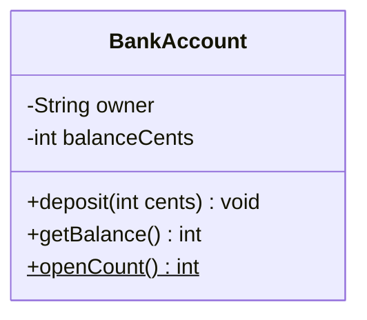

| Row | What goes there | Example |
| :--- | :--- | :--- |
| Top | Class name, `PascalCase` | `BankAccount` |
| Middle | Attributes: `visibility name : type` | `-balanceCents : int` |
| Bottom | Methods: `visibility name(params) return` | `+deposit(cents) void` |

### Visibility symbols

| Symbol | Meaning | Python | C# |
| :---: | :--- | :--- | :--- |
| `+` | public | `name` | `public` |
| `-` | private | `_name` (a convention) | `private` |
| `#` | protected | `_name` in a base class (convention) | `protected` |
| `~` | package / internal | module-level, no underscore | `internal` |

### Static and abstract

- **Static** members belong to the class, not to one object. Mermaid marks a static member with `$` at the end: `+openCount()$ int`. On paper they are underlined.
- **Abstract** members have no body. Mermaid marks them with `*`: `+area()* float`. On paper they are in *italics*.

### Stereotypes: the `<<label>>` above the name

| Stereotype | Meaning | Example |
| :--- | :--- | :--- |
| `<<interface>>` | A contract with no state | `Printable` |
| `<<abstract>>` | A class you cannot create directly | `Shape` |
| `<<enumeration>>` | A fixed set of named values | `OrderStatus` |

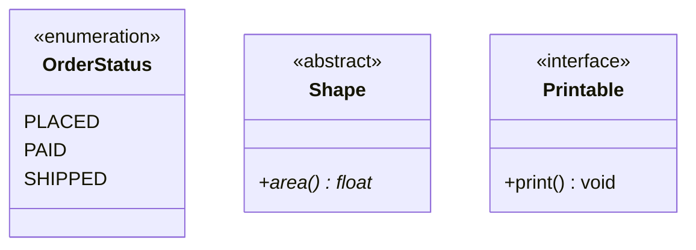

### The same class in code

````carousel
```python
class BankAccount:
    _open_count = 0                      # static: one copy for the class

    def __init__(self, owner: str) -> None:
        self._owner = owner              # - owner : str
        self._balance_cents = 0          # - balanceCents : int
        BankAccount._open_count += 1

    def deposit(self, cents: int) -> None:   # + deposit(cents) void
        if cents <= 0:
            raise ValueError("deposit must be positive")
        self._balance_cents += cents

    def get_balance(self) -> int:            # + getBalance() int
        return self._balance_cents

    @staticmethod
    def open_count() -> int:                 # + openCount()$ int
        return BankAccount._open_count


a = BankAccount("Asha")
a.deposit(500)
print(a.get_balance(), BankAccount.open_count())
```

<!-- slide -->

```csharp
public class BankAccount
{
    private static int _openCount;           // static: one copy for the class
    private readonly string _owner;          // - owner : string
    private int _balanceCents;               // - balanceCents : int

    public BankAccount(string owner)
    {
        _owner = owner;
        _openCount++;
    }

    public void Deposit(int cents)           // + Deposit(cents) void
    {
        if (cents <= 0) throw new ArgumentException("deposit must be positive");
        _balanceCents += cents;
    }

    public int GetBalance() => _balanceCents; // + GetBalance() int

    public static int OpenCount() => _openCount; // + OpenCount()$ int
}
```
````

### What to leave out of a box

Leave out getters and setters, constructors, and helper methods. Show only the **2 to 4 methods** that carry the story. If a box has twelve methods, the reader sees noise.

> [!TIP]
> **Common mistake:** Writing `getName()` and `setName()` in every box. A reader assumes they exist. Spend the space on behaviour: `deposit()`, `checkout()`, `assign()`.

---

## 3. Class vs object

A **class** is a blueprint. An **object** (also called an *instance*) is one real thing built from it.

| | Class | Object |
| :--- | :--- | :--- |
| Real-world | The idea of "a book" | *This* copy of *Dune* on shelf 4 |
| Exists | In your source code | In memory, while the program runs |
| Has | Attribute **names and types** | Attribute **values** |
| Count | One | Many |

### The class diagram

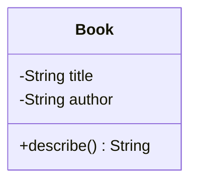

### The object diagram

UML also has an **object diagram**: a snapshot at one moment. Each box is titled `name : Class` and shows **values**, not types.

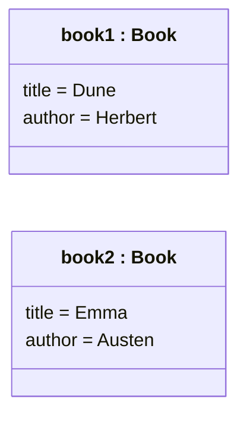

Mermaid has no special object diagram, so we borrow a class box and use a label. The same snapshot in plain text works everywhere:

```text
+---------------------+     +---------------------+
| book1 : Book        |     | book2 : Book        |
| title  = "Dune"     |     | title  = "Emma"     |
| author = "Herbert"  |     | author = "Austen"   |
+---------------------+     +---------------------+
```

In an interview, a small object diagram is the best way to explain *what the code builds at runtime* ("Here is one order with two lines").

````carousel
```python
class Book:
    def __init__(self, title: str, author: str) -> None:
        self._title = title
        self._author = author

    def describe(self) -> str:
        return f"{self._title} by {self._author}"


book1 = Book("Dune", "Herbert")   # object 1: book1 : Book
book2 = Book("Emma", "Austen")    # object 2: book2 : Book
print(book1.describe())
print(book2.describe())
print(book1 is book2)             # False: two different objects
```

<!-- slide -->

```csharp
public class Book
{
    private readonly string _title;
    private readonly string _author;

    public Book(string title, string author)
    {
        _title = title;
        _author = author;
    }

    public string Describe() => $"{_title} by {_author}";
}

// var book1 = new Book("Dune", "Herbert");   // book1 : Book
// var book2 = new Book("Emma", "Austen");    // book2 : Book
// Console.WriteLine(ReferenceEquals(book1, book2)); // False
```
````

> [!TIP]
> **Common mistake:** Putting values (`title = Dune`) in a class diagram, or types (`title : String`) in an object diagram. Class diagram: types. Object diagram: values.

Practice: [UML: One Class, Two Objects](/practice/code/uml-class-and-objects/).

---

## 4. Dependency: "A uses B for a moment"

| | |
| :--- | :--- |
| **Arrow** | dotted line with an open arrowhead, `A ..> B` |
| **Meaning** | A *uses* B. A does not keep B. |
| **Lifecycle question** | Does A remember B after the method ends? **No.** |
| **Real world** | A chef uses a knife while cooking. The chef does not own the knife. |
| **In code** | B is a **parameter**, a **local variable**, or a **return type** of a method of A. Never a field. |

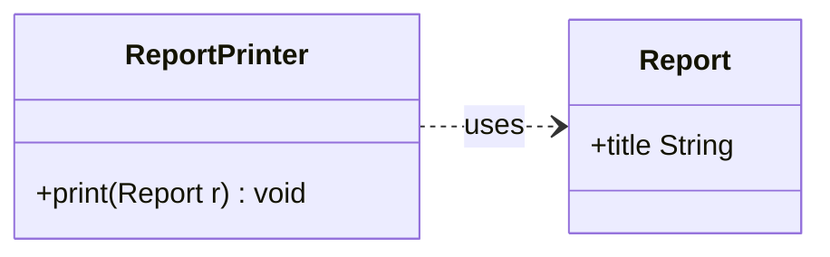

````carousel
```python
class Report:
    def __init__(self, title: str) -> None:
        self.title = title


class ReportPrinter:
    # No field holds a Report. It arrives, is used, and is forgotten.
    def print(self, report: Report) -> str:
        return f"=== {report.title} ==="


printer = ReportPrinter()
print(printer.print(Report("Sales")))
```

<!-- slide -->

```csharp
public class Report
{
    public string Title { get; }
    public Report(string title) => Title = title;
}

public class ReportPrinter
{
    // No field holds a Report. It is a parameter only.
    public string Print(Report report) => $"=== {report.Title} ===";
}
```
````

**Why it matters.** Dependencies are the cheapest coupling. A change in `Report` may break `ReportPrinter`, but the printer carries no hidden state.

> [!TIP]
> **Common mistake:** Drawing a solid line (association) when the class only takes the other as a parameter. Rule: *no field, no association.* Practice: [UML: Dependency](/practice/code/uml-dependency-report-printer/).

---

## 5. Association: "A knows B"

| | |
| :--- | :--- |
| **Arrow** | solid line, `A --> B` (one way) or `A -- B` (two ways) |
| **Meaning** | A **keeps a reference** to B and can use it later. |
| **Lifecycle question** | Does B live on its own, independent of A? **Yes.** |
| **Real world** | A student is enrolled in courses. A course has students. Neither owns the other. |
| **In code** | B is a **field** of A (or a list of B). |

### One-way (uni-directional) and two-way (bi-directional)

- `Student --> Course`: a student knows its courses. A course does not know its students.
- `Student "*" -- "*" Course`: both know each other. This costs more: you must keep both sides in sync.

**Default to one way.** Add the second direction only when you really need to navigate it.

### Roles, labels and multiplicity

A **label** on the line names the relationship (`enrolled in`). A **role** names the end (`students`, `courses`). **Multiplicity** says how many (section 10).

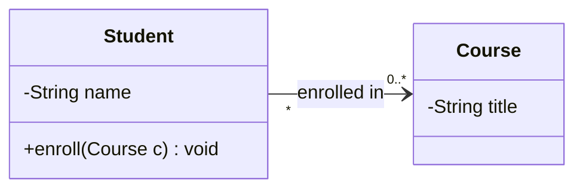

````carousel
```python
class Course:
    def __init__(self, title: str) -> None:
        self.title = title


class Student:
    def __init__(self, name: str) -> None:
        self.name = name
        self._courses: list[Course] = []        # the association: a field

    def enroll(self, course: Course) -> None:
        self._courses.append(course)

    def course_titles(self) -> list[str]:
        return [c.title for c in self._courses]


python = Course("Python")                # created OUTSIDE the student
amy = Student("Amy")
amy.enroll(python)
print(amy.course_titles())               # ['Python']
del amy                                  # the student is gone...
print(python.title)                      # ...the course lives on
```

<!-- slide -->

```csharp
public class Course
{
    public string Title { get; }
    public Course(string title) => Title = title;
}

public class Student
{
    public string Name { get; }
    private readonly List<Course> _courses = new();   // the association

    public Student(string name) => Name = name;

    public void Enroll(Course course) => _courses.Add(course);

    public IReadOnlyList<string> CourseTitles() =>
        _courses.Select(c => c.Title).ToList();
}
```
````

The signature of association: **B is created outside A and handed in.**

### Association class: when the link has its own data

Sometimes the *relationship* carries data. A student's **grade** belongs to neither the student nor the course. It belongs to the *pair*. Make the link its own class, called an **association class**, and connect it with a dotted line to the association.

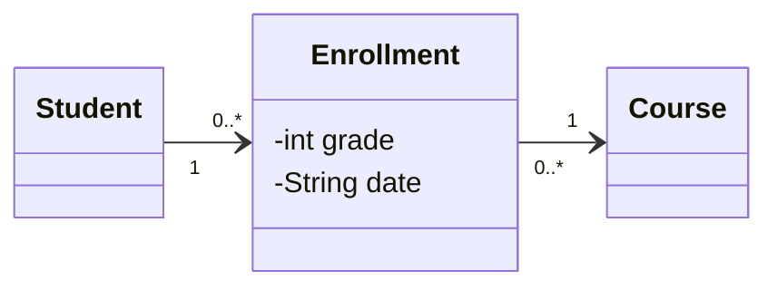

(Mermaid draws it as a middle class with two lines. On paper, the box hangs off the middle of one line by a dashed line.)

````carousel
```python
from dataclasses import dataclass


@dataclass
class Course:
    title: str


@dataclass
class Student:
    name: str


@dataclass
class Enrollment:           # the association class: the grade lives here
    student: Student
    course: Course
    grade: int | None = None


e = Enrollment(Student("Amy"), Course("Python"))
e.grade = 90
print(e.student.name, e.course.title, e.grade)
```

<!-- slide -->

```csharp
public record Course(string Title);
public record Student(string Name);

public class Enrollment               // the association class
{
    public Student Student { get; }
    public Course Course { get; }
    public int? Grade { get; set; }

    public Enrollment(Student student, Course course)
    {
        Student = student;
        Course = course;
    }
}
```
````

> [!TIP]
> **Common mistake:** Drawing every connection as a plain line, with no arrowhead and no multiplicity. An unlabelled `A -- B` could mean any of six things. Practice: [UML: Association](/practice/code/uml-association-students-courses/).

---

## 6. Aggregation: "A has B, but B can live without A"

| | |
| :--- | :--- |
| **Arrow** | line with a **hollow diamond** at the whole, `Whole o-- Part` |
| **Meaning** | A **whole-part** relation. The whole *gathers* parts. |
| **Lifecycle question** | If the whole is destroyed, do the parts survive? **Yes.** |
| **Real world** | A team has players. The team is disbanded, the players still exist and can join another team. |
| **In code** | Parts are **created outside** and **passed in**. The whole holds them in a list. |

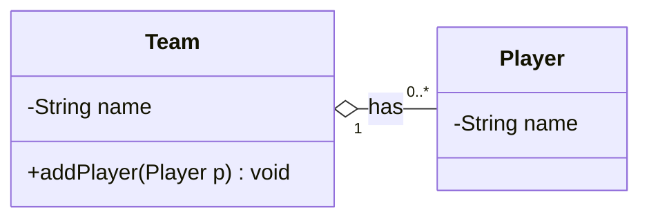

````carousel
```python
class Player:
    def __init__(self, name: str) -> None:
        self.name = name


class Team:
    def __init__(self, name: str) -> None:
        self.name = name
        self._players: list[Player] = []

    def add_player(self, player: Player) -> None:   # part arrives from outside
        self._players.append(player)

    def roster(self) -> list[str]:
        return [p.name for p in self._players]


ravi = Player("Ravi")
red = Team("Red")
red.add_player(ravi)
blue = Team("Blue")
blue.add_player(ravi)       # the same player can join another team
del red                     # disband Red...
print(ravi.name, blue.roster())   # ...Ravi still exists
```

<!-- slide -->

```csharp
public class Player
{
    public string Name { get; }
    public Player(string name) => Name = name;
}

public class Team
{
    public string Name { get; }
    private readonly List<Player> _players = new();

    public Team(string name) => Name = name;

    // The part arrives from outside. The team did not create it.
    public void AddPlayer(Player player) => _players.Add(player);

    public IReadOnlyList<string> Roster() =>
        _players.Select(p => p.Name).ToList();
}
```
````

**Honest note.** In code, aggregation and plain association look **the same** (a field holding a reference). The diamond is a *design statement*: "these are parts of a whole". Many teams skip it. UML 2 itself says its meaning is vague. But interviewers love asking, so know it.

> [!TIP]
> **Common mistake:** Using the hollow diamond for every "has a" relation "just in case". If you cannot name the whole and its parts, it is plain association. Practice: [UML: Aggregation](/practice/code/uml-aggregation-team-players/).

---

## 7. Composition: "A owns B, and B dies with A"

| | |
| :--- | :--- |
| **Arrow** | line with a **filled diamond** at the whole, `Whole *-- Part` |
| **Meaning** | A **owns** B. B has no life apart from A. |
| **Lifecycle question** | If the whole is destroyed, do the parts go too? **Yes.** |
| **Real world** | A house has rooms. Destroy the house and the rooms are gone. |
| **In code** | The whole **creates** its parts in its own constructor. Nobody else holds them. |

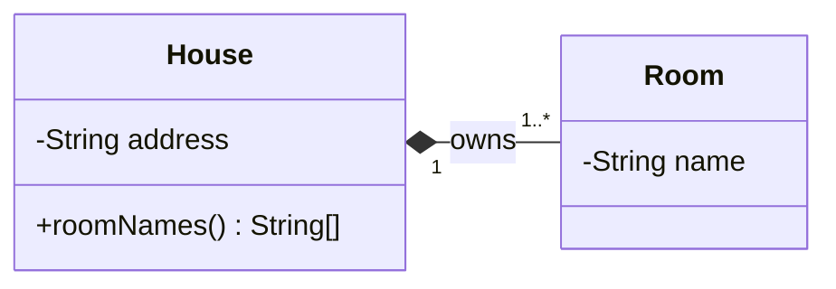

````carousel
```python
class Room:
    def __init__(self, name: str) -> None:
        self.name = name


class House:
    def __init__(self, address: str, room_names: list[str]) -> None:
        self.address = address
        # The house CREATES its rooms. Callers pass names, not Room objects.
        self._rooms = [Room(n) for n in room_names]

    def room_names(self) -> list[str]:
        return [r.name for r in self._rooms]


h = House("12 Park Road", ["Kitchen", "Bedroom"])
print(h.room_names())
```

<!-- slide -->

```csharp
public class Room
{
    public string Name { get; }
    public Room(string name) => Name = name;
}

public class House
{
    public string Address { get; }
    private readonly List<Room> _rooms;

    public House(string address, IEnumerable<string> roomNames)
    {
        Address = address;
        // The house CREATES its rooms. Callers pass names, not Room objects.
        _rooms = roomNames.Select(n => new Room(n)).ToList();
    }

    public IReadOnlyList<string> RoomNames() =>
        _rooms.Select(r => r.Name).ToList();
}
```
````

### The tell-tale signs of composition in code

1. The part is created with `new` / a constructor call **inside** the whole.
2. The part is **not** passed in by callers and **not** handed out for others to keep.
3. A part belongs to exactly **one** whole (multiplicity `1` on the diamond side).

> [!TIP]
> **Common mistake:** Using composition when the part is passed in from outside. `Airplane *-- Engine` is wrong if engines are swapped between planes. Also: drawing everything as composition, because it "feels strong". Practice: [UML: Composition](/practice/code/uml-composition-house-rooms/).

---

## 8. Inheritance (generalisation): "A is a kind of B"

| | |
| :--- | :--- |
| **Arrow** | solid line with a **hollow triangle** at the parent, `Parent <\|-- Child` |
| **Meaning** | Child **is a** Parent. It inherits attributes and methods and may override them. |
| **Lifecycle question** | None. It is a relation between *classes*, not between objects. One object is both. |
| **Real world** | A car is a vehicle. A bicycle is a vehicle. |
| **In code** | `class Car(Vehicle)` in Python, `class Car : Vehicle` in C#. |

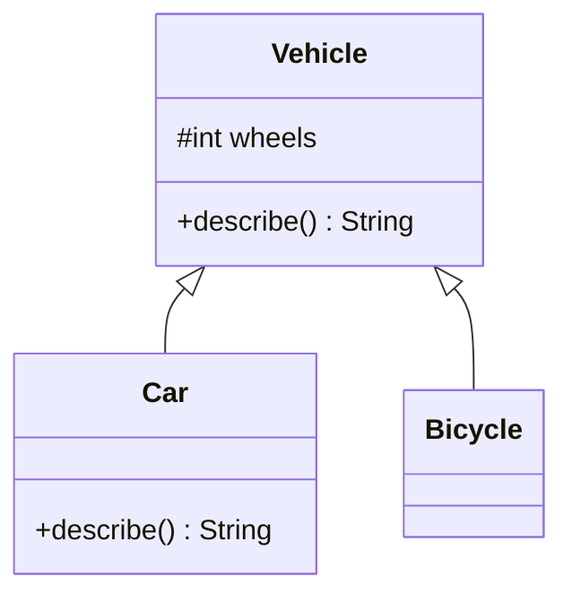

````carousel
```python
class Vehicle:
    def __init__(self, wheels: int) -> None:
        self._wheels = wheels

    def describe(self) -> str:
        return f"A vehicle with {self._wheels} wheels"


class Car(Vehicle):
    def __init__(self) -> None:
        super().__init__(4)

    def describe(self) -> str:                  # override
        return "A car. " + super().describe()


class Bicycle(Vehicle):
    def __init__(self) -> None:
        super().__init__(2)


for v in (Car(), Bicycle()):
    print(v.describe())
print(isinstance(Car(), Vehicle))   # True: a Car IS a Vehicle
```

<!-- slide -->

```csharp
public class Vehicle
{
    protected readonly int Wheels;
    public Vehicle(int wheels) => Wheels = wheels;

    public virtual string Describe() => $"A vehicle with {Wheels} wheels";
}

public class Car : Vehicle
{
    public Car() : base(4) { }

    public override string Describe() => "A car. " + base.Describe();
}

public class Bicycle : Vehicle
{
    public Bicycle() : base(2) { }
}
```
````

**The "is-a" test.** Say it aloud: *"A Car is a Vehicle."* True. *"A Stack is a List."* Only if a stack can do everything a list can, which it cannot. Then use composition (a stack **has** a list).

> [!TIP]
> **Common mistake:** Inheriting just to reuse code (`class Order(list)`). Inherit when the child can stand in anywhere the parent is expected. Otherwise hold the other class as a field. Practice: [UML: Inheritance](/practice/code/uml-inheritance-vehicles/).

---

## 9. Realization: "A promises what B demands"

| | |
| :--- | :--- |
| **Arrow** | **dotted** line with a **hollow triangle** at the interface, `Interface <\|.. Class` |
| **Meaning** | The class **implements** the interface: it keeps the promise. |
| **Lifecycle question** | None. It is a relation between types. |
| **Real world** | A plug socket (interface) and every device that fits it. |
| **In code** | Python: an abstract base class or a `Protocol`. C#: `class Pdf : IPrintable`. |

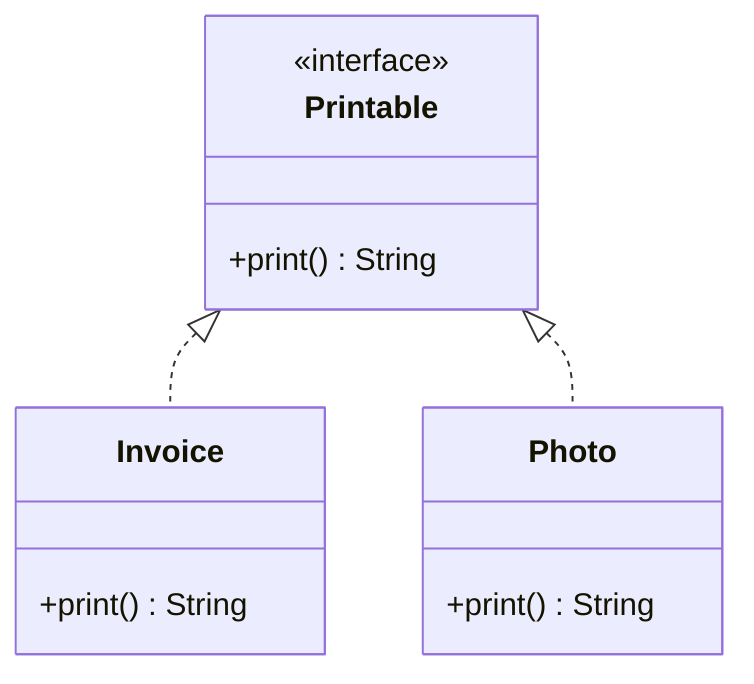

**How do you show an interface?** Two ways: put `<<interface>>` above the name, or draw it as a small circle (a "lollipop") on the class. Mermaid uses the stereotype.

````carousel
```python
from abc import ABC, abstractmethod


class Printable(ABC):               # <<interface>>
    @abstractmethod
    def print(self) -> str: ...


class Invoice(Printable):           # realization
    def print(self) -> str:
        return "Invoice #1"


class Photo(Printable):
    def print(self) -> str:
        return "Photo of a cat"


def print_all(items: list[Printable]) -> None:
    for item in items:                # depends on the interface only
        print(item.print())


print_all([Invoice(), Photo()])
```

<!-- slide -->

```csharp
public interface IPrintable            // <<interface>>
{
    string Print();
}

public class Invoice : IPrintable      // realization
{
    public string Print() => "Invoice #1";
}

public class Photo : IPrintable
{
    public string Print() => "Photo of a cat";
}

public static class Printing
{
    public static void PrintAll(IEnumerable<IPrintable> items)
    {
        foreach (var item in items) Console.WriteLine(item.Print());
    }
}
```
````

> [!TIP]
> **Common mistake:** Drawing a solid line with a triangle (inheritance) to an interface. Interface means **dotted**. Practice: [UML: Interface and Realization](/practice/code/uml-realization-printable/).

---

## 10. The strength ladder and multiplicity

### Strength ladder: from weakest to strongest

```text
Dependency   ..>    A uses B for one call           (weakest: no field)
Association  -->    A keeps a reference to B
Aggregation  o--    A has B as a part, B survives
Composition  *--    A owns B, B dies with A         (strongest whole-part)
Inheritance  <|--   A is a B                        (a different axis: tightest)
Realization  <|..   A keeps B's promise             (loose: depends on a contract)
```

**Rule:** always draw the **weakest** line that is true. Weaker coupling is easier to change.

### Multiplicity: how many?

| Written | Means | In code |
| :---: | :--- | :--- |
| `1` | exactly one | A **required** argument or field, never null |
| `0..1` | zero or one | An **optional** field: `Optional` / `X \| None` / `X?` |
| `*` or `0..*` | zero or many | A **list** that may be empty |
| `1..*` | one or many | A **list** that must not be empty (check in the constructor) |
| `2..5` | between two and five | A list with a validated size |

Read multiplicity **at the far end**: `Customer "1" --> "0..*" Order` says *one customer has zero or many orders*, and *each order belongs to one customer*.

````carousel
```python
from __future__ import annotations


class Address:
    def __init__(self, city: str) -> None:
        self.city = city


class OrderLine:
    def __init__(self, sku: str, qty: int) -> None:
        self.sku = sku
        self.qty = qty


class Order:
    def __init__(self, customer: str, lines: list[OrderLine],
                 note: str | None = None) -> None:
        if not lines:                                  # 1..*  -> must not be empty
            raise ValueError("an order needs at least one line")
        self.customer = customer                        # 1     -> required
        self.note = note                                # 0..1  -> may be None
        self.lines = list(lines)                        # *     -> a list


o = Order("Amy", [OrderLine("A1", 2)])
print(len(o.lines), o.note)
try:
    Order("Amy", [])
except ValueError as e:
    print("rejected:", e)
```

<!-- slide -->

```csharp
public class OrderLine
{
    public string Sku { get; }
    public int Qty { get; }
    public OrderLine(string sku, int qty) { Sku = sku; Qty = qty; }
}

public class Order
{
    public string Customer { get; }                  // 1    -> required
    public string? Note { get; }                     // 0..1 -> nullable
    private readonly List<OrderLine> _lines;         // *    -> a list

    public Order(string customer, IEnumerable<OrderLine> lines, string? note = null)
    {
        _lines = lines.ToList();
        if (_lines.Count == 0)                       // 1..* -> must not be empty
            throw new ArgumentException("an order needs at least one line");
        Customer = customer;
        Note = note;
    }

    public IReadOnlyList<OrderLine> Lines => _lines;
}
```
````

Practice: [UML: Multiplicity](/practice/code/uml-multiplicity-order-lines/).

---

## 11. How to decide: aggregation or composition?

Use two questions. Ask both.

1. **Lifecycle test.** *"If I delete the whole, should the part be deleted too?"* Yes: composition. No: aggregation or association.
2. **Ownership test.** *"Can the part belong to two wholes at the same time, or be moved to another whole?"* Yes: **not** composition. No (exactly one owner): composition.

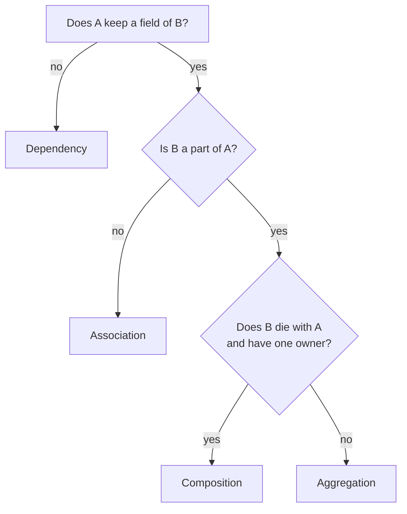

### Ten labelled examples

| # | Whole and part | Lifecycle test | Ownership test | Answer |
| :-: | :--- | :--- | :--- | :--- |
| 1 | House and Room | Rooms vanish with the house | One house | **Composition** |
| 2 | Order and OrderLine | Lines make no sense without the order | One order | **Composition** |
| 3 | Team and Player | Players survive | Players change teams | **Aggregation** |
| 4 | Library and Book | Books can be given away | Can move libraries | **Aggregation** |
| 5 | Car and Engine | Depends. A factory design: engine built into the car | One car | **Composition** (or aggregation in a repair-shop model where engines are swapped) |
| 6 | University and Department | Departments close with the university | One university | **Composition** |
| 7 | Department and Professor | Professors survive | Can move | **Aggregation** |
| 8 | Student and Course | Both live apart | Many to many | **Association** (not a whole-part) |
| 9 | Playlist and Song | Songs survive | In many playlists | **Aggregation** |
| 10 | Customer and Order | Orders are kept for audit, even if a customer account is closed | Order belongs to one customer | **Association** |

Example 5 shows the real answer: **it depends on the model**. The diagram records *your* design decision. Say your reasoning aloud and an interviewer will accept either.

> [!NOTE]
> **Shortcut for code.** If the whole's constructor does `new Part(...)` and no outside code ever holds a part, you have composition. If parts come in through the constructor or an `add` method, you have aggregation (or association).

Practice: [UML: Choose the Relationship](/practice/code/uml-choose-the-relationship/).

---

## 12. Reading a diagram aloud

Turn every line into one plain sentence. Do this for every diagram you draw.

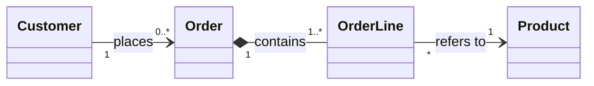

| Line | Say it |
| :--- | :--- |
| `Customer "1" --> "0..*" Order : places` | "One customer places zero or more orders. The customer knows its orders." |
| `Order "1" *-- "1..*" OrderLine` | "An order owns one or more lines. Delete the order and its lines go too." |
| `OrderLine "*" --> "1" Product` | "Each line refers to exactly one product. Many lines may refer to the same product. The product lives on if the line is deleted." |

If you cannot say the sentence, the line is wrong or missing something.

---

## 13. From a requirements paragraph to a diagram (the noun and verb method)

**Method.**

1. Read the paragraph. **Underline the nouns**: candidate classes.
2. **Underline the verbs**: candidate methods, and also hints of relationships.
3. Throw away nouns that are only **attributes** (name, price, date) or are outside the system.
4. For each pair, ask the two questions: *keep or use?* *die together?* Pick the arrow.
5. Add multiplicity. Add `<<interface>>` where behaviour varies.
6. Write the code from the diagram. Check it reads back to the same diagram.

### Worked example: a small online shop

> *A **customer** places **orders**. An order has one or more **lines**; each line is for a **product** and a **quantity**. An order is **paid** with a **payment method**: card or cash. The order can **calculate its total**. A customer keeps several **addresses**.*

**Step 1 and 2: nouns and verbs.**

| Noun | Decision |
| :--- | :--- |
| customer | class `Customer` |
| order | class `Order` |
| line | class `OrderLine` |
| product | class `Product` |
| quantity | attribute of `OrderLine` |
| payment method (card, cash) | interface `PaymentMethod` with two classes |
| total | method `total()` on `Order` |
| address | class `Address` |

| Verb | Becomes |
| :--- | :--- |
| places | `Customer` knows its orders |
| has lines | `Order` owns `OrderLine` |
| is for a product | `OrderLine` refers to `Product` |
| is paid | `Order.pay(method)`: a dependency on `PaymentMethod` |
| calculate total | `Order.total()` |

**Step 4: pick each arrow.**

| Pair | Questions | Arrow |
| :--- | :--- | :--- |
| Customer, Order | Keeps? Yes. Dies together? No (audit) | association `-->` |
| Order, OrderLine | Part? Yes. Dies together? Yes | composition `*--` |
| OrderLine, Product | Keeps? Yes. Dies together? No | association `-->` |
| Order, PaymentMethod | Only a parameter of `pay` | dependency `..>` |
| Card/Cash, PaymentMethod | Implements | realization `<\|..` |
| Customer, Address | Part? Yes. One owner, dies together | composition `*--` |

**Step 5: the diagram.**

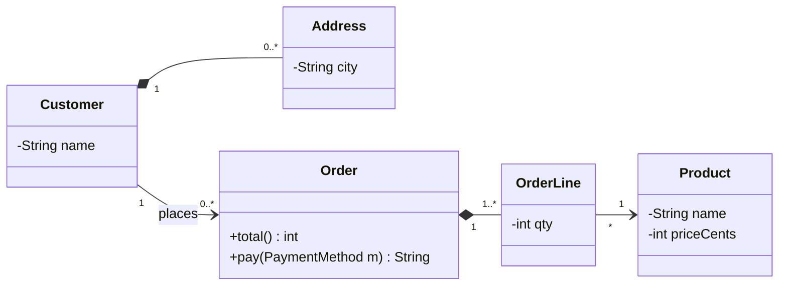

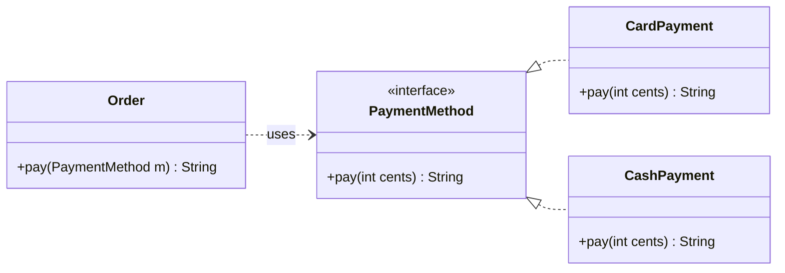

(Two small diagrams are easier to read than one big one. Split by theme.)

**Step 6: the code.**

````carousel
```python
from __future__ import annotations
from abc import ABC, abstractmethod


class PaymentMethod(ABC):                       # <<interface>>
    @abstractmethod
    def pay(self, cents: int) -> str: ...


class CardPayment(PaymentMethod):
    def __init__(self, last4: str) -> None:
        self._last4 = last4

    def pay(self, cents: int) -> str:
        return f"Paid {cents} by card ending {self._last4}"


class CashPayment(PaymentMethod):
    def pay(self, cents: int) -> str:
        return f"Paid {cents} in cash"


class Product:
    def __init__(self, name: str, price_cents: int) -> None:
        self.name = name
        self.price_cents = price_cents


class OrderLine:
    def __init__(self, product: Product, qty: int) -> None:
        self._product = product                  # association: field
        self._qty = qty

    def subtotal(self) -> int:
        return self._product.price_cents * self._qty


class Order:
    def __init__(self, items: list[tuple[Product, int]]) -> None:
        if not items:
            raise ValueError("an order needs at least one line")
        # composition: the order creates its own lines
        self._lines = [OrderLine(p, q) for p, q in items]

    def total(self) -> int:
        return sum(line.subtotal() for line in self._lines)

    def pay(self, method: PaymentMethod) -> str:   # dependency: parameter only
        return method.pay(self.total())


class Address:
    def __init__(self, city: str) -> None:
        self.city = city


class Customer:
    def __init__(self, name: str, cities: list[str]) -> None:
        self.name = name
        self._addresses = [Address(c) for c in cities]   # composition
        self._orders: list[Order] = []                    # association

    def place(self, order: Order) -> None:
        self._orders.append(order)

    def order_count(self) -> int:
        return len(self._orders)


pen = Product("Pen", 150)
book = Product("Book", 1200)
order = Order([(pen, 2), (book, 1)])
amy = Customer("Amy", ["Pune"])
amy.place(order)
print(order.total(), amy.order_count())
print(order.pay(CardPayment("4242")))
print(order.pay(CashPayment()))
```

<!-- slide -->

```csharp
public interface IPaymentMethod
{
    string Pay(int cents);
}

public class CardPayment : IPaymentMethod
{
    private readonly string _last4;
    public CardPayment(string last4) => _last4 = last4;
    public string Pay(int cents) => $"Paid {cents} by card ending {_last4}";
}

public class CashPayment : IPaymentMethod
{
    public string Pay(int cents) => $"Paid {cents} in cash";
}

public record Product(string Name, int PriceCents);

public class OrderLine
{
    private readonly Product _product;          // association: field
    private readonly int _qty;

    public OrderLine(Product product, int qty)
    {
        _product = product;
        _qty = qty;
    }

    public int Subtotal() => _product.PriceCents * _qty;
}

public class Order
{
    private readonly List<OrderLine> _lines;

    public Order(IEnumerable<(Product Product, int Qty)> items)
    {
        // composition: the order creates its own lines
        _lines = items.Select(i => new OrderLine(i.Product, i.Qty)).ToList();
        if (_lines.Count == 0)
            throw new ArgumentException("an order needs at least one line");
    }

    public int Total() => _lines.Sum(l => l.Subtotal());

    // dependency: the payment method is a parameter only
    public string Pay(IPaymentMethod method) => method.Pay(Total());
}

public class Address
{
    public string City { get; }
    public Address(string city) => City = city;
}

public class Customer
{
    public string Name { get; }
    private readonly List<Address> _addresses;              // composition
    private readonly List<Order> _orders = new();           // association

    public Customer(string name, IEnumerable<string> cities)
    {
        Name = name;
        _addresses = cities.Select(c => new Address(c)).ToList();
    }

    public void Place(Order order) => _orders.Add(order);
    public int OrderCount() => _orders.Count;
}
```
````

Notice how each arrow shows up in the code: **dependency** = parameter, **association** = field set from outside, **composition** = `new` inside the constructor, **realization** = `extends` an interface.

---

## 14. From code back to a diagram

You will often get code and be asked to draw it. Use this table.

| You see in the code | Draw |
| :--- | :--- |
| `class A(B)` / `class A : B` where B is a class | `B <\|-- A` |
| `class A(B)` / `class A : IB` where B is an interface | `IB <\|.. A` |
| A field of type B, passed in | `A --> B` (or `o--` if it is a part) |
| A field of type `list[B]`, parts passed in | `A "1" o-- "*" B` |
| A field created with `new B()` inside A | `A *-- B` |
| B appears only in a parameter, local variable or return | `A ..> B` |
| Field type is a primitive (`int`, `str`) | An attribute in the box, no line |

### Exercise: read this and draw it

````carousel
```python
class Engine:
    def start(self) -> str:
        return "vroom"


class Driver:
    def __init__(self, name: str) -> None:
        self.name = name


class Garage:
    def inspect(self, car: "Car") -> str:
        return car.model


class Car:
    def __init__(self, model: str, driver: Driver) -> None:
        self.model = model
        self._engine = Engine()      # created inside
        self._driver = driver        # passed in

    def start(self) -> str:
        return self._engine.start()
```

<!-- slide -->

```csharp
public class Engine
{
    public string Start() => "vroom";
}

public class Driver
{
    public string Name { get; }
    public Driver(string name) => Name = name;
}

public class Garage
{
    public string Inspect(Car car) => car.Model;
}

public class Car
{
    public string Model { get; }
    private readonly Engine _engine = new();   // created inside
    private readonly Driver _driver;           // passed in

    public Car(string model, Driver driver)
    {
        Model = model;
        _driver = driver;
    }

    public string Start() => _engine.Start();
}
```
````

**Answer:** `Car *-- Engine` (created inside), `Car --> Driver` (passed in, kept), `Garage ..> Car` (parameter only).

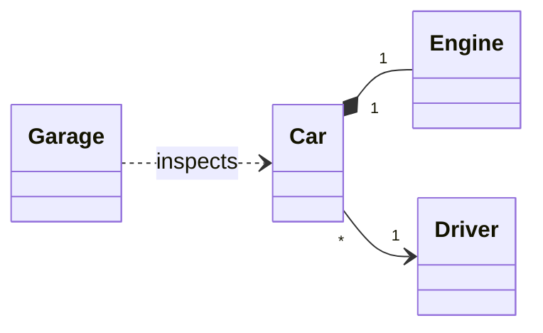

Practice: [UML and Code: Mini Library](/practice/code/uml-library-capstone/).

---

## 15. A companion: the sequence diagram

A class diagram shows the **structure**. A **sequence diagram** shows **one scenario over time**: who calls whom, in what order. Use it for "what happens when the user pays?".

- Each participant has a vertical **lifeline**.
- `->>` is a call. `-->>` is a reply.
- Time flows **down**.

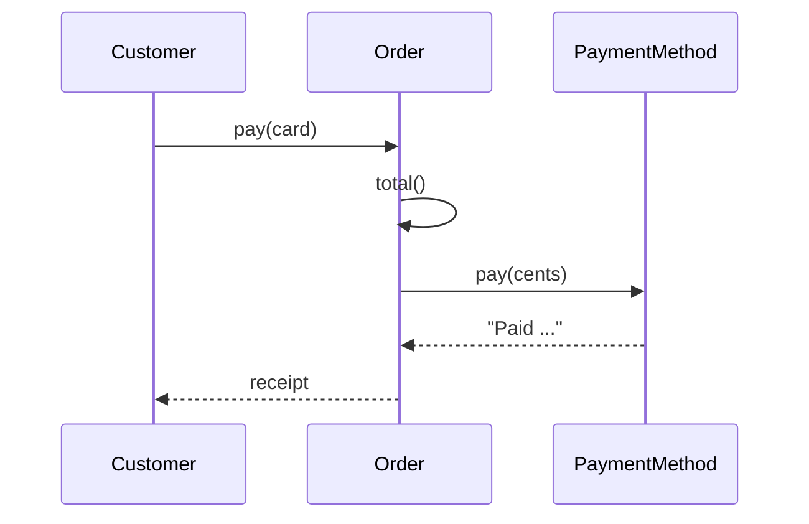

Read it: *The customer asks the order to pay with a card. The order works out its total. It asks the payment method to pay that amount. The payment method answers, and the order returns a receipt.*

Every arrow in the sequence diagram must match a **method** on the class diagram. If the order calls `P.pay()`, then `PaymentMethod` must list `pay()`. That is the best check you have that both diagrams agree.

---

## 16. Common mistakes and anti-patterns

| Mistake | Why it hurts | Fix |
| :--- | :--- | :--- |
| Every association drawn as a plain line | Reader cannot tell field from parameter | Use `-->` with direction, and `..>` for parameters |
| Everything is composition | Hides the real lifecycle; hard to reuse parts | Apply the lifecycle and ownership tests |
| Aggregation everywhere "just in case" | The diamond carries no information | Use plain association unless there is a real whole-part |
| Both directions drawn without need | Two things to keep in sync | One direction by default |
| No multiplicity | `1` or many? Nobody knows | Add `1`, `0..1`, `*`, `1..*` |
| Getters and setters in boxes | Noise hides the behaviour | Show only the methods that carry the story |
| Too many classes (20+ on the board) | Reader gets lost | Split by theme. 5 to 8 boxes per diagram |
| Inheritance used only for code reuse | Breaks substitution | Compose instead |
| Solid triangle line to an interface | Wrong arrow | Dotted line with hollow triangle |
| Diagram and code disagree | The diagram is a lie | Redraw from the code, or fix the code |
| Drawing `Customer --> String` | Primitives are attributes | Put `name : String` inside the box |

---

## 17. What you would say in two minutes

> "A class diagram has boxes for classes and lines for relationships. I draw the weakest line that is true. If a class only takes another as a parameter, that is a **dependency**, a dotted arrow. If it keeps a reference in a field, that is an **association**, a solid arrow, with multiplicity. If the reference is a *part of a whole* and the part can live on its own, like players in a team, that is **aggregation**, a hollow diamond. If the whole creates the part and the part dies with it, like rooms in a house, that is **composition**, a filled diamond. **Inheritance** is a solid line with a hollow triangle, for a real is-a. **Realization** is the same triangle on a dotted line, for a class that implements an interface. I add multiplicity at the ends and read every line back as a sentence. In code: composition means the whole does `new Part()`; aggregation means the parts are passed in; dependency means the other class is only a parameter."

---

## 18. Cheat sheet

| Relationship | Mermaid | Line look | Lifecycle | In code | Example |
| :--- | :--- | :--- | :--- | :--- | :--- |
| Dependency | `A ..> B` | dotted, open arrow | none | parameter / local | Printer uses Report |
| Association | `A --> B` | solid, open arrow | independent | field set from outside | Student and Course |
| Aggregation | `A o-- B` | hollow diamond | parts outlive whole | list, parts passed in | Team and Player |
| Composition | `A *-- B` | filled diamond | parts die with whole | `new` in constructor | House and Room |
| Inheritance | `P <\|-- C` | solid, hollow triangle | n/a | `class C(P)` / `C : P` | Car is a Vehicle |
| Realization | `I <\|.. C` | dotted, hollow triangle | n/a | implements interface | Invoice is Printable |

| Multiplicity | Meaning | Code |
| :---: | :--- | :--- |
| `1` | exactly one | required field |
| `0..1` | optional | `None` / `null` allowed |
| `*` | zero or many | list |
| `1..*` | at least one | non-empty list |

| Visibility | `+` public | `-` private | `#` protected | `~` package |
| :--- | :---: | :---: | :---: | :---: |

---

## 19. Practice: eight exercises

Do each one on paper first. Then open the answer.

### Exercise 1. Name the arrow

For each pair, say the arrow: (a) `Teacher` and `Classroom` (a teacher is assigned a classroom), (b) `Document` and `Paragraph`, (c) `Dog` and `Animal`, (d) `Logger` and `Message` (logger has `log(Message m)` only).

<details>
<summary>Answer</summary>

(a) association `-->` (both live apart). (b) composition `*--` (paragraphs belong to one document and die with it). (c) inheritance `Animal <|-- Dog`. (d) dependency `Logger ..> Message`.
</details>

### Exercise 2. Class to code

Write the diagram and the code for `Rectangle` with private `width` and `height`, and a public `area()`.

<details>
<summary>Answer</summary>

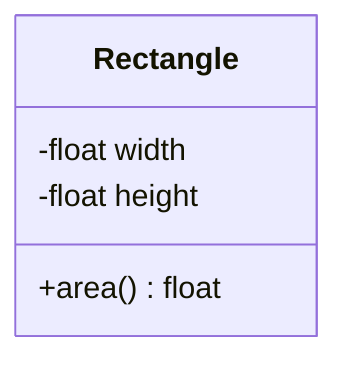

```python
class Rectangle:
    def __init__(self, width: float, height: float) -> None:
        self._width = width
        self._height = height

    def area(self) -> float:
        return self._width * self._height


print(Rectangle(3, 4).area())
```

```csharp
public class Rectangle
{
    private readonly double _width, _height;
    public Rectangle(double width, double height) { _width = width; _height = height; }
    public double Area() => _width * _height;
}
```
</details>

### Exercise 3. Two objects

Draw an object diagram: two `Player` objects `p1` and `p2` in one `Team` called "Red".

<details>
<summary>Answer</summary>

```text
red : Team            p1 : Player        p2 : Player
name = "Red"          name = "Ravi"      name = "Sita"
   o---------------------^                    ^
   o------------------------------------------+
```

The team holds two references. The objects are separate boxes. The diamond end is at `red`.
</details>

### Exercise 4. Aggregation or composition?

Decide: (a) `Playlist` and `Song`, (b) `Invoice` and `InvoiceLine`, (c) `Company` and `Employee`.

<details>
<summary>Answer</summary>

(a) Aggregation: songs survive and sit in many playlists. (b) Composition: a line has no meaning without its invoice. (c) Aggregation: employees live on if the company closes (they go elsewhere). Say your reason aloud.
</details>

### Exercise 5. Spot the bug in the code

This code claims `Library *-- Book` (composition). What is wrong?

```python
class Library:
    def __init__(self, books):
        self._books = books      # list passed in from outside
```

<details>
<summary>Answer</summary>

The books are passed in, so the library did not create them. That is **aggregation** (`o--`). For composition, the library would build its own `Book` objects from data, for example from titles.
</details>

### Exercise 6. Add the interface

`Dog` and `Robot` can both `speak()`. A `Speaker` function takes either. Draw it and code it.

<details>
<summary>Answer</summary>

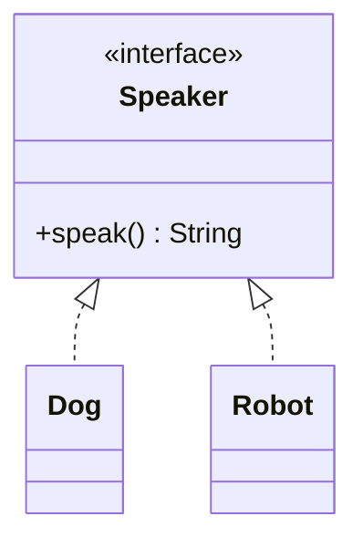

```python
from abc import ABC, abstractmethod


class Speaker(ABC):
    @abstractmethod
    def speak(self) -> str: ...


class Dog(Speaker):
    def speak(self) -> str:
        return "Woof"


class Robot(Speaker):
    def speak(self) -> str:
        return "Beep"


def announce(s: Speaker) -> str:
    return s.speak()


print(announce(Dog()), announce(Robot()))
```

```csharp
public interface ISpeaker { string Speak(); }
public class Dog : ISpeaker { public string Speak() => "Woof"; }
public class Robot : ISpeaker { public string Speak() => "Beep"; }
```
</details>

### Exercise 7. Multiplicity to code

`Flight "1" --> "0..1" Pilot` and `Flight "1" --> "1..*" Passenger`. Write the constructor.

<details>
<summary>Answer</summary>

```python
class Pilot: ...
class Passenger: ...


class Flight:
    def __init__(self, passengers: list[Passenger], pilot: Pilot | None = None) -> None:
        if not passengers:                 # 1..*
            raise ValueError("at least one passenger")
        self._passengers = list(passengers)
        self._pilot = pilot                # 0..1


print(Flight([Passenger()])._pilot)
```

```csharp
public class Flight
{
    private readonly List<Passenger> _passengers;
    private readonly Pilot? _pilot;           // 0..1
    public Flight(IEnumerable<Passenger> passengers, Pilot? pilot = null)
    {
        _passengers = passengers.ToList();
        if (_passengers.Count == 0) throw new ArgumentException("at least one passenger");
        _pilot = pilot;
    }
}
public class Pilot { }
public class Passenger { }
```
</details>

### Exercise 8. Code to diagram

Draw this: `class Cart: def __init__(self): self._items = []`, `def add(self, product): self._items.append(product)`, `def checkout(self, payer): return payer.charge(self.total())`.

<details>
<summary>Answer</summary>

`Cart` keeps `Product`s passed in through `add`: `Cart "1" o-- "*" Product` (aggregation, or plain association). `Cart` uses `payer` only as a parameter: `Cart ..> Payer`.

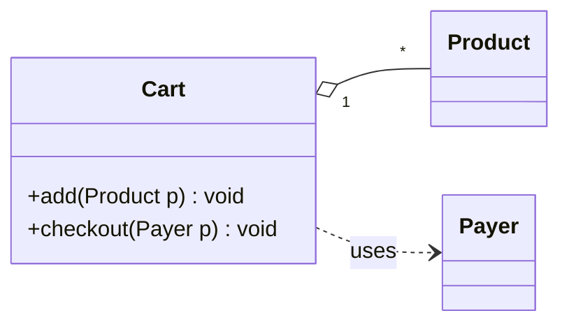
</details>

---

## 20. Mini project: a tiny library, drawn and coded

Build the model, in both Python and C#, and draw it.

**Requirements.**

- A `Library` has many `Book`s and many `Member`s.
- A `Book` is either a `PrintedBook` or an `EBook` (inheritance). Both are `Borrowable` (realization).
- A `Member` can borrow up to three books. A loan records the **due date** (association class `Loan`).
- A `Library` has several **shelves**, created by the library (composition). A shelf holds book **ids**.
- `Library.report(printer)` takes a `ReportPrinter` (dependency).

**Steps.**

1. List the nouns and verbs.
2. Draw one class diagram of at most eight boxes. Pick every arrow with the questions from sections 11 and 13.
3. Write the Python. Make sure composition uses `new` inside, and aggregation takes parts from outside.
4. Write the C#. Match the diagram line for line.
5. Draw a sequence diagram for "a member borrows a book".
6. Read every line of the class diagram aloud.

**Check yourself.** The same project is available as a code problem where the diagram and the code are both checked: [UML and Code: Mini Library](/practice/code/uml-library-capstone/).

### All the practice problems in one place

| Problem | Skill |
| :--- | :--- |
| [UML: One Class, Two Objects](/practice/code/uml-class-and-objects/) | class vs object |
| [UML: Association](/practice/code/uml-association-students-courses/) | field reference, multiplicity |
| [UML: Aggregation](/practice/code/uml-aggregation-team-players/) | parts outlive the whole |
| [UML: Composition](/practice/code/uml-composition-house-rooms/) | whole creates the parts |
| [UML: Choose the Relationship](/practice/code/uml-choose-the-relationship/) | decide the arrow |
| [UML: Inheritance](/practice/code/uml-inheritance-vehicles/) | is-a |
| [UML: Dependency](/practice/code/uml-dependency-report-printer/) | parameter only |
| [UML: Interface and Realization](/practice/code/uml-realization-printable/) | interface |
| [UML: Multiplicity](/practice/code/uml-multiplicity-order-lines/) | `1`, `0..1`, `*`, `1..*` |
| [UML and Code: Mini Library](/practice/code/uml-library-capstone/) | everything together |

---

## 21. Interview questions

<details>
<summary><strong>1. Aggregation vs composition: what is the difference? [BASIC]</strong></summary>

Both are whole-part. In **aggregation** the parts can live without the whole and may be shared or moved (team and players). In **composition** the whole owns the parts: it creates them and they die with it (house and rooms). I use the lifecycle test ("delete the whole: does the part go?") and the ownership test ("can the part belong to two wholes?"). In code, composition means `new Part()` inside the whole; aggregation means parts are passed in.
</details>

<details>
<summary><strong>2. Association vs dependency? [BASIC]</strong></summary>

Association is a **structural** link: the class keeps a reference in a field, so it knows the other across method calls. Dependency is **temporary**: the other class is a parameter, a local variable, or a return type, and is forgotten when the method ends. Association is a solid arrow, dependency is dotted.
</details>

<details>
<summary><strong>3. How do you show an interface on a class diagram? [BASIC]</strong></summary>

Put `<<interface>>` above the name (or draw a lollipop). A class that implements it is connected with a **dotted line and a hollow triangle** pointing at the interface (realization). A class that only uses the interface has a dotted arrow (dependency) or solid arrow (association, if it keeps one in a field) to it.
</details>

<details>
<summary><strong>4. What does multiplicity mean and how does it appear in code? [BASIC]</strong></summary>

It says how many objects sit at one end of a line. `1` is a required field. `0..1` is optional (`None`, `null`). `*` is a list that can be empty. `1..*` is a list that must have at least one item, which I check in the constructor.
</details>

<details>
<summary><strong>5. Is a Python list of objects aggregation or composition? [TRICKY]</strong></summary>

The list itself says nothing. It depends on **who created the objects** and **who else holds them**. If the container builds them and nobody else keeps them, it is composition. If they come from outside and can outlive the container, it is aggregation or association.
</details>

<details>
<summary><strong>6. Why default to a one-way association? [BASIC]</strong></summary>

Two-way links need both sides kept in sync (add a student to a course and the course to the student). That is where bugs come from. One way is simpler and easier to change. Add the other direction only if you really need to navigate it.
</details>

<details>
<summary><strong>7. When is an association class needed? [BASIC]</strong></summary>

When the **relationship** has its own data. A grade belongs to the pair (student, course), not to either one. Make `Enrollment` its own class holding both references and the grade.
</details>

<details>
<summary><strong>8. Inheritance vs composition: when to pick which? [SCENARIO]</strong></summary>

Inherit for a true is-a where the child can replace the parent anywhere (Liskov). Compose for everything else. A `Stack` is not a `List` (it should not expose `insert(0, x)`), so a stack **has** a list. Composition also lets you swap behaviour at runtime.
</details>

<details>
<summary><strong>9. You see a field created with `new` inside a constructor. Which arrow? [SCENARIO]</strong></summary>

Composition, a filled diamond, assuming no one else gets hold of that object. If the object is also handed out and kept by others, the ownership claim is weak and I would say so.
</details>

<details>
<summary><strong>10. Turn "a library lends books to members" into a diagram. Talk me through it. [SCENARIO]</strong></summary>

Nouns: Library, Book, Member. Verb: lends, which is a `Loan` with a due date, so an association class between Member and Book. Library holds books and members passed in: aggregation, `Library "1" o-- "*" Book`. Member to Loan to Book is association. I add multiplicity (`Member "1" --> "0..3" Loan`) and read each line aloud to check it.
</details>

---

## Further reading

- [UML class diagrams](https://www.uml-diagrams.org/class-diagrams-overview.html) · uml-diagrams.org overview of class diagram notation
- [Association, aggregation and composition](https://www.uml-diagrams.org/association.html) · uml-diagrams.org on association ends, multiplicity and shared vs composite aggregation
- [Mermaid class diagrams](https://mermaid.js.org/syntax/classDiagram.html) · full Mermaid `classDiagram` syntax used in this chapter
- [Mermaid sequence diagrams](https://mermaid.js.org/syntax/sequenceDiagram.html) · the sequence syntax from section 15
- [UML Distilled (Martin Fowler)](https://martinfowler.com/books/umlDistilled.html) · the short, practical book on using UML
- [Python data model](https://docs.python.org/3/reference/datamodel.html) · how objects, classes and `__init__` really work
- [abc: Abstract Base Classes](https://docs.python.org/3/library/abc.html) · Python's way to write an interface
- [C# interfaces](https://learn.microsoft.com/en-us/dotnet/csharp/fundamentals/types/interfaces) · Microsoft Learn on interfaces in C#
- [C# inheritance](https://learn.microsoft.com/en-us/dotnet/csharp/fundamentals/object-oriented/inheritance) · Microsoft Learn on base classes, `virtual` and `override`

## Next

[03 · Generics, Exceptions and Value Objects](../03-generics-exceptions-and-value-objects/README.md)
