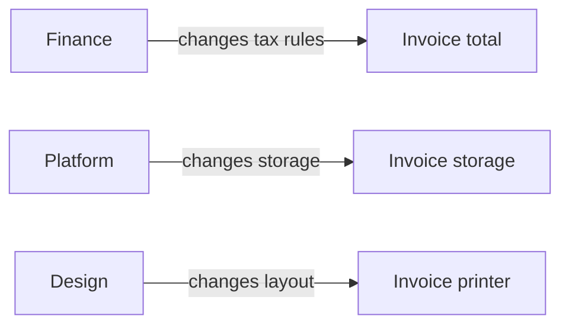

# 01 · Single Responsibility Principle (SRP)

> **Prerequisites:** [01 · Classes & Objects](../../01-classes-objects-and-oop-building-blocks/README.md) and the one-page [SOLID overview](../../04-solid-principles/README.md).  
> **Reading time:** ~30 minutes  
> **Audience:** developers who have heard "a class should do one thing" and want the real rule, with code to refactor and drills to practise

> [!NOTE]
> **In one line:** A class should have **one reason to change**. A reason to change is a person or team who can ask for a change, so *"who would ask for this to change?"* is the question that finds the seams.

> [!TIP]
> **Golden rule:** Do not count methods. Count the **groups of people** who would edit the class. Finance, operations and design should not be editing the same file.

> [!TIP]
> **Try it:** Take the quiz [SRP: Single Responsibility Principle](/practice/quiz/srp-single-responsibility/) first, without reading on. Then read this lesson and take it again.

---

## 1. Roadmap

| Step | What you do | Section |
| :--- | :--- | :--- |
| 1 | See a class that does too much | 2 |
| 2 | State the principle precisely | 3 |
| 3 | Split it, in Python and in C# | 4, 5 |
| 4 | Learn when to stop splitting | 6 |
| 5 | Practise on three drills with answers | 7 |
| 6 | Say it in an interview | 8 |

After this lesson you can find the responsibilities in a class by naming its **actors**, split it without creating a pile of one-method classes, and explain why a split made the code easier to change and to test.

---

## 2. The smell: one class, three bosses

An `Invoice` class that totals the lines, saves itself to a database and prints itself as text:

```python
class Invoice:
    def __init__(self, lines):
        self.lines = lines            # list of (name, qty, unit_price)

    def total(self):                  # the finance team owns this rule
        return sum(q * p for _, q, p in self.lines)

    def save(self, db):               # the platform team owns storage
        db.append({"lines": self.lines, "total": self.total()})

    def render(self):                 # the design team owns the layout
        rows = [f"{n} x{q} @ {p:.2f}" for n, q, p in self.lines]
        return "\n".join(rows + [f"TOTAL {self.total():.2f}"])


db = []
inv = Invoice([("pen", 2, 1.5), ("book", 1, 12.0)])
inv.save(db)
print(inv.render())
print(len(db))
```

Output:

```text
pen x2 @ 1.50
book x1 @ 12.00
TOTAL 15.00
1
```

It works. The trouble shows up later:

- Finance changes the rounding rule, and the same edit risks the layout.
- Design adds a column to the print-out, and a merge conflict appears with the database change.
- A test of `total()` has to build an object that also knows about databases and layout.
- Each team deploys the same file, so each team can break the others.

---

## 3. The principle, stated precisely

The principle comes from Robert C. Martin. His wording changed over the years, and the later wording is the useful one:

> *A module should be responsible to one, and only one, actor.* (Clean Architecture, 2017)

An **actor** is a group of people who want the code to change for the same reason: the finance team, the operations team, a regulator, a design team. So:

- **Responsibility** means *a reason to change*, which comes from an actor.
- **Cohesion** is how strongly the parts of a class belong together. High cohesion means they change together.
- **Coupling** is how much one class must know about another. SRP lowers the accidental coupling between actors.



A class that sits where all three arrows land is a class with three bosses.

> [!NOTE]
> SRP is **not** "a class has one method" and **not** "a function does one thing". A function that does one thing is a good habit (a separate idea). SRP is about **who can ask for a change**.

---

## 4. The fix in Python

Split by actor. The data stays in a small class, and each concern gets its own collaborator:

```python
class Invoice:
    """Data and the money rule. Finance owns it."""
    def __init__(self, lines):
        self.lines = lines

    def total(self):
        return sum(q * p for _, q, p in self.lines)


class InvoiceRepository:
    """Storage. The platform team owns it."""
    def __init__(self, db):
        self._db = db

    def save(self, invoice):
        self._db.append({"lines": invoice.lines, "total": invoice.total()})


class InvoicePrinter:
    """Layout. The design team owns it."""
    def render(self, invoice):
        rows = [f"{n} x{q} @ {p:.2f}" for n, q, p in invoice.lines]
        return "\n".join(rows + [f"TOTAL {invoice.total():.2f}"])


db = []
inv = Invoice([("pen", 2, 1.5), ("book", 1, 12.0)])
InvoiceRepository(db).save(inv)
print(InvoicePrinter().render(inv))
print(len(db))
```

The output is the same as before:

```text
pen x2 @ 1.50
book x1 @ 12.00
TOTAL 15.00
1
```

What changed:

| Before | After |
| :--- | :--- |
| One class, three reasons to change | Three classes, one reason each |
| Testing `total()` needs a database object in scope | `Invoice` is tested with a list, nothing else |
| Layout change edits the money class | Layout change edits only `InvoicePrinter` |
| Storage change risks the printer | Storage change touches only `InvoiceRepository` |

---

## 5. The same fix in C#

```csharp
public record InvoiceLine(string Name, int Qty, decimal UnitPrice);

public class Invoice
{
    public IReadOnlyList<InvoiceLine> Lines { get; }
    public Invoice(IEnumerable<InvoiceLine> lines) => Lines = lines.ToList();

    // Finance owns this rule.
    public decimal Total() => Lines.Sum(l => l.Qty * l.UnitPrice);
}

public class InvoiceRepository
{
    private readonly List<(IReadOnlyList<InvoiceLine> Lines, decimal Total)> _db;
    public InvoiceRepository(List<(IReadOnlyList<InvoiceLine>, decimal)> db) => _db = db;

    // The platform team owns storage.
    public void Save(Invoice invoice) => _db.Add((invoice.Lines, invoice.Total()));
}

public class InvoicePrinter
{
    // The design team owns layout.
    public string Render(Invoice invoice)
    {
        var rows = invoice.Lines.Select(l => $"{l.Name} x{l.Qty} @ {l.UnitPrice:F2}");
        return string.Join("\n", rows.Append($"TOTAL {invoice.Total():F2}"));
    }
}
```

The shape is identical in both languages: a small class for the data and the rule, and one collaborator per other concern.

---

## 6. When to stop splitting

Over-applying SRP is as costly as ignoring it. A change that touches ten tiny classes is called **shotgun surgery**, and it is the cost of splitting by method count.

| Signal | What to do |
| :--- | :--- |
| Two classes always change together, for the same reason | Merge them back. They are one responsibility. |
| A class has two reasons to change, and they have both happened | Split now. |
| A class has two possible reasons, and neither has happened | Leave it. Split when the second one arrives. |
| The "split" is a class with one method and one caller | It is probably a function. Keep it as one. |

A useful test: describe the class in one sentence without the word **and**. "It calculates an invoice total" passes. "It calculates totals *and* saves them *and* prints them" does not.

---

## 7. Practice theory: three drills

Try each drill on paper before you open the answer.

### Drill 1: the registration service

```python
class UserService:
    def register(self, email, password):
        if "@" not in email:
            raise ValueError("bad email")
        hashed = "hash:" + password[::-1]
        print("INSERT user", email, hashed)
        print("SMTP send welcome to", email)
        print("AUDIT registered", email)
```

**Question:** Which responsibilities are mixed, and who is the actor for each?

<details>
<summary>Answer</summary>

Four jobs share one method: validation (product rules), password hashing (security team), persistence (platform team), and two side effects (email: marketing; audit: compliance). Keep `register` as the **one workflow** that calls collaborators: a validator, a `PasswordHasher`, a `UserRepository`, a `WelcomeMailer` and an `AuditLog`. The service keeps the order of the steps, and each collaborator changes for its own reason.

</details>

### Drill 2: is this a violation?

```python
class Temperature:
    def __init__(self, celsius):
        self.celsius = celsius

    def to_fahrenheit(self):
        return self.celsius * 9 / 5 + 32

    def to_kelvin(self):
        return self.celsius + 273.15
```

**Question:** Should the conversions be split into their own classes?

<details>
<summary>Answer</summary>

No. All three members serve one concern, temperature, and they would change together (for example if you add rounding rules). Splitting into `FahrenheitConverter` and `KelvinConverter` would add classes with no new reason to change. This is the "do not split by method count" case.

</details>

### Drill 3: the report

```python
class SalesReport:
    def __init__(self, rows):
        self.rows = rows

    def monthly_totals(self): ...
    def to_csv(self): ...
    def to_pdf(self): ...
    def email_to_manager(self, smtp): ...
```

**Question:** Name the actors and propose the split.

<details>
<summary>Answer</summary>

Actors: analysts (the numbers in `monthly_totals`), the people who consume spreadsheets (`to_csv`), the design team (`to_pdf`), and the people who send mail (`email_to_manager`). Keep `SalesReport` as data plus the calculation. Make `CsvExporter`, `PdfExporter` and `ReportMailer` take a `SalesReport`. A bonus: the exporters now share a small `Exporter` interface, which prepares the next principle, [Open/Closed](../02-open-closed-principle/README.md).

</details>

---

## 8. Interview corner

**"What is the Single Responsibility Principle?"**
A class should have one reason to change, meaning one actor who can ask for a change. I find the responsibilities by listing who would edit the class: finance, operations, design. If it is more than one group, I split along those lines.

**"Does SRP mean one method per class?"**
No. A class with many methods can follow it if they serve one concern. I do not split by method count, because that creates shotgun surgery, where one business change edits many tiny classes.

**"How does SRP help testing?"**
A class with one job needs few collaborators, so its test needs few fakes. If a unit test needs a database, a mailer and a clock to check one rule, the class has too many jobs.

**"Give an example of a violation you would see in a code review."**
A controller method that parses the request, applies business rules, runs SQL and builds JSON. I would move the rule into a service and the SQL into a repository, so the controller only translates HTTP.

---

## 9. Cheat sheet

| Idea | Remember |
| :--- | :--- |
| The rule | One reason to change, which means one actor |
| Finding it | List who would ask for a change, and say the class in one sentence without "and" |
| Smells | Many unrelated constructor dependencies, merge conflicts between teams, tests that need many fakes |
| Over-splitting | Tiny classes that always change together: merge them back |
| Related | Cohesion (belongs together), shotgun surgery (the over-split cost) |

---

## Further reading

- Robert C. Martin, *Clean Architecture* (2017), chapter 7, "SRP: The Single Responsibility Principle".
- Robert C. Martin, [The Single Responsibility Principle](https://blog.cleancoder.com/uncle-bob/2014/05/08/SingleReponsibilityPrinciple.html), Clean Coder blog, 2014.

## Next

[02 · Open/Closed Principle](../02-open-closed-principle/README.md)
