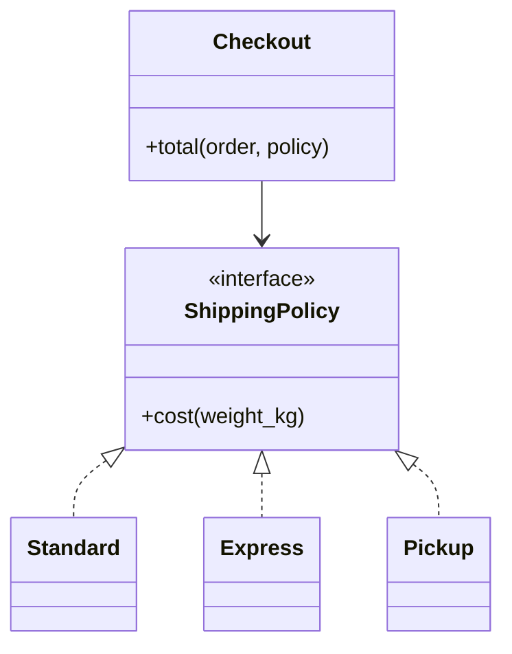

# 02 · Open/Closed Principle (OCP)

> **Prerequisites:** [01 · Single Responsibility Principle](../01-single-responsibility-principle/README.md).  
> **Reading time:** ~30 minutes  
> **Audience:** developers who keep adding `else if` branches to the same method and want to know how to stop

> [!NOTE]
> **In one line:** Code should be **open for extension and closed for modification**: a new case is a new class you add, not a stable, tested method you reopen.

> [!TIP]
> **Golden rule:** If adding the next variant means editing a method that already works, ask whether the variants could sit behind one interface. If the next variant will probably never come, leave the code alone.

> [!TIP]
> **Try it:** Take the quiz [OCP: Open/Closed Principle](/practice/quiz/ocp-open-closed/) before and after this lesson.

---

## 1. Roadmap

| Step | What you do | Section |
| :--- | :--- | :--- |
| 1 | See the `if/else` chain that grows | 2 |
| 2 | Understand "open" and "closed" | 3 |
| 3 | Refactor it with polymorphism, in Python and C# | 4, 5 |
| 4 | Know the price and when not to pay it | 6 |
| 5 | Practise on three drills | 7 |
| 6 | Interview answers | 8 |

---

## 2. The smell: the method that grows every sprint

```python
def shipping_cost(order_kind, weight_kg):
    if order_kind == "standard":
        return 5 + 0.5 * weight_kg
    elif order_kind == "express":
        return 12 + 1.0 * weight_kg
    elif order_kind == "pickup":
        return 0
    else:
        raise ValueError(f"unknown kind: {order_kind}")


print(shipping_cost("standard", 4))
print(shipping_cost("express", 4))
print(shipping_cost("pickup", 4))
```

Output:

```text
7.0
16.0
0
```

Every new delivery option (same-day, drone, locker) forces another edit to this function. Each edit re-risks the three branches that already work, and each one needs the full test suite run again. Often the same `if` chain is copied in a second place, such as the invoice, and now two places must be edited in step.

---

## 3. What "open" and "closed" mean

Bertrand Meyer coined the idea in 1988, and Robert C. Martin restated it for interfaces in the 1990s. The modern reading:

- **Open for extension:** you can add new behaviour.
- **Closed for modification:** you add it without editing the source of the code that already works.

The mechanism is **polymorphism**: the stable code depends on an interface, and each variant is a class that implements it.



`Checkout` is closed: it never changes when a new policy appears. The set of policies is open: add a class and register it.

---

## 4. The fix in Python

```python
from abc import ABC, abstractmethod


class ShippingPolicy(ABC):
    @abstractmethod
    def cost(self, weight_kg): ...


class Standard(ShippingPolicy):
    def cost(self, weight_kg):
        return 5 + 0.5 * weight_kg


class Express(ShippingPolicy):
    def cost(self, weight_kg):
        return 12 + 1.0 * weight_kg


class Pickup(ShippingPolicy):
    def cost(self, weight_kg):
        return 0


POLICIES = {"standard": Standard(), "express": Express(), "pickup": Pickup()}


def shipping_cost(order_kind, weight_kg):
    return POLICIES[order_kind].cost(weight_kg)


print(shipping_cost("standard", 4))
print(shipping_cost("express", 4))
print(shipping_cost("pickup", 4))

# A new option arrives. Nothing above is edited: add a class, register it.
class SameDay(ShippingPolicy):
    def cost(self, weight_kg):
        return 20 + 1.5 * weight_kg


POLICIES["same_day"] = SameDay()
print(shipping_cost("same_day", 4))
```

Output:

```text
7.0
16.0
0
26.0
```

The last two lines are the point: `SameDay` was added **after** the original code, and `shipping_cost` and the three existing classes were not touched.

> [!NOTE]
> Something still has to know the full list of policies. Here it is the `POLICIES` registry. That is fine: the list lives in a **wiring** place, not in the business logic you wanted to protect.

---

## 5. The same idea in C#

```csharp
public interface IShippingPolicy
{
    decimal Cost(decimal weightKg);
}

public class Standard : IShippingPolicy { public decimal Cost(decimal w) => 5m + 0.5m * w; }
public class Express  : IShippingPolicy { public decimal Cost(decimal w) => 12m + 1.0m * w; }
public class Pickup   : IShippingPolicy { public decimal Cost(decimal w) => 0m; }

public class Checkout
{
    private readonly IReadOnlyDictionary<string, IShippingPolicy> _policies;
    public Checkout(IReadOnlyDictionary<string, IShippingPolicy> policies) => _policies = policies;

    public decimal ShippingCost(string kind, decimal weightKg) => _policies[kind].Cost(weightKg);
}
```

In ASP.NET Core you would register each implementation in the dependency injection container, and `Checkout` would receive the whole set. Adding a `SameDay` class and one registration line leaves `Checkout` untouched.

---

## 6. The price, and when to skip it

OCP is not free. The abstraction is one more thing to read, and it must guess **the axis of change**.

| Situation | Advice |
| :--- | :--- |
| A tax rule that has changed three times already | Introduce the interface: the axis is proven. |
| A report with five formats and a sixth is requested | Interface, one class per format. |
| A script with one fixed behaviour | Do not. An interface would be noise. |
| Only one variant exists, and a second is a guess | Wait for the second variant (a rule of thumb: abstract on the **second or third** case). |

Another warning: if a new requirement cuts **across** all your variants (every policy now also needs a currency), OCP does not save you. You edit the interface and every class. Closure is always closure *against a kind of change you chose*.

---

## 7. Practice theory: three drills

### Drill 1: spot the violation

```python
def discount(customer_type, amount):
    if customer_type == "regular":
        return amount * 0.0
    if customer_type == "silver":
        return amount * 0.05
    if customer_type == "gold":
        return amount * 0.10
    return 0
```

**Question:** What happens when marketing adds "platinum"? And what if the same chain also appears in the invoice code?

<details>
<summary>Answer</summary>

You edit `discount`, and in the second place too. Forgetting one gives two prices for the same customer. Refactor to a `DiscountPolicy` interface with one class per tier, registered in a dictionary. The invoice calls the same lookup, so a new tier is one class and one registration.

</details>

### Drill 2: is this a fair use of an `if`?

```python
def parse_flag(text):
    if text == "yes":
        return True
    return False
```

**Question:** Should this be a class hierarchy?

<details>
<summary>Answer</summary>

No. There is one fixed behaviour and no sign of growth. A hierarchy would be speculative abstraction. OCP asks for extension points where **change keeps coming**, not everywhere.

</details>

### Drill 3: design the extension point

You export reports to CSV and PDF, and Excel is requested next quarter.

**Question:** Sketch the interface and the wiring.

<details>
<summary>Answer</summary>

```python
class Exporter(ABC):
    @abstractmethod
    def export(self, report): ...

EXPORTERS = {"csv": CsvExporter(), "pdf": PdfExporter()}
# Excel: class ExcelExporter(Exporter); EXPORTERS["xlsx"] = ExcelExporter()
```

The caller asks the registry for an exporter by name. The Excel work adds one class and one line, and no existing exporter or test changes.

</details>

---

## 8. Interview corner

**"Explain the Open/Closed Principle."**
Software should be open for extension and closed for modification. I put the varying behaviour behind an interface, so a new case is a new class, and the stable code that uses the interface stays unchanged.

**"Which design pattern supports it most directly?"**
Strategy: each algorithm is a class behind one interface. Others that help are Decorator, Template Method and plugin registries.

**"What is the downside?"**
Indirection, and a wrong guess about what will vary. I wait until a second or third variant before abstracting. A change that cuts across every variant still means editing them all.

**"How does OCP relate to SRP?"**
SRP separates the reasons to change into classes. OCP makes it cheap to add a new variant of one of those reasons, without editing the old ones.

---

## 9. Cheat sheet

| Idea | Remember |
| :--- | :--- |
| The rule | Add behaviour by adding code, not by editing tested code |
| The tool | An interface plus one class per variant |
| The wiring | A registry, a factory or the DI container, outside the stable logic |
| The smell | A `switch` or `if/else` over a type, repeated in several places |
| The warning | Abstract after the second or third variant, not before |

---

## Further reading

- Bertrand Meyer, *Object-Oriented Software Construction* (1988), the original statement of the principle.
- Robert C. Martin, *Clean Architecture* (2017), chapter 8, "OCP: The Open-Closed Principle".

## Next

[03 · Liskov Substitution Principle](../03-liskov-substitution-principle/README.md)
