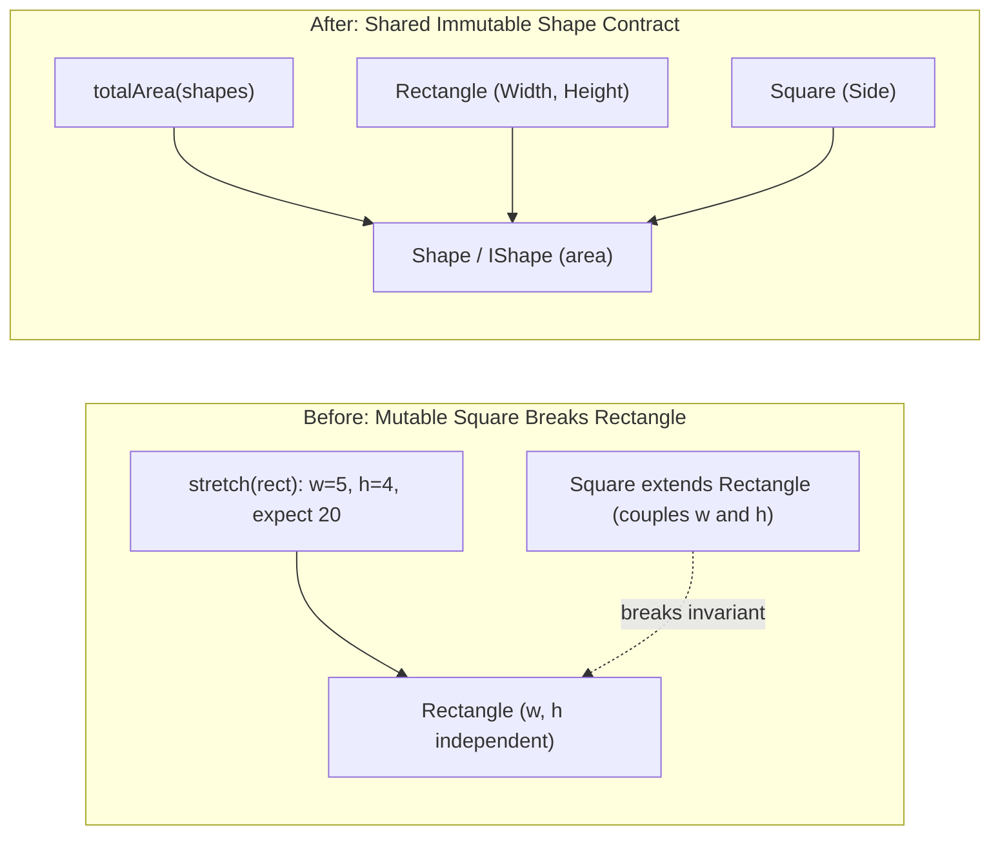
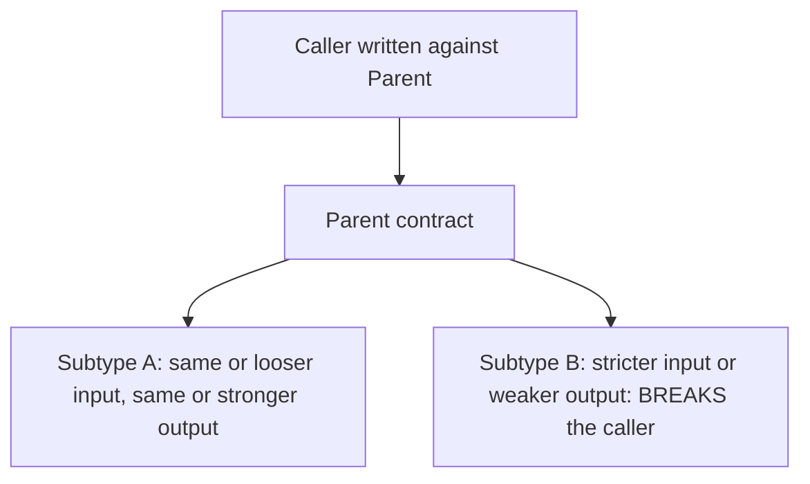

# 03 · Liskov Substitution Principle (LSP)

> **Prerequisites:** [02 · Open/Closed Principle](../02-open-closed-principle/README.md) and [31 · OOP Pillar 3: Inheritance](../../31-oop-pillar-3-inheritance/README.md).  
> **Reading time:** ~35 minutes  
> **Audience:** developers who use inheritance and want to know when a subclass is really allowed to replace its parent

> [!NOTE]
> **In one line:** If code works with a parent type, it must keep working, **with the same expectations**, when you hand it any subtype. A subtype is a promise-keeper, not just a type with the same method names.

> [!TIP]
> **Golden rule:** A subclass may **accept more** and **promise more** than its parent. It may never accept less or promise less. If callers must check "which subclass is this?", the hierarchy is wrong.

> [!TIP]
> **Try it:** Take the quiz [LSP: Liskov Substitution Principle](/practice/quiz/lsp-liskov-substitution/).

---

## 1. Roadmap

| Step | What you do | Section |
| :--- | :--- | :--- |
| 1 | Watch the Rectangle/Square break a caller | 2 |
| 2 | Learn the contract rules | 3 |
| 3 | Fix it in Python, C#, Go, and TypeScript | 4 |
| 4 | Test for it with a contract test | 5 |
| 5 | Drills | 6 |
| 6 | Interview answers | 7 |

---

## 1A. The Visual Story: Problem -> Analogy -> Solution

### The Problem (Why Naive Code Explodes)

In naive OOP, developers model real-world taxonomy directly: `Square` extends mutable `Rectangle`. A caller `stretch(rect)` sets `rect.width = 5` and `rect.height = 4`, expecting `rect.area() == 20`. Because `Square` forces both sides to stay equal, setting `height = 4` silently overwrites `width` to `4` and returns `16`. No compiler error, no exception—just silent invariant corruption in production.

### Real-World Analogy

Think of a **charging-only USB-C cable** versus a **full-featured USB-C data/display cable**. Both have the exact same physical plug, so both fit into your laptop's USB-C port. Yet if your monitor expects a video signal and you substitute the charging-only cable, the connection silently fails. Substitutability requires keeping the **promised behaviour**, not just matching the plug shape.

### Visual Problem -> Solution Diagram



### Where It Is Used (Production & LLD Interviews)

| Ecosystem / Context | Concrete Application of LSP |
| :--- | :--- |
| **.NET** | `IReadOnlyList<T>` vs `IList<T>` (so read-only collections never throw `NotSupportedException` on `Add`), covariant return types |
| **Python** | `collections.abc.Sequence` vs `MutableSequence`; `Protocol` contracts verified by `mypy` and shared pytest contract suites |
| **Go** | `io.Reader` / `io.Writer` implementations honouring exact EOF and byte-count contracts (`bytes.Buffer`, `os.File`, `net.Conn`) |
| **TypeScript** | `ReadonlyArray<T>` vs `Array<T>`, discriminated unions instead of subclass overrides that throw `NotImplementedError` |
| **LLD Interviews** | **Parking Lot / Vehicle** (separating `ElectricVehicle` vs `FuelVehicle` instead of `charge()` throwing on gas cars), **Chess** (`Piece.validMoves()`), **Payment Gateway** (consistent error contracts across Stripe/PayPal) |

---

## 2. The smell: the subclass that surprises its caller

The classic example, in Python:

```python
class Rectangle:
    def __init__(self, width, height):
        self.width = width
        self.height = height

    def area(self):
        return self.width * self.height


class Square(Rectangle):
    def __init__(self, side):
        super().__init__(side, side)

    # A square must stay square, so setting one side sets both.
    def __setattr__(self, name, value):
        if name in ("width", "height"):
            object.__setattr__(self, "width", value)
            object.__setattr__(self, "height", value)
        else:
            object.__setattr__(self, name, value)


def stretch(rect):
    rect.width = 5
    rect.height = 4
    return rect.area()


print(stretch(Rectangle(1, 1)))
print(stretch(Square(1)))
```

Output:

```text
20
16
```

`stretch` is written against `Rectangle` and assumes width and height change **independently**. With a `Square` the second assignment overwrites the first, so the area is 16, not 20. The code compiles and runs, and it gives a wrong answer.

A square *is a* rectangle in geometry, but a **mutable** `Square` is not a substitutable `Rectangle` in code. The relationship in the real world is not what matters; the **behaviour callers rely on** is.

---

## 3. The principle, and the contract rules

Barbara Liskov stated it in 1987, and with Jeannette Wing formalised it in 1994 as *behavioural subtyping*: a property that holds for the parent's objects must also hold for the subtype's objects.

Think of each method as a contract with three parts:

| Part | Meaning | A subtype may |
| :--- | :--- | :--- |
| **Precondition** | What the caller must provide | Keep it or **weaken** it (accept more) |
| **Postcondition** | What the method promises on return | Keep it or **strengthen** it (promise more) |
| **Invariant** | What is always true of the object | Keep it |

And two more practical rules:

- **No new surprises:** a subtype must not throw an exception type the parent's callers do not expect.
- **No removed behaviour:** an override that does nothing, or throws "not supported", breaks the promise that the method works.



---

## 4. The fix in Python, C#, Go, and TypeScript

Do not make `Square` a mutable `Rectangle`. Two honest designs:

**Option 1: make shapes immutable, with one shared interface.**

````carousel
```python
from abc import ABC, abstractmethod


class Shape(ABC):
    @abstractmethod
    def area(self): ...


class Rectangle(Shape):
    def __init__(self, width, height):
        self._w, self._h = width, height

    def area(self):
        return self._w * self._h


class Square(Shape):
    def __init__(self, side):
        self._s = side

    def area(self):
        return self._s * self._s


def total_area(shapes):
    return sum(s.area() for s in shapes)


print(total_area([Rectangle(5, 4), Square(3)]))
```
<!-- slide -->
```csharp
public interface IShape { double Area(); }

public record Rectangle(double Width, double Height) : IShape
{
    public double Area() => Width * Height;
}

public record Square(double Side) : IShape
{
    public double Area() => Side * Side;
}

public static class Shapes
{
    public static double TotalArea(IEnumerable<IShape> shapes) => shapes.Sum(s => s.Area());
}
```
<!-- slide -->
```go
package main

type Shape interface {
	Area() float64
}

type Rectangle struct {
	Width, Height float64
}

func (r Rectangle) Area() float64 { return r.Width * r.Height }

type Square struct {
	Side float64
}

func (s Square) Area() float64 { return s.Side * s.Side }

func TotalArea(shapes []Shape) float64 {
	total := 0.0
	for _, s := range shapes {
		total += s.Area()
	}
	return total
}
```
<!-- slide -->
```typescript
export interface Shape {
  area(): number;
}

export class Rectangle implements Shape {
  constructor(
    public readonly width: number,
    public readonly height: number
  ) {}

  area(): number {
    return this.width * this.height;
  }
}

export class Square implements Shape {
  constructor(public readonly side: number) {}

  area(): number {
    return this.side * this.side;
  }
}

export function totalArea(shapes: readonly Shape[]): number {
  return shapes.reduce((sum, s) => sum + s.area(), 0);
}
```
````

Output:

```text
29
```

`total_area` needs only `area()`, and both types keep that promise. The broken part, independent setters, is gone because it was never a shared promise.

In C#, records are immutable by default, which removes the "setting one side changes the other" trap. C# also makes the **return type** rule visible: an override can return a more specific type (covariant returns, since C# 9) but cannot narrow what it accepts.

**Option 2: put optional capabilities in a narrower type.** The famous bird example:

```python
class Bird:
    def eat(self):
        return "eating"


class FlyingBird(Bird):
    def fly(self):
        return "flying"


class Sparrow(FlyingBird):
    pass


class Penguin(Bird):
    pass


def release(bird: FlyingBird):
    return bird.fly()


print(release(Sparrow()))
```

Output:

```text
flying
```

`Penguin` cannot be passed to `release` by mistake, because it is not a `FlyingBird`. The type says what the object can do, so no caller needs an `isinstance` check.

---

## 5. Catching it: a contract test

The most practical defence is to write the parent's expectations once and run them against **every** subtype:

```python
def check_shape_contract(make_shape, expected_area):
    s = make_shape()
    assert s.area() >= 0, "an area is never negative"
    assert s.area() == s.area(), "asking twice gives the same answer"
    assert s.area() == expected_area


check_shape_contract(lambda: Rectangle(5, 4), 20)
check_shape_contract(lambda: Square(3), 9)
print("all subtypes keep the Shape contract")
```

Output:

```text
all subtypes keep the Shape contract
```

Each new subtype adds one line. If a subtype cannot pass the parent's checks, you learn it in a test and not in production.

Other smells to search for in a code base:

- `isinstance` or `is` checks on a parent-typed value.
- Overrides that only `pass`, `return None` or `raise NotImplementedError`.
- A subclass constructor that rejects values the parent accepted.

---

## 6. Practice theory: three drills

### Drill 1: the read-only list

```python
class Stack:
    def push(self, x): ...
    def pop(self): ...

class ReadOnlyStack(Stack):
    def push(self, x):
        raise PermissionError("read only")
```

**Question:** Does `ReadOnlyStack` satisfy LSP?

<details>
<summary>Answer</summary>

No. Every caller of `Stack` expects `push` to work. A subtype that rejects it breaks those callers. Make a `ReadableStack` interface with `peek` and `size`, let `Stack` extend it with `push` and `pop`, and give the read-only code the narrower type.

</details>

### Drill 2: stricter input

```python
class Parser:
    def parse(self, text: str): ...   # accepts any string

class StrictParser(Parser):
    def parse(self, text: str):
        if not text.isascii():
            raise ValueError("ASCII only")
        ...
```

**Question:** What rule is broken?

<details>
<summary>Answer</summary>

The precondition was **strengthened**: the parent accepted any string, and the subtype rejects some. A caller written against `Parser` can now crash. The fix is to accept the same input (handle non-ASCII text) or not to make `StrictParser` a `Parser`.

</details>

### Drill 3: the safe direction

```python
class Report:
    def build(self, rows: list) -> str: ...

class SummaryReport(Report):
    def build(self, rows) -> str:   # accepts any iterable now
        ...
```

**Question:** Is accepting more than the parent allowed?

<details>
<summary>Answer</summary>

Yes. Weakening a precondition (accepting any iterable instead of only lists) cannot break a caller who passes a list. LSP forbids accepting **less**, not more.

</details>

---

## 7. Interview corner

**"State the Liskov Substitution Principle."**
Objects of a subtype must be usable anywhere the parent is expected, without changing the correctness of the program. In practice a subtype keeps the parent's contract: it accepts at least the same inputs, promises at least the same results, and keeps its invariants.

**"Why is Square extending Rectangle a classic violation?"**
Callers of `Rectangle` assume width and height change independently. A mutable `Square` couples them, so code that sets both and expects `w * h` gets a different answer. The geometry is right and the behaviour is wrong.

**"How do you detect LSP violations?"**
Contract tests run against all subtypes, plus a search for `isinstance` checks, empty overrides and `NotImplementedError` in subclasses.

**"Is it only about inheritance?"**
No, it applies to any substitution behind an interface: two implementations of `PaymentGateway` must keep the same promises, including how they fail.

---

## 8. Cheat sheet

| Rule | Subtype may |
| :--- | :--- |
| Preconditions | Be the same or weaker (accept more) |
| Postconditions | Be the same or stronger (promise more) |
| Invariants | Be kept |
| Exceptions | Not add types callers do not expect |
| Smell | `isinstance` in callers, empty or throwing overrides |
| Defence | One contract test, run on every subtype |

---

## Further reading

- Barbara Liskov and Jeannette Wing, [A Behavioral Notion of Subtyping](https://www.cs.cmu.edu/~wing/publications/LiskovWing94.pdf), ACM TOPLAS, 1994.
- Robert C. Martin, *Clean Architecture* (2017), chapter 9, "LSP: The Liskov Substitution Principle".

## Next

[04 · Interface Segregation Principle](../04-interface-segregation-principle/README.md)
