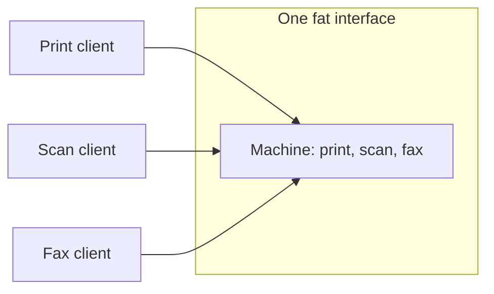

# 04 · Interface Segregation Principle (ISP)

> **Prerequisites:** [03 · Liskov Substitution Principle](../03-liskov-substitution-principle/README.md) and [30 · OOP Pillar 2: Abstraction](../../30-oop-pillar-2-abstraction/README.md).  
> **Reading time:** ~25 minutes  
> **Audience:** developers who write interfaces and meet classes that implement half of them

> [!NOTE]
> **In one line:** No client should be **forced to depend on methods it does not use**. Prefer several small interfaces shaped by what callers need over one large interface shaped by what the implementation has.

> [!TIP]
> **Golden rule:** If an implementing class has to write `raise NotImplementedError` or return nothing for a method, the interface asks for more than that class can honestly give.

> [!TIP]
> **Try it:** Take the quiz [ISP: Interface Segregation Principle](/practice/quiz/isp-interface-segregation/).

---

## 1. Roadmap

| Step | What you do | Section |
| :--- | :--- | :--- |
| 1 | See a fat interface and its empty methods | 2 |
| 2 | Learn why the callers suffer too | 3 |
| 3 | Split it, in Python and C# | 4, 5 |
| 4 | Learn how small is small enough | 6 |
| 5 | Drills | 7 |
| 6 | Interview answers | 8 |

---

## 2. The smell: the printer that cannot scan

```python
from abc import ABC, abstractmethod


class Machine(ABC):
    @abstractmethod
    def print_doc(self, doc): ...
    @abstractmethod
    def scan(self): ...
    @abstractmethod
    def fax(self, doc): ...


class OfficeAllInOne(Machine):
    def print_doc(self, doc):
        return f"printed {doc}"

    def scan(self):
        return "scanned page"

    def fax(self, doc):
        return f"faxed {doc}"


class BasicPrinter(Machine):
    def print_doc(self, doc):
        return f"printed {doc}"

    def scan(self):
        raise NotImplementedError("this printer cannot scan")

    def fax(self, doc):
        raise NotImplementedError("this printer cannot fax")


try:
    BasicPrinter().scan()
except NotImplementedError as e:
    print("error:", e)
```

Output:

```text
error: this printer cannot scan
```

`BasicPrinter` is forced to carry two methods that lie. Any code holding a `Machine` can call `scan()` and crash. That also means `BasicPrinter` is not a safe substitute, so ISP problems often show up as [LSP](../03-liskov-substitution-principle/README.md) problems.

---

## 3. Why the callers suffer too

A client that only prints still depends on `Machine`. If the `fax` signature changes, that client must be rebuilt, retested and sometimes redeployed, although it never faxes. The wider the interface, the larger the **blast radius** of any change.



A change to `fax` reaches all three clients. With segregated interfaces, only the fax client is affected.

---

## 4. The fix in Python

Split by **role**: what a particular client wants from the object.

```python
from abc import ABC, abstractmethod


class Printer(ABC):
    @abstractmethod
    def print_doc(self, doc): ...


class Scanner(ABC):
    @abstractmethod
    def scan(self): ...


class FaxSender(ABC):
    @abstractmethod
    def fax(self, doc): ...


class BasicPrinter(Printer):
    def print_doc(self, doc):
        return f"printed {doc}"


class OfficeAllInOne(Printer, Scanner, FaxSender):
    def print_doc(self, doc):
        return f"printed {doc}"

    def scan(self):
        return "scanned page"

    def fax(self, doc):
        return f"faxed {doc}"


def print_report(device: Printer):
    return device.print_doc("report")


print(print_report(BasicPrinter()))
print(print_report(OfficeAllInOne()))
```

Output:

```text
printed report
printed report
```

`print_report` asks only for a `Printer`, so it works with both devices. `BasicPrinter` has no dishonest methods. The all-in-one device implements all three roles by listing them.

> [!NOTE]
> Python also has `typing.Protocol`, a structural interface: any object with a `print_doc` method satisfies `Printer` without inheriting from it. It is the closest match to Go's small, implicit interfaces.

---

## 5. The same idea in C#

```csharp
public interface IPrinter  { string Print(string doc); }
public interface IScanner  { string Scan(); }
public interface IFaxSender { string Fax(string doc); }

public class BasicPrinter : IPrinter
{
    public string Print(string doc) => $"printed {doc}";
}

public class OfficeAllInOne : IPrinter, IScanner, IFaxSender
{
    public string Print(string doc) => $"printed {doc}";
    public string Scan() => "scanned page";
    public string Fax(string doc) => $"faxed {doc}";
}
```

C# allows a class to implement many interfaces, which makes role interfaces cheap. A method parameter of type `IPrinter` accepts both classes.

A second real-world example is `IReadOnlyList<T>` versus `IList<T>`: a method that only reads should take the read-only one, so callers can pass an array, a list or any read-only view.

---

## 6. How small is small enough?

| Too big | About right | Too small |
| :--- | :--- | :--- |
| `IUserRepository` with 25 methods used by 12 different clients | `IUserReader` (find, list) and `IUserWriter` (add, update, delete) | One interface per method, with no meaning of its own |

A working rule: **group the methods that clients use together**. If every caller of `find` also calls `list`, they belong in the same interface. If some callers only read and others only write, they are two roles.

Look at your callers, not at the implementation. The implementation will often implement several interfaces, and that is fine.

---

## 7. Practice theory: three drills

### Drill 1: the repository

```python
class UserRepository(ABC):
    def find(self, user_id): ...
    def add(self, user): ...
    def delete(self, user_id): ...
    def reindex_all(self): ...
```

A `ProfilePage` only needs `find`.

**Question:** What would you change?

<details>
<summary>Answer</summary>

Define `UserReader` with `find` and have `ProfilePage` depend on it. The concrete repository can still implement `UserReader`, `UserWriter` and an admin-only `UserMaintenance` (for `reindex_all`). In tests, `ProfilePage` now needs a fake with one method, not four.

</details>

### Drill 2: spot the lie

```python
class Worker(ABC):
    def work(self): ...
    def eat(self): ...

class Robot(Worker):
    def work(self): return "welding"
    def eat(self): raise NotImplementedError
```

**Question:** What is the principle at stake, and the fix?

<details>
<summary>Answer</summary>

ISP (and LSP): `eat` does not apply to a robot. Split into `Workable` and `Eatable`. A `Human` implements both, a `Robot` only `Workable`, and the scheduler that needs workers takes `Workable`.

</details>

### Drill 3: do not overdo it

**Question:** A reviewer asks to split `Stack` with `push`, `pop` and `peek` into three interfaces. Is that a good application of ISP?

<details>
<summary>Answer</summary>

No. Callers use these methods together, and no client wants only `peek` from a stack. Splitting creates three meaningless interfaces. Split when different clients need different **subsets**, not just because a method count is high.

</details>

---

## 8. Interview corner

**"What is the Interface Segregation Principle?"**
Clients should not be forced to depend on methods they do not use. I make interfaces small and role-shaped, so a class implements only what it can honestly provide and a caller sees only what it needs.

**"How is it different from the Single Responsibility Principle?"**
SRP is about a class having one reason to change. ISP is about an **interface** being shaped by the needs of its clients. A class with one responsibility can still be forced to implement a fat interface.

**"How do you spot a violation?"**
Implementations with empty or throwing methods, and test fakes that stub many methods nobody calls.

**"Does ISP mean one method per interface?"**
No. I group methods that clients use together. Go's `io.Reader` has one method because that is the role. A `Stack` interface with push, pop and peek is one role.

---

## 9. Cheat sheet

| Idea | Remember |
| :--- | :--- |
| The rule | Clients depend only on the methods they use |
| The tool | Several role interfaces, implemented together by one class |
| The smell | `NotImplementedError`, empty methods, fakes with many stubs |
| The limit | Group methods that callers use together |
| Related | A fat interface often causes an LSP violation too |

---

## Further reading

- Robert C. Martin, *Clean Architecture* (2017), chapter 10, "ISP: The Interface Segregation Principle".
- Python documentation, [`typing.Protocol`](https://docs.python.org/3/library/typing.html#typing.Protocol).

## Next

[05 · Dependency Inversion Principle](../05-dependency-inversion-principle/README.md)
