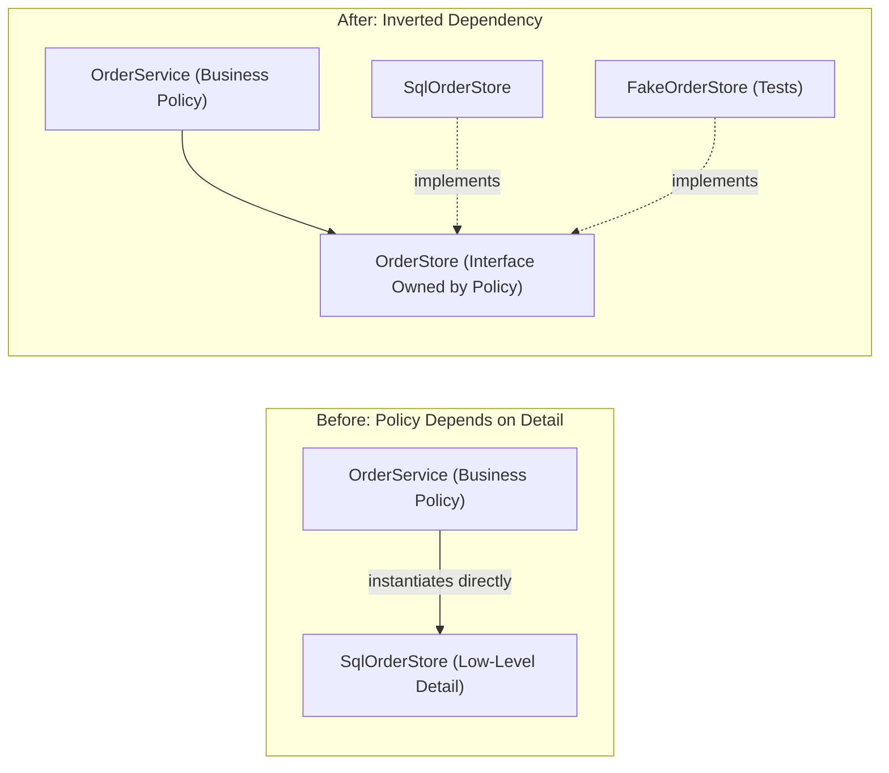
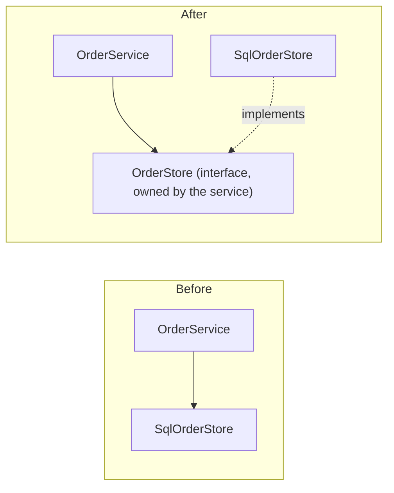

# 05 · Dependency Inversion Principle (DIP)

> **Prerequisites:** [04 · Interface Segregation Principle](../04-interface-segregation-principle/README.md).  
> **Reading time:** ~35 minutes  
> **Audience:** developers who `new` their collaborators inside classes and cannot test without a database

> [!NOTE]
> **In one line:** **High-level policy must not depend on low-level detail. Both should depend on an abstraction**, and the abstraction is shaped by the high-level code that needs it.

> [!TIP]
> **Golden rule:** Business code should never name a database, an HTTP client or the system clock. It names an interface it owns, and something at the edge of the program plugs the real one in.

> [!TIP]
> **Try it:** Take the quiz [DIP: Dependency Inversion Principle](/practice/quiz/dip-dependency-inversion/).

---

## 1. Roadmap

| Step | What you do | Section |
| :--- | :--- | :--- |
| 1 | See a service welded to its database | 2 |
| 2 | Separate inversion, injection and IoC | 3 |
| 3 | Invert it, in Python, C#, Go, and TypeScript | 4 |
| 4 | Test it with a fake, and wire it at the root | 5 |
| 5 | Drills | 6 |
| 6 | Interview answers | 7 |

---

## 1A. The Visual Story: Problem -> Analogy -> Solution

### The Problem (Why Naive Code Explodes)

In naive code, `OrderService` instantiates `SqlOrderStore()` (or `new MySqlRepo()`) directly inside its constructor. The high-level business rule (`total > 0`) is welded to a concrete database driver: you cannot unit-test `place()` without spinning up SQL, dependencies are hidden from callers, and switching storage engines forces edits inside core domain logic.

### Real-World Analogy

Imagine **soldering a desk lamp's wires directly into your house's electrical junction box** instead of using a **wall plug**. You cannot test the lamp on a portable battery, move it to another outlet, or swap the power grid without an electrician. When both the lamp and the house wiring depend on a standard socket contract, either side can be swapped independently.

### Visual Problem -> Solution Diagram



### Where It Is Used (Production & LLD Interviews)

| Ecosystem / Context | Concrete Application of DIP |
| :--- | :--- |
| **.NET (ASP.NET Core)** | `IServiceCollection` DI container wiring `IOrderStore` -> `SqlOrderStore` in `Program.cs` (Composition Root) |
| **Python (FastAPI)** | `Depends(...)` injection, `Protocol` / `ABC` ports in domain packages with SQLAlchemy/HTTP adapters at the edge |
| **Go** | Consumer-defined interfaces (small interfaces in the caller's package) wired in `cmd/server/main.go` |
| **TypeScript (NestJS / Inversify)** | Constructor injection with `@Inject(TOKEN)` symbols bound to concrete repositories in module configuration |
| **LLD Interviews** | **Order / Checkout Service** (`OrderStore`, `PaymentGateway`), **Rate Limiter** (`Clock`, `CounterStore`), **Uber / Ride-Sharing** (`DriverMatcher`, `LocationStore`) |

---

## 2. The smell: policy that knows its tools

```python
class SqlOrderStore:
    def __init__(self):
        self.rows = []

    def save(self, order_id, total):
        self.rows.append((order_id, total))
        return "saved to SQL"


class OrderService:
    def __init__(self):
        self.store = SqlOrderStore()        # the policy builds its own detail

    def place(self, order_id, total):
        if total <= 0:
            raise ValueError("total must be positive")
        return self.store.save(order_id, total)


print(OrderService().place("o1", 25.0))
```

Output:

```text
saved to SQL
```

`OrderService` holds the business rule (a total must be positive) but it also **chooses** the storage. Consequences:

- A test of the rule must run the real store. With a real database that is slow and fragile.
- Moving to another storage means editing the business class.
- Dependencies are hidden inside the constructor, so nobody can see what the class needs.

The arrows of the source code point **from policy to detail**. DIP flips them.

---

## 3. Inversion, injection and inversion of control

These three are often mixed up:

| Term | What it is |
| :--- | :--- |
| **Dependency Inversion** (the principle) | Depend on abstractions. The high-level module **owns** the interface, and the low-level module implements it. |
| **Dependency Injection** (a technique) | Pass the implementation in from outside: constructor, method argument or a container. |
| **Inversion of Control** (a broader idea) | A framework calls your code instead of your code calling the framework (a container, a web framework, event handlers). |

Injection is the usual way to **achieve** inversion, but you can inject a concrete class and still have no inversion at all.



After inversion, the SQL class depends on the interface that the business layer defines. The arrow from detail to policy is the "inversion".

---

## 4. The fix in Python, C#, Go, and TypeScript

````carousel
```python
from abc import ABC, abstractmethod


class OrderStore(ABC):                    # owned by the business layer
    @abstractmethod
    def save(self, order_id, total): ...


class OrderService:
    def __init__(self, store: OrderStore):    # the dependency is visible and replaceable
        self._store = store

    def place(self, order_id, total):
        if total <= 0:
            raise ValueError("total must be positive")
        return self._store.save(order_id, total)


class SqlOrderStore(OrderStore):          # detail, at the edge
    def __init__(self):
        self.rows = []

    def save(self, order_id, total):
        self.rows.append((order_id, total))
        return "saved to SQL"


class FakeOrderStore(OrderStore):         # for tests
    def __init__(self):
        self.saved = []

    def save(self, order_id, total):
        self.saved.append((order_id, total))
        return "fake"


# Production wiring (the composition root):
print(OrderService(SqlOrderStore()).place("o1", 25.0))

# A test: no database, the rule is checked alone.
fake = FakeOrderStore()
service = OrderService(fake)
service.place("o2", 10.0)
print(fake.saved)
try:
    service.place("o3", -1)
except ValueError as e:
    print("rejected:", e)
print(len(fake.saved))
```
<!-- slide -->
```csharp
public interface IOrderStore                       // owned by the business layer
{
    string Save(string orderId, decimal total);
}

public class OrderService
{
    private readonly IOrderStore _store;
    public OrderService(IOrderStore store) => _store = store;

    public string Place(string orderId, decimal total)
    {
        if (total <= 0) throw new ArgumentException("total must be positive");
        return _store.Save(orderId, total);
    }
}

public class SqlOrderStore : IOrderStore
{
    public string Save(string orderId, decimal total) => "saved to SQL";
}
```
<!-- slide -->
```go
package main

import "errors"

// OrderStore is owned by the business layer.
type OrderStore interface {
	Save(orderID string, total float64) string
}

type OrderService struct {
	store OrderStore
}

func NewOrderService(store OrderStore) *OrderService {
	return &OrderService{store: store}
}

func (s *OrderService) Place(orderID string, total float64) (string, error) {
	if total <= 0 {
		return "", errors.New("total must be positive")
	}
	return s.store.Save(orderID, total), nil
}

// SqlOrderStore is a low-level detail wired in main().
type SqlOrderStore struct{}

func (SqlOrderStore) Save(orderID string, total float64) string {
	return "saved to SQL"
}
```
<!-- slide -->
```typescript
// Owned by the business layer.
export interface OrderStore {
  save(orderId: string, total: number): string;
}

export class OrderService {
  constructor(private readonly store: OrderStore) {}

  place(orderId: string, total: number): string {
    if (total <= 0) {
      throw new Error("total must be positive");
    }
    return this.store.save(orderId, total);
  }
}

// Low-level detail, wired at the composition root.
export class SqlOrderStore implements OrderStore {
  save(_orderId: string, _total: number): string {
    return "saved to SQL";
  }
}
```
````

Output:

```text
saved to SQL
[('o2', 10.0)]
rejected: total must be positive
1
```

The last line shows the rule's guard works and a rejected order was **not** saved, checked with no database.

In ASP.NET Core the container does the wiring:

```csharp
builder.Services.AddScoped<IOrderStore, SqlOrderStore>();
builder.Services.AddScoped<OrderService>();
```

The one place that lists the concrete classes is the **composition root**. Everything else stays free of them.

---

## 5. Time, randomness and the network are dependencies too

The same rule applies to anything that makes a test slow or non-repeatable:

```python
from datetime import datetime, timedelta


class Clock(ABC):
    @abstractmethod
    def now(self): ...


class FixedClock(Clock):
    def __init__(self, moment):
        self.moment = moment

    def now(self):
        return self.moment


class TrialPolicy:
    def __init__(self, clock: Clock):
        self._clock = clock

    def is_expired(self, started_at):
        return self._clock.now() - started_at > timedelta(days=14)


started = datetime(2026, 1, 1)
print(TrialPolicy(FixedClock(datetime(2026, 1, 10))).is_expired(started))
print(TrialPolicy(FixedClock(datetime(2026, 1, 20))).is_expired(started))
```

Output:

```text
False
True
```

Without the injected `Clock`, the test would call `datetime.now()` and either wait two weeks or become flaky around midnight.

**Do not overdo it.** Not every class needs an interface. Wrap things that **change or cannot be run in a test**: databases, clocks, networks, file systems, randomness. A pure helper like `slugify(text)` needs no interface.

---

## 6. Practice theory: three drills

### Drill 1: find the hidden dependency

```python
class Notifier:
    def alert(self, text):
        import smtplib
        server = smtplib.SMTP("smtp.example.com")
        server.sendmail("a@x", "b@y", text)
```

**Question:** What is wrong, and what is the smallest fix?

<details>
<summary>Answer</summary>

The class creates its own SMTP client, so a test would send real mail or fail to connect. Introduce a `MailSender` interface that `Notifier` receives in its constructor, with an `SmtpMailSender` as the production class and a fake that records messages for tests.

</details>

### Drill 2: who owns the interface?

Layers: `billing` (business rules) and `stripe_adapter` (calls Stripe).

**Question:** In which package does the `PaymentGateway` interface live?

<details>
<summary>Answer</summary>

In `billing`. The business layer defines the abstraction it needs (`charge(amount, token)`), and `stripe_adapter` imports it and implements it. If the interface lived in the adapter, billing would still import the adapter, and nothing would be inverted.

</details>

### Drill 3: is this over-engineering?

```python
def slugify(text):
    return text.lower().replace(" ", "-")
```

**Question:** Should `slugify` be injected through an interface?

<details>
<summary>Answer</summary>

No. It is a stable, pure function with no I/O and no variation. An interface would add noise and no benefit. DIP is for boundaries that change or need a fake.

</details>

---

## 7. Interview corner

**"What is the Dependency Inversion Principle?"**
High-level modules should not depend on low-level modules; both should depend on abstractions. The business code owns an interface, and the database or HTTP code implements it. The dependency arrow in the source points toward the policy.

**"What is the difference between DIP and dependency injection?"**
DIP is the design rule about the direction of dependencies. Injection is one way to supply the implementation, through a constructor or a container. I can inject a concrete class and still have no inversion.

**"Where do you create the real objects?"**
In the composition root, near the start of the program: a `main` function, the startup file or the container's configuration. Nowhere else knows the concrete classes.

**"How does DIP make code easier to test?"**
The unit test passes a fake that implements the same interface, so the rule runs in memory in milliseconds, with no database, network or real clock.

---

## 8. Cheat sheet

| Idea | Remember |
| :--- | :--- |
| The rule | Policy depends on abstractions it owns; details implement them |
| The technique | Constructor injection, wired in the composition root |
| What to wrap | Databases, clocks, network, files, randomness |
| What not to wrap | Pure helpers and stable internal code |
| The smell | `new ConcreteThing()` inside business code, `datetime.now()` in rules |

---

## Further reading

- Robert C. Martin, *Clean Architecture* (2017), chapter 11, "DIP: The Dependency Inversion Principle".
- Martin Fowler, [Inversion of Control Containers and the Dependency Injection pattern](https://martinfowler.com/articles/injection.html), 2004.

## Next

[06 · SOLID Refactoring Drills](../06-solid-refactoring-drills/README.md)
