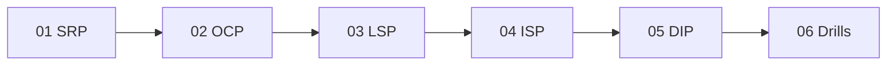

# SOLID in Depth: One Lesson per Principle

> **Prerequisites:** the [OOP pillars](../29-oop-pillar-1-encapsulation/README.md) and the one-page [SOLID overview](../04-solid-principles/README.md).  
> **Reading time:** ~3 hours in total, as 6 lessons of 25 to 45 minutes  
> **Audience:** developers who can recite SOLID and want to apply it: find the problem in real code, fix it, and prove that nothing broke

> [!NOTE]
> **In one line:** One lesson per principle, each with the smell, the rule, a fix in Python and C#, drills with answers and a quiz. The last lesson refactors one messy class through all five.

> [!TIP]
> **Golden rule:** A principle is a tool for a pain you can name: a team conflict, a growing `if` chain, a test that needs a database. If you cannot name the pain, do not apply the principle yet.

## The lessons

| # | Lesson | The question it answers | Quiz |
| :--- | :--- | :--- | :--- |
| 01 | [Single Responsibility](01-single-responsibility-principle/README.md) | Who would ask this class to change? | [SRP quiz](/practice/quiz/srp-single-responsibility/) |
| 02 | [Open/Closed](02-open-closed-principle/README.md) | How do I add a case without reopening tested code? | [OCP quiz](/practice/quiz/ocp-open-closed/) |
| 03 | [Liskov Substitution](03-liskov-substitution-principle/README.md) | When can a subclass stand in for its parent? | [LSP quiz](/practice/quiz/lsp-liskov-substitution/) |
| 04 | [Interface Segregation](04-interface-segregation-principle/README.md) | How big should an interface be? | [ISP quiz](/practice/quiz/isp-interface-segregation/) |
| 05 | [Dependency Inversion](05-dependency-inversion-principle/README.md) | Who owns the interface, and who creates the object? | [DIP quiz](/practice/quiz/dip-dependency-inversion/) |
| 06 | [Refactoring Drills](06-solid-refactoring-drills/README.md) | Which principle is this, and in what order do I fix it? | [SOLID quiz](/practice/quiz/solid-design-principles/) |

## How to use this track

1. Take the quiz for a principle **before** the lesson, to see what you already know.
2. Read the lesson and run the Python code. Change one thing and predict the output.
3. Do the drills on paper before opening each answer.
4. Take the quiz again.
5. Finish with the refactoring drills, then practise on the [design problems](/practice/) in Practice.

## Next

[25 · Design Patterns, One at a Time](../25-design-patterns-one-at-a-time/README.md)
