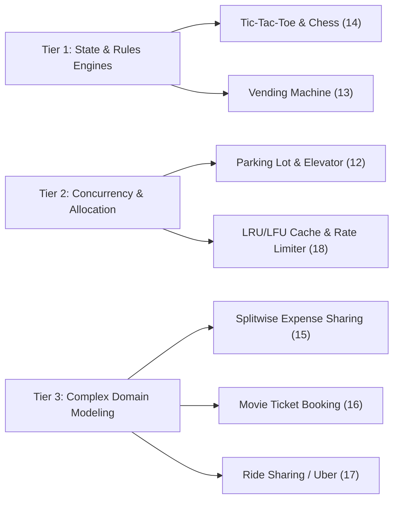
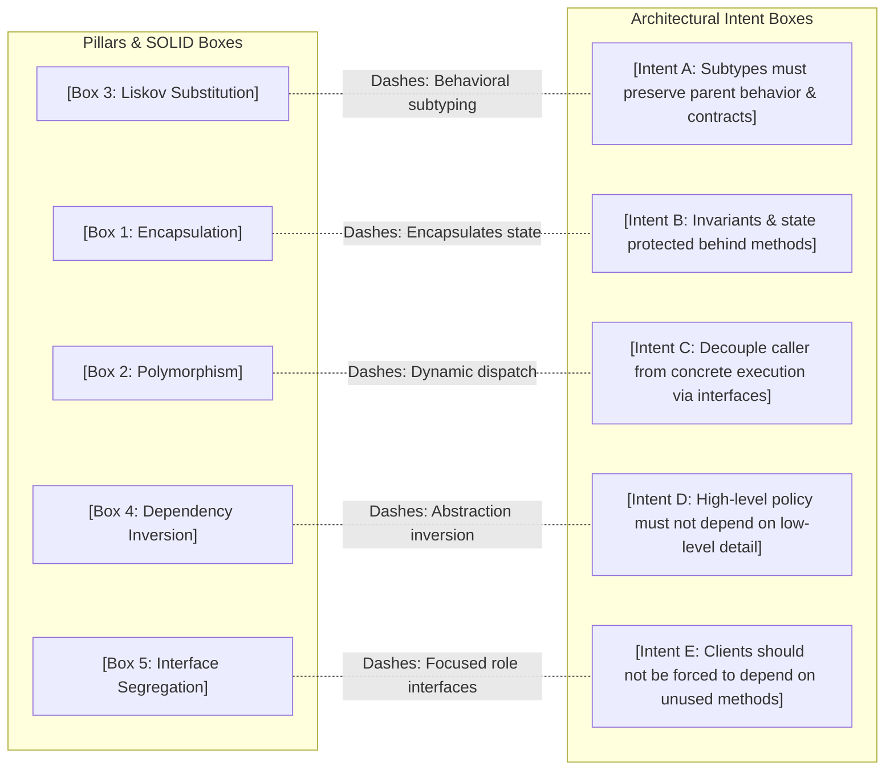
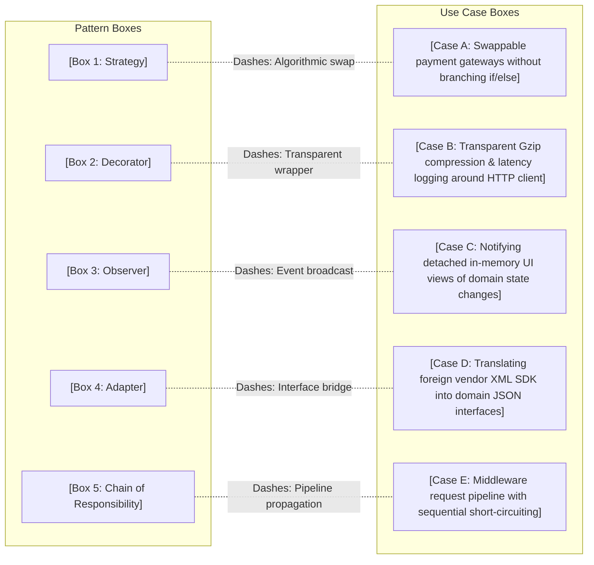

# Master Low-Level Design Practice Arena

Welcome to the **Master LLD Practice Arena**. Reading design patterns and OOP theory is only 20% of interview preparation; the remaining 80% is developing muscle memory through deliberate, timed coding drills and whiteboard architectural exercises.

> [!TIP]
> **The Active Recall Rule:** Never jump straight to the solution. Set a timer for 15 minutes, open an empty file in your editor (`practice.py` or `Practice.cs`), type out the class contracts, and run your unit assertions against real scenarios.

---

## 🎯 Track Practice Workbooks

Drill each pillar of Low-Level Design in its dedicated practice arena:

| Practice Arena | Focus Area | Drills Included |
| :--- | :--- | :--- |
| **[OOP & SOLID Practice Arena](24-oop-interview-questions/PRACTICE.md)** | Core OOP, Inheritance vs. Composition, Interfaces, Value vs Reference Equality, SOLID Refactoring | 11 Targeted Coding & Whiteboard Drills |
| **[Design Patterns Practice Arena](25-design-patterns-one-at-a-time/PRACTICE.md)** | All 23 GoF Patterns + Modern Framework Patterns (Repository, Specification, DI, Middleware) | 30 Hands-On Mini-Implementations |
| **[C# & .NET Practice Arena](26-csharp-and-dotnet-interview/PRACTICE.md)** | Memory Profiling (struct vs class), Custom LINQ, Async State Machines, ThreadPool, Middleware Pipeline, DI Lifetimes | 22 Concrete Language Engineering Challenges |
| **[Python Internals Practice Arena](27-python-interview/PRACTICE.md)** | Closures, Custom Decorator Factories, Generator Pipelines, Dunder Protocols, MRO Linearization, Asyncio Tasks | 20 Idiomatic Python Architecture Drills |

---

## ⏱️ Classic Interview Problems Speed-Run Checklist

When preparing for full 45-minute whiteboard/machine-coding rounds, practice designing and implementing these classic problems from scratch:



### 1. State & Lifecycle Systems
- [ ] **Vending Machine ([Module 13](13-library-and-vending-machine/README.md)):** Implement State Pattern (`IdleState`, `HasMoneyState`, `DispensingState`), inventory management, and exact change calculation.
- [ ] **Elevator Dispatcher ([Module 12](12-parking-lot-and-elevator/README.md)):** Implement SCAN / LOOK scheduling algorithm, floor request queueing, and multi-car direction optimization.

### 2. High-Throughput & Resource Allocators
- [ ] **Multi-Floor Parking Lot ([Module 12](12-parking-lot-and-elevator/README.md)):** Spot allocation by vehicle type (`Compact`, `Regular`, `Large`, `EV`), fee calculation strategy (`Hourly`, `FlatRate`), and entry/exit ticketing.
- [ ] **LRU & LFU In-Memory Cache ([Module 18](18-lru-lfu-cache-and-rate-limiter/README.md)):** $O(1)$ Hash Map + Doubly-Linked List for LRU; Frequency bucket doubly-linked list for LFU; thread-safe read/write locking.
- [ ] **Sliding Window Rate Limiter ([Module 18](18-lru-lfu-cache-and-rate-limiter/README.md)):** Sliding log and token bucket algorithms with thread-safe timestamp management.

### 3. Financial & Transactional Systems
- [ ] **Splitwise Expense Sharing ([Module 15](15-splitwise-expense-sharing/README.md)):** Equal, exact, and percentage splits; Debt simplification graph algorithm (greedy minimize cash flow).
- [ ] **Movie Ticket Booking ([Module 16](16-movie-ticket-booking/README.md)):** Concurrency-safe seat reservation with 10-minute hold lock; seat layout matrix; payment integration.
- [ ] **Ride-Sharing Platform ([Module 17](17-ride-sharing/README.md)):** Driver-rider geo matching strategy; dynamic pricing calculator (surge pricing); ride status lifecycle state machine.

---

## 🧩 Box-Joining & Dash-Matching Active Recall Drills

Test your mental mapping by connecting concept boxes to architectural intent boxes across dashes.

### Drill 1: OOP Pillars & SOLID Box Joining
Match each Principle Box on the left to its Architectural Intent Box on the right:



### Drill 2: GoF Design Pattern Box Joining
Connect each Design Pattern Box across dashed lines to its real-world production use case:



---

## ✍️ Fill-in-the-Blanks with Dashes (`___`) Speed Drills

Test your precise recall of language runtimes and low-level mechanics:

- [ ] **1. Fragile Base Class:** The Fragile Base Class problem occurs when a subclass depends on the internal execution order of its superclass, breaking the `_______` (black-box/white-box) boundary. *(Answer: black-box)*
- [ ] **2. LSP Subtyping Contract:** Under the Liskov Substitution Principle, a subclass is permitted to `_______` (weaken/strengthen) preconditions, but must `_______` (weaken/strengthen) or maintain postconditions. *(Answer: weaken; strengthen)*
- [ ] **3. Python Memory Slots:** Specifying `__slots__ = ('x', 'y')` replaces the instance `_______` dictionary with a fixed-size C pointer array, eliminating approximately `____%` of memory overhead. *(Answer: `__dict__`; 60-70%)*
- [ ] **4. .NET Stack Safety:** In C#, `Span<T>` is declared as a `____ struct` to guarantee that its interior pointer never escapes the execution `_______`, preventing dangling memory pointers. *(Answer: ref; stack)*
- [ ] **5. Double-Checked Locking:** In a multi-threaded Singleton, the instance pointer must be declared `_______` to insert a hardware memory barrier and prevent CPU instruction `_______`. *(Answer: volatile; reordering)*
- [ ] **6. CPython Cyclic GC:** While reference counting provides immediate deallocation, cyclic references survive until CPython's generational cyclic garbage collector runs across `____` generations. *(Answer: 3)*

---

## 💡 How to Run Your Practice Drills

### In Python
```bash
# Create your practice sandbox
mkdir lld-drills
cd lld-drills
python -m venv .venv
source .venv/bin/activate  # On Windows: .venv\Scripts\Activate.ps1
# Write test assertions with pytest
pip install pytest
pytest test_solution.py
```

### In C# / .NET
```bash
# Create a rapid console test project
dotnet new console -n LldDrills
cd LldDrills
dotnet run
```

