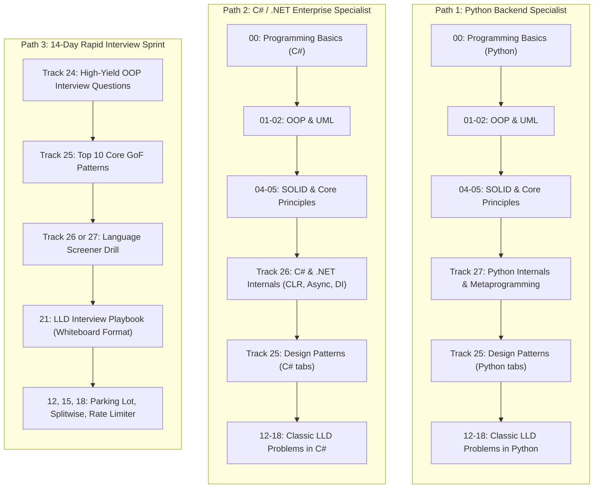

# Low-Level Design: OOP Foundations → Design Patterns → Classic Interview Problems

A hands-on curriculum in Low-Level Design (LLD/OOD) — the "given a
requirement, design the classes" discipline that shows up as its own
interview round at most product companies. Every code example in this
track is written **twice**, in **Python and C#**, shown side by side as
switchable tabs (click "Python" or "C#" — your choice is remembered as you
move between pages). **Zero prior programming in either language is
assumed.** Modules 00–01 teach both languages from the ground up — plain
variables and control flow first, then classes and OOP building blocks —
before any design content begins.

This is a large curriculum, being built out one module at a time. Modules
are added in dependency order; if a module's folder doesn't exist yet, it
hasn't been built out yet — check back.

This folder is a sibling to [`../backend/`](../backend/README.md) and
[`../learn/`](../learn/README.md), not a replacement for either. `learn/`
is operating infrastructure. `backend/` is building and operating a
networked application end to end. `lld/` is narrower and deeper on one
thing both of those touch only briefly: **how you design the classes and
objects inside a single component** — the skill tested directly in an LLD
interview round, independent of any framework, network, or database.

## Naming convention

Same convention as `backend/` and `learn/`:

- **Modules** are top-level folders directly under `lld/`, named
  `NN-module-name` — a zero-padded two-digit sequence number (the order you
  do them in) plus a lowercase kebab-case slug.
- Every module folder contains exactly one `README.md`. No separate
  exercise files or scripts — everything a module needs is written inline.
- The track closes with **two open-ended, no-solution-given capstones**:
  `22-capstone-project` (generic — you choose the domain) and
  `23-supply-chain-platform` (a themed second capstone applying
  everything to one specific, meaty domain end to end). Both skip the
  quiz, interview-question, and independent-challenge scaffolding —
  they *are* the open-ended integration test.
- This file (`lld/README.md`) is the single index for the whole track.

## How code samples work: tabs, not two separate walls of code

Every non-trivial snippet appears as a tabbed block:

```
{{tabs}}
{{tab Python}}
...python code...
{{tab C#}}
...C# code...
{{/tabs}}
```

The browser viewer renders this as clickable **Python | C#** tabs. Read a
concept once; see it expressed idiomatically in both languages; pick
whichever you're actively practicing.

## Recommended Study Paths: How to Learn LLD

Not everyone starts with the same background or timeline. Pick the study path that matches your current goal:



### Path 1: Python Backend Specialist
1. **Foundations:** Complete [00-programming-basics-python-and-csharp](00-programming-basics-python-and-csharp/README.md), [01-classes-objects-and-oop-building-blocks](01-classes-objects-and-oop-building-blocks/README.md), and [02-oop-foundations-and-uml](02-oop-foundations-and-uml/README.md).
2. **Principles:** Master [04-solid-principles](04-solid-principles/README.md) and [05-core-design-principles](05-core-design-principles/README.md).
3. **Language Deep Dive:** Complete all lessons in [Track 27: Python Interview Questions](27-python-interview/README.md) to master mutability, closures, decorators, generators, dunder data model, MRO, asyncio, and memory management.
4. **Patterns & Practice:** Learn [Track 25: Design Patterns](25-design-patterns-one-at-a-time/README.md) focusing on Pythonic idioms.
5. **Interview Problems:** Implement the classic problems in [12-parking-lot-and-elevator](12-parking-lot-and-elevator/README.md) through [18-lru-lfu-cache-and-rate-limiter](18-lru-lfu-cache-and-rate-limiter/README.md).

### Path 2: C# / .NET Enterprise Specialist
1. **Foundations:** Complete [00-programming-basics-python-and-csharp](00-programming-basics-python-and-csharp/README.md), [01-classes-objects-and-oop-building-blocks](01-classes-objects-and-oop-building-blocks/README.md), and [02-oop-foundations-and-uml](02-oop-foundations-and-uml/README.md).
2. **Principles:** Master [04-solid-principles](04-solid-principles/README.md) and [05-core-design-principles](05-core-design-principles/README.md).
3. **Language Deep Dive:** Complete all lessons in [Track 26: C# and .NET Interview Questions](26-csharp-and-dotnet-interview/README.md) to master value vs. reference types, delegates/lambdas, LINQ deferred execution, GC/IDisposable, async/await state machines, DI lifetimes, and ASP.NET Core middleware.
4. **Patterns & Practice:** Learn [Track 25: Design Patterns](25-design-patterns-one-at-a-time/README.md) focusing on C# idioms.
5. **Interview Problems:** Implement the classic problems in [12-parking-lot-and-elevator](12-parking-lot-and-elevator/README.md) through [18-lru-lfu-cache-and-rate-limiter](18-lru-lfu-cache-and-rate-limiter/README.md).

### Path 3: The 14-Day Rapid Interview Sprint
When you have an interview in 1–2 weeks:
1. **Day 1–3 (OOP Screener):** Work through [Track 24: OOP Interview Questions](24-oop-interview-questions/README.md) (The 4 pillars, abstract class vs. interface, overriding vs. hiding, value vs. reference equality, coupling and cohesion).
2. **Day 4–8 (Core Patterns):** Study Singleton, Factory Method, Builder, Adapter, Decorator, Proxy, Strategy, Observer, State, and Chain of Responsibility in [Track 25](25-design-patterns-one-at-a-time/README.md).
3. **Day 9–11 (Language Deep Dive):** Rapid-fire revision sheets in [Track 26 Lesson 22](26-csharp-and-dotnet-interview/22-rapid-fire-csharp-and-dotnet/README.md) or [Track 27 Lesson 20](27-python-interview/20-rapid-fire-python/README.md).
4. **Day 12–14 (Whiteboarding Classic Problems):** Master the 45-minute template in [21-lld-interview-playbook](21-lld-interview-playbook/README.md) and whiteboard [12-parking-lot-and-elevator](12-parking-lot-and-elevator/README.md), [15-splitwise-expense-sharing](15-splitwise-expense-sharing/README.md), and [18-lru-lfu-cache-and-rate-limiter](18-lru-lfu-cache-and-rate-limiter/README.md).

---

## The Active Practice & Retention System: Build Muscle Memory

Passive reading does not pass LLD interviews. To guarantee retention:

1. **Immediate Inline Drills (Every Lesson):**
   Every single lesson includes a dedicated `## 6. Exercises & Practical Drills` section with hands-on coding challenges and interview debugging prompts. Always solve the challenge in code before expanding the `<details><summary>Answer</summary>` block.
2. **Dedicated Practice Workbooks (`PRACTICE.md`):**
   Each major track includes a standalone practice arena containing targeted coding challenges, refactoring exercises, and whiteboard drills:
   - [Master LLD Practice Arena](PRACTICE.md) — Comprehensive problem directory & timed challenge checklists.
   - [OOP & SOLID Practice Arena](24-oop-interview-questions/PRACTICE.md) — 11 hands-on exercises covering inheritance, composition, and contracts.
   - [Design Patterns Practice Arena](25-design-patterns-one-at-a-time/PRACTICE.md) — 30 mini-coding challenges (one per pattern) with automated test cases.
   - [C# & .NET Practice Arena](26-csharp-and-dotnet-interview/PRACTICE.md) — Profiling allocations, custom LINQ operators, middleware, and DI container diagnostics.
   - [Python Internals Practice Arena](27-python-interview/PRACTICE.md) — Mutable defaults, closure inspection, custom decorators, and async generators.
3. **The 3-Step Recall Rule:**
   - **Step 1:** Read the concept and examine the visual mental model.
   - **Step 2:** Type the code snippet into your terminal without copy-pasting; verify matching console output.
   - **Step 3:** Answer the senior interview question out loud in under 2 minutes without looking at the model answer.

## Modules

| # | Module | What you'll be able to do after | Depends on |
|---|--------|-----------------------------------|------------|
| 00 | [00-programming-basics-python-and-csharp](00-programming-basics-python-and-csharp/README.md) | Write and run a simple program in both Python and C#: variables, data types, operators, `if`/loops, functions | nothing |
| 01 | [01-classes-objects-and-oop-building-blocks](01-classes-objects-and-oop-building-blocks/README.md) | Define classes, constructors, access modifiers, properties, and static members, and use each language's basic collections | programming-basics |
| 02 | [02-oop-foundations-and-uml](02-oop-foundations-and-uml/README.md) | Explain and apply encapsulation, abstraction, inheritance, and polymorphism, and read/draw a UML class and sequence diagram | classes-objects-and-oop-building-blocks |
| 03 | [03-generics-exceptions-and-value-objects](03-generics-exceptions-and-value-objects/README.md) | Write generic/type-safe classes and methods, design a sane exception hierarchy, and model immutable value objects (enums, records/dataclasses) | oop-foundations-and-uml |
| 04 | [04-solid-principles](04-solid-principles/README.md) | Apply all five SOLID principles and recognize violations in real code | oop-foundations-and-uml |
| 05 | [05-core-design-principles](05-core-design-principles/README.md) | Apply DRY, KISS, YAGNI, the Law of Demeter, composition-over-inheritance, and reason about coupling/cohesion | solid-principles |
| 06 | [06-creational-patterns](06-creational-patterns/README.md) | Implement and choose correctly between Singleton, Factory Method, Abstract Factory, Builder, and Prototype | core-design-principles |
| 07 | [07-structural-patterns](07-structural-patterns/README.md) | Implement and choose correctly between Adapter, Decorator, Facade, Composite, Proxy, Bridge, and Flyweight | creational-patterns |
| 08 | [08-behavioral-patterns-i](08-behavioral-patterns-i/README.md) | Implement and choose correctly between Strategy, Observer, Command, State, and Template Method | structural-patterns |
| 09 | [09-behavioral-patterns-ii](09-behavioral-patterns-ii/README.md) | Implement and choose correctly between Iterator, Chain of Responsibility, Mediator, Memento, and Visitor | behavioral-patterns-i |
| 10 | [10-concurrency-safe-design](10-concurrency-safe-design/README.md) | Design thread-safe singletons, producer-consumer pipelines, and immutable objects, and reason about where locks belong in a design | behavioral-patterns-ii |
| 11 | [11-requirements-to-class-diagrams](11-requirements-to-class-diagrams/README.md) | Turn a vague prompt into actors, use cases, entities, relationships, and a first-draft class + sequence diagram — the actual method used in an LLD interview | concurrency-safe-design |
| 12 | [12-parking-lot-and-elevator](12-parking-lot-and-elevator/README.md) | Design and fully implement a Parking Lot and an Elevator System | requirements-to-class-diagrams |
| 13 | [13-library-and-vending-machine](13-library-and-vending-machine/README.md) | Design and fully implement a Library Management system and a Vending Machine | parking-lot-and-elevator |
| 14 | [14-tic-tac-toe-and-chess](14-tic-tac-toe-and-chess/README.md) | Design and fully implement Tic-Tac-Toe and a Chess move/board engine | library-and-vending-machine |
| 15 | [15-splitwise-expense-sharing](15-splitwise-expense-sharing/README.md) | Design and fully implement an expense-splitting system (Splitwise-style) | tic-tac-toe-and-chess |
| 16 | [16-movie-ticket-booking](16-movie-ticket-booking/README.md) | Design and fully implement a seat-selection ticket-booking system (BookMyShow-style) | splitwise-expense-sharing |
| 17 | [17-ride-sharing](17-ride-sharing/README.md) | Design and fully implement a ride-matching system (Uber-style) | movie-ticket-booking |
| 18 | [18-lru-lfu-cache-and-rate-limiter](18-lru-lfu-cache-and-rate-limiter/README.md) | Design and fully implement an LRU cache, an LFU cache, and a rate limiter | ride-sharing |
| 19 | [19-api-library-design-and-di](19-api-library-design-and-di/README.md) | Design a clean, versioned, fluent public API/SDK, and apply dependency injection for testability | lru-lfu-cache-and-rate-limiter |
| 20 | [20-anti-patterns-and-code-smells](20-anti-patterns-and-code-smells/README.md) | Recognize and fix God Objects, anemic domain models, spaghetti coupling, and other common LLD code smells | api-library-design-and-di |
| 21 | [21-lld-interview-playbook](21-lld-interview-playbook/README.md) | Run a structured 45-minute LLD interview: clarify requirements, whiteboard a design, communicate tradeoffs under time pressure | everything above |
| 22 | [22-capstone-project](22-capstone-project/README.md) | Design and build a larger combined system end to end with no guidance given | everything above |
| 23 | [23-supply-chain-platform](23-supply-chain-platform/README.md) | Design and build a supply-chain platform (inventory, warehouses, orders, shipments, suppliers) end to end with no guidance given — a second, differently-themed capstone | capstone-project |

## Interview questions: OOP, patterns, C# and Python

Four tracks of interview questions, each a folder of short lessons. They sit beside the modules above, not after them: use them whenever
an interview is close. Lessons not written yet are marked *Soon*, and their page lists the questions they will answer.

| # | Track | What you'll be able to do |
|---|-------|---------------------------|
| 24 | [OOP Interview Questions](24-oop-interview-questions/README.md) | Answer the OOP questions that open most interviews (pillars, abstract class vs interface, overloading vs overriding, equality, SOLID) in two minutes each, in Python and C# |
| 25 | [Design Patterns, One at a Time](25-design-patterns-one-at-a-time/README.md) | Explain every common pattern on its own: where to use it, how to build it in Python and C#, when not to, and where your framework already uses it |
| 26 | [C# and .NET Interview Questions](26-csharp-and-dotnet-interview/README.md) | Answer C#, .NET and ASP.NET Core questions: types, delegates, async/await, the GC, DI lifetimes, the middleware pipeline (`app.Use`, `app.Run`, `app.Map`), EF Core |
| 27 | [Python Interview Questions](27-python-interview/README.md) | Answer Python questions: mutability, decorators, generators, dunder methods, the MRO, the GIL and asyncio, and web apps (`app.run`, WSGI, ASGI, FastAPI) |

## Prerequisites already confirmed

- **Zero prior programming assumed, in either language** — not Python,
  not C#. Modules 00–01 start from `print("hello")` and build up to
  classes; nothing before module 02 assumes you've written code before.
- Practicing wherever's convenient — unlike `learn/`, nothing here depends
  on WSL2, Docker, or Azure; a Python interpreter and a C# environment
  (`dotnet` CLI or an IDE) are all you need.

Start here → [00-programming-basics-python-and-csharp/README.md](00-programming-basics-python-and-csharp/README.md)
