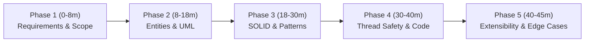
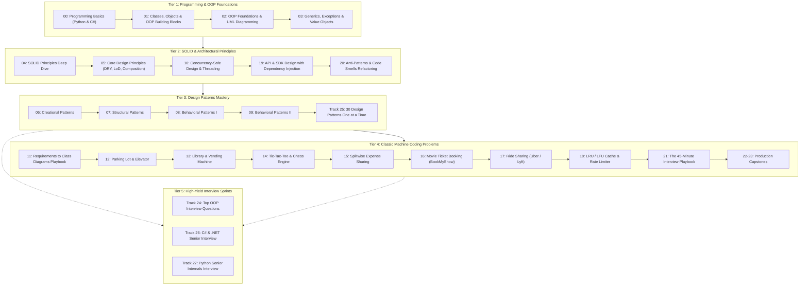
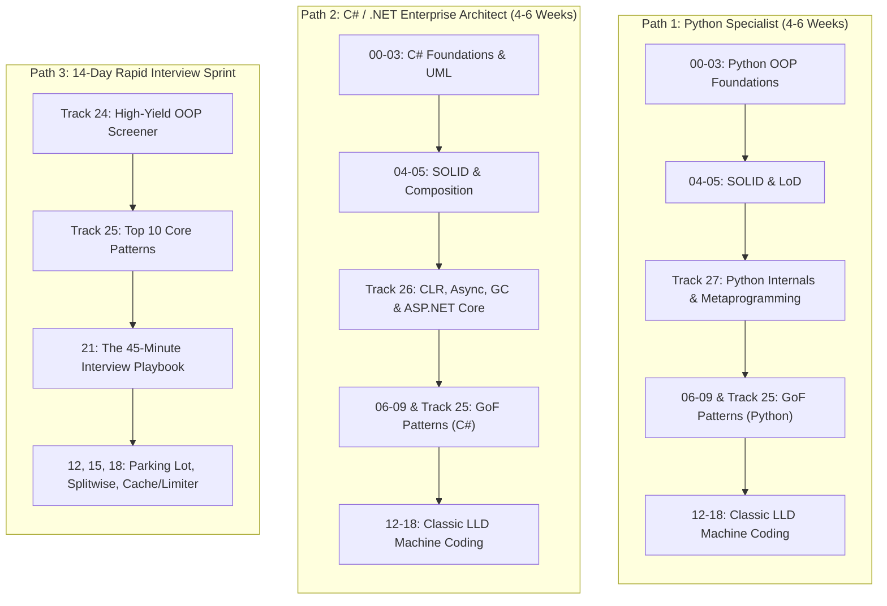

# Low-Level Design (LLD) & Object-Oriented Architecture Masterclass

> **Master Low-Level Design (LLD), Object-Oriented Analysis & Design (OOAD), and Gang of Four (GoF) Design Patterns from first principles to FAANG/Tier-1 machine coding interview excellence.** Every architectural concept and design pattern is implemented across **four production languages: Python, C# (.NET), Go, and TypeScript**, complete with interactive class diagrams, thread-safety models, and real-world failure post-mortems.

---

> [!TIP]
> **Hands-on Workbench:** Design, simulate, and export UML class diagrams and ER schemas live in our browser-based [Low-Level Design (LLD) & Schema Studio](/tools/lld-studio/). Test design pattern templates (Parking Lot, Elevator, Payment Gateway, Rate Limiter) and export production code with one click.

---

## 1. High-Level Design (HLD) vs. Low-Level Design (LLD)

In modern engineering interviews and production systems, software design spans two complementary altitudes:

| Architectural Dimension | High-Level Design (HLD / System Design) | Low-Level Design (LLD / Object-Oriented Design) |
| :--- | :--- | :--- |
| **Primary Scope** | Macro-architecture & distributed system topology | Micro-architecture & internal component structuring |
| **Key Building Blocks** | Load balancers, microservices, caches, message queues, databases | Classes, interfaces, abstract data types, methods, packages |
| **Core Constraints** | Network latency, disk I/O, partition tolerance, throughput (QPS), availability (99.99%) | Coupling, cohesion, memory footprint, thread safety, cyclomatic complexity, extensibility |
| **Guiding Theorems & Rules** | CAP Theorem, PACELC, Amdahl's Law, Little's Law, Fallacies of Distributed Computing | SOLID Principles, DRY, KISS, YAGNI, Law of Demeter, GoF Patterns |
| **Typical Deliverables** | Component topologies, data flow diagrams, database sharding schemes, API contracts | UML class diagrams, sequence diagrams, design pattern implementations, working code |
| **Interview Format** | 45-minute whiteboarding discussion on scaling to $10\text{M}+$ users | 45–90 minute machine coding or whiteboarding round writing clean, extensible, runnable code |

---

## 2. The 4-Language Polyglot Architecture

Engineering excellence requires recognizing design patterns independent of syntax while mastering the idioms of your target runtime. Every core implementation throughout this curriculum is provided in:

````carousel
```python
# Python 3.12+ (Type Hints, Abstract Base Classes, Protocols, Pydantic)
from abc import ABC, abstractmethod

class PaymentGateway(ABC):
    @abstractmethod
    def process_payment(self, account_id: str, amount_cents: int) -> bool:
        """Abstract contract for idempotent transaction processing."""
        pass
```
<!-- slide -->
```csharp
// C# 12 / .NET 8 (Strong Typing, Interfaces, DI Lifetimes, Pattern Matching)
public interface IPaymentGateway
{
    Task<PaymentResult> ProcessPaymentAsync(string accountId, decimal amount, CancellationToken ct = default);
}
```
<!-- slide -->
```go
// Go 1.22+ (Implicit Interfaces, Structural Typing, Goroutines, Channels)
type PaymentGateway interface {
    ProcessPayment(ctx context.Context, accountID string, amountCents int64) error
}
```
<!-- slide -->
```typescript
// TypeScript 5+ / Node.js (Structural Contracts, Strict Null Checks, Async/Await)
export interface PaymentGateway {
  processPayment(accountId: string, amountCents: number): Promise<boolean>;
}
```
````

> [!NOTE]
> The site automatically synchronizes your language tab preference across all lessons. Choose **Python**, **C#**, **Go**, or **TypeScript** once, and your choice is preserved throughout your learning journey.

---

## 3. The 45-Minute LLD Interview Execution Protocol

Top-tier tech companies (Google, Amazon, Uber, Meta, Microsoft, Atlassian) evaluate low-level design using a rigorous 5-phase timeline. Memorize and practice this exact cadence:



### Phase 1: Requirement Clarification & Use-Case Scoping (00:00 – 08:00)
- **Never start coding immediately.** Ask clarifying questions to constrain the problem domain.
- Define **Core Functional Requirements** (e.g. "Support hourly parking for bikes, compact cars, and electric trucks; issue tickets; compute fees on exit").
- Define **Non-Functional Requirements** at component level: thread safety, in-memory execution speed, idempotent operations, and extension points.
- Explicitly state out-of-scope items (e.g. external payment hardware, OCR license plate recognition cameras).

### Phase 2: Core Entity Discovery & Class Modeling (08:00 – 18:00)
- Extract nouns as Candidate Classes and verbs as Methods.
- Separate **Domain Entities** (state-bearing) from **Service Controllers** (behavior-bearing) and **Value Objects** (immutable descriptors).
- Draw the core UML Class Diagram: identify Inheritance (`is-a`), Composition (`has-a`), Aggregation, and Realization (`implements`).

### Phase 3: Design Pattern Application & SOLID Alignment (18:00 – 30:00)
- Identify hot spots of future change. Apply Gang of Four patterns purposefully—never force patterns where simple composition suffices:
  - Variable algorithms $\rightarrow$ **Strategy Pattern**
  - Complex object assembly $\rightarrow$ **Builder Pattern**
  - Event publishing & reactive updates $\rightarrow$ **Observer Pattern**
  - State transitions $\rightarrow$ **State Pattern**
  - Multi-tier processing / interceptors $\rightarrow$ **Chain of Responsibility**
- Verify adherence to **SOLID**: Open/Closed (adding new types requires zero modifications to existing classes), Dependency Inversion (high-level orchestrators depend on abstractions).

### Phase 4: Thread Safety & Concurrency Hardening (30:00 – 40:00)
- In real-world LLD interviews, multiple actors interact with your system simultaneously (e.g. 5 cars entering a parking lot with 1 spot left).
- Guard shared mutable state using fine-grained locks (`ReentrantLock`, `ReaderWriterLockSlim`, mutexes, or atomic variables). Avoid crude global locks that bottleneck throughput.

### Phase 5: Extensibility Walkthrough & Edge Case Validation (40:00 – 45:00)
- Walk the interviewer through an extensibility drill: *"How would you add dynamic surge pricing, VIP reservations, or crypto payments?"*
- Demonstrate that new features require only a new class implementing an existing interface registered in the factory or dependency injection container.

---

## 4. Master Curriculum Architecture

The LLD curriculum is engineered into 5 progressive tiers covering 28 structured modules:



---

## 5. Structured Module Catalog

### Tier 1: Programming & Object-Oriented Foundations
| # | Module | Core Architectural Concepts | Key Deliverable |
|:---|:---|:---|:---|
| **00** | [Programming Basics](00-programming-basics-python-and-csharp/README.md) | Syntax equivalence, memory models, primitives vs references, stack vs heap | Polyglot baseline in Python & C# |
| **01** | [Classes & OOP Building Blocks](01-classes-objects-and-oop-building-blocks/README.md) | Constructors, access modifiers, properties, static state, collections | Domain entity encapsulation |
| **02** | [OOP Foundations & UML](02-oop-foundations-and-uml/README.md) | Encapsulation, abstraction, inheritance vs realization, UML Class & Sequence notation | High-fidelity UML diagrams |
| **28** | [Python Basics, Step by Step](28-python-basics-step-by-step/README.md) | 11 modules: values, loops, functions, lists, tuples, sets and dictionaries (every operation), comprehensions, errors, files, first classes | Zero to comfortable in Python, with C# beside it |
| **29** | [OOP Pillar 1: Encapsulation](29-oop-pillar-1-encapsulation/README.md) | Invariants, access control, properties, defensive copies, tell-don't-ask | Objects that cannot be corrupted |
| **30** | [OOP Pillar 2: Abstraction](30-oop-pillar-2-abstraction/README.md) | Abstract methods vs abstract classes vs interfaces, Protocols, dependency inversion | Contracts and fakes for tests |
| **31** | [OOP Pillar 3: Inheritance](31-oop-pillar-3-inheritance/README.md) | super(), overriding, MRO and the diamond, LSP, composition over inheritance | Hierarchies that do not lie |
| **32** | [OOP Pillar 4: Polymorphism](32-oop-pillar-4-polymorphism/README.md) | Compile-time vs runtime, overloading vs overriding, operators, duck typing | Replacing if/else ladders |
| **33** | [UML Class Diagrams and Relationships](33-uml-class-diagram-relationships/README.md) | Class, object, association, aggregation, composition, dependency, realization | Draw it and code it |
| **03** | [Generics, Exceptions & Value Objects](03-generics-exceptions-and-value-objects/README.md) | Type covariance/contravariance, domain exception hierarchies, immutability | Robust value objects & domain primitives |

### Tier 2: SOLID & Architectural Principles
| # | Module | Core Architectural Concepts | Key Deliverable |
|:---|:---|:---|:---|
| **04** | [SOLID Principles Deep Dive](04-solid-principles/README.md) | SRP, OCP, LSP, ISP, DIP in production systems with refactoring proofs | Refactoring God classes into SOLID hierarchies |
| **05** | [Core Design Principles](05-core-design-principles/README.md) | DRY, KISS, YAGNI, Law of Demeter, Composition over Inheritance, Cohesion vs Coupling | Clean coupling matrices |
| **10** | [Concurrency-Safe Design](10-concurrency-safe-design/README.md) | Race conditions, deadlocks, lock striping, read/write locks, producer-consumer queues | Thread-safe thread pools and singletons |
| **19** | [API & Library Design with DI](19-api-library-design-and-di/README.md) | Fluent builders, API evolution, semantic versioning, IoC containers & lifetimes | Modular, testable SDK architectures |
| **20** | [Anti-Patterns & Code Smells](20-anti-patterns-and-code-smells/README.md) | Anemic models, feature envy, shotgun surgery, primitive obsession | Automated refactoring checklists |

### Tier 3: Gang of Four (GoF) Design Patterns
| # | Module | Patterns Covered | Production Use Case |
|:---|:---|:---|:---|
| **06** | [Creational Patterns](06-creational-patterns/README.md) | Singleton, Factory Method, Abstract Factory, Builder, Prototype | Dynamic database drivers, request builders |
| **07** | [Structural Patterns](07-structural-patterns/README.md) | Adapter, Decorator, Facade, Composite, Proxy, Bridge, Flyweight | HTTP middleware, ORM caching proxies, legacy adapters |
| **08** | [Behavioral Patterns I](08-behavioral-patterns-i/README.md) | Strategy, Observer, Command, State, Template Method | Dynamic pricing engines, event buses, workflow states |
| **09** | [Behavioral Patterns II](09-behavioral-patterns-ii/README.md) | Iterator, Chain of Responsibility, Mediator, Memento, Visitor | API gateway filters, chat brokers, transactional undo |
| **25** | [30 Patterns One at a Time](25-design-patterns-one-at-a-time/README.md) | Deep dives into all 23 classic GoF + 7 modern cloud/enterprise patterns | Pattern comparison drills & framework mappings |

### Tier 4: Classic Machine Coding & Whiteboard Problems
| # | Problem Suite | Primary Patterns & Architecture | Key Design Challenges |
|:---|:---|:---|:---|
| **11** | [Requirements to Diagrams](11-requirements-to-class-diagrams/README.md) | Whiteboard translation framework, actor mapping | Turning ambiguous prompts into class structures |
| **12** | [Parking Lot & Elevator](12-parking-lot-and-elevator/README.md) | Strategy (pricing), State (elevator motion), Factory | Thread-safe spot allocation, SCAN elevator scheduling |
| **13** | [Library & Vending Machine](13-library-and-vending-machine/README.md) | State (coin/dispense), Chain of Responsibility | Exact change validation, inventory reservations |
| **14** | [Tic-Tac-Toe & Chess](14-tic-tac-toe-and-chess/README.md) | Strategy (piece moves), Command (move history/undo) | Move validation, check/checkmate detection, replay |
| **15** | [Splitwise Expense Sharing](15-splitwise-expense-sharing/README.md) | Strategy (equal/exact/percent split), Graph simplification | Debt minimization via bipartite balance settlement |
| **16** | [Movie Ticket Booking](16-movie-ticket-booking/README.md) | Optimistic locking, State, Mutex locking | Concurrency collision avoidance, temporary 10m seat locks |
| **17** | [Ride Sharing (Uber)](17-ride-sharing/README.md) | Strategy (matching & pricing), Observer (location) | Geospatial proximity search, driver dispatch state machine |
| **18** | [LRU/LFU Cache & Rate Limiter](18-lru-lfu-cache-and-rate-limiter/README.md) | Doubly linked list + Hash map, Token Bucket, Sliding Window | $O(1)$ eviction under high concurrency |
| **21** | [LLD Interview Playbook](21-lld-interview-playbook/README.md) | 45-minute communication template, time management | Live whiteboard strategy under interview pressure |
| **22** | [Open Capstone Project](22-capstone-project/README.md) | Full architectural design & machine coding implementation | Autonomous system design from scratch |
| **23** | [Supply Chain Platform](23-supply-chain-platform/README.md) | Multi-warehouse inventory, shipment tracking, order lifecycles | Enterprise domain modeling end to end |

### Tier 5: Senior Interview Deep Dives
| # | Specialization Track | Focus Areas |
|:---|:---|:---|
| **24** | [OOP Interview Questions](24-oop-interview-questions/README.md) | Pillars, abstract classes vs interfaces, overriding vs shadowing, value vs reference equality |
| **26** | [C# & .NET Interview](26-csharp-and-dotnet-interview/README.md) | CLR internals, async/await state machines, GC/IDisposable, LINQ deferred execution, DI lifetimes, ASP.NET Core middleware |
| **27** | [Python Interview](27-python-interview/README.md) | Data model dunders, GIL & threading, asyncio event loops, MRO linearization, generators, closures, memory profiling |

---

## 6. Recommended Study Paths



---

## 7. Active Practice & Retention System

Passive reading does not develop machine coding speed or architectural clarity. Build muscle memory through:

1. **The Interactive LLD Studio (`/tools/lld-studio/`):**
   Model class hierarchies, drag-and-drop associations, test GoF pattern templates, and export cleanly formatted code and Mermaid diagrams.
2. **Dedicated Practice Arenas (`PRACTICE.md`):**
   - [Master LLD Practice Arena](PRACTICE.md) — Comprehensive timed challenge checklists.
   - [OOP & SOLID Practice Arena](24-oop-interview-questions/PRACTICE.md) — Inheritance, composition, and contract refactoring drills.
   - [Design Patterns Practice Arena](25-design-patterns-one-at-a-time/PRACTICE.md) — 30 mini-coding challenges with unit test suites.
   - [C# & .NET Practice Arena](26-csharp-and-dotnet-interview/PRACTICE.md) — Allocation profiling, LINQ operators, custom middleware, and DI container setup.
   - [Python Internals Practice Arena](27-python-interview/PRACTICE.md) — Mutable defaults, closure inspection, decorators, and async generators.
3. **The 3-Step Recall Rule:**
   - **Step 1:** Read the design pattern or problem specification and inspect the UML diagram.
   - **Step 2:** Code the solution from scratch without copying; verify unit tests pass.
   - **Step 3:** Explain the design tradeoffs out loud in under 3 minutes (e.g. why Strategy over State, why composition over inheritance).

---

Ready to begin? Start with [Module 00: Programming Basics in Python & C#](00-programming-basics-python-and-csharp/README.md) or jump straight to [Module 04: SOLID Principles Deep Dive](04-solid-principles/README.md).
