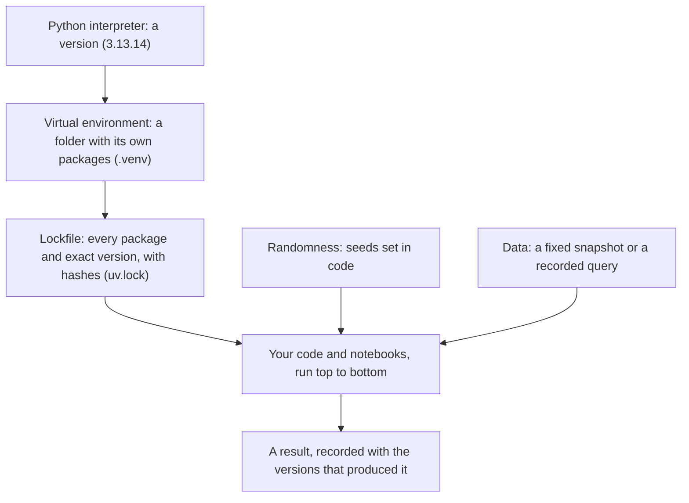
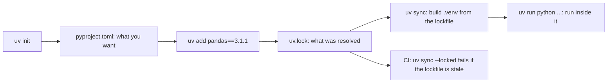
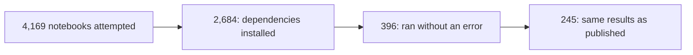

# Module 00: Jupyter, uv, Virtual Environments, and Reproducible Setups

> **Prerequisites:** Basic Python and a terminal. [Track 00 Overview](../README.md).  
> **Estimated Reading Time:** 35 minutes  
> **Target Audience:** Backend engineers, data engineers and new ML engineers who will run, share or review analysis code and notebooks

> [!TIP]
> **The Golden Rule of Reproducible Setups:** A result is reproducible only if someone else can produce it **from the files in the repository alone**. Pin every dependency in a **lockfile** that is committed, run the code in an **isolated environment** created from that lockfile, make every source of randomness **explicit**, and treat a notebook as reproducible only after it has run **top to bottom in a fresh kernel**. Your laptop's working state is not part of the result.

---

## Why This Matters

Data and ML work fails quietly when environments drift. A notebook that produced a chart last month raises an error today because a library changed; a model trained on a laptop scores differently on the CI runner; a colleague cannot run the analysis at all because a package was installed by hand and never written down. None of these is an exotic failure. Section 3 quotes a study of thousands of notebooks attached to published research: of the 4,169 that it attempted to run automatically, **396 ran without an error and 245 reproduced their published results**.

This module is the base the rest of the track stands on. It shows what a virtual environment isolates, what a lockfile pins, how `uv` turns both into two commands, why notebooks need a fresh-kernel run, and which hidden sources of randomness change results between two runs of the same code. You will run each of those in this lesson, with real output.

---

## 1. Architectural Mental Model: What Makes a Result Repeatable

### Four Layers, From the Interpreter to Your Code



Each layer removes one kind of drift:

- **The interpreter version.** `requires-python` in `pyproject.toml` and a `.python-version` file say which Python to use; uv can download and install it.
- **The environment.** A virtual environment is a directory with its own `site-packages`, so a project's packages do not mix with the system's or another project's. "It is not recommended to include the `.venv` directory in version control"; it is rebuilt from the lockfile.
- **The lockfile.** The project file (`pyproject.toml`) states what you *want* (`pandas>=3`); the lockfile records what was *resolved* (`pandas 3.1.1`, and every transitive dependency). uv's documentation: "`uv.lock` is a *universal* or *cross-platform* lockfile", which "should be checked into version control, allowing for consistent and reproducible installations across machines", and "is a human-readable TOML file but is managed by uv and should not be edited manually."
- **The code's own nondeterminism.** Unseeded random generators, the iteration order of sets of strings, and parallel reductions can change a result even in an identical environment (Workflow 3).

### The uv Workflow in One Picture



### Why Notebooks Are Special

A notebook is a document *and* a live process. The saved file contains the cells and the outputs they last produced, but the outputs come from whatever the kernel held at the time: cells run out of order, cells since edited, variables from cells since deleted. The file therefore can show results that its own code no longer produces. The only test is to run the saved file from top to bottom in a **fresh kernel**, which is what a colleague, a CI job or `nbclient` does (Workflow 2).

---

## 2. Systematic Reference and Comparison Grids

### Environment and Packaging Tools

| Tool | What it does | Lockfile | Notes |
| :--- | :--- | :--- | :--- |
| `venv` + `pip` | Built into Python: create an environment, install packages | None by itself (`pip freeze` is an export, not a lock) | Universal, manual |
| `pip-tools` | Compiles `requirements.in` into a fully pinned `requirements.txt` | Pinned requirements file | Two files to keep in step |
| **uv** | Creates environments, resolves, locks, installs, runs, and installs Python itself | `uv.lock` (cross-platform) | One tool for the whole workflow; used in this track |
| Conda / mamba | Environments with non-Python libraries (compilers, CUDA) | `conda-lock` for locks | Useful when native libraries are the hard part |
| Docker | Freezes the whole operating system layer | The image digest | Complements a lockfile; does not replace it |

### The Files of a uv Project

| File | Commit it? | Who writes it | Holds |
| :--- | :--- | :--- | :--- |
| `pyproject.toml` | Yes | You (and `uv add`) | The project, `requires-python`, direct dependencies |
| `uv.lock` | **Yes** | uv only | Every resolved package, its version, source and hashes |
| `.python-version` | Yes | `uv init`, `uv python pin` | The Python version for this project |
| `.venv/` | **No** | uv (`uv sync`) | The installed environment, rebuilt from the lockfile |

### Commands You Will Use

| Command | Effect |
| :--- | :--- |
| `uv init name --python 3.13` | A new project with `pyproject.toml` and `.python-version` |
| `uv add "pandas==3.1.1"` | Adds a dependency, resolves, updates `uv.lock` and the environment |
| `uv lock` | Re-resolves and writes `uv.lock` |
| `uv sync` | Makes `.venv` match `uv.lock` exactly |
| `uv sync --locked` | The same, but **fails** if `uv.lock` is out of date: the CI gate |
| `uv run python script.py` | Runs inside the project's environment, syncing first |
| `python -m venv .venv` and `pip install -r requirements.txt` | The plain equivalent without uv |

### Sources of a Different Result, and the Pin for Each

| Source | Symptom | Pin |
| :--- | :--- | :--- |
| A library upgraded | A changed number or a new warning after reinstalling | Lockfile, committed, installed with `--locked` |
| A different Python | Different behaviour or a failed install | `requires-python`, `.python-version` |
| Notebook hidden state | Saved outputs that the code no longer produces | Run top to bottom in a fresh kernel before sharing |
| Unseeded randomness | Different splits, initializations, samples | `np.random.default_rng(seed)`, `random_state=` everywhere |
| Iteration order of string sets | Different order in a file or a result between processes | Sort before you iterate when the order can reach the output |
| Different data | Silent drift in every number | A snapshot with a checksum, or a dated, recorded query |

---

## 3. Real Case Study: Running the Notebooks Behind Published Research

This is a documented measurement, not an invented incident: Sheeba Samuel and Daniel Mietchen, "Computational reproducibility of Jupyter notebooks from biomedical publications" (arXiv 2209.04308, 2022).

| What the study reports | Number |
| :--- | :--- |
| Notebooks collected | 9,625, from 1,117 GitHub repositories linked to 1,419 publications in PubMed Central |
| Python notebooks with declared requirements that were run automatically | 4,169 |
| Notebooks for which all declared dependencies installed | 2,684 |
| Notebooks that "ran through without any errors" | 396 |
| Of those, notebooks that "produced results identical to those reported in the original" | 245 |

An earlier study by João Felipe Pimentel, Leonardo Murta, Vanessa Braganholo and Juliana Freire ("A Large-scale Study about Quality and Reproducibility of Jupyter Notebooks", MSR 2019) "studied 1.4 million notebooks from GitHub", analysed the characteristics that impact reproducibility, and proposed best practices to improve it.



### What to Take From It

1. **"Requirements declared" is not "environment reproducible".** More than a third of the attempted notebooks failed at installation, before a single cell ran: unpinned or incomplete requirements age badly.
2. **Running is the test.** Of the notebooks whose dependencies installed, most still raised an exception; nobody had run them from a clean start.
3. **Same output is a further step.** Fewer than two thirds of the notebooks that ran produced their published results, which is where seeds, data snapshots and versions come in.
4. **All of these are cheap to prevent at the time of writing** and expensive to repair later: a committed lockfile, a fresh-kernel run, explicit seeds.

---

## 4. Is This the Same Environment? In Four Languages (`carousel`)

Two exports of one environment can differ in order, letter case and spelling (`scikit_learn` and `Scikit-Learn`) and still be the same environment; one changed version makes them different. The program normalizes package names by the rule of PEP 503 ("lowercased with all runs of the characters `.`, `-`, or `_` replaced with a single `-` character"), sorts, takes a SHA-256 fingerprint of the canonical form, and lists what differs.

````carousel
```python
"""Is this the same environment? Two exports of one environment can differ in order, letter case and spelling ('scikit_learn' and
'Scikit-Learn') and still be the same; one changed version makes them different. Normalize every name by the rule of PEP 503, sort, take a
SHA-256 fingerprint, and list what changed. (The exports are examples; the versions are those used in this track.)"""
import hashlib
import re

LAPTOP = """
NumPy==2.5.5
scikit_learn==1.9.1
pandas==3.1.1
python-dateutil==4.0.0
"""
CI_RUNNER = """
# exported by the CI job
python_dateutil == 4.0.0
pandas==3.1.1
numpy==2.5.5
Scikit-Learn==1.9.1
"""
SERVER = """
numpy==2.5.5
pandas==3.0.2
scikit-learn==1.9.1
python-dateutil==4.0.0
scipy==1.18.1
"""


def normalize(name):
    """PEP 503: lower case, and every run of '.', '-' or '_' becomes a single '-'."""
    return re.sub(r"[-_.]+", "-", name).lower()


def parse(text):
    pins = {}
    for line in text.splitlines():
        line = line.strip()
        if not line or line.startswith("#"):
            continue
        name, version = line.split("==")
        pins[normalize(name.strip())] = version.strip()
    return pins


def canonical(pins):
    return "".join(f"{name}=={pins[name]}\n" for name in sorted(pins))


def fingerprint(pins):
    return hashlib.sha256(canonical(pins).encode("utf-8")).hexdigest()[:16]


def diff(old, new):
    lines = []
    for name in sorted(set(old) | set(new)):
        if name not in new:
            lines.append(f"  removed  {name}=={old[name]}")
        elif name not in old:
            lines.append(f"  added    {name}=={new[name]}")
        elif old[name] != new[name]:
            lines.append(f"  changed  {name} {old[name]} -> {new[name]}")
    return lines


if __name__ == "__main__":
    exports = {"laptop": parse(LAPTOP), "CI runner": parse(CI_RUNNER), "server": parse(SERVER)}
    print("canonical form of the laptop's export:")
    print(canonical(exports["laptop"]), end="")
    for name, pins in exports.items():
        print(f"{name:10} {len(pins)} packages  fingerprint {fingerprint(pins)}")
    print(f"laptop and CI runner are the same environment: {fingerprint(exports['laptop']) == fingerprint(exports['CI runner'])}")
    print(f"laptop and server are the same environment: {fingerprint(exports['laptop']) == fingerprint(exports['server'])}")
    print("what the server has that the laptop does not:")
    print("\n".join(diff(exports["laptop"], exports["server"])))
```

<!-- slide -->

```typescript
// Is this the same environment? Two exports of one environment can differ in order, letter case and spelling ('scikit_learn' and
// 'Scikit-Learn') and still be the same; one changed version makes them different. Normalize every name by the rule of PEP 503, sort, take a
// SHA-256 fingerprint, and list what changed. (The exports are examples; the versions are those used in this track.)
import { createHash } from "node:crypto";

const LAPTOP = `
NumPy==2.5.5
scikit_learn==1.9.1
pandas==3.1.1
python-dateutil==4.0.0
`;
const CI_RUNNER = `
# exported by the CI job
python_dateutil == 4.0.0
pandas==3.1.1
numpy==2.5.5
Scikit-Learn==1.9.1
`;
const SERVER = `
numpy==2.5.5
pandas==3.0.2
scikit-learn==1.9.1
python-dateutil==4.0.0
scipy==1.18.1
`;

type Pins = Map<string, string>;

/** PEP 503: lower case, and every run of '.', '-' or '_' becomes a single '-'. */
const normalize = (name: string): string => name.replace(/[-_.]+/g, "-").toLowerCase();

function parse(text: string): Pins {
  const pins: Pins = new Map();
  for (const raw of text.split("\n")) {
    const line = raw.trim();
    if (line === "" || line.startsWith("#")) continue;
    const [name, version] = line.split("==");
    pins.set(normalize(name.trim()), version.trim());
  }
  return pins;
}

const sortedNames = (pins: Pins): string[] => [...pins.keys()].sort();
const canonical = (pins: Pins): string => sortedNames(pins).map((name) => `${name}==${pins.get(name)}\n`).join("");
const fingerprint = (pins: Pins): string => createHash("sha256").update(canonical(pins), "utf8").digest("hex").slice(0, 16);

function diff(old: Pins, now: Pins): string[] {
  const names = [...new Set([...old.keys(), ...now.keys()])].sort();
  const lines: string[] = [];
  for (const name of names) {
    if (!now.has(name)) lines.push(`  removed  ${name}==${old.get(name)}`);
    else if (!old.has(name)) lines.push(`  added    ${name}==${now.get(name)}`);
    else if (old.get(name) !== now.get(name)) lines.push(`  changed  ${name} ${old.get(name)} -> ${now.get(name)}`);
  }
  return lines;
}

const exports: [string, Pins][] = [["laptop", parse(LAPTOP)], ["CI runner", parse(CI_RUNNER)], ["server", parse(SERVER)]];
const [laptop, ci, server] = exports.map(([, pins]) => pins);
const py = (flag: boolean): string => (flag ? "True" : "False");
console.log("canonical form of the laptop's export:");
process.stdout.write(canonical(laptop));
for (const [name, pins] of exports) console.log(`${name.padEnd(10)} ${pins.size} packages  fingerprint ${fingerprint(pins)}`);
console.log(`laptop and CI runner are the same environment: ${py(fingerprint(laptop) === fingerprint(ci))}`);
console.log(`laptop and server are the same environment: ${py(fingerprint(laptop) === fingerprint(server))}`);
console.log("what the server has that the laptop does not:");
console.log(diff(laptop, server).join("\n"));
```

<!-- slide -->

```go
// Is this the same environment? Two exports of one environment can differ in order, letter case and spelling ("scikit_learn" and
// "Scikit-Learn") and still be the same; one changed version makes them different. Normalize every name by the rule of PEP 503, sort, take a
// SHA-256 fingerprint, and list what changed. (The exports are examples; the versions are those used in this track.)
package main

import (
	"crypto/sha256"
	"encoding/hex"
	"fmt"
	"regexp"
	"sort"
	"strings"
)

const laptop = `
NumPy==2.5.5
scikit_learn==1.9.1
pandas==3.1.1
python-dateutil==4.0.0
`

const ciRunner = `
# exported by the CI job
python_dateutil == 4.0.0
pandas==3.1.1
numpy==2.5.5
Scikit-Learn==1.9.1
`

const server = `
numpy==2.5.5
pandas==3.0.2
scikit-learn==1.9.1
python-dateutil==4.0.0
scipy==1.18.1
`

var separators = regexp.MustCompile(`[-_.]+`)

// normalize follows PEP 503: lower case, and every run of '.', '-' or '_' becomes a single '-'.
func normalize(name string) string { return strings.ToLower(separators.ReplaceAllString(name, "-")) }

func parse(text string) map[string]string {
	pins := map[string]string{}
	for _, raw := range strings.Split(text, "\n") {
		line := strings.TrimSpace(raw)
		if line == "" || strings.HasPrefix(line, "#") {
			continue
		}
		name, version, _ := strings.Cut(line, "==")
		pins[normalize(strings.TrimSpace(name))] = strings.TrimSpace(version)
	}
	return pins
}

func sortedNames(pins map[string]string) []string {
	names := make([]string, 0, len(pins))
	for name := range pins {
		names = append(names, name)
	}
	sort.Strings(names)
	return names
}

func canonical(pins map[string]string) string {
	var b strings.Builder
	for _, name := range sortedNames(pins) {
		b.WriteString(name + "==" + pins[name] + "\n")
	}
	return b.String()
}

func fingerprint(pins map[string]string) string {
	sum := sha256.Sum256([]byte(canonical(pins)))
	return hex.EncodeToString(sum[:])[:16]
}

func diff(old, now map[string]string) []string {
	all := map[string]string{}
	for k, v := range old {
		all[k] = v
	}
	for k, v := range now {
		all[k] = v
	}
	var lines []string
	for _, name := range sortedNames(all) {
		before, inOld := old[name]
		after, inNew := now[name]
		switch {
		case !inNew:
			lines = append(lines, fmt.Sprintf("  removed  %s==%s", name, before))
		case !inOld:
			lines = append(lines, fmt.Sprintf("  added    %s==%s", name, after))
		case before != after:
			lines = append(lines, fmt.Sprintf("  changed  %s %s -> %s", name, before, after))
		}
	}
	return lines
}

func py(flag bool) string {
	if flag {
		return "True"
	}
	return "False"
}

func main() {
	names := []string{"laptop", "CI runner", "server"}
	pins := []map[string]string{parse(laptop), parse(ciRunner), parse(server)}
	fmt.Println("canonical form of the laptop's export:")
	fmt.Print(canonical(pins[0]))
	for i, name := range names {
		fmt.Printf("%-10s %d packages  fingerprint %s\n", name, len(pins[i]), fingerprint(pins[i]))
	}
	fmt.Printf("laptop and CI runner are the same environment: %s\n", py(fingerprint(pins[0]) == fingerprint(pins[1])))
	fmt.Printf("laptop and server are the same environment: %s\n", py(fingerprint(pins[0]) == fingerprint(pins[2])))
	fmt.Println("what the server has that the laptop does not:")
	fmt.Println(strings.Join(diff(pins[0], pins[2]), "\n"))
}
```

<!-- slide -->

```csharp
// Is this the same environment? Two exports of one environment can differ in order, letter case and spelling ('scikit_learn' and
// 'Scikit-Learn') and still be the same; one changed version makes them different. Normalize every name by the rule of PEP 503, sort, take a
// SHA-256 fingerprint, and list what changed. (The exports are examples; the versions are those used in this track.)
using System;
using System.Collections.Generic;
using System.Linq;
using System.Security.Cryptography;
using System.Text;
using System.Text.RegularExpressions;

const string Laptop = """

NumPy==2.5.5
scikit_learn==1.9.1
pandas==3.1.1
python-dateutil==4.0.0
""";
const string CiRunner = """

# exported by the CI job
python_dateutil == 4.0.0
pandas==3.1.1
numpy==2.5.5
Scikit-Learn==1.9.1
""";
const string Server = """

numpy==2.5.5
pandas==3.0.2
scikit-learn==1.9.1
python-dateutil==4.0.0
scipy==1.18.1
""";

// PEP 503: lower case, and every run of '.', '-' or '_' becomes a single '-'.
string Normalize(string name) => Regex.Replace(name, "[-_.]+", "-").ToLowerInvariant();

SortedDictionary<string, string> Parse(string text)
{
    var pins = new SortedDictionary<string, string>(StringComparer.Ordinal);
    foreach (var raw in text.Split('\n'))
    {
        var line = raw.Trim();
        if (line.Length == 0 || line.StartsWith('#')) continue;
        var parts = line.Split("==");
        pins[Normalize(parts[0].Trim())] = parts[1].Trim();
    }
    return pins;
}

string Canonical(SortedDictionary<string, string> pins) => string.Concat(pins.Select(p => $"{p.Key}=={p.Value}\n"));

string Fingerprint(SortedDictionary<string, string> pins) =>
    Convert.ToHexString(SHA256.HashData(Encoding.UTF8.GetBytes(Canonical(pins)))).ToLowerInvariant()[..16];

List<string> Diff(SortedDictionary<string, string> old, SortedDictionary<string, string> now)
{
    var lines = new List<string>();
    foreach (var name in old.Keys.Union(now.Keys).OrderBy(n => n, StringComparer.Ordinal))
    {
        bool inOld = old.TryGetValue(name, out var before), inNew = now.TryGetValue(name, out var after);
        if (!inNew) lines.Add($"  removed  {name}=={before}");
        else if (!inOld) lines.Add($"  added    {name}=={after}");
        else if (before != after) lines.Add($"  changed  {name} {before} -> {after}");
    }
    return lines;
}

string Py(bool flag) => flag ? "True" : "False";

var exports = new (string Name, SortedDictionary<string, string> Pins)[] { ("laptop", Parse(Laptop)), ("CI runner", Parse(CiRunner)), ("server", Parse(Server)) };
Console.WriteLine("canonical form of the laptop's export:");
Console.Write(Canonical(exports[0].Pins));
foreach (var (name, pins) in exports) Console.WriteLine($"{name,-10} {pins.Count} packages  fingerprint {Fingerprint(pins)}");
Console.WriteLine($"laptop and CI runner are the same environment: {Py(Fingerprint(exports[0].Pins) == Fingerprint(exports[1].Pins))}");
Console.WriteLine($"laptop and server are the same environment: {Py(Fingerprint(exports[0].Pins) == Fingerprint(exports[2].Pins))}");
Console.WriteLine("what the server has that the laptop does not:");
Console.WriteLine(string.Join("\n", Diff(exports[0].Pins, exports[2].Pins)));
```
````

**Observed output (identical in Python 3.13.14, Node 24, Go 1.22 and .NET 10):**

```text
canonical form of the laptop's export:
numpy==2.5.5
pandas==3.1.1
python-dateutil==4.0.0
scikit-learn==1.9.1
laptop     4 packages  fingerprint 749be571765470d4
CI runner  4 packages  fingerprint 749be571765470d4
server     5 packages  fingerprint f87035ab6cb2560d
laptop and CI runner are the same environment: True
laptop and server are the same environment: False
what the server has that the laptop does not:
  changed  pandas 3.1.1 -> 3.0.2
  added    scipy==1.18.1
```

What to notice:

- **Normalization makes spelling irrelevant.** `NumPy`, `scikit_learn` and `python_dateutil` become `numpy`, `scikit-learn` and `python-dateutil`, so the laptop's and the CI runner's exports have the **same fingerprint** (`749be571765470d4`) although no line of the two files is in the same place.
- **A fingerprint is a cheap equality check.** Printing it at the start of a training job or in a report lets anyone see, at a glance, whether two runs used the same environment.
- **The diff says why two runs differ.** The server has an older pandas (3.0.2) and an extra package (scipy): either can change a result. This is the comparison to make before blaming the model.

---

## 5. Practical Hands-On Verification Workflows

Verified on **Windows 11 with Git Bash, uv 0.12.8, Python 3.13.14**; the libraries are the versions printed in each output.

### Workflow 1: A Locked Project With uv, and the CI Gate

Run this script in an empty folder. It creates a project, pins two dependencies, shows the lockfile, runs code in the locked environment, then edits `pyproject.toml` by hand without relocking and shows `uv sync --locked` refusing it:

```bash
#!/usr/bin/env bash
# A reproducible project with uv: create it, pin the dependencies, see the lockfile, run code in the locked environment,
# and watch the --locked gate refuse a project whose lockfile is out of date. Run it in an empty folder.
set -u
uv --version
uv init analysis --python 3.13 --quiet
cd analysis
echo "--- files uv created"
ls -A | grep -v '^\.git$'
echo "--- add two pinned dependencies (this resolves them and writes uv.lock)"
uv add "numpy==2.5.5" "pandas==3.1.1" --quiet
grep -A4 '^dependencies' pyproject.toml
echo "--- the lockfile records the exact version and a hash of every file it may install"
grep -A2 '^name = "numpy"' uv.lock
echo "packages in uv.lock: $(grep -c '^\[\[package\]\]' uv.lock)"
echo "--- run code inside the locked environment"
uv run python -c "import sys, numpy, pandas; print('python', sys.version.split()[0], 'numpy', numpy.__version__, 'pandas', pandas.__version__)"
echo "--- someone edits pyproject.toml by hand and forgets to relock"
sed -i 's/"pandas==3.1.1",/"pandas==3.1.1",\n    "scipy>=1.18",/' pyproject.toml
uv sync --locked 2>&1 | head -3
echo "exit code: ${PIPESTATUS[0]}"
echo "--- relock, and the gate passes"
uv lock --quiet && uv sync --locked --quiet && echo "uv sync --locked: ok, $(grep -c '^\[\[package\]\]' uv.lock) packages locked"
```

**Observed Output:**

```text
uv 0.12.8 (68209e5c6 2026-08-31 x86_64-pc-windows-msvc)
--- files uv created
.gitignore
.python-version
README.md
pyproject.toml
src
--- add two pinned dependencies (this resolves them and writes uv.lock)
dependencies = [
    "numpy==2.5.5",
    "pandas==3.1.1",
]

--- the lockfile records the exact version and a hash of every file it may install
name = "numpy"
version = "2.5.5"
source = { registry = "https://pypi.org/simple" }
packages in uv.lock: 5
--- run code inside the locked environment
python 3.13.14 numpy 2.5.5 pandas 3.1.1
--- someone edits pyproject.toml by hand and forgets to relock
Resolved 6 packages in 153ms
error: The lockfile at `uv.lock` needs to be updated, but `--locked` was provided.

exit code: 1
--- relock, and the gate passes
uv sync --locked: ok, 6 packages locked
```

- `uv init` wrote `pyproject.toml`, `.python-version`, `.gitignore`, a README and a `src` folder; `uv add` resolved the two pins and wrote `uv.lock` with 5 package entries: the project itself, numpy, pandas and the packages pandas depends on.
- `uv run` ran inside the locked environment and printed exactly the pinned versions: **python 3.13.14, numpy 2.5.5, pandas 3.1.1**.
- After the hand edit, `uv sync --locked` failed with "The lockfile at `uv.lock` needs to be updated, but `--locked` was provided" and **exit code 1**. In CI, that one flag turns "it works on my machine" into a failed build with a clear reason; after `uv lock` the gate passes with 6 packages.

### Workflow 2: A Notebook Whose Saved Outputs Lie

The script plays an author who runs cells, defines a value in a cell they later delete, edits a cell without re-running anything, and saves. Then it runs the saved file from top to bottom in a fresh kernel with `nbclient`, as a colleague or CI would (needs `pip install nbformat nbclient ipykernel`):

```python
"""A notebook's saved outputs are a record of what the kernel happened to hold, not of what the cells say. This script plays an author who
edits and re-runs cells out of order (in one Python namespace, like a kernel), saves the notebook with those outputs, and then runs the
saved file from top to bottom in a fresh kernel with nbclient, the way CI or a colleague would."""
import nbformat
from nbclient import NotebookClient

cells = {
    "load": "rate = 0.10",
    "price": "price = round(100 * (1 + rate), 2)\nprice",
    "final": "price - discount",
}
# What the author did, in this order: ran 'load' and 'price'; defined a discount in a cell they later deleted; ran 'final';
# then edited 'load' to 0.20 and saved, without running anything again.
kernel = {}
outputs = {}
exec(cells["load"], kernel)
exec(cells["price"].splitlines()[0], kernel)
outputs["price"] = kernel["price"]
exec("discount = 5", kernel)  # the deleted cell
outputs["final"] = eval(cells["final"], kernel)
cells["load"] = "rate = 0.20"

notebook = nbformat.v4.new_notebook()
for count, (name, source) in enumerate(cells.items(), start=1):
    cell = nbformat.v4.new_code_cell(source, execution_count=count)
    if name in outputs:
        cell.outputs = [nbformat.v4.new_output("execute_result", {"text/plain": repr(outputs[name])}, execution_count=count)]
    notebook.cells.append(cell)
nbformat.write(notebook, "analysis.ipynb")

saved = nbformat.read("analysis.ipynb", as_version=4)
print("what the saved notebook shows:")
for cell in saved.cells:
    shown = cell.outputs[0]["data"]["text/plain"] if cell.outputs else "(no output)"
    print(f"  {cell.source.splitlines()[0]:36} -> {shown}")

fresh = nbformat.read("analysis.ipynb", as_version=4)
NotebookClient(fresh, timeout=60, kernel_name="python3", allow_errors=True).execute()
print("what a fresh kernel computes from the same file, top to bottom:")
for cell in fresh.cells:
    result = cell.outputs[0] if cell.outputs else None
    if result is None:
        shown = "(no output)"
    elif result["output_type"] == "error":
        shown = f"{result['ename']}: {result['evalue']}"
    else:
        shown = result["data"]["text/plain"]
    print(f"  {cell.source.splitlines()[0]:36} -> {shown}")
```

**Observed Output:**

```text
what the saved notebook shows:
  rate = 0.20                          -> (no output)
  price = round(100 * (1 + rate), 2)   -> 110.0
  price - discount                     -> 105.0
what a fresh kernel computes from the same file, top to bottom:
  rate = 0.20                          -> (no output)
  price = round(100 * (1 + rate), 2)   -> 120.0
  price - discount                     -> NameError: name 'discount' is not defined
```

The saved notebook shows a price of **110.0** and a final value of **105.0**. Its own code, run from the top, computes **120.0** (the rate was edited to 0.20 after the outputs were made) and then fails with **`NameError: name 'discount' is not defined`** (the cell that defined it was deleted). Nothing in the file hints at either problem; only a fresh run shows them. The fix is a habit: "Restart and run all" before saving, and an automated top-to-bottom run (nbclient, or `jupyter nbconvert --execute`) in CI for notebooks that others rely on.

### Workflow 3: Sources of Nondeterminism in Identical Environments

```python
"""Three things that change a result between two runs of the same code, and how to pin each: the order of a set of strings (Python
randomizes string hashing per process), an unseeded random generator, and the library versions themselves."""
import os
import subprocess
import sys

import numpy as np
import pandas as pd
import sklearn

SNIPPET = "words = {'apple', 'banana', 'cherry', 'date', 'elder'}; print(list(words), sorted(words) == list(sorted(words)))"
print("== 1. iterating over a set of strings, in three separate processes ==")
for seed in ("1", "2", "3"):
    out = subprocess.run([sys.executable, "-c", SNIPPET], env={**os.environ, "PYTHONHASHSEED": seed}, capture_output=True, text=True).stdout.strip()
    print(f"  PYTHONHASHSEED={seed}: {out.split(' True')[0]}")
print("  sorted() gives one order in every process: iterate over sorted(words) when the order can reach a result or a file")

print("\n== 2. random numbers: a generator with a seed, and one without ==")
print("  seeded, run 1:", np.random.default_rng(42).integers(0, 100, 5).tolist())
print("  seeded, run 2:", np.random.default_rng(42).integers(0, 100, 5).tolist())
unseeded = [np.random.default_rng().integers(0, 100, 5).tolist() for _ in range(2)]
print(f"  unseeded runs equal: {unseeded[0] == unseeded[1]}")

print("\n== 3. record what produced the result, next to the result ==")
print(f"  python {sys.version.split()[0]}, numpy {np.__version__}, pandas {pd.__version__}, scikit-learn {sklearn.__version__}, platform {sys.platform}")
```

**Observed Output:**

```text
== 1. iterating over a set of strings, in three separate processes ==
  PYTHONHASHSEED=1: ['elder', 'date', 'cherry', 'apple', 'banana']
  PYTHONHASHSEED=2: ['date', 'apple', 'elder', 'cherry', 'banana']
  PYTHONHASHSEED=3: ['banana', 'elder', 'date', 'apple', 'cherry']
  sorted() gives one order in every process: iterate over sorted(words) when the order can reach a result or a file

== 2. random numbers: a generator with a seed, and one without ==
  seeded, run 1: [8, 77, 65, 43, 43]
  seeded, run 2: [8, 77, 65, 43, 43]
  unseeded runs equal: False

== 3. record what produced the result, next to the result ==
  python 3.13.14, numpy 2.5.5, pandas 3.1.1, scikit-learn 1.9.1, platform win32
```

- **The same set, three orders.** Python randomizes the hashing of strings for each process, so a set of five words came out in three different orders under three `PYTHONHASHSEED` values. Any result that depends on that order (the first item, a file written in a loop, a train/test split built from a set) changes between runs. Iterate over `sorted(...)` when order can reach an output.
- **A seeded generator repeats itself; an unseeded one does not.** `default_rng(42)` gave `[8, 77, 65, 43, 43]` twice; two unseeded generators gave different numbers.
- **Write the versions down next to the result.** A one-line record of Python and library versions turns "why is this different?" into a diff.

---

## 6. Hands-On Exercises and Independent Challenge

### Practical Exercises

1. **Lock a project.** Run Workflow 1, then change `numpy==2.5.5` to `numpy>=2.5` in `pyproject.toml` and run `uv lock`. Did the locked version of numpy change? Why or why not?
2. **Fingerprint your environment.** Run `uv pip freeze` (or `pip freeze`) in two environments you use and feed both exports to the carousel program. Are they the same environment? If not, which packages differ?
3. **Make the notebook honest.** Fix the notebook of Workflow 2 so that a fresh kernel reproduces the saved outputs, and decide whether `discount` belongs in the notebook or in a module.
4. **Find the hidden order.** In the program `words = {"b", "a", "c"}; print(next(iter(words)))`, how many different first words can you get by changing `PYTHONHASHSEED`? What would you change if this decided which customer is "the first" in a report?

<details><summary>Answers</summary>

1. No, as long as 2.5.5 still satisfies `>=2.5`: `uv lock` prefers the versions already in the lockfile and changes a locked version only when the constraint excludes it or you ask (`uv lock --upgrade-package numpy`). The lockfile, not the constraint, decides what is installed.
2. Two environments are the same only if every normalized name and version agree; a difference in a numerical library (NumPy, SciPy, BLAS builds) is the most likely to change results. Differences in tools (linters, Jupyter) usually do not.
3. Put `discount = 5` back in a cell before it is used (or compute it from data), keep `rate` at the value you mean, then restart the kernel and run all; save only after that run. Values that several notebooks need belong in a small Python module or a config file, imported by each.
4. As many orders as the set allows, typically several of the three possible first words across seeds. If an order decides a result, sort by an explicit key (for example the customer id or the date) so that the result does not depend on the process.

</details>

### Independent Challenge

Your team's analysis repository has 30 notebooks, a `requirements.txt` with unpinned names (`pandas`, `scikit-learn`, `matplotlib`), and a model that "scored 0.91 last quarter". Nobody can reproduce the 0.91 now. Write the plan to make the repository reproducible and to find out whether 0.91 can be recovered.

<details><summary>Architectural Discussion</summary>

**Freeze what exists before changing anything.** Record the current environment (`uv pip freeze` from the machine that produced 0.91, if it still exists), the Python version and the data snapshot or query and its date. If the old environment is gone, the git history and package release dates bound which versions were likely installed.

**Move to a locked project.** `uv init` (or add a `pyproject.toml`), add the dependencies with the versions found above, commit `uv.lock` and `.python-version`, and install only with `uv sync --locked`.

**Make each notebook prove itself.** Run every notebook top to bottom in a fresh kernel with `nbclient` in CI; fix or retire the ones that fail. Move shared code into a package imported by the notebooks.

**Make randomness explicit.** Seed every split, model and sampler; replace iteration over sets with sorted iteration where order matters.

**Recover or explain 0.91.** Rerun the original notebook in the reconstructed environment on the original data. If it reproduces, you have a baseline; if not, compare environments (the carousel program's diff), data and seeds one at a time. If 0.91 came from a leaky split or a lucky seed (Track 01), the honest number replaces it, and the report says why.

</details>

---

## 7. Common Mistakes and Troubleshooting

- **Installing into the system Python.** Every project gets its own environment; never `pip install` globally for project work.
- **Committing `.venv` or not committing `uv.lock`.** It is the other way round: commit the lockfile, rebuild the environment.
- **Treating `pip freeze` as a lockfile.** It is a snapshot of one machine, without hashes, and often includes unrelated packages.
- **Editing `uv.lock` by hand.** It "should not be edited manually"; change `pyproject.toml` and run `uv lock`.
- **Sharing a notebook that has not run top to bottom in a fresh kernel.** Its outputs can describe code that no longer exists (Workflow 2).
- **Forgetting the seed.** Set `random_state` or a seeded `Generator` for every split, model and sample.
- **Depending on set or dictionary-of-set order.** Sort by an explicit key when the order reaches a result.
- **Not recording versions with results.** One line of versions saves hours of guessing later.

---

## 8. Operational Validation Checkpoints and Checkpoint Quiz

<details><summary><strong>Checkpoint 1: A colleague's run of your training script gives a different score. What do you compare first?</strong></summary>

The environment and the data, before the model. Compare normalized package lists (the carousel program's fingerprint and diff), the Python version, the data snapshot and the seeds. A different numerical library version, a different data extract or an unseeded split explains most such differences.

</details>

<details><summary><strong>Checkpoint 2: CI fails with "the lockfile needs to be updated". Is that a bug in CI?</strong></summary>

No. Someone changed `pyproject.toml` without running `uv lock` (Workflow 1). Run `uv lock`, review the changes to `uv.lock` (which packages and versions moved), and commit both files together.

</details>

<details><summary><strong>Checkpoint 3: A notebook in the repository shows a chart, but running it raises an error. What happened and what is the rule?</strong></summary>

The saved outputs came from kernel state that the code no longer produces: cells run out of order, edited, or deleted (Workflow 2). The rule: restart and run all before saving, and run notebooks top to bottom in a fresh kernel in CI.

</details>

### Checkpoint Quiz

1. What is the difference between `pyproject.toml` and `uv.lock`, and which do you commit?
2. What does `uv sync --locked` add to `uv sync`, and why is it used in CI?
3. Why can a saved notebook display results its own code does not produce?
4. Why did the same set of words print in different orders in Workflow 3, and how do you remove that dependence?
5. In the case study, what share of the attempted notebooks reproduced their published results?

<details><summary>Answers</summary>

1. `pyproject.toml` states the project and its direct dependencies (what you want, possibly as ranges); `uv.lock` records the resolved versions of every package, direct and transitive, with hashes (what is installed). Commit both; never commit `.venv`.
2. It refuses to proceed if the lockfile is out of date with `pyproject.toml`, so CI fails instead of silently resolving new versions. Every build then uses exactly the committed lock.
3. The outputs are stored from the last time each cell ran, with whatever the kernel held then; cells may have run out of order, been edited afterwards, or depended on deleted cells.
4. Python randomizes string hashing per process (`PYTHONHASHSEED`), and a set's iteration order depends on the hashes. Sort before iterating when the order matters.
5. 245 of the 4,169 attempted notebooks, about 6%; 396 ran without errors, and 2,684 had their dependencies install.

</details>

---

## 9. Interview Practice

> [!interview]
> How do you make a data science project reproducible for the next person who clones it?

<details><summary>What a strong answer covers</summary>

- A project file with `requires-python`, a committed lockfile (uv.lock or a compiled requirements file), and an environment created from it (`uv sync --locked` in CI).
- Notebooks run top to bottom in a fresh kernel in CI; shared code in modules.
- Seeds for every random step; sorted iteration where order matters; versions and data snapshot recorded with results.
- Mention that a container can freeze the OS layer but does not replace the lockfile.

</details>

> [!interview]
> A model's metric changed after a dependency upgrade. How do you find out why?

<details><summary>What a strong answer covers</summary>

- Diff the two locked environments (normalized names and versions) to list the changes.
- Re-run with the old lock to confirm the cause, then bisect: upgrade packages one at a time (or by group) and rerun with fixed seeds and data.
- Read the release notes of the culprit (a changed default, a new algorithm), decide whether the new behaviour is correct, and pin or adapt.

</details>

---

## Further Reading and Sources

- [uv documentation: Project structure and files](https://docs.astral.sh/uv/concepts/projects/layout/) — `pyproject.toml`, the project environment and `uv.lock`, quoted above.
- [PEP 503: Simple Repository API, normalized names](https://peps.python.org/pep-0503/) — the name-normalization rule used by the carousel program.
- [Samuel and Mietchen, "Computational reproducibility of Jupyter notebooks from biomedical publications" (arXiv 2209.04308)](https://arxiv.org/abs/2209.04308) — the numbers of the case study.
- [Pimentel, Murta, Braganholo and Freire, "A Large-scale Study about Quality and Reproducibility of Jupyter Notebooks" (MSR 2019)](https://2019.msrconf.org/details/msr-2019-papers/36/A-Large-scale-Study-about-Quality-and-Reproducibility-of-Jupyter-Notebooks) — 1.4 million notebooks from GitHub and best practices for reproducibility.
- [Python documentation: `venv`](https://docs.python.org/3/library/venv.html) — virtual environments in the standard library.

## Next

Continue to **[Module 01: NumPy Arrays: ndarray, Shapes, Dtypes, and Contiguous Memory](../01-numpy-ndarrays-dtypes-and-memory-layout/README.md)**, the first module that uses the environment you just learned to build.
