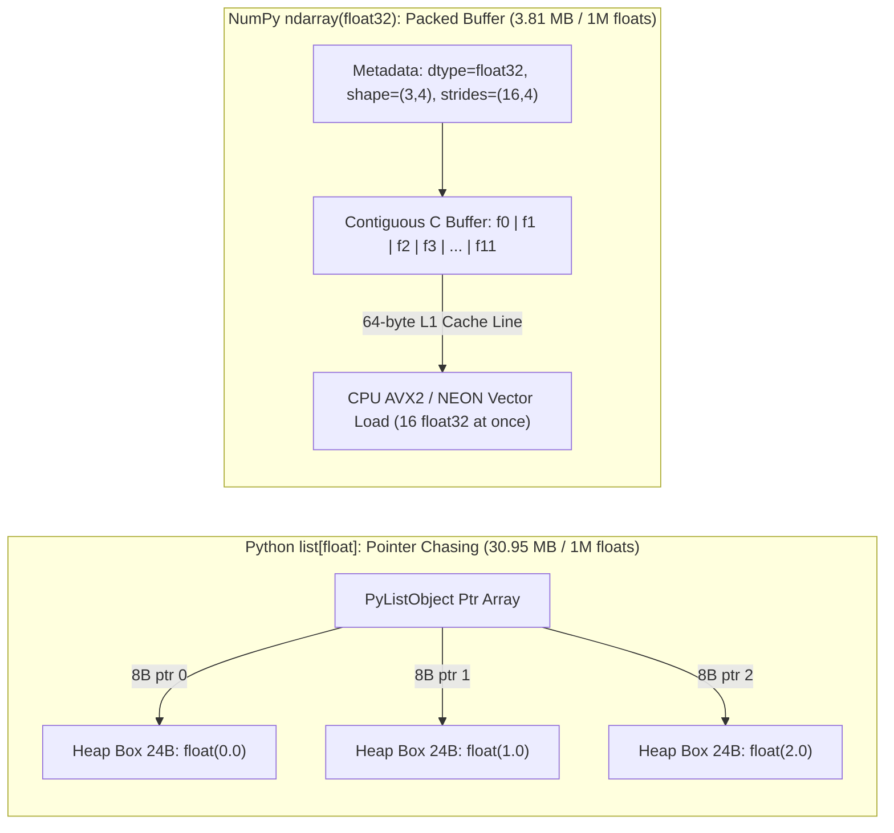
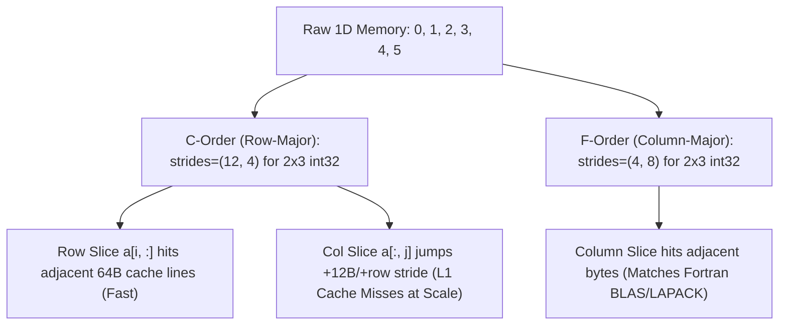
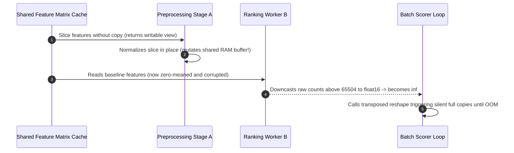

# Module 01: NumPy Arrays: ndarray, Shapes, Dtypes, and Contiguous Memory

> **Prerequisites:** [Module 00: Jupyter, uv, Virtual Environments, and Reproducible Setups](../00-jupyter-uv-and-reproducible-data-environments/README.md) and [Track 00 Overview](../README.md).  
> **Estimated Reading Time:** 30 minutes  
> **Target Audience:** ML Engineers, Data Scientists, Backend Engineers moving into numerical Python and deep learning systems

> [!TIP]
> **The Golden Rule of `ndarray` Memory & Views:** Every `ndarray` is two small things decoupled from each other—a **fixed-type contiguous byte buffer** (`data*`) plus lightweight **view metadata** (`dtype`, `shape`, `strides`). Treat every slice, `.T` transpose, and `.ravel()` on contiguous arrays as an *aliased pointer into live RAM* until proven otherwise with `.copy()` or `np.shares_memory()`, and always enforce explicit precision bounds before narrowing to `float16` or integer dtypes.

---

## Why This Matters

Machine learning workloads—feature pipelines, tabular matrices, embeddings, images, and mini-batches—live or die on **memory density** and **CPU cache locality**. A standard Python `list[float]` stores an array of $8$-byte `PyObject*` pointers scattered across heap-allocated `24`-byte `PyFloatObject` structs (`CPython 3.13`). Summing one million numbers forces the CPU to dereference a million non-contiguous heap addresses per pass, stalling L1/L2 cache prefetchers and blocking vectorization.

A NumPy `ndarray` strips away the per-element object wrappers and packs homogeneous numbers side by side in a single C-aligned buffer (`3.81 MB` for $1\text{M}$ `float32` values vs. `30.95 MB` for Python `list[float]`—an **$8.1\times$ RAM reduction** and an order-of-magnitude compute speedup). Virtually every library above it—**Pandas, Polars, scikit-learn, SciPy, XGBoost, and PyTorch**—either wraps `ndarray` directly or exchanges buffers zero-copy via the Python Buffer Protocol / DLPack. Understanding `ndarray` memory layout turns mysterious OOM crashes, silent dtype precision loss, and unintended matrix mutations into predictable systems engineering.

---

## 1. Architectural Mental Model: The `ndarray` Struct, Strides, and Cache Lines

### Python `list` vs. NumPy `ndarray` in Memory



When NumPy creates an array, it separates **metadata** from **raw bytes**:

- **`data`**: Base pointer to the first byte in the allocation.
- **`dtype`**: Byte width (`itemsize`) and binary interpretation (`float32` IEEE-754, two's-complement `int64`, unsigned `uint8`, etc.).
- **`shape`**: Tuple $(d_0, d_1, \dots, d_{k-1})$ giving element counts along each axis.
- **`strides`**: Tuple $(s_0, s_1, \dots, s_{k-1})$ giving **how many bytes** to advance in memory to increment index $k$ by $+1$.

### The Stride Offset Formula & Zero-Copy Views

NumPy locates any multidimensional coordinate $(i_0, i_1, \dots, i_{d-1})$ in constant $O(d)$ arithmetic without moving bytes:

$$\text{byte\_offset}(i_0, i_1, \dots, i_{d-1}) = \sum_{k=0}^{d-1} i_k \cdot s_k$$

And total raw payload size scales purely with the product of dimensions and element byte width:

$$M_{\text{bytes}} = \left(\prod_{k=0}^{d-1} \text{shape}[k]\right) \times \text{itemsize}$$

Consider `base = np.arange(12, dtype=np.int32).reshape(3, 4)`:

- Because each `int32` occupies `4` bytes and rows contain `4` columns, advancing one column moves $s_1 = 4\text{ B}$ and advancing one row moves $s_0 = 4 \times 4 = 16\text{ B}$ (`strides = (16, 4)`).
- Taking the transpose `t = base.T` executes in $O(1)$ time with **zero memory allocation**: NumPy simply creates a new Python header pointing to the exact same buffer with `shape = (4, 3)` and **swapped strides** `(4, 16)`.

### C-Contiguous vs. Fortran-Contiguous Layout and Cache Locality



CPU memory controllers fetch RAM into L1 cache in **$64$-byte cache lines** (enough for `16` consecutive `float32` numbers or `8` `float64` numbers). On a $2048 \times 2048$ C-contiguous `float32` matrix (`16 MB` total, each row spanning `8 KB`):

- Iterating row slices `mat[i, :].sum()` streams sequential bytes inside a single row: **$7.83\text{ ms}$** measured locally on Python `3.13` / NumPy `2.4.6`.
- Iterating column slices `mat[:, j].sum()` forces every consecutive element to jump $2048 \times 4 = 8,192\text{ B}$ (`128` cache lines apart!), triggering repeated cache misses: **$46.69\text{ ms}$** (**$6.0\times$ slower** on identical arithmetic!).

> [!NOTE]
> Whole-matrix NumPy reductions like `mat.sum(axis=0)` are *still* fast because NumPy's C loops iterate outer-row-inner-column internally across SIMD registers, prefetching sequential rows while accumulating multiple columns in parallel. The $6.0\times$ penalty appears whenever *your code* loops over non-contiguous slices or feeds strided non-contiguous buffers into single-slice C/BLAS extensions that must implicitly copy them into contiguous scratch buffers.

---

## 2. Systematic Reference & Comparison Grids

### Numeric `dtype` Specifications & ML Precision Traps

| `dtype` | Size (`itemsize`) | Approximate Range / Precision | Primary ML / Data Role | Silent Failure Trap |
| :--- | :--- | :--- | :--- | :--- |
| **`bool`** | $1\text{ B}$ | `True` (`1`) / `False` (`0`) | Masks, missingness indicators | Takes $8\times$ less RAM than `float64`, not $1$ bit |
| **`uint8`** | $1\text{ B}$ | Integers $[0, 255]$ | RGB pixels, grayscale images, compact categorical codes | Array-to-array addition wraps modulo $256$ ($250 + 10 \to 4$) |
| **`int32`** | $4\text{ B}$ | $[-2.14 \times 10^9, +2.14 \times 10^9]$ | Token IDs, sequence lengths, medium table indices | Silent 32-bit overflow on nanosecond timestamps or huge user IDs |
| **`int64`** | $8\text{ B}$ | $\pm 9.22 \times 10^{18}$ | NumPy default signed int, global IDs, target labels | Doubles memory footprint vs. `int32` for large index tables |
| **`float16`** | $2\text{ B}$ | Max finite $65,504$; $\approx 3$ decimal digits | Mixed-precision inference / compact GPU weight storage | Anything $> 65,504$ becomes `inf`; small gradients underflow to `0` |
| **`float32`** | $4\text{ B}$ | Exact integers up to $2^{24}$ ($16,777,216$); $\approx 7$ digits | Standard DL & tabular feature tensor precision (PyTorch default) | Running sums or integer IDs $> 2^{24}$ lose unit precision (`2**24 + 1 == 2**24`) |
| **`float64`** | $8\text{ B}$ | Exact integers up to $2^{53}$; $\approx 15\text{–}17$ digits | NumPy default float, numerical linear algebra, loss accumulators | $2\times$ RAM and half the SIMD vector lane width vs. `float32` |

### View vs. Copy Semantics Reference

| Operation | Return Type | Shares Underlying RAM (`shares_memory`)? | Allocation Cost |
| :--- | :--- | :--- | :--- |
| Basic slice (`a[1:4]`, `a[:, ::2]`) | **View** | **Yes** (`True`) | $O(1)$ header only |
| Transpose (`a.T`, `a.swapaxes(0, 1)`) | **View** | **Yes** (`True`) | $O(1)$ stride swap |
| `a.reshape(new_shape)` on compatible strides | **View** | **Yes** (`True`) | $O(1)$ metadata rewrite |
| `a.T.reshape(-1)` on incompatible strides | **Copy** | **No** (`False`) | $O(N)$ silent allocation + copy |
| `a.ravel()` | **View if C-contiguous, else Copy** | Conditional | $O(1)$ or $O(N)$ |
| `a.flatten()` | **Always Copy** | **No** (`False`) | $O(N)$ guaranteed |
| Fancy indexing (`a[[0, 2, 4]]`) | **Always Copy** | **No** (`False`) | $O(k)$ new buffer |
| Boolean masking (`a[a > 0]`) | **Always Copy** | **No** (`False`) | $O(k)$ new buffer |
| `np.ascontiguousarray(a)` | **View if already C-contiguous & same dtype, else Copy** | Conditional | $O(1)$ or $O(N)$ |

### NumPy 2.x (NEP 50) Weak Scalar Promotion Rules

Prior to NumPy 2.0, mixing an array with a Python literal scalar (`int` or `float`) used **value-based inspection**—sometimes silently promoting a `float32` array to `float64` or allowing inconsistent wraparounds depending on the literal's magnitude. Under **NumPy 2.x (NEP 50)**:

1. **Python scalars are weakly typed:** Adding a Python `float` (`np.array([1.5], dtype=np.float32) + 3.0`) preserves the array's **`float32`** dtype rather than widening the whole buffer to `float64`.
2. **Array-vs-Array promotion uses strict dtype lattices:** Combining a `float32` array and a `float64` array yields `float64` (highest precision wins).
3. **Out-of-bounds Python integer literals fail loudly:** `np.array([250], dtype=np.uint8) + 300` raises `OverflowError: Python integer 300 out of bounds for uint8`, whereas in-range `uint8([250]) + 10` keeps `uint8` and wraps modulo $256$ to `[4]`.

---

## 3. Production War Story Post-Mortem: Shared View Corruption & Silent `float16` Overflow

| Field | Incident Details |
| :--- | :--- |
| **Severity** | **SEV-1** (Silent Ranking Degradation + Batch Worker OOM Crashes) |
| **Detection / Resolution** | Caught $19$ hours post-deploy via CTR revenue drop and pod restart alerts / Mitigated in $2$ hours |
| **Impact** | Downstream ranking AUC dropped from `0.81` to `0.59`, costing ~\$22,000 in misallocated ad spend and crashing $32\text{ GB}$ batch workers on `MemoryError` |

### What Happened

An online feature-preprocessing service cached a shared daily feature matrix (`np.float32`, shape `500,000 x 128`) in RAM and handed column slices (`features[:, 4:12]`) to per-model preprocessing stages without copying or marking slices read-only. One experimental stage standardized its slice in place (`batch -= batch.mean(axis=0)`), silently corrupting the live baseline matrix seen by every other model worker in the process. Simultaneously, a "memory optimization" PR downcast incoming event counts and account tenure days (`> 70,000`) to `np.float16` before stacking, silently converting values above `65,504` to `inf` (poisoning `StandardScaler` means to `NaN`), while calling `features.T.reshape(-1)` inside a tight worker loop forced hidden multi-hundred-MB copies until pods OOM-killed.



### Root Cause Analysis

1. **Unprotected writable slices across module boundaries:** Returning basic slice views from shared state without `.flags.writeable = False` or `.copy()` turned local in-place `+=`/`-=` math into cross-stage action at a distance.
2. **Blind `float16` casting without dynamic-range assertions:** Any count, price, or timestamp column exceeding $65,504$ silently turned into `np.inf` on `.astype(np.float16)`, breaking downstream divisions (`inf / inf -> NaN`).
3. **Hidden non-contiguous `.reshape()` copies inside hot loops:** Calling `.reshape(-1)` on a transposed view allocated fresh buffers on every iteration instead of reusing pre-allocated contiguous buffers.

### Architectural Hardening

- Marked every cached/shared `ndarray` read-only immediately after construction: `shared_matrix.flags.writeable = False`.
- Kept raw IDs and unbounded counters in `int64`/`float64` outside mixed-precision cast helpers, and enforced `np.isfinite()` + range checks (`abs(max) <= 65504`) before any downcasting.
- Enforced buffer isolation tests in CI asserting `assert not np.shares_memory(upstream, transformed)` for transformation boundaries that mutate outputs.

---

## 4. Zero-Copy Strided Views Across Systems Languages (`carousel`)

NumPy's C-struct design (`base buffer` + `shape` + `strides` + `offset`) is the same pattern used across systems engineering—whether sharing memory inside NumPy, viewing raw bytes via TypeScript `Float32Array`, slicing flat Go buffers, or mapping C# `Span<float>`.

````carousel
```python
from __future__ import annotations

import numpy as np


def inspect_layout(arr: np.ndarray, label: str) -> None:
    """Prints shape, byte strides, and contiguity flags for an ndarray."""
    print(
        f"[{label}] shape={arr.shape} dtype={arr.dtype} itemsize={arr.itemsize}B "
        f"strides={arr.strides} nbytes={arr.nbytes}B "
        f"C={arr.flags.c_contiguous} F={arr.flags.f_contiguous}"
    )


def safe_batch_features(raw: np.ndarray, *, max_abs: float = 1e6) -> np.ndarray:
    """Validates numeric bounds and returns an isolated C-contiguous float32 copy."""
    if not np.issubdtype(raw.dtype, np.number):
        raise TypeError(f"Expected numeric dtype, got {raw.dtype}")
    if not np.all(np.isfinite(raw)):
        raise ValueError("Input contains NaN or Inf values")
    if np.max(np.abs(raw)) > max_abs:
        raise ValueError(f"Feature magnitude exceeds safe bound {max_abs}")

    # Note: np.ascontiguousarray returns a VIEW if raw is already C-contiguous float32.
    # Chaining .copy() guarantees an isolated mutable buffer upstream callers cannot alias.
    return np.ascontiguousarray(raw, dtype=np.float32).copy()


if __name__ == "__main__":
    raw = np.arange(6, dtype=np.float64).reshape(2, 3)
    inspect_layout(raw, "raw")
    inspect_layout(raw.T, "raw.T")

    clean = safe_batch_features(raw.T)
    inspect_layout(clean, "safe_copy")
    print("Shares upstream buffer:", np.shares_memory(raw, clean))
```
<!-- slide -->
```typescript
/**
 * Strided zero-copy 2D view over a shared ArrayBuffer via Float32Array—
 * mirroring NumPy's (data, offset, shape, strides) header decoupling.
 */
export class StridedFloat32View {
  readonly data: Float32Array;
  readonly rows: number;
  readonly cols: number;
  readonly rowStride: number; // in elements (bytes / 4)
  readonly colStride: number; // in elements (bytes / 4)
  readonly offset: number;

  constructor(
    buffer: ArrayBuffer,
    rows: number,
    cols: number,
    rowStride = cols,
    colStride = 1,
    offset = 0,
  ) {
    this.data = new Float32Array(buffer);
    this.rows = rows;
    this.cols = cols;
    this.rowStride = rowStride;
    this.colStride = colStride;
    this.offset = offset;
  }

  at(r: number, c: number): number {
    if (r < 0 || r >= this.rows || c < 0 || c >= this.cols) {
      throw new RangeError(`Index (${r}, ${c}) out of bounds (${this.rows}, ${this.cols})`);
    }
    return this.data[this.offset + r * this.rowStride + c * this.colStride];
  }

  /** O(1) zero-copy transpose: swaps dims and strides without touching bytes. */
  transpose(): StridedFloat32View {
    return new StridedFloat32View(
      this.data.buffer,
      this.cols,
      this.rows,
      this.colStride,
      this.rowStride,
      this.offset,
    );
  }
}

const raw = new Float32Array([0, 1, 2, 3, 4, 5]);
const view = new StridedFloat32View(raw.buffer, 2, 3);
const transposed = view.transpose();
console.log("view(1, 2) =", view.at(1, 2), "| transposed(2, 1) =", transposed.at(2, 1));
```
<!-- slide -->
```go
package main

import "fmt"

// StridedView mirrors NumPy's metadata header over a flat contiguous []float32 slice.
type StridedView struct {
	Data      []float32
	Rows      int
	Cols      int
	RowStride int // elements per row step (byteStride / 4)
	ColStride int // elements per col step (byteStride / 4)
	Offset    int
}

func NewRowMajorView(data []float32, rows, cols int) (StridedView, error) {
	if rows*cols > len(data) {
		return StridedView{}, fmt.Errorf("buffer length %d too small for (%d,%d)", len(data), rows, cols)
	}
	return StridedView{Data: data, Rows: rows, Cols: cols, RowStride: cols, ColStride: 1}, nil
}

// Transpose swaps shape and strides in O(1) with zero heap allocations.
func (v StridedView) Transpose() StridedView {
	return StridedView{
		Data:      v.Data,
		Rows:      v.Cols,
		Cols:      v.Rows,
		RowStride: v.ColStride,
		ColStride: v.RowStride,
		Offset:    v.Offset,
	}
}

func (v StridedView) At(r, c int) float32 {
	if r < 0 || r >= v.Rows || c < 0 || c >= v.Cols {
		panic("index out of bounds")
	}
	return v.Data[v.Offset+r*v.RowStride+c*v.ColStride]
}

func main() {
	buf := []float32{0, 1, 2, 3, 4, 5}
	mat, _ := NewRowMajorView(buf, 2, 3)
	tr := mat.Transpose()
	fmt.Printf("mat(1,2)=%.0f, tr(2,1)=%.0f, shares backing array=%v\n",
		mat.At(1, 2), tr.At(2, 1), &mat.Data[0] == &tr.Data[0])
}
```
<!-- slide -->
```csharp
using System;

namespace ML.MemoryLayout;

/// <summary>
/// Stack-allocated strided view over a contiguous float[] buffer without copying elements.
/// </summary>
public readonly ref struct StridedSpan2D
{
    private readonly Span<float> _data;
    public int Rows { get; }
    public int Cols { get; }
    public int RowStride { get; }
    public int ColStride { get; }

    public StridedSpan2D(Span<float> data, int rows, int cols, int rowStride, int colStride = 1)
    {
        if (rows * cols > data.Length && rowStride == cols)
            throw new ArgumentException("Backing span is smaller than shape.");
        _data = data;
        Rows = rows;
        Cols = cols;
        RowStride = rowStride;
        ColStride = colStride;
    }

    public ref float this[int row, int col] => ref _data[row * RowStride + col * ColStride];

    public StridedSpan2D Transpose() =>
        new(_data, Cols, Rows, ColStride, RowStride);
}
```
````

---

## 5. Practical Hands-On Verification Workflows (Python 3.13 + NumPy 2.4.6)

Run each self-contained script directly with `python` (verified locally on **Python `3.13.14` + NumPy `2.4.6`**).

### Workflow 1: Inspect `strides`, View Aliasing, and Read-Only Buffer Protection

Confirm which operations share underlying RAM (`shares_memory == True`), see `base.T.ravel()` allocate silently, and test `.flags.writeable = False`:

```python
import numpy as np

base = np.arange(12, dtype=np.int32).reshape(3, 4)
slice_view = base[:, ::2]       # every other column -> shares memory
transposed = base.T             # swapped strides -> F-contiguous view
flat_view = base.ravel()        # C-contiguous -> zero-copy view
flat_copy = transposed.ravel()  # non-C-contiguous -> silently allocates copy!
fancy_copy = base[[0, 2], :]    # integer array indexing -> always copy

print(f"base shape={base.shape} strides={base.strides} C={base.flags.c_contiguous}")
print(f"transposed shape={transposed.shape} strides={transposed.strides} shares={np.shares_memory(base, transposed)}")
print(f"slice_view shares={np.shares_memory(base, slice_view)}")
print(f"flat_view (base.ravel) shares={np.shares_memory(base, flat_view)}")
print(f"flat_copy (base.T.ravel) shares={np.shares_memory(base, flat_copy)}")
print(f"fancy_copy shares={np.shares_memory(base, fancy_copy)}")

# Protect shared buffer against accidental downstream writes
slice_view.flags.writeable = False
try:
    slice_view[0, 0] = 999
except ValueError as err:
    print("Guard caught write:", err)
```

**Expected Output:**

```text
base shape=(3, 4) strides=(16, 4) C=True
transposed shape=(4, 3) strides=(4, 16) shares=True
slice_view shares=True
flat_view (base.ravel) shares=True
flat_copy (base.T.ravel) shares=False
fancy_copy shares=False
Guard caught write: assignment destination is read-only
```

### Workflow 2: Measure Python `list` vs. `ndarray` RAM and Row-vs-Column Cache Locality

Measure actual heap footprint (`sys.getsizeof`) and see how stepping across `8 KB` column strides slows slice traversal by $\sim 6\times$:

```python
import sys
import time
import numpy as np

N = 1_000_000
py_list = [float(i) for i in range(N)]
py_bytes = sys.getsizeof(py_list) + N * sys.getsizeof(0.0)
arr64 = np.arange(N, dtype=np.float64)
arr32 = arr64.astype(np.float32)

print(f"RAM Python list[float] : {py_bytes / 1024**2:5.2f} MB")
print(f"RAM np.ndarray float64 : {arr64.nbytes / 1024**2:5.2f} MB ({py_bytes / arr64.nbytes:.1f}x smaller)")
print(f"RAM np.ndarray float32 : {arr32.nbytes / 1024**2:5.2f} MB ({py_bytes / arr32.nbytes:.1f}x smaller)")

t0 = time.perf_counter(); _ = sum(py_list); py_ms = (time.perf_counter() - t0) * 1000
t0 = time.perf_counter(); _ = float(arr64.sum()); np_ms = (time.perf_counter() - t0) * 1000
print(f"1M sum speed -> Python: {py_ms:5.2f} ms | NumPy: {np_ms:5.2f} ms ({py_ms / np_ms:.1f}x faster)")

mat = np.ones((2048, 2048), dtype=np.float32, order="C")
_ = mat[0, :].sum()  # warmup

t0 = time.perf_counter()
_ = [float(mat[i, :].sum()) for i in range(2048)]
row_ms = (time.perf_counter() - t0) * 1000

t0 = time.perf_counter()
_ = [float(mat[:, j].sum()) for j in range(2048)]
col_ms = (time.perf_counter() - t0) * 1000
print(f"2048x2048 slice sum -> row [i,:] {row_ms:5.2f} ms | col [:,j] {col_ms:5.2f} ms ({col_ms / row_ms:.1f}x slower)")
```

**Observed Output (Python 3.13.14, NumPy 2.4.6):**

```text
RAM Python list[float] : 30.95 MB
RAM np.ndarray float64 :  7.63 MB (4.1x smaller)
RAM np.ndarray float32 :  3.81 MB (8.1x smaller)
1M sum speed -> Python: 11.42 ms | NumPy:  1.25 ms (9.2x faster)
2048x2048 slice sum -> row [i,:]  7.83 ms | col [:,j] 46.69 ms (6.0x slower)
```

> [!NOTE]
> Exact millisecond timings vary slightly by CPU architecture and OS power profile, while the RAM ratios (`4.1x` / `8.1x`) and strided-vs-contiguous slowdown factor (`~5x–8x`) hold consistently across x86-64 and Apple Silicon hosts.

### Workflow 3: Prove NumPy 2.x (NEP 50) Promotion, `float16`/`float32` Ceilings, and `uint8` Wraparound

Verify every silent numeric edge case directly:

```python
import numpy as np

print("NumPy version:", np.__version__)

# 1. NumPy 2.x NEP 50: weak Python float scalar preserves float32 dtype
f32 = np.array([1.5, 2.5], dtype=np.float32)
res = f32 + 3.0
print("float32 + 3.0 dtype:", res.dtype)

# 2. float16 max finite boundary (65504)
f16_vals = np.array([65504.0, 65536.0], dtype=np.float64)
with np.errstate(over="ignore"):
    casted = f16_vals.astype(np.float16)
print("float16([65504, 65536]):", casted)

# 3. float32 integer precision ceiling (2**24 = 16,777,216)
big = np.float32(16_777_216.0)
print("float32(2**24 + 1) == 2**24:", (big + np.float32(1.0)) == big)

# 4. uint8 silent modulo wraparound vs Python scalar bounds check
u8 = np.array([250], dtype=np.uint8)
print("uint8([250]) + 10 ->", u8 + 10)
try:
    _ = u8 + 300
except OverflowError as err:
    print("uint8([250]) + 300 -> OverflowError:", err)
```

**Expected Output:**

```text
NumPy version: 2.4.6
float32 + 3.0 dtype: float32
float16([65504, 65536]): [6.55e+04      inf]
float32(2**24 + 1) == 2**24: True
uint8([250]) + 10 -> [4]
uint8([250]) + 300 -> OverflowError: Python integer 300 out of bounds for uint8
```

---

## 6. Hands-On Exercises & Independent Challenge

### Practical Exercises

1. **Stride Decoder:** Write `element_byte_offset(arr: np.ndarray, idx: tuple[int, ...]) -> int` using only `arr.strides` and `idx`, and verify across a $3\text{D}$ shape `(4, 5, 6)` C-order array and its `.transpose(2, 0, 1)` view that `arr.reshape(-1)` ordering vs raw byte offset agree with `np.shares_memory`.
2. **Memory Budget Estimator:** Compute how much RAM a training dataset of $2,000,000$ rows $\times 512$ features takes in `float64`, `float32`, and `float16`. Identify which precision fits comfortably inside a `8 GB` GPU/worker container with headroom for optimizer states.
3. **Copy vs. View Unit Test:** Given a preprocessing pipeline returning normalized mini-batches, write a pytest test verifying that mutating `batch[0, 0] = -999.0` leaves the cached training dataset untouched (`np.shares_memory(dataset, batch) is False`) and catching silent regressions if someone swaps `.flatten()` for `.ravel()`.

### Independent Challenge

A data engineering colleague proposes storing `user_id` values (`10_000_000` to `95_000_000`) alongside `90` normalized floating-point telemetry features inside a single `2D` `np.float32` matrix so the entire dataset stays in one compact array (`400 MB` instead of `800 MB`). Using what you verified about IEEE-754 mantissa precision and heterogeneous `ndarray` dtypes, explain why this causes silent customer-account collisions in production and how you should model it instead.

<details><summary>Architectural Discussion</summary>

IEEE-754 `float32` allocates only **$23$ explicit mantissa bits** ($+1$ implicit bit $= 24$ bits of integer precision), meaning integers stop being uniquely representable at $2^{24} = 16,777,216$. Any `user_id` above `16,777,216` is silently rounded to the nearest even integer (`16777216 + 1 == 16777216` verified above), causing distinct accounts (`16,777,216` and `16,777,217`) to collide onto the exact same floating-point ID while telemetry joins silently attribute events to the wrong user! Keep `user_id` as an exact $1\text{D}$ `np.int64` array (`8 B` $\times N$) separate from the dense $2\text{D}$ `np.float32` feature matrix, or store typed heterogeneous columns cleanly inside a **Pandas / Polars DataFrame** or Arrow table.

</details>

---

## 7. Common Mistakes & Troubleshooting

- **Assuming `np.array()` preserves your Python container with zero copies:** `np.array(existing_arr)` always copies by default (`copy=True` in standard constructors); use `np.asarray(existing)` when zero-copy passthrough is intended, and `.copy()` explicitly when isolation is required.
- **Confusing `np.empty()` with zero-initialized memory:** `np.empty((1000, 1000))` allocates raw uninitialized virtual/heap pages containing arbitrary stale bytes—leading to intermittent `NaN`s if not overwritten immediately before reduction. Use `np.zeros()` unless benchmarking proves allocation memset is a measured bottleneck.
- **Mixing `uint8` pixel math before normalizing to `float32`:** Writing `(img - 128) / 255.0` directly when `img` is `uint8` and `-128` isn't used safely or writing `img_a - img_b` between two `uint8` arrays triggers unsigned underflow (`uint8(10) - uint8(20) == 246`), ruining image diffs and gradients; always promote `.astype(np.float32)` *before* subtracting unsigned arrays.
- **Forgetting that `.flags.writeable` protects views too (when enforced on creation):** Setting `.flags.writeable = False` on the *base* array stops writes on it, and newly created views inherit read-only status (`slice_view.flags.writeable == False`), preventing downstream in-place mutations from corrupting shared memory.

---

## 8. Operational Validation Checkpoints & Checkpoint Quiz

### Operational Validation Checkpoints

<details><summary><strong>Checkpoint 1: Diagnosing a 3D video tensor stride swap</strong></summary>

An array `frames` has dtype `uint8` (`1 B`) and C-contiguous shape `(100, 64, 64, 3)` (`[batch, height, width, channels]`). What are its `.nbytes` and `.strides`, and what happens to `.strides` and `.nbytes` if you reorder channels first using `np.transpose(frames, (0, 3, 1, 2))`?

**Validation:**
- Total elements: $100 \times 64 \times 64 \times 3 = 1,228,800$, so `.nbytes` $= 1,228,800\text{ B} \approx 1.17\text{ MiB}$.
- Original C-contiguous strides: `(64*64*3, 64*3, 3, 1)` $= (12288, 192, 3, 1)$.
- After `np.transpose(frames, (0, 3, 1, 2))`: shape becomes `(100, 3, 64, 64)`, strides swap in $O(1)$ to `(12288, 1, 192, 3)`, and `.nbytes` stays $1,228,800\text{ B}$ with **zero RAM copied** (`C_CONTIGUOUS` becomes `False`—so if downstream C++/CUDA expects contiguous NCHW bytes, call `.copy()` or `np.ascontiguousarray()` once at batch assembly).

</details>

<details><summary><strong>Checkpoint 2: Why `np.ascontiguousarray(x, dtype=np.float32)` is not a safe mutation barrier</strong></summary>

Your function must modify rows in place during standardization without mutating caller inputs, so you call `buf = np.ascontiguousarray(caller_x, dtype=np.float32)` before `buf -= buf.mean(axis=0)`. Why did a caller complain that their input array was overwritten?

**Validation:** Whenever `caller_x` *already happens* to be `C`-contiguous and `float32`, `np.ascontiguousarray(caller_x, dtype=np.float32)` is a no-op that returns the exact **same array reference** (`buf is caller_x`) rather than allocating a copy. If your function mutates its local buffer, always write `np.array(caller_x, dtype=np.float32, order="C", copy=True)` (or explicitly call `.copy()`).

</details>

<details><summary><strong>Checkpoint 3: Auditing `float16` feature storage for an inference store</strong></summary>

An engineer compresses a tabular feature matrix containing `session_duration_ms`, `items_in_cart`, and `daily_revenue_usd` from `float64` down to `float16` to fit double the rows in Redis. Name two distinct numerical corruption failures this introduces.

**Validation:**
1. **Overflow to `inf` above $65,504$:** A $90$-second session (`session_duration_ms = 90_000`) or enterprise purchase above \$65,504 overflows IEEE-754 half-precision max finite value (`65504.0`) and silently becomes `inf`, causing `NaN`s in normalization/dot products.
2. **Quantization / Step-Size Loss on Large Magnitudes:** Between $32,768$ and $65,504$, `float16` has only $10$ explicit mantissa bits, giving a step size of $32$! Two distinct values like `40,000` and `40,015` snap to the exact same binary representation (`float16`), destroying signal granularity—use `float32` (`4 B`, exact up to $16.7\text{M}$ integers) unless bounded post-normalization values (`[-10, +10]`) are explicitly verified.

</details>

### Checkpoint Quiz

1. Why does a $1\text{M}$-element Python `list[float]` occupy $\sim 31\text{ MB}$ in CPython `3.13` while a NumPy `float64` array occupies $7.63\text{ MB}$ and `float32` occupies $3.81\text{ MB}$?
2. Which two fields inside an `ndarray` allow `arr.T` (transpose) to complete in $O(1)$ without copying element bytes?
3. What is the behavioral difference between `arr.T.ravel()` and `arr.T.flatten()`, and which `flags` property tells you whether `arr.ravel()` will return a view or allocate memory?
4. Under NumPy 2.x (NEP 50), what is the resulting `dtype` of `np.array([1.0], dtype=np.float32) + 2.0`, and what happens on `np.array([250], dtype=np.uint8) + 300`?
5. What happens to `np.float32(16_777_216.0) + np.float32(1.0)` and `np.array([65536.0]).astype(np.float16)`, and why?

<details><summary>Answers</summary>

1. Python `list[float]` stores an array of $8$-byte `PyObject*` pointers pointing to individually heap-allocated `24`-byte `PyFloatObject` structs ($\sim 32\text{ B}$ per number plus list over-allocation). An `ndarray` stores raw unboxed IEEE-754 floats packed contiguously (`8 B` per `float64`, `4 B` per `float32`) with only one tiny header struct for the entire array.
2. `shape` and `strides`—transposing simply swaps tuple dimensions and byte-step strides while keeping the `data*` pointer pointed at the original buffer.
3. Both return a $1\text{D}$ array, but `flatten()` **always** allocates and returns an independent copy, whereas `ravel()` returns a zero-copy view *only* when `arr.flags.c_contiguous` is `True` (so `arr.T.ravel()` on a `2D` matrix silently allocates a copy because `arr.T` is `F`-contiguous, not `C`-contiguous).
4. `np.array([1.0], dtype=np.float32) + 2.0` stays **`float32`** because Python scalars are weakly typed under NEP 50; `np.array([250], dtype=np.uint8) + 300` raises **`OverflowError`** because `300` exceeds `uint8` bounds `[0, 255]`.
5. `float32(16_777_216.0) + float32(1.0)` evaluates to **`16,777,216.0`** (losing the `+ 1.0` completely) because `float32` only has $24$ bits of significand precision ($2^{24} = 16,777,216$); `np.array([65536.0]).astype(np.float16)` becomes **`inf`** because the maximum finite `float16` value is `65,504`.

</details>

---

## Further Reading & Sources

- [NumPy Official Documentation — Internal Organization of `ndarray`](https://numpy.org/doc/stable/dev/internals.html) — buffer layout, `shape`, and `strides` C-level architecture.
- [NumPy Official Documentation — Data Types (`dtype`)](https://numpy.org/doc/stable/user/basics.types.html) — exact bit widths, signed/unsigned bounds, and precision rules.
- [NumPy Official Documentation — Copies and Views](https://numpy.org/doc/stable/user/basics.copies.html) — definitive guide on when slicing, reshaping, and indexing alias vs. allocate.
- [NEP 50 — Promotion Rules for Python Scalars](https://numpy.org/neps/nep-0050-scalar-promotion.html) — NumPy 2.x weak scalar promotion and bounds-checking specification.

## Next

Continue to **[Module 02: NumPy Indexing, Boolean Masks, Broadcasting, and Vectorization](../02-numpy-indexing-slicing-and-broadcasting/README.md)** to see how shape alignment, boolean masking, and broadcasting eliminate Python loops altogether.
