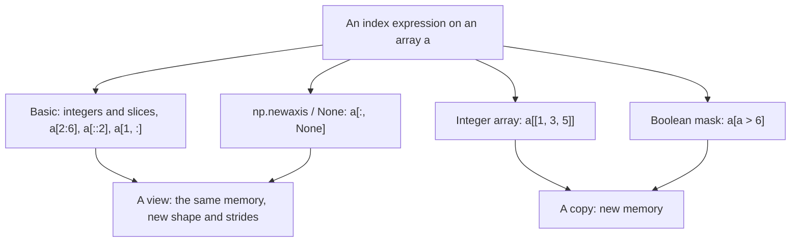
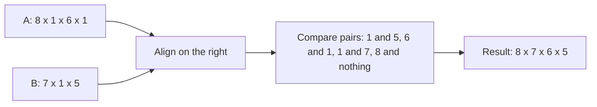

# Module 02: NumPy Indexing, Boolean Masks, Broadcasting, and Vectorization

> **Prerequisites:** [Module 01: NumPy Arrays: ndarray, Shapes, Dtypes, and Contiguous Memory](../01-numpy-ndarrays-dtypes-and-memory-layout/README.md) (views, strides, copies).  
> **Estimated Reading Time:** 40 minutes  
> **Target Audience:** Engineers who write data preparation, feature or evaluation code in Python and want it correct and fast

> [!TIP]
> **The Golden Rule of NumPy Indexing:** Know, for every expression, whether you get a **view** or a **copy**: basic slices are views, integer-array and boolean indexing are copies. Write conditions with **parentheses** around each comparison and combine them with `&`, `|` and `~`. Let **broadcasting** line shapes up from the right instead of writing loops, and before you broadcast large arrays, compute the size of the intermediate it creates.

---

## Why This Matters

Most data code is selection and arithmetic on whole columns: keep the valid rows, flag the outliers, subtract a mean from every feature, compute every distance between two sets of points. Done with Python loops it is slow; done with NumPy's indexing and broadcasting it is fast and short. It is also where silent bugs live: an assignment that writes into a temporary copy and changes nothing, a condition that means something other than it reads, a repeated index that is counted once, or a broadcast that quietly asks for 24 GiB of memory.

The NumPy paper in *Nature* (Harris et al., 2020) puts it plainly: "Array programming provides a powerful, compact, expressive syntax for accessing, manipulating, and operating on data". This module writes the rules out by hand in four languages so you can check them, then measures their effects with NumPy 2.5.5.

---

## 1. Architectural Mental Model: Selecting and Aligning Data

### Four Kinds of Indexing, Two Results



The NumPy documentation states both halves: "All arrays generated by basic slicing are always views of the original array", and "Advanced indexing always returns a copy of the data (contrast with basic slicing that returns a view)." A boolean mask is advanced indexing; for a mask with the same shape as the array, `x[mask]` "returns a 1-dimensional array filled with the elements of x corresponding to the True values".

Two consequences matter every day:

- **Writing through a view changes the original**, which is how `window[:] = 0` on a slice zeroes part of the source (Workflow 1).
- **Indexing twice in one assignment writes into a copy.** `x[x > 10][0] = -1` builds a temporary array with `x[x > 10]` and sets its first element; `x` does not change. Use a single indexing step on `x` itself.

### The Broadcasting Rule

"When operating on two arrays, NumPy compares their shapes element-wise. It starts with the trailing (i.e. rightmost) dimension and works its way left. Two dimensions are compatible when they are equal, or one of them is 1." Otherwise you get `ValueError: operands could not be broadcast together`.



A dimension of size 1 is stretched without copying: NumPy reads the same element again by using a stride of 0 along that dimension, the idea the program in section 4 implements with plain index arithmetic.

### Vectorization

A Python loop pays the interpreter's cost for every element; a vectorized expression runs one loop in compiled code over a contiguous buffer. The price of broadcasting is memory: an expression such as `points[:, None, :] - centres[None, :, :]` builds an intermediate array of shape `(n, m, d)`. The NumPy guide warns that "there are cases where broadcasting is a bad idea because it leads to inefficient use of memory that slows computation", and that then "it is better to write the algorithm's outer loop in Python".

---

## 2. Systematic Reference and Comparison Grids

### Indexing Reference

| Expression | Kind | Returns | Writes through `a[...] = v`? |
| :--- | :--- | :--- | :--- |
| `a[3]`, `a[1, 2]` | Basic | A scalar or a lower-dimensional view | Yes |
| `a[2:6]`, `a[::2]`, `a[:, 1:]` | Basic slice | **View** | Yes |
| `a[:, None]`, `a[None, :]` | New axis | **View** with an added dimension of size 1 | Yes |
| `a[[1, 3, 5]]` | Integer array | **Copy** | Yes, when it is the whole left side |
| `a[a > 0]` | Boolean mask | **Copy** (1-D) | Yes, when it is the whole left side |
| `a[a > 0][0] = v` | Chained | Writes into a temporary | **No: `a` is unchanged** |
| `a[[1, 1, 3]] += 1` | Repeated integer index | Reads, adds, writes once per position | Adds once, not twice; use `np.add.at` |

### Conditions on Arrays

| Want | Write | Not |
| :--- | :--- | :--- |
| Both | `(x > 30) & (x < 40)` | `x > 30 and x < 40` (ambiguous truth value), `x > 30 & x < 40` (wrong precedence) |
| Either | `(x < 0) \| (x > 100)` | `x < 0 or x > 100` |
| Not | `~np.isnan(x)` | `not np.isnan(x)` |
| Missing values | `np.isnan(x)` | `x == np.nan` (always False) |
| Choose a value | `np.where(cond, a, b)` | A loop with `if` |
| Several conditions | `np.select([c1, c2], [v1, v2], default=v0)` | Nested `np.where` |
| Count or sum by index | `np.bincount`, `np.add.at` | `a[idx] += 1` with repeated `idx` |

### Shapes That Broadcast and Shapes That Do Not

| Left | Right | Result | Typical use |
| :--- | :--- | :--- | :--- |
| `(n, d)` | `(d,)` | `(n, d)` | Subtract a per-feature mean from every row |
| `(n, 1)` | `(1, m)` | `(n, m)` | Every pair of a column and a row |
| `(256, 256, 3)` | `(3,)` | `(256, 256, 3)` | Scale each colour channel of an image |
| `(4, 3)` | `(4,)` | **Error** | A per-row value needs shape `(4, 1)` |
| `(n, 1, d)` | `(1, m, d)` | `(n, m, d)` | All pairwise differences: check the memory first |

---

## 3. Real Case Study: Array Programming Behind Scientific Discoveries

This module's source is documented rather than an incident: Charles R. Harris, K. Jarrod Millman, Stéfan J. van der Walt and colleagues, "Array Programming with NumPy", *Nature* 585, 357 (2020); arXiv 2006.10256.

| What the paper says | Why it matters here |
| :--- | :--- |
| "Array programming provides a powerful, compact, expressive syntax for accessing, manipulating, and operating on data" | Indexing and broadcasting are that syntax |
| "NumPy was an important part of the software stack used in the discovery of gravitational waves", and in the first imaging of a black hole | The same operations you write for a feature table ran in landmark analyses |
| NumPy is presented as the primary array library of Python and the base of the scientific Python ecosystem, increasingly acting as an interoperability layer for other array libraries | The rules of this module carry over to pandas, scikit-learn, PyTorch and others that follow NumPy's conventions |

The lesson of the paper for daily work is that the expressive power cuts both ways: an index expression does exactly what its rules say, not what it looks like it says. The rest of this module makes those rules visible.

---

## 4. The Rules Written Out by Hand, in Four Languages (`carousel`)

The program implements the broadcasting rule for two shapes, a broadcast addition by index arithmetic with a step of 0 for a dimension of size 1, a boolean mask with a sentinel value, and the two meanings of adding at repeated indices. Every answer was checked against NumPy 2.5.5 (`np.broadcast_shapes`, `+`, `x[[1, 1, 3, 1]] += 1` and `np.add.at`).

````carousel
```python
"""NumPy's rules written out with plain lists, so they can be checked by hand: the broadcasting rule for two shapes, a broadcast addition done
by index arithmetic (a dimension of size 1 is read with step 0, so nothing is copied), a boolean mask, and why x[[1, 1, 3, 1]] += 1 adds only once."""


def show(shape):
    return "(" + ", ".join(str(n) for n in shape) + ("," if len(shape) == 1 else "") + ")"


def broadcast_shape(a, b):
    """Align the shapes on the right; each pair of sizes must be equal or contain a 1; the result takes the larger. None if impossible."""
    out = []
    for i in range(1, max(len(a), len(b)) + 1):
        x = a[-i] if i <= len(a) else 1
        y = b[-i] if i <= len(b) else 1
        if x != y and x != 1 and y != 1:
            return None
        out.append(max(x, y))
    return tuple(reversed(out))


def broadcast_add(a, a_shape, b, b_shape):
    """Add two 2-D arrays stored as flat lists. A dimension of size 1 gets step 0: the same element is read again instead of being copied."""
    rows, cols = broadcast_shape(a_shape, b_shape)
    a_step = (a_shape[1] if a_shape[0] > 1 else 0, 1 if a_shape[1] > 1 else 0)
    b_step = (b_shape[1] if b_shape[0] > 1 else 0, 1 if b_shape[1] > 1 else 0)
    return [[a[i * a_step[0] + j * a_step[1]] + b[i * b_step[0] + j * b_step[1]] for j in range(cols)] for i in range(rows)], a_step


if __name__ == "__main__":
    print("== the broadcasting rule ==")
    for left, right in [((3, 1), (1, 4)), ((5, 3), (3,)), ((4, 3), (4,)), ((8, 1, 6, 1), (7, 1, 5)), ((256, 256, 3), (3,)), ((2, 1), (8, 4, 3))]:
        result = broadcast_shape(left, right)
        print(f"{show(left):>14} with {show(right):>10} -> {show(result) if result else 'cannot broadcast'}")

    print("== a (3, 1) column plus a (1, 4) row, without copying either ==")
    total, a_step = broadcast_add([0, 10, 20], (3, 1), [1, 2, 3, 4], (1, 4))
    for row in total:
        print("  " + " ".join(f"{v:3d}" for v in row))
    print(f"  the column is read with steps {a_step}: moving along a row reads the same element again")

    print("== a boolean mask ==")
    readings = [21.5, 35.0, -999.0, 38.2, 41.0, 33.3, -999.0, 29.9]  # -999 marks a broken sensor
    valid = [r != -999.0 for r in readings]
    hot = [v and 30.0 <= r < 40.0 for r, v in zip(readings, valid)]
    print(f"  valid readings: {sum(valid)} of {len(readings)}; between 30 and 40: {[r for r, h in zip(readings, hot) if h]}")
    clipped = [r if v else 0.0 for r, v in zip(readings, valid)]
    print(f"  broken readings replaced by 0 (like np.where(valid, x, 0)): {clipped}")

    print("== x[[1, 1, 3, 1]] += 1 ==")
    x = [0, 10, 20, 30, 40]
    index = [1, 1, 3, 1]
    buffered = list(x)
    temporary = [buffered[i] + 1 for i in index]  # read all, add, then write back: the last write to position 1 wins
    for i, value in zip(index, temporary):
        buffered[i] = value
    unbuffered = list(x)
    for i in index:  # what np.add.at does: one addition per occurrence
        unbuffered[i] += 1
    print(f"  {'x[index] += 1':24} -> {buffered}")
    print(f"  {'np.add.at(x, index, 1)':24} -> {unbuffered}")
```

<!-- slide -->

```typescript
// NumPy's rules written out with plain lists, so they can be checked by hand: the broadcasting rule for two shapes, a broadcast addition done
// by index arithmetic (a dimension of size 1 is read with step 0, so nothing is copied), a boolean mask, and why x[[1, 1, 3, 1]] += 1 adds only once.

const show = (shape: number[] | null): string => (shape === null ? "cannot broadcast" : `(${shape.join(", ")}${shape.length === 1 ? "," : ""})`);
const pyFloat = (x: number): string => (Number.isInteger(x) ? x.toFixed(1) : String(x));
const list = (values: number[], format: (x: number) => string = String): string => `[${values.map(format).join(", ")}]`;

/** Align the shapes on the right; each pair of sizes must be equal or contain a 1; the result takes the larger. null if impossible. */
function broadcastShape(a: number[], b: number[]): number[] | null {
  const out: number[] = [];
  for (let i = 1; i <= Math.max(a.length, b.length); i++) {
    const x = i <= a.length ? a[a.length - i] : 1;
    const y = i <= b.length ? b[b.length - i] : 1;
    if (x !== y && x !== 1 && y !== 1) return null;
    out.push(Math.max(x, y));
  }
  return out.reverse();
}

/** Add two 2-D arrays stored as flat lists. A dimension of size 1 gets step 0: the same element is read again instead of being copied. */
function broadcastAdd(a: number[], aShape: number[], b: number[], bShape: number[]): [number[][], number[]] {
  const [rows, cols] = broadcastShape(aShape, bShape)!;
  const aStep = [aShape[0] > 1 ? aShape[1] : 0, aShape[1] > 1 ? 1 : 0];
  const bStep = [bShape[0] > 1 ? bShape[1] : 0, bShape[1] > 1 ? 1 : 0];
  const total: number[][] = [];
  for (let i = 0; i < rows; i++) {
    const row: number[] = [];
    for (let j = 0; j < cols; j++) row.push(a[i * aStep[0] + j * aStep[1]] + b[i * bStep[0] + j * bStep[1]]);
    total.push(row);
  }
  return [total, aStep];
}

console.log("== the broadcasting rule ==");
const pairs: [number[], number[]][] = [[[3, 1], [1, 4]], [[5, 3], [3]], [[4, 3], [4]], [[8, 1, 6, 1], [7, 1, 5]], [[256, 256, 3], [3]], [[2, 1], [8, 4, 3]]];
for (const [left, right] of pairs) console.log(`${show(left).padStart(14)} with ${show(right).padStart(10)} -> ${show(broadcastShape(left, right))}`);

console.log("== a (3, 1) column plus a (1, 4) row, without copying either ==");
const [total, aStep] = broadcastAdd([0, 10, 20], [3, 1], [1, 2, 3, 4], [1, 4]);
for (const row of total) console.log("  " + row.map((v) => String(v).padStart(3)).join(" "));
console.log(`  the column is read with steps (${aStep.join(", ")}): moving along a row reads the same element again`);

console.log("== a boolean mask ==");
const readings = [21.5, 35.0, -999.0, 38.2, 41.0, 33.3, -999.0, 29.9]; // -999 marks a broken sensor
const valid = readings.map((r) => r !== -999.0);
const hot = readings.map((r, i) => valid[i] && r >= 30.0 && r < 40.0);
console.log(`  valid readings: ${valid.filter(Boolean).length} of ${readings.length}; between 30 and 40: ${list(readings.filter((_, i) => hot[i]), pyFloat)}`);
console.log(`  broken readings replaced by 0 (like np.where(valid, x, 0)): ${list(readings.map((r, i) => (valid[i] ? r : 0.0)), pyFloat)}`);

console.log("== x[[1, 1, 3, 1]] += 1 ==");
const x = [0, 10, 20, 30, 40];
const index = [1, 1, 3, 1];
const buffered = [...x];
const temporary = index.map((i) => buffered[i] + 1); // read all, add, then write back: the last write to position 1 wins
index.forEach((i, k) => {
  buffered[i] = temporary[k];
});
const unbuffered = [...x];
for (const i of index) unbuffered[i] += 1; // what np.add.at does: one addition per occurrence
console.log(`  ${"x[index] += 1".padEnd(24)} -> ${list(buffered)}`);
console.log(`  ${"np.add.at(x, index, 1)".padEnd(24)} -> ${list(unbuffered)}`);
```

<!-- slide -->

```go
// NumPy's rules written out with plain slices, so they can be checked by hand: the broadcasting rule for two shapes, a broadcast addition done
// by index arithmetic (a dimension of size 1 is read with step 0, so nothing is copied), a boolean mask, and why x[[1, 1, 3, 1]] += 1 adds only once.
package main

import (
	"fmt"
	"math"
	"strconv"
	"strings"
)

func show(shape []int) string {
	if shape == nil {
		return "cannot broadcast"
	}
	parts := make([]string, len(shape))
	for i, n := range shape {
		parts[i] = strconv.Itoa(n)
	}
	tail := ""
	if len(shape) == 1 {
		tail = ","
	}
	return "(" + strings.Join(parts, ", ") + tail + ")"
}

func pyFloat(x float64) string {
	if x == math.Trunc(x) {
		return strconv.FormatFloat(x, 'f', 1, 64)
	}
	return strconv.FormatFloat(x, 'f', -1, 64)
}

func floats(values []float64) string {
	parts := make([]string, len(values))
	for i, v := range values {
		parts[i] = pyFloat(v)
	}
	return "[" + strings.Join(parts, ", ") + "]"
}

func ints(values []int) string {
	parts := make([]string, len(values))
	for i, v := range values {
		parts[i] = strconv.Itoa(v)
	}
	return "[" + strings.Join(parts, ", ") + "]"
}

// broadcastShape aligns the shapes on the right; each pair of sizes must be equal or contain a 1; the result takes the larger. nil if impossible.
func broadcastShape(a, b []int) []int {
	n := len(a)
	if len(b) > n {
		n = len(b)
	}
	out := make([]int, n)
	for i := 1; i <= n; i++ {
		x, y := 1, 1
		if i <= len(a) {
			x = a[len(a)-i]
		}
		if i <= len(b) {
			y = b[len(b)-i]
		}
		if x != y && x != 1 && y != 1 {
			return nil
		}
		out[n-i] = max(x, y)
	}
	return out
}

func step(shape []int) [2]int {
	var s [2]int
	if shape[0] > 1 {
		s[0] = shape[1]
	}
	if shape[1] > 1 {
		s[1] = 1
	}
	return s
}

// broadcastAdd adds two 2-D arrays stored as flat slices. A dimension of size 1 gets step 0: the same element is read again instead of being copied.
func broadcastAdd(a []int, aShape []int, b []int, bShape []int) ([][]int, [2]int) {
	shape := broadcastShape(aShape, bShape)
	aStep, bStep := step(aShape), step(bShape)
	total := make([][]int, shape[0])
	for i := range total {
		total[i] = make([]int, shape[1])
		for j := range total[i] {
			total[i][j] = a[i*aStep[0]+j*aStep[1]] + b[i*bStep[0]+j*bStep[1]]
		}
	}
	return total, aStep
}

func main() {
	fmt.Println("== the broadcasting rule ==")
	pairs := [][2][]int{{{3, 1}, {1, 4}}, {{5, 3}, {3}}, {{4, 3}, {4}}, {{8, 1, 6, 1}, {7, 1, 5}}, {{256, 256, 3}, {3}}, {{2, 1}, {8, 4, 3}}}
	for _, p := range pairs {
		fmt.Printf("%14s with %10s -> %s\n", show(p[0]), show(p[1]), show(broadcastShape(p[0], p[1])))
	}

	fmt.Println("== a (3, 1) column plus a (1, 4) row, without copying either ==")
	total, aStep := broadcastAdd([]int{0, 10, 20}, []int{3, 1}, []int{1, 2, 3, 4}, []int{1, 4})
	for _, row := range total {
		cells := make([]string, len(row))
		for i, v := range row {
			cells[i] = fmt.Sprintf("%3d", v)
		}
		fmt.Println("  " + strings.Join(cells, " "))
	}
	fmt.Printf("  the column is read with steps (%d, %d): moving along a row reads the same element again\n", aStep[0], aStep[1])

	fmt.Println("== a boolean mask ==")
	readings := []float64{21.5, 35.0, -999.0, 38.2, 41.0, 33.3, -999.0, 29.9} // -999 marks a broken sensor
	validCount := 0
	var hot, replaced []float64
	for _, r := range readings {
		valid := r != -999.0
		if valid {
			validCount++
			if r >= 30.0 && r < 40.0 {
				hot = append(hot, r)
			}
			replaced = append(replaced, r)
		} else {
			replaced = append(replaced, 0.0)
		}
	}
	fmt.Printf("  valid readings: %d of %d; between 30 and 40: %s\n", validCount, len(readings), floats(hot))
	fmt.Printf("  broken readings replaced by 0 (like np.where(valid, x, 0)): %s\n", floats(replaced))

	fmt.Println("== x[[1, 1, 3, 1]] += 1 ==")
	x := []int{0, 10, 20, 30, 40}
	index := []int{1, 1, 3, 1}
	buffered := append([]int(nil), x...)
	temporary := make([]int, len(index))
	for k, i := range index { // read all, add, then write back: the last write to position 1 wins
		temporary[k] = buffered[i] + 1
	}
	for k, i := range index {
		buffered[i] = temporary[k]
	}
	unbuffered := append([]int(nil), x...)
	for _, i := range index { // what np.add.at does: one addition per occurrence
		unbuffered[i]++
	}
	fmt.Printf("  %-24s -> %s\n", "x[index] += 1", ints(buffered))
	fmt.Printf("  %-24s -> %s\n", "np.add.at(x, index, 1)", ints(unbuffered))
}
```

<!-- slide -->

```csharp
// NumPy's rules written out with plain arrays, so they can be checked by hand: the broadcasting rule for two shapes, a broadcast addition done
// by index arithmetic (a dimension of size 1 is read with step 0, so nothing is copied), a boolean mask, and why x[[1, 1, 3, 1]] += 1 adds only once.
using System;
using System.Collections.Generic;
using System.Globalization;
using System.Linq;

CultureInfo.CurrentCulture = CultureInfo.InvariantCulture;

string Show(int[]? shape) => shape is null ? "cannot broadcast" : "(" + string.Join(", ", shape) + (shape.Length == 1 ? "," : "") + ")";
string PyFloat(double x) => x == Math.Truncate(x) ? x.ToString("0.0") : x.ToString("R");
string Floats(IEnumerable<double> values) => "[" + string.Join(", ", values.Select(PyFloat)) + "]";
string Ints(IEnumerable<int> values) => "[" + string.Join(", ", values) + "]";

// Align the shapes on the right; each pair of sizes must be equal or contain a 1; the result takes the larger. null if impossible.
int[]? BroadcastShape(int[] a, int[] b)
{
    int n = Math.Max(a.Length, b.Length);
    var output = new int[n];
    for (int i = 1; i <= n; i++)
    {
        int x = i <= a.Length ? a[a.Length - i] : 1;
        int y = i <= b.Length ? b[b.Length - i] : 1;
        if (x != y && x != 1 && y != 1) return null;
        output[n - i] = Math.Max(x, y);
    }
    return output;
}

int[] Step(int[] shape) => new[] { shape[0] > 1 ? shape[1] : 0, shape[1] > 1 ? 1 : 0 };

// Add two 2-D arrays stored as flat arrays. A dimension of size 1 gets step 0: the same element is read again instead of being copied.
(int[][] Total, int[] AStep) BroadcastAdd(int[] a, int[] aShape, int[] b, int[] bShape)
{
    var shape = BroadcastShape(aShape, bShape)!;
    int[] aStep = Step(aShape), bStep = Step(bShape);
    var total = new int[shape[0]][];
    for (int i = 0; i < shape[0]; i++)
    {
        total[i] = new int[shape[1]];
        for (int j = 0; j < shape[1]; j++) total[i][j] = a[i * aStep[0] + j * aStep[1]] + b[i * bStep[0] + j * bStep[1]];
    }
    return (total, aStep);
}

Console.WriteLine("== the broadcasting rule ==");
var pairs = new (int[], int[])[] { (new[] { 3, 1 }, new[] { 1, 4 }), (new[] { 5, 3 }, new[] { 3 }), (new[] { 4, 3 }, new[] { 4 }), (new[] { 8, 1, 6, 1 }, new[] { 7, 1, 5 }), (new[] { 256, 256, 3 }, new[] { 3 }), (new[] { 2, 1 }, new[] { 8, 4, 3 }) };
foreach (var (left, right) in pairs) Console.WriteLine($"{Show(left),14} with {Show(right),10} -> {Show(BroadcastShape(left, right))}");

Console.WriteLine("== a (3, 1) column plus a (1, 4) row, without copying either ==");
var (sum, columnStep) = BroadcastAdd(new[] { 0, 10, 20 }, new[] { 3, 1 }, new[] { 1, 2, 3, 4 }, new[] { 1, 4 });
foreach (var row in sum) Console.WriteLine("  " + string.Join(" ", row.Select(v => v.ToString().PadLeft(3))));
Console.WriteLine($"  the column is read with steps ({columnStep[0]}, {columnStep[1]}): moving along a row reads the same element again");

Console.WriteLine("== a boolean mask ==");
double[] readings = { 21.5, 35.0, -999.0, 38.2, 41.0, 33.3, -999.0, 29.9 }; // -999 marks a broken sensor
bool[] valid = readings.Select(r => r != -999.0).ToArray();
var hot = readings.Where((r, i) => valid[i] && r >= 30.0 && r < 40.0);
Console.WriteLine($"  valid readings: {valid.Count(v => v)} of {readings.Length}; between 30 and 40: {Floats(hot)}");
Console.WriteLine($"  broken readings replaced by 0 (like np.where(valid, x, 0)): {Floats(readings.Select((r, i) => valid[i] ? r : 0.0))}");

Console.WriteLine("== x[[1, 1, 3, 1]] += 1 ==");
int[] x = { 0, 10, 20, 30, 40 };
int[] index = { 1, 1, 3, 1 };
int[] buffered = (int[])x.Clone();
int[] temporary = index.Select(i => buffered[i] + 1).ToArray(); // read all, add, then write back: the last write to position 1 wins
for (int k = 0; k < index.Length; k++) buffered[index[k]] = temporary[k];
int[] unbuffered = (int[])x.Clone();
foreach (int i in index) unbuffered[i] += 1; // what np.add.at does: one addition per occurrence
Console.WriteLine($"  {"x[index] += 1",-24} -> {Ints(buffered)}");
Console.WriteLine($"  {"np.add.at(x, index, 1)",-24} -> {Ints(unbuffered)}");
```
````

**Observed output (identical in Python 3.13.14, Node 24, Go 1.22 and .NET 10):**

```text
== the broadcasting rule ==
        (3, 1) with     (1, 4) -> (3, 4)
        (5, 3) with       (3,) -> (5, 3)
        (4, 3) with       (4,) -> cannot broadcast
  (8, 1, 6, 1) with  (7, 1, 5) -> (8, 7, 6, 5)
 (256, 256, 3) with       (3,) -> (256, 256, 3)
        (2, 1) with  (8, 4, 3) -> cannot broadcast
== a (3, 1) column plus a (1, 4) row, without copying either ==
    1   2   3   4
   11  12  13  14
   21  22  23  24
  the column is read with steps (1, 0): moving along a row reads the same element again
== a boolean mask ==
  valid readings: 6 of 8; between 30 and 40: [35.0, 38.2, 33.3]
  broken readings replaced by 0 (like np.where(valid, x, 0)): [21.5, 35.0, 0.0, 38.2, 41.0, 33.3, 0.0, 29.9]
== x[[1, 1, 3, 1]] += 1 ==
  x[index] += 1            -> [0, 11, 20, 31, 40]
  np.add.at(x, index, 1)   -> [0, 13, 20, 31, 40]
```

What to notice:

- **The rule decides from the right.** `(5, 3)` with `(3,)` works because the trailing sizes match; `(4, 3)` with `(4,)` fails because 3 and 4 differ, which is the documentation's own error example. `(8, 1, 6, 1)` with `(7, 1, 5)` gives `(8, 7, 6, 5)` as in the NumPy guide.
- **Stretching costs nothing.** The column is read with steps `(1, 0)`: along a row the step is 0, so the same three numbers produce a 3 by 4 result without being copied.
- **A sentinel is data until you mask it.** Two readings of -999 are excluded by the mask before anything is computed.
- **Repeated indices.** `x[index] += 1` gives 11 at position 1, not 13: the values are read once into a temporary, increased, and written back three times. `np.add.at` performs one addition per occurrence.

---

## 5. Practical Hands-On Verification Workflows (Python 3.13 + NumPy 2.5.5)

### Workflow 1: Views, Copies and Assignments That Do Nothing

```python
"""Which indexing gives a view and which a copy, and the assignment traps that follow from it."""
import numpy as np

print("numpy", np.__version__)
a = np.arange(10)
print("\n== 1. what shares memory with a = np.arange(10) ==")
for label, b in [("a[2:6]          basic slice", a[2:6]), ("a[::2]          basic slice", a[::2]),
                 ("a[[1, 3, 5]]    integer array", a[[1, 3, 5]]), ("a[a > 6]        boolean mask", a[a > 6])]:
    print(f"  {label:32} shares memory: {np.shares_memory(a, b)}")

print("\n== 2. writing through a view changes the original ==")
window = a[2:6]
window[:] = 0
print("  after window[:] = 0, a is", a.tolist())

print("\n== 3. chained indexing writes into a temporary copy ==")
x = np.array([5, 50, 7, 70, 9])
x[x > 10][0] = -1  # x[x > 10] is a new array; setting its first element changes nothing in x
print("  x[x > 10][0] = -1           ->", x.tolist())
x[np.flatnonzero(x > 10)[0]] = -1  # one indexing step, on x itself
print("  x[np.flatnonzero(x > 10)[0]] = -1 ->", x.tolist())
x[x > 10] = 0  # a mask on the left of '=' does write into x
print("  x[x > 10] = 0               ->", x.tolist())

print("\n== 4. repeated indices: += reads, adds and writes once per position; np.add.at adds once per occurrence ==")
y = np.arange(0, 50, 10)
y[[1, 1, 3, 1]] += 1
z = np.arange(0, 50, 10)
np.add.at(z, [1, 1, 3, 1], 1)
print("  y[[1, 1, 3, 1]] += 1        ->", y.tolist())
print("  np.add.at(z, [1, 1, 3, 1], 1) ->", z.tolist())
counts = np.bincount([2, 0, 2, 2, 1], minlength=4)
print("  np.bincount([2, 0, 2, 2, 1]) ->", counts.tolist(), " (counting is the common reason to want np.add.at)")
```

**Observed Output:**

```text
numpy 2.5.5

== 1. what shares memory with a = np.arange(10) ==
  a[2:6]          basic slice      shares memory: True
  a[::2]          basic slice      shares memory: True
  a[[1, 3, 5]]    integer array    shares memory: False
  a[a > 6]        boolean mask     shares memory: False

== 2. writing through a view changes the original ==
  after window[:] = 0, a is [0, 1, 0, 0, 0, 0, 6, 7, 8, 9]

== 3. chained indexing writes into a temporary copy ==
  x[x > 10][0] = -1           -> [5, 50, 7, 70, 9]
  x[np.flatnonzero(x > 10)[0]] = -1 -> [5, -1, 7, 70, 9]
  x[x > 10] = 0               -> [5, -1, 7, 0, 9]

== 4. repeated indices: += reads, adds and writes once per position; np.add.at adds once per occurrence ==
  y[[1, 1, 3, 1]] += 1        -> [0, 11, 20, 31, 40]
  np.add.at(z, [1, 1, 3, 1], 1) -> [0, 13, 20, 31, 40]
  np.bincount([2, 0, 2, 2, 1]) -> [1, 1, 3, 0]  (counting is the common reason to want np.add.at)
```

Basic slices share memory with `a`; integer arrays and masks do not. Writing through the slice `window` changed `a`. The chained assignment `x[x > 10][0] = -1` left `x` exactly as it was; indexing `x` once (`x[np.flatnonzero(x > 10)[0]]`) or putting the whole mask on the left of `=` (`x[x > 10] = 0`) writes into `x`. And `np.bincount` is the fast way to count occurrences, which is what most people want when they reach for repeated `+=`.

### Workflow 2: What Vectorization Buys, and What Broadcasting Costs

```python
"""Vectorization measured, and the memory price of broadcasting. Times vary by machine; the ratios are what to read."""
import time

import numpy as np

rng = np.random.default_rng(0)


def timed(fn, repeat=3):
    best = float("inf")
    for _ in range(repeat):
        t0 = time.perf_counter()
        result = fn()
        best = min(best, time.perf_counter() - t0)
    return best * 1000, result


print("== 1. one million values: a Python loop against one NumPy expression ==")
values = rng.normal(0, 1, 1_000_000)
as_list = values.tolist()
loop_ms, loop_result = timed(lambda: sum(v * v for v in as_list if v > 0))
vec_ms, vec_result = timed(lambda: float(np.sum(values[values > 0] ** 2)))
print(f"  sum of squares of the positive values: loop {loop_ms:7.1f} ms, NumPy {vec_ms:6.2f} ms ({loop_ms / vec_ms:.0f} times faster); same result: {abs(loop_result - vec_result) < 1e-6 * vec_result}")

print("\n== 2. every distance between 400 points and 300 centres (8 features each) ==")
points, centres = rng.normal(size=(400, 8)), rng.normal(size=(300, 8))


def loops():
    out = np.empty((400, 300))
    for i in range(400):
        for j in range(300):
            out[i, j] = np.sqrt(((points[i] - centres[j]) ** 2).sum())
    return out


def broadcast():
    return np.sqrt(((points[:, None, :] - centres[None, :, :]) ** 2).sum(axis=2))  # a (400, 300, 8) intermediate


def matmul():
    squared = (points ** 2).sum(1)[:, None] + (centres ** 2).sum(1)[None, :] - 2 * points @ centres.T  # |a-b|^2 = |a|^2 + |b|^2 - 2 a.b
    return np.sqrt(np.maximum(squared, 0))


reference = None
for name, fn in [("Python loops", loops), ("broadcasting", broadcast), ("matrix product", matmul)]:
    ms, result = timed(fn, repeat=1 if name == "Python loops" else 3)
    reference = result if reference is None else reference
    print(f"  {name:15} {ms:9.2f} ms   agrees with the loops: {np.allclose(result, reference)}")

print("\n== 3. the size of the broadcast intermediate grows with every dimension ==")
for n, m, d in [(400, 300, 8), (5_000, 2_000, 8), (50_000, 2_000, 32)]:
    intermediate = n * m * d * 8 / 1024**2
    result = n * m * 8 / 1024**2
    print(f"  {n:>6} x {m:>5} points, {d:>2} features: broadcast intermediate {intermediate:>10,.1f} MiB; the answer itself {result:>8,.1f} MiB")
print("  the matrix-product form never builds the 3-D intermediate; for very large inputs, process the points in chunks")
```

**Observed Output (times vary by machine):**

```text
== 1. one million values: a Python loop against one NumPy expression ==
  sum of squares of the positive values: loop    33.3 ms, NumPy   7.50 ms (4 times faster); same result: True

== 2. every distance between 400 points and 300 centres (8 features each) ==
  Python loops       158.23 ms   agrees with the loops: True
  broadcasting         6.88 ms   agrees with the loops: True
  matrix product       0.37 ms   agrees with the loops: True

== 3. the size of the broadcast intermediate grows with every dimension ==
     400 x   300 points,  8 features: broadcast intermediate        7.3 MiB; the answer itself      0.9 MiB
    5000 x  2000 points,  8 features: broadcast intermediate      610.4 MiB; the answer itself     76.3 MiB
   50000 x  2000 points, 32 features: broadcast intermediate   24,414.1 MiB; the answer itself    762.9 MiB
  the matrix-product form never builds the 3-D intermediate; for very large inputs, process the points in chunks
```

- **One million values:** the vectorized mask-and-sum was 4 times faster than a generator expression over a Python list. The gap is much larger when the loop body does more work per element.
- **Pairwise distances:** the double Python loop took **158 ms**, broadcasting **6.9 ms**, and the matrix-product identity $\lVert a-b \rVert^2 = \lVert a\rVert^2 + \lVert b\rVert^2 - 2\,a\cdot b$ **0.37 ms**, all with the same answer. The last form uses a matrix multiply, which NumPy hands to an optimized linear-algebra library.
- **The memory bill:** the broadcast intermediate for 5,000 by 2,000 points with 8 features is **610 MiB**, and for 50,000 by 2,000 with 32 features **24,414 MiB**, while the answer itself is 76 MiB and 763 MiB. Before broadcasting large inputs, multiply the shapes out; prefer a formulation without the 3-D intermediate, or process in chunks.

### Workflow 3: Masks for Cleaning: Precedence, NaN and Choosing Values

```python
"""Boolean masks for cleaning data: operator precedence, NaN, and choosing values by condition."""
import numpy as np

temperature = np.array([21.5, 35.0, np.nan, 38.2, 41.0, 33.3, -999.0, 29.9])

print("== 1. combine conditions with &, |, ~ and parentheses ==")
try:
    temperature > 30 & temperature < 40
except (ValueError, TypeError) as err:
    print(f"  temperature > 30 & temperature < 40  -> {type(err).__name__}: {err}")
print("  (temperature > 30) & (temperature < 40) ->", ((temperature > 30) & (temperature < 40)).tolist())
print("  '&' binds tighter than '>', so the first line meant temperature > (30 & temperature) < 40")

print("\n== 2. NaN is not equal to anything, itself included ==")
print("  np.nan == np.nan:", bool(np.nan == np.nan))
print("  temperature == np.nan finds:", int((temperature == np.nan).sum()), "values;  np.isnan(temperature) finds:", int(np.isnan(temperature).sum()))
print("  temperature.mean():", temperature.mean(), "  np.nanmean(temperature):", round(float(np.nanmean(temperature)), 3), " (the -999 sentinel is still in it)")

print("\n== 3. clean in one pass: sentinel and NaN to missing, then label by range ==")
clean = np.where((temperature == -999.0) | np.isnan(temperature), np.nan, temperature)
label = np.select([np.isnan(clean), clean < 30, clean < 40], ["missing", "normal", "warm"], default="hot")
for t, l in zip(clean.tolist(), label.tolist()):
    print(f"  {t!s:>6} -> {l}")
print("  mean of the valid readings:", round(float(np.nanmean(clean)), 3), "from", int((~np.isnan(clean)).sum()), "values")
```

**Observed Output:**

```text
== 1. combine conditions with &, |, ~ and parentheses ==
  temperature > 30 & temperature < 40  -> TypeError: ufunc 'bitwise_and' not supported for the input types, and the inputs could not be safely coerced to any supported types according to the casting rule ''safe''
  (temperature > 30) & (temperature < 40) -> [False, True, False, True, False, True, False, False]
  '&' binds tighter than '>', so the first line meant temperature > (30 & temperature) < 40

== 2. NaN is not equal to anything, itself included ==
  np.nan == np.nan: False
  temperature == np.nan finds: 0 values;  np.isnan(temperature) finds: 1
  temperature.mean(): nan   np.nanmean(temperature): -114.3  (the -999 sentinel is still in it)

== 3. clean in one pass: sentinel and NaN to missing, then label by range ==
    21.5 -> normal
    35.0 -> warm
     nan -> missing
    38.2 -> warm
    41.0 -> hot
    33.3 -> warm
     nan -> missing
    29.9 -> normal
  mean of the valid readings: 33.15 from 6 values
```

- **Precedence:** without parentheses, `temperature > 30 & temperature < 40` is read as `temperature > (30 & temperature) < 40`; on a float array the `&` itself fails with a `TypeError` (on an integer array the same line fails with "truth value of an array with more than one element is ambiguous"). With parentheses it gives the intended mask.
- **NaN:** `np.nan == np.nan` is False, so `temperature == np.nan` found **0** missing values while `np.isnan` found 1. `mean()` returned `nan`, and `np.nanmean` returned **-114.3** because the -999 sentinel was still in the data: two kinds of missing need two checks.
- **One pass:** `np.where` turned both kinds into NaN, `np.select` labelled every reading, and the mean of the six valid readings is **33.15**.

---

## 6. Hands-On Exercises and Independent Challenge

### Practical Exercises

1. **Predict, then check.** For each, say view or copy, then verify with `np.shares_memory`: `a[1:]`, `a[[0]]`, `a[a == a]`, `a.reshape(2, 5)`, `a[:, None]`.
2. **Fix the shapes.** You have a `(4, 3)` array and a per-row value of shape `(4,)`. Write two ways to subtract the per-row value from each row.
3. **Count without a loop.** Given an array of 1,000,000 category codes from 0 to 9, compute how many of each there are in one line, and say why `counts[codes] += 1` gives the wrong answer.
4. **Budget a broadcast.** You need all distances between 200,000 customers and 500 stores, with 16 features. How much memory does the broadcast intermediate need in float64, and how would you compute the nearest store for each customer instead?

<details><summary>Answers</summary>

1. `a[1:]` view; `a[[0]]` copy (integer array); `a[a == a]` copy (mask); `a.reshape(2, 5)` view for a contiguous `a`; `a[:, None]` view (a new axis).
2. `a - v[:, None]` or `a - v.reshape(4, 1)`: give the per-row value a trailing dimension of size 1 so that it lines up with the rows.
3. `np.bincount(codes, minlength=10)`. `counts[codes] += 1` reads each category's count once, adds 1, and writes back, so every category ends with a count of at most 1 (the repeated-index rule of Workflow 1).
4. 200,000 x 500 x 16 x 8 bytes, about 11.9 GiB (12,207 MiB), for an answer that is 200,000 x 500 x 8 bytes, about 763 MiB. Use the matrix-product form for the squared distances and `argmin` along the stores, in chunks of customers (for example 10,000 at a time) to bound memory.

</details>

### Independent Challenge

A feature pipeline standardizes 30 columns of a 5-million-row table with `(X - X.mean(axis=0)) / X.std(axis=0)`, flags outliers with a mask, replaces a sentinel of -1 by the column median and computes, for every row, the distance to 50 cluster centres. It runs out of memory on the 16 GiB worker and is slow. Find the expensive steps, estimate their memory, and rewrite the pipeline to fit.

<details><summary>Architectural Discussion</summary>

**Estimate first.** The table itself is 5,000,000 x 30 x 8 bytes, about 1.1 GiB in float64. Each full-size temporary (the centred array, the standardized array, a boolean mask is one byte per element) adds about as much. The distance step with broadcasting builds 5,000,000 x 50 x 30 x 8 bytes, about 56 GiB: that is the failure.

**Rewrite.** Use the matrix-product identity for the distances (the result is 5,000,000 x 50 x 8 bytes, about 1.9 GiB), computed in chunks of rows. Do the standardization in place (`X -= mean; X /= std`) or in float32 if the precision is enough. Replace the sentinel with a mask computed per column (`np.where(X == -1, median, X)` creates a copy; doing it in place with `X[mask] = ...` per column avoids a second full array), and compute the median before standardizing. Keep masks as boolean arrays and combine them with parentheses.

**Check.** Compare a sample of rows against the old pipeline with `np.allclose`, and record peak memory before and after.

</details>

---

## 7. Common Mistakes and Troubleshooting

- **Chained indexing on the left of `=`.** `x[mask][i] = v` writes into a temporary. Index once.
- **`and`, `or`, `not` on arrays.** They need a single truth value; use `&`, `|`, `~`.
- **Missing parentheses in conditions.** `&` binds more tightly than comparisons.
- **`x == np.nan`.** Always False; use `np.isnan`.
- **Sentinels left in data.** -999 or -1 are numbers until masked; check for them as well as for NaN.
- **Repeated indices with `+=`.** Use `np.add.at` or `np.bincount`.
- **A per-row value with shape `(n,)`.** It lines up with the columns, not the rows; reshape to `(n, 1)`.
- **Broadcasting without estimating memory.** Multiply the shapes and the item size first.
- **Assuming a mask selection is a view.** It is a copy; changing it does not change the source.

---

## 8. Operational Validation Checkpoints and Checkpoint Quiz

<details><summary><strong>Checkpoint 1: A cleaning step "replaces negative prices with zero" but the negative prices are still there. What do you look for?</strong></summary>

A chained assignment such as `df_values[mask][:] = 0` or `prices[prices < 0][0:] = 0`, which writes into a temporary copy. Replace it with a single indexing step on the array itself, `prices[prices < 0] = 0`, or `np.where(prices < 0, 0, prices)`, and add a check that no negative values remain.

</details>

<details><summary><strong>Checkpoint 2: A job that computes pairwise similarities dies with MemoryError on bigger inputs. What do you check?</strong></summary>

The shape of the broadcast intermediate: `(n, m, d)` grows with all three. Compute its size, switch to a formulation without the 3-D array (a matrix product), and process rows in chunks so that memory is bounded regardless of `n`.

</details>

<details><summary><strong>Checkpoint 3: A frequency count is too low. The code does counts[codes] += 1. Why?</strong></summary>

With repeated indices, `+=` reads each position once, adds one, and writes it back, so each distinct code is incremented once per statement, not once per occurrence. Use `np.bincount(codes, minlength=k)` or `np.add.at(counts, codes, 1)`.

</details>

### Checkpoint Quiz

1. Which indexing forms return views and which return copies?
2. State the broadcasting rule, and say why `(4, 3) + (4,)` fails.
3. Why does `x[x > 10][0] = -1` not change `x`?
4. Why is `temperature == np.nan` the wrong test for missing values, and what replaces it?
5. In Workflow 2, why was the matrix-product form faster than broadcasting, and how large would the broadcast intermediate be for 5,000 by 2,000 points with 8 features?

<details><summary>Answers</summary>

1. Basic slicing (integers, slices, `None`) returns views; integer-array and boolean (advanced) indexing return copies.
2. Shapes are compared from the right; two sizes are compatible when they are equal or one is 1. `(4, 3)` and `(4,)` compare 3 with 4 at the trailing position: neither equal nor 1.
3. `x[x > 10]` is advanced indexing, which creates a new array; `[0] = -1` sets an element of that temporary, which is then discarded.
4. NaN is not equal to anything, including itself, so the comparison is always False. Use `np.isnan(temperature)`, and check sentinels separately.
5. It avoids the 3-D intermediate and does the heavy work in a matrix multiply, which NumPy runs in an optimized linear-algebra library. The intermediate would be 5,000 x 2,000 x 8 x 8 bytes, about 610 MiB.

</details>

---

## 9. Interview Practice

> [!interview]
> Explain the difference between a view and a copy in NumPy, and give a bug that comes from confusing them.

<details><summary>What a strong answer covers</summary>

- Basic slicing returns views (shared memory, new shape and strides); integer-array and boolean indexing return copies.
- Bugs: modifying a slice changes the source unexpectedly; chained indexing on the left of `=` writes into a temporary and changes nothing; repeated indices with `+=` count once.
- How to check: `np.shares_memory`, and `.copy()` when isolation is needed.

</details>

> [!interview]
> How would you compute the distance from every one of 10 million points to 1,000 centres?

<details><summary>What a strong answer covers</summary>

- Not with an `(n, m, d)` broadcast: estimate its memory to show why.
- Use the identity with a matrix product for squared distances, in chunks of rows; keep only what is needed (for example the argmin per row).
- Mention float32 versus float64, numerical care (clip small negatives from rounding), and approximate nearest-neighbour indexes when exact search is too slow.

</details>

---

## Further Reading and Sources

- [NumPy: Broadcasting](https://numpy.org/doc/stable/user/basics.broadcasting.html) — the broadcasting rule, the `(8, 1, 6, 1)` example and the memory warning quoted above.
- [NumPy: Indexing on ndarrays](https://numpy.org/doc/stable/user/basics.indexing.html) — views from basic slicing, copies from advanced indexing, boolean indexing and the repeated-index note.
- [Harris et al., "Array Programming with NumPy" (Nature 585, 357, 2020; arXiv 2006.10256)](https://arxiv.org/abs/2006.10256) — the case study of section 3.
- [NumPy: `numpy.ufunc.at`](https://numpy.org/doc/stable/reference/generated/numpy.ufunc.at.html) — unbuffered in-place operations such as `np.add.at`.

## Next

Continue to **[Module 03: NumPy Aggregations, Matrix Ops (@, linalg), and Generator RNG](../03-numpy-linear-algebra-random-and-aggregations/README.md)**, which builds on these shapes to reduce, multiply and sample arrays.
