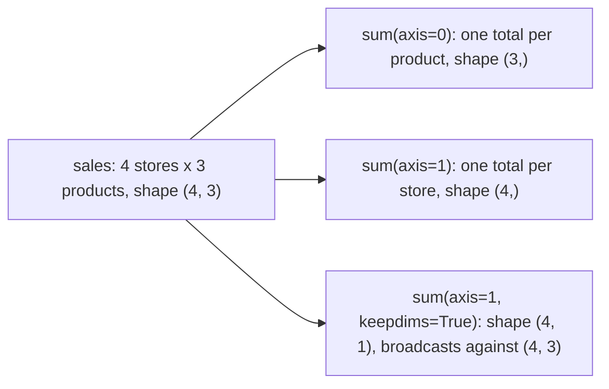
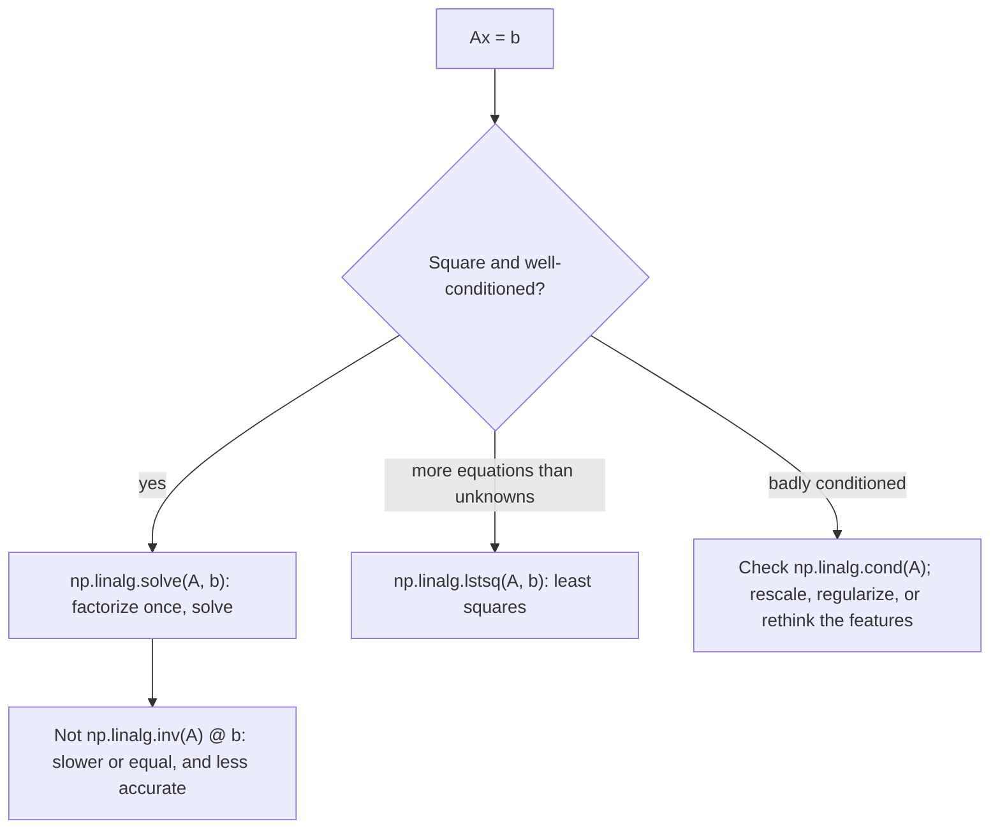
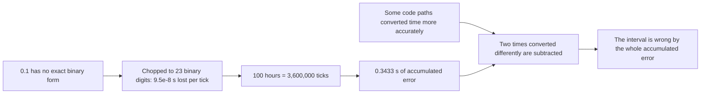

# Module 03: NumPy Aggregations, Matrix Ops (@, linalg), and Generator RNG

> **Prerequisites:** [Module 02: NumPy Indexing, Boolean Masks, Broadcasting, and Vectorization](../02-numpy-indexing-slicing-and-broadcasting/README.md).  
> **Estimated Reading Time:** 40 minutes  
> **Target Audience:** Engineers who compute statistics, fit models or simulate with NumPy and need the numbers to be right and repeatable

> [!TIP]
> **The Golden Rule of Numerical Work:** Rounding errors are tiny, and they **add up**. Say which **axis** you reduce and keep dimensions when you divide by the result; accumulate in **float64** even when the data is float32; **solve** linear systems instead of multiplying by an inverse, and look at the **condition number** before trusting the answer; and draw random numbers from a **seeded `Generator`** that your code owns, spawning independent streams for parallel workers.

---

## Why This Matters

Aggregations, matrix products and random draws are the three operations under almost every statistic, model and simulation. Each has a failure that produces a plausible number instead of an error: a total off by more than 1% because a long sum ran in float32; a regression whose coefficients are mostly rounding noise because the system was badly conditioned; an experiment that cannot be repeated because some library reset the global random seed. Section 3 is the classic documented case of the first kind: a clock that lost a tenth of a microsecond per tick and, after 100 hours, was a third of a second wrong.

---

## 1. Architectural Mental Model: Reduce, Multiply, Sample

### Reductions and the Axis



The axis you name is the one that **disappears**. `keepdims=True` keeps it with size 1, which is what makes `sales / sales.sum(axis=1, keepdims=True)` divide each row by its own total; without it, the shapes `(4, 3)` and `(4,)` do not broadcast (Module 02).

### Why Sums Lose Precision

A float64 holds about 16 significant decimal digits, a float32 about 7. Every addition rounds its result to that precision, so a running total that is large compared with the values being added loses their low digits at every step. The error of a plain left-to-right sum grows roughly with the number of additions; adding in pairs (the two halves separately, then together) means each value passes through only about $\log_2 n$ additions, and **Kahan's compensated summation** carries the lost low-order part forward explicitly:

$$y = x_i - c,\quad t = s + y,\quad c = (t - s) - y,\quad s = t$$

NumPy's `sum` uses a blocked, pairwise reduction; `cumsum` must add one value at a time. Workflow 1 shows the difference on a million values.

### Solving Linear Systems



The **condition number** $\kappa(A)$ measures how much relative errors in $b$ (including rounding) can be amplified in $x$. A rough rule: you lose about $\log_{10}\kappa$ of your 16 decimal digits. Workflow 2 shows a Hilbert matrix with $\kappa \approx 2 \times 10^{16}$, for which float64 has nothing left.

### Random Numbers You Can Repeat

`np.random.default_rng(seed)` returns a `Generator` (backed by the PCG64 bit generator) with **its own state**: two generators built from the same seed produce the same stream, and nothing outside your code can disturb it. The legacy functions (`np.random.seed`, `np.random.rand`) share one hidden global state that any library can reset. For parallel work, NumPy's guide on parallel random number generation recommends spawning independent child streams from one seed; as it puts it, "This feature lets you make local decisions about when and how to split up streams without coordination between processes."

---

## 2. Systematic Reference and Comparison Grids

### Reductions

| Function | Notes |
| :--- | :--- |
| `a.sum(axis=k)`, `a.mean(axis=k)` | The named axis disappears; `keepdims=True` keeps it with size 1 |
| `a.sum(dtype=np.float64)` | Accumulate float32 data in float64 |
| `np.cumsum`, `np.cumprod` | Sequential: error grows with length |
| `np.nansum`, `np.nanmean`, `np.nanstd` | Ignore NaN; plain versions return NaN if any value is NaN |
| `a.std(ddof=1)` | Sample standard deviation (divide by n - 1); the default `ddof=0` divides by n |
| `np.percentile(a, q)`, `np.median(a)` | Robust to outliers; sort-based, slower than a mean |
| `math.fsum(values)` | Exactly rounded sum of a Python iterable, when it must be right |

### Products and Linear Algebra

| Operation | Shapes | Use |
| :--- | :--- | :--- |
| `A * B` | Broadcast-compatible | Elementwise product |
| `A @ B`, `np.matmul` | `(n, k) @ (k, m) -> (n, m)`; stacks of matrices allowed | Matrix product |
| `np.dot(a, b)` | Older, with special rules for 1-D and N-D | Prefer `@` |
| `np.linalg.solve(A, b)` | `A` square | Solve a system |
| `np.linalg.lstsq(A, b)` | `A` tall | Least squares |
| `np.linalg.cond(A)` | Square or rectangular | How many digits you can trust |
| `np.linalg.inv(A)` | Square | Rarely needed; do not use it to solve systems |

### Random Numbers

| Do | Do not |
| :--- | :--- |
| `rng = np.random.default_rng(seed)` and pass `rng` to functions | `np.random.seed(seed)` and rely on the global state |
| `rng.spawn(n)` (or `SeedSequence(seed).spawn(n)`) for workers | `RandomState(root_seed + worker_id)` |
| Record the seed with the results | Use a new unrecorded seed each run |
| `rng.permutation`, `rng.choice(n, k, replace=False)` | Shuffle with a hand-written loop |

---

## 3. Real Case Study: The Patriot Clock

This is a documented failure, described by Robert Skeel in *SIAM News* (July 1992, vol. 25, no. 4) from the US Government Accountability Office's report IMTEC-92-26 ("Patriot Missile Defense: Software Problem Led to System Failure at Dhahran, Saudi Arabia", February 1992).

| What Skeel's article reports | Detail |
| :--- | :--- |
| The outcome | During the 1991 Gulf War an error "allowed an Iraqi Scud missile to slip through Patriot missile defenses"; it "hit U.S. Army barracks in Dhahran, Saudi Arabia, killing 28 servicemen" |
| How time was kept | "The internal clock kept time as an integer value in units of tenths of a second", converted to seconds by multiplying by 0.1 |
| The representation | "The computer's registers were only 24 bits long"; with the first 23 binary digits, "the value is 0.1 × (1 - 2^-20)" |
| The accumulated error | After about 100 hours of operation the computed time was off by "0.3433 seconds", in which a Scud travels "more than half a kilometer" |
| Why it mattered | Tracking uses the time between radar pulses, where the error alone was tiny; but "the call to the subroutine was not inserted at every point where it was needed", so a more accurate conversion was used in some places and not in others, and the errors stopped cancelling |



### What to Take From It

1. **A representation error is a rate.** Losing $9.5 \times 10^{-8}$ s per tick is harmless for a second and decisive for 100 hours. Ask how many operations a value goes through.
2. **Consistency matters as much as precision.** Two quantities computed the same way share their error, and a difference cancels it; computed two ways, the difference carries the whole error. The program in section 4 shows both.
3. **Choose the representation and the accumulation deliberately:** integer counts for time, float64 accumulators, compensated or pairwise sums where the count is large.

---

## 4. Rounding Errors, Added Up, in Four Languages (`carousel`)

The program recomputes the Patriot clock with exact integer arithmetic for the chopped constant, then sums 0.1 one hundred thousand times in 64-bit and 32-bit floating point, three ways: plainly, with Kahan's compensated sum, and pairwise. 32-bit arithmetic is emulated by rounding every result to the nearest float32 (`struct` in Python, `Math.fround` in TypeScript, a `float32` conversion in Go and a `float` cast in C#), which gives exactly the results of float32 hardware.

````carousel
```python
"""Small rounding errors, added up. First the Patriot clock (Skeel, SIAM News, 1992): time kept in tenths of a second and multiplied by 0.1 chopped
to 23 binary digits. Then summing 0.1 one hundred thousand times in 64-bit and 32-bit floating point, plainly, with Kahan's compensated sum, and in
pairs (the way NumPy's sum reduces), against the exact answer of 10,000."""
import struct


def f32(x):
    """Round to the nearest 32-bit float, as a float32 register would."""
    return struct.unpack("f", struct.pack("f", x))[0]


def naive(values, rnd):
    total = 0.0
    for v in values:
        total = rnd(total + v)
    return total


def kahan(values, rnd):
    """Compensated summation: keep the low-order part lost by each addition and feed it back into the next one."""
    total = carry = 0.0
    for v in values:
        y = rnd(v - carry)
        t = rnd(total + y)
        carry = rnd(rnd(t - total) - y)
        total = t
    return total


def pairwise(values, rnd):
    """Add the two halves separately and then together: each value passes through about log2(n) additions instead of n."""
    if len(values) <= 8:
        return naive(values, rnd)
    middle = len(values) // 2
    return rnd(pairwise(values[:middle], rnd) + pairwise(values[middle:], rnd))


if __name__ == "__main__":
    print("== the Patriot clock ==")
    chopped = (2**23 // 10) / 2**23  # 0.1 keeps 23 binary digits after the point; the rest is cut off
    per_tick = 0.1 - chopped
    ticks = 100 * 3600 * 10  # 100 hours in tenths of a second
    print(f"0.1 stored as {chopped:.12f}; lost at every tick: {per_tick:.3e} s")
    print(f"after 100 hours ({ticks:,} ticks) the clock is behind by {ticks * per_tick:.4f} s")
    start, end = ticks, ticks + 50  # two radar pulses 5 seconds apart, late in the run
    same = end * chopped - start * chopped
    mixed = end * 0.1 - start * chopped  # one time converted the improved way, one the old way
    print(f"interval between two pulses 5 s apart: both converted the same way {same:.6f} s; converted differently {mixed:.6f} s")

    print("== adding 0.1 one hundred thousand times (exact answer 10000) ==")
    values = [0.1] * 100_000
    keep = lambda x: x  # noqa: E731  (64-bit: Python floats are already doubles)
    print(f"{'method':>10} {'64-bit result':>22} {'64-bit error':>13} {'32-bit result':>16} {'32-bit error':>13}")
    for name, method in (("plain", naive), ("Kahan", kahan), ("pairwise", pairwise)):
        d, s = method(values, keep), method([f32(v) for v in values], f32)
        print(f"{name:>10} {d:>22.12f} {d - 10000:>13.3e} {s:>16.6f} {s - 10000:>13.3e}")
```

<!-- slide -->

```typescript
// Small rounding errors, added up. First the Patriot clock (Skeel, SIAM News, 1992): time kept in tenths of a second and multiplied by 0.1 chopped
// to 23 binary digits. Then summing 0.1 one hundred thousand times in 64-bit and 32-bit floating point, plainly, with Kahan's compensated sum, and in
// pairs (the way NumPy's sum reduces), against the exact answer of 10,000.

type Round = (x: number) => number;
const keep: Round = (x) => x; // 64-bit: JavaScript numbers are already doubles
const f32: Round = Math.fround; // round to the nearest 32-bit float, as a float32 register would

function naive(values: number[], rnd: Round): number {
  let total = 0.0;
  for (const v of values) total = rnd(total + v);
  return total;
}

/** Compensated summation: keep the low-order part lost by each addition and feed it back into the next one. */
function kahan(values: number[], rnd: Round): number {
  let total = 0.0;
  let carry = 0.0;
  for (const v of values) {
    const y = rnd(v - carry);
    const t = rnd(total + y);
    carry = rnd(rnd(t - total) - y);
    total = t;
  }
  return total;
}

/** Add the two halves separately and then together: each value passes through about log2(n) additions instead of n. */
function pairwise(values: number[], rnd: Round): number {
  if (values.length <= 8) return naive(values, rnd);
  const middle = Math.floor(values.length / 2);
  return rnd(pairwise(values.slice(0, middle), rnd) + pairwise(values.slice(middle), rnd));
}

function sci(x: number, digits: number): string {
  const [mantissa, exponent] = x.toExponential(digits).split("e");
  const sign = exponent.startsWith("-") ? "-" : "+";
  return `${mantissa}e${sign}${exponent.replace(/^[+-]/, "").padStart(2, "0")}`;
}

console.log("== the Patriot clock ==");
const chopped = Math.floor(2 ** 23 / 10) / 2 ** 23; // 0.1 keeps 23 binary digits after the point; the rest is cut off
const perTick = 0.1 - chopped;
const ticks = 100 * 3600 * 10; // 100 hours in tenths of a second
console.log(`0.1 stored as ${chopped.toFixed(12)}; lost at every tick: ${sci(perTick, 3)} s`);
console.log(`after 100 hours (${ticks.toLocaleString("en-US")} ticks) the clock is behind by ${(ticks * perTick).toFixed(4)} s`);
const start = ticks;
const end = ticks + 50; // two radar pulses 5 seconds apart, late in the run
const same = end * chopped - start * chopped;
const mixed = end * 0.1 - start * chopped; // one time converted the improved way, one the old way
console.log(`interval between two pulses 5 s apart: both converted the same way ${same.toFixed(6)} s; converted differently ${mixed.toFixed(6)} s`);

console.log("== adding 0.1 one hundred thousand times (exact answer 10000) ==");
const values = new Array<number>(100_000).fill(0.1);
const values32 = values.map(f32);
console.log(`${"method".padStart(10)} ${"64-bit result".padStart(22)} ${"64-bit error".padStart(13)} ${"32-bit result".padStart(16)} ${"32-bit error".padStart(13)}`);
for (const [name, method] of [["plain", naive], ["Kahan", kahan], ["pairwise", pairwise]] as [string, (v: number[], r: Round) => number][]) {
  const d = method(values, keep);
  const s = method(values32, f32);
  console.log(`${name.padStart(10)} ${d.toFixed(12).padStart(22)} ${sci(d - 10000, 3).padStart(13)} ${s.toFixed(6).padStart(16)} ${sci(s - 10000, 3).padStart(13)}`);
}
```

<!-- slide -->

```go
// Small rounding errors, added up. First the Patriot clock (Skeel, SIAM News, 1992): time kept in tenths of a second and multiplied by 0.1 chopped
// to 23 binary digits. Then summing 0.1 one hundred thousand times in 64-bit and 32-bit floating point, plainly, with Kahan's compensated sum, and in
// pairs (the way NumPy's sum reduces), against the exact answer of 10,000.
package main

import (
	"fmt"
	"math"
	"strings"
)

type round func(float64) float64

func keep(x float64) float64 { return x }                   // 64-bit: Go float64 values are already doubles
func f32(x float64) float64  { return float64(float32(x)) } // round to the nearest 32-bit float, as a float32 register would

func naive(values []float64, rnd round) float64 {
	total := 0.0
	for _, v := range values {
		total = rnd(total + v)
	}
	return total
}

// kahan is compensated summation: keep the low-order part lost by each addition and feed it back into the next one.
func kahan(values []float64, rnd round) float64 {
	total, carry := 0.0, 0.0
	for _, v := range values {
		y := rnd(v - carry)
		t := rnd(total + y)
		carry = rnd(rnd(t-total) - y)
		total = t
	}
	return total
}

// pairwise adds the two halves separately and then together: each value passes through about log2(n) additions instead of n.
func pairwise(values []float64, rnd round) float64 {
	if len(values) <= 8 {
		return naive(values, rnd)
	}
	middle := len(values) / 2
	return rnd(pairwise(values[:middle], rnd) + pairwise(values[middle:], rnd))
}

func thousands(n int) string {
	s := fmt.Sprint(n)
	var parts []string
	for len(s) > 3 {
		parts = append([]string{s[len(s)-3:]}, parts...)
		s = s[:len(s)-3]
	}
	return strings.Join(append([]string{s}, parts...), ",")
}

func main() {
	fmt.Println("== the Patriot clock ==")
	chopped := math.Floor(math.Pow(2, 23)/10) / math.Pow(2, 23) // 0.1 keeps 23 binary digits after the point; the rest is cut off
	perTick := 0.1 - chopped
	ticks := 100 * 3600 * 10 // 100 hours in tenths of a second
	fmt.Printf("0.1 stored as %.12f; lost at every tick: %.3e s\n", chopped, perTick)
	fmt.Printf("after 100 hours (%s ticks) the clock is behind by %.4f s\n", thousands(ticks), float64(ticks)*perTick)
	start, end := float64(ticks), float64(ticks+50) // two radar pulses 5 seconds apart, late in the run
	same := end*chopped - start*chopped
	mixed := end*0.1 - start*chopped // one time converted the improved way, one the old way
	fmt.Printf("interval between two pulses 5 s apart: both converted the same way %.6f s; converted differently %.6f s\n", same, mixed)

	fmt.Println("== adding 0.1 one hundred thousand times (exact answer 10000) ==")
	values := make([]float64, 100_000)
	values32 := make([]float64, len(values))
	for i := range values {
		values[i] = 0.1
		values32[i] = f32(0.1)
	}
	fmt.Printf("%10s %22s %13s %16s %13s\n", "method", "64-bit result", "64-bit error", "32-bit result", "32-bit error")
	methods := []struct {
		name string
		fn   func([]float64, round) float64
	}{{"plain", naive}, {"Kahan", kahan}, {"pairwise", pairwise}}
	for _, m := range methods {
		d, s := m.fn(values, keep), m.fn(values32, f32)
		fmt.Printf("%10s %22.12f %13.3e %16.6f %13.3e\n", m.name, d, d-10000, s, s-10000)
	}
}
```

<!-- slide -->

```csharp
// Small rounding errors, added up. First the Patriot clock (Skeel, SIAM News, 1992): time kept in tenths of a second and multiplied by 0.1 chopped
// to 23 binary digits. Then summing 0.1 one hundred thousand times in 64-bit and 32-bit floating point, plainly, with Kahan's compensated sum, and in
// pairs (the way NumPy's sum reduces), against the exact answer of 10,000.
using System;
using System.Globalization;
using System.Linq;

CultureInfo.CurrentCulture = CultureInfo.InvariantCulture;

Func<double, double> keep = x => x; // 64-bit: C# double values are already doubles
Func<double, double> f32 = x => (double)(float)x; // round to the nearest 32-bit float, as a float32 register would

double Naive(double[] values, Func<double, double> rnd)
{
    double total = 0.0;
    foreach (double v in values) total = rnd(total + v);
    return total;
}

// Compensated summation: keep the low-order part lost by each addition and feed it back into the next one.
double Kahan(double[] values, Func<double, double> rnd)
{
    double total = 0.0, carry = 0.0;
    foreach (double v in values)
    {
        double y = rnd(v - carry);
        double t = rnd(total + y);
        carry = rnd(rnd(t - total) - y);
        total = t;
    }
    return total;
}

// Add the two halves separately and then together: each value passes through about log2(n) additions instead of n.
double Pairwise(double[] values, Func<double, double> rnd)
{
    if (values.Length <= 8) return Naive(values, rnd);
    int middle = values.Length / 2;
    return rnd(Pairwise(values[..middle], rnd) + Pairwise(values[middle..], rnd));
}

string Sci(double x) => x.ToString("0.000e+00");

Console.WriteLine("== the Patriot clock ==");
double chopped = Math.Floor(Math.Pow(2, 23) / 10) / Math.Pow(2, 23); // 0.1 keeps 23 binary digits after the point; the rest is cut off
double perTick = 0.1 - chopped;
int ticks = 100 * 3600 * 10; // 100 hours in tenths of a second
Console.WriteLine($"0.1 stored as {chopped:F12}; lost at every tick: {Sci(perTick)} s");
Console.WriteLine($"after 100 hours ({ticks:N0} ticks) the clock is behind by {ticks * perTick:F4} s");
double start = ticks, end = ticks + 50; // two radar pulses 5 seconds apart, late in the run
double same = end * chopped - start * chopped;
double mixed = end * 0.1 - start * chopped; // one time converted the improved way, one the old way
Console.WriteLine($"interval between two pulses 5 s apart: both converted the same way {same:F6} s; converted differently {mixed:F6} s");

Console.WriteLine("== adding 0.1 one hundred thousand times (exact answer 10000) ==");
double[] values = Enumerable.Repeat(0.1, 100_000).ToArray();
double[] values32 = values.Select(f32).ToArray();
Console.WriteLine($"{"method",10} {"64-bit result",22} {"64-bit error",13} {"32-bit result",16} {"32-bit error",13}");
foreach (var (name, method) in new (string, Func<double[], Func<double, double>, double>)[] { ("plain", Naive), ("Kahan", Kahan), ("pairwise", Pairwise) })
{
    double d = method(values, keep), s = method(values32, f32);
    Console.WriteLine($"{name,10} {d,22:F12} {Sci(d - 10000),13} {s,16:F6} {Sci(s - 10000),13}");
}
```
````

**Observed output (identical in Python 3.13.14, Node 24, Go 1.22 and .NET 10):**

```text
== the Patriot clock ==
0.1 stored as 0.099999904633; lost at every tick: 9.537e-08 s
after 100 hours (3,600,000 ticks) the clock is behind by 0.3433 s
interval between two pulses 5 s apart: both converted the same way 4.999995 s; converted differently 5.343323 s
== adding 0.1 one hundred thousand times (exact answer 10000) ==
    method          64-bit result  64-bit error    32-bit result  32-bit error
     plain     10000.000000018848     1.885e-08      9998.556641    -1.443e+00
     Kahan     10000.000000000000     0.000e+00     10000.000000     0.000e+00
  pairwise     10000.000000000000     0.000e+00     10000.000000     0.000e+00
```

What to notice:

- **The clock reproduces Skeel's numbers.** 0.1 chopped is 0.099999904633; the loss per tick is $9.537 \times 10^{-8}$ s; after 3,600,000 ticks the clock is **0.3433 s** behind.
- **Same conversion, the error cancels; mixed conversions, it does not.** An interval of 5 seconds measured with both times converted the same way is 4.999995 s; with one time converted the improved way and the other the old way it is **5.343323 s**, wrong by the whole accumulated error.
- **Float32 plain summation is off by 1.44.** After 100,000 additions of 0.1 the float32 total is 9998.556641. In float64 the plain sum is off by only $1.9 \times 10^{-8}$.
- **Better algorithms fix it without more precision.** Kahan's sum and pairwise summation reach exactly 10000 in both float64 and float32.

---

## 5. Practical Hands-On Verification Workflows (Python 3.13 + NumPy 2.5.5)

### Workflow 1: Reductions, Axes and Accumulation Order

```python
"""Reductions: which axis, keeping dimensions, and how precision depends on the dtype and on the order of the additions."""
import numpy as np

print("numpy", np.__version__)
sales = np.array([[120, 80, 0], [90, 110, 30], [60, 70, 50], [100, 90, 40]], dtype=float)  # 4 stores x 3 products
print("\n== 1. axis: which dimension disappears ==")
print("  total per product, sum(axis=0):", sales.sum(axis=0).tolist())
print("  total per store,   sum(axis=1):", sales.sum(axis=1).tolist())
share = sales / sales.sum(axis=1, keepdims=True)  # keepdims leaves shape (4, 1), which broadcasts against (4, 3)
print("  each product's share of its store (rows sum to 1):", np.round(share, 3)[0].tolist(), "... row sums", share.sum(axis=1).tolist())
try:
    sales / sales.sum(axis=1)
except ValueError as err:
    print("  without keepdims:", err)

print("\n== 2. the same million additions of 0.1, in two dtypes and two orders ==")
for dtype in (np.float32, np.float64):
    x = np.full(1_000_000, 0.1, dtype=dtype)
    print(f"  {np.dtype(dtype).name}: np.sum {x.sum()!r:>24}   last value of np.cumsum {x.cumsum()[-1]!r:>24}")
print("  np.sum adds in blocks and pairs; np.cumsum must add one value at a time, so its error grows with every step")
x32 = np.full(1_000_000, 0.1, dtype=np.float32)
print(f"  float32 data, accumulated in float64: np.sum(x, dtype=np.float64) = {x32.sum(dtype=np.float64)!r}")

print("\n== 3. missing values in a reduction ==")
readings = np.array([3.0, np.nan, 4.0, 5.0])
print("  mean:", readings.mean(), "  nanmean:", np.nanmean(readings), "  count of valid values:", int(np.count_nonzero(~np.isnan(readings))))
```

**Observed Output:**

```text
numpy 2.5.5

== 1. axis: which dimension disappears ==
  total per product, sum(axis=0): [370.0, 350.0, 120.0]
  total per store,   sum(axis=1): [200.0, 230.0, 180.0, 230.0]
  each product's share of its store (rows sum to 1): [0.6, 0.4, 0.0] ... row sums [1.0, 1.0, 1.0, 1.0]
  without keepdims: operands could not be broadcast together with shapes (4,3) (4,) 

== 2. the same million additions of 0.1, in two dtypes and two orders ==
  float32: np.sum    np.float32(100000.01)   last value of np.cumsum    np.float32(100958.34)
  float64: np.sum np.float64(100000.00000000003)   last value of np.cumsum np.float64(100000.00000133288)
  np.sum adds in blocks and pairs; np.cumsum must add one value at a time, so its error grows with every step
  float32 data, accumulated in float64: np.sum(x, dtype=np.float64) = np.float64(100000.00149011612)

== 3. missing values in a reduction ==
  mean: nan   nanmean: 4.0   count of valid values: 3
```

- `keepdims=True` made the per-store share possible; without it the division failed with "operands could not be broadcast together with shapes (4,3) (4,)".
- **The order of additions decides the error.** For a million float32 values of 0.1, `np.sum` (blocked, pairwise) gave **100000.01**, while the last value of `np.cumsum` (one value at a time) was **100958.34**, wrong by almost 1%. In float64 both are close. Accumulating the float32 data in float64 (`dtype=np.float64`) gives 100000.0015, which is the exact sum of the float32 values (each is slightly more than 0.1).
- `mean` returns NaN if any value is NaN; `nanmean` skips it.

### Workflow 2: Matrix Products, Solving, and the Condition Number

```python
"""Matrix products and solving linear systems: the shape rule of @, why np.linalg.solve beats multiplying by the inverse, how the condition
number predicts lost digits, and least squares for more equations than unknowns."""
import time

import numpy as np

print("== 1. the shape rule of @: (n, k) @ (k, m) -> (n, m) ==")
A, B = np.ones((3, 4)), np.ones((4, 2))
print("  (3, 4) @ (4, 2) ->", (A @ B).shape, "  elementwise A * A ->", (A * A).shape)
try:
    A @ A
except ValueError as err:
    print("  (3, 4) @ (3, 4) ->", str(err).split(" (")[0])

print("\n== 2. solving H x = b for Hilbert matrices (badly conditioned), where the true x is all ones ==")
print(f"{'n':>4} {'condition number':>17} {'error, solve':>13} {'error, inv @ b':>15} {'residual, solve':>16} {'residual, inv':>14}")
for n in (4, 8, 12):
    H = 1.0 / (np.arange(n)[:, None] + np.arange(n)[None, :] + 1)
    truth = np.ones(n)
    b = H @ truth
    x_solve = np.linalg.solve(H, b)
    x_inv = np.linalg.inv(H) @ b
    err = lambda x: np.abs(x - truth).max()  # noqa: E731
    res = lambda x: np.abs(H @ x - b).max()  # noqa: E731
    print(f"{n:>4} {np.linalg.cond(H):>17.2e} {err(x_solve):>13.1e} {err(x_inv):>15.1e} {res(x_solve):>16.1e} {res(x_inv):>14.1e}")
print("  float64 keeps about 16 digits; a condition number near 1e16 leaves almost none for the answer")

print("\n== 3. time on a well-conditioned 2000 x 2000 system ==")
rng = np.random.default_rng(0)
M = rng.normal(size=(2000, 2000)) + 2000 * np.eye(2000)
rhs = rng.normal(size=2000)
for name, fn in (("np.linalg.solve(M, b)", lambda: np.linalg.solve(M, rhs)), ("np.linalg.inv(M) @ b", lambda: np.linalg.inv(M) @ rhs)):
    t0 = time.perf_counter()
    fn()
    print(f"  {name:22} {(time.perf_counter() - t0) * 1000:7.1f} ms")

print("\n== 4. more equations than unknowns: fit y = a + b x to 50 noisy points by least squares ==")
x = np.linspace(0, 10, 50)
y = 3.0 + 2.0 * x + rng.normal(0, 1.0, 50)
design = np.column_stack([np.ones_like(x), x])
coef, residuals, rank, _ = np.linalg.lstsq(design, y, rcond=None)
print(f"  a = {coef[0]:.3f}, b = {coef[1]:.3f} (the data were made with a = 3, b = 2); rank {rank}; sum of squared residuals {residuals[0]:.2f}")
```

**Observed Output (times vary by machine):**

```text
== 1. the shape rule of @: (n, k) @ (k, m) -> (n, m) ==
  (3, 4) @ (4, 2) -> (3, 2)   elementwise A * A -> (3, 4)
  (3, 4) @ (3, 4) -> matmul: Input operand 1 has a mismatch in its core dimension 0, with gufunc signature

== 2. solving H x = b for Hilbert matrices (badly conditioned), where the true x is all ones ==
   n  condition number  error, solve  error, inv @ b  residual, solve  residual, inv
   4          1.55e+04       6.6e-14         9.1e-13          0.0e+00        9.5e-14
   8          1.53e+10       1.2e-07         1.9e-06          2.2e-16        1.4e-08
  12          1.81e+16       7.0e-01         2.1e+01          4.4e-16        5.4e-02
  float64 keeps about 16 digits; a condition number near 1e16 leaves almost none for the answer

== 3. time on a well-conditioned 2000 x 2000 system ==
  np.linalg.solve(M, b)    970.9 ms
  np.linalg.inv(M) @ b    1029.8 ms

== 4. more equations than unknowns: fit y = a + b x to 50 noisy points by least squares ==
  a = 3.351, b = 1.931 (the data were made with a = 3, b = 2); rank 2; sum of squared residuals 40.49
```

- **Shapes:** `(3, 4) @ (4, 2)` gives `(3, 2)`; `(3, 4) @ (3, 4)` fails on the inner dimension, while `*` multiplies elementwise.
- **Condition numbers predict lost digits.** For the 8 by 8 Hilbert matrix ($\kappa \approx 1.5 \times 10^{10}$), `solve` is accurate to $1.2 \times 10^{-7}$ and `inv @ b` to $1.9 \times 10^{-6}$. For 12 by 12 ($\kappa \approx 1.8 \times 10^{16}$) `solve` is off by 0.70 and `inv @ b` by **21** in an answer whose entries are all 1. The residual of `solve` stays at $10^{-16}$: a small residual does not mean a correct answer when the matrix is badly conditioned.
- **Speed:** on this machine `solve` and `inv @ b` took about the same time (971 and 1,030 ms). `solve` is never the slower choice and is the more accurate one.
- **Least squares** recovered a = 3.351, b = 1.931 from 50 noisy points made with a = 3, b = 2.

### Workflow 3: Generators, the Global Seed, and Parallel Streams

```python
"""Random numbers you can reproduce: the Generator API, the problem with one global seed, and independent streams for parallel workers."""
import numpy as np

print("== 1. a Generator is an object with its own state ==")
rng = np.random.default_rng(2026)
print("  default_rng(2026), three draws:", rng.integers(0, 1000, 3).tolist(), "  bit generator:", type(rng.bit_generator).__name__)
print("  same seed again:               ", np.random.default_rng(2026).integers(0, 1000, 3).tolist())


def library_function():
    """A third-party helper that reseeds the legacy global generator for its own reasons."""
    np.random.seed(0)
    return np.random.rand()


print("\n== 2. the legacy global seed: anyone can reset it ==")
np.random.seed(2026)
first = np.random.randint(0, 1000, 3).tolist()
np.random.seed(2026)
library_function()
second = np.random.randint(0, 1000, 3).tolist()
print("  np.random.seed(2026), three draws:                 ", first)
print("  np.random.seed(2026), a library call, three draws: ", second)
rng = np.random.default_rng(2026)
library_function()
print("  default_rng(2026) after the same library call:     ", rng.integers(0, 1000, 3).tolist(), "(unaffected: it has its own state)")

print("\n== 3. seeds for parallel workers ==")
unsafe = {(root, worker): np.random.RandomState(root + worker).randint(0, 10**6) for root in (1, 2) for worker in (0, 1)}
print(f"  RandomState(root + worker): run with root 1, worker 1 -> {unsafe[(1, 1)]}; run with root 2, worker 0 -> {unsafe[(2, 0)]}")
print("  two different runs reuse the same stream, which the NumPy guide marks 'UNSAFE! Do not do this!'")
streams = np.random.default_rng(12345).spawn(4)
print("  default_rng(12345).spawn(4), first draw of each worker:", [int(s.integers(0, 10**6)) for s in streams])
again = [int(s.integers(0, 10**6)) for s in np.random.default_rng(12345).spawn(4)]
print("  the same spawn again gives the same four streams:", again)
```

**Observed Output:**

```text
== 1. a Generator is an object with its own state ==
  default_rng(2026), three draws: [851, 178, 26]   bit generator: PCG64
  same seed again:                [851, 178, 26]

== 2. the legacy global seed: anyone can reset it ==
  np.random.seed(2026), three draws:                  [257, 390, 794]
  np.random.seed(2026), a library call, three draws:  [629, 192, 835]
  default_rng(2026) after the same library call:      [851, 178, 26] (unaffected: it has its own state)

== 3. seeds for parallel workers ==
  RandomState(root + worker): run with root 1, worker 1 -> 875688; run with root 2, worker 0 -> 875688
  two different runs reuse the same stream, which the NumPy guide marks 'UNSAFE! Do not do this!'
  default_rng(12345).spawn(4), first draw of each worker: [224704, 769757, 251183, 920663]
  the same spawn again gives the same four streams: [224704, 769757, 251183, 920663]
```

- A `Generator` built from 2026 gave `[851, 178, 26]` twice, and a library that reseeded the global state did not change it.
- With the legacy global seed, the same seed followed by a library call gave different numbers (`[257, 390, 794]` against `[629, 192, 835]`): your experiment's randomness depended on code you did not write.
- **Root seed plus worker id collides:** the run with root 1, worker 1 and the run with root 2, worker 0 drew the same number (875688), the overlap NumPy's guide warns about. `spawn` gives four distinct streams, and the same four again from the same root seed.

---

## 6. Hands-On Exercises and Independent Challenge

### Practical Exercises

1. **Axis practice.** For an array of shape `(5, 24, 7)` (5 sensors, 24 hours, 7 days), write the expression for the mean per sensor per day, and for each sensor's hourly values as a share of that sensor's daily total.
2. **Make float32 safe.** Change the program to sum 0.1 one million times. How large is the plain float32 error now, and how do Kahan and pairwise do?
3. **Read a condition number.** A feature matrix has $\kappa(X^\top X) = 10^{12}$. Roughly how many reliable digits do the least-squares coefficients have in float64, and what would you do?
4. **Seed a simulation.** Rewrite `def simulate(n): return np.random.rand(n).mean()` so that it is reproducible, testable, and safe to run in parallel.

<details><summary>Answers</summary>

1. Mean per sensor per day: `x.mean(axis=1)` gives shape `(5, 7)`. Share of the daily total: `x / x.sum(axis=1, keepdims=True)`, shape `(5, 24, 7)`.
2. The plain float32 total becomes **100958.34375**, wrong by **958**, not ten times 1.44 but more than 600 times: once the total passes 65,536, float32 values are 1/128 apart, so every added 0.1 is rounded to a multiple of 0.0078125 and the same rounding repeats a million times. Kahan reaches exactly 100000; pairwise gives 100000.0078, one float32 step above it. These are the same figures as `np.cumsum` and `np.sum` in Workflow 1. In float64 the plain error grows from $1.9 \times 10^{-8}$ to $1.3 \times 10^{-6}$.
3. About 16 - 12 = 4 significant digits, at best. Standardize the features, remove near-duplicate or collinear columns, use `lstsq` (or a QR decomposition) on $X$ directly rather than forming $X^\top X$, or regularize (ridge).
4. ```python
   def simulate(n, rng):
       return rng.random(n).mean()

   result = simulate(1000, np.random.default_rng(42))           # reproducible and testable
   workers = np.random.default_rng(42).spawn(8)                  # independent streams for 8 workers
   ```

</details>

### Independent Challenge

A monitoring service keeps a running total of request latencies in float32 to report the daily average, and multiplies a request count by a float period to compute uptime. After some weeks the average drifts and the uptime figure disagrees with the logs. Diagnose both, and redesign the computations.

<details><summary>Architectural Discussion</summary>

**The running total.** Millions of additions into a float32 accumulator lose the low digits of every small latency once the total is large (the plain float32 sum in the program was off by 1.44 after 100,000 additions). Keep counts as integers and sums in float64, reset per window (per minute, per hour) and combine windows pairwise, or use compensated summation. Store latencies as integer microseconds where possible.

**The uptime.** A count multiplied by a binary floating-point period that has no exact representation accumulates a rate error, as in the Patriot clock. Keep time as an integer count of a base unit (milliseconds, ticks) and convert once, at the end, the same way everywhere. Never subtract two times computed by different conversions.

**Checks.** Recompute a day's figures from the raw logs with `math.fsum` as a reference, alert when the running figure differs by more than a tolerance, and add a unit test that runs a month of simulated traffic through the accumulator.

</details>

---

## 7. Common Mistakes and Troubleshooting

- **Reducing over the wrong axis.** Write down the shape before and after; use `keepdims=True` when the result divides the original.
- **Accumulating in float32.** Pass `dtype=np.float64` to reductions on float32 data.
- **Trusting `cumsum` for long series.** Its error grows with every step; recompute totals with `sum` or `math.fsum` when it matters.
- **`np.linalg.inv(A) @ b`.** Use `np.linalg.solve(A, b)`, or `lstsq` for tall systems.
- **Ignoring the condition number.** A tiny residual can hide a wrong answer.
- **`np.random.seed` in library or shared code.** Pass a `Generator` instead.
- **`seed + worker_id` for parallel runs.** Use `spawn`.
- **`std()` without thinking about `ddof`.** The default divides by n; a sample standard deviation divides by n - 1.

---

## 8. Operational Validation Checkpoints and Checkpoint Quiz

<details><summary><strong>Checkpoint 1: A daily total computed with cumsum differs from one computed with sum. Which is right?</strong></summary>

Probably neither exactly, but `sum` (pairwise) is far closer; `cumsum` accumulates the error of every step. Recompute with `math.fsum` or with a float64 accumulator to get a reference, and use `sum` with `dtype=np.float64` in the pipeline.

</details>

<details><summary><strong>Checkpoint 2: A regression's coefficients change wildly when you add one row. What do you check?</strong></summary>

The condition number of the design matrix: near-collinear features make the system ill-conditioned, so small changes in the data swing the solution. Standardize, remove or combine collinear features, regularize, and solve with `lstsq` or QR rather than forming $X^\top X$.

</details>

<details><summary><strong>Checkpoint 3: An experiment gives different results every run although the code calls np.random.seed(0) at the top. Why?</strong></summary>

Some code after the seed (a library, a parallel worker, another module) reseeds or consumes the global generator, or the workers do not share the seed at all. Replace the global calls with a `Generator` created from the seed and passed explicitly; spawn streams for workers.

</details>

### Checkpoint Quiz

1. What does `keepdims=True` change, and when do you need it?
2. Why does a plain sum of many small values lose precision, and name two remedies.
3. Why prefer `np.linalg.solve(A, b)` to `np.linalg.inv(A) @ b`?
4. What does a condition number of $10^{16}$ mean for a float64 solution?
5. Why is `RandomState(root + worker)` unsafe, and what replaces it?

<details><summary>Answers</summary>

1. The reduced axis is kept with size 1, so the result broadcasts against the original array; needed when dividing or subtracting the result from the original (shares, centring).
2. Each addition rounds the running total to the format's precision, so small values lose their low digits once the total is large, and the error grows with the number of additions. Remedies: accumulate in float64, add pairwise or in blocks, use compensated (Kahan) summation, or `math.fsum`.
3. It factorizes once and solves directly, which is never slower and is more accurate; forming the inverse adds work and rounding error, which Workflow 2 shows growing with the condition number.
4. Rounding errors of $10^{-16}$ can be amplified to order 1: essentially no reliable digits remain (the 12 by 12 Hilbert solution was off by 0.70 with `solve` and by 21 with the inverse).
5. Seeds of different runs overlap (root 1 with worker 1 equals root 2 with worker 0), so supposedly independent experiments share random streams. Use `default_rng(seed).spawn(n)` or `SeedSequence(seed).spawn(n)`.

</details>

---

## 9. Interview Practice

> [!interview]
> Why might a sum computed in production differ from the same sum computed in a notebook?

<details><summary>What a strong answer covers</summary>

- Floating-point addition is not associative: a different order (parallel reduction, blocking, streaming) gives a different rounding.
- Precision: float32 versus float64 accumulators.
- Remedies: float64 accumulation, pairwise or compensated sums, deterministic reduction order where results must match, and tolerances in comparisons rather than equality.

</details>

> [!interview]
> How do you make a stochastic training or simulation pipeline reproducible, including when it runs on many workers?

<details><summary>What a strong answer covers</summary>

- One root seed, recorded; a `Generator` passed explicitly to every function that draws.
- `spawn` independent streams for workers; never seed plus worker id.
- Fix library-level randomness too (`random_state` in scikit-learn); note that some parallel or GPU operations are nondeterministic in reduction order and need their own settings.

</details>

---

## Further Reading and Sources

- [Skeel, "Roundoff Error and the Patriot Missile" (SIAM News 25(4), July 1992), as reproduced by the University of Puerto Rico at Humacao](https://mate.uprh.edu/~pnegron/notas4061/patriot.htm) — the source of the case study and its quotations.
- [GAO report IMTEC-92-26, "Patriot Missile Defense: Software Problem Led to System Failure at Dhahran, Saudi Arabia"](https://www.gao.gov/products/imtec-92-26) — the official review the article draws on.
- [NumPy: Parallel random number generation](https://numpy.org/doc/stable/reference/random/parallel.html) — `spawn`, `SeedSequence`, and the warning about root seed plus worker id.
- [NumPy: `numpy.linalg.solve`](https://numpy.org/doc/stable/reference/generated/numpy.linalg.solve.html) and [`numpy.linalg.cond`](https://numpy.org/doc/stable/reference/generated/numpy.linalg.cond.html) — solving systems and measuring conditioning.
- [NumPy: `numpy.sum`](https://numpy.org/doc/stable/reference/generated/numpy.sum.html) — the notes on pairwise summation and precision.

## Next

Continue to **[Module 04: Pandas Core: Series, DataFrame, .loc/.iloc, and CSV/Parquet I/O](../04-pandas-series-dataframes-and-indexing/README.md)**, where labelled columns sit on top of the arrays of these three modules.
