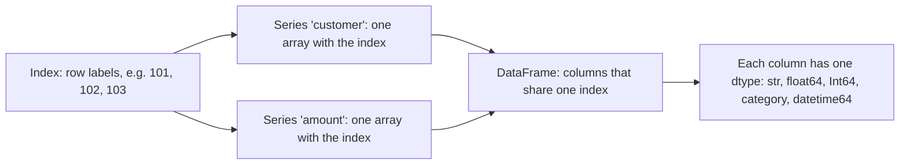
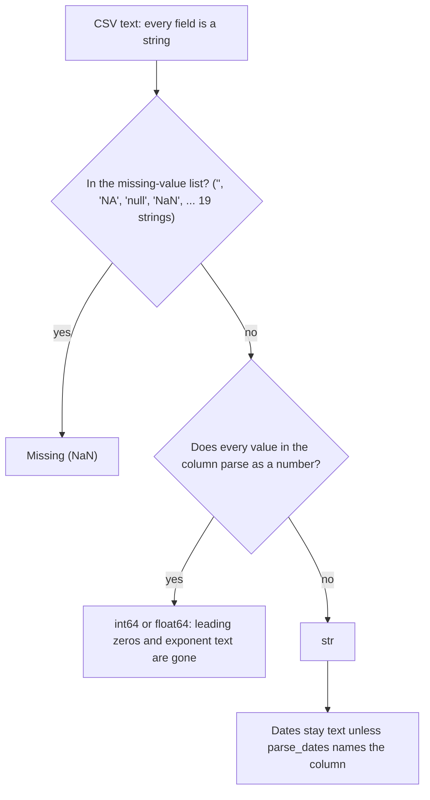
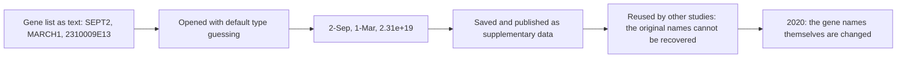

# Module 04: Pandas Core: Series, DataFrame, .loc/.iloc, and CSV/Parquet I/O

> **Prerequisites:** [Module 03: NumPy Aggregations, Matrix Ops (@, linalg), and Generator RNG](../03-numpy-linear-algebra-random-and-aggregations/README.md).  
> **Estimated Reading Time:** 40 minutes  
> **Target Audience:** Engineers who load tables into pandas for analysis or model training and need the values that arrive to be the values in the file

> [!TIP]
> **The Golden Rule of Loading Data:** A CSV file has **no types**: every reader guesses them, and the guess is wrong for identifiers, codes and anything that only looks like a number or a missing value. **Declare** the types of the columns you care about, **check** the frame right after loading, and store intermediate data as **Parquet**, which keeps its types. Inside pandas, remember that arithmetic **aligns on labels**, `.loc` selects by **label** and `.iloc` by **position**, and every assignment goes through **one** `.loc` call.

---

## Why This Matters

Most data science work starts with `pd.read_csv`, and most of it trusts whatever comes back. A ZIP code of 02134 comes back as the number 2134, a sample id 007 as 7, the country code NA (Namibia) as a missing value, and an identifier like 2310009E13 as 2.31 times ten to the nineteenth. None of these raise an error, and every later step (joins, group counts, a model's features) silently works on the damaged values. Section 3 shows how far this went in genomics, where a decade of published papers carried gene names turned into dates and numbers by type guessing on import.

---

## 1. Architectural Mental Model: Labels on Top of Arrays

### Series and DataFrame



A **Series** is a NumPy-like array (Modules 01 to 03) plus an **index** of labels. A **DataFrame** is a set of Series sharing one index, one dtype per column. Two consequences follow:

- **Operations align on labels.** `a + b` matches rows by index label, not by position; a label present on only one side gives a missing value.
- **There are two ways to address a row:** by its label (`.loc`) and by its position (`.iloc`). With an integer index the two look alike and mean different things.

### `.loc` and `.iloc`

| | `.loc[rows, columns]` | `.iloc[rows, columns]` |
| :--- | :--- | :--- |
| Selects by | Labels, boolean masks | Integer positions |
| Slice end | **Included** (`loc[101:103]` gives three rows) | Excluded, as in Python |
| Use for assignment | Yes: `df.loc[mask, "col"] = value` | Yes, by position |

Plain `df[...]` and `s[...]` are shortcuts that guess which of the two you meant; in pandas 3, `s[0]` on a Series is always a label lookup. Write `.loc` or `.iloc` whenever the index is made of integers.

### Copy-on-Write

Since pandas 3.0, "Copy-on-Write is the default and only mode" (pandas migration guide). Every indexing result behaves as a new object, so a **chained** assignment such as `df[mask]["col"] = value` assigns into a temporary and is lost; the guide says that "chained assignment will consistently never work and raise a `ChainedAssignmentError` warning". The replacement is one `.loc` call: `df.loc[mask, "col"] = value`.

### Reading a File Is Guessing



`read_csv` guesses **per column**: a column becomes numeric only if every non-missing value looks like a number. A spreadsheet guesses **per cell**, so it also damages columns where only some values look like numbers or dates. **Parquet** stores the schema with the data, so nothing is guessed on the way back.

---

## 2. Systematic Reference and Comparison Grids

### Reading CSV Safely

| Parameter | What it does |
| :--- | :--- |
| `dtype={"zip": "string", "amount": "float64"}` | Declares column types; identifiers as `"string"` keep leading zeros and exponent-like text |
| `keep_default_na=False` | Stops treating the 19 default strings (`NA`, `null`, `None`, `NaN`, `n/a`, ...) as missing |
| `na_values={"amount": [""]}` | Says per column which strings are missing |
| `parse_dates=["ordered_at"]` | Parses named columns as dates; without it, dates stay text |
| `usecols=[...]` | Reads only some columns |
| `nrows=1000` | Reads a sample first, to inspect the guesses |

### pandas Dtypes You Will Meet

| Dtype | Holds | Missing value |
| :--- | :--- | :--- |
| `int64`, `float64` | NumPy numbers | `int64` has none (a missing value turns the column into `float64`); `float64` uses `NaN` |
| `Int64` (capital I) | Nullable integers | `pd.NA` |
| `str` | Text (the pandas 3 default for strings) | `NaN` |
| `string` | Text, the opt-in string dtype | `pd.NA` |
| `category` | Few distinct values stored as small integer codes | `NaN` |
| `datetime64[us, UTC]` | Timestamps, optionally with a time zone | `NaT` |

### CSV versus Parquet

| | CSV | Parquet |
| :--- | :--- | :--- |
| Types | None: guessed on every read | Stored in the file |
| Layout | Rows of text | Columns, compressed |
| Read some columns | Must parse every row anyway | Reads only those columns |
| Filter rows | After reading | `filters=` can skip row groups whose statistics rule them out |
| Readable by | Anything, including people and spreadsheets | Data tools (pandas, Polars, DuckDB, Spark, Arrow) |
| Use for | Exchange with people and other systems | Intermediate and analytical data |

---

## 3. Real Case Study: Gene Names Turned Into Dates

| Source | What it reports |
| :--- | :--- |
| Ziemann, Eren and El-Osta, "Gene name errors are widespread in the scientific literature", *Genome Biology* 17:177 (2016) | Excel "when used with default settings, is known to convert gene names to dates and floating-point numbers"; *SEPT2* and *MARCH1* "are converted by default to '2-Sep' and '1-Mar', respectively", and RIKEN identifiers such as '2310009E13' become floating-point numbers |
| The same paper's scan | 35,175 supplementary Excel files from 18 journals (2005 to 2015); "approximately one-fifth of papers with supplementary Excel gene lists contain erroneous gene name conversions" (704 articles, 19.6%) |
| Abeysooriya, Soria, Kasu and Ziemann, "Gene name errors: Lessons not learned", *PLoS Computational Biology* 17(7):e1008984 (2021) | A scan of PubMed Central supplementary files from 2014 to 2020 found errors in "30.9% (3,436/11,117) of articles with supplementary Excel gene lists"; the errors "continued to accumulate unabated in the period after 2016" |
| Bruford et al., "Guidelines for human gene nomenclature", *Nature Genetics* 52:754 to 758 (2020) | The HUGO Gene Nomenclature Committee renamed the genes instead: "all symbols that auto-converted to dates in Microsoft Excel have been changed"; "SEPT1 is now SEPTIN1; MARCH1 is now MARCHF1" |



### What to Take From It

1. **The damage is silent and one-way.** "2-Sep" cannot be turned back into *SEPT2* without knowing it was one; 2.31e+19 has lost the letters of its identifier.
2. **Better tools did not fix it; declared types do.** Five years after the first paper the share of affected papers was higher, and the eventual fix was renaming the genes. In your own pipeline you do not need to wait for that: declare identifier columns as text.
3. **pandas makes the same kind of guess.** It does not turn *SEPT2* into a date, but it does turn an all-numeric-looking identifier column into floats, drop leading zeros, and read `NA` as missing. The program in section 4 and Workflow 2 show each case.

---

## 4. Three Ways to Read the Same File, in Four Languages (`carousel`)

The program reads one small CSV three ways: guessing a type for every cell (a spreadsheet's behaviour, simplified to numbers and month-day dates), guessing one type per column (the default behaviour of `read_csv`), and with declared types. It then counts the cells whose text no longer matches the file.

````carousel
```python
"""Three ways to read the same CSV text: guess a type for every cell (as a spreadsheet does), guess one type per column (as pandas.read_csv
does by default), or declare the types. The program counts the cells whose text no longer matches what the file said."""
import re

CSV_TEXT = """gene,clone_id,sample_id,zip,country,expression
SEPT2,2310009E13,007,02134,NA,12.5
MARCH1,4930430E12,008,10001,US,3.25
DEC1,1110059E24,009,94103,IN,
TP53,5730409E11,010,60601,NA,0.75"""

MISSING_TOKENS = ["", "NA", "N/A", "NaN", "null"]  # a few of the strings pandas.read_csv treats as missing by default
NUMBER = re.compile(r"^[+-]?(\d+\.?\d*|\.\d+)([eE][+-]?\d+)?$")
MONTH = re.compile(r"^(JAN|FEB|MARCH|MAR|APR|MAY|JUN|JUL|AUG|SEPT|SEP|OCT|NOV|DEC)(\d{1,2})$")
SCHEMA = {"gene": "text", "clone_id": "text", "sample_id": "text", "zip": "text", "country": "text", "expression": "number"}
SHOWN_MISSING = "<missing>"
BIG = 1e15  # from here on a number is shown in exponent form, as spreadsheets and pandas do


def show_number(value):
    if abs(value) >= BIG:
        return f"{value:.6e}"
    if value == int(value):
        return str(int(value))
    return repr(value)


def spreadsheet_cell(text):
    """One cell at a time: anything that looks like a date or a number becomes one."""
    month = MONTH.match(text.upper())
    if month:
        return f"{int(month.group(2))}-{month.group(1)[:3].title()}"
    if NUMBER.match(text):
        return show_number(float(text))
    return text


def per_column(values):
    """One type per column: missing tokens become missing; if every other value looks like a number, the column is numeric."""
    present = [v for v in values if v not in MISSING_TOKENS]
    numeric = len(present) > 0 and all(NUMBER.match(v) for v in present)
    return [SHOWN_MISSING if v in MISSING_TOKENS else (show_number(float(v)) if numeric else v) for v in values]


def declared(name, values):
    """The reader is told each column's type; only an empty field is missing."""
    if SCHEMA[name] == "number":
        return [SHOWN_MISSING if v == "" else show_number(float(v)) for v in values]
    return list(values)


def changed(original, shown):
    return shown != original and not (original == "" and shown == SHOWN_MISSING)


lines = CSV_TEXT.split("\n")
header = lines[0].split(",")
rows = [line.split(",") for line in lines[1:]]
columns = {name: [row[i] for row in rows] for i, name in enumerate(header)}

readers = [
    ("guess a type for every cell (spreadsheet)", {name: [spreadsheet_cell(v) for v in vals] for name, vals in columns.items()}),
    ("guess one type per column (read_csv default)", {name: per_column(vals) for name, vals in columns.items()}),
    ("declare the types (dtype=..., keep_default_na=False)", {name: declared(name, vals) for name, vals in columns.items()}),
]

total_cells = len(rows) * len(header)
for title, result in readers:
    print(f"== {title} ==")
    print("  " + " ".join(f"{name:>14}" for name in header))
    for r in range(len(rows)):
        print("  " + " ".join(f"{result[name][r]:>14}" for name in header))
    damaged = [name for name in header for r in range(len(rows)) if changed(columns[name][r], result[name][r])]
    by_column = ", ".join(f"{name} {damaged.count(name)}" for name in header if damaged.count(name) > 0)
    print(f"  cells changed: {len(damaged)} of {total_cells}" + (f" ({by_column})" if by_column else ""))
```

<!-- slide -->

```typescript
// Three ways to read the same CSV text: guess a type for every cell (as a spreadsheet does), guess one type per column (as pandas.read_csv
// does by default), or declare the types. The program counts the cells whose text no longer matches what the file said.

const CSV_TEXT = `gene,clone_id,sample_id,zip,country,expression
SEPT2,2310009E13,007,02134,NA,12.5
MARCH1,4930430E12,008,10001,US,3.25
DEC1,1110059E24,009,94103,IN,
TP53,5730409E11,010,60601,NA,0.75`;

const MISSING_TOKENS = ["", "NA", "N/A", "NaN", "null"]; // a few of the strings pandas.read_csv treats as missing by default
const NUMBER = /^[+-]?(\d+\.?\d*|\.\d+)([eE][+-]?\d+)?$/;
const MONTH = /^(JAN|FEB|MARCH|MAR|APR|MAY|JUN|JUL|AUG|SEPT|SEP|OCT|NOV|DEC)(\d{1,2})$/;
const SCHEMA: Record<string, "text" | "number"> = {
  gene: "text", clone_id: "text", sample_id: "text", zip: "text", country: "text", expression: "number",
};
const SHOWN_MISSING = "<missing>";
const BIG = 1e15; // from here on a number is shown in exponent form, as spreadsheets and pandas do

function showNumber(value: number): string {
  if (Math.abs(value) >= BIG) return value.toExponential(6);
  return String(value); // whole numbers print without a decimal point, others in their shortest form
}

// One cell at a time: anything that looks like a date or a number becomes one.
function spreadsheetCell(text: string): string {
  const month = MONTH.exec(text.toUpperCase());
  if (month) {
    const name = month[1].slice(0, 3);
    return `${parseInt(month[2], 10)}-${name[0]}${name.slice(1).toLowerCase()}`;
  }
  if (NUMBER.test(text)) return showNumber(parseFloat(text));
  return text;
}

// One type per column: missing tokens become missing; if every other value looks like a number, the column is numeric.
function perColumn(values: string[]): string[] {
  const present = values.filter((v) => !MISSING_TOKENS.includes(v));
  const numeric = present.length > 0 && present.every((v) => NUMBER.test(v));
  return values.map((v) => (MISSING_TOKENS.includes(v) ? SHOWN_MISSING : numeric ? showNumber(parseFloat(v)) : v));
}

// The reader is told each column's type; only an empty field is missing.
function declared(name: string, values: string[]): string[] {
  if (SCHEMA[name] === "number") return values.map((v) => (v === "" ? SHOWN_MISSING : showNumber(parseFloat(v))));
  return [...values];
}

const changed = (original: string, shown: string) => shown !== original && !(original === "" && shown === SHOWN_MISSING);

const lines = CSV_TEXT.split("\n");
const header = lines[0].split(",");
const rows = lines.slice(1).map((line) => line.split(","));
const columns: Record<string, string[]> = Object.fromEntries(header.map((name, i) => [name, rows.map((row) => row[i])]));

const mapColumns = (fn: (name: string, vals: string[]) => string[]) =>
  Object.fromEntries(header.map((name) => [name, fn(name, columns[name])])) as Record<string, string[]>;

const readers: [string, Record<string, string[]>][] = [
  ["guess a type for every cell (spreadsheet)", mapColumns((_, vals) => vals.map(spreadsheetCell))],
  ["guess one type per column (read_csv default)", mapColumns((_, vals) => perColumn(vals))],
  ["declare the types (dtype=..., keep_default_na=False)", mapColumns(declared)],
];

const totalCells = rows.length * header.length;
for (const [title, result] of readers) {
  console.log(`== ${title} ==`);
  console.log("  " + header.map((name) => name.padStart(14)).join(" "));
  for (let r = 0; r < rows.length; r++) console.log("  " + header.map((name) => result[name][r].padStart(14)).join(" "));
  const damaged = header.flatMap((name) => rows.map((_, r) => r).filter((r) => changed(columns[name][r], result[name][r])).map(() => name));
  const count = (name: string) => damaged.filter((d) => d === name).length;
  const byColumn = header.filter((name) => count(name) > 0).map((name) => `${name} ${count(name)}`).join(", ");
  console.log(`  cells changed: ${damaged.length} of ${totalCells}` + (byColumn ? ` (${byColumn})` : ""));
}
```

<!-- slide -->

```go
// Three ways to read the same CSV text: guess a type for every cell (as a spreadsheet does), guess one type per column (as pandas.read_csv
// does by default), or declare the types. The program counts the cells whose text no longer matches what the file said.
package main

import (
	"fmt"
	"math"
	"regexp"
	"strconv"
	"strings"
)

const csvText = `gene,clone_id,sample_id,zip,country,expression
SEPT2,2310009E13,007,02134,NA,12.5
MARCH1,4930430E12,008,10001,US,3.25
DEC1,1110059E24,009,94103,IN,
TP53,5730409E11,010,60601,NA,0.75`

var missingTokens = []string{"", "NA", "N/A", "NaN", "null"} // a few of the strings pandas.read_csv treats as missing by default
var number = regexp.MustCompile(`^[+-]?(\d+\.?\d*|\.\d+)([eE][+-]?\d+)?$`)
var month = regexp.MustCompile(`^(JAN|FEB|MARCH|MAR|APR|MAY|JUN|JUL|AUG|SEPT|SEP|OCT|NOV|DEC)(\d{1,2})$`)
var schema = map[string]string{"gene": "text", "clone_id": "text", "sample_id": "text", "zip": "text", "country": "text", "expression": "number"}

const shownMissing = "<missing>"
const big = 1e15 // from here on a number is shown in exponent form, as spreadsheets and pandas do

func isMissing(v string) bool {
	for _, m := range missingTokens {
		if v == m {
			return true
		}
	}
	return false
}

func showNumber(value float64) string {
	if math.Abs(value) >= big {
		return fmt.Sprintf("%.6e", value)
	}
	if value == math.Trunc(value) {
		return strconv.FormatInt(int64(value), 10)
	}
	return strconv.FormatFloat(value, 'g', -1, 64)
}

func parse(text string) float64 {
	v, _ := strconv.ParseFloat(text, 64)
	return v
}

// One cell at a time: anything that looks like a date or a number becomes one.
func spreadsheetCell(text string) string {
	if m := month.FindStringSubmatch(strings.ToUpper(text)); m != nil {
		day, _ := strconv.Atoi(m[2])
		return fmt.Sprintf("%d-%s%s", day, m[1][:1], strings.ToLower(m[1][1:3]))
	}
	if number.MatchString(text) {
		return showNumber(parse(text))
	}
	return text
}

// One type per column: missing tokens become missing; if every other value looks like a number, the column is numeric.
func perColumn(values []string) []string {
	present, numeric := 0, true
	for _, v := range values {
		if !isMissing(v) {
			present++
			numeric = numeric && number.MatchString(v)
		}
	}
	numeric = numeric && present > 0
	out := make([]string, len(values))
	for i, v := range values {
		switch {
		case isMissing(v):
			out[i] = shownMissing
		case numeric:
			out[i] = showNumber(parse(v))
		default:
			out[i] = v
		}
	}
	return out
}

// The reader is told each column's type; only an empty field is missing.
func declared(name string, values []string) []string {
	out := make([]string, len(values))
	for i, v := range values {
		switch {
		case schema[name] != "number":
			out[i] = v
		case v == "":
			out[i] = shownMissing
		default:
			out[i] = showNumber(parse(v))
		}
	}
	return out
}

func changed(original, shown string) bool {
	return shown != original && !(original == "" && shown == shownMissing)
}

func main() {
	lines := strings.Split(csvText, "\n")
	header := strings.Split(lines[0], ",")
	var rows [][]string
	for _, line := range lines[1:] {
		rows = append(rows, strings.Split(line, ","))
	}
	columns := map[string][]string{}
	for i, name := range header {
		for _, row := range rows {
			columns[name] = append(columns[name], row[i])
		}
	}
	mapColumns := func(fn func(name string, vals []string) []string) map[string][]string {
		out := map[string][]string{}
		for _, name := range header {
			out[name] = fn(name, columns[name])
		}
		return out
	}
	type reader struct {
		title  string
		result map[string][]string
	}
	readers := []reader{
		{"guess a type for every cell (spreadsheet)", mapColumns(func(_ string, vals []string) []string {
			out := make([]string, len(vals))
			for i, v := range vals {
				out[i] = spreadsheetCell(v)
			}
			return out
		})},
		{"guess one type per column (read_csv default)", mapColumns(func(_ string, vals []string) []string { return perColumn(vals) })},
		{"declare the types (dtype=..., keep_default_na=False)", mapColumns(declared)},
	}

	totalCells := len(rows) * len(header)
	for _, rd := range readers {
		fmt.Printf("== %s ==\n", rd.title)
		cells := make([]string, len(header))
		for i, name := range header {
			cells[i] = fmt.Sprintf("%14s", name)
		}
		fmt.Println("  " + strings.Join(cells, " "))
		for r := range rows {
			for i, name := range header {
				cells[i] = fmt.Sprintf("%14s", rd.result[name][r])
			}
			fmt.Println("  " + strings.Join(cells, " "))
		}
		damaged := 0
		var parts []string
		for _, name := range header {
			count := 0
			for r := range rows {
				if changed(columns[name][r], rd.result[name][r]) {
					count++
				}
			}
			if count > 0 {
				parts = append(parts, fmt.Sprintf("%s %d", name, count))
			}
			damaged += count
		}
		suffix := ""
		if len(parts) > 0 {
			suffix = " (" + strings.Join(parts, ", ") + ")"
		}
		fmt.Printf("  cells changed: %d of %d%s\n", damaged, totalCells, suffix)
	}
}
```

<!-- slide -->

```csharp
// Three ways to read the same CSV text: guess a type for every cell (as a spreadsheet does), guess one type per column (as pandas.read_csv
// does by default), or declare the types. The program counts the cells whose text no longer matches what the file said.
using System;
using System.Collections.Generic;
using System.Globalization;
using System.Linq;
using System.Text.RegularExpressions;

CultureInfo.CurrentCulture = CultureInfo.InvariantCulture;

const string CsvText = "gene,clone_id,sample_id,zip,country,expression\n" +
    "SEPT2,2310009E13,007,02134,NA,12.5\n" +
    "MARCH1,4930430E12,008,10001,US,3.25\n" +
    "DEC1,1110059E24,009,94103,IN,\n" +
    "TP53,5730409E11,010,60601,NA,0.75";

string[] missingTokens = { "", "NA", "N/A", "NaN", "null" }; // a few of the strings pandas.read_csv treats as missing by default
var number = new Regex(@"^[+-]?(\d+\.?\d*|\.\d+)([eE][+-]?\d+)?$");
var month = new Regex(@"^(JAN|FEB|MARCH|MAR|APR|MAY|JUN|JUL|AUG|SEPT|SEP|OCT|NOV|DEC)(\d{1,2})$");
var schema = new Dictionary<string, string>
{
    ["gene"] = "text", ["clone_id"] = "text", ["sample_id"] = "text", ["zip"] = "text", ["country"] = "text", ["expression"] = "number",
};
const string ShownMissing = "<missing>";
const double Big = 1e15; // from here on a number is shown in exponent form, as spreadsheets and pandas do

string ShowNumber(double value)
{
    if (Math.Abs(value) >= Big) return value.ToString("0.000000e+00");
    if (value == Math.Truncate(value)) return ((long)value).ToString();
    return value.ToString("R");
}

double Parse(string text) => double.Parse(text, NumberStyles.Float);

// One cell at a time: anything that looks like a date or a number becomes one.
string SpreadsheetCell(string text)
{
    var m = month.Match(text.ToUpperInvariant());
    if (m.Success) return $"{int.Parse(m.Groups[2].Value)}-{m.Groups[1].Value[0]}{m.Groups[1].Value.Substring(1, 2).ToLowerInvariant()}";
    if (number.IsMatch(text)) return ShowNumber(Parse(text));
    return text;
}

// One type per column: missing tokens become missing; if every other value looks like a number, the column is numeric.
string[] PerColumn(string[] values)
{
    var present = values.Where(v => !missingTokens.Contains(v)).ToArray();
    bool numeric = present.Length > 0 && present.All(v => number.IsMatch(v));
    return values.Select(v => missingTokens.Contains(v) ? ShownMissing : numeric ? ShowNumber(Parse(v)) : v).ToArray();
}

// The reader is told each column's type; only an empty field is missing.
string[] Declared(string name, string[] values) =>
    schema[name] == "number" ? values.Select(v => v == "" ? ShownMissing : ShowNumber(Parse(v))).ToArray() : values.ToArray();

bool Changed(string original, string shown) => shown != original && !(original == "" && shown == ShownMissing);

string[] lines = CsvText.Split('\n');
string[] header = lines[0].Split(',');
string[][] rows = lines.Skip(1).Select(line => line.Split(',')).ToArray();
var columns = header.Select((name, i) => (name, i)).ToDictionary(p => p.name, p => rows.Select(row => row[p.i]).ToArray());

Dictionary<string, string[]> MapColumns(Func<string, string[], string[]> fn) => header.ToDictionary(name => name, name => fn(name, columns[name]));

var readers = new (string Title, Dictionary<string, string[]> Result)[]
{
    ("guess a type for every cell (spreadsheet)", MapColumns((_, vals) => vals.Select(SpreadsheetCell).ToArray())),
    ("guess one type per column (read_csv default)", MapColumns((_, vals) => PerColumn(vals))),
    ("declare the types (dtype=..., keep_default_na=False)", MapColumns(Declared)),
};

int totalCells = rows.Length * header.Length;
foreach (var (title, result) in readers)
{
    Console.WriteLine($"== {title} ==");
    Console.WriteLine("  " + string.Join(" ", header.Select(name => name.PadLeft(14))));
    for (int r = 0; r < rows.Length; r++) Console.WriteLine("  " + string.Join(" ", header.Select(name => result[name][r].PadLeft(14))));
    var counts = header.Select(name => (name, count: Enumerable.Range(0, rows.Length).Count(r => Changed(columns[name][r], result[name][r])))).ToArray();
    string byColumn = string.Join(", ", counts.Where(c => c.count > 0).Select(c => $"{c.name} {c.count}"));
    Console.WriteLine($"  cells changed: {counts.Sum(c => c.count)} of {totalCells}" + (byColumn.Length > 0 ? $" ({byColumn})" : ""));
}
```
````

**Observed output (identical in Python 3.13.14, Node 24, Go 1.22 and .NET 10):**

```text
== guess a type for every cell (spreadsheet) ==
            gene       clone_id      sample_id            zip        country     expression
           2-Sep   2.310009e+19              7           2134             NA           12.5
           1-Mar   4.930430e+18              8          10001             US           3.25
           1-Dec   1.110059e+30              9          94103             IN               
            TP53   5.730409e+17             10          60601             NA           0.75
  cells changed: 12 of 24 (gene 3, clone_id 4, sample_id 4, zip 1)
== guess one type per column (read_csv default) ==
            gene       clone_id      sample_id            zip        country     expression
           SEPT2   2.310009e+19              7           2134      <missing>           12.5
          MARCH1   4.930430e+18              8          10001             US           3.25
            DEC1   1.110059e+30              9          94103             IN      <missing>
            TP53   5.730409e+17             10          60601      <missing>           0.75
  cells changed: 11 of 24 (clone_id 4, sample_id 4, zip 1, country 2)
== declare the types (dtype=..., keep_default_na=False) ==
            gene       clone_id      sample_id            zip        country     expression
           SEPT2     2310009E13            007          02134             NA           12.5
          MARCH1     4930430E12            008          10001             US           3.25
            DEC1     1110059E24            009          94103             IN      <missing>
            TP53     5730409E11            010          60601             NA           0.75
  cells changed: 0 of 24
```

What to notice:

- **Guessing per cell changed 12 of 24 cells.** Three gene names became dates (2-Sep, 1-Mar, 1-Dec), every clone id became a number in exponent form, every sample id lost its leading zeros, and so did the ZIP code 02134.
- **Guessing per column changed 11.** The gene column survived because TP53 is not a number or a date, but `clone_id`, `sample_id` and `zip` were numeric throughout, and Namibia's `NA` became missing twice.
- **Declared types changed none.** Only the empty expression is missing, as the file meant.
- The per-column numbers match what `pd.read_csv` really returns on this file (Workflow 2).

---

## 5. Practical Hands-On Verification Workflows (Python 3.13 + pandas 3.1.1)

### Workflow 1: Alignment, `.loc` and `.iloc`, and Copy-on-Write

```python
"""Series and DataFrames: arithmetic aligns on labels, .loc selects by label and .iloc by position, and under Copy-on-Write a chained
assignment changes nothing."""
import warnings

import pandas as pd

print("pandas", pd.__version__)

print("\n== 1. arithmetic aligns on the index, not on position ==")
stock = pd.Series([10, 20, 30], index=["apples", "bread", "cheese"])
delivered = pd.Series([5, 7, 2], index=["bread", "cheese", "dates"])
print((stock + delivered).to_string())
print("  fill_value=0 treats a label missing on one side as 0:", (stock.add(delivered, fill_value=0)).to_dict())
print("  the positional sum, if that is really what you want:", (stock.to_numpy() + delivered.to_numpy()).tolist())

print("\n== 2. .loc is by label (end included), .iloc is by position (end excluded) ==")
orders = pd.DataFrame({"customer": ["ana", "ben", "chen", "dev", "eve"], "amount": [120.0, 35.5, 80.0, 12.0, 64.25]},
                      index=[101, 102, 103, 104, 105])
print("  orders.loc[101:103, 'amount']  ->", orders.loc[101:103, "amount"].tolist())
print("  orders.iloc[0:2, 1]            ->", orders.iloc[0:2, 1].tolist())
countdown = pd.Series(["c", "b", "a"], index=[2, 1, 0])
print("  with integer labels [2, 1, 0]: countdown[0] ->", repr(countdown[0]), "  countdown.iloc[0] ->", repr(countdown.iloc[0]))

print("\n== 3. selecting and assigning with a mask ==")
big = orders["amount"] > 50
print("  orders with amount > 50:", orders.loc[big, "customer"].tolist())
with warnings.catch_warnings(record=True) as caught:
    warnings.simplefilter("always")
    orders[big]["amount"] = 0.0  # chained: the first [] makes a new object, the second assigns into it
print("  chained assignment orders[big]['amount'] = 0.0 ->", orders["amount"].tolist())
print("  warning:", caught[0].category.__name__, "-", str(caught[0].message).splitlines()[0])
orders.loc[big, "amount"] = orders.loc[big, "amount"] * 0.9  # one .loc call with the row mask and the column
print("  orders.loc[big, 'amount'] *= 0.9 ->", orders["amount"].tolist())

print("\n== 4. what pandas 3 stores ==")
print(orders.dtypes.to_string())
cities = pd.Series(["Pune", "Lagos", "Lima", "Oslo", "Perth"] * 200_000)  # a million values, five distinct
for label, series in (("str", cities), ("category", cities.astype("category"))):
    print(f"  a million city names as {label:8}: {series.memory_usage(deep=True) / 1e6:5.1f} MB")
for label, n in (("five rows", 5), ("a million rows", 1_000_000)):
    sample = cities.head(n)
    winner = "category" if sample.astype("category").memory_usage(deep=True) < sample.memory_usage(deep=True) else "str"
    print(f"  smaller for {label}: {winner}")
```

**Observed Output:**

```text
pandas 3.1.1

== 1. arithmetic aligns on the index, not on position ==
apples     NaN
bread     25.0
cheese    37.0
dates      NaN
  fill_value=0 treats a label missing on one side as 0: {'apples': 10.0, 'bread': 25.0, 'cheese': 37.0, 'dates': 2.0}
  the positional sum, if that is really what you want: [15, 27, 32]

== 2. .loc is by label (end included), .iloc is by position (end excluded) ==
  orders.loc[101:103, 'amount']  -> [120.0, 35.5, 80.0]
  orders.iloc[0:2, 1]            -> [120.0, 35.5]
  with integer labels [2, 1, 0]: countdown[0] -> 'a'   countdown.iloc[0] -> 'c'

== 3. selecting and assigning with a mask ==
  orders with amount > 50: ['ana', 'chen', 'eve']
  chained assignment orders[big]['amount'] = 0.0 -> [120.0, 35.5, 80.0, 12.0, 64.25]
  warning: ChainedAssignmentError - A value is being set on a copy of a DataFrame or Series through chained assignment.
  orders.loc[big, 'amount'] *= 0.9 -> [108.0, 35.5, 72.0, 12.0, 57.825]

== 4. what pandas 3 stores ==
customer        str
amount      float64
  a million city names as str     :  12.4 MB
  a million city names as category:   1.0 MB
  smaller for five rows: str
  smaller for a million rows: category
```

- **Alignment:** adding two Series matched `bread` with `bread` and `cheese` with `cheese`; `apples` and `dates`, present on one side only, became NaN. `add(..., fill_value=0)` treats the missing side as 0. If you meant a positional sum, say so with `.to_numpy()`.
- **`.loc[101:103]` returned three rows; `.iloc[0:2]` returned two.** With the integer labels `[2, 1, 0]`, `countdown[0]` was `'a'` (the label 0) while `countdown.iloc[0]` was `'c'` (the first position).
- **The chained assignment did nothing** and raised `ChainedAssignmentError`; the single `.loc` call changed the three rows above 50.
- **Strings are `str` in pandas 3.** For a million city names with five distinct values, `category` took 1.0 MB against 12.4 MB; for five rows, plain `str` was smaller. Use `category` for long columns with few distinct values.

### Workflow 2: What `read_csv` Guesses, and How to Stop It

```python
"""read_csv guesses a type for each column. On identifier columns the guess loses information; declaring the types keeps it,
and a short check after loading catches what slipped through."""
import pathlib
import tempfile

import pandas as pd

TEXT = """gene,clone_id,sample_id,zip,country,expression,measured_on
SEPT2,2310009E13,007,02134,NA,12.5,2026-03-01
MARCH1,4930430E12,008,10001,US,3.25,2026-03-02
DEC1,1110059E24,009,94103,IN,,2026-03-02
TP53,5730409E11,010,60601,NA,0.75,2026-03-04
"""
path = pathlib.Path(tempfile.mkdtemp()) / "samples.csv"
path.write_text(TEXT)

print("== 1. the defaults ==")
guessed = pd.read_csv(path)
print(guessed.to_string())
print("  dtypes:", dict(guessed.dtypes.astype(str)))

print("\n== 2. declare the identifier columns as text and say which strings mean missing ==")
TEXT_COLUMNS = ["gene", "clone_id", "sample_id", "zip", "country"]
declared = pd.read_csv(
    path,
    dtype={name: "string" for name in TEXT_COLUMNS} | {"expression": "float64"},
    keep_default_na=False,          # do not treat 'NA', 'null', 'NaN', ... as missing
    na_values={"expression": [""]},  # only an empty expression is missing
    parse_dates=["measured_on"],
)
print(declared.to_string())
print("  dtypes:", dict(declared.dtypes.astype(str)))

print("\n== 3. check the frame after loading ==")


def problems(frame):
    found = []
    if not frame["zip"].astype(str).str.fullmatch(r"\d{5}").all():
        found.append("zip codes that are not 5 digits")
    if not frame["sample_id"].astype(str).str.fullmatch(r"\d{3}").all():
        found.append("sample ids that are not 3 digits")
    if frame["country"].isna().any():
        found.append(f"{int(frame['country'].isna().sum())} missing countries")
    if frame["clone_id"].dtype.kind == "f":
        found.append("clone ids stored as floating-point numbers")
    return found


print("  defaults:", problems(guessed))
print("  declared:", problems(declared))
```

**Observed Output:**

```text
== 1. the defaults ==
     gene      clone_id  sample_id    zip country  expression measured_on
0   SEPT2  2.310009e+19          7   2134     NaN       12.50  2026-03-01
1  MARCH1  4.930430e+18          8  10001      US        3.25  2026-03-02
2    DEC1  1.110059e+30          9  94103      IN         NaN  2026-03-02
3    TP53  5.730409e+17         10  60601     NaN        0.75  2026-03-04
  dtypes: {'gene': 'str', 'clone_id': 'float64', 'sample_id': 'int64', 'zip': 'int64', 'country': 'str', 'expression': 'float64', 'measured_on': 'str'}

== 2. declare the identifier columns as text and say which strings mean missing ==
     gene    clone_id sample_id    zip country  expression measured_on
0   SEPT2  2310009E13       007  02134      NA       12.50  2026-03-01
1  MARCH1  4930430E12       008  10001      US        3.25  2026-03-02
2    DEC1  1110059E24       009  94103      IN         NaN  2026-03-02
3    TP53  5730409E11       010  60601      NA        0.75  2026-03-04
  dtypes: {'gene': 'string', 'clone_id': 'string', 'sample_id': 'string', 'zip': 'string', 'country': 'string', 'expression': 'float64', 'measured_on': 'datetime64[us]'}

== 3. check the frame after loading ==
  defaults: ['zip codes that are not 5 digits', 'sample ids that are not 3 digits', '2 missing countries', 'clone ids stored as floating-point numbers']
  declared: []
```

- The defaults reproduced the per-column result of the program exactly: `clone_id` as `float64` (2.310009e+19), `sample_id` and `zip` as `int64` (7, 2134), two countries missing, and the dates left as `str`.
- With `dtype=`, `keep_default_na=False`, `na_values=` and `parse_dates=`, every identifier came back as written and the date column became `datetime64[us]`.
- **The check after loading** listed four problems for the defaults and none for the declared read. A few lines like these (lengths, patterns, missing counts, dtypes) are the cheapest test you can add to a pipeline.

### Workflow 3: CSV versus Parquet on a Million Rows

```python
"""The same million-row table saved as CSV and as Parquet: what comes back, how big the files are, how long reading takes, and
reading only the columns and rows you need."""
import pathlib
import tempfile
import time

import numpy as np
import pandas as pd

rng = np.random.default_rng(7)
N = 1_000_000
coupon = pd.array(rng.integers(5, 30, N), dtype="Int64")
coupon[rng.random(N) < 0.7] = pd.NA  # most orders have no coupon
orders = pd.DataFrame({
    "customer_id": pd.array([f"{i:06d}" for i in rng.integers(0, 50_000, N)], dtype="string"),
    "city": pd.Categorical(rng.choice(["Pune", "Lagos", "Lima", "Oslo", "Perth"], N)),
    "ordered_at": pd.Timestamp("2026-01-01", tz="UTC") + pd.to_timedelta(rng.integers(0, 90 * 86_400, N), unit="s"),
    "amount": rng.gamma(2.0, 30.0, N).round(2),
    "coupon": coupon,
})
folder = pathlib.Path(tempfile.mkdtemp())
csv_path, parquet_path = folder / "orders.csv", folder / "orders.parquet"


def timed(fn):
    t0 = time.perf_counter()
    result = fn()
    return result, time.perf_counter() - t0


_, csv_write = timed(lambda: orders.to_csv(csv_path, index=False))
_, parquet_write = timed(lambda: orders.to_parquet(parquet_path, index=False))
from_csv, csv_read = timed(lambda: pd.read_csv(csv_path))
from_parquet, parquet_read = timed(lambda: pd.read_parquet(parquet_path))

print("== 1. size and time (times vary by machine) ==")
for name, path, write, read in (("CSV", csv_path, csv_write, csv_read), ("Parquet", parquet_path, parquet_write, parquet_read)):
    print(f"  {name:8} {path.stat().st_size / 1e6:6.1f} MB   write {write:5.2f} s   read {read:5.2f} s")

print("\n== 2. what comes back ==")
print(f"  {'column':12} {'original':22} {'from CSV':22} {'from Parquet':22}")
for column in orders.columns:
    print(f"  {column:12} {str(orders[column].dtype):22} {str(from_csv[column].dtype):22} {str(from_parquet[column].dtype):22}")
print("  first customer_id:", repr(orders['customer_id'].iloc[0]), "-> CSV", repr(from_csv['customer_id'].iloc[0]),
      "-> Parquet", repr(from_parquet['customer_id'].iloc[0]))
print("  Parquet frame equal to the original:", from_parquet.equals(orders))
typed_csv, t_typed = timed(lambda: pd.read_csv(csv_path, dtype={"customer_id": "string", "city": "category", "coupon": "Int64"},
                                               parse_dates=["ordered_at"]))
print(f"  CSV read again with the types declared: {t_typed:5.2f} s; equal to the original: {typed_csv.equals(orders)}")
print("  ordered_at dtype now:", typed_csv["ordered_at"].dtype)

print("\n== 3. read only what you need ==")
two_columns, t_columns = timed(lambda: pd.read_parquet(parquet_path, columns=["city", "amount"]))
lima, t_filter = timed(lambda: pd.read_parquet(parquet_path, columns=["city", "amount"], filters=[("city", "==", "Lima")]))
print(f"  columns=['city', 'amount']:            {two_columns.shape}  {t_columns:5.2f} s")
print(f"  ... and filters=[('city', '==', 'Lima')]: {lima.shape}  {t_filter:5.2f} s")
```

**Observed Output (times vary by machine):**

```text
== 1. size and time (times vary by machine) ==
  CSV        46.9 MB   write  2.60 s   read  0.04 s
  Parquet    12.6 MB   write  0.26 s   read  0.08 s

== 2. what comes back ==
  column       original               from CSV               from Parquet          
  customer_id  string                 int64                  string                
  city         category               str                    category              
  ordered_at   datetime64[us, UTC]    str                    datetime64[us, UTC]   
  amount       float64                float64                float64               
  coupon       Int64                  float64                Int64                 
  first customer_id: '020626' -> CSV np.int64(20626) -> Parquet '020626'
  Parquet frame equal to the original: True
  CSV read again with the types declared:  0.45 s; equal to the original: True
  ordered_at dtype now: datetime64[us, UTC]

== 3. read only what you need ==
  columns=['city', 'amount']:            (1000000, 2)   0.01 s
  ... and filters=[('city', '==', 'Lima')]: (199230, 2)   0.02 s
```

- **Size:** the Parquet file was 12.6 MB against 46.9 MB of CSV, and it was written about ten times faster (0.26 s against 2.60 s).
- **Types:** from CSV, `customer_id` came back as `int64` ('020626' became 20626), `city` and `ordered_at` as plain text, and `coupon` as `float64`. From Parquet every column came back with its original dtype and the frame was equal to the original.
- **Read time:** the untyped CSV read was the fastest read on this machine (0.04 s), but it returned the wrong types. Reading the CSV with the types declared, the only fair comparison, took 0.45 s against 0.08 s for Parquet.
- **Column and row selection:** reading two columns, and then only the Lima rows of them (199,230 rows), took a hundredth of a second or two.

---

## 6. Hands-On Exercises and Independent Challenge

### Practical Exercises

1. **Predict the alignment.** `a = pd.Series([1, 2, 3], index=["x", "y", "z"])` and `b = pd.Series([10, 20, 30], index=["z", "y", "x"])`. What is `a + b`?
2. **Fix the assignment.** Rewrite `df[df["status"] == "late"]["fee"] = 5` so that it works in pandas 3.
3. **Read a product file.** A CSV has columns `sku` (values like `00123`, `4E10`), `region` (`NA` for North America, `EU`, `APAC`), `price` and `launched` (dates). Write the `read_csv` call.
4. **Choose a format.** A daily job writes a 30-column table that three later jobs read, each using 4 columns. Which format, and why?

<details><summary>Answers</summary>

1. `x: 31, y: 22, z: 13`: values are matched by label, so the order of `b` does not matter.
2. `df.loc[df["status"] == "late", "fee"] = 5`.
3. ```python
   pd.read_csv(path, dtype={"sku": "string", "region": "string", "price": "float64"},
               keep_default_na=False, na_values={"price": [""]}, parse_dates=["launched"])
   ```
   Without `dtype`, `sku` would lose leading zeros, or become a float if every value looked numeric; without `keep_default_na=False`, North America would be missing.
4. Parquet: the types survive, the file is smaller, and each job reads only its 4 columns instead of parsing all 30.

</details>

### Independent Challenge

A churn model's training data arrives every week as a CSV export from a CRM. After a release of the CRM, the model's accuracy drops, and the team finds that one week's `account_id` values no longer join to the billing table. Design the loading step so that this cannot happen silently again.

<details><summary>Architectural Discussion</summary>

**The likely cause.** The export changed how it writes some column (quotes removed, a new account range with leading zeros or with letters, a different null marker), and `read_csv` guessed a different type: ids that used to be text became integers, so `000123` no longer matched `000123` in billing.

**A declared schema.** Keep the expected columns, dtypes and missing-value markers in one configuration file, read with `dtype=`, `keep_default_na=False`, `na_values=` and `parse_dates=` from it, and never rely on the defaults.

**Checks right after loading.** Fail the job when a column is missing or extra, when an id does not match its pattern, when the join rate to billing falls below a threshold, or when a column's missing share changes sharply from last week. Log the counts.

**Store what you loaded.** Write the validated frame as Parquet with its schema, so downstream jobs never parse the CSV again, and keep the raw file for audits.

</details>

---

## 7. Common Mistakes and Troubleshooting

- **Letting `read_csv` guess identifier columns.** Declare them as `"string"`.
- **Forgetting that `NA`, `null` and `None` are missing by default.** Use `keep_default_na=False` and per-column `na_values`.
- **Assuming dates are dates.** Without `parse_dates`, they are text.
- **Chained assignment.** Use one `.loc[rows, column] = value`.
- **`s[0]` on an integer index.** It is the label 0, not the first row; use `.iloc[0]`.
- **Adding Series with different indexes and expecting positions to match.** Check the index or use `.to_numpy()` deliberately.
- **Saving intermediate results as CSV.** Every read guesses again; use Parquet.
- **Writing the index by accident.** Pass `index=False` unless the index carries meaning.

---

## 8. Operational Validation Checkpoints and Checkpoint Quiz

<details><summary><strong>Checkpoint 1: After a join, many rows have NaN in the joined columns although the ids look the same. What do you check first?</strong></summary>

The dtypes of the key columns on both sides: one is probably `int64` (leading zeros gone) and the other text, or one has trailing spaces. Read both with the key declared as `"string"`, then compare the sets of keys that fail to match.

</details>

<details><summary><strong>Checkpoint 2: A pipeline sets values with df[mask]["col"] = x and the values do not change. Why?</strong></summary>

Under Copy-on-Write (the only mode in pandas 3) the first indexing step returns a new object; the assignment goes into it and is discarded, with a `ChainedAssignmentError` warning. Use `df.loc[mask, "col"] = x`.

</details>

<details><summary><strong>Checkpoint 3: Reading a CSV gives a float column for something that should be integer. Why, and how do you keep integers?</strong></summary>

A missing value cannot be stored in `int64`, so a column of integers with gaps is read as `float64` (as `coupon` was in Workflow 3). Declare it as the nullable `"Int64"`, or store the data as Parquet, which keeps the dtype.

</details>

### Checkpoint Quiz

1. What does `a + b` do with labels present in only one of two Series?
2. How many rows does `df.loc[10:30]` return for an index of `[10, 20, 30, 40]`, and `df.iloc[0:2]`?
3. Name three ways `read_csv` defaults can change a value from what the file says.
4. Why does Parquet avoid them?
5. What does `keep_default_na=False` do on its own, without `na_values`?

<details><summary>Answers</summary>

1. The result has the union of the labels; a label missing on one side gives NaN (unless `fill_value` is given).
2. Three rows (labels 10, 20 and 30, end included) and two rows (positions 0 and 1).
3. Leading zeros dropped from all-numeric columns; identifiers like `2310009E13` turned into floats; strings such as `NA`, `null` or `None` turned into missing values; integers with gaps turned into floats; dates left as text.
4. The file stores each column's type, so the reader does not guess.
5. No string is read as missing, not even an empty field: it becomes an empty string, and a numeric column that contains one is read as text (in pandas 3.1.1, `"3"` instead of `3`). Pass `na_values` to name the markers you do want.

</details>

---

## 9. Interview Practice

> [!interview]
> You are handed a CSV export to train a model on. What do you do before any modelling?

<details><summary>What a strong answer covers</summary>

- Read a sample with `nrows` and look at the guessed dtypes; then read with a declared schema (`dtype`, `keep_default_na`, `na_values`, `parse_dates`).
- Validate: expected columns, id patterns, missing shares, value ranges, duplicates, join rates to related tables.
- Store the validated data as Parquet and keep the raw file.

</details>

> [!interview]
> Explain the difference between `.loc` and `.iloc`, and a bug the difference can cause.

<details><summary>What a strong answer covers</summary>

- `.loc` uses labels and includes the slice end; `.iloc` uses positions and excludes it.
- With an integer index that is not `0..n-1` (after sorting or filtering), `s[0]` or a `.loc` slice selects by label, not position, and picks different rows than intended.
- Assignment should go through one `.loc` call; chained assignment does nothing under Copy-on-Write.

</details>

---

## Further Reading and Sources

- [Ziemann, Eren and El-Osta, "Gene name errors are widespread in the scientific literature", Genome Biology 17:177 (2016)](https://pmc.ncbi.nlm.nih.gov/articles/PMC4994289/) — the original scan and its figures.
- [Abeysooriya, Soria, Kasu and Ziemann, "Gene name errors: Lessons not learned", PLoS Computational Biology 17(7):e1008984 (2021)](https://journals.plos.org/ploscompbiol/article?id=10.1371/journal.pcbi.1008984) — the follow-up scan of 2014 to 2020.
- [Bruford et al., "Guidelines for human gene nomenclature", Nature Genetics 52:754 to 758 (2020)](https://pmc.ncbi.nlm.nih.gov/articles/PMC7494048/) — the renaming of the genes that spreadsheets converted.
- [pandas: `read_csv`](https://pandas.pydata.org/docs/reference/api/pandas.read_csv.html) — `dtype`, `na_values`, `keep_default_na` and `parse_dates`.
- [pandas: Migration guides](https://pandas.pydata.org/docs/user_guide/migration.html) — Copy-on-Write and the new default string dtype in pandas 3.0.
- [pandas: `read_parquet`](https://pandas.pydata.org/docs/reference/api/pandas.read_parquet.html) — `columns` and `filters`.

## Next

Continue to **[Module 05: Pandas Wrangling: groupby, merge, pivot, Reshaping, and Windows](../05-pandas-groupby-merge-pivot-and-windows/README.md)**, where these typed frames are grouped, joined and reshaped.
