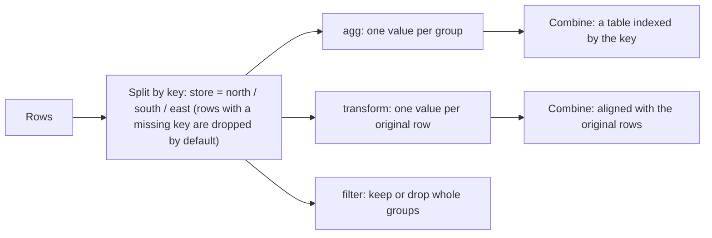
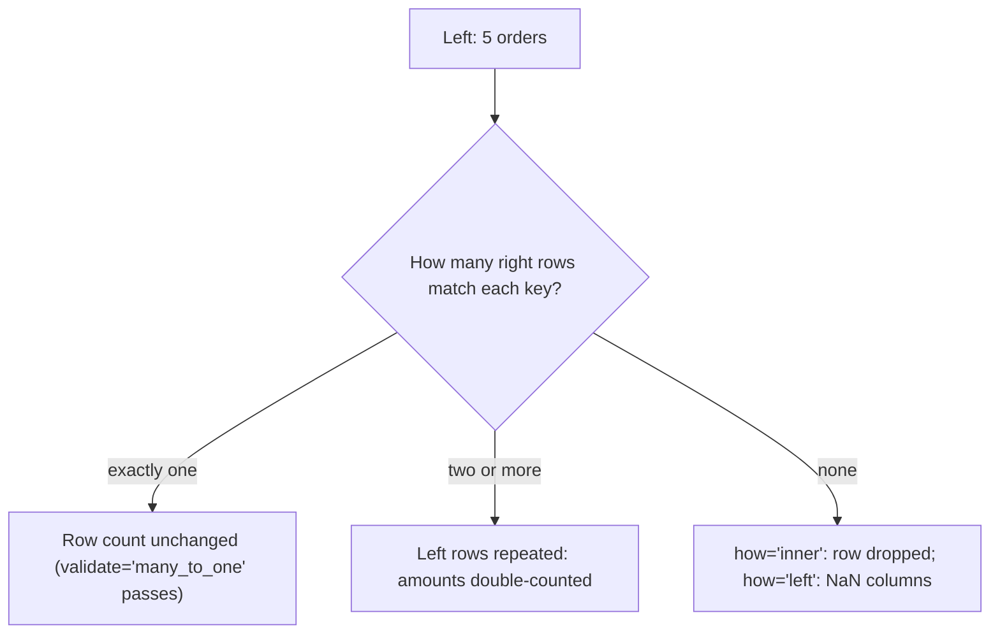
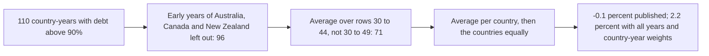

# Module 05: Pandas Wrangling: groupby, merge, pivot, Reshaping, and Windows

> **Prerequisites:** [Module 04: Pandas Core: Series, DataFrame, .loc/.iloc, and CSV/Parquet I/O](../04-pandas-series-dataframes-and-indexing/README.md).  
> **Estimated Reading Time:** 40 minutes  
> **Target Audience:** Engineers who summarize, join and reshape tables to build reports or model features, and need the totals to add up

> [!TIP]
> **The Golden Rule of Wrangling:** Before every aggregation, say **what one row stands for** and what each group should weigh; before every join, say **how many rows** each key should match and check it with `validate=`; and before every window, say **which past** it covers (rows or time, with or without the current row). Then compare row counts and totals before and after each step: a summary that does not reconcile with its input is wrong.

---

## Why This Matters

`groupby`, `merge`, `pivot` and `rolling` are where tables quietly change size and meaning. A group key that is missing drops its rows from every total. A key that repeats on the right side of a join doubles the amounts on the left. An average of group averages weighs a group of one row the same as a group of a thousand. A rolling window that includes the current row leaks the answer into a model's features. None of these raises an error. Section 3 shows two of them in a published economics result that influenced the debate on government debt.

---

## 1. Architectural Mental Model: Split, Apply, Combine

### groupby



- **Missing keys:** `groupby` drops rows whose key is missing unless you pass `dropna=False`. Their values vanish from every group total.
- **`size` versus `count`:** `size` counts rows; `count` counts non-missing values.
- **`agg` versus `transform`:** `agg` gives one row per group; `transform` broadcasts the group's value back to each row, which is how you compute shares, deviations from the group mean, or group-normalized features.

### Weights: What a Row Stands For

The mean of group means weighs every **group** equally; the mean of the rows weighs every **row** equally. They agree only when every group has the same number of rows. Neither is wrong in general, but the choice must be deliberate and stated, because it can flip the conclusion (the program in section 4 turns a positive average into a negative one this way).

### merge



`validate="one_to_one"`, `"one_to_many"` or `"many_to_one"` makes pandas raise a `MergeError` when the keys break the relationship you expect; `indicator=True` adds a `_merge` column saying whether each row matched on both sides, only the left, or only the right.

### Reshaping and Windows

| Operation | Shape change |
| :--- | :--- |
| `pivot(index, columns, values)` | Long to wide; fails if an (index, column) pair repeats |
| `pivot_table(..., aggfunc=...)` | Long to wide, aggregating repeats |
| `melt(id_vars, ...)` | Wide to long |
| `rolling(3)` | A window of the last 3 **rows** |
| `rolling("3D")` | A window of the last 3 **days** of the time index |
| `shift(1)` | The previous row's value: the safe base for "past only" features |

---

## 2. Systematic Reference and Comparison Grids

### Aggregations

| Want | Write |
| :--- | :--- |
| Several named results | `df.groupby("k").agg(rows=("x", "size"), mean=("x", "mean"))` |
| Keep rows with a missing key | `groupby("k", dropna=False)` |
| A group value on every row | `groupby("k")["x"].transform("mean")` |
| Share of the group total | `df["x"] / df.groupby("k")["x"].transform("sum")` |
| Weighted mean of group means | `np.average(means, weights=counts)` |
| Keep only large groups | `groupby("k").filter(lambda g: len(g) >= 30)` |

### Joins

| Check | How |
| :--- | :--- |
| Keys unique where they should be | `validate="many_to_one"` (or `one_to_one`) |
| Which rows did not match | `indicator=True`, then look at `left_only` and `right_only` |
| Row count and totals | Compare `len()` and `sum()` before and after |
| Key types | Same dtype on both sides; pandas refuses int64 against str |
| Key text | Strip spaces and normalize case before joining |

### Windows and Lags for Features

| Feature | Safe version |
| :--- | :--- |
| Last value | `groupby("entity")["x"].shift(1)` |
| Mean of the previous k periods | `groupby("entity")["x"].transform(lambda s: s.shift(1).rolling(k, min_periods=1).mean())` |
| Mean of the previous 7 days | A time-indexed `rolling("7D", closed="left")` per entity |
| Unsafe | `shift` without `groupby` (crosses entities); a window that includes the current row |

---

## 3. Real Case Study: Weighting and Excluded Rows in "Growth in a Time of Debt"

| What Herndon, Ash and Pollin report (PERI Working Paper 322, April 2013) | Detail |
| :--- | :--- |
| The claim they replicated | Reinhart and Rogoff's "Growth in a Time of Debt" (2010) found average real GDP growth of -0.1 percent for countries with public debt above 90 percent of GDP |
| The corrected figure | "when properly calculated, the average real GDP growth rate for countries carrying a public-debt-to-GDP ratio of over 90 percent is actually 2.2 percent, not -0.1 percent" |
| The causes | "coding errors, selective exclusion of available data, and unconventional weighting of summary statistics" |
| The spreadsheet range | A coding error "entirely excludes five countries, Australia, Austria, Belgium, Canada, and Denmark"; footnote: the authors "averaged cells in lines 30 to 44 instead of lines 30 to 49" |
| The excluded years | 96 country-years reported against 110 available; with the spreadsheet error the estimate used "only 71" |
| The weighting | Growth was averaged per country, then "the country averages within each group were then averaged, equally weighted by country"; so New Zealand's single year at -7.6 percent weighed as much as the UK's 19 years averaging 2.4 percent |



### What to Take From It

1. **A hard-coded range is a silent filter.** `groupby` over the whole column cannot forget the last five rows; a range of cells can. Reconcile counts: the number of country-years going into an average should be printed next to it.
2. **Weighting is a modelling decision.** Herndon, Ash and Pollin note that equal country weights might be argued for, but the choice was not stated, and it gave one year the weight of nineteen. State the unit of each average.
3. **Excluded rows need a reason in writing.** New Zealand's excluded early years were all in the highest-debt group; with them, its average changes from -7.6 to +2.6 percent (the program below). Log every exclusion with its effect.

---

## 4. Group Weights, in Four Languages (`carousel`)

The program uses only figures Herndon, Ash and Pollin print for four of the countries in the over-90-percent group: the UK (19 years, average 2.4 percent), Greece (19 years, 2.9 percent), the United States (its four years, 1946 to 1949) and New Zealand (the one year kept, 1951, and the four early years left out). It averages them per country and per country-year, with and without New Zealand's excluded years. Four countries are not the whole data set, so the results are an illustration of the mechanism, not a replication of the 2.2 or -0.1 percent figures.

````carousel
```python
"""A grouped average depends on what each row stands for. These are four of the countries in the over-90%-debt group, with the
figures Herndon, Ash and Pollin (2013) print: real GDP growth in percent. Averaging the country averages gives one year of
New Zealand the same weight as nineteen years of the United Kingdom; averaging the country-years does not."""

# (country, years in the group, growth in each year). The UK and Greece are given in the paper only as 19-year averages,
# so they enter as their average and their count.
UK = ("United Kingdom", 19, 2.4)
GREECE = ("Greece", 19, 2.9)
US_YEARS = [-10.9, -0.9, 4.4, -0.5]          # 1946 to 1949
NZ_KEPT = [-7.6]                              # 1951, the one year that stayed in the analysis
NZ_EXCLUDED = [7.7, 11.9, -9.9, 10.8]         # 1946 to 1949, left out of the working spreadsheet


def summarize(years):
    """Left-to-right total, so every language adds in the same order."""
    total = 0.0
    for g in years:
        total += g
    return len(years), total / len(years)


def groups(nz_years):
    us_n, us_mean = summarize(US_YEARS)
    nz_n, nz_mean = summarize(nz_years)
    return [UK, GREECE, ("United States", us_n, us_mean), ("New Zealand", nz_n, nz_mean)]


def per_country(rows):
    total = 0.0
    for _, _, mean in rows:
        total += mean
    return total / len(rows)


def per_country_year(rows):
    weighted, count = 0.0, 0
    for _, n, mean in rows:
        weighted += n * mean
        count += n
    return weighted / count


for title, nz in (("New Zealand with its one kept year", NZ_KEPT), ("New Zealand with all five years", NZ_EXCLUDED + NZ_KEPT)):
    rows = groups(nz)
    print(f"== {title} ==")
    print(f"  {'country':16} {'years':>5} {'mean growth %':>14} {'weight, by country':>19} {'weight, by year':>16}")
    years_total = sum(n for _, n, _ in rows)
    for name, n, mean in rows:
        print(f"  {name:16} {n:5d} {mean:14.3f} {1 / len(rows):19.3f} {n / years_total:16.3f}")
    print(f"  average of the country averages: {per_country(rows):7.3f} %")
    print(f"  average of the country-years:    {per_country_year(rows):7.3f} %")
```

<!-- slide -->

```typescript
// A grouped average depends on what each row stands for. These are four of the countries in the over-90%-debt group, with the
// figures Herndon, Ash and Pollin (2013) print: real GDP growth in percent. Averaging the country averages gives one year of
// New Zealand the same weight as nineteen years of the United Kingdom; averaging the country-years does not.

type Group = [name: string, years: number, mean: number];

// The UK and Greece are given in the paper only as 19-year averages, so they enter as their average and their count.
const UK: Group = ["United Kingdom", 19, 2.4];
const GREECE: Group = ["Greece", 19, 2.9];
const US_YEARS = [-10.9, -0.9, 4.4, -0.5]; // 1946 to 1949
const NZ_KEPT = [-7.6]; // 1951, the one year that stayed in the analysis
const NZ_EXCLUDED = [7.7, 11.9, -9.9, 10.8]; // 1946 to 1949, left out of the working spreadsheet

// Left-to-right total, so every language adds in the same order.
function summarize(years: number[]): [number, number] {
  let total = 0.0;
  for (const g of years) total += g;
  return [years.length, total / years.length];
}

function groups(nzYears: number[]): Group[] {
  const [usN, usMean] = summarize(US_YEARS);
  const [nzN, nzMean] = summarize(nzYears);
  return [UK, GREECE, ["United States", usN, usMean], ["New Zealand", nzN, nzMean]];
}

function perCountry(rows: Group[]): number {
  let total = 0.0;
  for (const [, , mean] of rows) total += mean;
  return total / rows.length;
}

function perCountryYear(rows: Group[]): number {
  let weighted = 0.0;
  let count = 0;
  for (const [, n, mean] of rows) {
    weighted += n * mean;
    count += n;
  }
  return weighted / count;
}

const cases: [string, number[]][] = [
  ["New Zealand with its one kept year", NZ_KEPT],
  ["New Zealand with all five years", [...NZ_EXCLUDED, ...NZ_KEPT]],
];
for (const [title, nz] of cases) {
  const rows = groups(nz);
  console.log(`== ${title} ==`);
  console.log(`  ${"country".padEnd(16)} ${"years".padStart(5)} ${"mean growth %".padStart(14)} ${"weight, by country".padStart(19)} ${"weight, by year".padStart(16)}`);
  const yearsTotal = rows.reduce((acc, [, n]) => acc + n, 0);
  for (const [name, n, mean] of rows) {
    console.log(`  ${name.padEnd(16)} ${String(n).padStart(5)} ${mean.toFixed(3).padStart(14)} ${(1 / rows.length).toFixed(3).padStart(19)} ${(n / yearsTotal).toFixed(3).padStart(16)}`);
  }
  console.log(`  average of the country averages: ${perCountry(rows).toFixed(3).padStart(7)} %`);
  console.log(`  average of the country-years:    ${perCountryYear(rows).toFixed(3).padStart(7)} %`);
}
```

<!-- slide -->

```go
// A grouped average depends on what each row stands for. These are four of the countries in the over-90%-debt group, with the
// figures Herndon, Ash and Pollin (2013) print: real GDP growth in percent. Averaging the country averages gives one year of
// New Zealand the same weight as nineteen years of the United Kingdom; averaging the country-years does not.
package main

import "fmt"

type group struct {
	name  string
	years int
	mean  float64
}

// The UK and Greece are given in the paper only as 19-year averages, so they enter as their average and their count.
var uk = group{"United Kingdom", 19, 2.4}
var greece = group{"Greece", 19, 2.9}
var usYears = []float64{-10.9, -0.9, 4.4, -0.5}   // 1946 to 1949
var nzKept = []float64{-7.6}                      // 1951, the one year that stayed in the analysis
var nzExcluded = []float64{7.7, 11.9, -9.9, 10.8} // 1946 to 1949, left out of the working spreadsheet

// summarize totals left to right, so every language adds in the same order.
func summarize(years []float64) (int, float64) {
	total := 0.0
	for _, g := range years {
		total += g
	}
	return len(years), total / float64(len(years))
}

func groups(nzYears []float64) []group {
	usN, usMean := summarize(usYears)
	nzN, nzMean := summarize(nzYears)
	return []group{uk, greece, {"United States", usN, usMean}, {"New Zealand", nzN, nzMean}}
}

func perCountry(rows []group) float64 {
	total := 0.0
	for _, r := range rows {
		total += r.mean
	}
	return total / float64(len(rows))
}

func perCountryYear(rows []group) float64 {
	weighted, count := 0.0, 0
	for _, r := range rows {
		weighted += float64(r.years) * r.mean
		count += r.years
	}
	return weighted / float64(count)
}

func main() {
	cases := []struct {
		title string
		nz    []float64
	}{
		{"New Zealand with its one kept year", nzKept},
		{"New Zealand with all five years", append(append([]float64{}, nzExcluded...), nzKept...)},
	}
	for _, c := range cases {
		rows := groups(c.nz)
		fmt.Printf("== %s ==\n", c.title)
		fmt.Printf("  %-16s %5s %14s %19s %16s\n", "country", "years", "mean growth %", "weight, by country", "weight, by year")
		yearsTotal := 0
		for _, r := range rows {
			yearsTotal += r.years
		}
		for _, r := range rows {
			fmt.Printf("  %-16s %5d %14.3f %19.3f %16.3f\n", r.name, r.years, r.mean, 1/float64(len(rows)), float64(r.years)/float64(yearsTotal))
		}
		fmt.Printf("  average of the country averages: %7.3f %%\n", perCountry(rows))
		fmt.Printf("  average of the country-years:    %7.3f %%\n", perCountryYear(rows))
	}
}
```

<!-- slide -->

```csharp
// A grouped average depends on what each row stands for. These are four of the countries in the over-90%-debt group, with the
// figures Herndon, Ash and Pollin (2013) print: real GDP growth in percent. Averaging the country averages gives one year of
// New Zealand the same weight as nineteen years of the United Kingdom; averaging the country-years does not.
using System;
using System.Globalization;
using System.Linq;

CultureInfo.CurrentCulture = CultureInfo.InvariantCulture;

// The UK and Greece are given in the paper only as 19-year averages, so they enter as their average and their count.
var uk = (Name: "United Kingdom", Years: 19, Mean: 2.4);
var greece = (Name: "Greece", Years: 19, Mean: 2.9);
double[] usYears = { -10.9, -0.9, 4.4, -0.5 };      // 1946 to 1949
double[] nzKept = { -7.6 };                         // 1951, the one year that stayed in the analysis
double[] nzExcluded = { 7.7, 11.9, -9.9, 10.8 };    // 1946 to 1949, left out of the working spreadsheet

// Left-to-right total, so every language adds in the same order.
(int, double) Summarize(double[] years)
{
    double total = 0.0;
    foreach (double g in years) total += g;
    return (years.Length, total / years.Length);
}

(string Name, int Years, double Mean)[] Groups(double[] nzYears)
{
    var (usN, usMean) = Summarize(usYears);
    var (nzN, nzMean) = Summarize(nzYears);
    return new[] { uk, greece, ("United States", usN, usMean), ("New Zealand", nzN, nzMean) };
}

double PerCountry((string Name, int Years, double Mean)[] rows)
{
    double total = 0.0;
    foreach (var r in rows) total += r.Mean;
    return total / rows.Length;
}

double PerCountryYear((string Name, int Years, double Mean)[] rows)
{
    double weighted = 0.0;
    int count = 0;
    foreach (var r in rows)
    {
        weighted += r.Years * r.Mean;
        count += r.Years;
    }
    return weighted / count;
}

var cases = new (string Title, double[] Nz)[]
{
    ("New Zealand with its one kept year", nzKept),
    ("New Zealand with all five years", nzExcluded.Concat(nzKept).ToArray()),
};
foreach (var (title, nz) in cases)
{
    var rows = Groups(nz);
    Console.WriteLine($"== {title} ==");
    Console.WriteLine($"  {"country",-16} {"years",5} {"mean growth %",14} {"weight, by country",19} {"weight, by year",16}");
    int yearsTotal = rows.Sum(r => r.Years);
    foreach (var r in rows)
        Console.WriteLine($"  {r.Name,-16} {r.Years,5} {r.Mean,14:F3} {1.0 / rows.Length,19:F3} {(double)r.Years / yearsTotal,16:F3}");
    Console.WriteLine($"  average of the country averages: {PerCountry(rows),7:F3} %");
    Console.WriteLine($"  average of the country-years:    {PerCountryYear(rows),7:F3} %");
}
```
````

**Observed output (identical in Python 3.13.14, Node 24, Go 1.22 and .NET 10):**

```text
== New Zealand with its one kept year ==
  country          years  mean growth %  weight, by country  weight, by year
  United Kingdom      19          2.400               0.250            0.442
  Greece              19          2.900               0.250            0.442
  United States        4         -1.975               0.250            0.093
  New Zealand          1         -7.600               0.250            0.023
  average of the country averages:  -1.069 %
  average of the country-years:      1.981 %
== New Zealand with all five years ==
  country          years  mean growth %  weight, by country  weight, by year
  United Kingdom      19          2.400               0.250            0.404
  Greece              19          2.900               0.250            0.404
  United States        4         -1.975               0.250            0.085
  New Zealand          5          2.580               0.250            0.106
  average of the country averages:   1.476 %
  average of the country-years:      2.249 %
```

What to notice:

- **The same four countries give -1.069 or +1.981 percent** depending only on the weighting: by country, New Zealand's single year carries a quarter of the weight; by year, it carries 2.3 percent.
- **Restoring New Zealand's four excluded years** moves its average from -7.6 to +2.58 percent, and the per-country average from -1.069 to +1.476.
- **Both choices together** account for a swing of more than three percentage points on these four countries alone.

---

## 5. Practical Hands-On Verification Workflows (Python 3.13 + pandas 3.1.1)

### Workflow 1: groupby, Missing Keys, agg and transform

```python
"""groupby: split rows into groups, apply a function, combine. What it does with missing keys, how agg and transform differ,
and why the mean of group means is not the overall mean."""
import numpy as np
import pandas as pd

print("pandas", pd.__version__)
orders = pd.DataFrame({
    "store": ["north", "north", "north", "south", "south", None, "east"],
    "item": ["tea", "tea", "cake", "tea", "cake", "tea", "cake"],
    "amount": [4.0, 6.0, 12.0, 5.0, np.nan, 7.0, 30.0],
})
print(orders.to_string())

print("\n== 1. missing group keys are dropped unless you ask ==")
print("  sum by store:              ", orders.groupby("store")["amount"].sum().to_dict())
print("  sum by store, dropna=False:", orders.groupby("store", dropna=False)["amount"].sum().to_dict())
print("  total of all amounts:       ", orders["amount"].sum())

print("\n== 2. size counts rows, count counts non-missing values ==")
print(orders.groupby("store").agg(rows=("amount", "size"), values=("amount", "count"), mean=("amount", "mean")).to_string())

print("\n== 3. agg returns one row per group, transform one value per original row ==")
orders["store_mean"] = orders.groupby("store")["amount"].transform("mean")
orders["share_of_store"] = orders["amount"] / orders.groupby("store")["amount"].transform("sum")
print(orders[["store", "amount", "store_mean", "share_of_store"]].round(3).to_string())

print("\n== 4. the mean of group means is not the overall mean ==")
per_store = orders.groupby("store")["amount"].mean()
print("  store means:", per_store.round(3).to_dict())
print(f"  mean of the store means:      {per_store.mean():.3f}   (each store counts once)")
print(f"  mean over orders with a store: {orders.dropna(subset=['store'])['amount'].mean():.3f}   (each order counts once)")
weights = orders.groupby("store")["amount"].count()
print(f"  store means weighted by orders: {np.average(per_store, weights=weights):.3f}")
```

**Observed Output:**

```text
pandas 3.1.1
   store  item  amount
0  north   tea     4.0
1  north   tea     6.0
2  north  cake    12.0
3  south   tea     5.0
4  south  cake     NaN
5    NaN   tea     7.0
6   east  cake    30.0

== 1. missing group keys are dropped unless you ask ==
  sum by store:               {'east': 30.0, 'north': 22.0, 'south': 5.0}
  sum by store, dropna=False: {'east': 30.0, 'north': 22.0, 'south': 5.0, nan: 7.0}
  total of all amounts:        64.0

== 2. size counts rows, count counts non-missing values ==
       rows  values       mean
store                         
east      1       1  30.000000
north     3       3   7.333333
south     2       1   5.000000

== 3. agg returns one row per group, transform one value per original row ==
   store  amount  store_mean  share_of_store
0  north     4.0       7.333           0.182
1  north     6.0       7.333           0.273
2  north    12.0       7.333           0.545
3  south     5.0       5.000           1.000
4  south     NaN       5.000             NaN
5    NaN     7.0         NaN             NaN
6   east    30.0      30.000           1.000

== 4. the mean of group means is not the overall mean ==
  store means: {'east': 30.0, 'north': 7.333, 'south': 5.0}
  mean of the store means:      14.111   (each store counts once)
  mean over orders with a store: 11.400   (each order counts once)
  store means weighted by orders: 11.400
```

- **Missing keys:** the group sums add up to 57.0 while the column totals 64.0; the order with no store (7.0) is in no group until `dropna=False`.
- **`size` and `count`:** south has 2 rows but 1 value, so its mean (5.0) is over one order.
- **`transform`** put each store's mean and each order's share of its store on the original rows.
- **Weighting:** the mean of the store means is 14.111; the mean over orders is 11.400. Weighting the store means by their order counts gives back 11.400.

### Workflow 2: merge, validate and indicator

```python
"""merge: a join multiplies rows when a key repeats, drops rows that do not match, and refuses keys of different types.
validate= and indicator= turn each of these into something you can see."""
import pandas as pd
from pandas.errors import MergeError

orders = pd.DataFrame({"order_id": [1, 2, 3, 4, 5], "customer_id": ["c1", "c2", "c2", "c3", "c9"], "amount": [10.0, 20.0, 30.0, 40.0, 50.0]})
customers = pd.DataFrame({"customer_id": ["c1", "c2", "c2", "c3"], "segment": ["retail", "retail", "business", "retail"]})
print("orders:", len(orders), "rows, total amount", orders["amount"].sum(), "  customers:", len(customers), "rows (c2 appears twice)")

print("\n== 1. a repeated key multiplies rows ==")
joined = orders.merge(customers, on="customer_id", how="left")
print(f"  left join: {len(joined)} rows, total amount {joined['amount'].sum()}  (the two c2 orders are now four rows)")
try:
    orders.merge(customers, on="customer_id", how="left", validate="many_to_one")
except MergeError as err:
    print("  validate='many_to_one' ->", type(err).__name__ + ":", str(err).splitlines()[0])

print("\n== 2. what an inner join silently drops ==")
unique_customers = customers.drop_duplicates("customer_id", keep="last")
inner = orders.merge(unique_customers, on="customer_id", how="inner")
print(f"  inner join: {len(inner)} of {len(orders)} orders kept, total {inner['amount'].sum()} of {orders['amount'].sum()}")
outer = orders.merge(unique_customers, on="customer_id", how="outer", indicator=True)
print("  indicator=True:", outer["_merge"].value_counts().to_dict())
print("  orders with no customer:", outer.loc[outer["_merge"] == "left_only", "order_id"].astype(int).tolist())

print("\n== 3. keys of different types ==")
billing = pd.DataFrame({"order_id": ["1", "2", "3"], "paid": [True, True, False]})
try:
    orders.merge(billing, on="order_id")
except ValueError as err:
    print("  int64 keys vs text keys ->", str(err).split(".")[0])
billing["order_id"] = billing["order_id"].astype("int64")
print("  after converting the text keys:", len(orders.merge(billing, on="order_id")), "rows match")
spaced = pd.DataFrame({"customer_id": ["c1 ", "c2"], "region": ["west", "east"]})
print("  'c1 ' with a trailing space matches:", len(orders.merge(spaced, on="customer_id")), "orders;",
      "after str.strip():", len(orders.merge(spaced.assign(customer_id=spaced["customer_id"].str.strip()), on="customer_id")))
```

**Observed Output:**

```text
orders: 5 rows, total amount 150.0   customers: 4 rows (c2 appears twice)

== 1. a repeated key multiplies rows ==
  left join: 7 rows, total amount 200.0  (the two c2 orders are now four rows)
  validate='many_to_one' -> MergeError: Merge keys are not unique in right dataset; not a many-to-one merge

== 2. what an inner join silently drops ==
  inner join: 4 of 5 orders kept, total 100.0 of 150.0
  indicator=True: {'both': 4, 'left_only': 1, 'right_only': 0}
  orders with no customer: [5]

== 3. keys of different types ==
  int64 keys vs text keys -> You are trying to merge on int64 and str columns for key 'order_id'
  after converting the text keys: 3 rows match
  'c1 ' with a trailing space matches: 2 orders; after str.strip(): 3
```

- **The duplicated customer** turned 5 orders into 7 rows and a total of 150 into 200; `validate="many_to_one"` stopped it with a `MergeError`.
- **The inner join** kept 4 of 5 orders (100 of 150); `indicator=True` named order 5 as the one without a customer.
- **Types and text:** pandas refused to join int64 keys with text keys; after conversion, 3 rows matched. A trailing space in `"c1 "` cost one match until `str.strip()`.

### Workflow 3: pivot, melt, rolling windows and lag features

```python
"""Reshaping between long and wide tables, and windows over time: a window of 7 rows is not a window of 7 days, and a feature
built from a window must not include the value it is used to predict."""
import pandas as pd

sales = pd.DataFrame({
    "day": pd.to_datetime(["2026-03-01", "2026-03-01", "2026-03-02", "2026-03-02", "2026-03-02"]),
    "store": ["north", "south", "north", "south", "south"],
    "units": [5, 3, 7, 2, 4],
})

print("== 1. long to wide and back ==")
try:
    sales.pivot(index="day", columns="store", values="units")
except ValueError as err:
    print("  pivot with a repeated (day, store) ->", err)
wide = sales.pivot_table(index="day", columns="store", values="units", aggfunc="sum", fill_value=0)
print(wide.to_string())
long = wide.reset_index().melt(id_vars="day", var_name="store", value_name="units")
print("  melted back:", len(long), "rows (one per day and store; the two south rows of 2 March were summed)")

print("\n== 2. a window of rows is not a window of days ==")
days = pd.to_datetime(["2026-03-01", "2026-03-02", "2026-03-03", "2026-03-10", "2026-03-11", "2026-03-12"])
visits = pd.Series([10, 12, 11, 40, 42, 41], index=days)
frame = pd.DataFrame({
    "visits": visits,
    "mean of last 3 rows": visits.rolling(3).mean().round(2),
    "mean of last 3 days": visits.rolling("3D").mean().round(2),
})
print(frame.to_string())
print("  on 10 March the 3-row window still averages 2 and 3 March; the 3-day window holds 10 March alone")

print("\n== 3. features from the past only ==")
history = pd.DataFrame({
    "customer": ["a", "a", "a", "b", "b", "b"],
    "week": [1, 2, 3, 1, 2, 3],
    "spend": [10.0, 20.0, 30.0, 100.0, 200.0, 300.0],
})
history["leaky: mean incl. this week"] = history.groupby("customer")["spend"].transform(lambda s: s.rolling(2, min_periods=1).mean())
history["shift without groupby"] = history["spend"].shift(1)
history["last week's spend"] = history.groupby("customer")["spend"].shift(1)
history["mean of previous 2 weeks"] = history.groupby("customer")["spend"].transform(lambda s: s.shift(1).rolling(2, min_periods=1).mean())
print(history.to_string())
print("  'shift without groupby' gives customer b in week 1 the value of customer a in week 3")
```

**Observed Output:**

```text
== 1. long to wide and back ==
  pivot with a repeated (day, store) -> Index contains duplicate entries, cannot reshape
store       north  south
day                     
2026-03-01      5      3
2026-03-02      7      6
  melted back: 4 rows (one per day and store; the two south rows of 2 March were summed)

== 2. a window of rows is not a window of days ==
            visits  mean of last 3 rows  mean of last 3 days
2026-03-01      10                  NaN                 10.0
2026-03-02      12                  NaN                 11.0
2026-03-03      11                 11.0                 11.0
2026-03-10      40                 21.0                 40.0
2026-03-11      42                 31.0                 41.0
2026-03-12      41                 41.0                 41.0
  on 10 March the 3-row window still averages 2 and 3 March; the 3-day window holds 10 March alone

== 3. features from the past only ==
  customer  week  spend  leaky: mean incl. this week  shift without groupby  last week's spend  mean of previous 2 weeks
0        a     1   10.0                         10.0                    NaN                NaN                       NaN
1        a     2   20.0                         15.0                   10.0               10.0                      10.0
2        a     3   30.0                         25.0                   20.0               20.0                      15.0
3        b     1  100.0                        100.0                   30.0                NaN                       NaN
4        b     2  200.0                        150.0                  100.0              100.0                     100.0
5        b     3  300.0                        250.0                  200.0              200.0                     150.0
  'shift without groupby' gives customer b in week 1 the value of customer a in week 3
```

- **`pivot`** refused the repeated (2 March, south) pair; `pivot_table` summed it (2 + 4 = 6), and `melt` returned four long rows.
- **Rows versus days:** after a week with no data, the 3-row mean on 10 March (21.0) still mixed in 2 and 3 March; the 3-day mean (40.0) did not.
- **Leakage and crossing entities:** the "leaky" column includes the week being predicted; `shift` without `groupby` gave customer b in week 1 customer a's week-3 spend (30.0). The grouped `shift(1)` and the shifted rolling mean use only each customer's past.

---

## 6. Hands-On Exercises and Independent Challenge

### Practical Exercises

1. **Reconcile a summary.** A report sums revenue by region and the regional totals are 3% below the company total. Name two causes from this module and the check for each.
2. **Choose the weights.** You report the average delivery time "per city". Some cities have 10 deliveries, some 10,000. When would you weight by city, and when by delivery?
3. **Guard a join.** Write the merge of `events` (many rows per `user_id`) with `users` (one row per `user_id`) that fails if `users` has duplicates and shows which events had no user.
4. **Build a feature.** For daily `sales` per `store`, write a feature "mean sales of the previous 7 days" that uses only past days of the same store.

<details><summary>Answers</summary>

1. Rows with a missing region (dropped by `groupby`; check with `dropna=False` or `df["region"].isna().sum()`), and rows lost or duplicated by an earlier join (check `len()` and totals before and after it, and use `validate=`).
2. Per city when each city is a unit of decision (for example, comparing city managers), and say so; per delivery when the question is about a typical delivery. Report the counts next to each city's average either way.
3. ```python
   events.merge(users, on="user_id", how="left", validate="many_to_one", indicator=True)
   ```
   then `merged.loc[merged["_merge"] == "left_only"]`.
4. ```python
   daily = sales.set_index("day").sort_index()
   feature = daily.groupby("store")["sales"].transform(lambda s: s.rolling("7D", closed="left").mean())
   ```
   `closed="left"` leaves the current day out of its own window.

</details>

### Independent Challenge

A subscription company's churn dashboard shows the churn rate per plan, averaged across months, and a model uses each customer's "average monthly spend" as a feature. After a pricing change, a small new plan shows a 40% churn rate that leadership wants to act on, and the model's offline accuracy is much higher than its accuracy in production. Diagnose both.

<details><summary>Architectural Discussion</summary>

**The dashboard.** An average of monthly churn rates gives a month with 20 customers the weight of a month with 20,000, and a new plan has only a few months, each with few customers. Report churned and total customers next to every rate, weight by customer-months (or pool the counts), and show an interval; a 40% rate from 5 customers out of 12 is not a finding.

**The feature.** "Average monthly spend" was probably computed over the customer's whole history, including the months after the prediction date, or with a window that includes the month being predicted. Rebuild it as of each prediction date with `shift(1)` and a window per customer, and assert in a test that no feature uses a timestamp at or after the label's.

**Process.** Keep the unit of each average in its name (`churn_rate_by_customer_month`), and reconcile counts at each step of the pipeline.

</details>

---

## 7. Common Mistakes and Troubleshooting

- **Rows with a missing key disappear from groups.** Use `dropna=False` or fill the key first.
- **`count` mistaken for `size`.** Use `size` for rows, `count` for non-missing values.
- **Averaging averages without saying so.** Weight explicitly, and print the counts.
- **Joins that multiply rows.** Use `validate=`, and compare `len()` and totals before and after.
- **Inner joins that drop rows silently.** Use `indicator=True` on an outer join to see what is lost.
- **Keys that look equal but are not.** Match dtypes, strip spaces, normalize case.
- **`rolling(n)` on irregular time series.** Use a time window (`"7D"`) on a sorted time index.
- **Features that see the future.** `shift(1)` within each entity, `closed="left"` for time windows.

---

## 8. Operational Validation Checkpoints and Checkpoint Quiz

<details><summary><strong>Checkpoint 1: After a left join, the total revenue went up. What happened?</strong></summary>

A key on the right side matches more than one row, so left rows were repeated. Find the duplicated keys (`right[right.duplicated(key, keep=False)]`), decide which row is correct, deduplicate, and add `validate="many_to_one"` to the merge.

</details>

<details><summary><strong>Checkpoint 2: The per-region totals do not add up to the company total. Where do you look?</strong></summary>

Rows with a missing region (dropped by `groupby`), rows lost in an inner join upstream, and duplicated rows from a join. Run the same total with `dropna=False`, and compare row counts at each step.

</details>

<details><summary><strong>Checkpoint 3: A model with lag features scores far better offline than online. What do you check?</strong></summary>

Whether the features use data from the prediction period or later: windows that include the current row, `shift` across entities (no `groupby`), or aggregates computed over the whole history. Rebuild them as of the prediction time and compare.

</details>

### Checkpoint Quiz

1. What happens by default to rows whose `groupby` key is missing?
2. What is the difference between `agg` and `transform`?
3. When do the mean of group means and the overall mean agree?
4. What does `validate="many_to_one"` check?
5. Why is `rolling(7)` wrong for daily data with gaps, and what replaces it?

<details><summary>Answers</summary>

1. They are dropped from every group, so group totals do not add up to the column total.
2. `agg` returns one row per group; `transform` returns a value for each original row, aligned with it.
3. When every group has the same number of rows (or the group means are equal).
4. That every key in the right table is unique, so each left row matches at most one right row; otherwise it raises `MergeError`.
5. It covers 7 rows, which can span more than 7 days when days are missing; use a time-based window like `rolling("7D")` on a sorted datetime index.

</details>

---

## 9. Interview Practice

> [!interview]
> A stakeholder asks for "the average order value per country". What questions do you ask, and what do you deliver?

<details><summary>What a strong answer covers</summary>

- The unit: the mean over orders in each country, or something else; whether the overall figure should weight countries equally or by orders.
- Missing countries, refunds and currency: which rows are in, and how they are converted.
- Deliver the averages with order counts (and spread), a reconciled total, and a note on the weighting.

</details>

> [!interview]
> How do you build time-window features for a model without leaking the target?

<details><summary>What a strong answer covers</summary>

- Compute every feature as of the prediction time: `shift(1)` and windows closed on the left, within each entity.
- Use time-based windows for irregular data, and the same code for training and serving.
- Test it: assert that each feature's source timestamps are before the label's, and compare offline features with those logged at serving time.

</details>

---

## Further Reading and Sources

- [Herndon, Ash and Pollin, "Does High Public Debt Consistently Stifle Economic Growth? A Critique of Reinhart and Rogoff", PERI Working Paper 322 (April 2013)](https://peri.umass.edu/publication/item/526-does-high-public-debt-consistently-stifle-economic-growth-a-critique-of-reinhart-and-rogoff) — the source of the case study and of the figures in the program.
- [pandas: Group by: split-apply-combine](https://pandas.pydata.org/docs/user_guide/groupby.html) — `agg`, `transform`, `filter` and `dropna`.
- [pandas: Merge, join, concatenate and compare](https://pandas.pydata.org/docs/user_guide/merging.html) — `validate` and `indicator`.
- [pandas: Reshaping and pivot tables](https://pandas.pydata.org/docs/user_guide/reshaping.html) — `pivot`, `pivot_table` and `melt`.
- [pandas: Windowing operations](https://pandas.pydata.org/docs/user_guide/window.html) — row and time windows, and `closed`.

## Next

Continue to **[Module 06: Data Cleaning: Missingness, Duplicates, Strings, Dates, and Outliers](../06-data-cleaning-missing-values-and-outliers/README.md)**, where the problems these operations expose get fixed.
