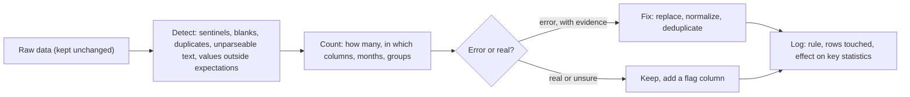
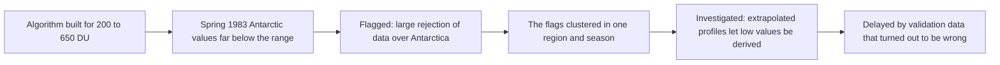

# Module 06: Data Cleaning: Missingness, Duplicates, Strings, Dates, and Outliers

> **Prerequisites:** [Module 05: Pandas Wrangling: groupby, merge, pivot, Reshaping, and Windows](../05-pandas-groupby-merge-pivot-and-windows/README.md).  
> **Estimated Reading Time:** 40 minutes  
> **Target Audience:** Engineers who prepare raw tables for analysis or model training and must decide what to fix, what to flag and what to leave alone

> [!TIP]
> **The Golden Rule of Cleaning:** **Flag, count and look before you change anything.** Every rule that drops, fills or rewrites values should report how many values it touched and where; a rule whose changes cluster in one month, one region or one segment has probably found a real effect, not an error. Keep the raw data, make each cleaning step a function you can rerun, and record what was filled.

---

## Why This Matters

Cleaning decides which data your analysis sees. Missing values written as -999 or "unknown" pass every `isna()` check; filling blanks with the mean hides the fact that the people who left them blank were different; two rows for the same customer differ only by a space or an accent; "03/04/2026" is March in one country and April in another; and an outlier rule tuned on normal weeks deletes the one week that mattered. Section 3 is a documented case where valid but unexpected measurements were rejected by a processing range, and how the scientists noticed.

---

## 1. Architectural Mental Model: Detect, Decide, Record



### Missing Values

Missingness has a mechanism, and the right treatment depends on it:

| Mechanism | Meaning | Dropping or mean-filling |
| :--- | :--- | :--- |
| Missing completely at random | Blanks unrelated to anything | Loses information but does not bias means |
| Missing at random | Blanks depend on other observed columns | Biased unless you condition on those columns |
| Missing not at random | Blanks depend on the missing value itself (high earners skip the income question) | Biased; no filling rule fixes it without outside information |

You usually cannot prove which one you have, so compare rows with and without blanks on the columns you do have, keep a `was_missing` flag, and say in the results what was filled.

### Duplicates and Text

Two values that a person reads as the same can differ as strings: case, leading or trailing spaces, and **Unicode forms** ("ã" as one code point or as "a" plus a combining tilde). Normalize to a **key** (NFC, strip, casefold) and deduplicate on the key, keeping the original text.

### Dates

A date in text has no meaning until you say its **format**. Parse with an explicit `format=`, count what failed (`errors="coerce"` turns failures into `NaT`, which you must count), and store times in **UTC**: local clock times can be **nonexistent** (skipped at the spring clock change) or **ambiguous** (repeated in autumn).

### Outliers

An outlier rule is a hypothesis that some values are errors. Robust rules use the median and the median absolute deviation (MAD), which a few extreme values cannot drag around; the z-score uses the mean and standard deviation, which the outliers themselves inflate. Prefer **flagging** to deleting, look at what was flagged, and compare flags across groups and time.

---

## 2. Systematic Reference and Comparison Grids

### pandas Tools

| Task | Tool |
| :--- | :--- |
| Sentinels to missing | `s.mask(s.isin([-999, "unknown"]))` or `read_csv(na_values=...)` |
| Count missing | `df.isna().sum()`, `df.isna().mean()` |
| Keep evidence | `df["x_was_missing"] = df["x"].isna()` |
| Text keys | `s.map(lambda t: unicodedata.normalize("NFC", t).strip().casefold())` |
| Duplicates | `df.duplicated(subset)`, `df.drop_duplicates(subset, keep=...)` after sorting |
| Dates | `pd.to_datetime(s, format="%d/%m/%Y", errors="coerce")` |
| Time zones | `dt.tz_localize(zone, nonexistent=..., ambiguous=...)`, then `dt.tz_convert("UTC")` |
| Clip extremes | `s.clip(lower, upper)` with quantiles |

### Outlier Rules

| Rule | Flags | Weakness |
| :--- | :--- | :--- |
| Fixed range | Values outside limits set in advance | Rejects real values outside what was expected |
| z-score, $\lvert x - \bar{x} \rvert / s > 3$ | Far from the mean in standard deviations | The outliers inflate $s$; assumes a symmetric distribution |
| IQR, outside $[Q_1 - 1.5\,\mathrm{IQR},\ Q_3 + 1.5\,\mathrm{IQR}]$ | Far outside the middle half | Flags many valid values in skewed data |
| Robust z, $\lvert x - \tilde{x} \rvert / (1.4826\,\mathrm{MAD}) > 3.5$ | Far from the median in robust units | Still assumes one population per group |
| Clip (winsorize) | Nothing is removed; extremes are capped | Changes values; hides how many were extreme |

---

## 3. Real Case Study: The Ozone Values Outside the Expected Range

This case is described by two of the NASA scientists involved, Pawan K. Bhartia and Richard D. McPeters, in "The discovery of the Antarctic Ozone Hole", *Comptes Rendus Géoscience* 350(7):335 to 340 (2018). It is often retold as "NASA's software threw the low values away"; the authors' own account is more useful.

| What Bhartia and McPeters report | Detail |
| :--- | :--- |
| The processing range | "The circa 1984 SBUV and TOMS algorithms (Klenk et al., 1982) used 21 standard profiles"; "the total column ozone in these profiles varied from 200 to 650 DU" |
| The flagging | "Since any data far outside this range could not be processed reliably they were flagged" |
| What they saw | A "large rejection of data over Antarctica when September/October 1983 SBUV and TOMS data were processed" |
| How it was handled | "The problem was found within hours and analyzed within days"; it was "temporally solved by allowing the algorithm to derive low ozone values using profiles created by linearly extrapolating profiles" |
| Why reporting took longer | "Spring 1983 satellite data were not processed at NASA GSFC until June 1984", and a lack of validation data delayed the report; the values a ground station reported "were about a factor of two larger than satellite values", and "It turns out that the Dobson measures were incorrect, presumably caused by operator error" |
| Timeline | "An abstract reporting the results was submitted to the upcoming IAGA/IAMAP Symposium in December 1984"; the ground-based paper by Farman, Gardiner and Shanklin in *Nature* (1985) reported the losses, and the satellite maps confirmed them |



### What to Take From It

1. **A range check encodes what you expected, not what is possible.** Flagging values the algorithm could not process reliably was correct; treating the flags as errors without looking would have been wrong.
2. **Count the flags where they occur.** A rejection rate that jumps in one place and season is a signal. The program below shows how a fixed range concentrates its rejections in exactly the months that differ.
3. **Reference data can be wrong too.** The validation measurements disagreed with the satellite by a factor of two, and the error was in the reference. Check both sides of a comparison.

---

## 4. Three Outlier Rules, in Four Languages (`carousel`)

The program does **not** use real measurements. It simulates a year of total-ozone readings (200 per month, in Dobson units) where September to November are much lower than the rest, then applies three rules: drop values outside the 200 to 650 DU processing range from the case study, drop values with $\lvert z \rvert > 3$ computed over the whole year, and flag values with a robust z-score above 3.5 computed within each month. Random numbers come from a small fixed generator so that all four languages produce the same readings.

````carousel
```python
"""Outlier rules on simulated readings (not real measurements): a year of daily-style total-ozone values in Dobson units, where
September to November are much lower than the rest. The processing range 200 to 650 DU is the one Bhartia and McPeters (2018)
describe for the 1984 satellite algorithms. The program compares three rules: drop what is outside a fixed range, drop
|z| > 3 over all the data, and flag by a robust z-score within each month. It counts what each rule removes, month by month."""

import math

MONTHS = ["Jan", "Feb", "Mar", "Apr", "May", "Jun", "Jul", "Aug", "Sep", "Oct", "Nov", "Dec"]
MONTH_MEANS = [290, 285, 280, 275, 270, 265, 260, 240, 190, 160, 210, 280]  # simulated: a deep low from September to November
SPREAD = 25.0
READINGS_PER_MONTH = 200
VALID_RANGE = (200.0, 650.0)
Z_LIMIT = 3.0
ROBUST_LIMIT = 3.5
MAD_TO_SD = 1.4826  # scales the median absolute deviation to a standard deviation for normal data

state = 2026


def uniform():
    """Linear congruential generator, so every language draws the same numbers."""
    global state
    state = (state * 1664525 + 1013904223) % 4294967296
    return state / 4294967296


def normal():
    """Sum of 12 uniforms minus 6: close to a standard normal, and identical in every language."""
    total = 0.0
    for _ in range(12):
        total += uniform()
    return total - 6.0


def mean(values):
    total = 0.0
    for v in values:
        total += v
    return total / len(values)


def std(values):
    m = mean(values)
    total = 0.0
    for v in values:
        total += (v - m) * (v - m)
    return math.sqrt(total / len(values))


def median(values):
    s = sorted(values)
    mid = len(s) // 2
    return s[mid] if len(s) % 2 == 1 else (s[mid - 1] + s[mid]) / 2


readings = [[m + SPREAD * normal() for _ in range(READINGS_PER_MONTH)] for m in MONTH_MEANS]
everything = [v for month in readings for v in month]
overall_mean, overall_sd = mean(everything), std(everything)

print(f"{len(everything)} simulated readings; overall mean {overall_mean:.1f} DU, standard deviation {overall_sd:.1f} DU")
print(f"{'month':>5} {'mean, all':>10} {'outside 200-650':>16} {'|z| > 3':>8} {'robust flag':>12} {'mean after range drop':>22}")
removed_range = removed_z = flagged_robust = 0
for name, month in zip(MONTHS, readings):
    lo, hi = VALID_RANGE
    kept = [v for v in month if lo <= v <= hi]
    out_range = len(month) - len(kept)
    out_z = sum(1 for v in month if abs(v - overall_mean) / overall_sd > Z_LIMIT)
    med = median(month)
    mad = median([abs(v - med) for v in month])
    robust = sum(1 for v in month if abs(v - med) / (MAD_TO_SD * mad) > ROBUST_LIMIT)
    removed_range, removed_z, flagged_robust = removed_range + out_range, removed_z + out_z, flagged_robust + robust
    print(f"{name:>5} {mean(month):10.1f} {out_range:16d} {out_z:8d} {robust:12d} {mean(kept):22.1f}")
print(f"total {'':>10} {removed_range:16d} {removed_z:8d} {flagged_robust:12d}")
oct_all = mean(readings[9])
oct_kept = mean([v for v in readings[9] if VALID_RANGE[0] <= v <= VALID_RANGE[1]])
print(f"October: mean of all readings {oct_all:.1f} DU; after dropping values outside the range {oct_kept:.1f} DU "
      f"({oct_kept - oct_all:+.1f} DU, from {sum(1 for v in readings[9] if v >= VALID_RANGE[0])} of {READINGS_PER_MONTH} readings)")
```

<!-- slide -->

```typescript
// Outlier rules on simulated readings (not real measurements): a year of daily-style total-ozone values in Dobson units, where
// September to November are much lower than the rest. The processing range 200 to 650 DU is the one Bhartia and McPeters (2018)
// describe for the 1984 satellite algorithms. The program compares three rules: drop what is outside a fixed range, drop
// |z| > 3 over all the data, and flag by a robust z-score within each month. It counts what each rule removes, month by month.

const MONTHS = ["Jan", "Feb", "Mar", "Apr", "May", "Jun", "Jul", "Aug", "Sep", "Oct", "Nov", "Dec"];
const MONTH_MEANS = [290, 285, 280, 275, 270, 265, 260, 240, 190, 160, 210, 280]; // simulated: a deep low from September to November
const SPREAD = 25.0;
const READINGS_PER_MONTH = 200;
const VALID_RANGE: [number, number] = [200.0, 650.0];
const Z_LIMIT = 3.0;
const ROBUST_LIMIT = 3.5;
const MAD_TO_SD = 1.4826; // scales the median absolute deviation to a standard deviation for normal data

let state = 2026;

// Linear congruential generator, so every language draws the same numbers.
function uniform(): number {
  state = Number((BigInt(state) * 1664525n + 1013904223n) % 4294967296n);
  return state / 4294967296;
}

// Sum of 12 uniforms minus 6: close to a standard normal, and identical in every language.
function normal(): number {
  let total = 0.0;
  for (let i = 0; i < 12; i++) total += uniform();
  return total - 6.0;
}

function mean(values: number[]): number {
  let total = 0.0;
  for (const v of values) total += v;
  return total / values.length;
}

function std(values: number[]): number {
  const m = mean(values);
  let total = 0.0;
  for (const v of values) total += (v - m) * (v - m);
  return Math.sqrt(total / values.length);
}

function median(values: number[]): number {
  const s = [...values].sort((a, b) => a - b);
  const mid = Math.floor(s.length / 2);
  return s.length % 2 === 1 ? s[mid] : (s[mid - 1] + s[mid]) / 2;
}

const f1 = (x: number, width: number) => x.toFixed(1).padStart(width);
const d = (x: number, width: number) => String(x).padStart(width);

const readings = MONTH_MEANS.map((m) => Array.from({ length: READINGS_PER_MONTH }, () => m + SPREAD * normal()));
const everything = readings.flat();
const overallMean = mean(everything);
const overallSd = std(everything);
const [lo, hi] = VALID_RANGE;

console.log(`${everything.length} simulated readings; overall mean ${overallMean.toFixed(1)} DU, standard deviation ${overallSd.toFixed(1)} DU`);
console.log(`${"month".padStart(5)} ${"mean, all".padStart(10)} ${"outside 200-650".padStart(16)} ${"|z| > 3".padStart(8)} ${"robust flag".padStart(12)} ${"mean after range drop".padStart(22)}`);
let removedRange = 0;
let removedZ = 0;
let flaggedRobust = 0;
readings.forEach((month, i) => {
  const kept = month.filter((v) => lo <= v && v <= hi);
  const outRange = month.length - kept.length;
  const outZ = month.filter((v) => Math.abs(v - overallMean) / overallSd > Z_LIMIT).length;
  const med = median(month);
  const mad = median(month.map((v) => Math.abs(v - med)));
  const robust = month.filter((v) => Math.abs(v - med) / (MAD_TO_SD * mad) > ROBUST_LIMIT).length;
  removedRange += outRange;
  removedZ += outZ;
  flaggedRobust += robust;
  console.log(`${MONTHS[i].padStart(5)} ${f1(mean(month), 10)} ${d(outRange, 16)} ${d(outZ, 8)} ${d(robust, 12)} ${f1(mean(kept), 22)}`);
});
console.log(`total ${"".padStart(10)} ${d(removedRange, 16)} ${d(removedZ, 8)} ${d(flaggedRobust, 12)}`);
const octAll = mean(readings[9]);
const octKept = mean(readings[9].filter((v) => lo <= v && v <= hi));
const change = octKept - octAll;
console.log(
  `October: mean of all readings ${octAll.toFixed(1)} DU; after dropping values outside the range ${octKept.toFixed(1)} DU ` +
    `(${change >= 0 ? "+" : ""}${change.toFixed(1)} DU, from ${readings[9].filter((v) => v >= lo).length} of ${READINGS_PER_MONTH} readings)`,
);
```

<!-- slide -->

```go
// Outlier rules on simulated readings (not real measurements): a year of daily-style total-ozone values in Dobson units, where
// September to November are much lower than the rest. The processing range 200 to 650 DU is the one Bhartia and McPeters (2018)
// describe for the 1984 satellite algorithms. The program compares three rules: drop what is outside a fixed range, drop
// |z| > 3 over all the data, and flag by a robust z-score within each month. It counts what each rule removes, month by month.
package main

import (
	"fmt"
	"math"
	"sort"
)

var months = []string{"Jan", "Feb", "Mar", "Apr", "May", "Jun", "Jul", "Aug", "Sep", "Oct", "Nov", "Dec"}
var monthMeans = []float64{290, 285, 280, 275, 270, 265, 260, 240, 190, 160, 210, 280} // simulated: a deep low from September to November

const (
	spread           = 25.0
	readingsPerMonth = 200
	validLow         = 200.0
	validHigh        = 650.0
	zLimit           = 3.0
	robustLimit      = 3.5
	madToSD          = 1.4826 // scales the median absolute deviation to a standard deviation for normal data
)

var state uint64 = 2026

// uniform is a linear congruential generator, so every language draws the same numbers.
func uniform() float64 {
	state = (state*1664525 + 1013904223) % 4294967296
	return float64(state) / 4294967296
}

// normal sums 12 uniforms minus 6: close to a standard normal, and identical in every language.
func normal() float64 {
	total := 0.0
	for i := 0; i < 12; i++ {
		total += uniform()
	}
	return total - 6.0
}

func mean(values []float64) float64 {
	total := 0.0
	for _, v := range values {
		total += v
	}
	return total / float64(len(values))
}

func std(values []float64) float64 {
	m := mean(values)
	total := 0.0
	for _, v := range values {
		total += (v - m) * (v - m)
	}
	return math.Sqrt(total / float64(len(values)))
}

func median(values []float64) float64 {
	s := append([]float64{}, values...)
	sort.Float64s(s)
	mid := len(s) / 2
	if len(s)%2 == 1 {
		return s[mid]
	}
	return (s[mid-1] + s[mid]) / 2
}

func count(values []float64, keep func(float64) bool) int {
	n := 0
	for _, v := range values {
		if keep(v) {
			n++
		}
	}
	return n
}

func inRange(v float64) bool { return validLow <= v && v <= validHigh }

func filter(values []float64, keep func(float64) bool) []float64 {
	var out []float64
	for _, v := range values {
		if keep(v) {
			out = append(out, v)
		}
	}
	return out
}

func main() {
	readings := make([][]float64, len(monthMeans))
	var everything []float64
	for i, m := range monthMeans {
		for j := 0; j < readingsPerMonth; j++ {
			readings[i] = append(readings[i], m+spread*normal())
		}
		everything = append(everything, readings[i]...)
	}
	overallMean, overallSD := mean(everything), std(everything)

	fmt.Printf("%d simulated readings; overall mean %.1f DU, standard deviation %.1f DU\n", len(everything), overallMean, overallSD)
	fmt.Printf("%5s %10s %16s %8s %12s %22s\n", "month", "mean, all", "outside 200-650", "|z| > 3", "robust flag", "mean after range drop")
	removedRange, removedZ, flaggedRobust := 0, 0, 0
	for i, month := range readings {
		kept := filter(month, inRange)
		outRange := len(month) - len(kept)
		outZ := count(month, func(v float64) bool { return math.Abs(v-overallMean)/overallSD > zLimit })
		med := median(month)
		deviations := make([]float64, len(month))
		for k, v := range month {
			deviations[k] = math.Abs(v - med)
		}
		mad := median(deviations)
		robust := count(month, func(v float64) bool { return math.Abs(v-med)/(madToSD*mad) > robustLimit })
		removedRange, removedZ, flaggedRobust = removedRange+outRange, removedZ+outZ, flaggedRobust+robust
		fmt.Printf("%5s %10.1f %16d %8d %12d %22.1f\n", months[i], mean(month), outRange, outZ, robust, mean(kept))
	}
	fmt.Printf("total %10s %16d %8d %12d\n", "", removedRange, removedZ, flaggedRobust)
	octAll := mean(readings[9])
	octKept := mean(filter(readings[9], inRange))
	fmt.Printf("October: mean of all readings %.1f DU; after dropping values outside the range %.1f DU (%+.1f DU, from %d of %d readings)\n",
		octAll, octKept, octKept-octAll, count(readings[9], func(v float64) bool { return v >= validLow }), readingsPerMonth)
}
```

<!-- slide -->

```csharp
// Outlier rules on simulated readings (not real measurements): a year of daily-style total-ozone values in Dobson units, where
// September to November are much lower than the rest. The processing range 200 to 650 DU is the one Bhartia and McPeters (2018)
// describe for the 1984 satellite algorithms. The program compares three rules: drop what is outside a fixed range, drop
// |z| > 3 over all the data, and flag by a robust z-score within each month. It counts what each rule removes, month by month.
using System;
using System.Globalization;
using System.Linq;

CultureInfo.CurrentCulture = CultureInfo.InvariantCulture;

string[] months = { "Jan", "Feb", "Mar", "Apr", "May", "Jun", "Jul", "Aug", "Sep", "Oct", "Nov", "Dec" };
double[] monthMeans = { 290, 285, 280, 275, 270, 265, 260, 240, 190, 160, 210, 280 }; // simulated: a deep low from September to November
const double Spread = 25.0;
const int ReadingsPerMonth = 200;
const double ValidLow = 200.0, ValidHigh = 650.0;
const double ZLimit = 3.0;
const double RobustLimit = 3.5;
const double MadToSd = 1.4826; // scales the median absolute deviation to a standard deviation for normal data

ulong state = 2026;

// Linear congruential generator, so every language draws the same numbers.
double Uniform()
{
    state = (state * 1664525 + 1013904223) % 4294967296;
    return state / 4294967296.0;
}

// Sum of 12 uniforms minus 6: close to a standard normal, and identical in every language.
double Normal()
{
    double total = 0.0;
    for (int i = 0; i < 12; i++) total += Uniform();
    return total - 6.0;
}

double Mean(double[] values)
{
    double total = 0.0;
    foreach (double v in values) total += v;
    return total / values.Length;
}

double Std(double[] values)
{
    double m = Mean(values), total = 0.0;
    foreach (double v in values) total += (v - m) * (v - m);
    return Math.Sqrt(total / values.Length);
}

double Median(double[] values)
{
    double[] s = values.OrderBy(v => v).ToArray();
    int mid = s.Length / 2;
    return s.Length % 2 == 1 ? s[mid] : (s[mid - 1] + s[mid]) / 2;
}

bool InRange(double v) => ValidLow <= v && v <= ValidHigh;

double[][] readings = monthMeans.Select(m => Enumerable.Range(0, ReadingsPerMonth).Select(_ => m + Spread * Normal()).ToArray()).ToArray();
double[] everything = readings.SelectMany(month => month).ToArray();
double overallMean = Mean(everything), overallSd = Std(everything);

Console.WriteLine($"{everything.Length} simulated readings; overall mean {overallMean:F1} DU, standard deviation {overallSd:F1} DU");
Console.WriteLine($"{"month",5} {"mean, all",10} {"outside 200-650",16} {"|z| > 3",8} {"robust flag",12} {"mean after range drop",22}");
int removedRange = 0, removedZ = 0, flaggedRobust = 0;
for (int i = 0; i < readings.Length; i++)
{
    double[] month = readings[i];
    double[] kept = month.Where(InRange).ToArray();
    int outRange = month.Length - kept.Length;
    int outZ = month.Count(v => Math.Abs(v - overallMean) / overallSd > ZLimit);
    double med = Median(month);
    double mad = Median(month.Select(v => Math.Abs(v - med)).ToArray());
    int robust = month.Count(v => Math.Abs(v - med) / (MadToSd * mad) > RobustLimit);
    removedRange += outRange;
    removedZ += outZ;
    flaggedRobust += robust;
    Console.WriteLine($"{months[i],5} {Mean(month),10:F1} {outRange,16} {outZ,8} {robust,12} {Mean(kept),22:F1}");
}
Console.WriteLine($"total {"",10} {removedRange,16} {removedZ,8} {flaggedRobust,12}");
double octAll = Mean(readings[9]);
double octKept = Mean(readings[9].Where(InRange).ToArray());
Console.WriteLine($"October: mean of all readings {octAll:F1} DU; after dropping values outside the range {octKept:F1} DU " +
    $"({(octKept - octAll).ToString("+0.0;-0.0")} DU, from {readings[9].Count(v => v >= ValidLow)} of {ReadingsPerMonth} readings)");
```
````

**Observed output (identical in Python 3.13.14, Node 24, Go 1.22 and .NET 10):**

```text
2400 simulated readings; overall mean 250.8 DU, standard deviation 47.7 DU
month  mean, all  outside 200-650  |z| > 3  robust flag  mean after range drop
  Jan      287.8                0        0            0                  287.8
  Feb      284.1                0        0            0                  284.1
  Mar      281.4                0        0            0                  281.4
  Apr      275.3                1        0            0                  275.7
  May      272.1                1        0            1                  272.5
  Jun      266.5                0        0            0                  266.5
  Jul      262.0                4        0            1                  263.4
  Aug      240.6               10        0            3                  243.2
  Sep      188.3              139        0            0                  217.3
  Oct      160.5              188        2            0                  207.0
  Nov      209.0               66        0            0                  223.0
  Dec      281.9                0        0            0                  281.9
total                         409        2            5
October: mean of all readings 160.5 DU; after dropping values outside the range 207.0 DU (+46.5 DU, from 12 of 200 readings)
```

What to notice:

- **The fixed range removed 409 readings, 393 of them from September to November**, and 188 of the 200 October readings. October's mean rose from 160.5 to 207.0 DU on the 12 readings left: the cleaned data says the opposite of the raw data.
- **The global z-score flagged only 2 readings.** The low months widen the standard deviation (47.7 DU), so almost nothing is more than three of them from the mean.
- **The robust rule within each month flagged 5**, none in the low months: it looks for readings unusual for their own month, which is a question about errors rather than about the season.
- **The per-month counts are the finding.** A cleaning step that prints only "409 values removed" hides where they came from.

---

## 5. Practical Hands-On Verification Workflows (Python 3.13 + pandas 3.1.1)

### Workflow 1: Missing Values

```python
"""Missing values: find the ones written as ordinary values, see why dropping or mean-filling biases results when missingness
depends on the value itself, and keep a record of what was filled."""
import numpy as np
import pandas as pd

rng = np.random.default_rng(11)
N = 10_000

print("== 1. missing values that do not look missing ==")
survey = pd.DataFrame({
    "age": [34, -1, 51, 29, 0, 45],
    "income": [52_000, 61_000, -999, 48_000, 75_000, -999],
    "city": ["Pune", "unknown", "Lima", "", "Oslo", "N/A"],
})
print("  isna() per column before:", survey.isna().sum().to_dict())
SENTINELS = {"age": [-1, 0], "income": [-999], "city": ["unknown", "", "N/A"]}
clean = survey.copy()
for column, markers in SENTINELS.items():
    clean[column] = clean[column].mask(clean[column].isin(markers))
print("  isna() per column after replacing the sentinels:", clean.isna().sum().to_dict())
print(f"  mean income with the sentinels: {survey['income'].mean():,.0f}; without: {clean['income'].mean():,.0f}")

print("\n== 2. when high incomes are the ones left blank ==")
income = rng.lognormal(mean=10.8, sigma=0.5, size=N)
p_missing = np.where(income > np.quantile(income, 0.8), 0.6, 0.1)  # the top fifth answers far less often
observed = pd.Series(np.where(rng.random(N) < p_missing, np.nan, income))
print(f"  missing: {observed.isna().mean():.1%}")
print(f"  true mean income:            {income.mean():10,.0f}")
print(f"  mean of the answers given:   {observed.mean():10,.0f}   (dropping the blanks)")
filled = observed.fillna(observed.mean())
print(f"  mean after filling the mean: {filled.mean():10,.0f}   (the same bias)")
print(f"  standard deviation: true {pd.Series(income).std():,.0f}; after mean-filling {filled.std():,.0f} (filling shrinks the spread)")

print("\n== 3. fill, but keep the evidence ==")
frame = pd.DataFrame({"income": observed})
frame["income_was_missing"] = frame["income"].isna()
frame["income_filled"] = frame["income"].fillna(frame["income"].median())
print(frame.head(6).round(0).to_string())
print("  the indicator column lets a model learn that a blank itself carries information")
```

**Observed Output:**

```text
== 1. missing values that do not look missing ==
  isna() per column before: {'age': 0, 'income': 0, 'city': 0}
  isna() per column after replacing the sentinels: {'age': 2, 'income': 2, 'city': 3}
  mean income with the sentinels: 39,000; without: 59,000

== 2. when high incomes are the ones left blank ==
  missing: 19.8%
  true mean income:                55,932
  mean of the answers given:       50,153   (dropping the blanks)
  mean after filling the mean:     50,153   (the same bias)
  standard deviation: true 29,768; after mean-filling 22,065 (filling shrinks the spread)

== 3. fill, but keep the evidence ==
    income  income_was_missing  income_filled
0  49866.0               False        49866.0
1      NaN                True        46260.0
2      NaN                True        46260.0
3  37981.0               False        37981.0
4  42235.0               False        42235.0
5  37658.0               False        37658.0
  the indicator column lets a model learn that a blank itself carries information
```

- **Sentinels:** `isna()` found nothing until -1, 0, -999, "unknown", "" and "N/A" were replaced; the mean income went from 39,000 (with two -999s) to 59,000.
- **Missing not at random:** with the top fifth of incomes left blank 60% of the time, dropping the blanks gave a mean of 50,153 against a true 55,932. Mean-filling gave the same biased mean and shrank the standard deviation from 29,768 to 22,065.
- **The indicator column** keeps the fact that a value was missing, which a model can use.

### Workflow 2: Duplicates and Text

```python
"""Duplicates and text: rows that are the same customer but not the same string, and the normalization that makes them equal."""
import unicodedata

import pandas as pd

customers = pd.DataFrame({
    "email": ["ana@example.com", "Ana@Example.com ", "ben@example.com", "chen@example.com", "chen@example.com", "zoe@example.com",
              "zoe@example.com"],
    "city": ["Pune", "pune", "São Paulo", "São Paulo", "São Paulo", "Zürich", "Zurich"],
    "signed_up": ["2026-01-05", "2026-02-10", "2026-01-07", "2026-01-09", "2026-01-09", "2026-03-01", "2026-03-02"],
})
print(customers.to_string())

print("\n== 1. exact duplicates ==")
print("  fully identical rows:", int(customers.duplicated().sum()))
print("  rows with an email seen before:", int(customers.duplicated("email").sum()))

print("\n== 2. normalize, then compare ==")
def normalize(text):
    return unicodedata.normalize("NFC", text).strip().casefold()

print("  'São Paulo' written two ways is equal as text:", customers.loc[2, "city"] == customers.loc[3, "city"],
      "; lengths", len(customers.loc[2, "city"]), "and", len(customers.loc[3, "city"]))
customers["email_key"] = customers["email"].map(normalize)
customers["city_key"] = customers["city"].map(normalize)
print("  after NFC + strip + casefold: equal:", customers.loc[2, "city_key"] == customers.loc[3, "city_key"])
print("  distinct cities before:", customers["city"].nunique(), " after:", customers["city_key"].nunique(),
      " (Zürich and Zurich stay different: removing accents is a separate, lossy choice)")
print("  rows with an email seen before, after normalizing:", int(customers.duplicated("email_key").sum()))

print("\n== 3. keep one row per customer, deliberately ==")
latest = (customers.sort_values("signed_up")
          .drop_duplicates("email_key", keep="first")[["email_key", "city", "signed_up"]])
print(latest.to_string(index=False))
print(f"  {len(customers)} rows -> {len(latest)} customers; the earliest sign-up date is kept for each")
```

**Observed Output:**

```text
              email        city   signed_up
0   ana@example.com        Pune  2026-01-05
1  Ana@Example.com         pune  2026-02-10
2   ben@example.com   São Paulo  2026-01-07
3  chen@example.com  São Paulo  2026-01-09
4  chen@example.com   São Paulo  2026-01-09
5   zoe@example.com      Zürich  2026-03-01
6   zoe@example.com      Zurich  2026-03-02

== 1. exact duplicates ==
  fully identical rows: 0
  rows with an email seen before: 2

== 2. normalize, then compare ==
  'São Paulo' written two ways is equal as text: False ; lengths 9 and 10
  after NFC + strip + casefold: equal: True
  distinct cities before: 6  after: 4  (Zürich and Zurich stay different: removing accents is a separate, lossy choice)
  rows with an email seen before, after normalizing: 3

== 3. keep one row per customer, deliberately ==
       email_key       city  signed_up
 ana@example.com       Pune 2026-01-05
 ben@example.com  São Paulo 2026-01-07
chen@example.com São Paulo 2026-01-09
 zoe@example.com     Zürich 2026-03-01
  7 rows -> 4 customers; the earliest sign-up date is kept for each
```

- **Rows 3 and 4 look identical but are not:** one "São Paulo" is 9 code points and the other 10 (an "a" plus a combining tilde), so `duplicated()` found no identical rows.
- **NFC, strip and casefold** made the keys equal: distinct cities went from 6 to 4 and duplicate emails from 2 to 3. Zürich and Zurich stayed different: removing accents is a separate decision that can merge different names.
- **Sorting before `drop_duplicates`** decides which row survives; here the earliest sign-up for each of the 4 customers.

### Workflow 3: Dates, Time Zones and Outliers

```python
"""Dates that parse to the wrong day, local times that do not exist, and three ways to treat outliers in a skewed column."""
import numpy as np
import pandas as pd

print("== 1. the same text, two dates ==")
raw = pd.Series(["03/04/2026", "12/04/2026", "13/04/2026", "2026-04-14", "yesterday"])
print("  month first, errors='coerce':", pd.to_datetime(raw, format="%m/%d/%Y", errors="coerce").dt.strftime("%d %b").tolist())
print("  day first,   errors='coerce':", pd.to_datetime(raw, format="%d/%m/%Y", errors="coerce").dt.strftime("%d %b").tolist())
mixed = pd.to_datetime(raw, format="mixed", dayfirst=True, errors="coerce")
print("  format='mixed', dayfirst=True:", mixed.dt.strftime("%d %b").tolist())
print("  unparsed values:", int(mixed.isna().sum()), "-> count them; never let them pass silently")

print("\n== 2. local times around a clock change ==")
local = pd.Series(pd.to_datetime(["2026-03-29 01:30", "2026-03-29 02:30", "2026-10-25 02:30"]))
for option in ("raise", "NaT"):
    try:
        print(f"  nonexistent='{option}', ambiguous='NaT':",
              local.dt.tz_localize("Europe/Berlin", nonexistent=option, ambiguous="NaT").astype(str).tolist())
    except Exception as err:
        print(f"  nonexistent='{option}':", type(err).__name__, "-", err)
print("  02:30 on 29 March does not exist in Berlin; 02:30 on 25 October happens twice. Store UTC, convert for display.")

print("\n== 3. outliers in a skewed column ==")
rng = np.random.default_rng(5)
spend = pd.Series(np.concatenate([rng.lognormal(3.5, 0.6, 990), [5_000.0, 7_500.0, 12_000.0] + [0.0] * 7]))
q1, q3 = spend.quantile([0.25, 0.75])
iqr = q3 - q1
iqr_out = (spend < q1 - 1.5 * iqr) | (spend > q3 + 1.5 * iqr)
med = spend.median()
mad = (spend - med).abs().median()
robust_out = (spend - med).abs() / (1.4826 * mad) > 3.5
clipped = spend.clip(upper=spend.quantile(0.99))
print(f"  {len(spend)} values; mean {spend.mean():.2f}, median {med:.2f}")
print(f"  IQR rule flags {int(iqr_out.sum())}; robust z > 3.5 flags {int(robust_out.sum())}")
zeros = spend == 0
print(f"  of the 7 zeros, the IQR rule flags {int((iqr_out & zeros).sum())} and the robust rule {int((robust_out & zeros).sum())} "
      f"(lower IQR fence {q1 - 1.5 * iqr:.2f})")
print(f"  mean after dropping the IQR flags: {spend[~iqr_out].mean():.2f}; after clipping at the 99th percentile: {clipped.mean():.2f}")
print(f"  log scale: mean of log(1 + spend) {np.log1p(spend).mean():.3f}; the 7 zeros and 3 large values stay in the data")
print("  the three huge values and the zeros may be errors or real customers: look at them before choosing")
```

**Observed Output:**

```text
== 1. the same text, two dates ==
  month first, errors='coerce': ['04 Mar', '04 Dec', nan, nan, nan]
  day first,   errors='coerce': ['03 Apr', '12 Apr', '13 Apr', nan, nan]
  format='mixed', dayfirst=True: ['03 Apr', '12 Apr', '13 Apr', '14 Apr', nan]
  unparsed values: 1 -> count them; never let them pass silently

== 2. local times around a clock change ==
  nonexistent='raise': ValueError - 2026-03-29 02:30:00 is a nonexistent time due to daylight savings time. Try using the 'nonexistent' argument.
  nonexistent='NaT', ambiguous='NaT': ['2026-03-29 01:30:00+01:00', nan, nan]
  02:30 on 29 March does not exist in Berlin; 02:30 on 25 October happens twice. Store UTC, convert for display.

== 3. outliers in a skewed column ==
  1000 values; mean 63.72, median 33.47
  IQR rule flags 45; robust z > 3.5 flags 31
  of the 7 zeros, the IQR rule flags 0 and the robust rule 0 (lower IQR fence -21.35)
  mean after dropping the IQR flags: 35.84; after clipping at the 99th percentile: 39.40
  log scale: mean of log(1 + spend) 3.528; the 7 zeros and 3 large values stay in the data
  the three huge values and the zeros may be errors or real customers: look at them before choosing
```

- **Formats:** "03/04/2026" is 4 March read month-first and 3 April read day-first; "13/04/2026" fails month-first. `format="mixed"` with `dayfirst=True` parsed four of five, and "yesterday" stayed `NaT`, which is why the count matters.
- **Clock changes:** 02:30 on 29 March 2026 does not exist in Berlin, and pandas raises unless told what to do; 02:30 on 25 October happens twice, so `ambiguous="NaT"` refuses to guess.
- **Skewed data:** the IQR rule flagged 45 of 1,000 spend values and the robust rule 31, most of them ordinary large spenders in a long-tailed distribution. Neither flagged the seven zeros (the lower IQR fence was negative), which may be the real errors. Dropping the IQR flags moved the mean from 63.72 to 35.84; clipping at the 99th percentile to 39.40.

---

## 6. Hands-On Exercises and Independent Challenge

### Practical Exercises

1. **Find hidden missing values.** A `temperature` column has values between -40 and 50 and a few of 999.9 and -273.15. What do you do?
2. **Choose a fill.** 30% of `days_since_last_login` is blank because those users never logged in. Fill with the mean, the median, or something else?
3. **Deduplicate names.** "Müller", "Mueller", "MÜLLER " and `"Müller"` (a "u" followed by a combining diaeresis) are in a `surname` column. Which become equal after NFC, strip and casefold, and which need a separate rule?
4. **Change the rule in the program.** Make the fixed-range rule flag instead of drop, and print the share of flagged readings per month. What threshold on that share would have alerted you?

<details><summary>Answers</summary>

1. Treat 999.9 and -273.15 as sentinels (one is a placeholder, the other absolute zero), replace them with missing, count them, and ask the data owner what they mean; do not let them into means or into an outlier rule.
2. Neither mean nor median: the blank means "never logged in", which is information. Add `never_logged_in = days.isna()` and fill the days with a value outside the normal range or leave them missing for models that accept it.
3. "MÜLLER ", "Müller" and `"Müller"` become "müller"; "Mueller" stays different (the ue spelling is a transliteration rule, not a Unicode one), so it needs an explicit, documented mapping.
4. The shares are 0 to 5% in most months and 33% (Nov), 70% (Sep) and 94% (Oct) in the low months. Any alert on a share well above the usual rate, for example more than 5% in a month, would have fired.

</details>

### Independent Challenge

A payments team cleans transaction data before training a fraud model. The pipeline drops transactions above the 99.9th percentile of amount as "data errors", fills missing merchant categories with the most common category, and deduplicates on (card, amount, timestamp). After deployment, the model misses a new fraud pattern of many identical small charges and a few very large ones. Explain how the cleaning contributed and redesign it.

<details><summary>Architectural Discussion</summary>

**Dropping the largest amounts** removed exactly the rare, extreme transactions a fraud model must learn from. Flag them, verify a sample with the payments system, and keep the real ones.

**Filling the merchant category with the mode** erased a signal: fraudsters often use merchants with incomplete records. Keep a `category_missing` flag and an explicit "unknown" category.

**Deduplicating on (card, amount, timestamp)** merged repeated identical small charges that happened within the same timestamp resolution, which is the pattern itself. Deduplicate on a transaction id from the source system; if there is none, investigate how true duplicates arise before choosing a key.

**Process.** Every rule reports how many rows it touched by day, merchant and segment; a change in those counts is monitored like any other metric; the raw data is kept so that rules can be revised and rerun.

</details>

---

## 7. Common Mistakes and Troubleshooting

- **Trusting `isna()` alone.** Look for sentinels with `value_counts()` and the minimum and maximum of each column.
- **Mean-filling by default.** It biases the mean when missingness depends on the value and always shrinks the spread; keep an indicator.
- **Deduplicating on raw text.** Normalize to a key first, and decide which row to keep.
- **Parsing dates without a format.** Pass `format=`, count `NaT`, and store UTC.
- **Deleting outliers instead of flagging them.** Count flags per group and period before removing anything.
- **Using the mean and standard deviation to find outliers.** They are distorted by the outliers; use the median and MAD.
- **Cleaning in place without a record.** Keep raw data, write cleaning as functions, log rows touched.

---

## 8. Operational Validation Checkpoints and Checkpoint Quiz

<details><summary><strong>Checkpoint 1: After a new cleaning rule, a monthly metric jumps. How do you tell an improvement from damage?</strong></summary>

Count what the rule touched per month and per segment. If the touched rows cluster where the metric changed, inspect a sample of them: the rule may be removing a real effect, as the fixed range did with the low months in the program.

</details>

<details><summary><strong>Checkpoint 2: Two tables of customers do not join although the names look the same. What do you check?</strong></summary>

Trailing spaces, case, and Unicode forms (composed versus decomposed characters); compare `len()` of values that look equal. Build normalized keys on both sides.

</details>

<details><summary><strong>Checkpoint 3: Hourly events show a missing hour every March and a doubled hour every October. Why?</strong></summary>

They are stored in local time across daylight saving changes: one hour does not exist in spring and one repeats in autumn. Store timestamps in UTC and convert for display.

</details>

### Checkpoint Quiz

1. Why does filling missing values with the mean not fix bias when missingness depends on the value?
2. What does Unicode normalization (NFC) change, and what does it not change?
3. What does `errors="coerce"` do in `pd.to_datetime`, and what must you do after using it?
4. Why is a robust z-score based on the median and MAD preferred to a z-score based on the mean and standard deviation?
5. What should an outlier step report besides the number of values it removed?

<details><summary>Answers</summary>

1. The filled values equal the mean of the observed values, which is already biased because the missing ones differ systematically; filling keeps that mean and also shrinks the variance.
2. It gives the same text the same code points (for example a composed "ã" instead of "a" plus a combining tilde); it does not change case, spaces, or spelling variants like "ue" for "ü".
3. Values that cannot be parsed become `NaT` instead of raising; count them and inspect them, or they disappear silently.
4. The median and MAD are barely moved by a few extreme values, while the mean and standard deviation are pulled by them, so the extreme values hide themselves.
5. Where the flagged values are (per group and period), what they look like (a sample), and the effect of removing them on the key statistics.

</details>

---

## 9. Interview Practice

> [!interview]
> A column has 20% missing values. Walk through how you decide what to do.

<details><summary>What a strong answer covers</summary>

- Find out why values are missing (source, process), and compare rows with and without values on other columns.
- Distinguish "unknown" from "not applicable" (never logged in) and from sentinels.
- Options: leave missing for models that handle it, fill with a group statistic plus an indicator, model-based imputation; never silently drop rows if missingness may depend on the outcome.
- Report what was done and check that results hold under another reasonable choice.

</details>

> [!interview]
> How do you design an outlier-handling step for a production pipeline?

<details><summary>What a strong answer covers</summary>

- Flag rather than drop, with robust per-group rules; keep raw values.
- Monitor the flag rate by segment and time; alert on changes.
- Review flagged samples with domain experts; separate data errors (fix at the source) from real extremes (keep, maybe transform or cap for specific models).

</details>

---

## Further Reading and Sources

- [Bhartia and McPeters, "The discovery of the Antarctic Ozone Hole", Comptes Rendus Géoscience 350(7):335 to 340 (2018)](https://comptes-rendus.academie-sciences.fr/geoscience/articles/en/10.1016/j.crte.2018.04.006/) — the source of the case study and its quotations.
- [pandas: Working with missing data](https://pandas.pydata.org/docs/user_guide/missing_data.html) — `isna`, `fillna` and the missing-value markers of each dtype.
- [pandas: `to_datetime`](https://pandas.pydata.org/docs/reference/api/pandas.to_datetime.html) — `format`, `dayfirst`, `errors`.
- [pandas: Time zone handling](https://pandas.pydata.org/docs/user_guide/timeseries.html#time-zone-handling) — `tz_localize`, `nonexistent` and `ambiguous`.
- [Python: `unicodedata.normalize`](https://docs.python.org/3/library/unicodedata.html#unicodedata.normalize) — the normalization forms NFC, NFD, NFKC and NFKD.

## Next

Continue to **[Module 07: Polars LazyFrames and DuckDB for Larger-Than-Memory Tabular Data](../07-polars-lazy-frames-and-larger-than-memory-data/README.md)**, where the same operations run on data too large for pandas.
