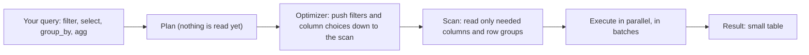
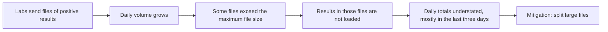

# Module 07: Polars LazyFrames and DuckDB for Larger-Than-Memory Tabular Data

> **Prerequisites:** [Module 06: Data Cleaning: Missingness, Duplicates, Strings, Dates, and Outliers](../06-data-cleaning-missing-values-and-outliers/README.md).  
> **Estimated Reading Time:** 40 minutes  
> **Target Audience:** Engineers whose tables have outgrown `pd.read_csv` on a laptop, and who need the bigger tool to give the same answer

> [!TIP]
> **The Golden Rule of Scaling Up:** Read **only the columns and rows the question needs**, let a query engine plan the work (Polars `scan_*` and `collect`, DuckDB SQL), and **reconcile** every result: rows in against rows out, totals against totals. A tool that hits a size limit should fail loudly or split the work; one that quietly keeps what fits is the most dangerous kind.

---

## Why This Matters

pandas loads a whole table into memory and then works on it, usually with several temporary copies. On ten million rows that is over a gigabyte; on a billion it is impossible. Polars' lazy API and DuckDB read files column by column, skip what the query does not need, use every core, and in DuckDB's case spill to disk when memory runs out. The speed matters less than two other things: whether the job **finishes**, and whether it gives the **same answer** as the code it replaces. Section 3 is a public-health reporting failure in which a size limit in a data pipeline left thousands of positive test results out of the daily figures.

---

## 1. Architectural Mental Model: Plan, Then Execute



### Eager versus Lazy

| | pandas (eager) | Polars `LazyFrame` | DuckDB |
| :--- | :--- | :--- | :--- |
| When work happens | At every line | At `collect()` | When the result is fetched |
| Query optimizer | No | Yes: predicate and projection pushdown, and more | Yes: a full SQL optimizer |
| Reads only needed columns | Only if you pass `columns=` | Automatically | Automatically |
| Parallel | Mostly single-threaded | All cores | All cores |
| Larger than memory | No | Streaming engine for many queries | Spills to disk for GROUP BY, JOIN, ORDER BY and windows |
| Interface | Python methods | Python expressions | SQL (and a Python relational API) |

**Predicate pushdown** moves a filter into the file scan, so row groups that cannot match are skipped using the statistics Parquet stores; **projection pushdown** reads only the columns used. Both are why the file format of Module 04 matters: a CSV must be parsed in full, a Parquet file can be read selectively.

### Reading a Plan

`LazyFrame.explain()` prints the optimized plan, from the bottom (the scan) up. In Workflow 1 the scan line says `PROJECT 4/7 COLUMNS` and `SELECTION: (col("month") == 3) & (col("status") == "paid")`: the filter runs inside the reader. DuckDB's `EXPLAIN` shows the same idea as `Filters:` on its `PARQUET_SCAN`.

### Limits and Reconciliation

Every tool has limits: memory, a maximum file or batch size, a row limit in a format. The safe behaviours, in order, are: **handle it** (split, stream, spill), **fail loudly**, and never **keep what fits silently**. Whatever the engine, compare row counts and totals between the input and the output of each step.

---

## 2. Systematic Reference and Comparison Grids

### The Same Operations in Three Tools

| Operation | pandas | Polars (lazy) | DuckDB SQL |
| :--- | :--- | :--- | :--- |
| Open a file | `pd.read_parquet(path)` | `pl.scan_parquet(path)` | `FROM 'path'` |
| Many files | Loop and `concat` | `pl.scan_parquet("dir/*.parquet")` | `FROM 'dir/*.parquet'` |
| Filter | `df[df.x > 0]` | `.filter(pl.col("x") > 0)` | `WHERE x > 0` |
| Columns | `df[["a", "b"]]` | `.select("a", "b")` | `SELECT a, b` |
| Group | `df.groupby("k")["x"].sum()` | `.group_by("k").agg(pl.col("x").sum())` | `GROUP BY k` |
| Run | (already ran) | `.collect()` (or `engine="streaming"`) | `.fetchall()`, `.df()`, `.pl()` |
| Show the plan | (none) | `.explain()` | `EXPLAIN SELECT ...` |

### Defaults That Differ

| Behaviour | pandas | Polars | DuckDB |
| :--- | :--- | :--- | :--- |
| Missing group key | Dropped unless `dropna=False` | Kept as a null group | Kept as a NULL group |
| Missing marker in floats | `NaN` | `null` (and `NaN` is a separate value) | `NULL` (and `NaN` is a separate value) |
| Row order of a group-by | Sorted by key | Not guaranteed | Not guaranteed without `ORDER BY` |
| String type | `str` | `String` (UTF-8) | `VARCHAR` |

---

## 3. Real Case Study: Results Left Out Because a File Was Too Large

| What Public Health England's statement says (published 4 October 2020, updated 5 October 2020) | Detail |
| :--- | :--- |
| How many | "15,841 cases between 25 September and 2 October were not included in the reported daily COVID-19 cases" |
| When most were missed | "over 75% (11,968) relate to cases that should have been reported between 30 September and 2 October" |
| The cause | "some files containing positive test results exceeded the maximum file size" |
| The fix | "A rapid mitigation has been put in place that splits large files" |

The statement does not name the software; press reports at the time offered different technical explanations, so this lesson relies only on the official wording.



### What to Take From It

1. **Growth turns a limit into a failure.** The limit was always there; rising volume crossed it, so the losses concentrated in the most recent days, when they also mattered most.
2. **Reconcile against the source.** The number of results each lab sent is known; comparing it with the number loaded every day turns a silent loss into an alert on the first day.
3. **Prefer tools that split, stream or fail.** Polars' streaming engine and DuckDB's spilling are designed to finish within a memory budget; where a tool has a hard limit, the pipeline must check it explicitly.

---

## 4. A Loader With a Limit, in Four Languages (`carousel`)

The program uses **simulated** counts, not the real data: three labs send one file per day for eight days, the volume grows, and the loader holds at most 1,000 rows per file. One loader keeps what fits; the other splits each file into parts of at most 1,000 rows. A reconciliation line compares rows loaded with rows sent.

````carousel
```python
"""A loader with a size limit, on simulated counts (not real data): three labs send one file of results per day, the daily
volume grows, and the loader can hold at most MAX_ROWS rows per file. Truncating at the limit loses rows without an error;
splitting each file into parts of at most MAX_ROWS loses none; reconciling the rows loaded against the rows sent catches the
first loader on the first day it goes wrong."""

LABS = ["lab A", "lab B", "lab C"]
DAYS = 8
MAX_ROWS = 1000
BASE, GROWTH, NOISE = 350, 100, 400  # simulated: rows per file = BASE + GROWTH * day + a random amount below NOISE

state = 7


def uniform():
    """Linear congruential generator, so every language draws the same numbers."""
    global state
    state = (state * 1664525 + 1013904223) % 4294967296
    return state / 4294967296


def load_truncating(rows):
    """Keeps what fits and says nothing about the rest."""
    return min(rows, MAX_ROWS), 1


def load_splitting(rows):
    """Splits the file into parts of at most MAX_ROWS rows and loads every part."""
    parts = (rows + MAX_ROWS - 1) // MAX_ROWS
    loaded = 0
    for p in range(parts):
        loaded += min(MAX_ROWS, rows - p * MAX_ROWS)
    return loaded, parts


sent = [[BASE + GROWTH * day + int(uniform() * NOISE) for _ in LABS] for day in range(DAYS)]

print(f"{'day':>3} {'sent':>6} {'loaded, truncating':>19} {'missed':>7} {'loaded, splitting':>18} {'parts':>6}  reconciliation")
total_sent = total_trunc = total_split = 0
missed_by_day = []
for day, files in enumerate(sent, start=1):
    day_sent = day_trunc = day_split = day_parts = 0
    for rows in files:
        t, _ = load_truncating(rows)
        s, parts = load_splitting(rows)
        day_sent, day_trunc, day_split, day_parts = day_sent + rows, day_trunc + t, day_split + s, day_parts + parts
    missed = day_sent - day_trunc
    missed_by_day.append(missed)
    total_sent, total_trunc, total_split = total_sent + day_sent, total_trunc + day_trunc, total_split + day_split
    check = "ok" if day_trunc == day_sent else f"ALERT: truncating loader is {missed} rows short"
    print(f"{day:>3} {day_sent:>6} {day_trunc:>19} {missed:>7} {day_split:>18} {day_parts:>6}  {check}")

total_missed = total_sent - total_trunc
last3 = sum(missed_by_day[-3:])
print(f"all {total_sent:>6} {total_trunc:>19} {total_missed:>7} {total_split:>18}")
print(f"the truncating loader lost {total_missed} of {total_sent} rows ({100 * total_missed / total_sent:.1f}%), "
      f"{last3} of them ({100 * last3 / total_missed:.1f}%) in the last 3 days, because volume grew past the limit")
```

<!-- slide -->

```typescript
// A loader with a size limit, on simulated counts (not real data): three labs send one file of results per day, the daily
// volume grows, and the loader can hold at most MAX_ROWS rows per file. Truncating at the limit loses rows without an error;
// splitting each file into parts of at most MAX_ROWS loses none; reconciling the rows loaded against the rows sent catches the
// first loader on the first day it goes wrong.

const LABS = ["lab A", "lab B", "lab C"];
const DAYS = 8;
const MAX_ROWS = 1000;
const [BASE, GROWTH, NOISE] = [350, 100, 400]; // simulated: rows per file = BASE + GROWTH * day + a random amount below NOISE

let state = 7;

// Linear congruential generator, so every language draws the same numbers.
function uniform(): number {
  state = Number((BigInt(state) * 1664525n + 1013904223n) % 4294967296n);
  return state / 4294967296;
}

// Keeps what fits and says nothing about the rest.
function loadTruncating(rows: number): [number, number] {
  return [Math.min(rows, MAX_ROWS), 1];
}

// Splits the file into parts of at most MAX_ROWS rows and loads every part.
function loadSplitting(rows: number): [number, number] {
  const parts = Math.floor((rows + MAX_ROWS - 1) / MAX_ROWS);
  let loaded = 0;
  for (let p = 0; p < parts; p++) loaded += Math.min(MAX_ROWS, rows - p * MAX_ROWS);
  return [loaded, parts];
}

const sent = Array.from({ length: DAYS }, (_, day) => LABS.map(() => BASE + GROWTH * day + Math.floor(uniform() * NOISE)));
const r = (x: number | string, width: number) => String(x).padStart(width);

console.log(`${r("day", 3)} ${r("sent", 6)} ${r("loaded, truncating", 19)} ${r("missed", 7)} ${r("loaded, splitting", 18)} ${r("parts", 6)}  reconciliation`);
let totalSent = 0;
let totalTrunc = 0;
let totalSplit = 0;
const missedByDay: number[] = [];
sent.forEach((files, i) => {
  let daySent = 0;
  let dayTrunc = 0;
  let daySplit = 0;
  let dayParts = 0;
  for (const rows of files) {
    const [t] = loadTruncating(rows);
    const [s, parts] = loadSplitting(rows);
    daySent += rows;
    dayTrunc += t;
    daySplit += s;
    dayParts += parts;
  }
  const missed = daySent - dayTrunc;
  missedByDay.push(missed);
  totalSent += daySent;
  totalTrunc += dayTrunc;
  totalSplit += daySplit;
  const check = dayTrunc === daySent ? "ok" : `ALERT: truncating loader is ${missed} rows short`;
  console.log(`${r(i + 1, 3)} ${r(daySent, 6)} ${r(dayTrunc, 19)} ${r(missed, 7)} ${r(daySplit, 18)} ${r(dayParts, 6)}  ${check}`);
});

const totalMissed = totalSent - totalTrunc;
const last3 = missedByDay.slice(-3).reduce((a, b) => a + b, 0);
console.log(`all ${r(totalSent, 6)} ${r(totalTrunc, 19)} ${r(totalMissed, 7)} ${r(totalSplit, 18)}`);
console.log(
  `the truncating loader lost ${totalMissed} of ${totalSent} rows (${((100 * totalMissed) / totalSent).toFixed(1)}%), ` +
    `${last3} of them (${((100 * last3) / totalMissed).toFixed(1)}%) in the last 3 days, because volume grew past the limit`,
);
```

<!-- slide -->

```go
// A loader with a size limit, on simulated counts (not real data): three labs send one file of results per day, the daily
// volume grows, and the loader can hold at most maxRows rows per file. Truncating at the limit loses rows without an error;
// splitting each file into parts of at most maxRows loses none; reconciling the rows loaded against the rows sent catches the
// first loader on the first day it goes wrong.
package main

import "fmt"

var labs = []string{"lab A", "lab B", "lab C"}

const (
	days    = 8
	maxRows = 1000
	base    = 350 // simulated: rows per file = base + growth * day + a random amount below noise
	growth  = 100
	noise   = 400
)

var state uint64 = 7

// uniform is a linear congruential generator, so every language draws the same numbers.
func uniform() float64 {
	state = (state*1664525 + 1013904223) % 4294967296
	return float64(state) / 4294967296
}

// loadTruncating keeps what fits and says nothing about the rest.
func loadTruncating(rows int) (int, int) {
	return min(rows, maxRows), 1
}

// loadSplitting splits the file into parts of at most maxRows rows and loads every part.
func loadSplitting(rows int) (int, int) {
	parts := (rows + maxRows - 1) / maxRows
	loaded := 0
	for p := 0; p < parts; p++ {
		loaded += min(maxRows, rows-p*maxRows)
	}
	return loaded, parts
}

func main() {
	sent := make([][]int, days)
	for day := 0; day < days; day++ {
		for range labs {
			sent[day] = append(sent[day], base+growth*day+int(uniform()*noise))
		}
	}

	fmt.Printf("%3s %6s %19s %7s %18s %6s  reconciliation\n", "day", "sent", "loaded, truncating", "missed", "loaded, splitting", "parts")
	totalSent, totalTrunc, totalSplit := 0, 0, 0
	var missedByDay []int
	for i, files := range sent {
		daySent, dayTrunc, daySplit, dayParts := 0, 0, 0, 0
		for _, rows := range files {
			t, _ := loadTruncating(rows)
			s, parts := loadSplitting(rows)
			daySent, dayTrunc, daySplit, dayParts = daySent+rows, dayTrunc+t, daySplit+s, dayParts+parts
		}
		missed := daySent - dayTrunc
		missedByDay = append(missedByDay, missed)
		totalSent, totalTrunc, totalSplit = totalSent+daySent, totalTrunc+dayTrunc, totalSplit+daySplit
		check := "ok"
		if dayTrunc != daySent {
			check = fmt.Sprintf("ALERT: truncating loader is %d rows short", missed)
		}
		fmt.Printf("%3d %6d %19d %7d %18d %6d  %s\n", i+1, daySent, dayTrunc, missed, daySplit, dayParts, check)
	}

	totalMissed := totalSent - totalTrunc
	last3 := 0
	for _, m := range missedByDay[len(missedByDay)-3:] {
		last3 += m
	}
	fmt.Printf("all %6d %19d %7d %18d\n", totalSent, totalTrunc, totalMissed, totalSplit)
	fmt.Printf("the truncating loader lost %d of %d rows (%.1f%%), %d of them (%.1f%%) in the last 3 days, because volume grew past the limit\n",
		totalMissed, totalSent, 100*float64(totalMissed)/float64(totalSent), last3, 100*float64(last3)/float64(totalMissed))
}
```

<!-- slide -->

```csharp
// A loader with a size limit, on simulated counts (not real data): three labs send one file of results per day, the daily
// volume grows, and the loader can hold at most MaxRows rows per file. Truncating at the limit loses rows without an error;
// splitting each file into parts of at most MaxRows loses none; reconciling the rows loaded against the rows sent catches the
// first loader on the first day it goes wrong.
using System;
using System.Collections.Generic;
using System.Globalization;
using System.Linq;

CultureInfo.CurrentCulture = CultureInfo.InvariantCulture;

string[] labs = { "lab A", "lab B", "lab C" };
const int Days = 8;
const int MaxRows = 1000;
const int Base = 350, Growth = 100, Noise = 400; // simulated: rows per file = Base + Growth * day + a random amount below Noise

ulong state = 7;

// Linear congruential generator, so every language draws the same numbers.
double Uniform()
{
    state = (state * 1664525 + 1013904223) % 4294967296;
    return state / 4294967296.0;
}

// Keeps what fits and says nothing about the rest.
(int Loaded, int Parts) LoadTruncating(int rows) => (Math.Min(rows, MaxRows), 1);

// Splits the file into parts of at most MaxRows rows and loads every part.
(int Loaded, int Parts) LoadSplitting(int rows)
{
    int parts = (rows + MaxRows - 1) / MaxRows, loaded = 0;
    for (int p = 0; p < parts; p++) loaded += Math.Min(MaxRows, rows - p * MaxRows);
    return (loaded, parts);
}

int[][] sent = Enumerable.Range(0, Days).Select(day => labs.Select(_ => Base + Growth * day + (int)(Uniform() * Noise)).ToArray()).ToArray();

Console.WriteLine($"{"day",3} {"sent",6} {"loaded, truncating",19} {"missed",7} {"loaded, splitting",18} {"parts",6}  reconciliation");
int totalSent = 0, totalTrunc = 0, totalSplit = 0;
var missedByDay = new List<int>();
for (int i = 0; i < sent.Length; i++)
{
    int daySent = 0, dayTrunc = 0, daySplit = 0, dayParts = 0;
    foreach (int rows in sent[i])
    {
        var t = LoadTruncating(rows);
        var s = LoadSplitting(rows);
        daySent += rows;
        dayTrunc += t.Loaded;
        daySplit += s.Loaded;
        dayParts += s.Parts;
    }
    int missed = daySent - dayTrunc;
    missedByDay.Add(missed);
    totalSent += daySent;
    totalTrunc += dayTrunc;
    totalSplit += daySplit;
    string check = dayTrunc == daySent ? "ok" : $"ALERT: truncating loader is {missed} rows short";
    Console.WriteLine($"{i + 1,3} {daySent,6} {dayTrunc,19} {missed,7} {daySplit,18} {dayParts,6}  {check}");
}

int totalMissed = totalSent - totalTrunc;
int last3 = missedByDay.Skip(missedByDay.Count - 3).Sum();
Console.WriteLine($"all {totalSent,6} {totalTrunc,19} {totalMissed,7} {totalSplit,18}");
Console.WriteLine($"the truncating loader lost {totalMissed} of {totalSent} rows ({100.0 * totalMissed / totalSent:F1}%), " +
    $"{last3} of them ({100.0 * last3 / totalMissed:F1}%) in the last 3 days, because volume grew past the limit");
```
````

**Observed output (identical in Python 3.13.14, Node 24, Go 1.22 and .NET 10):**

```text
day   sent  loaded, truncating  missed  loaded, splitting  parts  reconciliation
  1   1754                1754       0               1754      3  ok
  2   2081                2081       0               2081      3  ok
  3   1842                1842       0               1842      3  ok
  4   2944                2862      82               2944      5  ALERT: truncating loader is 82 rows short
  5   2891                2891       0               2891      3  ok
  6   3338                3000     338               3338      6  ALERT: truncating loader is 338 rows short
  7   3523                3000     523               3523      6  ALERT: truncating loader is 523 rows short
  8   3677                3000     677               3677      6  ALERT: truncating loader is 677 rows short
all  22050               20430    1620              22050
the truncating loader lost 1620 of 22050 rows (7.3%), 1538 of them (94.9%) in the last 3 days, because volume grew past the limit
```

What to notice:

- **Nothing failed.** The truncating loader returned normally every day and loaded 20,430 of 22,050 rows (7.3% lost).
- **The losses follow the growth:** 82 rows on day 4, when one file first crossed the limit, then 338, 523 and 677 on days 6 to 8; 94.9% of the loss fell in the last three days.
- **Splitting loaded every row**, at the cost of more parts (up to 6 a day instead of 3).
- **The reconciliation column caught it on day 4**, the first day any file was too big.

---

## 5. Practical Hands-On Verification Workflows (Python 3.13, pandas 3.1.1, Polars 2.1.0, DuckDB 2.0.0)

### Workflow 1: One Question, Ten Million Rows, Four Ways

Each way runs in a separate process so that its peak memory (from `psutil`) is its own; the first row is the cost of starting Python and importing the libraries.

```python
"""One question over ten million rows, four ways: pandas reading everything, pandas reading only what it needs, a Polars
LazyFrame, and DuckDB. Each runs in its own process so that its peak memory can be measured on its own."""
import pathlib
import subprocess
import sys
import tempfile

import numpy as np
import polars as pl

N = 10_000_000
folder = pathlib.Path(tempfile.mkdtemp())
path = folder / "orders.parquet"
rng = np.random.default_rng(3)
pl.DataFrame({
    "order_id": np.arange(N),
    "customer_id": rng.integers(0, 500_000, N, dtype=np.int32),
    "city": rng.choice(["Pune", "Lagos", "Lima", "Oslo", "Perth"], N),
    "status": rng.choice(["paid", "refunded", "cancelled"], N, p=[0.85, 0.05, 0.10]),
    "month": rng.integers(1, 13, N, dtype=np.int8),
    "amount": rng.gamma(2.0, 30.0, N).round(2),
    "note": rng.choice(["", "gift", "express delivery requested", "leave at the door"], N),
}).write_parquet(path, row_group_size=500_000)
print(f"{N:,} rows, 7 columns, Parquet file {path.stat().st_size / 1e6:.0f} MB")
print("question: total paid amount per city in March\n")

PREAMBLE = f"""
import time, psutil, pandas as pd, polars as pl, duckdb
path = r"{path}"
t0 = time.perf_counter()
"""
REPORT = """
seconds = time.perf_counter() - t0
mem = psutil.Process().memory_info()
peak = getattr(mem, "peak_wset", None) or __import__("resource").getrusage(__import__("resource").RUSAGE_SELF).ru_maxrss * 1024
totals = {k: round(float(v), 2) for k, v in sorted(result.items())}
lima = f"  Lima {totals['Lima']:,.2f}" if totals else ""
print(f"{seconds:6.2f} s  peak memory {peak / 1e6:6.0f} MB{lima}")
"""
WAYS = {
    "imports only (baseline)": """
result = {}
""",
    "pandas, whole file": """
df = pd.read_parquet(path)
paid = df[(df["status"] == "paid") & (df["month"] == 3)]
result = paid.groupby("city")["amount"].sum().to_dict()
""",
    "pandas, columns + filters": """
df = pd.read_parquet(path, columns=["city", "amount"], filters=[("status", "==", "paid"), ("month", "==", 3)])
result = df.groupby("city")["amount"].sum().to_dict()
""",
    "Polars LazyFrame": """
query = (pl.scan_parquet(path)
         .filter((pl.col("status") == "paid") & (pl.col("month") == 3))
         .group_by("city").agg(pl.col("amount").sum()))
out = query.collect()
result = dict(zip(out["city"].to_list(), out["amount"].to_list()))
""",
    "DuckDB SQL": """
rows = duckdb.sql(f"SELECT city, sum(amount) FROM '{path}' WHERE status = 'paid' AND month = 3 GROUP BY city").fetchall()
result = dict(rows)
""",
}
for name, body in WAYS.items():
    out = subprocess.run([sys.executable, "-c", PREAMBLE + body + REPORT], capture_output=True, text=True, check=True)
    print(f"  {name:26} {out.stdout.strip()}")

print("\nthe plan Polars runs (read from the bottom up):")
query = (pl.scan_parquet(path).filter((pl.col("status") == "paid") & (pl.col("month") == 3))
         .group_by("city").agg(pl.col("amount").sum()))
print(query.explain().replace(str(path).replace("\\", "/"), "orders.parquet"))
```

**Observed Output (times and memory vary by machine; 16 cores here):**

```text
10,000,000 rows, 7 columns, Parquet file 94 MB
question: total paid amount per city in March

  imports only (baseline)    0.00 s  peak memory    110 MB
  pandas, whole file         0.50 s  peak memory   1437 MB  Lima 8,469,957.50
  pandas, columns + filters  0.14 s  peak memory    465 MB  Lima 8,469,957.50
  Polars LazyFrame           0.02 s  peak memory    208 MB  Lima 8,469,957.50
  DuckDB SQL                 0.07 s  peak memory    217 MB  Lima 8,469,957.50

the plan Polars runs (read from the bottom up):
AGGREGATE[maintain_order: false]
  [col("amount").sum()] BY [col("city")]
  FROM
  simple π 2/2 ["city", "amount"]
    Parquet SCAN [orders.parquet]
    PROJECT 4/7 COLUMNS
    SELECTION: (col("month") == 3) & (col("status") == "paid")
    ESTIMATED ROWS: 10000000
```

- **All four gave the same total** for Lima (8,469,957.50).
- **pandas reading the whole file** peaked at 1,437 MB for a 94 MB file: decompressed columns, the strings in the `note` column, and temporary copies for the filter. Passing `columns=` and `filters=` cut that to 465 MB.
- **Polars and DuckDB** peaked at about 210 MB, roughly 100 MB above the import baseline, and answered in 0.02 and 0.07 s.
- **The plan** shows why: only 4 of the 7 columns are read, and the filter is applied in the scan.

### Workflow 2: DuckDB Over a Folder of Files, With a Memory Limit

```python
"""DuckDB: SQL straight over a folder of Parquet files, a memory limit it respects by spilling to disk, and results handed to
pandas or Polars."""
import pathlib
import tempfile
import time

import duckdb
import numpy as np
import polars as pl

folder = pathlib.Path(tempfile.mkdtemp())
rng = np.random.default_rng(9)
for month in range(1, 13):  # one file per month, as exports often arrive
    n = 1_000_000
    pl.DataFrame({
        "customer_id": rng.integers(0, 2_000_000, n),
        "month": np.full(n, month, dtype=np.int8),
        "amount": rng.gamma(2.0, 30.0, n).round(2),
    }).write_parquet(folder / f"orders_2026_{month:02d}.parquet")
files = (folder / "orders_2026_*.parquet").as_posix()

con = duckdb.connect()
print("== 1. query twelve files as one table ==")
print(con.sql(f"SELECT count(*) AS orders, count(DISTINCT month) AS months, round(sum(amount), 2) AS total FROM '{files}'").fetchall())

print("\n== 2. a group-by with two million groups, under a memory limit ==")
SQL = f"""SELECT customer_id, count(*) AS orders, sum(amount) AS spend
          FROM '{files}' GROUP BY customer_id ORDER BY spend DESC LIMIT 3"""
con.sql(f"SET temp_directory = '{(folder / 'spill').as_posix()}'")
for limit in ("4GB", "200MB"):
    con.sql(f"SET memory_limit = '{limit}'")
    t0 = time.perf_counter()
    top = con.sql(SQL).fetchall()
    print(f"  memory_limit {limit:>5}: {time.perf_counter() - t0:5.2f} s, top customer {top[0][0]} with {top[0][1]} orders")
spill = folder / "spill"
print("  the result is the same either way; under the low limit DuckDB may write intermediate data to", spill.name)

print("\n== 3. hand the result to pandas or Polars, or write it back as Parquet ==")
monthly = con.sql(f"SELECT month, round(sum(amount), 2) AS total FROM '{files}' GROUP BY month ORDER BY month")
print("  to pandas:", type(monthly.df()).__name__, monthly.df().shape, "  to Polars:", type(monthly.pl()).__name__, monthly.pl().shape)
out = folder / "monthly.parquet"
monthly.write_parquet(out.as_posix())
print("  written:", out.name, "->", pl.read_parquet(out).height, "rows")
```

**Observed Output (times vary by machine):**

```text
== 1. query twelve files as one table ==
[(12000000, 12, 720078816.33)]

== 2. a group-by with two million groups, under a memory limit ==
  memory_limit   4GB:  0.21 s, top customer 1039955 with 18 orders
  memory_limit 200MB:  1.57 s, top customer 1039955 with 18 orders
  the result is the same either way; under the low limit DuckDB may write intermediate data to spill

== 3. hand the result to pandas or Polars, or write it back as Parquet ==
  to pandas: DataFrame (12, 2)   to Polars: DataFrame (12, 2)
  written: monthly.parquet -> 12 rows
```

- **Twelve monthly files** were queried as one table with a glob pattern: 12,000,000 orders.
- **A group-by over about two million customers** took 0.21 s with a 4 GB memory limit and 1.57 s with 200 MB, with the same answer. DuckDB's documentation says that "larger-than-memory workloads are supported by spilling to disk" for GROUP BY, JOIN, ORDER BY and window functions, with exceptions such as `string_agg()`.
- **Results** can go to pandas (`.df()`), Polars (`.pl()`) or straight back to Parquet.

### Workflow 3: Do the Engines Agree?

```python
"""The same question in pandas, Polars and DuckDB, on data with missing keys and missing values. The engines differ in their
defaults, so a pipeline that moves between them must check that the answers reconcile."""
import duckdb
import numpy as np
import pandas as pd
import polars as pl

orders = pd.DataFrame({
    "city": ["Pune", "Pune", None, "Lima", "Lima", None, "Oslo"],
    "amount": [10.0, np.nan, 5.0, 7.0, 3.0, np.nan, 8.0],
})
pl_orders = pl.from_pandas(orders)

answers = {
    "pandas groupby": orders.groupby("city")["amount"].agg(["size", "count", "sum", "mean"]).reset_index(),
    "pandas groupby(dropna=False)": orders.groupby("city", dropna=False)["amount"].agg(["size", "count", "sum", "mean"]).reset_index(),
    "Polars group_by": pl_orders.group_by("city").agg(
        pl.len().alias("size"), pl.col("amount").count().alias("count"), pl.col("amount").sum().alias("sum"),
        pl.col("amount").mean().alias("mean")).sort("city", nulls_last=True).to_pandas(),
    "DuckDB GROUP BY": duckdb.sql("""SELECT city, count(*) AS size, count(amount) AS count, sum(amount) AS sum, avg(amount) AS mean
                                     FROM orders GROUP BY city ORDER BY city NULLS LAST""").df(),
}
for name, table in answers.items():
    print(f"== {name} ==")
    print(table.to_string(index=False))
    print(f"   rows covered: {int(table['size'].sum())} of {len(orders)};  total amount: {table['sum'].sum():.1f} of {orders['amount'].sum():.1f}\n")

print("== reconciliation ==")
expected_rows, expected_total = len(orders), orders["amount"].sum()
for name, table in answers.items():
    ok = int(table["size"].sum()) == expected_rows and abs(table["sum"].sum() - expected_total) < 1e-9
    print(f"  {name:30} {'reconciles' if ok else 'DOES NOT reconcile: rows with a missing city are left out'}")
print("\nnote: Polars converted pandas' NaN in 'amount' to null when importing, so count() and mean() skip it in every engine")
```

**Observed Output:**

```text
== pandas groupby ==
city  size  count  sum  mean
Lima     2      2 10.0   5.0
Oslo     1      1  8.0   8.0
Pune     2      1 10.0  10.0
   rows covered: 5 of 7;  total amount: 28.0 of 33.0

== pandas groupby(dropna=False) ==
city  size  count  sum  mean
Lima     2      2 10.0   5.0
Oslo     1      1  8.0   8.0
Pune     2      1 10.0  10.0
 NaN     2      1  5.0   5.0
   rows covered: 7 of 7;  total amount: 33.0 of 33.0

== Polars group_by ==
city  size  count  sum  mean
Lima     2      2 10.0   5.0
Oslo     1      1  8.0   8.0
Pune     2      1 10.0  10.0
 NaN     2      1  5.0   5.0
   rows covered: 7 of 7;  total amount: 33.0 of 33.0

== DuckDB GROUP BY ==
city  size  count  sum  mean
Lima     2      2 10.0   5.0
Oslo     1      1  8.0   8.0
Pune     2      1 10.0  10.0
 NaN     2      1  5.0   5.0
   rows covered: 7 of 7;  total amount: 33.0 of 33.0

== reconciliation ==
  pandas groupby                 DOES NOT reconcile: rows with a missing city are left out
  pandas groupby(dropna=False)   reconciles
  Polars group_by                reconciles
  DuckDB GROUP BY                reconciles

note: Polars converted pandas' NaN in 'amount' to null when importing, so count() and mean() skip it in every engine
```

- **pandas' default `groupby` covered 5 of 7 rows** and 28.0 of 33.0 in amount: the two rows without a city were dropped. Polars and DuckDB kept a null group, and so did pandas with `dropna=False`.
- **`size` and `count` agree across engines** once missing values are the same kind: Polars turned pandas' `NaN` into `null` on import.
- **The reconciliation block** is the part to copy into a migration: run old and new code on the same input and compare row counts and totals before switching.

---

## 6. Hands-On Exercises and Independent Challenge

### Practical Exercises

1. **Translate a query.** Write `df[df["country"] == "IN"].groupby("month")["revenue"].mean()` as a Polars lazy query over `sales/*.parquet` and as DuckDB SQL.
2. **Read a plan.** A Polars plan shows `PROJECT */12 COLUMNS` and no `SELECTION` in the scan. What does that tell you, and what might cause it?
3. **Choose a tool.** A nightly job joins a 40 GB events table with a 2 GB users table on a machine with 16 GB of memory. Which tool, and what do you set?
4. **Change the program.** Make the truncating loader raise an error instead of truncating. On which day does the job stop, and what is better about that?

<details><summary>Answers</summary>

1. ```python
   (pl.scan_parquet("sales/*.parquet").filter(pl.col("country") == "IN")
      .group_by("month").agg(pl.col("revenue").mean()).collect())
   ```
   ```sql
   SELECT month, avg(revenue) FROM 'sales/*.parquet' WHERE country = 'IN' GROUP BY month
   ```
2. All 12 columns are read and no filter is pushed into the scan. Causes include selecting every column (`select(pl.all())`), a filter on a computed expression the optimizer cannot push down, or a step that needs all columns (such as a row-wise Python function).
3. DuckDB (or Polars streaming) reading Parquet, with `memory_limit` below physical memory and `temp_directory` on a fast disk with room for spills; select only the needed columns, and reconcile the join's row count with the expected relationship.
4. It stops on day 4, the first day a file exceeds 1,000 rows. Nobody receives understated figures, the alert names the file, and the fix (splitting) is applied before any numbers are published.

</details>

### Independent Challenge

Your team wants to replace a pandas feature pipeline (about 30 steps, 5 GB of input, running out of memory more often each month) with Polars or DuckDB. The model trained on its output is in production. Design the migration so that it cannot change the model's inputs without anyone noticing.

<details><summary>Architectural Discussion</summary>

**Run both.** Port the pipeline step by step, and for every step run the old and new code on the same sample and on a full day of data, comparing row counts, key sets, per-column null counts, and totals or summary statistics within a tolerance.

**Pin the semantics.** Write down the defaults that differ (missing group keys, NaN versus null, sort order, string handling, integer overflow, time zones) and make each one explicit in the new code instead of inheriting it.

**Compare the final features**, not only intermediate tables: the distribution of each feature, and the model's predictions on both versions for a held-out day.

**Cut over with a check that stays.** Keep a daily reconciliation of input rows and output rows, and alert on any change in the share of rows dropped by filters or joins.

</details>

---

## 7. Common Mistakes and Troubleshooting

- **Calling `collect()` early.** Every `collect()` materializes data; build the whole query lazily and collect once.
- **Breaking the plan with Python functions.** `map_elements` and row-wise Python code stop optimization and parallelism; use expressions.
- **Reading CSV at scale.** Convert once to Parquet; pushdown needs it.
- **Assuming engines share pandas' defaults.** Missing keys, NaN versus null and ordering differ; reconcile.
- **Setting no memory limit on a shared machine.** Give DuckDB a `memory_limit` and a `temp_directory`.
- **Trusting a job because it finished.** Compare rows and totals with the source every run.

---

## 8. Operational Validation Checkpoints and Checkpoint Quiz

<details><summary><strong>Checkpoint 1: A Polars query is no faster than pandas. What do you check first?</strong></summary>

The plan from `.explain()`: whether the scan reads only the needed columns and has the filter pushed into it, and whether a Python function (`map_elements`) or an early `collect()` broke the lazy chain. Also check that the input is Parquet, not CSV.

</details>

<details><summary><strong>Checkpoint 2: After switching an aggregation from pandas to DuckDB, the totals per region match but the grand total is higher. Why?</strong></summary>

DuckDB kept a NULL region group that pandas' default `groupby` dropped. The new total is the correct one; decide how the NULL group should be reported, and make the old code's behaviour explicit if you need to compare.

</details>

<details><summary><strong>Checkpoint 3: A daily load finishes without errors but the row count is flat while upstream volume grows. What do you suspect?</strong></summary>

A cap: a file, batch, page or memory limit truncating the data. Compare rows sent with rows loaded per source and per file, and look for files at exactly the limit.

</details>

### Checkpoint Quiz

1. What is predicate pushdown, and why does it need a format like Parquet?
2. What does `LazyFrame.collect()` do that the earlier lines did not?
3. Which DuckDB operations can spill to disk, according to its documentation?
4. Why did pandas need far more memory than the file size in Workflow 1?
5. What is the minimum check to add when moving a pipeline to a new engine?

<details><summary>Answers</summary>

1. Applying a filter inside the file reader, so that row groups whose stored statistics rule them out are skipped; CSV has no such statistics and must be parsed in full.
2. It optimizes the whole query plan and executes it; before that, the lines only built the plan.
3. GROUP BY, JOIN, ORDER BY and window functions, with exceptions such as `string_agg()`; with several blocking operators in one query it may still run out of memory.
4. It loaded all seven columns, decompressed, with Python-level string handling, plus temporary arrays for the filter, before any aggregation.
5. Run old and new code on the same input and compare row counts and totals (and null counts) at each step and at the output.

</details>

---

## 9. Interview Practice

> [!interview]
> A teammate's notebook runs out of memory on a 20 GB Parquet dataset. What do you suggest?

<details><summary>What a strong answer covers</summary>

- Read only the needed columns and filters (`columns=`, `filters=`), then a lazy engine (Polars `scan_parquet`) or DuckDB SQL.
- Check the plan for pushdown; avoid Python row functions; aggregate before collecting.
- Use streaming or DuckDB's spilling with a memory limit for large joins and group-bys.
- Verify the answer against a sample computed the old way.

</details>

> [!interview]
> How do you make sure a data pipeline does not silently drop records?

<details><summary>What a strong answer covers</summary>

- Count at the source and at each stage; reconcile per source and per batch; alert on any shortfall.
- Know every limit (file size, batch size, memory, API page size) and test with volumes above it.
- Prefer components that split, stream or fail loudly over ones that truncate.
- Monitor the trend of counts, not only the job status.

</details>

---

## Further Reading and Sources

- [Public Health England, "PHE statement on delayed reporting of COVID-19 cases" (4 October 2020, updated 5 October 2020)](https://www.gov.uk/government/news/phe-statement-on-delayed-reporting-of-covid-19-cases) — the source of the case study and its quotations.
- [Polars user guide: Lazy API](https://docs.pola.rs/user-guide/lazy/) and [Query plan](https://docs.pola.rs/user-guide/lazy/query-plan/) — `scan_*`, `collect` and `explain`.
- [DuckDB: Reading and writing Parquet files](https://duckdb.org/docs/stable/data/parquet/overview) — globs, filters and `COPY`.
- [DuckDB: Tuning workloads](https://duckdb.org/docs/stable/guides/performance/how_to_tune_workloads) — larger-than-memory processing and spilling.
- [DuckDB: Configuration](https://duckdb.org/docs/stable/configuration/overview) — `memory_limit` and `temp_directory`.
- [pandas: Scaling to large datasets](https://pandas.pydata.org/docs/user_guide/scale.html) — what pandas itself recommends.

## Next

Continue to **[Module 08: Statistical Visualization with Matplotlib and Seaborn](../08-data-visualization-with-matplotlib-and-seaborn/README.md)**, where the summaries these engines produce become charts.
