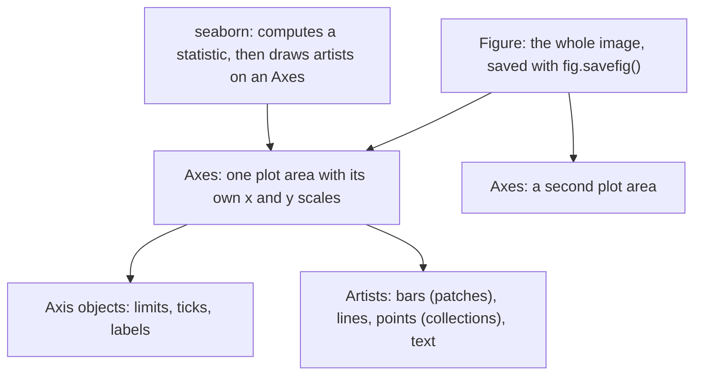
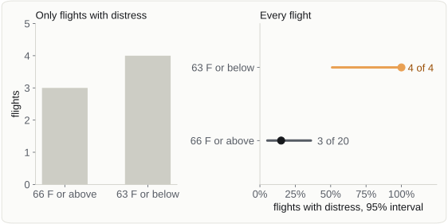
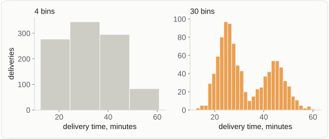

# Module 08: Statistical Visualization with Matplotlib and Seaborn

> **Prerequisites:** [Module 07: Polars LazyFrames and DuckDB for Larger-Than-Memory Tabular Data](../07-polars-lazy-frames-and-larger-than-memory-data/README.md).  
> **Estimated Reading Time:** 40 minutes  
> **Target Audience:** Engineers who make charts to find out what data says and to show it to people who will decide something

> [!TIP]
> **The Golden Rule of Charts:** A chart answers **one question**, and it must show what the question needs: the **denominator** (out of how many), the **uncertainty** (how sure), and the **data itself** whenever a summary could hide its shape. Check every default the library chose for you (bins, axis limits, what a bar or error bar means) before showing the chart to anyone.

---

## Why This Matters

Exploratory analysis is mostly looking at charts, and charts are where data is most easily misread. A histogram with too few bins merges two groups; a line chart zooms its y-axis to make half a point look like a cliff; a bar of the mean hides that half the tickets take an hour and half take two days; a comparison that leaves out the cases where nothing happened shows no pattern at all. Section 3 is the most cited example of the last one: a comparison made the night before the Challenger launch.

---

## 1. Architectural Mental Model: Figure, Axes, Artists



- **Use the object interface:** `fig, ax = plt.subplots()` and then `ax.plot(...)`, `ax.set_xlabel(...)`. Every chart setting belongs to an Axes, so a figure with several panels stays under control. The `plt.plot` style works on whatever Axes is "current", which becomes confusing with more than one.
- **seaborn** sits on top of matplotlib: it takes a DataFrame and column names, computes something (a mean, a confidence interval, a density), and draws matplotlib artists onto an Axes you can keep editing.
- **What you see is a statistic, not the data,** whenever the chart is a bar of means, a box plot, a density curve or a regression line. Know which one each chart is.

### The Question Picks the Chart

| Question | Chart | Watch for |
| :--- | :--- | :--- |
| How is one variable distributed? | Histogram, ECDF, box plot plus points | Bin count; a box hides gaps between groups |
| How do groups compare? | Points with intervals, box plots, strip plots | Bars of means hide spread; show the count of each group |
| How did something change over time? | Line chart | A zoomed y-axis must be labelled as such |
| How do two numbers relate? | Scatter plot, with transparency or hexagonal bins when dense | Overplotting; a fitted line suggests more than it shows |
| What share of the total? | Bar chart of shares, sorted | Pie charts with many slices |

---

## 2. Systematic Reference and Comparison Grids

### Defaults Worth Checking

| Default | Value (matplotlib 3.11, seaborn 0.13) | Why it matters |
| :--- | :--- | :--- |
| `ax.hist` bins | `rcParams["hist.bins"]` = 10 | Too few bins merge groups, too many show noise |
| Bar chart y-axis | Starts at 0 | Correct for bars: their length is the value |
| Line chart y-axis | Fits the data with a margin | A small change can fill the whole height |
| `sns.barplot` | `estimator="mean"`, `errorbar=("ci", 95)`, `n_boot=1000`, `seed=None` | The bar is a mean, the whisker a bootstrapped interval that changes slightly between runs unless `seed` is set |
| `sns.boxplot` | Whiskers to 1.5 IQR, outliers drawn as points | Hides two clusters inside one box |
| Colours | A categorical palette | Do not encode an ordered quantity with unordered colours |

### What to Put on Every Chart for Decisions

| Element | Example |
| :--- | :--- |
| A title that states the question or the finding | "Every cold launch had O-ring distress" |
| Axis labels with units | "hours to resolve", "share of flights" |
| The number behind each group | "3 of 20", "n = 80" |
| Uncertainty | An interval, with what it is (95% Wilson, bootstrap) |
| The source and date of the data | A caption under the chart |

---

## 3. Real Case Study: The Comparison That Left Out the Normal Flights

The source is the *Report of the Presidential Commission on the Space Shuttle Challenger Accident* (the Rogers Commission, 1986), volume 1, chapter VI, "An Accident Rooted in History".

| What the report says | Detail |
| :--- | :--- |
| What was compared on 27 January 1986, the night before the launch | "The managers compared as a function of temperature the flights for which thermal distress of O-rings had been observed-not the frequency of occurrence based on all flights" |
| What that comparison showed | "In such a comparison, there is nothing irregular in the distribution of O-ring 'distress' over the spectrum of joint temperatures at launch between 53 degrees Fahrenheit and 75 degrees Fahrenheit" |
| What including every flight shows | "When the entire history of flight experience is considered, including 'normal' flights with no erosion or blow-by, the comparison is substantially different" |
| The numbers | "only three incidents of O-ring thermal distress occurred out of twenty flights with O-ring temperatures at 66 degrees Fahrenheit or above, whereas, all four flights with O-ring temperatures at 63 degrees Fahrenheit or below experienced O-ring thermal distress" |
| The coldest earlier launch | "The temperature of the O-rings at launch was 53 degrees, the coldest to that date" |



*The counts from the Rogers Commission report, drawn both ways (Workflow 1).*

### What to Take From It

1. **A chart of events without their denominators cannot show a rate.** Three and four look alike; 3 of 20 and 4 of 4 do not.
2. **Put the uncertainty on the chart.** With only four cold flights an interval is wide (51% to 100%), and it still lies entirely above the warm flights' interval (5% to 36%).
3. **Ask what is missing from the plot**, especially the cases where nothing happened.

---

## 4. The Same Counts, Two Views, in Four Languages (`carousel`)

The program uses only the counts quoted above. It prints the view the managers had (flights with distress only) and then every flight with the rate and a 95% Wilson score interval, drawn as a text chart so that every language produces the same picture.

````carousel
```python
"""Two views of the same flight record, using only the counts in the Rogers Commission report (1986, chapter VI): O-ring
thermal distress on 3 of 20 flights with O-ring temperatures of 66 F or above, and on all 4 flights at 63 F or below.
The first view shows only the flights that had distress, as the managers' comparison did; the second shows every flight,
the rate in each group, and a 95% Wilson interval for that rate, drawn as a text chart."""
import math

GROUPS = [("66 F or above", 20, 3), ("63 F or below", 4, 4)]  # (O-ring temperature at launch, flights, flights with distress)
Z = 1.959963984540054  # the 97.5th percentile of the standard normal distribution
WIDTH = 50  # characters for 0% to 100%


def wilson(successes, n):
    """The Wilson score interval: unlike p +/- z*sqrt(p(1-p)/n), it stays inside 0 to 1 and works for 4 of 4."""
    p = successes / n
    denominator = 1 + Z * Z / n
    centre = (p + Z * Z / (2 * n)) / denominator
    half = Z * math.sqrt(p * (1 - p) / n + Z * Z / (4 * n * n)) / denominator
    return centre - half, centre + half


def position(share):
    """Column for a share between 0 and 1, rounding halves up the same way in every language."""
    return math.floor(share * WIDTH + 0.5)


print("== view 1: only the flights that had distress ==")
for name, _, distressed in GROUPS:
    print(f"  {name:14} {'#' * distressed:<5} {distressed} flights")
print("  3 against 4: nothing stands out")

print("\n== view 2: every flight, with the rate and its 95% interval ==")
print(f"  {'':14} {'flights':>7} {'distress':>8} {'rate':>6} {'95% interval':>15}")
for name, flights, distressed in GROUPS:
    lo, hi = wilson(distressed, flights)
    print(f"  {name:14} {flights:7d} {distressed:8d} {100 * distressed / flights:5.0f}% {100 * lo:6.1f}% to {100 * hi:5.1f}%")
print()
print(f"  {'':14} |0%{' ' * (WIDTH + 1 - 6)}100%|")
for name, flights, distressed in GROUPS:
    lo, hi = wilson(distressed, flights)
    row = [" "] * (WIDTH + 1)
    for c in range(position(lo), position(hi) + 1):
        row[c] = "-"
    row[position(distressed / flights)] = "o"
    print(f"  {name:14} |{''.join(row)}|")
lo_cold, _ = wilson(4, 4)
_, hi_warm = wilson(3, 20)
print(f"\n  the intervals do not overlap: the cold group's lower end ({100 * lo_cold:.1f}%) is above the warm group's upper end ({100 * hi_warm:.1f}%)")
```

<!-- slide -->

```typescript
// Two views of the same flight record, using only the counts in the Rogers Commission report (1986, chapter VI): O-ring
// thermal distress on 3 of 20 flights with O-ring temperatures of 66 F or above, and on all 4 flights at 63 F or below.
// The first view shows only the flights that had distress, as the managers' comparison did; the second shows every flight,
// the rate in each group, and a 95% Wilson interval for that rate, drawn as a text chart.

// (O-ring temperature at launch, flights, flights with distress)
const GROUPS: [string, number, number][] = [["66 F or above", 20, 3], ["63 F or below", 4, 4]];
const Z = 1.959963984540054; // the 97.5th percentile of the standard normal distribution
const WIDTH = 50; // characters for 0% to 100%

// The Wilson score interval: unlike p +/- z*sqrt(p(1-p)/n), it stays inside 0 to 1 and works for 4 of 4.
function wilson(successes: number, n: number): [number, number] {
  const p = successes / n;
  const denominator = 1 + (Z * Z) / n;
  const centre = (p + (Z * Z) / (2 * n)) / denominator;
  const half = (Z * Math.sqrt((p * (1 - p)) / n + (Z * Z) / (4 * n * n))) / denominator;
  return [centre - half, centre + half];
}

// Column for a share between 0 and 1, rounding halves up the same way in every language.
const position = (share: number) => Math.floor(share * WIDTH + 0.5);
const pct = (x: number, digits: number, width: number) => (100 * x).toFixed(digits).padStart(width);

console.log("== view 1: only the flights that had distress ==");
for (const [name, , distressed] of GROUPS) console.log(`  ${name.padEnd(14)} ${"#".repeat(distressed).padEnd(5)} ${distressed} flights`);
console.log("  3 against 4: nothing stands out");

console.log("\n== view 2: every flight, with the rate and its 95% interval ==");
console.log(`  ${"".padEnd(14)} ${"flights".padStart(7)} ${"distress".padStart(8)} ${"rate".padStart(6)} ${"95% interval".padStart(15)}`);
for (const [name, flights, distressed] of GROUPS) {
  const [lo, hi] = wilson(distressed, flights);
  console.log(`  ${name.padEnd(14)} ${String(flights).padStart(7)} ${String(distressed).padStart(8)} ${pct(distressed / flights, 0, 5)}% ${pct(lo, 1, 6)}% to ${pct(hi, 1, 5)}%`);
}
console.log();
console.log(`  ${"".padEnd(14)} |0%${" ".repeat(WIDTH + 1 - 6)}100%|`);
for (const [name, flights, distressed] of GROUPS) {
  const [lo, hi] = wilson(distressed, flights);
  const row = Array<string>(WIDTH + 1).fill(" ");
  for (let c = position(lo); c <= position(hi); c++) row[c] = "-";
  row[position(distressed / flights)] = "o";
  console.log(`  ${name.padEnd(14)} |${row.join("")}|`);
}
const [loCold] = wilson(4, 4);
const [, hiWarm] = wilson(3, 20);
console.log(
  `\n  the intervals do not overlap: the cold group's lower end (${(100 * loCold).toFixed(1)}%) is above the warm group's upper end (${(100 * hiWarm).toFixed(1)}%)`,
);
```

<!-- slide -->

```go
// Two views of the same flight record, using only the counts in the Rogers Commission report (1986, chapter VI): O-ring
// thermal distress on 3 of 20 flights with O-ring temperatures of 66 F or above, and on all 4 flights at 63 F or below.
// The first view shows only the flights that had distress, as the managers' comparison did; the second shows every flight,
// the rate in each group, and a 95% Wilson interval for that rate, drawn as a text chart.
package main

import (
	"fmt"
	"math"
	"strings"
)

type group struct {
	name       string // O-ring temperature at launch
	flights    int
	distressed int // flights with distress
}

var groups = []group{{"66 F or above", 20, 3}, {"63 F or below", 4, 4}}

const z = 1.959963984540054 // the 97.5th percentile of the standard normal distribution
const width = 50            // characters for 0% to 100%

// wilson is the Wilson score interval: unlike p +/- z*sqrt(p(1-p)/n), it stays inside 0 to 1 and works for 4 of 4.
func wilson(successes, n int) (float64, float64) {
	p := float64(successes) / float64(n)
	nf := float64(n)
	denominator := 1 + z*z/nf
	centre := (p + z*z/(2*nf)) / denominator
	half := z * math.Sqrt(p*(1-p)/nf+z*z/(4*nf*nf)) / denominator
	return centre - half, centre + half
}

// position gives the column for a share between 0 and 1, rounding halves up the same way in every language.
func position(share float64) int { return int(math.Floor(share*width + 0.5)) }

func main() {
	fmt.Println("== view 1: only the flights that had distress ==")
	for _, g := range groups {
		fmt.Printf("  %-14s %-5s %d flights\n", g.name, strings.Repeat("#", g.distressed), g.distressed)
	}
	fmt.Println("  3 against 4: nothing stands out")

	fmt.Println("\n== view 2: every flight, with the rate and its 95% interval ==")
	fmt.Printf("  %-14s %7s %8s %6s %15s\n", "", "flights", "distress", "rate", "95% interval")
	for _, g := range groups {
		lo, hi := wilson(g.distressed, g.flights)
		fmt.Printf("  %-14s %7d %8d %5.0f%% %6.1f%% to %5.1f%%\n", g.name, g.flights, g.distressed,
			100*float64(g.distressed)/float64(g.flights), 100*lo, 100*hi)
	}
	fmt.Println()
	fmt.Printf("  %-14s |0%%%s100%%|\n", "", strings.Repeat(" ", width+1-6))
	for _, g := range groups {
		lo, hi := wilson(g.distressed, g.flights)
		row := []rune(strings.Repeat(" ", width+1))
		for c := position(lo); c <= position(hi); c++ {
			row[c] = '-'
		}
		row[position(float64(g.distressed)/float64(g.flights))] = 'o'
		fmt.Printf("  %-14s |%s|\n", g.name, string(row))
	}
	loCold, _ := wilson(4, 4)
	_, hiWarm := wilson(3, 20)
	fmt.Printf("\n  the intervals do not overlap: the cold group's lower end (%.1f%%) is above the warm group's upper end (%.1f%%)\n",
		100*loCold, 100*hiWarm)
}
```

<!-- slide -->

```csharp
// Two views of the same flight record, using only the counts in the Rogers Commission report (1986, chapter VI): O-ring
// thermal distress on 3 of 20 flights with O-ring temperatures of 66 F or above, and on all 4 flights at 63 F or below.
// The first view shows only the flights that had distress, as the managers' comparison did; the second shows every flight,
// the rate in each group, and a 95% Wilson interval for that rate, drawn as a text chart.
using System;
using System.Globalization;

CultureInfo.CurrentCulture = CultureInfo.InvariantCulture;

// (O-ring temperature at launch, flights, flights with distress)
var groups = new (string Name, int Flights, int Distressed)[] { ("66 F or above", 20, 3), ("63 F or below", 4, 4) };
const double Z = 1.959963984540054; // the 97.5th percentile of the standard normal distribution
const int Width = 50; // characters for 0% to 100%

// The Wilson score interval: unlike p +/- z*sqrt(p(1-p)/n), it stays inside 0 to 1 and works for 4 of 4.
(double Lo, double Hi) Wilson(int successes, int n)
{
    double p = (double)successes / n;
    double denominator = 1 + Z * Z / n;
    double centre = (p + Z * Z / (2.0 * n)) / denominator;
    double half = Z * Math.Sqrt(p * (1 - p) / n + Z * Z / (4.0 * n * n)) / denominator;
    return (centre - half, centre + half);
}

// Column for a share between 0 and 1, rounding halves up the same way in every language.
int Position(double share) => (int)Math.Floor(share * Width + 0.5);

Console.WriteLine("== view 1: only the flights that had distress ==");
foreach (var g in groups) Console.WriteLine($"  {g.Name,-14} {new string('#', g.Distressed),-5} {g.Distressed} flights");
Console.WriteLine("  3 against 4: nothing stands out");

Console.WriteLine("\n== view 2: every flight, with the rate and its 95% interval ==");
Console.WriteLine($"  {"",-14} {"flights",7} {"distress",8} {"rate",6} {"95% interval",15}");
foreach (var g in groups)
{
    var (lo, hi) = Wilson(g.Distressed, g.Flights);
    Console.WriteLine($"  {g.Name,-14} {g.Flights,7} {g.Distressed,8} {100.0 * g.Distressed / g.Flights,5:F0}% {100 * lo,6:F1}% to {100 * hi,5:F1}%");
}
Console.WriteLine();
Console.WriteLine($"  {"",-14} |0%{new string(' ', Width + 1 - 6)}100%|");
foreach (var g in groups)
{
    var (lo, hi) = Wilson(g.Distressed, g.Flights);
    char[] row = new string(' ', Width + 1).ToCharArray();
    for (int c = Position(lo); c <= Position(hi); c++) row[c] = '-';
    row[Position((double)g.Distressed / g.Flights)] = 'o';
    Console.WriteLine($"  {g.Name,-14} |{new string(row)}|");
}
var (loCold, _) = Wilson(4, 4);
var (_, hiWarm) = Wilson(3, 20);
Console.WriteLine($"\n  the intervals do not overlap: the cold group's lower end ({100 * loCold:F1}%) is above the warm group's upper end ({100 * hiWarm:F1}%)");
```
````

**Observed output (identical in Python 3.13.14, Node 24, Go 1.22 and .NET 10):**

```text
== view 1: only the flights that had distress ==
  66 F or above  ###   3 flights
  63 F or below  ####  4 flights
  3 against 4: nothing stands out

== view 2: every flight, with the rate and its 95% interval ==
                 flights distress   rate    95% interval
  66 F or above       20        3    15%    5.2% to  36.0%
  63 F or below        4        4   100%   51.0% to 100.0%

                 |0%                                             100%|
  66 F or above  |   -----o----------                                |
  63 F or below  |                          ------------------------o|

  the intervals do not overlap: the cold group's lower end (51.0%) is above the warm group's upper end (36.0%)
```

What to notice:

- **View 1 is 3 against 4.** It is the comparison the report describes as showing "nothing irregular".
- **View 2 is 15% against 100%.** The Wilson interval for 4 of 4 (51.0% to 100.0%) does not overlap the one for 3 of 20 (5.2% to 36.0%).
- **Why Wilson:** the simple interval $p \pm z\sqrt{p(1-p)/n}$ has zero width when $p = 1$, claiming certainty from four flights; the Wilson interval does not.

---

## 5. Practical Hands-On Verification Workflows (Python 3.13, matplotlib 3.11.2, seaborn 0.13.2)

All three workflows use one style (13-pixel text, muted axes, a single accent colour) and save SVG files on a light card, with a title and description for screen readers, the way the figures on this page were made.

### Workflow 1: The Object Model and the Two Views

```python
"""Matplotlib's object model (Figure -> Axes -> artists), a shared style, and the two views of the Rogers Commission counts as
one figure: the counts of flights with distress, and the rate per group with its 95% interval and its denominator."""
import math
import pathlib

import matplotlib

matplotlib.use("Agg")  # draw to files, no window
import matplotlib.pyplot as plt
from matplotlib.patches import FancyBboxPatch

INK, MUTED, RULE, CARD, CARD_EDGE, ACCENT, ACCENT_TEXT = "#16181c", "#575c65", "#cdcdc5", "#fbfbf9", "#e4e4de", "#e9a053", "#9a4f06"
plt.rcParams.update({
    "font.size": 13, "font.family": "sans-serif", "font.sans-serif": ["Arial", "Liberation Sans", "DejaVu Sans"], "svg.fonttype": "none", "svg.hashsalt": "fixed",
    "text.color": INK, "axes.labelcolor": INK, "xtick.color": MUTED, "ytick.color": MUTED, "axes.edgecolor": RULE,
    "axes.facecolor": "none", "axes.spines.top": False, "axes.spines.right": False,
})


def save_svg(fig, path, title, description):
    """Save on a rounded card (readable on light and dark pages), with no timestamp, plus a title and description for screen readers."""
    fig.patch.set_alpha(0)
    fig.patches.append(FancyBboxPatch((0.004, 0.004), 0.992, 0.992, boxstyle="round,pad=0,rounding_size=0.025",
                                      transform=fig.transFigure, facecolor=CARD, edgecolor=CARD_EDGE, zorder=-10))
    fig.savefig(path, format="svg", metadata={"Date": None})
    svg = path.read_text(encoding="utf-8")
    svg = svg.replace("<svg ", '<svg role="img" ', 1)
    for attr in ("width", "height"):  # pixel sizes, so 13-point text is 13 px at the image's natural width
        start = svg.index(f'{attr}="') + len(attr) + 2
        end = svg.index('"', start)
        svg = svg[:start] + str(round(float(svg[start:end].removesuffix("pt")))) + svg[end:]
    head_end = svg.index(">", svg.index("<svg ")) + 1
    svg = svg[:head_end] + f"\n <title>{title}</title>\n <desc>{description}</desc>" + svg[head_end:]
    path.write_text(svg, encoding="utf-8")
    return path.stat().st_size


def wilson(k, n, z=1.959963984540054):
    p = k / n
    d = 1 + z * z / n
    c = (p + z * z / (2 * n)) / d
    h = z * math.sqrt(p * (1 - p) / n + z * z / (4 * n * n)) / d
    return c - h, c + h


GROUPS = [("66 F or above", 20, 3), ("63 F or below", 4, 4)]  # Rogers Commission report, chapter VI
names = [g[0] for g in GROUPS]

fig, (left, right) = plt.subplots(1, 2, figsize=(7.8, 3.9), gridspec_kw={"width_ratios": [1, 1.25]})
print("figure:", type(fig).__name__, "| axes:", [type(a).__name__ for a in fig.axes])

left.bar(names, [g[2] for g in GROUPS], color=RULE, width=0.55)
left.set_title("Only flights with distress", loc="left", fontsize=13)
left.set_ylabel("flights")
left.set_ylim(0, 5)

rates = [k / n for _, n, k in GROUPS]
intervals = [wilson(k, n) for _, n, k in GROUPS]
for y, (rate, (lo, hi), (_, n, k)) in enumerate(zip(rates, intervals, GROUPS)):
    right.plot([lo, hi], [y, y], color=ACCENT if rate > 0.5 else MUTED, linewidth=3, solid_capstyle="round")
    right.plot([rate], [y], "o", color=ACCENT if rate > 0.5 else INK, markersize=9)
    right.annotate(f"{k} of {n}", (hi, y), xytext=(8, -5), textcoords="offset points", color=ACCENT_TEXT if rate > 0.5 else MUTED)
right.set_yticks([0, 1], names)
right.set_ylim(-0.6, 1.6)
right.set_xlim(0, 1.25)
right.set_xticks([0, 0.25, 0.5, 0.75, 1.0], ["0%", "25%", "50%", "75%", "100%"])
right.set_xlabel("flights with distress, 95% interval")
right.set_title("Every flight", loc="left", fontsize=13)
fig.tight_layout()

for ax in fig.axes:
    print(f"  '{ax.get_title(loc='left')}': {len(ax.patches)} bars, {len(ax.lines)} lines, x limits {tuple(round(float(v), 2) for v in ax.get_xlim())}, "
          f"y limits {tuple(round(float(v), 2) for v in ax.get_ylim())}")
out = pathlib.Path("images") / "o-ring-two-views.svg"
out.parent.mkdir(exist_ok=True)
size = save_svg(fig, out, "Two views of the same flights",
                "Left: 3 and 4 flights with O-ring distress, which look alike. Right: 3 of 20 warm flights against 4 of 4 cold flights, "
                "with 95% intervals that do not overlap.")
print(f"saved {out.as_posix()}: {size / 1024:.1f} KB")
```

**Observed Output:**

```text
figure: Figure | axes: ['Axes', 'Axes']
  'Only flights with distress': 2 bars, 0 lines, x limits (-0.35, 1.35), y limits (0.0, 5.0)
  'Every flight': 0 bars, 4 lines, x limits (0.0, 1.25), y limits (-0.6, 1.6)
saved images/o-ring-two-views.svg: 14.2 KB
```

- The figure holds two Axes; the left one has 2 bar patches, the right one 4 lines (two intervals and two points).
- Limits are set explicitly (`set_ylim(0, 5)`, `set_xlim(0, 1.25)`) rather than left to the defaults, so both panels show the whole range.
- The resulting image is the one in section 3.

### Workflow 2: Bins and Baselines

```python
"""Choices the chart makes for you: the number of histogram bins can hide two groups, and the y-axis of a line chart does not
start at zero while a bar chart's does."""
import pathlib

import matplotlib

matplotlib.use("Agg")
import matplotlib.pyplot as plt
import numpy as np
from matplotlib.patches import FancyBboxPatch

INK, MUTED, RULE, CARD, CARD_EDGE, ACCENT = "#16181c", "#575c65", "#cdcdc5", "#fbfbf9", "#e4e4de", "#e9a053"
plt.rcParams.update({
    "font.size": 13, "font.family": "sans-serif", "font.sans-serif": ["Arial", "Liberation Sans", "DejaVu Sans"],
    "svg.fonttype": "none", "svg.hashsalt": "fixed", "text.color": INK, "axes.labelcolor": INK, "xtick.color": MUTED,
    "ytick.color": MUTED, "axes.edgecolor": RULE, "axes.facecolor": "none", "axes.spines.top": False, "axes.spines.right": False,
})


def save_svg(fig, path, title, description):
    """The same helper as in Workflow 1: a rounded card, no timestamp, pixel sizes, a title and a description."""
    fig.patch.set_alpha(0)
    fig.patches.append(FancyBboxPatch((0.004, 0.004), 0.992, 0.992, boxstyle="round,pad=0,rounding_size=0.025",
                                      transform=fig.transFigure, facecolor=CARD, edgecolor=CARD_EDGE, zorder=-10))
    fig.savefig(path, format="svg", metadata={"Date": None})
    svg = path.read_text(encoding="utf-8").replace("<svg ", '<svg role="img" ', 1)
    for attr in ("width", "height"):
        start = svg.index(f'{attr}="') + len(attr) + 2
        end = svg.index('"', start)
        svg = svg[:start] + str(round(float(svg[start:end].removesuffix("pt")))) + svg[end:]
    head_end = svg.index(">", svg.index("<svg ")) + 1
    path.write_text(svg[:head_end] + f"\n <title>{title}</title>\n <desc>{description}</desc>" + svg[head_end:], encoding="utf-8")
    return path.stat().st_size


rng = np.random.default_rng(8)
minutes = np.concatenate([rng.normal(25, 4, 600), rng.normal(45, 5, 400)])  # deliveries from a near and a far depot


def peaks(counts):
    """Bins higher than both neighbours."""
    return int(sum(1 for i in range(1, len(counts) - 1) if counts[i] > counts[i - 1] and counts[i] > counts[i + 1]))


print("== 1. the number of bins ==")
for bins in (4, 30, 60):
    counts, edges = np.histogram(minutes, bins=bins)
    print(f"  bins={bins:<3} local peaks: {peaks(counts):2d}" + (f"   counts {counts.tolist()}" if bins == 4 else ""))
print(f"  matplotlib's default, rcParams['hist.bins'], is {plt.rcParams['hist.bins']}; numpy's 'auto' rule picks {len(np.histogram_bin_edges(minutes, 'auto')) - 1}")

fig, axes = plt.subplots(1, 2, figsize=(7.8, 3.3), sharey=False)
for ax, bins, colour in zip(axes, (4, 30), (RULE, ACCENT)):
    ax.hist(minutes, bins=bins, color=colour, edgecolor=CARD, linewidth=0.8)
    ax.set_title(f"{bins} bins", loc="left", fontsize=13)
    ax.set_xlabel("delivery time, minutes")
axes[0].set_ylabel("deliveries")
fig.tight_layout()
out = pathlib.Path("images") / "bins-change-the-story.svg"
out.parent.mkdir(exist_ok=True)
size = save_svg(fig, out, "The same 1,000 delivery times in 4 and in 30 bins",
                "With 4 bins the histogram shows one broad hump; with 30 bins it shows two peaks, near 25 and 45 minutes, one per depot.")
print(f"  saved {out.as_posix()}: {size / 1024:.1f} KB")

print("\n== 2. where the y-axis starts ==")
months, uptime = ["Jan", "Feb", "Mar", "Apr"], [99.1, 99.3, 99.2, 99.6]
for kind in ("bar", "line"):
    fig, ax = plt.subplots()
    ax.bar(months, uptime) if kind == "bar" else ax.plot(months, uptime)
    lo, hi = ax.get_ylim()
    share = (uptime[3] - uptime[0]) / (hi - lo)
    print(f"  {kind:4}: y from {lo:6.2f} to {hi:6.2f}; the 0.5-point rise from Jan to Apr spans {share:.1%} of the chart's height")
    plt.close(fig)
print("  a bar's length encodes its value, so bars need a zero baseline; a line encodes change, so a zoomed axis is allowed if labelled")
```

**Observed Output:**

```text
== 1. the number of bins ==
  bins=4   local peaks:  1   counts [277, 345, 295, 83]
  bins=30  local peaks:  2
  bins=60  local peaks: 16
  matplotlib's default, rcParams['hist.bins'], is 10; numpy's 'auto' rule picks 13
  saved images/bins-change-the-story.svg: 21.0 KB

== 2. where the y-axis starts ==
  bar : y from   0.00 to 104.58; the 0.5-point rise from Jan to Apr spans 0.5% of the chart's height
  line: y from  99.07 to  99.62; the 0.5-point rise from Jan to Apr spans 90.9% of the chart's height
  a bar's length encodes its value, so bars need a zero baseline; a line encodes change, so a zoomed axis is allowed if labelled
```



*The same data in 4 and in 30 bins (Workflow 2).*

- **Bins:** 4 bins showed one peak, 30 showed the two depots, and 60 showed 16 "peaks" that are noise. Try several bin counts, or plot an ECDF, which has no bins.
- **Baselines:** with bars, the 0.5-point rise in uptime filled 0.5% of the height; with a line, 90.9%. Both are honest only if the reader can see where the axis starts.

### Workflow 3: Bars of Means Against the Data

```python
"""seaborn draws a statistic, not the data: a bar plot shows means with a bootstrapped 95% interval. Two teams with almost the
same mean look identical as bars; the points show that one team has two kinds of tickets."""
import pathlib

import matplotlib

matplotlib.use("Agg")
import matplotlib.pyplot as plt
import numpy as np
import pandas as pd
import seaborn as sns
from matplotlib.patches import FancyBboxPatch

INK, MUTED, RULE, CARD, CARD_EDGE, ACCENT = "#16181c", "#575c65", "#cdcdc5", "#fbfbf9", "#e4e4de", "#e9a053"
plt.rcParams.update({
    "font.size": 13, "font.family": "sans-serif", "font.sans-serif": ["Arial", "Liberation Sans", "DejaVu Sans"],
    "svg.fonttype": "none", "svg.hashsalt": "fixed", "text.color": INK, "axes.labelcolor": INK, "xtick.color": MUTED,
    "ytick.color": MUTED, "axes.edgecolor": RULE, "axes.facecolor": "none", "axes.spines.top": False, "axes.spines.right": False,
})


def save_svg(fig, path, title, description):
    """The same helper as in Workflow 1: a rounded card, no timestamp, pixel sizes, a title and a description."""
    fig.patch.set_alpha(0)
    fig.patches.append(FancyBboxPatch((0.004, 0.004), 0.992, 0.992, boxstyle="round,pad=0,rounding_size=0.025",
                                      transform=fig.transFigure, facecolor=CARD, edgecolor=CARD_EDGE, zorder=-10))
    fig.savefig(path, format="svg", metadata={"Date": None})
    svg = path.read_text(encoding="utf-8").replace("<svg ", '<svg role="img" ', 1)
    for attr in ("width", "height"):
        start = svg.index(f'{attr}="') + len(attr) + 2
        end = svg.index('"', start)
        svg = svg[:start] + str(round(float(svg[start:end].removesuffix("pt")))) + svg[end:]
    head_end = svg.index(">", svg.index("<svg ")) + 1
    path.write_text(svg[:head_end] + f"\n <title>{title}</title>\n <desc>{description}</desc>" + svg[head_end:], encoding="utf-8")
    return path.stat().st_size


print("seaborn", sns.__version__)
rng = np.random.default_rng(21)
tickets = pd.DataFrame({
    "team": ["Team A"] * 80 + ["Team B"] * 80,
    "hours": np.concatenate([rng.normal(20, 4, 80),                                       # one kind of ticket
                             np.concatenate([rng.normal(8, 2, 52), rng.normal(43, 5, 28)])]),  # quick fixes and escalations
})
print(tickets.groupby("team")["hours"].agg(["count", "mean", "median", "std"]).round(1).to_string())

fig, (left, right) = plt.subplots(1, 2, figsize=(7.8, 3.6), sharey=True)
sns.barplot(data=tickets, x="team", y="hours", ax=left, color=RULE, err_kws={"color": INK, "linewidth": 2}, seed=0)
left.set_title("Mean and 95% interval", loc="left", fontsize=13)
print("\nwhat the bar plot drew:")
for bar, line, team in zip(left.patches, left.lines, ["Team A", "Team B"]):
    lo, hi = sorted(line.get_ydata())
    print(f"  {team}: bar height {bar.get_height():.1f}, interval {lo:.1f} to {hi:.1f}")

np.random.seed(0)  # stripplot's jitter draws from NumPy's global generator and takes no seed; fixed here so the image repeats
sns.stripplot(data=tickets, x="team", y="hours", ax=right, color=ACCENT, alpha=0.75, size=4, jitter=0.25)
sns.boxplot(data=tickets, x="team", y="hours", ax=right, fill=False, color=INK, width=0.5, showfliers=False, linewidth=1.2)
right.set_title("Every ticket, with a box plot", loc="left", fontsize=13)
for ax in (left, right):
    ax.set_xlabel("")
left.set_ylabel("hours to resolve")
fig.tight_layout()
out = pathlib.Path("images") / "means-hide-the-data.svg"
out.parent.mkdir(exist_ok=True)
size = save_svg(fig, out, "Two teams as bars of the mean and as individual tickets",
                "Left: two bars of almost equal height with overlapping intervals. Right: the tickets show that Team A's cluster around "
                "20 hours while Team B's split into quick fixes near 8 hours and escalations near 43 hours.")
print(f"\nsaved {out.as_posix()}: {size / 1024:.1f} KB")
b = tickets.loc[tickets["team"] == "Team B", "hours"]
print(f"Team B tickets within 5 hours of its own mean: {int(((b - b.mean()).abs() < 5).sum())} of {len(b)}")
```

**Observed Output:**

```text
seaborn 0.13.2
        count  mean  median   std
team                             
Team A     80  20.1    19.9   3.6
Team B     80  19.8     9.7  16.7

what the bar plot drew:
  Team A: bar height 20.1, interval 19.4 to 20.9
  Team B: bar height 19.8, interval 16.0 to 23.6

saved images/means-hide-the-data.svg: 31.5 KB
Team B tickets within 5 hours of its own mean: 0 of 80
```


*Means against the tickets themselves (Workflow 3).*

- **The bars said the teams are the same:** means 20.1 and 19.8 hours with overlapping intervals.
- **The points said otherwise:** none of Team B's 80 tickets is within 5 hours of its mean; its median is 9.7 hours. Even the box plot spans the gap without showing it.
- **seaborn's interval is bootstrapped**, so pass `seed=` to make the chart repeatable; its `stripplot` jitter takes no seed and uses NumPy's global generator, which is why the workflow seeds that.

---

## 6. Hands-On Exercises and Independent Challenge

### Practical Exercises

1. **Add the denominator.** A dashboard shows "failed deployments per team" as bars: 12, 9, 4. What must be added before anyone compares the teams?
2. **Choose the axis.** Conversion went from 3.1% to 3.4%. Draw it as bars and as a line; which y-axis does each need?
3. **Replace a bar of means.** Rewrite Workflow 3's left panel as a point plot with the median and the interquartile range, using `sns.pointplot(..., estimator="median", errorbar=("pi", 50))`.
4. **Change the program.** Add a third group, "64 F to 65 F", with 0 flights. What should the program print, and why must it not divide by zero silently?

<details><summary>Answers</summary>

1. The number of deployments per team (and an interval for each rate): 12 failures of 400 is a lower rate than 4 of 20.
2. Bars must start at 0, which makes the change look small and true to scale; a line may zoom in, with the axis range labelled, to show the change in the rate.
3. ```python
   sns.pointplot(data=tickets, x="team", y="hours", estimator="median", errorbar=("pi", 50), ax=ax)
   ```
   `("pi", 50)` is the percentile interval covering the middle 50% of the data, the interquartile range.
4. It should print "0 flights" and no rate or interval: a group with no observations has no rate. In Python the division raises `ZeroDivisionError`; in TypeScript, Go and C# floating-point division gives NaN or Infinity and the program would print it, so check `n > 0` first.

</details>

### Independent Challenge

Your team reviews a weekly chart of "incidents by service" before deciding where to invest in reliability. Last quarter the chart pointed at the payments service, which has the most incidents. Redesign the chart and the review so that the decision is based on what the data can support.

<details><summary>Architectural Discussion</summary>

**Denominators.** Incidents per million requests (or per deployment) by service, not counts: the busiest service has the most incidents almost by definition. Show the count and the denominator next to each rate.

**Uncertainty.** An interval for each rate; services with few requests will have wide ones, and the chart should make that visible rather than ranking them.

**The data behind the summary.** Severity and duration of each incident as points, so that one long outage is not confused with many short blips.

**What is missing.** Services with zero incidents belong on the chart, with their denominators; without them, the comparison is the one the Rogers Commission criticized.

**Process.** The chart states its question in the title, its source and date in the caption, and the review notes what decision it supports.

</details>

---

## 7. Common Mistakes and Troubleshooting

- **Counts without denominators.** Plot rates with the count and the total.
- **Leaving out the zero cases.** Include the groups or periods where nothing happened.
- **Trusting the default bin count.** Try several, or use an ECDF.
- **Bars that do not start at zero.** Use points or a line if you need to zoom.
- **Bars of means for skewed or multi-modal data.** Show the points, or a box or violin plus points.
- **Error bars without a label.** Say whether they are a standard deviation, a standard error or a confidence interval, and how it was computed.
- **Using `plt.*` with several panels.** Use `fig, axes = plt.subplots(...)` and the Axes methods.
- **Colour as the only encoding.** Add labels or markers, and choose palettes readable with colour-vision deficiencies.

---

## 8. Operational Validation Checkpoints and Checkpoint Quiz

<details><summary><strong>Checkpoint 1: A chart shows that most security incidents happen on Linux servers. What do you ask?</strong></summary>

How many servers run each operating system. Most incidents on Linux may simply mean most servers are Linux; the comparison needs incidents per server (with intervals), including systems with no incidents.

</details>

<details><summary><strong>Checkpoint 2: Two A/B variants have bars of almost equal mean revenue per user. Can you conclude they perform the same?</strong></summary>

No. Look at the distributions: revenue is usually skewed, with many zeros and a few large values, and two variants can have similar means with different shapes (more buyers but smaller baskets). Plot the distributions or quantiles, and compare with an interval for the difference.

</details>

<details><summary><strong>Checkpoint 3: A histogram of response times shows a single peak, but users complain about two very different experiences. What do you try?</strong></summary>

More bins, an ECDF, a log-scaled x-axis, and splitting by a variable that might separate the groups (endpoint, region, cache hit). Two populations are often merged by too few bins or a linear axis on skewed data.

</details>

### Checkpoint Quiz

1. What is the difference between the Figure and the Axes in matplotlib?
2. What does a `sns.barplot` bar and its whisker show by default?
3. Why must a bar chart's y-axis start at zero, while a line chart's need not?
4. Why does a chart of only the flights with distress not show a temperature effect?
5. Why is the Wilson interval preferred to $p \pm z\sqrt{p(1-p)/n}$ for 4 of 4?

<details><summary>Answers</summary>

1. The Figure is the whole image; an Axes is one plot area with its own scales, artists and labels. A Figure can hold several Axes.
2. The mean of each group and a 95% bootstrapped confidence interval for it (`errorbar=("ci", 95)`, 1,000 resamples).
3. A bar's length encodes its value, so a cut axis distorts the ratio between bars; a line encodes change along a scale, so a zoomed range is acceptable if it is labelled.
4. It shows how the events are spread over temperatures, not how often they happen at each temperature: without the flights that had no distress, there is no rate to compare.
5. The simple interval has zero width at p = 1 and can leave the range from 0 to 1; the Wilson interval stays within it and gives a sensible width for small n.

</details>

---

## 9. Interview Practice

> [!interview]
> You are asked to present the results of an experiment to leadership in one chart. How do you design it?

<details><summary>What a strong answer covers</summary>

- One question, stated in the title as the finding.
- The effect with its uncertainty (an interval for the difference), the sample sizes, and the decision threshold if there is one.
- No defaults left unchecked: axis starts, error-bar definitions, colours readable by everyone.
- The data or a distribution in an appendix, so the summary can be checked.

</details>

> [!interview]
> A colleague's dashboard shows bar charts of averages for every metric. What would you change?

<details><summary>What a strong answer covers</summary>

- Show distributions or quantiles for skewed metrics (latency, revenue), not only means.
- Add counts and intervals; mark small groups.
- Use lines for trends with labelled axes; keep bars for quantities with a zero baseline.
- Include the groups and periods with zero events.

</details>

---

## Further Reading and Sources

- [Report of the Presidential Commission on the Space Shuttle Challenger Accident, volume 1, chapter VI, "An Accident Rooted in History" (1986)](https://www.nasa.gov/history/rogersrep/v1ch6.htm) — the source of the case study, its quotations and the counts in the program.
- [Matplotlib: Quick start guide](https://matplotlib.org/stable/users/explain/quick_start.html) — Figures, Axes and the object interface.
- [seaborn: `barplot`](https://seaborn.pydata.org/generated/seaborn.barplot.html) and [Statistical estimation and error bars](https://seaborn.pydata.org/tutorial/error_bars.html) — what the bars and whiskers mean.
- [NumPy: `histogram_bin_edges`](https://numpy.org/doc/stable/reference/generated/numpy.histogram_bin_edges.html) — the rules for choosing bins.

## Next

Continue to **[Module 09: Systematic EDA: Univariate, Bivariate, Correlations, and Audit Checks](../09-systematic-eda-univariate-bivariate-and-leakage-checks/README.md)**, where these charts become a repeatable checklist.
