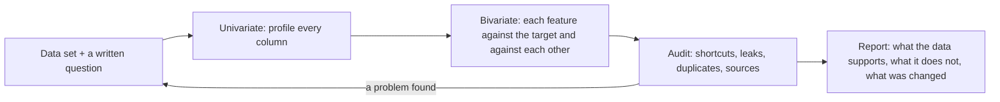
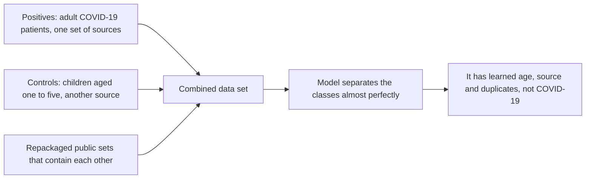

# Module 09: Systematic EDA: Univariate, Bivariate, Correlations, and Audit Checks

> **Prerequisites:** [Module 08: Statistical Visualization with Matplotlib and Seaborn](../08-data-visualization-with-matplotlib-and-seaborn/README.md).  
> **Estimated Reading Time:** 40 minutes  
> **Target Audience:** Engineers who receive a data set and must say, before anyone trains a model on it, what it contains, what is wrong with it, and what it can and cannot support

> [!TIP]
> **The Golden Rule of EDA:** Run the **same checklist** on every data set: profile every column, look at every relationship that matters with a chart and a number, and **audit** for anything that predicts the label too well. A feature that separates the classes almost perfectly is far more often a **shortcut or a leak** than a discovery, and summary statistics alone can hide all of it.

---

## Why This Matters

Exploratory data analysis is where you find out whether a data set can answer the question at all. Done as an unstructured browse, it finds what the analyst happens to look at. Done as a checklist, it finds the constant column, the identifier posing as a feature, the column filled only after the outcome, the source that differs between the classes, and the duplicates that will sit on both sides of a train/test split. Section 3 is a systematic review of more than sixty published COVID-19 imaging models in which several of these problems were common.

---

## 1. Architectural Mental Model: Profile, Relate, Audit



### Univariate: Every Column, the Same Questions

Type, share missing, number of distinct values, most common value and its share, range. Then the flags that need no judgement: a column with **one value** carries nothing; a column **unique on every row** is an identifier; a column **mostly missing** needs an explanation; a column whose missingness **depends on the label** is suspicious.

### Bivariate: Numbers That Need Pictures

| Measure | Detects | Misses |
| :--- | :--- | :--- |
| Pearson $r$ | Straight-line relationships | Curves, U shapes; dragged by single extreme points |
| Spearman $\rho$ (Pearson on ranks) | Any monotonic relationship; robust to extremes | U shapes and other non-monotonic patterns |
| Mutual information | Any dependence, including U shapes | Direction; needs more data; estimates vary |
| Rate per category | Differences between groups | Means nothing without the count and an interval |

Anscombe built four data sets in 1973 to show that identical summary statistics can describe completely different data; the program in section 4 reproduces them and shows three numbers that tell them apart.

### Audit: Too Good to Be True

| Check | Catches |
| :--- | :--- |
| Each feature alone against the label (AUC) | Leaks and shortcuts: AUC near 1 for a single column |
| Missingness of each column by label | Columns recorded only after the outcome |
| Source, site, device, time by label | Classes collected in different places or ways |
| Demographics by label | Controls from a different population |
| Exact and near duplicates, across the planned split | Records in both training and test |
| Timestamps of each feature against the label's | Information from the future |

---

## 2. Systematic Reference and Comparison Grids

### The EDA Checklist

| Step | Output |
| :--- | :--- |
| 1. Write the question and the unit of analysis | One sentence: "predict churn in the next 30 days, per customer" |
| 2. Profile all columns | The profile table and its automatic flags |
| 3. Check the target | Class balance, how it was defined, when it is known |
| 4. Each feature against the target | Charts with counts; correlations with their limits |
| 5. Features against each other | Duplicated or near-duplicate features |
| 6. Audit | Single-feature AUCs, sources, duplicates, timing |
| 7. Report | What the data supports, what it does not, every change made |

### Tools

| Task | pandas, SciPy, scikit-learn |
| :--- | :--- |
| Profile | `df.isna().mean()`, `df.nunique()`, `s.value_counts(normalize=True)`, `df.describe()` |
| Correlations | `scipy.stats.pearsonr`, `spearmanr`; `df.corr(method="spearman")` |
| Dependence | `sklearn.feature_selection.mutual_info_regression` / `_classif` |
| Rates with intervals | `scipy.stats.binomtest(k, n).proportion_ci(method="wilson")` |
| Single-feature AUC | `sklearn.metrics.roc_auc_score(y, feature)` |
| Duplicates across a split | `test.merge(train, on=columns, how="inner")` |

---

## 3. Real Case Study: Shortcuts in COVID-19 Imaging Models

Roberts et al., "Common pitfalls and recommendations for using machine learning to detect and prognosticate for COVID-19 using chest radiographs and CT scans", *Nature Machine Intelligence* 3:199 to 217 (2021). Quotations are from the arXiv version 4 of 5 January 2021.

| What the review reports | Detail |
| :--- | :--- |
| Scope | "Our search identified 2,212 studies, of which 415 were included after initial screening and, after quality screening, 61 studies were included in this systematic review" |
| The verdict | "Our review finds that none of the models identified are of potential clinical use due to methodological flaws and/or underlying biases" |
| Controls from another population | "Many papers (16/61) use the pneumonia dataset of Kermany et al. as a control group. They commonly fail to mention that this consists of paediatric patients aged between one and five." A model trained on adult COVID-19 patients and these controls "is likely to overperform as it is merely detecting children vs. adults" |
| The source as a shortcut | The review cites work showing that, with the lung region excluded entirely, the source of the images could still be identified, and COVID-19 still "diagnosed" above chance |
| Duplicated data | "'Frankenstein' datasets ... assembled from other datasets and redistributed under a new name" lead to "algorithms being trained and tested on identical or overlapping datasets whilst believing them to be from distinct sources" |



### What to Take From It

1. **Check who is in each class.** A table of source and age by label would have shown the paediatric controls immediately (Workflow 3, step 2).
2. **Treat near-perfect separation as a bug report.** A single column with an AUC near 1 should stop the project until it is explained.
3. **Test where the shortcut does not hold.** An external data set with adults in both classes and a single source is the honest test; in Workflow 3 it takes a model from 1.000 to 0.564.

---

## 4. Anscombe's Quartet, Audited, in Four Languages (`carousel`)

The program uses the four data sets Anscombe published in 1973. It prints the usual summary for each, which is the same for all four, then three audit numbers: the largest residual in residual standard deviations, the largest leverage (how much one point decides its own fitted value), and the correlation of the residuals with $(x - \bar{x})^2$, which detects a curve.

````carousel
```python
"""Anscombe's quartet (Anscombe, The American Statistician, 1973): four data sets with the same means, variances, correlation
and regression line. The summary block cannot tell them apart; three audit numbers can: the largest residual in standard
deviations, the largest leverage (how much one point decides the line), and whether the residuals curve with x."""
import math

X123 = [10.0, 8.0, 13.0, 9.0, 11.0, 14.0, 6.0, 4.0, 12.0, 7.0, 5.0]
SETS = [
    ("I", X123, [8.04, 6.95, 7.58, 8.81, 8.33, 9.96, 7.24, 4.26, 10.84, 4.82, 5.68]),
    ("II", X123, [9.14, 8.14, 8.74, 8.77, 9.26, 8.10, 6.13, 3.10, 9.13, 7.26, 4.74]),
    ("III", X123, [7.46, 6.77, 12.74, 7.11, 7.81, 8.84, 6.08, 5.39, 8.15, 6.42, 5.73]),
    ("IV", [8.0, 8.0, 8.0, 8.0, 8.0, 8.0, 8.0, 19.0, 8.0, 8.0, 8.0], [6.58, 5.76, 7.71, 8.84, 8.47, 7.04, 5.25, 12.50, 5.56, 7.91, 6.89]),
]
RESIDUAL_LIMIT = 2.5   # flag a point whose residual is more than this many residual standard deviations
LEVERAGE_LIMIT = 0.5   # flag a point that carries more than half the weight in deciding its own fitted value
CURVE_LIMIT = 0.5      # flag residuals whose correlation with (x - mean x)^2 is stronger than this


def total(values):
    s = 0.0
    for v in values:
        s += v
    return s


def mean(values):
    return total(values) / len(values)


def correlation(a, b):
    ma, mb = mean(a), mean(b)
    sab = total([(p - ma) * (q - mb) for p, q in zip(a, b)])
    saa = total([(p - ma) * (p - ma) for p in a])
    sbb = total([(q - mb) * (q - mb) for q in b])
    return sab / math.sqrt(saa * sbb)


print(f"{'set':>4} {'mean x':>7} {'var x':>6} {'mean y':>7} {'var y':>6} {'r':>6} {'line':>16} {'R^2':>5}")
audits = []
for name, x, y in SETS:
    n = len(x)
    mx, my = mean(x), mean(y)
    sxx = total([(v - mx) * (v - mx) for v in x])
    syy = total([(v - my) * (v - my) for v in y])
    sxy = total([(p - mx) * (q - my) for p, q in zip(x, y)])
    slope = sxy / sxx
    intercept = my - slope * mx
    r = sxy / math.sqrt(sxx * syy)
    print(f"{name:>4} {mx:7.3f} {sxx / (n - 1):6.3f} {my:7.3f} {syy / (n - 1):6.3f} {r:6.3f} {f'y = {intercept:.2f} + {slope:.3f}x':>16} {r * r:5.2f}")
    residuals = [q - (intercept + slope * p) for p, q in zip(x, y)]
    residual_sd = math.sqrt(total([e * e for e in residuals]) / (n - 2))
    worst = max(range(n), key=lambda i: abs(residuals[i]))
    leverage = [1 / n + (v - mx) * (v - mx) / sxx for v in x]
    heaviest = max(range(n), key=lambda i: leverage[i])
    curve = correlation(residuals, [(v - mx) * (v - mx) for v in x])
    audits.append((name, residuals[worst] / residual_sd, (x[worst], y[worst]), leverage[heaviest], (x[heaviest], y[heaviest]),
                   curve, len(set(x))))

print(f"\n{'set':>4} {'largest residual':>17} {'at point':>13} {'max leverage':>13} {'at point':>13} {'curvature':>10} {'distinct x':>11}  flags")
for name, z, zp, h, hp, curve, distinct in audits:
    flags = [label for label, hit in (("outlier", abs(z) > RESIDUAL_LIMIT), ("one point decides the line", h > LEVERAGE_LIMIT),
                                      ("curved", abs(curve) > CURVE_LIMIT)) if hit]
    print(f"{name:>4} {z:+14.2f} sd {f'({zp[0]:g}, {zp[1]:g})':>13} {h:13.3f} {f'({hp[0]:g}, {hp[1]:g})':>13} {curve:+10.3f} {distinct:11d}  "
          f"{', '.join(flags) if flags else 'none: a line is a fair summary'}")
```

<!-- slide -->

```typescript
// Anscombe's quartet (Anscombe, The American Statistician, 1973): four data sets with the same means, variances, correlation
// and regression line. The summary block cannot tell them apart; three audit numbers can: the largest residual in standard
// deviations, the largest leverage (how much one point decides the line), and whether the residuals curve with x.

const X123 = [10.0, 8.0, 13.0, 9.0, 11.0, 14.0, 6.0, 4.0, 12.0, 7.0, 5.0];
const SETS: [string, number[], number[]][] = [
  ["I", X123, [8.04, 6.95, 7.58, 8.81, 8.33, 9.96, 7.24, 4.26, 10.84, 4.82, 5.68]],
  ["II", X123, [9.14, 8.14, 8.74, 8.77, 9.26, 8.1, 6.13, 3.1, 9.13, 7.26, 4.74]],
  ["III", X123, [7.46, 6.77, 12.74, 7.11, 7.81, 8.84, 6.08, 5.39, 8.15, 6.42, 5.73]],
  ["IV", [8.0, 8.0, 8.0, 8.0, 8.0, 8.0, 8.0, 19.0, 8.0, 8.0, 8.0], [6.58, 5.76, 7.71, 8.84, 8.47, 7.04, 5.25, 12.5, 5.56, 7.91, 6.89]],
];
const RESIDUAL_LIMIT = 2.5; // flag a point whose residual is more than this many residual standard deviations
const LEVERAGE_LIMIT = 0.5; // flag a point that carries more than half the weight in deciding its own fitted value
const CURVE_LIMIT = 0.5; // flag residuals whose correlation with (x - mean x)^2 is stronger than this

function total(values: number[]): number {
  let s = 0.0;
  for (const v of values) s += v;
  return s;
}
const mean = (values: number[]) => total(values) / values.length;

function correlation(a: number[], b: number[]): number {
  const ma = mean(a);
  const mb = mean(b);
  const sab = total(a.map((p, i) => (p - ma) * (b[i] - mb)));
  const saa = total(a.map((p) => (p - ma) * (p - ma)));
  const sbb = total(b.map((q) => (q - mb) * (q - mb)));
  return sab / Math.sqrt(saa * sbb);
}

// Index of the first largest value, as Python's max() returns.
function argmax(values: number[]): number {
  let best = 0;
  for (let i = 1; i < values.length; i++) if (values[i] > values[best]) best = i;
  return best;
}

const f = (x: number, digits: number, width: number) => x.toFixed(digits).padStart(width);
const signed = (x: number, digits: number, width: number) => ((x >= 0 ? "+" : "") + x.toFixed(digits)).padStart(width);
const point = (x: number, y: number) => `(${x}, ${y})`;

console.log(`${"set".padStart(4)} ${"mean x".padStart(7)} ${"var x".padStart(6)} ${"mean y".padStart(7)} ${"var y".padStart(6)} ${"r".padStart(6)} ${"line".padStart(16)} ${"R^2".padStart(5)}`);
type Audit = [string, number, [number, number], number, [number, number], number, number];
const audits: Audit[] = [];
for (const [name, x, y] of SETS) {
  const n = x.length;
  const mx = mean(x);
  const my = mean(y);
  const sxx = total(x.map((v) => (v - mx) * (v - mx)));
  const syy = total(y.map((v) => (v - my) * (v - my)));
  const sxy = total(x.map((p, i) => (p - mx) * (y[i] - my)));
  const slope = sxy / sxx;
  const intercept = my - slope * mx;
  const r = sxy / Math.sqrt(sxx * syy);
  const line = `y = ${intercept.toFixed(2)} + ${slope.toFixed(3)}x`;
  console.log(`${name.padStart(4)} ${f(mx, 3, 7)} ${f(sxx / (n - 1), 3, 6)} ${f(my, 3, 7)} ${f(syy / (n - 1), 3, 6)} ${f(r, 3, 6)} ${line.padStart(16)} ${f(r * r, 2, 5)}`);
  const residuals = x.map((p, i) => y[i] - (intercept + slope * p));
  const residualSd = Math.sqrt(total(residuals.map((e) => e * e)) / (n - 2));
  const worst = argmax(residuals.map(Math.abs));
  const leverage = x.map((v) => 1 / n + ((v - mx) * (v - mx)) / sxx);
  const heaviest = argmax(leverage);
  const curve = correlation(residuals, x.map((v) => (v - mx) * (v - mx)));
  audits.push([name, residuals[worst] / residualSd, [x[worst], y[worst]], leverage[heaviest], [x[heaviest], y[heaviest]], curve, new Set(x).size]);
}

console.log(`\n${"set".padStart(4)} ${"largest residual".padStart(17)} ${"at point".padStart(13)} ${"max leverage".padStart(13)} ${"at point".padStart(13)} ${"curvature".padStart(10)} ${"distinct x".padStart(11)}  flags`);
for (const [name, z, zp, h, hp, curve, distinct] of audits) {
  const checks: [string, boolean][] = [
    ["outlier", Math.abs(z) > RESIDUAL_LIMIT],
    ["one point decides the line", h > LEVERAGE_LIMIT],
    ["curved", Math.abs(curve) > CURVE_LIMIT],
  ];
  const flags = checks.filter(([, hit]) => hit).map(([label]) => label);
  console.log(
    `${name.padStart(4)} ${signed(z, 2, 14)} sd ${point(...zp).padStart(13)} ${f(h, 3, 13)} ${point(...hp).padStart(13)} ${signed(curve, 3, 10)} ${String(distinct).padStart(11)}  ` +
      (flags.length ? flags.join(", ") : "none: a line is a fair summary"),
  );
}
```

<!-- slide -->

```go
// Anscombe's quartet (Anscombe, The American Statistician, 1973): four data sets with the same means, variances, correlation
// and regression line. The summary block cannot tell them apart; three audit numbers can: the largest residual in standard
// deviations, the largest leverage (how much one point decides the line), and whether the residuals curve with x.
package main

import (
	"fmt"
	"math"
	"strconv"
	"strings"
)

type dataset struct {
	name string
	x, y []float64
}

var x123 = []float64{10.0, 8.0, 13.0, 9.0, 11.0, 14.0, 6.0, 4.0, 12.0, 7.0, 5.0}
var sets = []dataset{
	{"I", x123, []float64{8.04, 6.95, 7.58, 8.81, 8.33, 9.96, 7.24, 4.26, 10.84, 4.82, 5.68}},
	{"II", x123, []float64{9.14, 8.14, 8.74, 8.77, 9.26, 8.10, 6.13, 3.10, 9.13, 7.26, 4.74}},
	{"III", x123, []float64{7.46, 6.77, 12.74, 7.11, 7.81, 8.84, 6.08, 5.39, 8.15, 6.42, 5.73}},
	{"IV", []float64{8.0, 8.0, 8.0, 8.0, 8.0, 8.0, 8.0, 19.0, 8.0, 8.0, 8.0}, []float64{6.58, 5.76, 7.71, 8.84, 8.47, 7.04, 5.25, 12.50, 5.56, 7.91, 6.89}},
}

const (
	residualLimit = 2.5 // flag a point whose residual is more than this many residual standard deviations
	leverageLimit = 0.5 // flag a point that carries more than half the weight in deciding its own fitted value
	curveLimit    = 0.5 // flag residuals whose correlation with (x - mean x)^2 is stronger than this
)

func total(values []float64) float64 {
	s := 0.0
	for _, v := range values {
		s += v
	}
	return s
}

func mean(values []float64) float64 { return total(values) / float64(len(values)) }

func mapIndex(n int, fn func(i int) float64) []float64 {
	out := make([]float64, n)
	for i := range out {
		out[i] = fn(i)
	}
	return out
}

func correlation(a, b []float64) float64 {
	ma, mb := mean(a), mean(b)
	sab := total(mapIndex(len(a), func(i int) float64 { return (a[i] - ma) * (b[i] - mb) }))
	saa := total(mapIndex(len(a), func(i int) float64 { return (a[i] - ma) * (a[i] - ma) }))
	sbb := total(mapIndex(len(b), func(i int) float64 { return (b[i] - mb) * (b[i] - mb) }))
	return sab / math.Sqrt(saa*sbb)
}

// argmax returns the index of the first largest value, as Python's max() does.
func argmax(values []float64) int {
	best := 0
	for i := 1; i < len(values); i++ {
		if values[i] > values[best] {
			best = i
		}
	}
	return best
}

func short(v float64) string { return strconv.FormatFloat(v, 'g', -1, 64) }

type audit struct {
	name           string
	z, h, curve    float64
	zx, zy, hx, hy float64
	distinct       int
}

func main() {
	fmt.Printf("%4s %7s %6s %7s %6s %6s %16s %5s\n", "set", "mean x", "var x", "mean y", "var y", "r", "line", "R^2")
	var audits []audit
	for _, s := range sets {
		x, y, n := s.x, s.y, len(s.x)
		mx, my := mean(x), mean(y)
		sxx := total(mapIndex(n, func(i int) float64 { return (x[i] - mx) * (x[i] - mx) }))
		syy := total(mapIndex(n, func(i int) float64 { return (y[i] - my) * (y[i] - my) }))
		sxy := total(mapIndex(n, func(i int) float64 { return (x[i] - mx) * (y[i] - my) }))
		slope := sxy / sxx
		intercept := my - slope*mx
		r := sxy / math.Sqrt(sxx*syy)
		line := fmt.Sprintf("y = %.2f + %.3fx", intercept, slope)
		fmt.Printf("%4s %7.3f %6.3f %7.3f %6.3f %6.3f %16s %5.2f\n", s.name, mx, sxx/float64(n-1), my, syy/float64(n-1), r, line, r*r)
		residuals := mapIndex(n, func(i int) float64 { return y[i] - (intercept + slope*x[i]) })
		residualSD := math.Sqrt(total(mapIndex(n, func(i int) float64 { return residuals[i] * residuals[i] })) / float64(n-2))
		worst := argmax(mapIndex(n, func(i int) float64 { return math.Abs(residuals[i]) }))
		leverage := mapIndex(n, func(i int) float64 { return 1/float64(n) + (x[i]-mx)*(x[i]-mx)/sxx })
		heaviest := argmax(leverage)
		curve := correlation(residuals, mapIndex(n, func(i int) float64 { return (x[i] - mx) * (x[i] - mx) }))
		distinct := map[float64]bool{}
		for _, v := range x {
			distinct[v] = true
		}
		audits = append(audits, audit{s.name, residuals[worst] / residualSD, leverage[heaviest], curve,
			x[worst], y[worst], x[heaviest], y[heaviest], len(distinct)})
	}

	fmt.Printf("\n%4s %17s %13s %13s %13s %10s %11s  flags\n", "set", "largest residual", "at point", "max leverage", "at point", "curvature", "distinct x")
	for _, a := range audits {
		var flags []string
		if math.Abs(a.z) > residualLimit {
			flags = append(flags, "outlier")
		}
		if a.h > leverageLimit {
			flags = append(flags, "one point decides the line")
		}
		if math.Abs(a.curve) > curveLimit {
			flags = append(flags, "curved")
		}
		summary := "none: a line is a fair summary"
		if len(flags) > 0 {
			summary = strings.Join(flags, ", ")
		}
		zp := "(" + short(a.zx) + ", " + short(a.zy) + ")"
		hp := "(" + short(a.hx) + ", " + short(a.hy) + ")"
		fmt.Printf("%4s %+14.2f sd %13s %13.3f %13s %+10.3f %11d  %s\n", a.name, a.z, zp, a.h, hp, a.curve, a.distinct, summary)
	}
}
```

<!-- slide -->

```csharp
// Anscombe's quartet (Anscombe, The American Statistician, 1973): four data sets with the same means, variances, correlation
// and regression line. The summary block cannot tell them apart; three audit numbers can: the largest residual in standard
// deviations, the largest leverage (how much one point decides the line), and whether the residuals curve with x.
using System;
using System.Collections.Generic;
using System.Globalization;
using System.Linq;

CultureInfo.CurrentCulture = CultureInfo.InvariantCulture;

double[] x123 = { 10.0, 8.0, 13.0, 9.0, 11.0, 14.0, 6.0, 4.0, 12.0, 7.0, 5.0 };
var sets = new (string Name, double[] X, double[] Y)[]
{
    ("I", x123, new[] { 8.04, 6.95, 7.58, 8.81, 8.33, 9.96, 7.24, 4.26, 10.84, 4.82, 5.68 }),
    ("II", x123, new[] { 9.14, 8.14, 8.74, 8.77, 9.26, 8.10, 6.13, 3.10, 9.13, 7.26, 4.74 }),
    ("III", x123, new[] { 7.46, 6.77, 12.74, 7.11, 7.81, 8.84, 6.08, 5.39, 8.15, 6.42, 5.73 }),
    ("IV", new[] { 8.0, 8.0, 8.0, 8.0, 8.0, 8.0, 8.0, 19.0, 8.0, 8.0, 8.0 }, new[] { 6.58, 5.76, 7.71, 8.84, 8.47, 7.04, 5.25, 12.50, 5.56, 7.91, 6.89 }),
};
const double ResidualLimit = 2.5; // flag a point whose residual is more than this many residual standard deviations
const double LeverageLimit = 0.5; // flag a point that carries more than half the weight in deciding its own fitted value
const double CurveLimit = 0.5;    // flag residuals whose correlation with (x - mean x)^2 is stronger than this

double Total(IEnumerable<double> values)
{
    double s = 0.0;
    foreach (double v in values) s += v;
    return s;
}

double Mean(double[] values) => Total(values) / values.Length;

double Correlation(double[] a, double[] b)
{
    double ma = Mean(a), mb = Mean(b);
    double sab = Total(a.Select((p, i) => (p - ma) * (b[i] - mb)));
    double saa = Total(a.Select(p => (p - ma) * (p - ma)));
    double sbb = Total(b.Select(q => (q - mb) * (q - mb)));
    return sab / Math.Sqrt(saa * sbb);
}

// Index of the first largest value, as Python's max() returns.
int Argmax(double[] values)
{
    int best = 0;
    for (int i = 1; i < values.Length; i++) if (values[i] > values[best]) best = i;
    return best;
}

string Signed(double v, string digits) => v.ToString($"+{digits};-{digits}");

Console.WriteLine($"{"set",4} {"mean x",7} {"var x",6} {"mean y",7} {"var y",6} {"r",6} {"line",16} {"R^2",5}");
var audits = new List<(string Name, double Z, string Zp, double H, string Hp, double Curve, int Distinct)>();
foreach (var (name, x, y) in sets)
{
    int n = x.Length;
    double mx = Mean(x), my = Mean(y);
    double sxx = Total(x.Select(v => (v - mx) * (v - mx)));
    double syy = Total(y.Select(v => (v - my) * (v - my)));
    double sxy = Total(x.Select((p, i) => (p - mx) * (y[i] - my)));
    double slope = sxy / sxx;
    double intercept = my - slope * mx;
    double r = sxy / Math.Sqrt(sxx * syy);
    string line = $"y = {intercept:F2} + {slope:F3}x";
    Console.WriteLine($"{name,4} {mx,7:F3} {sxx / (n - 1),6:F3} {my,7:F3} {syy / (n - 1),6:F3} {r,6:F3} {line,16} {r * r,5:F2}");
    double[] residuals = x.Select((p, i) => y[i] - (intercept + slope * p)).ToArray();
    double residualSd = Math.Sqrt(Total(residuals.Select(e => e * e)) / (n - 2));
    int worst = Argmax(residuals.Select(Math.Abs).ToArray());
    double[] leverage = x.Select(v => 1.0 / n + (v - mx) * (v - mx) / sxx).ToArray();
    int heaviest = Argmax(leverage);
    double curve = Correlation(residuals, x.Select(v => (v - mx) * (v - mx)).ToArray());
    audits.Add((name, residuals[worst] / residualSd, $"({x[worst]}, {y[worst]})", leverage[heaviest], $"({x[heaviest]}, {y[heaviest]})",
        curve, x.Distinct().Count()));
}

Console.WriteLine($"\n{"set",4} {"largest residual",17} {"at point",13} {"max leverage",13} {"at point",13} {"curvature",10} {"distinct x",11}  flags");
foreach (var a in audits)
{
    var flags = new List<string>();
    if (Math.Abs(a.Z) > ResidualLimit) flags.Add("outlier");
    if (a.H > LeverageLimit) flags.Add("one point decides the line");
    if (Math.Abs(a.Curve) > CurveLimit) flags.Add("curved");
    string summary = flags.Count > 0 ? string.Join(", ", flags) : "none: a line is a fair summary";
    Console.WriteLine($"{a.Name,4} {Signed(a.Z, "0.00"),14} sd {a.Zp,13} {a.H,13:F3} {a.Hp,13} {Signed(a.Curve, "0.000"),10} {a.Distinct,11}  {summary}");
}
```
````

**Observed output (identical in Python 3.13.14, Node 24, Go 1.22 and .NET 10):**

```text
 set  mean x  var x  mean y  var y      r             line   R^2
   I   9.000 11.000   7.501  4.127  0.816 y = 3.00 + 0.500x  0.67
  II   9.000 11.000   7.501  4.128  0.816 y = 3.00 + 0.500x  0.67
 III   9.000 11.000   7.500  4.123  0.816 y = 3.00 + 0.500x  0.67
  IV   9.000 11.000   7.501  4.123  0.817 y = 3.00 + 0.500x  0.67

 set  largest residual      at point  max leverage      at point  curvature  distinct x  flags
   I          -1.55 sd    (13, 7.58)         0.318    (14, 9.96)     -0.250          11  none: a line is a fair summary
  II          -1.54 sd      (4, 3.1)         0.318     (14, 8.1)     -1.000          11  curved
 III          +2.62 sd   (13, 12.74)         0.318    (14, 8.84)     +0.235          11  outlier
  IV          +1.49 sd     (8, 8.84)         1.000    (19, 12.5)     +0.000           2  one point decides the line
```

What to notice:

- **The summaries agree** to the precision shown: means 9 and 7.50, variances 11 and about 4.12, $r = 0.816$ (0.817 for IV), the line $y = 3.00 + 0.500x$, $R^2 = 0.67$.
- **The audit separates them.** I has no flag; II's residuals correlate with $(x - \bar{x})^2$ at $-1.000$, a curve; III has a residual of $+2.62$ residual standard deviations at (13, 12.74), an outlier; IV has a point with leverage 1.000 at (19, 12.5) and only 2 distinct x values, so that one point decides the slope.
- **Thresholds are choices** (2.5, 0.5 and 0.5 here) and are named constants, not magic numbers, so they can be reviewed.

---

## 5. Practical Hands-On Verification Workflows (Python 3.13, pandas 3.1.1, SciPy 1.18.1, scikit-learn 1.9.1)

### Workflow 1: A Profile of Every Column

```python
"""A column profile: one table that answers the same questions for every column, so that nothing is skipped because it looked
boring. The data set is simulated churn data with problems planted in it."""
import numpy as np
import pandas as pd

rng = np.random.default_rng(42)
N = 5_000
churned = rng.random(N) < 0.2
customers = pd.DataFrame({
    "customer_id": np.arange(100_000, 100_000 + N),
    "plan": rng.choice(["basic", "plus", "pro"], N, p=[0.6, 0.3, 0.1]),
    "monthly_fee": rng.choice([9.99, 19.99, 49.99], N),
    "tenure_months": rng.integers(1, 72, N),
    "support_calls": rng.poisson(np.where(churned, 3.0, 1.0)),
    "country": "IN",                                                     # one value everywhere
    "last_login_days": np.where(rng.random(N) < 0.08, np.nan, rng.exponential(10, N).round()),
    "cancel_reason": np.where(churned, rng.choice(["price", "service", "moved"], N), None),  # only filled after cancelling
    "churned": churned,
})


def profile(df):
    rows = []
    for name in df.columns:
        s = df[name]
        numeric = pd.api.types.is_numeric_dtype(s) and not pd.api.types.is_bool_dtype(s)
        rows.append({
            "column": name,
            "dtype": str(s.dtype),
            "missing %": round(100 * s.isna().mean(), 1),
            "distinct": s.nunique(dropna=True),
            "top value": s.mode(dropna=True).iloc[0] if s.notna().any() else None,
            "top %": round(100 * s.value_counts(normalize=True, dropna=True).iloc[0], 1) if s.notna().any() else None,
            "min": s.min() if numeric else "",
            "max": s.max() if numeric else "",
        })
    return pd.DataFrame(rows).set_index("column")


table = profile(customers)
print(table.to_string())

print("\nautomatic flags:")
for name, row in table.iterrows():
    notes = []
    if row["distinct"] == 1:
        notes.append("constant: carries no information")
    if row["distinct"] == len(customers):
        notes.append("unique per row: an identifier, not a feature")
    if row["missing %"] > 50:
        notes.append(f"{row['missing %']}% missing: ask why")
    if notes:
        print(f"  {name:16} {'; '.join(notes)}")
missing_by_target = customers.groupby("churned")["cancel_reason"].apply(lambda s: round(100 * s.isna().mean(), 1))
print("\ncancel_reason missing %, by churned:", missing_by_target.to_dict(), "-> filled only for churners: it is known after the outcome")
```

**Observed Output:**

```text
                   dtype  missing %  distinct top value  top %     min     max
column                                                                        
customer_id        int64        0.0      5000    100000    0.0  100000  104999
plan                 str        0.0         3     basic   60.0                
monthly_fee      float64        0.0         3     49.99   34.2    9.99   49.99
tenure_months      int64        0.0        71        44    1.7       1      71
support_calls      int64        0.0        11         1   32.3       0      11
country              str        0.0         1        IN  100.0                
last_login_days  float64        7.7        65       1.0    9.4     0.0    78.0
cancel_reason        str       79.5         3     price   33.9                
churned             bool        0.0         2     False   79.5                

automatic flags:
  customer_id      unique per row: an identifier, not a feature
  country          constant: carries no information
  cancel_reason    79.5% missing: ask why

cancel_reason missing %, by churned: {False: 100.0, True: 0.0} -> filled only for churners: it is known after the outcome
```

- **The automatic flags** found the identifier (`customer_id`, 5,000 distinct in 5,000 rows), the constant (`country`), and the mostly empty `cancel_reason` (79.5% missing).
- **Missingness by label** explained the last one: `cancel_reason` is missing for every customer who stayed and for none who left. It is recorded after the outcome, so it must not be a feature.

### Workflow 2: Relationships and Their Measures

```python
"""Relationships between two variables: what Pearson's r measures, what Spearman's rank correlation and mutual information add,
and why a rate per category needs its count next to it."""
import numpy as np
import pandas as pd
from scipy import stats
from sklearn.feature_selection import mutual_info_regression

rng = np.random.default_rng(4)
n = 2_000
x = rng.uniform(-3, 3, n)
cases = {
    "straight line": 2 * x + rng.normal(0, 1, n),
    "curve, rising": np.exp(x) + rng.normal(0, 0.5, n),
    "U shape": x * x + rng.normal(0, 0.5, n),
    "no relation": rng.normal(0, 1, n),
}
print(f"{'relationship':15} {'Pearson r':>10} {'Spearman':>9} {'mutual info':>12}")
for name, y in cases.items():
    mi = mutual_info_regression(x.reshape(-1, 1), y, random_state=0)[0]
    print(f"{name:15} {stats.pearsonr(x, y)[0]:10.3f} {stats.spearmanr(x, y)[0]:9.3f} {mi:12.3f}")
print("  the U shape has r near 0 but as much mutual information as the curves: zero correlation is not independence")

print("\n== one extreme point ==")
small_x = rng.normal(0, 1, 30)
small_y = rng.normal(0, 1, 30)
print(f"  30 unrelated points:         Pearson {stats.pearsonr(small_x, small_y)[0]:+.3f}  Spearman {stats.spearmanr(small_x, small_y)[0]:+.3f}")
small_x, small_y = np.append(small_x, 12.0), np.append(small_y, 12.0)
print(f"  the same plus one at (12,12): Pearson {stats.pearsonr(small_x, small_y)[0]:+.3f}  Spearman {stats.spearmanr(small_x, small_y)[0]:+.3f}")

print("\n== a rate per category, with its count ==")
orders = pd.DataFrame({
    "channel": rng.choice(["web", "app", "partner", "phone"], 3_000, p=[0.55, 0.40, 0.045, 0.005]),
})
orders["returned"] = rng.random(len(orders)) < orders["channel"].map({"web": 0.08, "app": 0.07, "partner": 0.08, "phone": 0.08})
summary = orders.groupby("channel")["returned"].agg(orders="size", returns="sum", rate="mean").sort_values("rate", ascending=False)
intervals = [stats.binomtest(int(k), int(n)).proportion_ci(method="wilson") for k, n in zip(summary["returns"], summary["orders"])]
summary["rate %"] = (100 * summary.pop("rate")).round(1)
summary["95% interval"] = [f"{100 * ci.low:.1f} to {100 * ci.high:.1f}" for ci in intervals]
print(summary.to_string())
print("  every channel was simulated with a return rate of 7 or 8%; the smallest groups have the widest intervals")
```

**Observed Output:**

```text
relationship     Pearson r  Spearman  mutual info
straight line        0.962     0.965        1.261
curve, rising        0.815     0.920        1.613
U shape              0.007     0.026        1.543
no relation          0.033     0.034        0.040
  the U shape has r near 0 but as much mutual information as the curves: zero correlation is not independence

== one extreme point ==
  30 unrelated points:         Pearson -0.023  Spearman -0.088
  the same plus one at (12,12): Pearson +0.844  Spearman +0.014

== a rate per category, with its count ==
         orders  returns  rate % 95% interval
channel                                      
web        1650      137     8.3   7.1 to 9.7
partner     121       10     8.3  4.6 to 14.5
app        1207       79     6.5   5.3 to 8.1
phone        22        1     4.5  0.8 to 21.8
  every channel was simulated with a return rate of 7 or 8%; the smallest groups have the widest intervals
```

- **The U shape** had Pearson 0.007 and Spearman 0.026, but mutual information 1.543, as high as the curves: a correlation near zero does not mean the variables are unrelated.
- **One extreme point** moved Pearson's r from -0.023 to +0.844 on 31 points; Spearman barely moved (+0.014).
- **Rates per channel** ranged from 4.5% to 8.3%, but every channel was simulated with 7 or 8%; the phone channel's interval (0.8% to 21.8% on 22 orders) shows that its rate says almost nothing.

### Workflow 3: An Audit for Shortcuts and Leaks

```python
"""An audit for shortcuts and leaks before any modelling, on simulated data shaped like the problems Roberts et al. (2021)
describe: positives and negatives from different sources, controls from a much younger population, a column recorded after
the outcome, and the same records in training and test."""
import numpy as np
import pandas as pd
from sklearn.linear_model import LogisticRegression
from sklearn.metrics import roc_auc_score

rng = np.random.default_rng(2021)


def make(n, positive_share, source_for_positive, source_for_negative, age_for_negative):
    y = rng.random(n) < positive_share
    return pd.DataFrame({
        "source": np.where(y, source_for_positive, source_for_negative),
        "age": np.where(y, rng.normal(60, 12, n), rng.normal(*age_for_negative, n)).round(),
        "opacity_score": rng.normal(np.where(y, 0.6, 0.0), 1.0, n),       # the real but weak signal
        "days_admitted_after_test": np.where(y, rng.poisson(6, n), rng.poisson(0.3, n)),  # known only after the outcome
        "label": y.astype(int),
    })


# Development data assembled from two sources: positives from hospital A, controls from a children's data set
dev = make(3_000, 0.4, "hospital A", "paediatric set", (3, 1.2))
dev = pd.concat([dev, dev.sample(300, random_state=1)], ignore_index=True)   # the same records added twice
# External data: one hospital, adult patients in both groups
external = make(2_000, 0.4, "hospital C", "hospital C", (58, 14))

print("== 1. each column alone against the label (AUC; 0.5 is chance) ==")
encoded = dev.assign(source=(dev["source"] == "hospital A").astype(int))
for column in ["source", "age", "opacity_score", "days_admitted_after_test"]:
    auc = roc_auc_score(encoded["label"], encoded[column])
    flag = "  <- too good: a shortcut or a leak?" if max(auc, 1 - auc) > 0.9 else ""
    print(f"  {column:26} {auc:.3f}{flag}")

print("\n== 2. who is in each class ==")
print(dev.groupby("label").agg(rows=("label", "size"), sources=("source", lambda s: sorted(s.unique())),
                               median_age=("age", "median")).to_string())

print("\n== 3. duplicates that will cross a random split ==")
shuffled = dev.sample(frac=1, random_state=0)
train, test = shuffled.iloc[:2_640], shuffled.iloc[2_640:]
columns = list(dev.columns)
overlap = test.merge(train.drop_duplicates(), on=columns, how="inner")
print(f"  {int(dev.duplicated().sum())} duplicated rows in the development data; {len(overlap)} test rows also appear in training")

print("\n== 4. what the shortcuts do to a model ==")
for features in (["age", "opacity_score", "days_admitted_after_test"], ["opacity_score"]):
    model = LogisticRegression(max_iter=1_000).fit(train[features], train["label"])
    inside = roc_auc_score(test["label"], model.predict_proba(test[features])[:, 1])
    outside = roc_auc_score(external["label"], model.predict_proba(external[features])[:, 1])
    print(f"  features {features}: AUC on the held-out split {inside:.3f}, on the external hospital {outside:.3f}")
```

**Observed Output:**

```text
== 1. each column alone against the label (AUC; 0.5 is chance) ==
  source                     1.000  <- too good: a shortcut or a leak?
  age                        1.000  <- too good: a shortcut or a leak?
  opacity_score              0.648
  days_admitted_after_test   0.995  <- too good: a shortcut or a leak?

== 2. who is in each class ==
       rows           sources  median_age
label                                    
0      1985  [paediatric set]         3.0
1      1315      [hospital A]        60.0

== 3. duplicates that will cross a random split ==
  300 duplicated rows in the development data; 82 test rows also appear in training

== 4. what the shortcuts do to a model ==
  features ['age', 'opacity_score', 'days_admitted_after_test']: AUC on the held-out split 1.000, on the external hospital 0.564
  features ['opacity_score']: AUC on the held-out split 0.640, on the external hospital 0.655
```

- **Single-column AUCs** flagged `source` (1.000), `age` (1.000) and `days_admitted_after_test` (0.995); the real signal, `opacity_score`, had 0.648.
- **Who is in each class:** every control came from the paediatric set with a median age of 3; every positive from hospital A with a median age of 60.
- **Duplicates:** 300 repeated records, of which 82 landed in the test part of a random split.
- **The model with the shortcuts** scored 1.000 on its held-out split and 0.564 on the external hospital; the model with only the real signal scored 0.640 and 0.655. The honest model looks worse inside and is better outside.

---

## 6. Hands-On Exercises and Independent Challenge

### Practical Exercises

1. **Read a profile.** A column `invoice_number` has 98% distinct values, and `region` has 1 distinct value in the training data. What do you do with each?
2. **Pick a measure.** Delivery time against distance looks like a curve that flattens. Which correlation do you report, and what chart goes with it?
3. **Explain an AUC.** A single feature, `account_closed_flag`, has an AUC of 0.99 for predicting churn. What questions do you ask?
4. **Extend the program.** Add a fifth data set to the quartet: Anscombe's set I with its point (14, 9.96) changed to (14, 20). Which audit flag fires?

<details><summary>Answers</summary>

1. `invoice_number` is effectively an identifier: drop it as a feature (or check whether its number encodes time, which could leak). `region` is constant in training; drop it, and find out why only one region is present, because the model will meet other regions in production.
2. Spearman's rank correlation for a monotonic curve, with a scatter plot (and perhaps a log scale on distance); Pearson's r would understate the relationship.
3. When the flag is set relative to the churn date, who sets it, and whether it would be known at prediction time. A flag recorded when the customer leaves is the outcome itself.
4. None of them. The changed point pulls the line towards itself (the line becomes $y = -0.19 + 0.956x$), so its own residual is only $+2.26$ residual standard deviations, under the 2.5 limit, and the program prints "none". The summaries do change (mean y 8.414, $r = 0.743$). A point can hide itself this way; the fix is a **deleted residual**: fit the line without the point, then measure how far the point is from that line.

</details>

### Independent Challenge

A hospital network gives you five years of patient records to build a model that predicts readmission within 30 days. The data comes from three hospitals that joined the network at different times and record diagnoses with different coding systems. Design the EDA and audit you run before any model is trained, and say what would make you stop.

<details><summary>Architectural Discussion</summary>

**Question and unit.** One row per discharge, label "readmitted within 30 days of this discharge", and features known at discharge time only.

**Profile and timing.** Profile every column per hospital and per year; record when each column is filled relative to the discharge. Anything filled after discharge (follow-up notes, readmission flags, billing completed later) is a leak.

**Sources.** Readmission rate, age, case mix and coding system by hospital and year; a model could learn "which hospital" instead of "which patient". Plan a validation on a held-out hospital and on the most recent year.

**Duplicates and patients.** The same patient appears many times; split by patient, not by row, and check that no patient crosses the split.

**Stop conditions.** A single column with an AUC above about 0.9, a label definition that differs between hospitals, or a held-out-hospital result far below the internal one. Each of these goes into the report with what was done about it.

</details>

---

## 7. Common Mistakes and Troubleshooting

- **Looking only at the columns that seem interesting.** Profile all of them, every time.
- **Reporting Pearson's r without a scatter plot.** It misses curves and is moved by single points.
- **Treating zero correlation as no relationship.** Check mutual information or the plot.
- **Ranking categories by rate without counts.** Add the count and an interval.
- **Celebrating a feature with an AUC near 1.** Investigate it as a leak or shortcut first.
- **Splitting rows at random when records repeat.** Deduplicate, and split by entity (patient, customer) or by time.
- **Validating only on data from the same sources.** Keep an external or later set for the final check.

---

## 8. Operational Validation Checkpoints and Checkpoint Quiz

<details><summary><strong>Checkpoint 1: A model scores 0.99 AUC on its test split in the first week of a project. What do you do next?</strong></summary>

Audit before celebrating: single-feature AUCs, missingness by label, sources and demographics by label, duplicates across the split, and the timing of each feature. Then evaluate on data from a different source or a later period.

</details>

<details><summary><strong>Checkpoint 2: Two features have a Pearson correlation of 0.02. Can you drop one as unrelated to the other?</strong></summary>

No. A near-zero Pearson r rules out a straight-line relationship only; plot them and compute Spearman and mutual information. The U shape in Workflow 2 had r = 0.007 and strong dependence.

</details>

<details><summary><strong>Checkpoint 3: The summary statistics of a new month's data match last month's exactly. Is the data unchanged?</strong></summary>

Not necessarily: Anscombe's quartet has identical summaries and different shapes. Compare distributions (histograms, quantiles), check for new outliers and high-leverage points, and plot the key relationships.

</details>

### Checkpoint Quiz

1. Name four flags a column profile can raise without any judgement.
2. What does Spearman's correlation detect that Pearson's does not, and what does neither detect?
3. What does a single-feature AUC of 0.5, and of 1.0, mean?
4. Why did the models in the Roberts et al. review that used the Kermany pneumonia data as controls overperform?
5. What does leverage measure, and why did set IV of the quartet have a leverage of 1?

<details><summary>Answers</summary>

1. A constant column, a column unique on every row (an identifier), a mostly missing column, and a column whose missingness differs by label.
2. Spearman detects monotonic but non-linear relationships and resists extreme points; neither detects non-monotonic relationships such as a U shape.
3. 0.5 means the feature alone ranks positives and negatives no better than chance; 1.0 means it separates them perfectly, which for one column usually means a leak or a shortcut.
4. The controls were children aged one to five and the positives were adults, so a model could separate the classes by age (and source) rather than by disease.
5. How much a point's own y value determines its fitted value; in set IV every point but one has x = 8, so the point at x = 19 alone decides the slope and the line must pass through it.

</details>

---

## 9. Interview Practice

> [!interview]
> Walk me through what you do in the first day with a new data set before building a model.

<details><summary>What a strong answer covers</summary>

- Write the question, the unit of analysis and when the label is known.
- Profile every column and act on the automatic flags.
- Look at the target and each important feature against it, with counts, intervals and plots.
- Audit for leaks and shortcuts: single-feature performance, sources and populations by label, duplicates, timing.
- Write down what the data can support and the validation plan (by entity, by time, external).

</details>

> [!interview]
> How do you tell a strong feature from a leak?

<details><summary>What a strong answer covers</summary>

- When is the feature's value known relative to the prediction time; is it a consequence of the label?
- Does it separate the classes almost perfectly on its own; does its missingness depend on the label?
- Does it hold up on data from another source or a later period?
- Is there a plausible mechanism, confirmed with someone who knows how the data is recorded?

</details>

---

## Further Reading and Sources

- [Roberts et al., "Common pitfalls and recommendations for using machine learning to detect and prognosticate for COVID-19 using chest radiographs and CT scans", arXiv:2008.06388 (version 4, January 2021)](https://arxiv.org/abs/2008.06388), published in Nature Machine Intelligence 3:199 to 217 (2021) — the source of the case study and its quotations.
- Anscombe, F. J., "Graphs in Statistical Analysis", The American Statistician 27(1):17 to 21 (1973), [doi:10.1080/00031305.1973.10478966](https://doi.org/10.1080/00031305.1973.10478966) — the quartet used in the program.
- [SciPy: `pearsonr`](https://docs.scipy.org/doc/scipy/reference/generated/scipy.stats.pearsonr.html) and [`spearmanr`](https://docs.scipy.org/doc/scipy/reference/generated/scipy.stats.spearmanr.html) — the two correlation measures.
- [scikit-learn: `mutual_info_regression`](https://scikit-learn.org/stable/modules/generated/sklearn.feature_selection.mutual_info_regression.html) — estimating dependence of any shape.
- [scikit-learn: Common pitfalls and recommended practices](https://scikit-learn.org/stable/common_pitfalls.html) — data leakage in preprocessing and evaluation.

## Next

Continue to **[Module 10: Capstone: End-to-End EDA Report & Clean Parquet Dataset](../10-capstone-end-to-end-eda-and-data-cleaning-report/README.md)**, where this checklist runs on one data set from raw file to clean Parquet and a written report.
