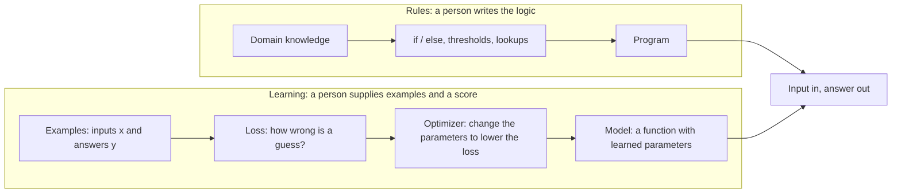
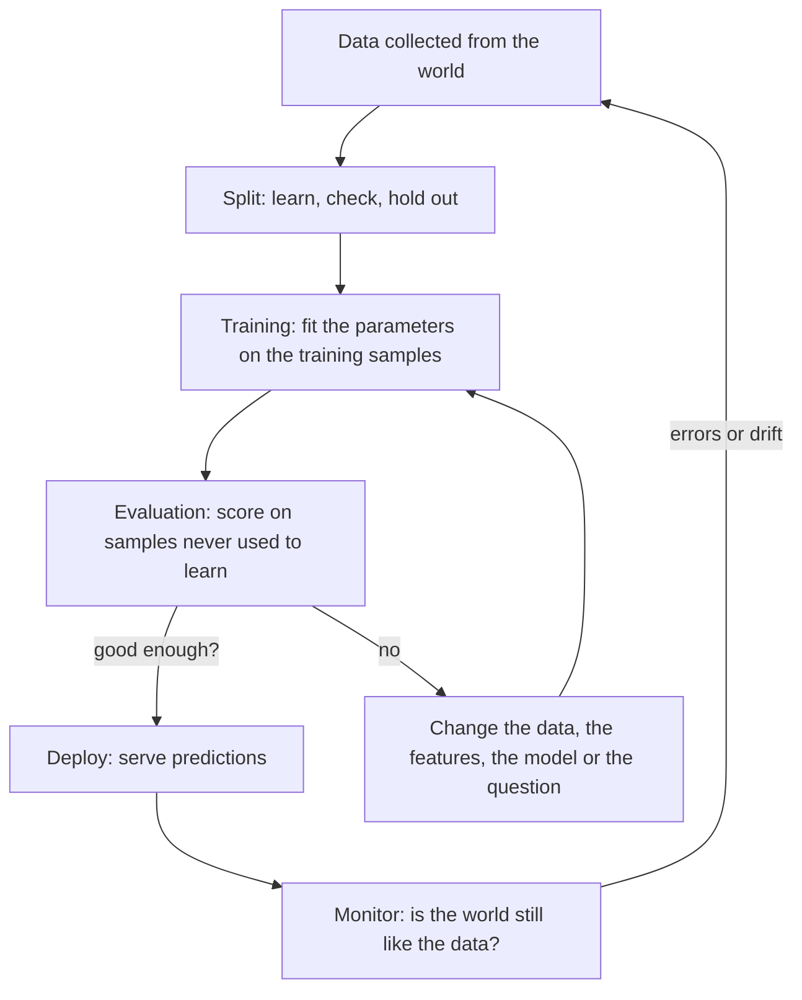
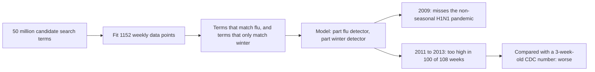

# Module 00: What Is Machine Learning? Learning From Examples, Parameters, Loss, and Generalization

> **Prerequisites:** [Track 01 Overview](../README.md). Helpful, not required: [Track 00, Module 01: NumPy Arrays](../../00-python-data-stack-and-eda/01-numpy-ndarrays-dtypes-and-memory-layout/README.md) for the array vocabulary.  
> **Estimated Reading Time:** 35 minutes  
> **Target Audience:** Backend engineers, data engineers and new ML engineers who will build, run or review a system that contains a model

> [!TIP]
> **The Golden Rule of Machine Learning:** Machine learning is **choosing the parameters of a function by measuring it on examples**. Whether the function is any good is a question about **examples it has not seen**, and it can only be answered honestly by holding some examples back and comparing against a simple baseline. Every technique in this track (splits, cross-validation, metrics, calibration, error analysis) exists to answer that one question without fooling yourself.

---

## Why This Matters

A model is software whose behaviour was **learned from data instead of written by a person**. That changes what can go wrong. A bug in ordinary code is a line you can point at; a flaw in a model is usually a flaw in the **examples** it learned from, in the **question** it was asked, or in how it was **measured**, and none of those is a line of code. The failures are quiet: the service returns a confident answer and nothing crashes.

Two engineering sources say the same thing from experience. Google's *Rules of Machine Learning* opens with "Don't be afraid to launch a product without machine learning" and says "Most of the problems you will face are, in fact, engineering problems." And the NeurIPS 2015 paper *Hidden Technical Debt in Machine Learning Systems* argues "it is dangerous to think of these quick wins as coming for free", listing risk factors that include "boundary erosion, entanglement, hidden feedback loops, undeclared consumers, data dependencies, configuration issues, changes in the external world".

This module gives you the vocabulary and the three ideas that the rest of the track builds on: **a model is a function with learned parameters**, **training is optimization of a loss on examples**, and **quality means generalization to new data**. You will implement the smallest possible learner in four languages, run real scikit-learn experiments, and read one real, well-documented failure: Google Flu Trends.

---

## 1. Architectural Mental Model: Rules, Examples, and Parameters

### Two Ways to Build Behaviour



In both columns the finished product is a function from an input to an answer. The difference is **where the numbers inside it came from**. A hand-written rule has a threshold a person picked (`radius > 15`). A learned model has parameters (the weights of a linear model, the splits of a tree) that an optimizer picked because they made the loss small on the examples.

### Mitchell's Definition: Task, Experience, Performance

Tom Mitchell's textbook *Machine Learning* (1997) describes the field as "the study of computer algorithms that improve automatically through experience", and its first chapter makes that precise with three parts. A program **learns** from experience **E** with respect to a class of tasks **T** and a performance measure **P** if its performance at the tasks, measured by P, improves with E. Every ML project is a choice of those three things, and a project that cannot name them is not yet a project.

- **T**, the task: what the model is asked to do (classify a message, estimate a time).
- **E**, the experience: the examples it learns from.
- **P**, the performance measure: how you will judge it, *on data it did not learn from*.

Workflow 2 below is this definition measured: the same learner, with more and more experience, and its performance on a fixed set of unseen samples.

### The Life of a Model



Training is **offline and occasional**, serving is **online and constant**, and monitoring closes the loop, because the world the examples came from keeps changing.

### The Few Equations You Need

A model is a function $\hat{y} = f_\theta(x)$ with parameters $\theta$. A **loss** $L(\hat{y}, y)$ scores one guess; for a number, the squared error $(\hat{y} - y)^2$ is the usual choice. **Training** looks for the parameters that make the average loss over the $n$ training examples small:

$$\theta^{*} = \arg\min_{\theta} \; \frac{1}{n} \sum_{i=1}^{n} L\big(f_\theta(x_i),\, y_i\big)$$

When the loss can be differentiated, the optimizer repeatedly takes a small step **downhill**, where the learning rate $\eta$ sets the step size:

$$\theta \leftarrow \theta - \eta \, \nabla_\theta J(\theta)$$

For a line $\hat{y} = wx + b$ with mean squared error, the two slopes of the error are

$$\frac{\partial J}{\partial w} = \frac{2}{n}\sum_{i}(wx_i + b - y_i)\,x_i, \qquad \frac{\partial J}{\partial b} = \frac{2}{n}\sum_{i}(wx_i + b - y_i)$$

and those two sums are exactly the `gradient` function in section 4. The quantity that matters in practice is not the training error but the **generalization gap**: the error on new data minus the error on the training data. Training lowers the first; evaluation measures the second.

---

## 2. Systematic Reference and Comparison Grids

### Vocabulary: ML Term, Meaning, and Software Analogy

| Term | Meaning | Software analogy | Who sets it |
| :--- | :--- | :--- | :--- |
| **Example** (sample, row) | One input with, usually, its answer | One test case | The data |
| **Feature** $x_j$ | One measurable input property (a column) | One argument of a function | You, by choosing what to measure |
| **Label** (target) $y$ | The answer the model should produce | The expected output | The data (often the expensive part) |
| **Model** $f_\theta$ | A function whose behaviour depends on parameters | A function with configuration baked in | The learning algorithm family |
| **Parameters** $\theta$ | Numbers **learned** from examples (weights, split points) | Values generated by a build step | The optimizer |
| **Hyperparameters** | Settings **chosen** before learning (learning rate $\eta$, tree depth, regularization strength `C`) | Build flags | You |
| **Loss** | What training minimizes: a smooth score of one guess | The build's objective | You |
| **Metric** | What you report and decide on (accuracy, error in minutes) | The acceptance criterion | You, from the business |
| **Training set** | Examples used to fit parameters | The build input | You |
| **Test set** | Examples held back to measure generalization | A release test no one tuned against | You, and you do not look at it while tuning |
| **Inference** | Using the trained model on new input | Running the program | The serving system |
| **Baseline** | A trivial or simple approach you must beat | The current behaviour in production | You |

### Rules, Learning, or Both

| Question | Hand-written rules | Learned model |
| :--- | :--- | :--- |
| What do you need to start? | Someone who knows the rule | Enough labelled examples |
| Can you explain every decision? | Yes, line by line | Sometimes (a linear model's weights), often only in aggregate |
| What happens when the world changes? | Someone edits the rule | The model must be retrained on new data, and you must notice that it is needed |
| Many weak signals that interact? | Rules multiply and conflict | The strength of learning |
| Cost of a wrong answer to maintain | A bug in a line | A data, labelling or drift problem |
| Typical first move | **Start here** (the Rules of ML's Rule #1) | Add it when a baseline plus data justify it |

Most production systems are **both**: a model proposes, rules enforce (a fraud model scores an order, a rule blocks sanctioned countries regardless of the score).

### Three Tasks Written as T, E and P

| Product | T (task) | E (experience) | P (performance measure) |
| :--- | :--- | :--- | :--- |
| Spam filter | Label each message spam or not spam | Messages with labels (for example from users' "report spam" actions) | Share of spam caught while wrongly blocking very little good mail |
| Delivery-time estimate | Predict the minutes from order to door | Past orders with their actual times | Average absolute error in minutes, on future orders |
| Fraud flagging | Flag orders likely to be fraudulent | Past orders and their eventual outcome (chargebacks arrive weeks later) | Precision and recall at the number of orders a team can review |

Notice that **E is not free**: labels for fraud arrive late and are rare, which is why "can we use ML?" is usually a question about the labels.

### Loss Is Not the Metric

| | Loss | Metric |
| :--- | :--- | :--- |
| Used for | Training: must be smooth enough to optimize | Deciding: matches what the business cares about |
| Example for a classifier | Log loss (cross-entropy) | Precision at a fixed recall, or cost per wrong decision |
| Example for a number | Mean squared error | Mean absolute error in minutes |
| Danger | A model can lower the loss while the metric stands still | A metric you cannot optimize directly still needs a loss that moves it |

The two are often different on purpose, and later modules of this track are about choosing and reading metrics.

---

## 3. Real Case Study: Google Flu Trends

This case is not an invented incident. It is documented in a peer-reviewed policy forum: David Lazer, Ryan Kennedy, Gary King and Alessandro Vespignani, "The Parable of Google Flu: Traps in Big Data Analysis", *Science* 343 (6176), 14 March 2014, pp. 1203–1205. Every statement in the table is from that paper.

| What the paper reports | Detail |
| :--- | :--- |
| The headline | In February 2013 Nature reported that Google Flu Trends (GFT) was "predicting more than double the proportion of doctor visits for influenza-like illness (ILI)" than the US Centers for Disease Control and Prevention (CDC), "despite the fact that GFT was built to predict CDC reports" |
| How it was built | "The methodology was to find the best matches among 50 million search terms to fit 1152 data points" |
| A warning sign | Developers "weeded out" seasonal search terms unrelated to flu but strongly correlated with the CDC data, "such as those regarding high school basketball"; the authors write that this "should have been a warning that the big data were overfitting the small number of cases" |
| Missed the unusual season | It "completely missed the nonseasonal 2009 influenza A-H1N1 pandemic"; "in short, the initial version of GFT was part flu detector, part winter detector" |
| A persistent bias, not a single mistake | After the 2009 update it "has missed high for 100 out of 108 weeks starting with August 2011"; GFT overestimated the 2012–2013 season and overshot 2011–2012 by more than 50% |
| The errors had structure | "Last week's errors predict this week's errors (temporal autocorrelation)", and error varies with the time of year (seasonality) |
| A simple baseline beat it | "Even 3-week-old CDC data do a better job of projecting current flu prevalence than GFT" |
| What would have helped | Combining GFT with lagged CDC data and dynamically recalibrating "can substantially improve on the performance of GFT or the CDC alone" |



### What to Take From It

1. **A model learns whatever separates its examples, including coincidences.** With 50 million candidate features and 1,152 examples, some features will match by chance. This is overfitting, and Modules 03 and 04 of this track show how to measure it.
2. **Association is not mechanism.** The model found terms that moved with the flu season; it had no way to know which of them were caused by the flu.
3. **Always compare with a simple baseline.** A lagged copy of the very number it was meant to predict beat it. The baseline in Workflow 1 plays the same role.
4. **Look at the errors over time.** Errors that predict the next errors mean the model is missing structure that a plain statistical method could find.
5. **Evaluation does not end at launch.** The paper says that combining sources is "no substitute for ongoing evaluation and improvement". That is the monitoring arrow in the life-of-a-model diagram.

---

## 4. The Smallest Learner in Four Languages (`carousel`)

The program below learns a **line** `y = w x + b` from ten examples. The world that made the examples is `y = 3x + 2` plus noise that no line can explain, and the learner never sees that rule, only the pairs. It starts from a flat line at zero, takes 2,000 downhill steps, and compares the result with the **exact least-squares answer**. All four versions print the same ten lines.

````carousel
```python
"""Learning a line from examples: start with a wrong guess, and move the two parameters downhill on the mean squared error until the
line fits the examples. Then the exact least-squares answer, for comparison, and a prediction for an input never seen."""

XS = [0, 1, 2, 3, 4, 5, 6, 7, 8, 9]
NOISE = [0.3, -0.5, 0.2, 0.4, -0.1, -0.4, 0.5, 0.1, -0.3, 0.2]
# The "world" is y = 3x + 2 plus some noise that no line can explain. The learner sees only the pairs (x, y).
YS = [2.0 + 3.0 * x + e for x, e in zip(XS, NOISE)]
LEARNING_RATE = 0.01
EPOCHS = 2000


def mean_squared_error(w, b):
    total = 0.0
    for x, y in zip(XS, YS):
        total += (w * x + b - y) ** 2
    return total / len(XS)


def gradient(w, b):
    """The slope of the error with respect to w and to b: how much the error grows if each parameter grows."""
    dw = db = 0.0
    for x, y in zip(XS, YS):
        residual = w * x + b - y
        dw += 2 * residual * x
        db += 2 * residual
    return dw / len(XS), db / len(XS)


def least_squares():
    """The closed-form answer for a line: no search needed, because this model is simple enough to solve exactly."""
    n = len(XS)
    mean_x = mean_y = 0.0
    for x, y in zip(XS, YS):
        mean_x += x
        mean_y += y
    mean_x, mean_y = mean_x / n, mean_y / n
    covariance = variance = 0.0
    for x, y in zip(XS, YS):
        covariance += (x - mean_x) * (y - mean_y)
        variance += (x - mean_x) ** 2
    w = covariance / variance
    return w, mean_y - w * mean_x


if __name__ == "__main__":
    w, b = 0.0, 0.0  # the starting guess: a flat line at zero
    print(f"{len(XS)} examples, learning rate {LEARNING_RATE}")
    for epoch in range(EPOCHS + 1):
        if epoch in (0, 1, 10, 100, 500, 2000):
            print(f"epoch {epoch:4d}  w={w:7.4f}  b={b:7.4f}  mse={mean_squared_error(w, b):8.4f}")
        dw, db = gradient(w, b)
        w, b = w - LEARNING_RATE * dw, b - LEARNING_RATE * db
    best_w, best_b = least_squares()
    print(f"least squares   w={best_w:7.4f}  b={best_b:7.4f}  mse={mean_squared_error(best_w, best_b):8.4f}")
    print(f"the world used  w= 3.0000  b= 2.0000  mse={mean_squared_error(3.0, 2.0):8.4f}")
    print(f"prediction for x=12: {w * 12 + b:.4f} (the world's noise-free value is 38)")
```

<!-- slide -->

```typescript
// Learning a line from examples: start with a wrong guess, and move the two parameters downhill on the mean squared error until the
// line fits the examples. Then the exact least-squares answer, for comparison, and a prediction for an input never seen.

const XS: number[] = [0, 1, 2, 3, 4, 5, 6, 7, 8, 9];
const NOISE: number[] = [0.3, -0.5, 0.2, 0.4, -0.1, -0.4, 0.5, 0.1, -0.3, 0.2];
// The "world" is y = 3x + 2 plus some noise that no line can explain. The learner sees only the pairs (x, y).
const YS: number[] = XS.map((x, i) => 2.0 + 3.0 * x + NOISE[i]);
const LEARNING_RATE = 0.01;
const EPOCHS = 2000;

function meanSquaredError(w: number, b: number): number {
  let total = 0.0;
  for (let i = 0; i < XS.length; i++) total += (w * XS[i] + b - YS[i]) ** 2;
  return total / XS.length;
}

/** The slope of the error with respect to w and to b: how much the error grows if each parameter grows. */
function gradient(w: number, b: number): [number, number] {
  let dw = 0.0;
  let db = 0.0;
  for (let i = 0; i < XS.length; i++) {
    const residual = w * XS[i] + b - YS[i];
    dw += 2 * residual * XS[i];
    db += 2 * residual;
  }
  return [dw / XS.length, db / XS.length];
}

/** The closed-form answer for a line: no search needed, because this model is simple enough to solve exactly. */
function leastSquares(): [number, number] {
  const n = XS.length;
  let meanX = 0.0;
  let meanY = 0.0;
  for (let i = 0; i < n; i++) {
    meanX += XS[i];
    meanY += YS[i];
  }
  meanX /= n;
  meanY /= n;
  let covariance = 0.0;
  let variance = 0.0;
  for (let i = 0; i < n; i++) {
    covariance += (XS[i] - meanX) * (YS[i] - meanY);
    variance += (XS[i] - meanX) ** 2;
  }
  const w = covariance / variance;
  return [w, meanY - w * meanX];
}

const fixed = (value: number, width: number): string => value.toFixed(4).padStart(width);

let w = 0.0; // the starting guess: a flat line at zero
let b = 0.0;
console.log(`${XS.length} examples, learning rate ${LEARNING_RATE}`);
for (let epoch = 0; epoch <= EPOCHS; epoch++) {
  if ([0, 1, 10, 100, 500, 2000].includes(epoch)) {
    console.log(`epoch ${String(epoch).padStart(4)}  w=${fixed(w, 7)}  b=${fixed(b, 7)}  mse=${fixed(meanSquaredError(w, b), 8)}`);
  }
  const [dw, db] = gradient(w, b);
  w -= LEARNING_RATE * dw;
  b -= LEARNING_RATE * db;
}
const [bestW, bestB] = leastSquares();
console.log(`least squares   w=${fixed(bestW, 7)}  b=${fixed(bestB, 7)}  mse=${fixed(meanSquaredError(bestW, bestB), 8)}`);
console.log(`the world used  w= 3.0000  b= 2.0000  mse=${fixed(meanSquaredError(3.0, 2.0), 8)}`);
console.log(`prediction for x=12: ${(w * 12 + b).toFixed(4)} (the world's noise-free value is 38)`);
```

<!-- slide -->

```go
// Learning a line from examples: start with a wrong guess, and move the two parameters downhill on the mean squared error until the
// line fits the examples. Then the exact least-squares answer, for comparison, and a prediction for an input never seen.
package main

import "fmt"

var xs = []float64{0, 1, 2, 3, 4, 5, 6, 7, 8, 9}
var noise = []float64{0.3, -0.5, 0.2, 0.4, -0.1, -0.4, 0.5, 0.1, -0.3, 0.2}

const (
	learningRate = 0.01
	epochs       = 2000
)

// The "world" is y = 3x + 2 plus some noise that no line can explain. The learner sees only the pairs (x, y).
func examples() []float64 {
	ys := make([]float64, len(xs))
	for i, x := range xs {
		ys[i] = 2.0 + 3.0*x + noise[i]
	}
	return ys
}

var ys = examples()

func meanSquaredError(w, b float64) float64 {
	total := 0.0
	for i := range xs {
		residual := w*xs[i] + b - ys[i]
		total += residual * residual
	}
	return total / float64(len(xs))
}

// gradient is the slope of the error with respect to w and to b: how much the error grows if each parameter grows.
func gradient(w, b float64) (float64, float64) {
	dw, db := 0.0, 0.0
	for i := range xs {
		residual := w*xs[i] + b - ys[i]
		dw += 2 * residual * xs[i]
		db += 2 * residual
	}
	n := float64(len(xs))
	return dw / n, db / n
}

// leastSquares is the closed-form answer for a line: no search needed, because this model is simple enough to solve exactly.
func leastSquares() (float64, float64) {
	n := float64(len(xs))
	meanX, meanY := 0.0, 0.0
	for i := range xs {
		meanX += xs[i]
		meanY += ys[i]
	}
	meanX /= n
	meanY /= n
	covariance, variance := 0.0, 0.0
	for i := range xs {
		covariance += (xs[i] - meanX) * (ys[i] - meanY)
		variance += (xs[i] - meanX) * (xs[i] - meanX)
	}
	w := covariance / variance
	return w, meanY - w*meanX
}

func main() {
	w, b := 0.0, 0.0 // the starting guess: a flat line at zero
	fmt.Printf("%d examples, learning rate %v\n", len(xs), learningRate)
	for epoch := 0; epoch <= epochs; epoch++ {
		switch epoch {
		case 0, 1, 10, 100, 500, 2000:
			fmt.Printf("epoch %4d  w=%7.4f  b=%7.4f  mse=%8.4f\n", epoch, w, b, meanSquaredError(w, b))
		}
		dw, db := gradient(w, b)
		w -= learningRate * dw
		b -= learningRate * db
	}
	bestW, bestB := leastSquares()
	fmt.Printf("least squares   w=%7.4f  b=%7.4f  mse=%8.4f\n", bestW, bestB, meanSquaredError(bestW, bestB))
	fmt.Printf("the world used  w= 3.0000  b= 2.0000  mse=%8.4f\n", meanSquaredError(3.0, 2.0))
	fmt.Printf("prediction for x=12: %.4f (the world's noise-free value is 38)\n", w*12+b)
}
```

<!-- slide -->

```csharp
// Learning a line from examples: start with a wrong guess, and move the two parameters downhill on the mean squared error until the
// line fits the examples. Then the exact least-squares answer, for comparison, and a prediction for an input never seen.
using System;
using System.Globalization;

CultureInfo.DefaultThreadCurrentCulture = CultureInfo.InvariantCulture;
CultureInfo.CurrentCulture = CultureInfo.InvariantCulture;

double[] xs = { 0, 1, 2, 3, 4, 5, 6, 7, 8, 9 };
double[] noise = { 0.3, -0.5, 0.2, 0.4, -0.1, -0.4, 0.5, 0.1, -0.3, 0.2 };
// The "world" is y = 3x + 2 plus some noise that no line can explain. The learner sees only the pairs (x, y).
double[] ys = new double[xs.Length];
for (int i = 0; i < xs.Length; i++) ys[i] = 2.0 + 3.0 * xs[i] + noise[i];
const double LearningRate = 0.01;
const int Epochs = 2000;

double MeanSquaredError(double w, double b)
{
    double total = 0.0;
    for (int i = 0; i < xs.Length; i++)
    {
        double residual = w * xs[i] + b - ys[i];
        total += residual * residual;
    }
    return total / xs.Length;
}

// The slope of the error with respect to w and to b: how much the error grows if each parameter grows.
(double, double) Gradient(double w, double b)
{
    double dw = 0.0, db = 0.0;
    for (int i = 0; i < xs.Length; i++)
    {
        double residual = w * xs[i] + b - ys[i];
        dw += 2 * residual * xs[i];
        db += 2 * residual;
    }
    return (dw / xs.Length, db / xs.Length);
}

// The closed-form answer for a line: no search needed, because this model is simple enough to solve exactly.
(double, double) LeastSquares()
{
    int n = xs.Length;
    double meanX = 0.0, meanY = 0.0;
    for (int i = 0; i < n; i++)
    {
        meanX += xs[i];
        meanY += ys[i];
    }
    meanX /= n;
    meanY /= n;
    double covariance = 0.0, variance = 0.0;
    for (int i = 0; i < n; i++)
    {
        covariance += (xs[i] - meanX) * (ys[i] - meanY);
        variance += (xs[i] - meanX) * (xs[i] - meanX);
    }
    double slope = covariance / variance;
    return (slope, meanY - slope * meanX);
}

double w = 0.0, b = 0.0; // the starting guess: a flat line at zero
Console.WriteLine($"{xs.Length} examples, learning rate {LearningRate.ToString("0.0#", CultureInfo.InvariantCulture)}");
for (int epoch = 0; epoch <= Epochs; epoch++)
{
    if (epoch is 0 or 1 or 10 or 100 or 500 or 2000)
    {
        Console.WriteLine($"epoch {epoch,4}  w={w,7:F4}  b={b,7:F4}  mse={MeanSquaredError(w, b),8:F4}");
    }
    var (dw, db) = Gradient(w, b);
    w -= LearningRate * dw;
    b -= LearningRate * db;
}
var (bestW, bestB) = LeastSquares();
Console.WriteLine($"least squares   w={bestW,7:F4}  b={bestB,7:F4}  mse={MeanSquaredError(bestW, bestB),8:F4}");
Console.WriteLine($"the world used  w= 3.0000  b= 2.0000  mse={MeanSquaredError(3.0, 2.0),8:F4}");
Console.WriteLine($"prediction for x=12: {w * 12 + b:F4} (the world's noise-free value is 38)");
```
````

**Observed output (identical in Python 3.13.14, Node 24, Go 1.22 and .NET 10):**

```text
10 examples, learning rate 0.01
epoch    0  w= 0.0000  b= 0.0000  mse=315.8500
epoch    1  w= 1.8936  b= 0.3108  mse= 55.2047
epoch   10  w= 3.2290  b= 0.6009  mse=  0.7080
epoch  100  w= 3.1378  b= 1.1756  mse=  0.3247
epoch  500  w= 3.0143  b= 1.9503  mse=  0.1107
epoch 2000  w= 3.0000  b= 2.0400  mse=  0.1084
least squares   w= 3.0000  b= 2.0400  mse=  0.1084
the world used  w= 3.0000  b= 2.0000  mse=  0.1100
prediction for x=12: 38.0400 (the world's noise-free value is 38)
```

Read it as a student of learning:

- **Loss falls quickly, then slowly.** The error drops from 315.85 to 55.20 in one step and to 0.71 in ten, then creeps from 0.32 at epoch 100 to 0.1084 at epoch 2000. Early steps remove large mistakes; late steps polish.
- **Training found the exact answer.** `w=3.0000, b=2.0400` is what least squares gives in one formula. For this tiny model the answer can be computed directly; for models with millions of parameters it cannot, and the downhill search is all you have.
- **The learned line fits the examples better than the true rule does.** `the world used` (3 and 2) has error 0.1100; the learned line has 0.1084. The learner bent slightly to the noise in these ten examples. That small gap is the seed of **overfitting**: with more flexible models, the learner can fit noise a lot.
- **Inference is one multiplication and one addition.** The prediction for the unseen input 12 is 38.04 against the noise-free 38. Training took 2,000 passes; using the model is trivial, an asymmetry you will see at scale in Workflow 3.

---

## 5. Practical Hands-On Verification Workflows (Python 3.13 + scikit-learn)

Run the scripts in a virtual environment (verified on **Python 3.13.14, scikit-learn 1.9.1, NumPy 2.5.5**):

```bash
python -m venv .venv
source .venv/bin/activate        # on Windows: .venv\Scripts\activate
pip install numpy scikit-learn
```

### Workflow 1: Four Ways to Decide, Scored on Samples the Learner Never Saw

The data set ships with scikit-learn: 569 tumour samples with 30 measurements each, from the UCI Wisconsin Diagnostic Breast Cancer data (212 malignant, 357 benign; in the data `0` means malignant and `1` benign). The script holds back 143 samples and compares: always the common answer, a rule a person wrote, a learned threshold on one feature, and a learned weight for every feature.

```python
"""Four ways to decide 'malignant or benign' on a real data set that ships with scikit-learn (569 tumour samples, 30 measurements each):
guess the common answer, apply a rule a person wrote, learn one threshold, and learn 31 parameters. All are scored on samples
that were not used to learn anything."""
import numpy as np
import sklearn
from sklearn.dummy import DummyClassifier
from sklearn.datasets import load_breast_cancer
from sklearn.linear_model import LogisticRegression
from sklearn.model_selection import train_test_split
from sklearn.pipeline import make_pipeline
from sklearn.preprocessing import StandardScaler
from sklearn.tree import DecisionTreeClassifier

data = load_breast_cancer()
X, y = data.data, data.target  # target 0 = malignant, 1 = benign
features = list(data.feature_names)
print(f"scikit-learn {sklearn.__version__}, numpy {np.__version__}")
print(f"{X.shape[0]} samples, {X.shape[1]} features; malignant {int((y == 0).sum())}, benign {int((y == 1).sum())}")

X_train, X_test, y_train, y_test = train_test_split(X, y, test_size=0.25, stratify=y, random_state=0)
print(f"learn from {len(y_train)} samples, test on {len(y_test)} the learner never saw\n")

# 1. No learning at all: always say the more common answer in the training samples.
baseline = DummyClassifier(strategy="most_frequent").fit(X_train, y_train)

# 2. A rule written by a person from one measurement, with no data: 'a large tumour is malignant'.
radius = features.index("mean radius")
rule_predictions = np.where(X_test[:, radius] > 15.0, 0, 1)

# 3. Learn one threshold on one feature: a tree of depth 1 searches for the best split.
stump = DecisionTreeClassifier(max_depth=1, random_state=0).fit(X_train, y_train)

# 4. Learn a weight for every feature (and an intercept) after putting the features on one scale.
model = make_pipeline(StandardScaler(), LogisticRegression(max_iter=1000)).fit(X_train, y_train)

rows = [
    ("always the common answer", baseline.score(X_test, y_test), "nothing learned but the majority label"),
    ("hand-written rule: mean radius > 15", float((rule_predictions == y_test).mean()), "no parameters, a number chosen by a person"),
    ("learned stump", stump.score(X_test, y_test), f"1 threshold: {features[stump.tree_.feature[0]]} <= {stump.tree_.threshold[0]:.3f}"),
    ("logistic regression, all 30", model.score(X_test, y_test), "31 parameters: 30 weights and an intercept"),
]
print(f"{'method':38} {'test accuracy':>13}   what it contains")
for name, accuracy, note in rows:
    print(f"{name:38} {accuracy:>13.3f}   {note}")

weights = model[-1].coef_[0]
order = np.argsort(-np.abs(weights))[:3]
print("\nthe three weights with the largest size (features were standardized, so they are comparable):")
for i in order:
    print(f"  {features[i]:22} {weights[i]:+.2f}   (positive pushes towards 'benign')")
print(f"model has {weights.size + 1} learned parameters; its settings that were chosen by a person (hyperparameters): C={model[-1].C}, max_iter=1000")
```

**Observed Output:**

```text
scikit-learn 1.9.1, numpy 2.5.5
569 samples, 30 features; malignant 212, benign 357
learn from 426 samples, test on 143 the learner never saw

method                                 test accuracy   what it contains
always the common answer                       0.629   nothing learned but the majority label
hand-written rule: mean radius > 15            0.888   no parameters, a number chosen by a person
learned stump                                  0.888   1 threshold: worst perimeter <= 106.100
logistic regression, all 30                    0.958   31 parameters: 30 weights and an intercept

the three weights with the largest size (features were standardized, so they are comparable):
  radius error           -1.21   (positive pushes towards 'benign')
  worst texture          -1.11   (positive pushes towards 'benign')
  mean concave points    -1.11   (positive pushes towards 'benign')
model has 31 learned parameters; its settings that were chosen by a person (hyperparameters): C=1.0, max_iter=1000
```

How to read it:

- **The baseline is not zero.** Saying "benign" every time scores 0.629 because 63% of the samples are benign. Any model that cannot beat that has learned nothing; this is why accuracy alone can mislead, a point Module 05 returns to.
- **A hand-written rule scored as well as a learned threshold** (0.888 each). That is not a surprise: the learned stump also uses a single threshold. It is a reminder that on 143 test samples, one sample is 0.7 points, so small differences between methods mean little. The learning curve below shows the size of that noise.
- **Using every measurement helps a lot:** 31 learned parameters reach 0.958. The three largest weights are on features a person would not have picked as the rule, which is the argument for learning when many weak signals interact.
- **Parameters against hyperparameters:** the 31 numbers were *learned*; `C=1.0` and `max_iter=1000` were *chosen*.

### Workflow 2: Performance Improves With Experience (Mitchell's E and P)

The same learner on 4, 10, 20, ... 426 training samples, each size drawn 30 times, all scored on the same 143 unseen samples:

```python
"""Performance improves with experience: the same learner trained on 10, 20, ... 320 samples, each size repeated 30 times with a
different random draw of training samples, always scored on the same 143 samples it never saw."""
import numpy as np
from sklearn.datasets import load_breast_cancer
from sklearn.linear_model import LogisticRegression
from sklearn.model_selection import train_test_split
from sklearn.pipeline import make_pipeline
from sklearn.preprocessing import StandardScaler

X, y = load_breast_cancer(return_X_y=True)
X_train, X_test, y_train, y_test = train_test_split(X, y, test_size=0.25, stratify=y, random_state=0)
majority = float(max((y_test == 0).mean(), (y_test == 1).mean()))
print(f"always the common answer: {majority:.3f} on the {len(y_test)} test samples; every learner below starts from the training pool of {len(y_train)}")
print(f"{'training samples':>16} {'mean accuracy':>14} {'std':>6} {'worst':>6} {'best':>6}")

repeats = 30
for size in (4, 10, 20, 40, 80, 160, 320, len(y_train)):
    scores = []
    for repeat in range(repeats):
        rng = np.random.default_rng(repeat)
        while True:  # a draw must contain both classes, or there is nothing to tell apart
            chosen = rng.choice(len(y_train), size=size, replace=False)
            if len(set(y_train[chosen])) == 2:
                break
        model = make_pipeline(StandardScaler(), LogisticRegression(max_iter=1000)).fit(X_train[chosen], y_train[chosen])
        scores.append(model.score(X_test, y_test))
    scores = np.array(scores)
    note = "  (the whole pool: one draw, so no spread)" if size == len(y_train) else ""
    print(f"{size:>16} {scores.mean():>14.3f} {scores.std():>6.3f} {scores.min():>6.3f} {scores.max():>6.3f}{note}")
```

**Observed Output:**

```text
always the common answer: 0.629 on the 143 test samples; every learner below starts from the training pool of 426
training samples  mean accuracy    std  worst   best
               4          0.824  0.088  0.615  0.951
              10          0.874  0.060  0.664  0.944
              20          0.920  0.029  0.860  0.972
              40          0.939  0.016  0.895  0.972
              80          0.949  0.013  0.923  0.972
             160          0.955  0.008  0.937  0.972
             320          0.957  0.007  0.937  0.972
             426          0.958  0.000  0.958  0.958  (the whole pool: one draw, so no spread)
```

Performance rises quickly and then flattens: 0.824 on 4 samples, 0.920 on 20, 0.949 on 80, 0.957 on 320. Two other numbers matter as much as the mean. The **spread falls** (the standard deviation goes from 0.088 to 0.007), which means a small training set gives you a lucky or unlucky model, and the **worst case with 10 samples is 0.664**, barely above the 0.629 baseline. More data helps most at the start; once the curve is flat, more of the same examples will not fix the model, a signal that the limit is the features or the model family, not the amount of data.

### Workflow 3: Training Is Offline and Rare, Inference Is Online and Constant

Three models on one generated data set (40,000 samples, 30 features; this one is synthetic, from `make_classification`), measuring the accuracy, the training time, the time of one prediction, the time of a batch, and the size of the saved model:

```python
"""Training happens rarely and offline; inference happens constantly and online. Three models on the same generated data set
(40,000 samples, 30 features: scikit-learn's make_classification, so synthetic) with the cost of each phase measured."""
import pickle
import time

import numpy as np
from sklearn.datasets import make_classification
from sklearn.ensemble import HistGradientBoostingClassifier, RandomForestClassifier
from sklearn.linear_model import LogisticRegression
from sklearn.model_selection import train_test_split
from sklearn.pipeline import make_pipeline
from sklearn.preprocessing import StandardScaler

X, y = make_classification(n_samples=40_000, n_features=30, n_informative=15, n_redundant=5, flip_y=0.02, random_state=0)
X_train, X_test, y_train, y_test = train_test_split(X, y, test_size=0.25, random_state=0)
print(f"{len(y_train):,} samples to learn from, {len(y_test):,} to test on\n")

models = [
    ("logistic regression", make_pipeline(StandardScaler(), LogisticRegression(max_iter=1000))),
    ("random forest, 100 trees", RandomForestClassifier(n_estimators=100, n_jobs=1, random_state=0)),
    ("gradient boosting (histogram)", HistGradientBoostingClassifier(random_state=0)),
]
print(f"{'model':30} {'accuracy':>8} {'train':>8} {'1 row':>10} {'10,000 rows':>12} {'saved size':>11}")
for name, model in models:
    t0 = time.perf_counter()
    model.fit(X_train, y_train)
    train_s = time.perf_counter() - t0

    one = X_test[:1]
    model.predict(one)  # warm up
    t0 = time.perf_counter()
    for i in range(300):
        model.predict(X_test[i:i + 1])
    one_ms = (time.perf_counter() - t0) / 300 * 1000

    t0 = time.perf_counter()
    model.predict(X_test)
    batch_ms = (time.perf_counter() - t0) * 1000

    size_mb = len(pickle.dumps(model)) / 1024**2
    print(f"{name:30} {model.score(X_test, y_test):>8.3f} {train_s:>6.2f} s {one_ms:>7.2f} ms {batch_ms:>9.0f} ms {size_mb:>8.2f} MB")
```

**Observed Output (timings vary by machine; the ratios do not):**

```text
30,000 samples to learn from, 10,000 to test on

model                          accuracy    train      1 row  10,000 rows  saved size
logistic regression               0.763   0.02 s    0.18 ms         2 ms     0.00 MB
random forest, 100 trees          0.962   9.27 s    3.74 ms       142 ms    32.52 MB
gradient boosting (histogram)     0.962   0.62 s    2.39 ms        12 ms     0.40 MB
```

Five lessons sit in this table:

1. **The model family matters more than tuning:** logistic regression scores 0.763 here, the tree-based models 0.962, because the synthetic data has structure a straight-line boundary cannot express.
2. **The same accuracy can cost very different amounts:** the random forest and gradient boosting both reach 0.962, but training takes 9.27 s against 0.62 s and the saved model is 32.5 MB against 0.4 MB.
3. **Training is a one-off, serving is every request:** the slowest training here is nine seconds; a service that answers a million predictions a day pays the per-prediction cost a million times.
4. **Batching is the serving lever:** one gradient-boosting prediction took 2.39 ms, but 10,000 rows took 12 ms, about 1.2 microseconds per row. Calling a model one row at a time pays a fixed overhead each time.
5. **A model is an artifact with a size and a version:** 32.5 MB has to be stored, shipped and loaded by every serving replica, which is why model size appears in engineering decisions.

---

## 6. Hands-On Exercises and Independent Challenge

### Practical Exercises

1. **Break the optimizer.** In the carousel program set `LEARNING_RATE` to `0.1`, then to `0.001`, and run each. Explain both results, and find the largest learning rate that still converges.
2. **One bad example.** Add an eleventh example, `x = 10` with `y = 100`, to the data and fit a line with `numpy.polyfit`. How far do `w` and `b` move, and which property of the squared error explains it?
3. **Write a better rule, honestly.** In Workflow 1, write your own rule from at most two measurements and score it on the test samples. You will be tempted to adjust the thresholds after seeing the score. What have you done to the test set if you do?
4. **Name T, E and P.** For "predict the delivery time of a food order", write T, E and P, a baseline you could ship tomorrow with no learning, and one reason the labels might be biased.

<details><summary>Answers</summary>

1. With `0.1` the weights blow up (`w` reaches about 1e12 within 16 steps): the step overshoots the valley and each overshoot is bigger than the last. With `0.001` the line is still wrong after 2,000 steps (`w=3.078, b=1.548`, error 0.178): too small a step is just slow. For a line with squared error the step must stay below $2/\lambda_{\max}$, where $\lambda_{\max}$ is the largest curvature of the error; here that is about 58.4, so the limit is about **0.034**. `0.03` converges to the same answer as the program.
2. With the outlier, the least-squares line becomes `w=6.09, b=-7.23` instead of `w=3.00, b=2.04`: one point out of eleven doubled the slope. Squaring the residual makes a large miss count far more than a small one, so the fit bends towards it. An ordinary new point `(10, 32)` instead leaves the line at `w=2.998, b=2.046`. This is why outliers, and robust losses, matter.
3. If you adjust the rule after seeing the test score, the test set has become part of your learning: you have fitted a parameter (your threshold) to it, and its score is now optimistic. This is exactly the mistake the next modules teach you to prevent with a validation set and a final untouched test set.
4. T: predict minutes from order to door. E: past orders with their actual delivery times. P: average absolute error in minutes on future orders. A baseline with no learning: the restaurant's quoted time, or the median time for that restaurant. Biased labels: you only observe orders that were accepted and delivered, so cancelled and very late orders, or areas you did not serve, are missing.

</details>

### Independent Challenge

A product manager asks: "Can we use machine learning to catch fraudulent orders? We have two weeks of orders and 12 confirmed frauds." Write the questions you would ask, say what you would build first, and say how you would decide whether a model is worth shipping.

<details><summary>Architectural Discussion</summary>

Start with the three things: T (flag an order for review before it ships), E (two weeks of orders and only **12 positive examples**, which is far too few to learn from and to hold some back), and P (not accuracy: with fraud this rare, always saying "not fraud" scores above 99%; the measure is how many frauds are caught for the number of reviews the team can do).

Questions: How are frauds confirmed, and how late (chargebacks arrive weeks after the order, so recent orders look clean)? What does a missed fraud cost against a wrongly blocked customer? What do you do today? Which orders are never reviewed, so their frauds are never labelled?

Build first, following the Rules of Machine Learning: **a rules-and-heuristics baseline** (block known bad addresses, flag unusual order size, a velocity limit) and **a pipeline that records every decision and its eventual outcome**, because that is how you get labels. Evaluate it on the later weeks only, never on a random mix of days, so you measure what it will face in production.

Ship a model when it beats the baseline on future data at the review capacity you have, with enough labelled examples that the estimate is stable (a handful of frauds in the test set will give a very noisy number, as Workflow 2 showed for small samples), and with a monitor that tells you when it has stopped working. A model that is not needed yet is a correct answer.

</details>

---

## 7. Common Mistakes and Troubleshooting

- **Reporting performance on the training data.** A model can fit its own examples perfectly and be useless on new ones. The only meaningful score is on data it did not learn from.
- **Skipping the baseline.** "92% accuracy" means nothing until you know that always guessing the common class gives 63%, or that a lagged copy of last week's value gives 90%.
- **Confusing loss and metric.** A falling loss does not prove the business metric improved; always report the metric you will be judged by.
- **Treating a hyperparameter as learned.** The learning rate, regularization strength and tree depth are choices; if you tune them against the test set, you have used it to learn.
- **Reading a small difference in one split as a real difference.** On 143 samples one prediction is 0.7 points; repeat with different splits (Module 03) before concluding.
- **Believing that more data fixes everything.** The curve flattens: when it does, change the features, the model or the question.
- **Forgetting that the world changes.** The data came from a moment in time; a model with no monitor degrades silently, as Google Flu Trends did.
- **Using ML where a rule would do.** If a threshold works and the cost of an error is low, the maintenance cost of a model is not worth it.

---

## 8. Operational Validation Checkpoints and Checkpoint Quiz

<details><summary><strong>Checkpoint 1: A teammate reports 97% accuracy on a fraud model. What do you ask?</strong></summary>

Ask what fraction of the data is fraud: if it is 2%, always predicting "no fraud" gets 98%, so 97% is worse than doing nothing. Ask which data the 97% was measured on (training or held-out), whether the split respected time, and what precision and recall it has at the number of cases the team can review. Accuracy on its own cannot answer any of these.

</details>

<details><summary><strong>Checkpoint 2: Training loss keeps falling but your held-out score stopped improving. What is happening?</strong></summary>

The generalization gap is growing: the model is fitting details (including noise) of the training examples that do not carry over to new data. Stop training earlier, simplify the model or constrain it (regularization), add data, or change features. Track both curves; Module 04 develops learning curves and the bias-variance picture.

</details>

<details><summary><strong>Checkpoint 3: The model was accurate for a year and is now getting worse. Where do you look?</strong></summary>

At the world, not the code. Compare today's inputs with the training data (a changed feature, a new customer segment, a new competitor), check whether the labels or their meaning changed, and look at the errors over time: structured errors, like Google Flu Trends' high-for-100-of-108-weeks, point to a missing or changed relationship. Retrain on recent data and, more importantly, add monitoring so you hear about it earlier.

</details>

### Checkpoint Quiz

1. State Mitchell's three parts of a learning problem, and name them for a spam filter.
2. What is the difference between a parameter and a hyperparameter? Give an example of each from Workflow 1.
3. Why is the training error a poor estimate of how a model will do in production?
4. In Workflow 2, what did the shrinking standard deviation tell you, and what did the flattening mean tell you?
5. Name two things that went wrong in Google Flu Trends, in terms of what this module teaches.

<details><summary>Answers</summary>

1. T, the task; E, the experience (the examples); P, the performance measure. For a spam filter: T is labelling a message spam or not, E is messages with labels, P is the share of spam caught while wrongly blocking very little good mail, measured on messages the model did not learn from.
2. A parameter is learned from the examples (one of the 30 weights or the intercept of the logistic regression); a hyperparameter is chosen by a person (`C=1.0`, `max_iter=1000`, the learning rate in the carousel program).
3. The model was fitted to those very examples, so their error is optimistic. Production inputs are new, and the relevant error is the generalization error, which is estimated on held-out data.
4. The shrinking spread (0.088 to 0.007) means a small training set gives results that depend heavily on which examples happened to be drawn. The flattening mean (0.949 on 80 to 0.957 on 320) means more examples of the same kind add little, so the limit is elsewhere (features, model family).
5. For example: **overfitting** (50 million candidate terms fitted to 1,152 points, so it matched winter as well as flu), and **no baseline or ongoing evaluation** (a 3-week-old CDC figure beat it, and its errors, high in 100 of 108 weeks and autocorrelated, were a visible signal that it was missing structure).

</details>

---

## 9. Interview Practice

> [!interview]
> Explain to a backend engineer what "training a model" means, and how it differs from writing code.

<details><summary>What a strong answer covers</summary>

- A model is a function with parameters; training searches for the parameter values that make a loss small on examples, instead of a person writing the logic.
- The behaviour is determined by data, loss and the model family, so bugs look like bad data, wrong labels or the wrong question.
- Training is offline and occasional; inference is online and constant; they have different costs.
- Quality is generalization, measured on held-out data against a baseline; mention drift.

</details>

> [!interview]
> When would you not use machine learning?

<details><summary>What a strong answer covers</summary>

- When a simple rule or heuristic already meets the need and the cost of an error is low (Rules of ML, Rule #1).
- When there are no labels or too few, or the labels arrive too late, or the question is not stable.
- When the system must be fully explainable line by line, or where the maintenance cost of retraining and monitoring is not justified.
- Even then, build the baseline and the data pipeline first; they are needed either way.

</details>

---

## Further Reading and Sources

- [Tom Mitchell, *Machine Learning* (McGraw-Hill, 1997), book page](http://www.cs.cmu.edu/~tom/mlbook.html) — the definition "the study of computer algorithms that improve automatically through experience" and the task, experience and performance framing of chapter 1.
- [Lazer, Kennedy, King and Vespignani, "The Parable of Google Flu: Traps in Big Data Analysis" (Science 343(6176), 2014)](https://gking.harvard.edu/publication/the-parable-of-google-flu-traps-in-big-data-analysis/) — the source of every statement in the case study of section 3.
- [Martin Zinkevich, "Rules of Machine Learning: Best Practices for ML Engineering"](https://developers.google.com/machine-learning/guides/rules-of-ml) — Rule #1 (launch without ML), Rule #4 (keep the first model simple) and Rule #5 (test the infrastructure independently).
- [Sculley et al., "Hidden Technical Debt in Machine Learning Systems" (NeurIPS 2015)](https://papers.nips.cc/paper_files/paper/2015/hash/86df7dcfd896fcaf2674f757a2463eba-Abstract.html) — why ML systems cost more to maintain than their code suggests.
- [scikit-learn: `load_breast_cancer`](https://scikit-learn.org/stable/modules/generated/sklearn.datasets.load_breast_cancer.html) — the data set of Workflows 1 and 2: 569 samples, 30 features, 212 malignant and 357 benign.

## Next

Continue to **[Module 01: Problem Framing: Supervised, Unsupervised, Ranking, and RL](../01-problem-framing-supervised-unsupervised-rl/README.md)**, where you decide which of these tasks you actually have before choosing a model.
