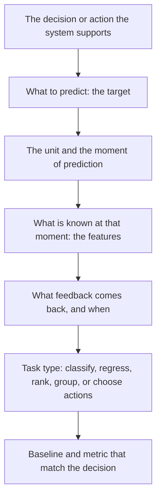
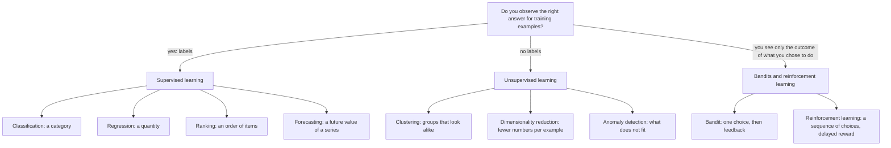
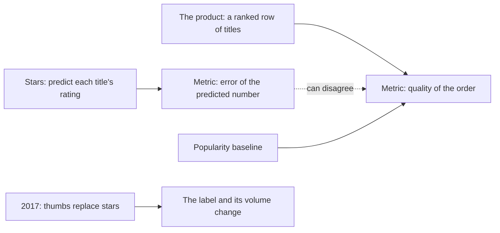

# Module 01: Problem Framing: Supervised, Unsupervised, Ranking, and RL

> **Prerequisites:** [Module 00: What Is Machine Learning?](../00-what-is-machine-learning/README.md) and the [Track 01 Overview](../README.md).  
> **Estimated Reading Time:** 35 minutes  
> **Target Audience:** Engineers and data scientists who will decide what a model should predict, and engineers who must judge whether a proposed ML project is the right project

> [!TIP]
> **The Golden Rule of Problem Framing:** The model comes last. First fix **the decision the system supports**, **what is known at the moment of that decision**, **what you will predict** and **what feedback you will get back**. Those four choices determine the task type (classification, regression, ranking, clustering, bandit or full reinforcement learning), the right baseline and the right metric. A well-tuned model for the wrong framing is a wrong product; the reverse is almost never true.

---

## Why This Matters

Choosing an algorithm is the part of a machine-learning project that has the best tooling and the least leverage. The scikit-learn documentation's own guide on picking an estimator says that "often the hardest part of solving a machine learning problem can be finding the right estimator for the job", and the same is true one level up: the hardest part is finding the right *problem*. The same data can support a classifier, a regressor, a ranker or a clustering, and each answers a different question, is judged by a different number, and fails in a different way.

This module is the map: the families of learning problems, the checklist that turns a business request into one of them, and three ways in which getting the framing wrong shows up in numbers. You will run all three in this lesson: the same data asked different questions, a model with the **lower error that ranks worse**, and a model that only learns about what it chose to show.

---

## 1. Architectural Mental Model: From a Decision to a Task

### The Framing Chain



Read it top to bottom as questions. *What will someone do differently because of this prediction?* *What is the thing predicted, for which unit (a user, an order, a user-item pair), and at what time?* *Which inputs will genuinely be available at that time?* (If the answer is "the ones in last month's table", that is the start of Module 02's leakage problem.) *What do you learn after acting, and how long does it take?*

### The Families of Learning Problems



A short definition of each, with where this curriculum teaches it:

| Family | The question it answers | Learns from | Typical output | Where in this curriculum |
| :--- | :--- | :--- | :--- | :--- |
| **Classification** | Which category? (spam or not, which digit) | Examples with the right category | A class and usually a probability | Tracks 03 and 04 |
| **Regression** | How much? (minutes, price) | Examples with the right number | A number | Tracks 03 and 04 |
| **Ranking** | In what order should these items appear? | Relevance signals for items in a list | A score per item; the order is what matters | Track 08 |
| **Forecasting** | What will this series be later? | The history of the series | Future values with an uncertainty | Track 07 |
| **Clustering** | Which examples are alike? | No labels | A group id per example | Track 06 |
| **Dimensionality reduction** | How can each example be described with fewer numbers? | No labels | A shorter vector | Tracks 02 and 06 |
| **Anomaly detection** | Which examples do not fit? | Mostly unlabelled data | A score of how unusual | Track 06 |
| **Bandits and reinforcement learning** | Which action should I take? | The rewards of the actions it took | A policy | Track 09 |

### Why Feedback Changes the Problem

In supervised learning the data is a table that exists before you begin: someone recorded the answer for every row, and what you do with the model does not change those rows. In **bandit and reinforcement-learning** problems the data is created by your own choices. You learn the click rate of the banner you showed, and **nothing about the banners you did not show**. A model fitted to such logs inherits the past policy's blind spots; to find out about an option you have to try it, which costs something now. Workflow 3 measures this.

---

## 2. Systematic Reference and Comparison Grids

### The Framing Checklist

| Question | What it decides | What goes wrong if you skip it |
| :--- | :--- | :--- |
| What decision will the prediction change? | The target and what "good" means | A beautiful model nobody uses |
| What exactly is the target, and who defined it? | The label | A proxy that does not match the goal (a click is not satisfaction) |
| What is the unit of prediction, and when is it made? | The rows and the time of the features | Training on information that does not exist yet at prediction time |
| What does an error cost, in each direction? | The metric and the threshold | Accuracy that hides an expensive mistake |
| What do you do today (the baseline)? | The bar to beat | A "92%" that is worse than a rule |
| How are the labels obtained, how late, how noisy? | Whether supervised learning is possible at all | Twelve confirmed frauds and a model |
| What feedback comes back from your own actions? | Supervised, or bandit and reinforcement learning | A model that never learns about what it does not show |
| How will you tell it has stopped working? | Monitoring | Silent decay |

### Reframing: One Problem, Several Tasks

| Business request | Framings | What each one throws away or adds |
| :--- | :--- | :--- |
| "Estimate delivery time" | Regression on minutes; classification into on time or late; a distribution or interval | Classes lose the amount; a point estimate hides the uncertainty |
| "Which customers will leave?" | Classification of leave in 30 days; time-to-event; ranking by risk for a limited retention budget | The right choice depends on whether you can act on all of them or on 500 |
| "What should we show on the home page?" | Rating prediction (regression); ranking; a bandit that learns from impressions | A good rating predictor can rank badly (Workflow 2) |
| "Group our customers" | Clustering; or supervised on a label you already trust | Clusters have no ground truth: the marketing team has to find them useful |

### Where the Supervision Comes From

| Signal | Example | Strength | Hazard |
| :--- | :--- | :--- | :--- |
| **Explicit labels** | A clinician's diagnosis; a user's "report spam" | Closest to the truth | Expensive, slow, sometimes biased by who bothers to label |
| **Implicit feedback** | Clicks, purchases, watch time | Plentiful | It is a proxy, and it is only collected for what was shown |
| **Outcomes that arrive late** | Chargebacks, churn | The real target | Recent examples have no label yet, which skews the data |
| **Weak or programmatic labels** | Rules, keyword lists, another model | Cheap and fast | Systematic errors that the model learns |
| **Self-supervision** | Predict the next word, a masked part | Needs no human labels | The task is a stand-in for the one you care about |

---

## 3. Real Case Study: Netflix, From Predicting Ratings to Ranking Titles

This is a documented change of framing, not an invented outage. It comes from two public Netflix sources: the blog post "Netflix Recommendations: Beyond the 5 Stars (Part 2)" by Xavier Amatriain and Justin Basilico (20 June 2012), and Netflix's announcement "Goodbye Stars, Hello Thumbs" (5 April 2017).

| What the sources say | Why it matters for framing |
| :--- | :--- |
| Ranking "is usually accomplished by selecting some items and sorting them in the order of expected enjoyment (or utility)" | The product decision is an **ordered list**, not a number per title |
| "Predicted ratings on their own as a ranking function can lead to items that are too niche or unfamiliar, and can exclude items that the member would want to watch even though they may not rate them highly" | Minimizing **rating error** is not the same as producing a good order |
| "An obvious baseline is item popularity", and "popularity is the opposite of personalization: it will produce the same ordering of items for every member" | A **baseline** exists, and a personalized model has to beat it to be worth having |
| Netflix replaced 5 stars with thumbs: "many of our members are confused about what they do", and tests of thumbs showed "an astounding 200% increase in ratings activity" | The **label itself** (what a rating means and how much of it you collect) is a design choice, and it changes the data |



### What to Take From It

1. **Start from the decision.** The user sees a row of titles in some order. The framing that matches it is ranking, and its metric is a ranking metric.
2. **A lower error does not guarantee a better order.** Section 4 builds the smallest possible example, and Workflow 2 measures it on generated data.
3. **Keep the popularity baseline in view.** It is what personalization must beat.
4. **The label is a product decision.** What a rating means, and how many people give one, shapes what you can learn.

---

## 4. Rating Error Against Ranking Quality, in Four Languages (`carousel`)

One user's real opinion of eight items (ratings 1 to 5), and three models' scores for them. The program computes two judgements of each model: the **error of its numbers** (RMSE) and the **quality of the order** its scores imply, using **NDCG** (normalized discounted cumulative gain): each item counts for its relevance divided by `log2(position + 1)`, so a good item high in the list counts more, and the sum is divided by the best possible sum.

````carousel
```python
"""Predicting a rating and ranking a list are different problems. One user's real opinion of eight items (1 to 5), three models'
scores for them, and two ways to judge a model: the error of its numbers (RMSE) and the quality of the order it implies (NDCG)."""
import math

RELEVANCE = [2, 5, 1, 4, 3, 1, 4, 2]  # what the user really thinks of items 0 to 7
MODELS = [
    ("A: the user's average for every item", [2.75] * 8),
    ("B: the right order, the wrong level", [r + 4.0 for r in RELEVANCE]),
    ("C: close, with some noise", [2.5, 4.2, 1.8, 3.1, 3.6, 1.2, 3.9, 2.4]),
]


def rmse(scores):
    total = 0.0
    for score, truth in zip(scores, RELEVANCE):
        total += (score - truth) ** 2
    return math.sqrt(total / len(RELEVANCE))


def order(scores):
    """Item numbers, best score first. Equal scores keep the order of the list, which is arbitrary: a model that cannot separate items has no order."""
    return sorted(range(len(scores)), key=lambda item: (-scores[item], item))


def dcg(gains, k):
    """Discounted cumulative gain: each item counts for its relevance, divided by log2 of its position plus one."""
    total = 0.0
    for position, gain in enumerate(gains[:k]):
        total += gain / math.log2(position + 2)
    return total


def ndcg(scores, k):
    """The gain of the order the model gives, as a share of the gain of the best possible order."""
    ranked = [RELEVANCE[item] for item in order(scores)]
    return dcg(ranked, k) / dcg(sorted(RELEVANCE, reverse=True), k)


if __name__ == "__main__":
    print(f"true ratings of items 0 to 7: {RELEVANCE}")
    for name, scores in MODELS:
        shown = ", ".join(str(item) for item in order(scores))
        print(f"{name:38} rmse={rmse(scores):5.3f}  ndcg@3={ndcg(scores, 3):.4f}  ndcg@5={ndcg(scores, 5):.4f}  ndcg@8={ndcg(scores, 8):.4f}  order=[{shown}]")
    by_error = min(MODELS, key=lambda m: rmse(m[1]))[0]
    by_order = max(MODELS, key=lambda m: (ndcg(m[1], 5), -rmse(m[1])))[0]
    print(f"lowest error: {by_error}")
    print(f"best order at 5: {by_order}")
```

<!-- slide -->

```typescript
// Predicting a rating and ranking a list are different problems. One user's real opinion of eight items (1 to 5), three models'
// scores for them, and two ways to judge a model: the error of its numbers (RMSE) and the quality of the order it implies (NDCG).

const RELEVANCE: number[] = [2, 5, 1, 4, 3, 1, 4, 2]; // what the user really thinks of items 0 to 7
const MODELS: [string, number[]][] = [
  ["A: the user's average for every item", new Array(8).fill(2.75)],
  ["B: the right order, the wrong level", RELEVANCE.map((r) => r + 4.0)],
  ["C: close, with some noise", [2.5, 4.2, 1.8, 3.1, 3.6, 1.2, 3.9, 2.4]],
];

function rmse(scores: number[]): number {
  let total = 0.0;
  for (let i = 0; i < RELEVANCE.length; i++) total += (scores[i] - RELEVANCE[i]) ** 2;
  return Math.sqrt(total / RELEVANCE.length);
}

/** Item numbers, best score first. Equal scores keep the order of the list, which is arbitrary: a model that cannot separate items has no order. */
function order(scores: number[]): number[] {
  return scores.map((_, item) => item).sort((a, b) => scores[b] - scores[a] || a - b);
}

/** Discounted cumulative gain: each item counts for its relevance, divided by log2 of its position plus one. */
function dcg(gains: number[], k: number): number {
  let total = 0.0;
  gains.slice(0, k).forEach((gain, position) => {
    total += gain / Math.log2(position + 2);
  });
  return total;
}

/** The gain of the order the model gives, as a share of the gain of the best possible order. */
function ndcg(scores: number[], k: number): number {
  const ranked = order(scores).map((item) => RELEVANCE[item]);
  return dcg(ranked, k) / dcg([...RELEVANCE].sort((a, b) => b - a), k);
}

console.log(`true ratings of items 0 to 7: [${RELEVANCE.join(", ")}]`);
for (const [name, scores] of MODELS) {
  const shown = order(scores).join(", ");
  console.log(`${name.padEnd(38)} rmse=${rmse(scores).toFixed(3)}  ndcg@3=${ndcg(scores, 3).toFixed(4)}  ndcg@5=${ndcg(scores, 5).toFixed(4)}  ndcg@8=${ndcg(scores, 8).toFixed(4)}  order=[${shown}]`);
}
let byError = MODELS[0];
let byOrder = MODELS[0];
for (const model of MODELS) {
  if (rmse(model[1]) < rmse(byError[1])) byError = model;
  const better = ndcg(model[1], 5) > ndcg(byOrder[1], 5) || (ndcg(model[1], 5) === ndcg(byOrder[1], 5) && rmse(model[1]) < rmse(byOrder[1]));
  if (better) byOrder = model;
}
console.log(`lowest error: ${byError[0]}`);
console.log(`best order at 5: ${byOrder[0]}`);
```

<!-- slide -->

```go
// Predicting a rating and ranking a list are different problems. One user's real opinion of eight items (1 to 5), three models'
// scores for them, and two ways to judge a model: the error of its numbers (RMSE) and the quality of the order it implies (NDCG).
package main

import (
	"fmt"
	"math"
	"sort"
	"strings"
)

var relevance = []float64{2, 5, 1, 4, 3, 1, 4, 2} // what the user really thinks of items 0 to 7

type model struct {
	name   string
	scores []float64
}

func models() []model {
	constant := make([]float64, 8)
	shifted := make([]float64, 8)
	for i, r := range relevance {
		constant[i] = 2.75
		shifted[i] = r + 4.0
	}
	return []model{
		{"A: the user's average for every item", constant},
		{"B: the right order, the wrong level", shifted},
		{"C: close, with some noise", []float64{2.5, 4.2, 1.8, 3.1, 3.6, 1.2, 3.9, 2.4}},
	}
}

func rmse(scores []float64) float64 {
	total := 0.0
	for i, truth := range relevance {
		total += (scores[i] - truth) * (scores[i] - truth)
	}
	return math.Sqrt(total / float64(len(relevance)))
}

// order lists item numbers, best score first. Equal scores keep the order of the list, which is arbitrary: a model that cannot separate items has no order.
func order(scores []float64) []int {
	items := make([]int, len(scores))
	for i := range items {
		items[i] = i
	}
	sort.SliceStable(items, func(a, b int) bool { return scores[items[a]] > scores[items[b]] })
	return items
}

// dcg is the discounted cumulative gain: each item counts for its relevance, divided by log2 of its position plus one.
func dcg(gains []float64, k int) float64 {
	total := 0.0
	for position := 0; position < k && position < len(gains); position++ {
		total += gains[position] / math.Log2(float64(position+2))
	}
	return total
}

// ndcg is the gain of the order the model gives, as a share of the gain of the best possible order.
func ndcg(scores []float64, k int) float64 {
	var ranked []float64
	for _, item := range order(scores) {
		ranked = append(ranked, relevance[item])
	}
	best := append([]float64(nil), relevance...)
	sort.Sort(sort.Reverse(sort.Float64Slice(best)))
	return dcg(ranked, k) / dcg(best, k)
}

func main() {
	rel := make([]string, len(relevance))
	for i, r := range relevance {
		rel[i] = fmt.Sprintf("%g", r)
	}
	fmt.Printf("true ratings of items 0 to 7: [%s]\n", strings.Join(rel, ", "))
	all := models()
	for _, m := range all {
		shown := make([]string, 0, len(m.scores))
		for _, item := range order(m.scores) {
			shown = append(shown, fmt.Sprint(item))
		}
		fmt.Printf("%-38s rmse=%5.3f  ndcg@3=%.4f  ndcg@5=%.4f  ndcg@8=%.4f  order=[%s]\n",
			m.name, rmse(m.scores), ndcg(m.scores, 3), ndcg(m.scores, 5), ndcg(m.scores, 8), strings.Join(shown, ", "))
	}
	byError, byOrder := all[0], all[0]
	for _, m := range all {
		if rmse(m.scores) < rmse(byError.scores) {
			byError = m
		}
		if ndcg(m.scores, 5) > ndcg(byOrder.scores, 5) || (ndcg(m.scores, 5) == ndcg(byOrder.scores, 5) && rmse(m.scores) < rmse(byOrder.scores)) {
			byOrder = m
		}
	}
	fmt.Printf("lowest error: %s\n", byError.name)
	fmt.Printf("best order at 5: %s\n", byOrder.name)
}
```

<!-- slide -->

```csharp
// Predicting a rating and ranking a list are different problems. One user's real opinion of eight items (1 to 5), three models'
// scores for them, and two ways to judge a model: the error of its numbers (RMSE) and the quality of the order it implies (NDCG).
using System;
using System.Collections.Generic;
using System.Globalization;
using System.Linq;

CultureInfo.CurrentCulture = CultureInfo.InvariantCulture;

double[] relevance = { 2, 5, 1, 4, 3, 1, 4, 2 }; // what the user really thinks of items 0 to 7
var models = new List<(string Name, double[] Scores)>
{
    ("A: the user's average for every item", Enumerable.Repeat(2.75, 8).ToArray()),
    ("B: the right order, the wrong level", relevance.Select(r => r + 4.0).ToArray()),
    ("C: close, with some noise", new[] { 2.5, 4.2, 1.8, 3.1, 3.6, 1.2, 3.9, 2.4 }),
};

double Rmse(double[] scores)
{
    double total = 0.0;
    for (int i = 0; i < relevance.Length; i++) total += (scores[i] - relevance[i]) * (scores[i] - relevance[i]);
    return Math.Sqrt(total / relevance.Length);
}

// Item numbers, best score first. Equal scores keep the order of the list, which is arbitrary: a model that cannot separate items has no order.
int[] Order(double[] scores) => Enumerable.Range(0, scores.Length).OrderByDescending(item => scores[item]).ThenBy(item => item).ToArray();

// Discounted cumulative gain: each item counts for its relevance, divided by log2 of its position plus one.
double Dcg(double[] gains, int k)
{
    double total = 0.0;
    for (int position = 0; position < k && position < gains.Length; position++) total += gains[position] / Math.Log2(position + 2);
    return total;
}

// The gain of the order the model gives, as a share of the gain of the best possible order.
double Ndcg(double[] scores, int k)
{
    double[] ranked = Order(scores).Select(item => relevance[item]).ToArray();
    double[] best = relevance.OrderByDescending(r => r).ToArray();
    return Dcg(ranked, k) / Dcg(best, k);
}

Console.WriteLine($"true ratings of items 0 to 7: [{string.Join(", ", relevance.Select(r => r.ToString("0.##")))}]");
foreach (var (name, scores) in models)
{
    string shown = string.Join(", ", Order(scores));
    Console.WriteLine($"{name,-38} rmse={Rmse(scores):F3}  ndcg@3={Ndcg(scores, 3):F4}  ndcg@5={Ndcg(scores, 5):F4}  ndcg@8={Ndcg(scores, 8):F4}  order=[{shown}]");
}
var byError = models[0];
var byOrder = models[0];
foreach (var model in models)
{
    if (Rmse(model.Scores) < Rmse(byError.Scores)) byError = model;
    if (Ndcg(model.Scores, 5) > Ndcg(byOrder.Scores, 5) || (Ndcg(model.Scores, 5) == Ndcg(byOrder.Scores, 5) && Rmse(model.Scores) < Rmse(byOrder.Scores))) byOrder = model;
}
Console.WriteLine($"lowest error: {byError.Name}");
Console.WriteLine($"best order at 5: {byOrder.Name}");
```
````

**Observed output (identical in Python 3.13.14, Node 24, Go 1.22 and .NET 10):**

```text
true ratings of items 0 to 7: [2, 5, 1, 4, 3, 1, 4, 2]
A: the user's average for every item   rmse=1.392  ndcg@3=0.5937  ndcg@5=0.7367  ndcg@8=0.8384  order=[0, 1, 2, 3, 4, 5, 6, 7]
B: the right order, the wrong level    rmse=4.000  ndcg@3=1.0000  ndcg@5=1.0000  ndcg@8=1.0000  order=[1, 3, 6, 4, 0, 7, 2, 5]
C: close, with some noise              rmse=0.603  ndcg@3=0.9475  ndcg@5=0.9940  ndcg@8=0.9946  order=[1, 6, 4, 3, 0, 7, 2, 5]
lowest error: C: close, with some noise
best order at 5: B: the right order, the wrong level
```

What to notice:

- **Model A has a smaller error than B and a much worse order.** A guesses the user's average (2.75) for every item: its numbers are close to the truth on average (RMSE 1.392) but it cannot tell items apart, so its order is just the order of the list (NDCG at 5 of 0.7367). B's numbers are all 4 too high (RMSE 4.000) but in exactly the right order, so NDCG is **1.0000 at every cut-off**.
- **Ranking cares about differences, not levels.** A constant added to every score changes the error and leaves the order alone.
- **C wins on error, not at the top of the list.** It has the smallest RMSE (0.603) and a near-perfect order (0.9940 at 5), but a little noise puts a 3-rated item above a 4-rated one inside the top 3, giving 0.9475, which B does not suffer. The last two lines show the two selection rules disagreeing: the lowest error picks C, the best order at 5 picks B.
- **Ties are a choice.** When scores are equal the program keeps the list order, so A's "order" is arbitrary. Libraries differ in how they treat ties; check before comparing numbers across tools.

---

## 5. Practical Hands-On Verification Workflows (Python 3.13 + scikit-learn)

Environment as in Module 00 (verified on **Python 3.13.14, scikit-learn 1.9.1, NumPy 2.5.5**; `pip install numpy scikit-learn`).

### Workflow 1: One Data Set, Several Questions

```python
"""The same data can carry different questions, and the question decides the task, the baseline and the metric. Two data sets that ship
with scikit-learn: 1,797 handwritten digits (8x8 pixels) and 442 diabetes patients (10 measurements, a progression score)."""
import numpy as np
import sklearn
from sklearn.cluster import KMeans
from sklearn.datasets import load_diabetes, load_digits
from sklearn.decomposition import PCA
from sklearn.dummy import DummyClassifier, DummyRegressor
from sklearn.linear_model import LogisticRegression, Ridge
from sklearn.metrics import adjusted_rand_score, mean_absolute_error, r2_score
from sklearn.model_selection import train_test_split
from sklearn.pipeline import make_pipeline
from sklearn.preprocessing import StandardScaler

print(f"scikit-learn {sklearn.__version__}, numpy {np.__version__}\n")

print("== digits: one set of images, three questions ==")
X, y = load_digits(return_X_y=True)
X_train, X_test, y_train, y_test = train_test_split(X, y, test_size=0.25, stratify=y, random_state=0)
supervised = make_pipeline(StandardScaler(), LogisticRegression(max_iter=2000)).fit(X_train, y_train)
print(f"supervised: which digit is it?  test accuracy {supervised.score(X_test, y_test):.3f} (always the commonest digit would score {DummyClassifier().fit(X_train, y_train).score(X_test, y_test):.3f})")
clusters = KMeans(n_clusters=10, n_init=10, random_state=0).fit(X)
print(f"unsupervised: which images look alike?  KMeans found 10 groups; agreement with the true digits (adjusted Rand index) {adjusted_rand_score(y, clusters.labels_):.3f}")
print("   (we can only compute that score because this data happens to have labels; in a real clustering job it does not)")
pca = PCA().fit(X)
needed = int(np.searchsorted(np.cumsum(pca.explained_variance_ratio_), 0.90) + 1)
print(f"unsupervised: how many numbers describe an image?  {needed} of 64 principal components keep 90% of the variance")

print("\n== diabetes: one number, two framings ==")
X, target = load_diabetes(return_X_y=True)
X_train, X_test, t_train, t_test = train_test_split(X, target, test_size=0.25, random_state=0)
regressor = Ridge(alpha=1.0).fit(X_train, t_train)
mean_guess = DummyRegressor().fit(X_train, t_train)
print("framed as regression: predict the progression score")
print(f"   mean absolute error {mean_absolute_error(t_test, regressor.predict(X_test)):.1f} against {mean_absolute_error(t_test, mean_guess.predict(X_test)):.1f} for always guessing the average; R2 {r2_score(t_test, regressor.predict(X_test)):.3f}")
print("framed as classification: is the score in the top group? (the threshold is a choice someone has to defend)")
print(f"   {'threshold':>22} {'share positive':>15} {'always-no accuracy':>19} {'model accuracy':>15}")
for share in (0.50, 0.75, 0.90):
    cut = np.quantile(t_train, share)
    classifier = make_pipeline(StandardScaler(), LogisticRegression(max_iter=1000)).fit(X_train, t_train > cut)
    baseline = DummyClassifier(strategy="most_frequent").fit(X_train, t_train > cut)
    print(f"   {'top ' + format(1 - share, '.0%') + ' (score > ' + format(cut, '.0f') + ')':>22} {(t_test > cut).mean():>15.2f} {baseline.score(X_test, t_test > cut):>19.3f} {classifier.score(X_test, t_test > cut):>15.3f}")
```

**Observed Output:**

```text
scikit-learn 1.9.1, numpy 2.5.5

== digits: one set of images, three questions ==
supervised: which digit is it?  test accuracy 0.969 (always the commonest digit would score 0.102)
unsupervised: which images look alike?  KMeans found 10 groups; agreement with the true digits (adjusted Rand index) 0.666
   (we can only compute that score because this data happens to have labels; in a real clustering job it does not)
unsupervised: how many numbers describe an image?  21 of 64 principal components keep 90% of the variance

== diabetes: one number, two framings ==
framed as regression: predict the progression score
   mean absolute error 44.9 against 58.3 for always guessing the average; R2 0.357
framed as classification: is the score in the top group? (the threshold is a choice someone has to defend)
                threshold  share positive  always-no accuracy  model accuracy
    top 50% (score > 139)            0.53               0.468           0.739
    top 25% (score > 218)            0.18               0.820           0.775
    top 10% (score > 268)            0.09               0.910           0.910
```

How to read it:

- **Digits, three ways.** Asked "which digit?" with labels, the model scores 0.969 against 0.102 for guessing the commonest digit. Asked "which images look alike?" with no labels, KMeans recovers the digits only partly (adjusted Rand index 0.666, and we can compute that only because this data has labels). Asked "how many numbers describe an image?", 21 principal components out of 64 keep 90% of the variance. The same data, three different products.
- **Diabetes as a number.** The regression error of 44.9 against 58.3 for guessing the average, with R² of 0.357, is an honest, modest, interpretable result.
- **Diabetes as a class: the threshold is a decision.** Turning the number into "top group or not" changes every figure. At the median cut, the model reaches 0.739 against 0.468 for always saying no. At the top quarter, **the model (0.775) does worse than always saying no (0.820)**, and at the top tenth it only ties it (0.910). Accuracy depends on how rare the positive class is, which the framing chose. A framing that bins a number also throws away how far above the threshold each case is.

### Workflow 2: A Lower Rating Error Does Not Mean a Better Ranking

Generated data with 400 users and 200 items: each user has a bias (some rate everything high, some low), each item has a quality, and a rating is 3 plus both plus noise. Three models are fitted on past ratings and judged on new lists of 30 items per user, by RMSE and by NDCG at 10, averaged over users:

```python
"""Does a lower rating error mean a better ranking? Generated data: every user has a bias (some rate high, some low) and every item has
a quality; a rating is 3 + user bias + item quality + noise, kept between 1 and 5. Three models are fitted on past ratings and judged on
new lists of items for the same users, both by the error of their numbers and by the quality of the order they give."""
import numpy as np
from sklearn.metrics import ndcg_score

rng = np.random.default_rng(0)
USERS, ITEMS, LIST = 400, 200, 30
user_bias = rng.normal(0, 1.0, USERS)
item_quality = rng.normal(0, 0.7, ITEMS)


def lists():
    """For each user, 30 distinct items and the rating that user gives each."""
    chosen = np.array([rng.choice(ITEMS, LIST, replace=False) for _ in range(USERS)])
    ratings = np.clip(3 + user_bias[:, None] + item_quality[chosen] + rng.normal(0, 0.5, chosen.shape), 1, 5)
    return chosen, ratings


train_items, train_ratings = lists()
test_items, test_ratings = lists()

# What each model learns from the past ratings.
user_mean = train_ratings.mean(axis=1)  # how high this user rates
global_mean = train_ratings.mean()
sums, counts = np.zeros(ITEMS), np.zeros(ITEMS)
np.add.at(sums, train_items.ravel(), (train_ratings - user_mean[:, None]).ravel())
np.add.at(counts, train_items.ravel(), 1)
item_effect = np.where(counts > 0, sums / np.maximum(counts, 1), 0.0)  # how well this item is rated beyond what the raters' bias explains

models = {
    "A: the user's average rating, for every item": lambda u, i: np.full(i.shape, user_mean[u]),
    "B: the item's quality only, same for every user": lambda u, i: global_mean + item_effect[i],
    "C: both: user average plus item quality": lambda u, i: user_mean[u] + item_effect[i],
}

print(f"{USERS} users, {ITEMS} items, {LIST} items per list; learn from {train_ratings.size:,} ratings, judge on {test_ratings.size:,} new ones")
print(f"{'model':48} {'rmse':>6} {'ndcg@10':>8}")
for name, predict in models.items():
    scores = np.array([predict(u, test_items[u]) for u in range(USERS)])
    rmse = float(np.sqrt(((scores - test_ratings) ** 2).mean()))
    # NDCG per user list, then averaged. Equal scores are treated as equal chance of any order, which is what a constant score means.
    ndcg = float(np.mean([ndcg_score(test_ratings[u][None, :], scores[u][None, :], k=10) for u in range(USERS)]))
    print(f"{name:48} {rmse:>6.3f} {ndcg:>8.3f}")
random_order = float(np.mean([ndcg_score(test_ratings[u][None, :], rng.random((1, LIST)), k=10) for u in range(USERS)]))
perfect_rmse_floor = 0.5
print(f"{'a random order of each list':48} {'':>6} {random_order:>8.3f}")
print(f"\nthe noise in these ratings is 0.5, so no model can have an rmse below about {perfect_rmse_floor}")
```

**Observed Output:**

```text
400 users, 200 items, 30 items per list; learn from 12,000 ratings, judge on 12,000 new ones
model                                              rmse  ndcg@10
A: the user's average rating, for every item      0.778    0.748
B: the item's quality only, same for every user   0.997    0.947
C: both: user average plus item quality           0.503    0.947
a random order of each list                                0.751

the noise in these ratings is 0.5, so no model can have an rmse below about 0.5
```

Model A, "the user's average", has a **lower error than B** (0.778 against 0.997) because the largest source of variation in ratings is who gives them. But within one user's list its scores are all equal, so its order is **no better than random** (0.748 against 0.751 for a random order). B ignores the user entirely, so it is wrong about the level of every rating, and still orders each list well (0.947). C combines both and is best on error (0.503, close to the noise floor of 0.5), yet its **order is exactly as good as B's**: the user's average adds to every item of a list equally and cannot change the order. If the product is a ranked list, optimizing and reporting RMSE would have led you to ship A.

### Workflow 3: Learning From What You Chose to Show

Three banners with click rates 4%, 5% and 8%. An old policy showed banner 0 for 98% of 5,000 impressions and each other banner for 1%, so the logs hold only about 50 impressions of the best banner. Then three ways to continue for 15,000 more impressions, over 200 repeated runs:

```python
"""Feedback you only get for what you did. Three banners can be shown; each has a true click rate the system does not know. A model
fitted to logs of a past policy and then left alone, against a policy that keeps trying the others a little (epsilon-greedy), over
200 repeated runs of 20,000 impressions."""
import numpy as np

RATES = [0.04, 0.05, 0.08]  # banner 2 is the best, and the old policy rarely showed it
ROUNDS, LOG_ROUNDS, RUNS = 20_000, 5_000, 200
OLD_POLICY = (0.98, 0.99)  # the logging policy: banner 0 for 98%, banner 1 for 1%, banner 2 for 1%
EPSILON = 0.10


def run(seed, policy):
    rng = np.random.default_rng(seed)
    draws = rng.random((4, ROUNDS)).tolist()  # four independent uniform numbers per impression
    shows, clicks, total = [0, 0, 0], [0, 0, 0], 0
    for t in range(ROUNDS):
        pick, explore, other, luck = draws[0][t], draws[1][t], draws[2][t], draws[3][t]
        estimates = [clicks[a] / max(shows[a], 1) for a in range(3)]
        greedy = max(range(3), key=lambda a: estimates[a])
        if t < LOG_ROUNDS:
            arm = 0 if pick < OLD_POLICY[0] else (1 if pick < OLD_POLICY[1] else 2)  # the logging period, the same for both learners
        elif policy == "random":
            arm = int(other * 3)
        elif policy == "epsilon-greedy":
            arm = int(other * 3) if explore < EPSILON else greedy
        else:  # "greedy after logs": trust the estimates from the logs and never try anything else
            arm = greedy
        hit = luck < RATES[arm]
        shows[arm] += 1
        clicks[arm] += hit
        total += hit
    return total, max(range(3), key=lambda a: clicks[a] / max(shows[a], 1))


best_total = ROUNDS * max(RATES)
print(f"true click rates {RATES}; the old policy showed the banners {OLD_POLICY[0]:.0%}, {OLD_POLICY[1] - OLD_POLICY[0]:.0%} and {1 - OLD_POLICY[1]:.0%} of the time, for the first {LOG_ROUNDS:,} impressions")
print(f"always showing the best banner would earn about {best_total:,.0f} clicks in {ROUNDS:,} impressions; {RUNS} runs per policy\n")
print(f"{'policy':24} {'mean clicks':>12} {'lost vs best':>13} {'runs that end preferring the best banner':>42}")
for policy in ("greedy after logs", "epsilon-greedy", "random"):
    results = [run(seed, policy) for seed in range(RUNS)]
    mean = float(np.mean([total for total, _ in results]))
    right = float(np.mean([final == 2 for _, final in results]))
    print(f"{policy:24} {mean:>12,.0f} {best_total - mean:>13,.0f} {right:>42.0%}")
```

**Observed Output (about 20 seconds):**

```text
true click rates [0.04, 0.05, 0.08]; the old policy showed the banners 98%, 1% and 1% of the time, for the first 5,000 impressions
always showing the best banner would earn about 1,600 clicks in 20,000 impressions; 200 runs per policy

policy                    mean clicks  lost vs best   runs that end preferring the best banner
greedy after logs               1,264           336                                        74%
epsilon-greedy                  1,352           248                                       100%
random                          1,050           550                                       100%
```

The "greedy after logs" learner takes the estimates from the logs as truth and never tries anything else. With only about 50 impressions of banners 1 and 2, those estimates are noisy, and **in 26% of the runs the learner ended up preferring the wrong banner and never found out**. It lost 336 clicks of the 1,600 available. A learner that keeps trying the others 10% of the time found the best banner in every run and lost 248, **even though a tenth of its impressions were deliberate experiments**. The random policy shows the price of never using what you know (550 lost). This is the whole argument for treating "which action to take" as its own family of problems, with exploration built in, instead of as a classifier trained on logs.

---

## 6. Hands-On Exercises and Independent Challenge

### Practical Exercises

1. **Frame five requests.** For each, give the task family, the target, the unit and moment of prediction, one metric and the baseline: (a) estimate the delivery time of an order, (b) decide which orders a small team should review for fraud, (c) choose the ten products on a home page, (d) group customers for the marketing team, (e) decide whether to offer a returning user a discount.
2. **Change a model, watch the numbers.** In the carousel program add a model D whose scores are the true ratings, except that item 0 (true rating 2) gets a score of 9. Which of RMSE, NDCG at 3 and NDCG at 8 changes the most, and why?
3. **Defend a threshold.** In Workflow 1, pick a cut-off for the diabetes score that you could justify to a clinician, compute the baseline accuracy at that cut-off, and say which metric you would report instead of accuracy.
4. **Price the exploration.** In Workflow 3 set the exploring share to 1% and then to 30%. Which is best, and what does that say about choosing it?

<details><summary>Answers</summary>

1. (a) Regression on minutes (or an interval); unit: an order, moment: when it is placed; metric: mean absolute error in minutes; baseline: the restaurant's quoted time. (b) Ranking or classification by risk with a fixed review budget; unit: an order, at checkout; metric: precision at the number of reviews per day; baseline: today's rules. (c) Ranking; unit: a user and a list of candidate products, at page load; metric: NDCG at 10 offline, and clicks or purchases online; baseline: popularity. (d) Clustering (no ground truth); unit: a customer; the check is whether the groups are useful and stable; baseline: the current segmentation. (e) A bandit or an uplift model: you must learn what happens *because of* the discount, which logs of past offers cannot tell you without randomization; metric: incremental revenue; baseline: no discount, or a rule.
2. RMSE barely changes (one score of eight moves by 7), but NDCG at 3 falls the most, because the wrong item now sits first and the top positions carry the largest weights. At 8 the whole list is counted, so the loss is smaller. This is why a metric that looks at the top of the list is used where only the top is shown.
3. A defensible cut-off is a clinical or business threshold rather than a quantile. Compute the share of positives; if it is far from 50%, accuracy is misleading, so report precision and recall at the threshold, or the area under the precision-recall curve (Module 05).
4. Measured with the same 200 runs: 1% exploring loses 285 clicks and finds the best banner in 90% of runs; 3% loses 254 (96%); 10% loses 248 (100%); 30% loses 309 (100%). Too little exploring leaves some runs stuck on a wrong banner, and too much wastes impressions on options that are known to be worse, so the best value is in between and depends on the horizon and on the gap between the banners. The point is that the exploration rate is a cost you choose on purpose.

</details>

### Independent Challenge

A news app has click logs from its current feed, which is sorted by recency. The editor-in-chief asks for a "recommended for you" feed. Frame it: the decision, the target, what the logs can and cannot teach you, the baseline, the offline and online metrics, and the first thing you would build.

<details><summary>Architectural Discussion</summary>

**Decision and task.** The decision is the **order of a list** for each user at the moment they open the app, so this is a ranking problem; the unit is a user and a candidate article.

**Target.** A click is a proxy: it rewards headlines, not satisfaction. Prefer a signal closer to value, such as reading time past a threshold or explicit thumbs, and be explicit that the proxy can be gamed.

**What the logs cannot teach.** The logs exist only for articles that **the recency feed chose to show, and at positions that were mostly high**. Articles that were never shown have no clicks, and top positions get more clicks regardless of quality. A ranker trained directly on these clicks would learn the old policy's habits (Workflow 3's blind spot). Plan to add some randomization or exploration and to correct for position.

**Baseline.** Recency, and popularity in the last hours. A personalized model must beat both on the chosen metric.

**Metrics.** Offline: NDCG at the number of items shown, on held-out future sessions and not a random split. Online: an experiment on a share of users measuring reading time and return visits, with a guardrail on diversity and on the share of clicks on clickbait.

**First build.** The logging that will make learning possible (what was shown, where, and what happened), the popularity-and-recency baseline, and an evaluation harness that replays held-out days. The model comes after.

</details>

---

## 7. Common Mistakes and Troubleshooting

- **Starting with the algorithm.** Pick the decision and the task first; a model family is a late, cheap choice.
- **Using a regression error to judge a ranking.** The lower-error model may order the list worse (Workflow 2). Use a ranking metric when the product is a list.
- **Binning a number into classes without defending the threshold.** The class balance, the baseline and the accuracy all change with the cut-off (Workflow 1).
- **Training on logs of your own policy and calling it supervised.** The logs contain only what was shown; use exploration, or at least know the blind spot (Workflow 3).
- **Treating a proxy label as the truth.** Clicks, ratings and chargebacks each measure something other than what you want.
- **Evaluating clustering as if it had an answer.** The adjusted Rand index in Workflow 1 exists only because the digits are labelled; real clusters need a usefulness check.
- **Ignoring the time dimension.** If the prediction is made at a moment, only the information from before that moment may be used.
- **Skipping the baseline.** Popularity, recency, the last value, the current rule: the number to beat.

---

## 8. Operational Validation Checkpoints and Checkpoint Quiz

<details><summary><strong>Checkpoint 1: The search team improved the RMSE of their relevance model by 10%, and click-through fell. How can that be?</strong></summary>

The RMSE measures how close the predicted scores are to the labels, on average, across all items. The product is the **order of a few results at the top**. A model can reduce average error by getting the many unimportant items better while ordering the top few worse. Check a ranking metric at the displayed cut-off (NDCG at 10), look at top-of-list errors specifically, and run an online experiment, because offline error and online behaviour can disagree.

</details>

<details><summary><strong>Checkpoint 2: A model trained on past promotions says discounts increase purchases. Can you trust it?</strong></summary>

Only with care. Discounts were given to people for reasons: likely buyers were targeted, so purchases and discounts are correlated even if the discount did nothing. The logs say what happened under the old policy, not what would happen under another action, which is a causal question. To learn it you need randomization (a holdout that gets no discount) or an uplift design, and a bandit-style approach if you want to keep learning while acting.

</details>

<details><summary><strong>Checkpoint 3: The product owner asks for "the 10 customers most likely to churn". What do you ask back?</strong></summary>

What will be done with them, and how many people can be contacted (a ranking with a capacity, so precision at k matters, not accuracy); over what time horizon churn is defined; what the retention action costs and what it recovers; whether labels for recent customers are available yet; and whether you can run a holdout to learn whether the action works at all.

</details>

### Checkpoint Quiz

1. Name the four questions at the top of the framing chain.
2. What is the difference between supervised learning and a bandit problem, in terms of the data?
3. In Workflow 2, model A had a lower RMSE than model B but a worse NDCG. Why?
4. In Workflow 1 the classifier scored 0.775 at the top-25% threshold. Why is that not a good result?
5. Why did the greedy learner in Workflow 3 end on the wrong banner in a quarter of the runs?

<details><summary>Answers</summary>

1. The decision the system supports; the target (what to predict); the unit and the moment of prediction, and so what is known then; and what feedback comes back from acting.
2. In supervised learning the labelled table exists independently of your model. In a bandit problem the data is created by your own actions: you only observe the outcome of the option you chose, so what you learn depends on what you try.
3. RMSE measures the size of the numbers' errors on average, and most variation in ratings comes from user bias, which A captures. NDCG measures the order within a list, where A's constant score gives no information, while B is right about the differences between items even though its level is wrong.
4. Always answering "no" scores 0.820 on that test set, so the model is worse than a constant by accuracy. The positive class is rare and accuracy hides it; use precision, recall or a ranking metric and compare with the baseline.
5. Its estimates for the banners came from about 50 impressions each (the old policy rarely showed them), so they were noisy, and because it never tried anything else it never gathered the evidence that would have corrected a wrong estimate.

</details>

---

## 9. Interview Practice

> [!interview]
> A stakeholder says "build a model to predict churn". Walk me through how you would frame it before writing any code.

<details><summary>What a strong answer covers</summary>

- The decision and the action: who is contacted, how many, at what cost and what benefit.
- The target definition: churn within what horizon, what counts, and how labels arrive late.
- The unit and the time of prediction, and the features that are truly available then.
- The task type (classification or ranking by risk with a review capacity) and the metric (precision at k, not accuracy), against a baseline (current rules or recency of use).
- Data checks: label delay, class balance, and whether a randomized holdout can measure the effect of the action.

</details>

> [!interview]
> When is a regression model the wrong tool for a recommendation feature?

<details><summary>What a strong answer covers</summary>

- When the product is an ordered list, the order is what matters, and a model can lower rating error while ordering worse.
- Predicted ratings alone can over-promote niche items and drop items a user would watch but not rate highly (the Netflix post).
- Use a ranking objective and metric (NDCG at the displayed cut-off), compare with a popularity baseline, and note exposure and position bias in the logs.

</details>

---

## Further Reading and Sources

- [scikit-learn: Choosing the right estimator](https://scikit-learn.org/stable/machine_learning_map.html) — the flowchart over classification, regression, clustering and dimensionality reduction, and the page's own statement about the hardest part.
- [Netflix Tech Blog: "Netflix Recommendations: Beyond the 5 Stars (Part 2)" (Amatriain and Basilico, 2012), as reproduced by KDnuggets](https://www.kdnuggets.com/2012/06/netflix-recommendations-beyond-5-stars.html) — ranking as sorting by expected enjoyment, the limits of predicted ratings as a ranking function, and the popularity baseline.
- [Netflix: "Goodbye Stars, Hello Thumbs" (5 April 2017)](https://about.netflix.com/en/news/goodbye-stars-hello-thumbs) — replacing stars with thumbs and the reported increase in ratings activity.
- [Sutton and Barto, *Reinforcement Learning: An Introduction*, second edition (MIT Press, 2018)](http://incompleteideas.net/book/the-book-2nd.html) — the standard textbook for the bandit and reinforcement-learning families introduced here.
- [scikit-learn: `ndcg_score`](https://scikit-learn.org/stable/modules/generated/sklearn.metrics.ndcg_score.html) — the reference implementation of NDCG, including how it treats ties.

## Next

Continue to **[Module 02: Train/Validation/Test Splits, Group Splits, and Data Leakage](../02-train-validation-test-splits-and-data-leakage/README.md)**, where the question "what is known at the moment of prediction" becomes a rule for how you split and what you may use.
