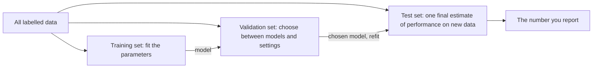
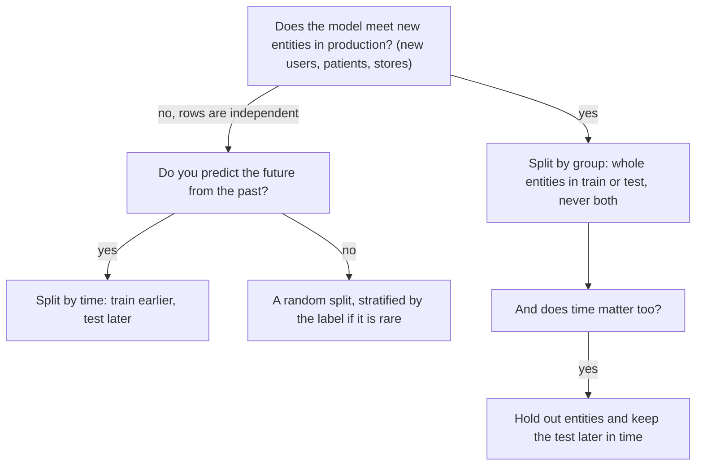
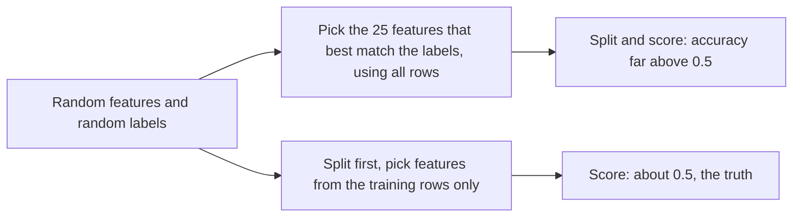

# Module 02: Train/Validation/Test Splits, Group Splits, and Data Leakage

> **Prerequisites:** [Module 01: Problem Framing](../01-problem-framing-supervised-unsupervised-rl/README.md) (the "what is known at the moment of prediction" question) and [Module 00](../00-what-is-machine-learning/README.md).  
> **Estimated Reading Time:** 40 minutes  
> **Target Audience:** ML engineers, data scientists and backend engineers who evaluate, review or productionize models

> [!TIP]
> **The Golden Rule of Evaluation:** The test set must relate to the training set the way **production relates to the past**: new people, new days, new rows, none of which the model has seen in any form. So split by the thing you will meet new (the **group**, the **time**), not only by row. Fit **every** learned step (scaler, imputer, feature selector, encoder, model) on the training part **only**, inside a pipeline. Touch the test set **once**. Anything else gives a score that is a statement about your data pipeline, not about your model.

---

## Why This Matters

A model is judged on data it was not trained on, so the split is part of the experiment. If the split is wrong, the number is wrong, and nothing in the code will tell you: the evaluation runs, prints 0.97, and the model goes to production. scikit-learn's guide to common pitfalls defines the problem in two sentences: "Data leakage occurs when information that would not be available at prediction time is used when building the model. This results in overly optimistic performance estimates, for example from cross-validation, and thus poorer performance when the model is used on actually novel data, for example during production."

This is not a beginner's mistake that experts avoid. A survey of published machine-learning-based science found leakage-related errors in 17 fields, collectively affecting 329 papers (section 3). In this module you will measure five kinds of leakage yourself, each with a number: a model that scores 83% on labels that are pure noise, a score of 0.79 that should be 0.65, a score of 0.90 that should be 0.53, a forecast that beats the baseline in a shuffled test and loses to it in the real one, and a scaler leak that turns out to be almost harmless, which is as important to know.

---

## 1. Architectural Mental Model: What a Split Is For

### Three Sets, Three Jobs



| Set | Used for | How often it may be used | If you misuse it |
| :--- | :--- | :--- | :--- |
| **Training** | Fitting the parameters (weights, splits, scaler means, selected features) | Unlimited | Nothing: this is what it is for |
| **Validation** | Choosing the model type, hyperparameters, features, threshold | Many times | It slowly becomes part of training: the best of many candidates is optimistic |
| **Test** | One final estimate of how the chosen model does on new data | **Once** | If you tune against it, it is a second validation set and you have no test set |

When data is scarce, cross-validation (Module 03) replaces the fixed validation set, but a final held-out test set is still kept apart.

### The Split Must Mimic Deployment



A random split is correct **only** when the rows are independent and exchangeable. Every row from the same patient, user, device, document or listing that lands in both sets lets the model identify the entity instead of learning the relationship.

### A Taxonomy of Leakage

| Kind | What leaks | Example | Fix |
| :--- | :--- | :--- | :--- |
| **Preprocessing fitted on all data** | Information about the test rows enters the learned statistics | A scaler, imputer, PCA or feature selector fitted before splitting | Split first; put every learned step in a **pipeline** |
| **Duplicates and near-duplicates** | The same row on both sides | A listing ingested twice; one image at two resolutions | Deduplicate before the split |
| **Group overlap** | The same entity on both sides | Several visits per patient | Group splits |
| **Temporal leakage** | The future helps predict the past | Random split of a time series; a feature computed over the whole period | Time-ordered split; compute features as of the prediction time |
| **Target leakage** | A feature that encodes the label or is known only after it | A "treatment given" column in a model that predicts disease | Ask for each feature: would I have it at prediction time? |
| **Peeking at the test set** | Repeated tuning against the test score | Trying 50 models and reporting the best test score | Choose on validation; report the test score once |
| **A test set from a different world** | The evaluation is not the production distribution | A test set of easy cases | Build it from production-like data |

### How Big Must a Test Set Be?

An accuracy measured on $n$ test examples is itself an estimate, with a standard error of about

$$\mathrm{SE} \approx \sqrt{\frac{p(1-p)}{n}}$$

For an accuracy of 0.90, that is 3.0 points at $n = 100$ and 0.95 points at $n = 1000$; a rough 95% interval is about two standard errors on each side. So "model A scored 0.92 and model B 0.91" on a hundred examples says nothing. A test set must be large enough for the differences you care about to be larger than its noise.

---

## 2. Systematic Reference and Comparison Grids

### Which Split in scikit-learn

| Situation | Tool | Notes |
| :--- | :--- | :--- |
| Independent rows, balanced enough | `train_test_split`, `KFold` | Fix `random_state` so the split is reproducible |
| Independent rows, a rare label | `StratifiedShuffleSplit`, `StratifiedKFold`, `train_test_split(stratify=y)` | Keeps the class ratio in every part |
| Several rows per entity | `GroupShuffleSplit`, `GroupKFold`, `StratifiedGroupKFold` | Pass `groups=`; entities are never divided |
| The future from the past | `TimeSeriesSplit`, or a plain date cut-off | Train always precedes test; no shuffling |
| Preprocessing that learns something | `Pipeline` or `make_pipeline` | The pipeline refits each step on each fold's training rows |

### What Must Be Fitted on What

| Step | Learns from the data | Fit on | Then |
| :--- | :--- | :--- | :--- |
| Scaler (mean, spread) | Column statistics | Training rows only | `transform` the test rows |
| Imputer (median, mode) | Column statistics | Training rows only | `transform` the test rows |
| Feature selection (`SelectKBest`) | Which columns relate to the **label** | Training rows only | Highest risk: it uses the label |
| PCA, encoders, vocabularies | Structure of the inputs | Training rows only | `transform` |
| The model | Parameters | Training rows only | `predict` on the test rows |
| Hyperparameter search | Which settings score best | Validation folds from the training rows | Report on the test set once |

### Symptoms That Should Make You Suspicious

| Symptom | Likely cause |
| :--- | :--- |
| A score that is too good for the problem | Target leakage, or duplicates |
| One feature dominates and looks like an identifier (an id, a timestamp, a count of events after the fact) | A feature that encodes the entity or the outcome |
| Cross-validation is far better than a later hold-out, or than production | Group or time leakage |
| The score collapses when you hold out whole entities | The model memorized entities |
| Performance on random labels is above chance | There is a leak in your pipeline (this is a useful **test** of a pipeline: shuffle the labels and expect chance) |

---

## 3. Real Case Study: Leakage in Published Machine-Learning Science

This is a documented, large-scale finding rather than a single incident. Sayash Kapoor and Arvind Narayanan surveyed the literature on machine-learning-based science ("Leakage and the Reproducibility Crisis in ML-based Science", *Patterns* 4(9), 2023; arXiv 2207.07048).

| What the authors report | Detail |
| :--- | :--- |
| The scale | "17 fields where errors have been found, collectively affecting 329 papers" (the arXiv abstract; the counts changed between versions, and the authors' tracking page now reports 41 papers from 30 fields, "collectively affecting 648 papers") |
| The effect | In some cases "leading to wildly overoptimistic conclusions" |
| A taxonomy | "A fine-grained taxonomy of 8 types of leakage that range from textbook errors to open research problems" |
| The headline groups | "Lack of clean separation of training and test set", "Model uses features which are not legitimate", and "Test set is not drawn from the distribution of interest" |

The scikit-learn guide shows the smallest possible instance, which you will run in Workflow 1. It builds 200 samples with 10,000 random standard-normal features and random binary targets, so there is no signal at all. Choosing the 25 best features with the labels **before** splitting gave, in the guide, an accuracy of 0.76: "much higher than chance, even though our targets are completely random". Doing the selection after the split, or inside a pipeline, gave 0.5.



### What to Take From It

1. **Leakage is a property of the workflow, not of the algorithm.** Nothing is wrong with the classifier; the evaluation was answering a different question.
2. **The labels make a leak dangerous.** A step that uses the label (feature selection) leaks a lot; one that does not (a scaler) usually leaks little (Workflow 1).
3. **A test of the pipeline is cheap:** run it on shuffled labels. If it scores above chance, you have a leak.
4. **Reviewers cannot see leakage in a result.** Only the code and the split reveal it, so the pipeline must be written to make leakage hard.

---

## 4. Three Splits and What They Leak, in Four Languages (`carousel`)

The program splits 20 hospital visits by three people's rules: random rows, whole patients and time. Each row is `(patient, day, label)`, and a patient's label never changes, so a "model" that only **remembers patients** (the memorizer) scores perfectly on any split that shows it the same patients again. The shuffles use a small fixed random generator so that all four languages produce the same output.

````carousel
```python
"""Three ways to split the same 20 hospital visits into a training and a test set, and what each one leaks. Every row is (patient, day, label);
a patient's label never changes, so a model that merely remembers patients scores perfectly on any split that shows it the same patients again."""

ROWS = [
    ("A", 1, 0), ("B", 2, 1), ("A", 3, 0), ("C", 4, 1), ("D", 5, 0), ("A", 6, 0), ("B", 7, 1), ("E", 8, 0), ("C", 9, 1), ("F", 10, 1),
    ("D", 11, 0), ("A", 12, 0), ("B", 13, 1), ("E", 14, 0), ("C", 15, 1), ("F", 16, 1), ("D", 17, 0), ("B", 18, 1), ("E", 19, 0), ("F", 20, 1),
]


class Lcg:
    """A small, fixed random number generator, so that all four languages shuffle the same way."""

    def __init__(self, seed):
        self.state = seed

    def below(self, bound):
        self.state = (self.state * 1664525 + 1013904223) % 4294967296
        return (self.state >> 8) % bound


def shuffled(items, seed):
    items, rng = list(items), Lcg(seed)
    for i in range(len(items) - 1, 0, -1):
        j = rng.below(i + 1)
        items[i], items[j] = items[j], items[i]
    return items


def random_split(rows, test_size, seed):
    order = shuffled(range(len(rows)), seed)
    return [rows[i] for i in sorted(order[test_size:])], [rows[i] for i in sorted(order[:test_size])]


def group_split(rows, test_groups, seed):
    patients = shuffled(sorted({row[0] for row in rows}), seed)
    held_out = set(patients[:test_groups])
    return [r for r in rows if r[0] not in held_out], [r for r in rows if r[0] in held_out]


def time_split(rows, test_size):
    ordered = sorted(rows, key=lambda row: row[1])
    return ordered[:-test_size], ordered[-test_size:]


def memorizer_accuracy(train, test):
    """Predict a test row's label from the same patient's training rows; for a patient never seen, just guess 1 (a coin flip would do as well)."""
    seen = {patient: label for patient, _, label in train}
    correct = sum(1 for patient, _, label in test if seen.get(patient, 1) == label)
    return correct / len(test)


def report(name, train, test):
    shared = sorted({r[0] for r in train} & {r[0] for r in test})
    earliest_test = min(r[1] for r in test)
    from_the_future = sum(1 for r in train if r[1] > earliest_test)
    print(f"{name:20} train={len(train):2d} test={len(test)} patients in both: {','.join(shared) or '-':11} "
          f"train rows after the first test day: {from_the_future:2d}  memorizer accuracy: {memorizer_accuracy(train, test):.2f}")


if __name__ == "__main__":
    print(f"{len(ROWS)} visits, {len({r[0] for r in ROWS})} patients; a patient's label never changes")
    report("random rows", *random_split(ROWS, 6, seed=7))
    report("whole patients", *group_split(ROWS, 2, seed=7))
    report("by time (last 6)", *time_split(ROWS, 6))
    print("averaged over 20 different shuffles (the time split has only one version):")
    for name, make in [("random rows", lambda s: random_split(ROWS, 6, s)), ("whole patients", lambda s: group_split(ROWS, 2, s))]:
        splits = [make(seed) for seed in range(20)]
        both = sum(1 for train, test in splits if {r[0] for r in train} & {r[0] for r in test})
        mean = sum(memorizer_accuracy(train, test) for train, test in splits) / len(splits)
        print(f"{name:20} some patient on both sides in {both:2d} of 20 splits; mean memorizer accuracy {mean:.2f}")
```

<!-- slide -->

```typescript
// Three ways to split the same 20 hospital visits into a training and a test set, and what each one leaks. Every row is (patient, day, label);
// a patient's label never changes, so a model that merely remembers patients scores perfectly on any split that shows it the same patients again.

type Row = { patient: string; day: number; label: number };

const ROWS: Row[] = ([
  ["A", 1, 0], ["B", 2, 1], ["A", 3, 0], ["C", 4, 1], ["D", 5, 0], ["A", 6, 0], ["B", 7, 1], ["E", 8, 0], ["C", 9, 1], ["F", 10, 1],
  ["D", 11, 0], ["A", 12, 0], ["B", 13, 1], ["E", 14, 0], ["C", 15, 1], ["F", 16, 1], ["D", 17, 0], ["B", 18, 1], ["E", 19, 0], ["F", 20, 1],
] as [string, number, number][]).map(([patient, day, label]) => ({ patient, day, label }));

/** A small, fixed random number generator, so that all four languages shuffle the same way. */
class Lcg {
  state: number;

  constructor(seed: number) {
    this.state = seed;
  }

  below(bound: number): number {
    this.state = (Math.imul(this.state, 1664525) + 1013904223) >>> 0;
    return (this.state >>> 8) % bound;
  }
}

function shuffled<T>(items: T[], seed: number): T[] {
  const copy = [...items];
  const rng = new Lcg(seed);
  for (let i = copy.length - 1; i > 0; i--) {
    const j = rng.below(i + 1);
    [copy[i], copy[j]] = [copy[j], copy[i]];
  }
  return copy;
}

const range = (n: number): number[] => Array.from({ length: n }, (_, i) => i);

function randomSplit(rows: Row[], testSize: number, seed: number): [Row[], Row[]] {
  const order = shuffled(range(rows.length), seed);
  const train = order.slice(testSize).sort((a, b) => a - b).map((i) => rows[i]);
  const test = order.slice(0, testSize).sort((a, b) => a - b).map((i) => rows[i]);
  return [train, test];
}

function groupSplit(rows: Row[], testGroups: number, seed: number): [Row[], Row[]] {
  const patients = shuffled([...new Set(rows.map((r) => r.patient))].sort(), seed);
  const heldOut = new Set(patients.slice(0, testGroups));
  return [rows.filter((r) => !heldOut.has(r.patient)), rows.filter((r) => heldOut.has(r.patient))];
}

function timeSplit(rows: Row[], testSize: number): [Row[], Row[]] {
  const ordered = [...rows].sort((a, b) => a.day - b.day);
  return [ordered.slice(0, ordered.length - testSize), ordered.slice(ordered.length - testSize)];
}

/** Predict a test row's label from the same patient's training rows; for a patient never seen, just guess 1 (a coin flip would do as well). */
function memorizerAccuracy(train: Row[], test: Row[]): number {
  const seen = new Map<string, number>();
  for (const r of train) seen.set(r.patient, r.label);
  const correct = test.filter((r) => (seen.get(r.patient) ?? 1) === r.label).length;
  return correct / test.length;
}

const patientsOf = (rows: Row[]): Set<string> => new Set(rows.map((r) => r.patient));
const overlap = (train: Row[], test: Row[]): string[] => [...patientsOf(train)].filter((p) => patientsOf(test).has(p)).sort();

function report(name: string, [train, test]: [Row[], Row[]]): void {
  const shared = overlap(train, test);
  const earliestTest = Math.min(...test.map((r) => r.day));
  const fromTheFuture = train.filter((r) => r.day > earliestTest).length;
  console.log(
    `${name.padEnd(20)} train=${String(train.length).padStart(2)} test=${test.length} patients in both: ${(shared.join(",") || "-").padEnd(11)} ` +
      `train rows after the first test day: ${String(fromTheFuture).padStart(2)}  memorizer accuracy: ${memorizerAccuracy(train, test).toFixed(2)}`,
  );
}

console.log(`${ROWS.length} visits, ${patientsOf(ROWS).size} patients; a patient's label never changes`);
report("random rows", randomSplit(ROWS, 6, 7));
report("whole patients", groupSplit(ROWS, 2, 7));
report("by time (last 6)", timeSplit(ROWS, 6));
console.log("averaged over 20 different shuffles (the time split has only one version):");
const makers: [string, (seed: number) => [Row[], Row[]]][] = [
  ["random rows", (seed) => randomSplit(ROWS, 6, seed)],
  ["whole patients", (seed) => groupSplit(ROWS, 2, seed)],
];
for (const [name, make] of makers) {
  const splits = range(20).map((seed) => make(seed));
  const both = splits.filter(([train, test]) => overlap(train, test).length > 0).length;
  const mean = splits.reduce((sum, [train, test]) => sum + memorizerAccuracy(train, test), 0) / splits.length;
  console.log(`${name.padEnd(20)} some patient on both sides in ${String(both).padStart(2)} of 20 splits; mean memorizer accuracy ${mean.toFixed(2)}`);
}
```

<!-- slide -->

```go
// Three ways to split the same 20 hospital visits into a training and a test set, and what each one leaks. Every row is (patient, day, label);
// a patient's label never changes, so a model that merely remembers patients scores perfectly on any split that shows it the same patients again.
package main

import (
	"fmt"
	"sort"
	"strings"
)

type row struct {
	patient string
	day     int
	label   int
}

var rows = []row{
	{"A", 1, 0}, {"B", 2, 1}, {"A", 3, 0}, {"C", 4, 1}, {"D", 5, 0}, {"A", 6, 0}, {"B", 7, 1}, {"E", 8, 0}, {"C", 9, 1}, {"F", 10, 1},
	{"D", 11, 0}, {"A", 12, 0}, {"B", 13, 1}, {"E", 14, 0}, {"C", 15, 1}, {"F", 16, 1}, {"D", 17, 0}, {"B", 18, 1}, {"E", 19, 0}, {"F", 20, 1},
}

// lcg is a small, fixed random number generator, so that all four languages shuffle the same way.
type lcg struct{ state uint32 }

func (g *lcg) below(bound int) int {
	g.state = g.state*1664525 + 1013904223
	return int(g.state>>8) % bound
}

func shuffled[T any](items []T, seed uint32) []T {
	out := append([]T(nil), items...)
	rng := &lcg{seed}
	for i := len(out) - 1; i > 0; i-- {
		j := rng.below(i + 1)
		out[i], out[j] = out[j], out[i]
	}
	return out
}

func indices(n int) []int {
	out := make([]int, n)
	for i := range out {
		out[i] = i
	}
	return out
}

func pick(all []row, order []int) []row {
	sorted := append([]int(nil), order...)
	sort.Ints(sorted)
	out := make([]row, 0, len(sorted))
	for _, i := range sorted {
		out = append(out, all[i])
	}
	return out
}

func randomSplit(all []row, testSize int, seed uint32) ([]row, []row) {
	order := shuffled(indices(len(all)), seed)
	return pick(all, order[testSize:]), pick(all, order[:testSize])
}

func patientSet(all []row) map[string]bool {
	set := map[string]bool{}
	for _, r := range all {
		set[r.patient] = true
	}
	return set
}

func groupSplit(all []row, testGroups int, seed uint32) ([]row, []row) {
	var names []string
	for p := range patientSet(all) {
		names = append(names, p)
	}
	sort.Strings(names)
	names = shuffled(names, seed)
	heldOut := map[string]bool{}
	for _, p := range names[:testGroups] {
		heldOut[p] = true
	}
	var train, test []row
	for _, r := range all {
		if heldOut[r.patient] {
			test = append(test, r)
		} else {
			train = append(train, r)
		}
	}
	return train, test
}

func timeSplit(all []row, testSize int) ([]row, []row) {
	ordered := append([]row(nil), all...)
	sort.SliceStable(ordered, func(a, b int) bool { return ordered[a].day < ordered[b].day })
	return ordered[:len(ordered)-testSize], ordered[len(ordered)-testSize:]
}

// memorizerAccuracy predicts a test row's label from the same patient's training rows; for a patient never seen, it just guesses 1 (a coin flip would do as well).
func memorizerAccuracy(train, test []row) float64 {
	seen := map[string]int{}
	for _, r := range train {
		seen[r.patient] = r.label
	}
	correct := 0
	for _, r := range test {
		guess, ok := seen[r.patient]
		if !ok {
			guess = 1
		}
		if guess == r.label {
			correct++
		}
	}
	return float64(correct) / float64(len(test))
}

func overlap(train, test []row) []string {
	inTest := patientSet(test)
	var shared []string
	for p := range patientSet(train) {
		if inTest[p] {
			shared = append(shared, p)
		}
	}
	sort.Strings(shared)
	return shared
}

func report(name string, train, test []row) {
	shared := strings.Join(overlap(train, test), ",")
	if shared == "" {
		shared = "-"
	}
	earliest := test[0].day
	for _, r := range test {
		if r.day < earliest {
			earliest = r.day
		}
	}
	future := 0
	for _, r := range train {
		if r.day > earliest {
			future++
		}
	}
	fmt.Printf("%-20s train=%2d test=%d patients in both: %-11s train rows after the first test day: %2d  memorizer accuracy: %.2f\n",
		name, len(train), len(test), shared, future, memorizerAccuracy(train, test))
}

func main() {
	fmt.Printf("%d visits, %d patients; a patient's label never changes\n", len(rows), len(patientSet(rows)))
	train, test := randomSplit(rows, 6, 7)
	report("random rows", train, test)
	train, test = groupSplit(rows, 2, 7)
	report("whole patients", train, test)
	train, test = timeSplit(rows, 6)
	report("by time (last 6)", train, test)
	fmt.Println("averaged over 20 different shuffles (the time split has only one version):")
	makers := []struct {
		name string
		make func(seed uint32) ([]row, []row)
	}{
		{"random rows", func(seed uint32) ([]row, []row) { return randomSplit(rows, 6, seed) }},
		{"whole patients", func(seed uint32) ([]row, []row) { return groupSplit(rows, 2, seed) }},
	}
	for _, m := range makers {
		both, total := 0, 0.0
		for seed := uint32(0); seed < 20; seed++ {
			train, test := m.make(seed)
			if len(overlap(train, test)) > 0 {
				both++
			}
			total += memorizerAccuracy(train, test)
		}
		fmt.Printf("%-20s some patient on both sides in %2d of 20 splits; mean memorizer accuracy %.2f\n", m.name, both, total/20)
	}
}
```

<!-- slide -->

```csharp
// Three ways to split the same 20 hospital visits into a training and a test set, and what each one leaks. Every row is (patient, day, label);
// a patient's label never changes, so a model that merely remembers patients scores perfectly on any split that shows it the same patients again.
using System;
using System.Collections.Generic;
using System.Globalization;
using System.Linq;

CultureInfo.CurrentCulture = CultureInfo.InvariantCulture;

var rows = new List<Row>
{
    new("A", 1, 0), new("B", 2, 1), new("A", 3, 0), new("C", 4, 1), new("D", 5, 0), new("A", 6, 0), new("B", 7, 1), new("E", 8, 0), new("C", 9, 1), new("F", 10, 1),
    new("D", 11, 0), new("A", 12, 0), new("B", 13, 1), new("E", 14, 0), new("C", 15, 1), new("F", 16, 1), new("D", 17, 0), new("B", 18, 1), new("E", 19, 0), new("F", 20, 1),
};

List<T> Shuffled<T>(IEnumerable<T> items, uint seed)
{
    var copy = items.ToList();
    var rng = new Lcg(seed);
    for (int i = copy.Count - 1; i > 0; i--)
    {
        int j = rng.Below(i + 1);
        (copy[i], copy[j]) = (copy[j], copy[i]);
    }
    return copy;
}

(List<Row>, List<Row>) RandomSplit(List<Row> all, int testSize, uint seed)
{
    var order = Shuffled(Enumerable.Range(0, all.Count), seed);
    var train = order.Skip(testSize).OrderBy(i => i).Select(i => all[i]).ToList();
    var test = order.Take(testSize).OrderBy(i => i).Select(i => all[i]).ToList();
    return (train, test);
}

(List<Row>, List<Row>) GroupSplit(List<Row> all, int testGroups, uint seed)
{
    var patients = Shuffled(all.Select(r => r.Patient).Distinct().OrderBy(p => p, StringComparer.Ordinal), seed);
    var heldOut = patients.Take(testGroups).ToHashSet();
    return (all.Where(r => !heldOut.Contains(r.Patient)).ToList(), all.Where(r => heldOut.Contains(r.Patient)).ToList());
}

(List<Row>, List<Row>) TimeSplit(List<Row> all, int testSize)
{
    var ordered = all.OrderBy(r => r.Day).ToList();
    return (ordered.Take(ordered.Count - testSize).ToList(), ordered.Skip(ordered.Count - testSize).ToList());
}

// Predict a test row's label from the same patient's training rows; for a patient never seen, just guess 1 (a coin flip would do as well).
double MemorizerAccuracy(List<Row> train, List<Row> test)
{
    var seen = new Dictionary<string, int>();
    foreach (var r in train) seen[r.Patient] = r.Label;
    int correct = test.Count(r => (seen.TryGetValue(r.Patient, out int label) ? label : 1) == r.Label);
    return (double)correct / test.Count;
}

List<string> Overlap(List<Row> train, List<Row> test)
{
    var inTest = test.Select(r => r.Patient).ToHashSet();
    return train.Select(r => r.Patient).Distinct().Where(inTest.Contains).OrderBy(p => p, StringComparer.Ordinal).ToList();
}

void Report(string name, (List<Row> Train, List<Row> Test) split)
{
    var (train, test) = split;
    string shared = string.Join(",", Overlap(train, test));
    if (shared == "") shared = "-";
    int earliest = test.Min(r => r.Day);
    int future = train.Count(r => r.Day > earliest);
    Console.WriteLine($"{name,-20} train={train.Count,2} test={test.Count} patients in both: {shared,-11} train rows after the first test day: {future,2}  memorizer accuracy: {MemorizerAccuracy(train, test):F2}");
}

Console.WriteLine($"{rows.Count} visits, {rows.Select(r => r.Patient).Distinct().Count()} patients; a patient's label never changes");
Report("random rows", RandomSplit(rows, 6, 7));
Report("whole patients", GroupSplit(rows, 2, 7));
Report("by time (last 6)", TimeSplit(rows, 6));
Console.WriteLine("averaged over 20 different shuffles (the time split has only one version):");
var makers = new (string Name, Func<uint, (List<Row>, List<Row>)> Make)[]
{
    ("random rows", seed => RandomSplit(rows, 6, seed)),
    ("whole patients", seed => GroupSplit(rows, 2, seed)),
};
foreach (var (name, make) in makers)
{
    int both = 0;
    double total = 0.0;
    for (uint seed = 0; seed < 20; seed++)
    {
        var (train, test) = make(seed);
        if (Overlap(train, test).Count > 0) both++;
        total += MemorizerAccuracy(train, test);
    }
    Console.WriteLine($"{name,-20} some patient on both sides in {both,2} of 20 splits; mean memorizer accuracy {total / 20:F2}");
}

record Row(string Patient, int Day, int Label);

// A small, fixed random number generator, so that all four languages shuffle the same way.
class Lcg(uint seed)
{
    private uint _state = seed;

    public int Below(int bound)
    {
        _state = unchecked(_state * 1664525u + 1013904223u);
        return (int)(_state >> 8) % bound;
    }
}
```
````

**Observed output (identical in Python 3.13.14, Node 24, Go 1.22 and .NET 10):**

```text
20 visits, 6 patients; a patient's label never changes
random rows          train=14 test=6 patients in both: A,B,C,D     train rows after the first test day: 11  memorizer accuracy: 1.00
whole patients       train=13 test=7 patients in both: -           train rows after the first test day: 12  memorizer accuracy: 1.00
by time (last 6)     train=14 test=6 patients in both: B,C,D,E,F   train rows after the first test day:  0  memorizer accuracy: 1.00
averaged over 20 different shuffles (the time split has only one version):
random rows          some patient on both sides in 20 of 20 splits; mean memorizer accuracy 1.00
whole patients       some patient on both sides in  0 of 20 splits; mean memorizer accuracy 0.46
```

What to notice:

- **A random split puts patients on both sides:** patients A, B, C and D are in both sets, and 20 of 20 different shuffles share at least one patient. The memorizer scores 1.00 without learning anything about medicine.
- **A time split does not fix group leakage.** It has no training row after the first test day (the future is kept out) and still shares five of six patients; the memorizer again scores 1.00. Time order and entity overlap are separate problems and need separate checks.
- **A group split removes the overlap** (no patient in both sets, in 0 of 20 shuffles), and the memorizer falls to chance: 0.46 on average. The single group split printed above scored 1.00 only by luck, because with two held-out patients the guess happens to match both; this is why the table also averages over 20 shuffles. With a handful of groups, a single split is noise.
- **Check, do not hope.** The two numbers per split, the patients in both and the training rows after the first test day, are the checks to run on any real split.

---

## 5. Practical Hands-On Verification Workflows (Python 3.13 + scikit-learn)

Environment as in Module 00 (verified on **Python 3.13.14, scikit-learn 1.9.1, NumPy 2.5.5**). Every experiment fixes its random seeds.

### Workflow 1: Preprocessing Leakage, Large and Small

First the guide's pure-noise case (200 samples, 10,000 random features, random labels), averaged over 20 random data sets and done two ways, cross-validation and a single hold-out. Then the same kind of mistake with a scaler on real data:

```python
"""Leakage through preprocessing. First the case that scikit-learn's own guide uses: features chosen with the labels, on data that is pure
noise, so any score above 50% is a leak. Then the same mistake with a scaler on real data, to show that not every leak is large."""
import numpy as np
import sklearn
from sklearn.datasets import load_breast_cancer
from sklearn.feature_selection import SelectKBest, f_classif
from sklearn.linear_model import LogisticRegression
from sklearn.model_selection import StratifiedKFold, cross_val_score, train_test_split
from sklearn.pipeline import make_pipeline
from sklearn.preprocessing import StandardScaler

print(f"scikit-learn {sklearn.__version__}, numpy {np.__version__}\n")

print("== 1. features picked with the labels, on pure noise: 200 samples, 10,000 random features, random labels ==")
wrong, right, held_wrong, held_right = [], [], [], []
for seed in range(20):
    rng = np.random.default_rng(seed)
    X, y = rng.standard_normal((200, 10_000)), rng.integers(0, 2, 200)
    cv = StratifiedKFold(5, shuffle=True, random_state=seed)
    # Wrong: select the 25 features most related to y using ALL the samples, then cross-validate on them.
    X_selected = SelectKBest(f_classif, k=25).fit_transform(X, y)
    wrong.append(cross_val_score(LogisticRegression(), X_selected, y, cv=cv).mean())
    # Right: selection is a step of the pipeline, so it is learned again inside every fold from that fold's training rows only.
    right.append(cross_val_score(make_pipeline(SelectKBest(f_classif, k=25), LogisticRegression()), X, y, cv=cv).mean())
    # The same two ways with one hold-out split.
    X_train, X_test, y_train, y_test = train_test_split(X, y, random_state=seed)
    chosen = SelectKBest(f_classif, k=25).fit(X, y)  # wrong: looked at the test labels
    held_wrong.append(LogisticRegression().fit(chosen.transform(X_train), y_train).score(chosen.transform(X_test), y_test))
    pipe = make_pipeline(SelectKBest(f_classif, k=25), LogisticRegression()).fit(X_train, y_train)
    held_right.append(pipe.score(X_test, y_test))
for name, scores in [("cross-validation, selection on all rows", wrong), ("cross-validation, selection inside the pipeline", right),
                     ("hold-out, selection on all rows", held_wrong), ("hold-out, selection on the training rows", held_right)]:
    print(f"{name:50} accuracy {np.mean(scores):.3f} +/- {np.std(scores):.3f}   (the truth is 0.5, since the labels are random)")

print("\n== 2. the same mistake with a scaler, on real data: breast cancer, 20 random 5-fold cross-validations ==")
X, y = load_breast_cancer(return_X_y=True)
leaky, clean = [], []
for seed in range(20):
    cv = StratifiedKFold(5, shuffle=True, random_state=seed)
    leaky.append(cross_val_score(LogisticRegression(max_iter=2000), StandardScaler().fit_transform(X), y, cv=cv).mean())
    clean.append(cross_val_score(make_pipeline(StandardScaler(), LogisticRegression(max_iter=2000)), X, y, cv=cv).mean())
print(f"scaler fitted on all rows       {np.mean(leaky):.4f}")
print(f"scaler inside the pipeline      {np.mean(clean):.4f}")
print(f"difference                      {np.mean(leaky) - np.mean(clean):+.4f}   (a leak that does not touch the labels is usually small; the label-based one above was not)")
```

**Observed Output:**

```text
scikit-learn 1.9.1, numpy 2.5.5

== 1. features picked with the labels, on pure noise: 200 samples, 10,000 random features, random labels ==
cross-validation, selection on all rows            accuracy 0.832 +/- 0.021   (the truth is 0.5, since the labels are random)
cross-validation, selection inside the pipeline    accuracy 0.499 +/- 0.039   (the truth is 0.5, since the labels are random)
hold-out, selection on all rows                    accuracy 0.823 +/- 0.047   (the truth is 0.5, since the labels are random)
hold-out, selection on the training rows           accuracy 0.530 +/- 0.057   (the truth is 0.5, since the labels are random)

== 2. the same mistake with a scaler, on real data: breast cancer, 20 random 5-fold cross-validations ==
scaler fitted on all rows       0.9795
scaler inside the pipeline      0.9790
difference                      +0.0005   (a leak that does not touch the labels is usually small; the label-based one above was not)
```

- **The label-based leak is enormous:** selecting features on all rows gives **0.832 in cross-validation and 0.823 on a hold-out**, while the truth is 0.5 because the labels are random. Selection inside the pipeline gives 0.499 and 0.530, the honest answer.
- **The scaler leak is almost nothing** (+0.0005 on real data), because a mean and a spread carry little about individual rows and nothing about the label. It is still wrong, because the habit that allows the small leak also allows the large one, and a pipeline removes both at no cost.
- **A diagnostic to keep:** if a pipeline scores above chance on shuffled labels, it leaks.

### Workflow 2: The Same Thing on Both Sides: Duplicates and Groups

Real breast-cancer data with 20% of the labels flipped and 40% of the rows ingested twice, then a model that does little but remember (1-nearest-neighbour). Then 200 generated people with ten visits each, where a person's label is unrelated to their measurements:

```python
"""The same thing on both sides of a split. First duplicated rows (real data with 20% wrong labels, so a model that only remembers rows
looks better than it is). Then several rows per person, where the person is what the model can memorize (generated data)."""
import numpy as np
from sklearn.datasets import load_breast_cancer
from sklearn.ensemble import RandomForestClassifier
from sklearn.model_selection import GroupKFold, KFold, cross_val_score, train_test_split
from sklearn.neighbors import KNeighborsClassifier

print("== 1. duplicated rows: breast cancer data, 20% of the labels flipped, 1-nearest-neighbour ==")
X, y = load_breast_cancer(return_X_y=True)
rng = np.random.default_rng(0)
noisy = np.where(rng.random(len(y)) < 0.20, 1 - y, y)  # 20% of the labels are wrong, as in many real data sets
repeats = rng.choice(len(y), size=int(0.4 * len(y)), replace=False)  # 40% of the rows were ingested twice
X_dup, y_dup = np.vstack([X, X[repeats]]), np.concatenate([noisy, noisy[repeats]])
print(f"{len(y)} real rows, {len(y_dup)} rows after the duplicates were ingested")
random_scores, deduplicated_scores = [], []
for seed in range(20):
    X_tr, X_te, y_tr, y_te = train_test_split(X_dup, y_dup, test_size=0.25, random_state=seed)
    random_scores.append(KNeighborsClassifier(1).fit(X_tr, y_tr).score(X_te, y_te))
    X_tr, X_te, y_tr, y_te = train_test_split(X, noisy, test_size=0.25, random_state=seed)  # one copy of each row, then split
    deduplicated_scores.append(KNeighborsClassifier(1).fit(X_tr, y_tr).score(X_te, y_te))
print(f"split with duplicates in both sides   accuracy {np.mean(random_scores):.3f}")
print(f"deduplicated first, then split        accuracy {np.mean(deduplicated_scores):.3f}   <- what to expect on new data")
print("a test row that has an exact copy in the training set is answered by that copy, wrong label included: the model scores by remembering")

print("\n== 2. several visits per person: 200 people, 10 visits each, 20 measurements, a label that is a property of the person ==")
rng = np.random.default_rng(1)
PEOPLE, VISITS, FEATURES = 200, 10, 20
signature = rng.normal(0, 1, (PEOPLE, FEATURES))  # what makes a person recognisable
person_label = rng.integers(0, 2, PEOPLE)  # unrelated to the signature: there is nothing to learn that carries over to new people
X = np.repeat(signature, VISITS, axis=0) + rng.normal(0, 0.5, (PEOPLE * VISITS, FEATURES))
y = np.repeat(person_label, VISITS)
groups = np.repeat(np.arange(PEOPLE), VISITS)
model = RandomForestClassifier(n_estimators=100, random_state=0, n_jobs=1)
random_cv = cross_val_score(model, X, y, cv=KFold(5, shuffle=True, random_state=0)).mean()
group_cv = cross_val_score(model, X, y, cv=GroupKFold(5), groups=groups).mean()
print(f"5-fold, visits split at random        accuracy {random_cv:.3f}")
print(f"5-fold, whole people held out         accuracy {group_cv:.3f}   <- the truth: the labels are unrelated to the measurements")
```

**Observed Output:**

```text
== 1. duplicated rows: breast cancer data, 20% of the labels flipped, 1-nearest-neighbour ==
569 real rows, 796 rows after the duplicates were ingested
split with duplicates in both sides   accuracy 0.793
deduplicated first, then split        accuracy 0.647   <- what to expect on new data
a test row that has an exact copy in the training set is answered by that copy, wrong label included: the model scores by remembering

== 2. several visits per person: 200 people, 10 visits each, 20 measurements, a label that is a property of the person ==
5-fold, visits split at random        accuracy 0.900
5-fold, whole people held out         accuracy 0.526   <- the truth: the labels are unrelated to the measurements
```

- **Duplicates:** with copies on both sides, accuracy is **0.793**; deduplicating first and then splitting gives **0.647**. A test row with an exact copy in training is answered by that copy, wrong label included, so the score rewards remembering. (The noisy labels make the effect visible; in clean data the inflation is smaller but the cause is the same.)
- **Groups:** splitting visits at random gives **0.900**; holding out whole people gives **0.526**, which is the truth because the labels have nothing to do with the measurements. The forest recognised people, not diseases. This is the structure of many real data sets: patients, users, devices, sessions, documents with several pages.

### Workflow 3: Temporal Leakage

Two years of a daily value with a weekly pattern and a steady rise (generated), and a gradient-boosting model with legitimate features (the day number and the day of the week):

```python
"""Leakage through time. Two years of a daily value with a weekly pattern and a steady rise (generated). The task is to predict the value of days
that come after the days the model has seen. A random split tests something easier: filling in days whose neighbours it has already seen."""
import numpy as np
from sklearn.ensemble import HistGradientBoostingRegressor
from sklearn.metrics import mean_absolute_error
from sklearn.model_selection import KFold, TimeSeriesSplit

rng = np.random.default_rng(0)
DAYS = 730
t = np.arange(DAYS)
value = 100 + 0.05 * t + 8 * np.sin(2 * np.pi * t / 7) + rng.normal(0, 2.0, DAYS)  # trend + weekly pattern + noise
X = np.column_stack([t, t % 7])  # the day number and the day of the week: both are known in advance, so they are legitimate features

print(f"{DAYS} days; the noise has a standard deviation of 2.0, so no model can have a mean absolute error below about 1.6")


def score(splitter, name):
    errors = []
    for train, test in splitter.split(X):
        model = HistGradientBoostingRegressor(random_state=0).fit(X[train], value[train])
        errors.append(mean_absolute_error(value[test], model.predict(X[test])))
    print(f"{name:42} mean absolute error {np.mean(errors):6.2f}   per fold: {' '.join(f'{e:5.2f}' for e in errors)}")


score(KFold(5, shuffle=True, random_state=0), "5-fold, days shuffled")
score(TimeSeriesSplit(5), "5 forward-chaining splits (past -> future)")

# The simplest forecast that needs no model: the value of the same weekday one week earlier, scored on the last 120 days.
last = DAYS - 120
naive = mean_absolute_error(value[last:], value[last - 7:DAYS - 7])
print(f"{'same weekday one week earlier, last 120 days':42} mean absolute error {naive:6.2f}   <- the baseline a forecast has to beat")
```

**Observed Output:**

```text
730 days; the noise has a standard deviation of 2.0, so no model can have a mean absolute error below about 1.6
5-fold, days shuffled                      mean absolute error   1.77   per fold:  1.91  1.72  1.75  1.91  1.59
5 forward-chaining splits (past -> future) mean absolute error   4.05   per fold:  3.90  4.10  3.48  4.31  4.44
same weekday one week earlier, last 120 days mean absolute error   2.27   <- the baseline a forecast has to beat
```

- **A shuffled test flatters the model:** a mean absolute error of **1.77**, close to the noise floor of about 1.6. Every test day has neighbours in the training set, so the model only interpolates.
- **A real forecast is harder:** with forward-chaining splits (always training on the past and testing on the next block) the error is **4.05**, more than twice as high, because tree models cannot extrapolate a trend beyond the days they have seen.
- **The baseline wins:** repeating the same weekday from one week earlier, with no model at all, has an error of **2.27** on the last 120 days, better than the model's 4.05. The shuffled test said the model was nearly perfect; the honest test says it is worse than a one-line rule. Always compare against the naive forecast.

---

## 6. Hands-On Exercises and Independent Challenge

### Practical Exercises

1. **Read a split.** In the carousel program, change the group split to hold out 3 patients instead of 2 and the time split to the last 10 rows. Which numbers in the report change, and which stay the same?
2. **Repair this code.** The snippet below produces a flattering score. List every leak and rewrite it with a pipeline.

   ```python
   X = StandardScaler().fit_transform(X)
   X = SelectKBest(f_classif, k=20).fit_transform(X, y)
   X_train, X_test, y_train, y_test = train_test_split(X, y, random_state=0)
   search = GridSearchCV(LogisticRegression(), {"C": [0.1, 1, 10]}).fit(X_train, y_train)
   print(search.score(X_test, y_test))
   ```

3. **Choose the split.** For each, say how you would split and why: (a) click prediction from three months of logs; (b) detecting pneumonia from X-rays when each patient has several images; (c) predicting house prices from listings where the same house is often listed more than once; (d) recommending items to users you have seen before and to new users.
4. **Size a test set.** How many test examples do you need to estimate an accuracy of about 0.90 to within plus or minus 2 points (95%)?

<details><summary>Answers</summary>

1. With 3 patients held out, the memorizer's accuracy on one split moves again (it is chance by construction, not a stable number), the shared-patient list stays empty, and the test size changes. With a 10-row time split the training set shrinks and the "after the first test day" count stays 0. The shared-patient list of the time split is still not empty, so a time split alone does not remove entity overlap.
2. Two leaks: the scaler and the selector are fitted on **all** rows before the split, and the selector uses the label, which is the worst kind. The hyperparameter search is fitted on the training rows only, which is right, but because the earlier steps had already seen the test rows its test score is contaminated too. Rewrite:

   ```python
   X_train, X_test, y_train, y_test = train_test_split(X, y, random_state=0)
   pipe = make_pipeline(StandardScaler(), SelectKBest(f_classif, k=20), LogisticRegression())
   search = GridSearchCV(pipe, {"logisticregression__C": [0.1, 1, 10]}).fit(X_train, y_train)
   print(search.score(X_test, y_test))
   ```

   Now every learned step is refitted inside each cross-validation fold from that fold's training rows only, and the test rows are touched once.
3. (a) By time: train on the first weeks, validate on the next, test on the last, since you will predict future clicks; also guard against the same user in both. (b) By patient (`GroupShuffleSplit` or `GroupKFold`), because several images of one patient make the model recognise the patient. (c) Deduplicate (or group by property id) before any split, so that two listings of one house cannot straddle it. (d) Two evaluations: one with held-out interactions of known users, and one with held-out users for the cold-start case; the metric for each tells you something different.
4. $\mathrm{SE} = 0.01$ gives $n = p(1-p)/\mathrm{SE}^2 = 0.09 / 0.0001 = 900$ examples (a 95% interval is about 2 standard errors, or 2 points).

</details>

### Independent Challenge

You inherit a churn model with a cross-validated score of 97% that performs poorly in production. Write the audit you would do, in order, and say which findings would change the evaluation design.

<details><summary>Architectural Discussion</summary>

1. **Check the features' timestamps.** For each feature, ask when it becomes known. A flag such as `account_closed`, a count of support tickets over the whole customer life, or "days since last login" computed at extraction time can encode the outcome. Rebuild each feature **as of the prediction date**.
2. **Check the split.** If rows are customer-months, the same customer is on both sides of a random split; hold out whole customers, and also evaluate with a forward-in-time split (train on earlier months, test on later ones).
3. **Check duplicates** (customer records merged from two systems, repeated rows) before splitting.
4. **Check the pipeline.** Are the scaler, imputer, encoders and any feature selection fitted on training rows only? Move them into a pipeline.
5. **Check the label timing.** Churn is known weeks later; recent customers are labelled "did not churn" only because the label has not arrived yet.
6. **Run the shuffled-label test.** If the pipeline scores above chance when the labels are shuffled, there is still a leak.
7. **Compare with a baseline** (last month's activity, a simple rule) on the honest split; the honest number is the one to report.

Expect the score to fall a lot. That is the point: the honest estimate is what you can plan with.

</details>

---

## 7. Common Mistakes and Troubleshooting

- **Fitting a scaler, imputer or selector before the split.** Split first; use a `Pipeline`.
- **Using the test set to choose.** If you looked at it to pick a model or a threshold, it is a validation set; build a new test set.
- **A random split on grouped data.** Several rows per entity need a group split.
- **A random split on a time series.** Train on the past, test on the future.
- **Forgetting duplicates.** Deduplicate before the split, on the key that defines "the same thing".
- **Using a feature that is not available at prediction time.** Ask of every column: would I have this value at the moment of the decision?
- **Trusting one split.** With few groups or few test rows, one split is noisy; repeat or use cross-validation.
- **Reporting the best of many.** If you tried 50 models on one test set, the best score is biased upwards.
- **No baseline.** A forecast that loses to "same weekday last week" is not a forecast.

---

## 8. Operational Validation Checkpoints and Checkpoint Quiz

<details><summary><strong>Checkpoint 1: Your cross-validated accuracy is 0.95 but a hold-out from next month gives 0.78. What do you check?</strong></summary>

Whether the cross-validation shuffled data that has time or group structure. Compare a random split, a group split and a forward-in-time split on the same pipeline; the gap between them is the size of the leak. Then check for features that were built over the whole period or that are known only after the outcome.

</details>

<details><summary><strong>Checkpoint 2: A feature ranks first in importance and looks like an ID. What does that suggest?</strong></summary>

That the model is recognising entities (or something that encodes the order of the rows) instead of learning a relationship. Remove the feature and group-split by that entity: a large drop confirms that the model had memorized it. If the feature is legitimate but identifies an entity, the model cannot be expected to generalise to new entities.

</details>

<details><summary><strong>Checkpoint 3: You tuned hyperparameters on the test set and then realised it. What now?</strong></summary>

The test score is no longer an unbiased estimate; it is a validation score. Collect or hold back fresh data that was never used (a later time period is ideal), report on that, and from now on keep the test set locked until the final step.

</details>

### Checkpoint Quiz

1. What is each of the training, validation and test sets used for?
2. In Workflow 1, why was the accuracy of 0.832 on random labels wrong, and what is the fix?
3. A time split removed the future from training. Why did the memorizer still score 1.00?
4. How does a duplicated row make a score look better?
5. In Workflow 3, why is a random split inappropriate for a forecasting model, and what did the baseline show?

<details><summary>Answers</summary>

1. Training: fit the parameters. Validation: choose models and settings (many uses). Test: one final estimate on data that took no part in any choice.
2. Features were selected using the labels of **all** rows, including the rows later used for testing, so the "test" labels influenced the model. The labels are random, so the true accuracy is 0.5. The fix is to split first, or to put the selector in a pipeline so that it is fitted on training rows only.
3. Because time order and entity overlap are different problems: five of the six patients appeared in both sets, so remembering patients was enough. A time split does not remove entities that persist across time; a group split (or group-and-time) does.
4. The test row has an identical copy in the training set, so the model can answer by recalling the copy and its label rather than generalising. Deduplicating before the split removes the shortcut.
5. A random split gives every test day neighbours in the training set, so the model interpolates and looks almost perfect (MAE 1.77), while a forecast must extrapolate beyond the training days (4.05 with forward-chaining). The naive "same weekday last week" baseline (2.27) beats the model in the realistic setting, which the shuffled test hid.

</details>

---

## 9. Interview Practice

> [!interview]
> A model scores 99% in cross-validation and 70% in production. List the first five things you check.

<details><summary>What a strong answer covers</summary>

- Whether the split matched deployment: group overlap (entities on both sides) and time order (training on the future).
- Feature availability: columns known only after the outcome, or computed over the whole period.
- Preprocessing fitted on all data (selection that uses the label especially), and whether everything is in a pipeline.
- Duplicates and near-duplicates across the split.
- The label timing, the distribution shift between the evaluation data and production, and a shuffled-label test of the pipeline.

</details>

> [!interview]
> How would you design train, validation and test sets for a model that predicts next week's demand per store?

<details><summary>What a strong answer covers</summary>

- Time-ordered splits: train on the oldest weeks, validate on later ones, test on the latest; no shuffling.
- Features as of the forecast date only (promotions planned in advance are fine; actual sales of the target week are not).
- Decide whether new stores appear (then also hold out stores) and watch for holidays that appear once a year.
- Compare against a seasonal-naive baseline and report an error with the size of the test period in mind.

</details>

---

## Further Reading and Sources

- [scikit-learn: Common pitfalls and recommended practices, "Data leakage"](https://scikit-learn.org/stable/common_pitfalls.html) — the definition quoted above, the pure-noise feature-selection example (0.76 against 0.5) and the recommendation to use a `Pipeline`.
- [Kapoor and Narayanan, "Leakage and the Reproducibility Crisis in ML-based Science" (arXiv 2207.07048)](https://arxiv.org/abs/2207.07048) — the survey of 17 fields and 329 papers and the taxonomy of 8 types of leakage.
- [Reproducibility project: "Leakage and the reproducibility crisis in ML-based science"](https://reproducible.cs.princeton.edu/) — the authors' page with the updated tally and the headline kinds of leakage.
- [scikit-learn: Cross-validation iterators for grouped data and for time series](https://scikit-learn.org/stable/modules/cross_validation.html) — `GroupKFold`, `GroupShuffleSplit`, `StratifiedGroupKFold` and `TimeSeriesSplit`, the tools used in this module.
- [Hastie, Tibshirani and Friedman, *The Elements of Statistical Learning*, 2nd edition (book page)](https://hastie.su.domains/ElemStatLearn/) — section 7.10.2, "The Wrong and Right Way to Do Cross-validation", is the classical statement of the selection-before-cross-validation error that Workflow 1 reproduces.

## Next

Continue to **[Module 03: Cross-Validation: K-Fold, Stratified, GroupKFold, and Time-Based](../03-cross-validation-k-fold-stratified-and-time-based/README.md)**, which turns one split into many and shows how to report the spread, not just the mean.
