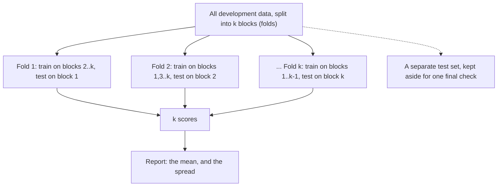
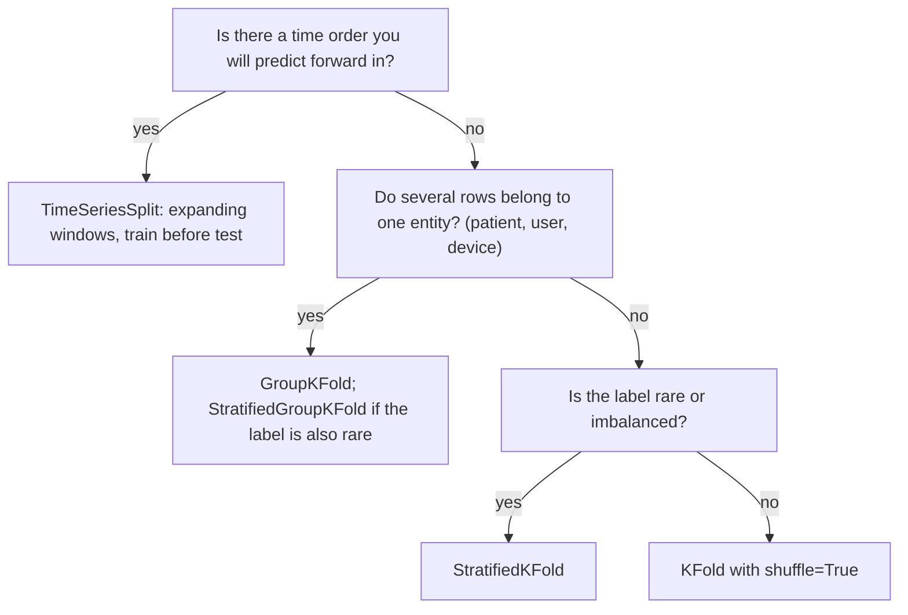
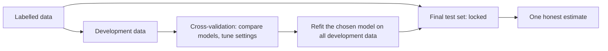
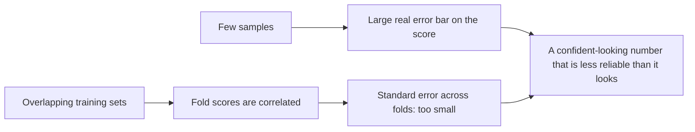

# Module 03: Cross-Validation: K-Fold, Stratified, GroupKFold, and Time-Based

> **Prerequisites:** [Module 02: Train/Validation/Test Splits, Group Splits, and Data Leakage](../02-train-validation-test-splits-and-data-leakage/README.md).  
> **Estimated Reading Time:** 40 minutes  
> **Target Audience:** ML engineers and data scientists who compare models, tune hyperparameters, or must say how sure they are of a metric

> [!TIP]
> **The Golden Rule of Cross-Validation:** Cross-validation repeats the train/test split so that every sample is tested once and no single lucky split decides the result, but it is only as honest as the **splitter** that makes the folds. Pick the splitter from the structure of the data (rare classes, groups, time), put every learned step inside a pipeline, report a **mean and a spread**, and treat the spread as **too small**. Keep a final test set apart, and use **nested** cross-validation when the same data is also used to choose hyperparameters.

---

## Why This Matters

A single train/test split gives one number, and that number depends on which rows happened to land where. scikit-learn's guide puts the underlying mistake plainly: "Learning the parameters of a prediction function and testing it on the same data is a methodological mistake: a model that would just repeat the labels of the samples that it has just seen would have a perfect score but would fail to predict anything useful on yet-unseen data." Cross-validation is the standard answer: "A test set should still be held out for final evaluation, but the validation set is no longer needed when doing CV", and the method "does not waste too much data (as is the case when fixing an arbitrary validation set)".

But cross-validation is also where many good intentions go wrong, in four ways that this module measures: a splitter that does not shuffle sorted data (a model scoring **0.000**), a rare class that vanishes from some folds, an error bar that covers the truth about **80%** of the time instead of 95%, and a hyperparameter search whose best score is **10 points** too high on small noisy data.

---

## 1. Architectural Mental Model: Many Splits, One Estimate

### K-Fold in One Picture



Every sample is in a test fold exactly once and in the training part of the other $k-1$ folds. The estimate is the average of the $k$ fold scores:

$$\hat{s} = \frac{1}{k}\sum_{i=1}^{k} s_i$$

### Choosing the Splitter From the Data



The choice is not a tuning detail: it decides which question the score answers. A shuffled `KFold` on grouped data answers "can the model recognise people it has seen?"; `GroupKFold` answers "does it work on new people?".

### Why the Error Bar Is Too Small

The $k$ fold scores are **not independent**. Any two training sets share a fraction $(k-2)/(k-1)$ of the data (three quarters when $k=5$), and every sample is tested once, so the scores move together. The usual summary, the standard deviation of the fold scores divided by $\sqrt{k}$, treats them as independent and therefore reports too small an error bar. Bengio and Grandvalet proved that "there exists no universal ... unbiased estimator of the variance of K-fold cross-validation" and that naive estimators "grossly underestimate variance". Workflow 1 measures how much.

### Where Cross-Validation Sits in the Workflow



---

## 2. Systematic Reference and Comparison Grids

### Splitters, and What Each One Guarantees

| Splitter | Use it when | What it guarantees | Watch out for |
| :--- | :--- | :--- | :--- |
| `KFold(k, shuffle=True)` | Rows are independent, classes balanced | Each sample is tested once; fold sizes differ by at most one | "By default no shuffling occurs": with `shuffle=False` sorted data gives folds of one class (Workflow 2) |
| `StratifiedKFold(k)` | A class is rare or the data is imbalanced | Each fold has "approximately the same percentage of samples of each target class as the complete set" | Hides class-count noise: it "can artificially shrink the spread" of the metric |
| `GroupKFold(k)` | Several rows per entity | "The same group is not represented in both testing and training sets" | Needs `groups=`; folds are unequal when groups are very unequal |
| `StratifiedGroupKFold(k)` | Groups **and** a rare label | Groups stay whole and class shares stay close | Both goals cannot always be met exactly |
| `TimeSeriesSplit(k)` | Predicting forward in time | "Successive training sets are supersets of those that come before them"; training is always earlier than testing | Early folds train on little data; do not shuffle |
| `RepeatedKFold`, `ShuffleSplit` | You want to average over many random splits | Less dependence on one shuffle | More fits; same leakage rules apply |
| `LeaveOneOut`, `LeaveOneGroupOut` | Very few samples, or one fold per entity | Maximum training data per fold | Leave-one-out "often" gives "high variance as an estimator for the test error" and costs $n$ fits |

### Choosing k

| k | Training size per fold | Cost | Typical effect |
| :--- | :--- | :--- | :--- |
| 3 | 67% of the data | Low | Pessimistic: the model sees less data than it will at the end |
| 5 | 80% | Moderate | A common default |
| 10 | 90% | 2 times that of 5 | A common default for smaller data sets; smaller bias, more cost |
| n (leave-one-out) | All but one | $n$ fits | Almost unbiased, but noisy and expensive |

There is no k that removes the noise of a small data set. Repeating the cross-validation with different shuffles reduces the dependence on one shuffle, not the dependence on the data you have.

### What to Report

| Report | Why |
| :--- | :--- |
| The metric and the splitter, with `random_state` | So that the number can be reproduced and means what it says |
| The mean over the folds and the **spread** (standard deviation) | One number hides how unstable it is |
| The baseline on the same folds | Otherwise nobody knows whether 0.93 is good |
| That the spread **understates** the uncertainty | The folds are correlated (Workflow 1) |
| The score of the final model on the **untouched test set** | Cross-validation scores were used to choose |

### Pipelines Are Not Optional

"Preprocessing (such as standardization, feature selection, etc.) and similar data transformations similarly should be learnt from a training set and applied to held-out data for prediction", and "a `Pipeline` makes it easier to compose estimators, providing this behavior under cross-validation." With a pipeline, every fold refits the scaler, the selector and the model on that fold's training rows. Without one, every fold has already seen its test rows (Module 02).

---

## 3. Real Case Study: Small Samples and the Honesty of the Error Bar

Two published results explain why a cross-validation number should be read with care. Both are documented, and neither involves an invented incident.

| Source | What it shows |
| :--- | :--- |
| Yoshua Bengio and Yves Grandvalet, "No Unbiased Estimator of the Variance of K-Fold Cross-Validation", *Journal of Machine Learning Research* 5 (2004), 1089–1105 | A main theorem "shows that there exists no universal (valid under all distributions) unbiased estimator of the variance of K-fold cross-validation"; naive estimators "(that don't take into account the error correlations due to the overlap between training and test sets) grossly underestimate variance" |
| Gaël Varoquaux, "Cross-validation failure: small sample sizes lead to large error bars", *NeuroImage* 180 (2018), 68–77 | "Simple experiments show that sample sizes of many neuroimaging studies inherently lead to large error bars", with the example of "±10% for 100 samples", and the "standard error across folds strongly underestimates them" |



### What to Take From It

1. **A cross-validation score is an estimate with a large error bar when data is small.** Treat differences of a point or two between models as noise.
2. **The bar you compute is not the bar you have.** Workflow 1 measures the gap on real data: the usual 95% bar covered the truth in only about 80% of the draws.
3. **More data, or repeated independent evaluation, is the real fix.** Repeating with another shuffle reduces the dependence on the shuffle, not on the data.
4. **Say how the number was made.** A sentence about the splitter, the metric, the seeds and the baseline is part of the result.

---

## 4. The Four Splitters, Written Out, in Four Languages (`carousel`)

The program below implements `KFold`, `StratifiedKFold`, `GroupKFold` and `TimeSeriesSplit` in full on 12 samples, with nothing random so that every language gives identical output, and then checks each against the rule it exists to keep. Workflow 2 shows that these four implementations produce **exactly the same folds as scikit-learn's**.

````carousel
```python
"""Four cross-validation splitters written out in full, on 12 samples, so that you can see exactly which samples each fold tests. Nothing is
random: the output is the same on every run and in every language. Each splitter is then checked against the rule it exists to keep."""

Y = [0, 0, 0, 0, 0, 0, 0, 0, 1, 1, 1, 1]  # the label of each sample: sorted by class, as many exported files are
GROUPS = ["A", "A", "A", "B", "B", "C", "C", "C", "C", "D", "E", "E"]  # which person each sample came from
K = 3
N = len(Y)


def kfold(n, k):
    """Consecutive blocks; the first n % k folds are one sample larger. No shuffling."""
    sizes = [n // k + (1 if i < n % k else 0) for i in range(k)]
    start, folds = 0, []
    for size in sizes:
        folds.append(list(range(start, start + size)))
        start += size
    return folds


def stratified_kfold(labels, k):
    """Cut each class into consecutive blocks, one per fold. A fold's share of a class is the number of times that class occurs among
    every k-th label of the sorted labels (the rule scikit-learn uses), so every fold has nearly the same share of each class."""
    order = list(dict.fromkeys(labels))  # classes in order of first appearance
    ranked = sorted(order.index(label) for label in labels)
    folds = [[] for _ in range(k)]
    for number, cls in enumerate(order):
        members = [index for index, label in enumerate(labels) if label == cls]
        start = 0
        for fold in range(k):
            share = ranked[fold::k].count(number)
            folds[fold].extend(members[start:start + share])
            start += share
    return [sorted(f) for f in folds]


def group_kfold(groups, k):
    """Whole groups go to the fold that has the fewest samples so far, largest groups first."""
    sizes = {}
    for g in groups:
        sizes[g] = sizes.get(g, 0) + 1
    folds = [[] for _ in range(k)]
    for g in sorted(sizes, key=lambda name: (-sizes[name], name)):
        smallest = min(range(k), key=lambda i: (len(folds[i]), i))
        folds[smallest].extend(index for index, member in enumerate(groups) if member == g)
    return [sorted(f) for f in folds]


def time_series_split(n, k):
    """Expanding window: each fold trains on everything before its test block and tests on the next block."""
    block = n // (k + 1)
    first = n - k * block
    return [(list(range(0, first + i * block)), list(range(first + i * block, first + (i + 1) * block))) for i in range(k)]


def show(name, folds):
    print(f"-- {name}")
    for number, test in enumerate(folds, start=1):
        train = [i for i in range(N) if i not in test]
        zeros_train, ones_train = sum(1 for i in train if Y[i] == 0), sum(1 for i in train if Y[i] == 1)
        zeros_test, ones_test = sum(1 for i in test if Y[i] == 0), sum(1 for i in test if Y[i] == 1)
        print(f"fold {number}: test {test}  train has {zeros_train} of class 0 and {ones_train} of class 1; test has {zeros_test} and {ones_test}")


if __name__ == "__main__":
    print(f"{N} samples, labels {Y}")
    print(f"groups {''.join(GROUPS)}")
    plain, strat, grouped = kfold(N, K), stratified_kfold(Y, K), group_kfold(GROUPS, K)
    show("KFold, no shuffling", plain)
    show("StratifiedKFold", strat)
    show("GroupKFold: test sets", grouped)
    for number, test in enumerate(grouped, start=1):
        print(f"fold {number}: groups in the test set {''.join(sorted({GROUPS[i] for i in test}))}")
    print("-- TimeSeriesSplit")
    walk = time_series_split(N, K)
    for number, (train, test) in enumerate(walk, start=1):
        print(f"fold {number}: train {train[0]}..{train[-1]}  test {test[0]}..{test[-1]}")
    print("-- checks")
    covered = lambda folds: sorted(i for f in folds for i in f) == list(range(N))
    print("every sample is tested exactly once:", all(covered(f) for f in (plain, strat, grouped)))
    print("every training set contains both classes (KFold, Stratified):",
          all(len({Y[i] for i in range(N) if i not in test}) == 2 for test in plain), all(len({Y[i] for i in range(N) if i not in test}) == 2 for test in strat))
    shared = sum(1 for test in grouped for g in {GROUPS[i] for i in test} if any(GROUPS[i] == g for i in range(N) if i not in test))
    print("groups that appear in both a test set and its training set (GroupKFold):", shared)
    print("every training index is earlier than every test index (TimeSeriesSplit):", all(max(train) < min(test) for train, test in walk))
```

<!-- slide -->

```typescript
// Four cross-validation splitters written out in full, on 12 samples, so that you can see exactly which samples each fold tests. Nothing is
// random: the output is the same on every run and in every language. Each splitter is then checked against the rule it exists to keep.

const Y: number[] = [0, 0, 0, 0, 0, 0, 0, 0, 1, 1, 1, 1]; // the label of each sample: sorted by class, as many exported files are
const GROUPS: string[] = ["A", "A", "A", "B", "B", "C", "C", "C", "C", "D", "E", "E"]; // which person each sample came from
const K = 3;
const N = Y.length;

const range = (n: number): number[] => Array.from({ length: n }, (_, i) => i);
const text = (values: number[]): string => `[${values.join(", ")}]`;
const py = (flag: boolean): string => (flag ? "True" : "False");

/** Consecutive blocks; the first n % k folds are one sample larger. No shuffling. */
function kfold(n: number, k: number): number[][] {
  const folds: number[][] = [];
  let start = 0;
  for (let i = 0; i < k; i++) {
    const size = Math.floor(n / k) + (i < n % k ? 1 : 0);
    folds.push(range(size).map((offset) => start + offset));
    start += size;
  }
  return folds;
}

/**
 * Cut each class into consecutive blocks, one per fold. A fold's share of a class is the number of times that class occurs among
 * every k-th label of the sorted labels (the rule scikit-learn uses), so every fold has nearly the same share of each class.
 */
function stratifiedKfold(labels: number[], k: number): number[][] {
  const order = [...new Set(labels)]; // classes in order of first appearance
  const ranked = labels.map((label) => order.indexOf(label)).sort((a, b) => a - b);
  const folds: number[][] = Array.from({ length: k }, () => []);
  order.forEach((cls, number) => {
    const members = labels.map((label, index) => (label === cls ? index : -1)).filter((index) => index >= 0);
    let start = 0;
    for (let fold = 0; fold < k; fold++) {
      let share = 0;
      for (let j = fold; j < ranked.length; j += k) if (ranked[j] === number) share += 1;
      folds[fold].push(...members.slice(start, start + share));
      start += share;
    }
  });
  return folds.map((fold) => fold.sort((a, b) => a - b));
}

/** Whole groups go to the fold that has the fewest samples so far, largest groups first. */
function groupKfold(groups: string[], k: number): number[][] {
  const sizes = new Map<string, number>();
  for (const g of groups) sizes.set(g, (sizes.get(g) ?? 0) + 1);
  const folds: number[][] = Array.from({ length: k }, () => []);
  const names = [...sizes.keys()].sort((a, b) => sizes.get(b)! - sizes.get(a)! || (a < b ? -1 : a > b ? 1 : 0));
  for (const g of names) {
    let smallest = 0;
    for (let i = 1; i < k; i++) if (folds[i].length < folds[smallest].length) smallest = i;
    groups.forEach((member, index) => {
      if (member === g) folds[smallest].push(index);
    });
  }
  return folds.map((fold) => fold.sort((a, b) => a - b));
}

/** Expanding window: each fold trains on everything before its test block and tests on the next block. */
function timeSeriesSplit(n: number, k: number): [number[], number[]][] {
  const block = Math.floor(n / (k + 1));
  const first = n - k * block;
  return range(k).map((i): [number[], number[]] => [range(first + i * block), range(block).map((o) => first + i * block + o)]);
}

const count = (indices: number[], label: number): number => indices.filter((i) => Y[i] === label).length;

function show(name: string, folds: number[][]): void {
  console.log(`-- ${name}`);
  folds.forEach((test, position) => {
    const train = range(N).filter((i) => !test.includes(i));
    console.log(`fold ${position + 1}: test ${text(test)}  train has ${count(train, 0)} of class 0 and ${count(train, 1)} of class 1; test has ${count(test, 0)} and ${count(test, 1)}`);
  });
}

console.log(`${N} samples, labels ${text(Y)}`);
console.log(`groups ${GROUPS.join("")}`);
const plain = kfold(N, K);
const strat = stratifiedKfold(Y, K);
const grouped = groupKfold(GROUPS, K);
show("KFold, no shuffling", plain);
show("StratifiedKFold", strat);
show("GroupKFold: test sets", grouped);
grouped.forEach((test, position) => {
  console.log(`fold ${position + 1}: groups in the test set ${[...new Set(test.map((i) => GROUPS[i]))].sort().join("")}`);
});
console.log("-- TimeSeriesSplit");
const walk = timeSeriesSplit(N, K);
walk.forEach(([train, test], position) => {
  console.log(`fold ${position + 1}: train ${train[0]}..${train[train.length - 1]}  test ${test[0]}..${test[test.length - 1]}`);
});
console.log("-- checks");
const covered = (folds: number[][]): boolean => JSON.stringify(folds.flat().sort((a, b) => a - b)) === JSON.stringify(range(N));
console.log("every sample is tested exactly once:", py([plain, strat, grouped].every(covered)));
const bothClasses = (folds: number[][]): boolean => folds.every((test) => new Set(range(N).filter((i) => !test.includes(i)).map((i) => Y[i])).size === 2);
console.log("every training set contains both classes (KFold, Stratified):", py(bothClasses(plain)), py(bothClasses(strat)));
let shared = 0;
for (const test of grouped) {
  for (const g of new Set(test.map((i) => GROUPS[i]))) {
    if (range(N).some((i) => !test.includes(i) && GROUPS[i] === g)) shared += 1;
  }
}
console.log("groups that appear in both a test set and its training set (GroupKFold):", shared);
console.log("every training index is earlier than every test index (TimeSeriesSplit):", py(walk.every(([train, test]) => Math.max(...train) < Math.min(...test))));
```

<!-- slide -->

```go
// Four cross-validation splitters written out in full, on 12 samples, so that you can see exactly which samples each fold tests. Nothing is
// random: the output is the same on every run and in every language. Each splitter is then checked against the rule it exists to keep.
package main

import (
	"fmt"
	"sort"
	"strings"
)

var labels = []int{0, 0, 0, 0, 0, 0, 0, 0, 1, 1, 1, 1}                            // the label of each sample: sorted by class, as many exported files are
var groups = []string{"A", "A", "A", "B", "B", "C", "C", "C", "C", "D", "E", "E"} // which person each sample came from

const k = 3

var n = len(labels)

func indices(count int) []int {
	out := make([]int, count)
	for i := range out {
		out[i] = i
	}
	return out
}

func text(values []int) string {
	parts := make([]string, len(values))
	for i, v := range values {
		parts[i] = fmt.Sprint(v)
	}
	return "[" + strings.Join(parts, ", ") + "]"
}

func py(flag bool) string {
	if flag {
		return "True"
	}
	return "False"
}

func contains(values []int, want int) bool {
	for _, v := range values {
		if v == want {
			return true
		}
	}
	return false
}

// kfold makes consecutive blocks; the first n % k folds are one sample larger. No shuffling.
func kfold(total, folds int) [][]int {
	out := [][]int{}
	start := 0
	for i := 0; i < folds; i++ {
		size := total / folds
		if i < total%folds {
			size++
		}
		block := make([]int, size)
		for j := range block {
			block[j] = start + j
		}
		out = append(out, block)
		start += size
	}
	return out
}

// stratifiedKfold cuts each class into consecutive blocks, one per fold. A fold's share of a class is the number of times that class occurs among
// every k-th label of the sorted labels (the rule scikit-learn uses), so every fold has nearly the same share of each class.
func stratifiedKfold(ys []int, folds int) [][]int {
	var order []int
	number := map[int]int{}
	for _, y := range ys {
		if _, seen := number[y]; !seen {
			number[y] = len(order)
			order = append(order, y)
		}
	}
	ranked := make([]int, len(ys))
	for i, y := range ys {
		ranked[i] = number[y]
	}
	sort.Ints(ranked)
	out := make([][]int, folds)
	for classNumber, class := range order {
		var members []int
		for index, y := range ys {
			if y == class {
				members = append(members, index)
			}
		}
		start := 0
		for fold := 0; fold < folds; fold++ {
			share := 0
			for j := fold; j < len(ranked); j += folds {
				if ranked[j] == classNumber {
					share++
				}
			}
			out[fold] = append(out[fold], members[start:start+share]...)
			start += share
		}
	}
	for _, fold := range out {
		sort.Ints(fold)
	}
	return out
}

// groupKfold gives whole groups to the fold that has the fewest samples so far, largest groups first.
func groupKfold(members []string, folds int) [][]int {
	sizes := map[string]int{}
	for _, g := range members {
		sizes[g]++
	}
	names := make([]string, 0, len(sizes))
	for g := range sizes {
		names = append(names, g)
	}
	sort.Slice(names, func(a, b int) bool {
		if sizes[names[a]] != sizes[names[b]] {
			return sizes[names[a]] > sizes[names[b]]
		}
		return names[a] < names[b]
	})
	out := make([][]int, folds)
	for _, g := range names {
		smallest := 0
		for i := 1; i < folds; i++ {
			if len(out[i]) < len(out[smallest]) {
				smallest = i
			}
		}
		for index, member := range members {
			if member == g {
				out[smallest] = append(out[smallest], index)
			}
		}
	}
	for _, fold := range out {
		sort.Ints(fold)
	}
	return out
}

type walkFold struct{ train, test []int }

// timeSeriesSplit is an expanding window: each fold trains on everything before its test block and tests on the next block.
func timeSeriesSplit(total, folds int) []walkFold {
	block := total / (folds + 1)
	first := total - folds*block
	out := []walkFold{}
	for i := 0; i < folds; i++ {
		test := make([]int, block)
		for j := range test {
			test[j] = first + i*block + j
		}
		out = append(out, walkFold{indices(first + i*block), test})
	}
	return out
}

func count(from []int, label int) int {
	total := 0
	for _, i := range from {
		if labels[i] == label {
			total++
		}
	}
	return total
}

func complement(test []int) []int {
	out := []int{}
	for i := 0; i < n; i++ {
		if !contains(test, i) {
			out = append(out, i)
		}
	}
	return out
}

func show(name string, folds [][]int) {
	fmt.Printf("-- %s\n", name)
	for position, test := range folds {
		train := complement(test)
		fmt.Printf("fold %d: test %s  train has %d of class 0 and %d of class 1; test has %d and %d\n",
			position+1, text(test), count(train, 0), count(train, 1), count(test, 0), count(test, 1))
	}
}

func covered(folds [][]int) bool {
	var all []int
	for _, f := range folds {
		all = append(all, f...)
	}
	sort.Ints(all)
	return text(all) == text(indices(n))
}

func bothClasses(folds [][]int) bool {
	for _, test := range folds {
		classes := map[int]bool{}
		for _, i := range complement(test) {
			classes[labels[i]] = true
		}
		if len(classes) != 2 {
			return false
		}
	}
	return true
}

func main() {
	fmt.Printf("%d samples, labels %s\n", n, text(labels))
	fmt.Printf("groups %s\n", strings.Join(groups, ""))
	plain, strat, grouped := kfold(n, k), stratifiedKfold(labels, k), groupKfold(groups, k)
	show("KFold, no shuffling", plain)
	show("StratifiedKFold", strat)
	show("GroupKFold: test sets", grouped)
	for position, test := range grouped {
		seen := map[string]bool{}
		var names []string
		for _, i := range test {
			if !seen[groups[i]] {
				seen[groups[i]] = true
				names = append(names, groups[i])
			}
		}
		sort.Strings(names)
		fmt.Printf("fold %d: groups in the test set %s\n", position+1, strings.Join(names, ""))
	}
	fmt.Println("-- TimeSeriesSplit")
	walk := timeSeriesSplit(n, k)
	for position, w := range walk {
		fmt.Printf("fold %d: train %d..%d  test %d..%d\n", position+1, w.train[0], w.train[len(w.train)-1], w.test[0], w.test[len(w.test)-1])
	}
	fmt.Println("-- checks")
	fmt.Println("every sample is tested exactly once:", py(covered(plain) && covered(strat) && covered(grouped)))
	fmt.Println("every training set contains both classes (KFold, Stratified):", py(bothClasses(plain)), py(bothClasses(strat)))
	shared := 0
	for _, test := range grouped {
		seen := map[string]bool{}
		for _, i := range test {
			seen[groups[i]] = true
		}
		for g := range seen {
			for i := 0; i < n; i++ {
				if !contains(test, i) && groups[i] == g {
					shared++
					break
				}
			}
		}
	}
	fmt.Println("groups that appear in both a test set and its training set (GroupKFold):", shared)
	ordered := true
	for _, w := range walk {
		if w.train[len(w.train)-1] >= w.test[0] {
			ordered = false
		}
	}
	fmt.Println("every training index is earlier than every test index (TimeSeriesSplit):", py(ordered))
}
```

<!-- slide -->

```csharp
// Four cross-validation splitters written out in full, on 12 samples, so that you can see exactly which samples each fold tests. Nothing is
// random: the output is the same on every run and in every language. Each splitter is then checked against the rule it exists to keep.
using System;
using System.Collections.Generic;
using System.Globalization;
using System.Linq;

CultureInfo.CurrentCulture = CultureInfo.InvariantCulture;

int[] y = { 0, 0, 0, 0, 0, 0, 0, 0, 1, 1, 1, 1 }; // the label of each sample: sorted by class, as many exported files are
string[] groups = { "A", "A", "A", "B", "B", "C", "C", "C", "C", "D", "E", "E" }; // which person each sample came from
const int K = 3;
int n = y.Length;

string Text(IEnumerable<int> values) => "[" + string.Join(", ", values) + "]";
string Py(bool flag) => flag ? "True" : "False";

// Consecutive blocks; the first n % k folds are one sample larger. No shuffling.
List<List<int>> KFold(int total, int folds)
{
    var result = new List<List<int>>();
    int start = 0;
    for (int i = 0; i < folds; i++)
    {
        int size = total / folds + (i < total % folds ? 1 : 0);
        result.Add(Enumerable.Range(start, size).ToList());
        start += size;
    }
    return result;
}

// Cut each class into consecutive blocks, one per fold. A fold's share of a class is the number of times that class occurs among
// every k-th label of the sorted labels (the rule scikit-learn uses), so every fold has nearly the same share of each class.
List<List<int>> StratifiedKFold(int[] labels, int folds)
{
    int[] order = labels.Distinct().ToArray(); // classes in order of first appearance
    int[] ranked = labels.Select(label => Array.IndexOf(order, label)).OrderBy(r => r).ToArray();
    var result = Enumerable.Range(0, folds).Select(_ => new List<int>()).ToList();
    for (int number = 0; number < order.Length; number++)
    {
        var members = Enumerable.Range(0, labels.Length).Where(index => labels[index] == order[number]).ToList();
        int start = 0;
        for (int fold = 0; fold < folds; fold++)
        {
            int share = 0;
            for (int j = fold; j < ranked.Length; j += folds) if (ranked[j] == number) share++;
            result[fold].AddRange(members.Skip(start).Take(share));
            start += share;
        }
    }
    return result.Select(f => f.OrderBy(i => i).ToList()).ToList();
}

// Whole groups go to the fold that has the fewest samples so far, largest groups first.
List<List<int>> GroupKFold(string[] members, int folds)
{
    var sizes = members.GroupBy(g => g).ToDictionary(g => g.Key, g => g.Count());
    var result = Enumerable.Range(0, folds).Select(_ => new List<int>()).ToList();
    foreach (var name in sizes.Keys.OrderByDescending(g => sizes[g]).ThenBy(g => g, StringComparer.Ordinal))
    {
        int smallest = 0;
        for (int i = 1; i < folds; i++) if (result[i].Count < result[smallest].Count) smallest = i;
        for (int index = 0; index < members.Length; index++) if (members[index] == name) result[smallest].Add(index);
    }
    return result.Select(f => f.OrderBy(i => i).ToList()).ToList();
}

// Expanding window: each fold trains on everything before its test block and tests on the next block.
List<(List<int> Train, List<int> Test)> TimeSeriesSplit(int total, int folds)
{
    int block = total / (folds + 1);
    int first = total - folds * block;
    return Enumerable.Range(0, folds).Select(i => (Enumerable.Range(0, first + i * block).ToList(), Enumerable.Range(first + i * block, block).ToList())).ToList();
}

int Count(IEnumerable<int> from, int label) => from.Count(i => y[i] == label);
List<int> Complement(List<int> test) => Enumerable.Range(0, n).Where(i => !test.Contains(i)).ToList();

void Show(string name, List<List<int>> folds)
{
    Console.WriteLine($"-- {name}");
    for (int position = 0; position < folds.Count; position++)
    {
        var test = folds[position];
        var train = Complement(test);
        Console.WriteLine($"fold {position + 1}: test {Text(test)}  train has {Count(train, 0)} of class 0 and {Count(train, 1)} of class 1; test has {Count(test, 0)} and {Count(test, 1)}");
    }
}

bool Covered(List<List<int>> folds) => folds.SelectMany(f => f).OrderBy(i => i).SequenceEqual(Enumerable.Range(0, n));
bool BothClasses(List<List<int>> folds) => folds.All(test => Complement(test).Select(i => y[i]).Distinct().Count() == 2);

Console.WriteLine($"{n} samples, labels {Text(y)}");
Console.WriteLine($"groups {string.Concat(groups)}");
var plain = KFold(n, K);
var strat = StratifiedKFold(y, K);
var grouped = GroupKFold(groups, K);
Show("KFold, no shuffling", plain);
Show("StratifiedKFold", strat);
Show("GroupKFold: test sets", grouped);
for (int position = 0; position < grouped.Count; position++)
{
    Console.WriteLine($"fold {position + 1}: groups in the test set {string.Concat(grouped[position].Select(i => groups[i]).Distinct().OrderBy(g => g, StringComparer.Ordinal))}");
}
Console.WriteLine("-- TimeSeriesSplit");
var walk = TimeSeriesSplit(n, K);
for (int position = 0; position < walk.Count; position++)
{
    var (train, test) = walk[position];
    Console.WriteLine($"fold {position + 1}: train {train[0]}..{train[^1]}  test {test[0]}..{test[^1]}");
}
Console.WriteLine("-- checks");
Console.WriteLine("every sample is tested exactly once: " + Py(Covered(plain) && Covered(strat) && Covered(grouped)));
Console.WriteLine($"every training set contains both classes (KFold, Stratified): {Py(BothClasses(plain))} {Py(BothClasses(strat))}");
int shared = 0;
foreach (var test in grouped)
{
    foreach (var g in test.Select(i => groups[i]).Distinct())
    {
        if (Enumerable.Range(0, n).Any(i => !test.Contains(i) && groups[i] == g)) shared++;
    }
}
Console.WriteLine($"groups that appear in both a test set and its training set (GroupKFold): {shared}");
Console.WriteLine("every training index is earlier than every test index (TimeSeriesSplit): " + Py(walk.All(w => w.Train.Max() < w.Test.Min())));
```
````

**Observed output (identical in Python 3.13.14, Node 24, Go 1.22 and .NET 10):**

```text
12 samples, labels [0, 0, 0, 0, 0, 0, 0, 0, 1, 1, 1, 1]
groups AAABBCCCCDEE
-- KFold, no shuffling
fold 1: test [0, 1, 2, 3]  train has 4 of class 0 and 4 of class 1; test has 4 and 0
fold 2: test [4, 5, 6, 7]  train has 4 of class 0 and 4 of class 1; test has 4 and 0
fold 3: test [8, 9, 10, 11]  train has 8 of class 0 and 0 of class 1; test has 0 and 4
-- StratifiedKFold
fold 1: test [0, 1, 2, 8]  train has 5 of class 0 and 3 of class 1; test has 3 and 1
fold 2: test [3, 4, 5, 9]  train has 5 of class 0 and 3 of class 1; test has 3 and 1
fold 3: test [6, 7, 10, 11]  train has 6 of class 0 and 2 of class 1; test has 2 and 2
-- GroupKFold: test sets
fold 1: test [5, 6, 7, 8]  train has 5 of class 0 and 3 of class 1; test has 3 and 1
fold 2: test [0, 1, 2, 9]  train has 5 of class 0 and 3 of class 1; test has 3 and 1
fold 3: test [3, 4, 10, 11]  train has 6 of class 0 and 2 of class 1; test has 2 and 2
fold 1: groups in the test set C
fold 2: groups in the test set AD
fold 3: groups in the test set BE
-- TimeSeriesSplit
fold 1: train 0..2  test 3..5
fold 2: train 0..5  test 6..8
fold 3: train 0..8  test 9..11
-- checks
every sample is tested exactly once: True
every training set contains both classes (KFold, Stratified): False True
groups that appear in both a test set and its training set (GroupKFold): 0
every training index is earlier than every test index (TimeSeriesSplit): True
```

What to notice:

- **Plain `KFold` on sorted data is broken.** The labels are sorted by class, so the third fold tests only class 1 and its training set has **zero** samples of class 1 (`train has 8 of class 0 and 0 of class 1`). The check line says so: `False` for KFold, `True` for Stratified.
- **Stratified folds keep the class mix:** three folds with 3+1, 3+1 and 2+2 samples of class 0 and class 1, so every fold trains on both.
- **Group folds keep people whole.** Group C (four samples) is alone in fold 1; A and D together in fold 2; B and E in fold 3, and **no group appears on both sides** (0 groups shared). The greedy rule, largest group first into the smallest fold, ends with three folds of four samples.
- **Time folds only look backwards.** Each fold trains on every earlier block (0..2, 0..5, 0..8) and tests on the next; the last line confirms that every training index precedes every test index.

---

## 5. Practical Hands-On Verification Workflows (Python 3.13 + scikit-learn)

Environment as in Module 00 (verified on **Python 3.13.14, scikit-learn 1.9.1, NumPy 2.5.5**). Workflow 2 imports the program above: save it as `folds.py` next to the script and run the script with `python` (not `python -I`).

### Workflow 1: How Noisy Is a Cross-Validation Score, and Is Its Error Bar Honest?

Part 1 repeats the same 5-fold cross-validation with 40 shuffles. Part 2 draws many small data sets (30 to 200 rows) from the 569 real samples. For each, it computes the 5-fold score and its usual error bar, then measures how the model really does on the rows that were **not** in that data set, and counts how often the "truth" fell inside the bar:

```python
"""How much can you trust a cross-validation score? Real data (569 tumour samples). Draw many small data sets from it; on each, run 5-fold
cross-validation, then measure how the model really does on the samples that were NOT in that data set, and compare the two."""
import numpy as np
from sklearn.datasets import load_breast_cancer
from sklearn.linear_model import LogisticRegression
from sklearn.model_selection import KFold, StratifiedKFold, cross_val_score
from sklearn.pipeline import make_pipeline
from sklearn.preprocessing import StandardScaler

X, y = load_breast_cancer(return_X_y=True)
model = make_pipeline(StandardScaler(), LogisticRegression(max_iter=1000))

print("== 1. one data set, the same 5-fold cross-validation with 40 different shuffles ==")
means = [cross_val_score(model, X, y, cv=KFold(5, shuffle=True, random_state=seed)).mean() for seed in range(40)]
print(f"mean over the shuffles {np.mean(means):.4f}; the score depends on the shuffle by {np.std(means):.4f} (min {np.min(means):.4f}, max {np.max(means):.4f})")

print("\n== 2. small data sets: how wrong is the cross-validation score, and is its error bar honest? ==")
print(f"{'rows':>5} {'cv mean':>8} {'naive error bar':>16} {'actual error of cv':>19} {'inside the bar':>15}")
rng = np.random.default_rng(0)
for n in (30, 50, 100, 200):
    cv_scores, naive_bars, truths = [], [], []
    for _ in range(150):
        chosen = rng.choice(len(y), n, replace=False)
        rest = np.setdiff1d(np.arange(len(y)), chosen)
        if len(set(y[chosen])) < 2:
            continue
        folds = cross_val_score(model, X[chosen], y[chosen], cv=StratifiedKFold(5, shuffle=True, random_state=int(rng.integers(1 << 30))))
        cv_scores.append(folds.mean())
        naive_bars.append(folds.std(ddof=1) / np.sqrt(5))  # the usual 'standard error' of the mean of the five fold scores
        truths.append(model.fit(X[chosen], y[chosen]).score(X[rest], y[rest]))  # how that same data set's model does on rows it never saw
    cv_scores, naive_bars, truths = map(np.array, (cv_scores, naive_bars, truths))
    error = cv_scores - truths
    inside = np.mean(np.abs(error) <= 1.96 * naive_bars)
    print(f"{n:>5} {cv_scores.mean():>8.3f} {'+/- ' + format(1.96 * naive_bars.mean(), '.3f'):>16} {'+/- ' + format(1.96 * np.sqrt(np.mean(error ** 2)), '.3f'):>19} {inside:>15.0%}")
print("'naive error bar' is 1.96 x the standard error of the five fold scores; 'actual error' is 1.96 x the typical gap between the cv score and the model's score on the rows left out of the data set (a stand-in for the truth);")
print("'inside the bar' is how often the truth fell within the naive bar around the cv score (a 95% bar should say 95%)")
```

**Observed Output (about 50 seconds):**

```text
== 1. one data set, the same 5-fold cross-validation with 40 different shuffles ==
mean over the shuffles 0.9773; the score depends on the shuffle by 0.0041 (min 0.9666, max 0.9824)

== 2. small data sets: how wrong is the cross-validation score, and is its error bar honest? ==
 rows  cv mean  naive error bar  actual error of cv  inside the bar
   30    0.934        +/- 0.078           +/- 0.119             80%
   50    0.950        +/- 0.055           +/- 0.071             79%
  100    0.960        +/- 0.035           +/- 0.050             82%
  200    0.968        +/- 0.022           +/- 0.033             79%
'naive error bar' is 1.96 x the standard error of the five fold scores; 'actual error' is 1.96 x the typical gap between the cv score and the model's score on the rows left out of the data set (a stand-in for the truth);
'inside the bar' is how often the truth fell within the naive bar around the cv score (a 95% bar should say 95%)
```

- **Part 1:** the same model on the same data scores between 0.9666 and 0.9824 depending only on the shuffle: a spread of 0.0041 (one standard deviation) that has nothing to do with the data.
- **Part 2:** the usual error bar is too narrow at every size. With 100 rows it says ±0.035; the actual typical error is ±0.050, and the truth lay inside the usual bar in **82%** of the draws, not 95%. At 30, 50 and 200 rows the coverage was 80%, 79% and 79%. This is the behaviour Bengio and Grandvalet and Varoquaux describe, measured here on real data.
- **Caveat:** the "truth" is the score on the remaining rows, which is itself an estimate, and a model fitted on 100% of a data set differs a little from the folds' models fitted on 80%. The conclusion is the direction and rough size of the gap, not the third decimal.

### Workflow 2: The Splitter Is Part of the Experiment

Three checks: the sorted iris file with and without shuffling, a rare class, and a comparison of the hand-written splitters with scikit-learn's:

```python
"""The splitter is part of the experiment. Data sorted by class (as the iris file is), a rare class, and a check that the splitters written out
by hand in this lesson produce the same folds as scikit-learn's."""
import numpy as np
import sklearn
from sklearn.datasets import load_iris, make_classification
from sklearn.linear_model import LogisticRegression
from sklearn.model_selection import GroupKFold, KFold, StratifiedKFold, TimeSeriesSplit, cross_val_score

from folds import GROUPS, Y, group_kfold, kfold, stratified_kfold, time_series_split

print(f"scikit-learn {sklearn.__version__}\n")
print("== 1. the iris data is sorted by class: 50 setosa, then 50 versicolor, then 50 virginica ==")
X, y = load_iris(return_X_y=True)
model = LogisticRegression(max_iter=1000)
for name, cv in [("KFold(3), no shuffling", KFold(3)), ("KFold(3, shuffle=True)", KFold(3, shuffle=True, random_state=0)),
                 ("StratifiedKFold(3)", StratifiedKFold(3)), ("cross_val_score(cv=3), the default for a classifier", 3)]:
    scores = cross_val_score(model, X, y, cv=cv)
    print(f"{name:52} fold accuracies {np.round(scores, 3)}  mean {scores.mean():.3f}")
print("with no shuffling, each fold tests one species and trains on the other two, a species the model has never seen")

print("\n== 2. a rare class: 200 samples, 10 of them positive, 5 folds ==")
X, y = make_classification(n_samples=200, n_features=5, weights=[0.95], flip_y=0, random_state=0)
print(f"positives in the data: {int(y.sum())}")
counts = [[int(y[test].sum()) for _, test in KFold(5, shuffle=True, random_state=seed).split(X)] for seed in range(200)]
worst = min(min(c) for c in counts)
empty = np.mean([min(c) == 0 for c in counts])
print(f"KFold with shuffling, positives per test fold over 200 shuffles: from {worst} to {max(max(c) for c in counts)}; at least one fold with no positive at all in {empty:.0%} of the shuffles")
print(f"StratifiedKFold, positives per test fold: {[int(y[test].sum()) for _, test in StratifiedKFold(5).split(X, y)]}")

print("\n== 3. the splitters written out in this lesson against scikit-learn's, on the same 12 samples ==")
samples = np.zeros((12, 1))
labels, groups = np.array(Y), np.array(GROUPS)
mine = {"KFold": kfold(12, 3), "StratifiedKFold": stratified_kfold(Y, 3), "GroupKFold": group_kfold(GROUPS, 3)}
theirs = {
    "KFold": [sorted(t.tolist()) for _, t in KFold(3).split(samples)],
    "StratifiedKFold": [sorted(t.tolist()) for _, t in StratifiedKFold(3).split(samples, labels)],
    "GroupKFold": [sorted(t.tolist()) for _, t in GroupKFold(3).split(samples, labels, groups)],
}
for name in mine:
    print(f"{name:16} same folds as scikit-learn: {mine[name] == theirs[name]}")
walk = [(train.tolist(), test.tolist()) for train, test in TimeSeriesSplit(3).split(samples)]
print(f"{'TimeSeriesSplit':16} same folds as scikit-learn: {walk == time_series_split(12, 3)}")
```

**Observed Output:**

```text
scikit-learn 1.9.1

== 1. the iris data is sorted by class: 50 setosa, then 50 versicolor, then 50 virginica ==
KFold(3), no shuffling                               fold accuracies [0. 0. 0.]  mean 0.000
KFold(3, shuffle=True)                               fold accuracies [0.98 0.96 0.96]  mean 0.967
StratifiedKFold(3)                                   fold accuracies [0.98 0.96 0.98]  mean 0.973
cross_val_score(cv=3), the default for a classifier  fold accuracies [0.98 0.96 0.98]  mean 0.973
with no shuffling, each fold tests one species and trains on the other two, a species the model has never seen

== 2. a rare class: 200 samples, 10 of them positive, 5 folds ==
positives in the data: 10
KFold with shuffling, positives per test fold over 200 shuffles: from 0 to 7; at least one fold with no positive at all in 51% of the shuffles
StratifiedKFold, positives per test fold: [2, 2, 2, 2, 2]

== 3. the splitters written out in this lesson against scikit-learn's, on the same 12 samples ==
KFold            same folds as scikit-learn: True
StratifiedKFold  same folds as scikit-learn: True
GroupKFold       same folds as scikit-learn: True
TimeSeriesSplit  same folds as scikit-learn: True
```

- **Iris sorted by class:** `KFold(3)` without shuffling gets **0.000** in every fold, because each fold tests one species and the model has never seen it. Shuffling gives 0.967, `StratifiedKFold` 0.973. Note that `cross_val_score(cv=3)` with a classifier uses stratified folds by default, which is why passing a bare integer is safer than constructing a `KFold` yourself.
- **A rare class:** with 10 positives in 200 samples, shuffled `KFold` gave between 0 and 7 positives per test fold over 200 shuffles, and **at least one fold with no positive at all in 51% of them**; a fold without positives cannot score recall or precision. `StratifiedKFold` gives exactly 2 in each.
- **The lesson's splitters equal scikit-learn's** (all four print `True`), so what you read in section 4 is what the library does.

### Workflow 3: Nested Cross-Validation and Selection Bias

A grid of 25 settings for a support-vector machine is searched with cross-validation. The score of the best setting is what many reports quote. Nested cross-validation repeats the whole search inside every outer fold so that the outer score never took part in the choice. On random labels the truth is 0.5:

```python
"""Choosing hyperparameters with cross-validation and then reporting that same cross-validation score is optimistic: the winner was picked
because its score was high. Nested cross-validation keeps an outer loop that the choice never saw. On pure noise the truth is known (0.5)."""
import numpy as np
from sklearn.datasets import load_breast_cancer
from sklearn.model_selection import GridSearchCV, KFold, cross_val_score
from sklearn.svm import SVC

GRID = {"C": [0.1, 1, 10, 100, 1000], "gamma": [0.0001, 0.001, 0.01, 0.1, 1]}  # 25 candidate settings


def compare(X, y, trials, label):
    chosen, nested = [], []
    for trial in range(trials):
        inner = KFold(5, shuffle=True, random_state=trial)
        outer = KFold(5, shuffle=True, random_state=100 + trial)
        search = GridSearchCV(SVC(), GRID, cv=inner).fit(X, y)
        chosen.append(search.best_score_)  # the best of 25 cross-validation scores: the number people often report
        nested.append(cross_val_score(GridSearchCV(SVC(), GRID, cv=inner), X, y, cv=outer).mean())  # the whole search is repeated inside every outer fold
    print(f"{label:46} best-of-25 cv score {np.mean(chosen):.3f}   nested cv score {np.mean(nested):.3f}   optimism {np.mean(chosen) - np.mean(nested):+.3f}")


rng = np.random.default_rng(0)
TRIALS = 15
compare(rng.standard_normal((40, 10)), rng.integers(0, 2, 40), TRIALS, "noise: 40 samples, 10 features, random labels")
compare(rng.standard_normal((80, 10)), rng.integers(0, 2, 80), TRIALS, "noise: 80 samples, 10 features, random labels")
X, y = load_breast_cancer(return_X_y=True)
for size in (60, 150):
    subset = np.random.default_rng(1).choice(len(y), size, replace=False)
    compare(X[subset], y[subset], TRIALS, f"real data: {size} breast-cancer samples")
print("the truth for random labels is 0.5; 25 settings compared on a few dozen samples are many chances to look good by luck")
```

**Observed Output (about two minutes):**

```text
noise: 40 samples, 10 features, random labels  best-of-25 cv score 0.610   nested cv score 0.507   optimism +0.103
noise: 80 samples, 10 features, random labels  best-of-25 cv score 0.601   nested cv score 0.510   optimism +0.091
real data: 60 breast-cancer samples            best-of-25 cv score 0.928   nested cv score 0.919   optimism +0.009
real data: 150 breast-cancer samples           best-of-25 cv score 0.934   nested cv score 0.920   optimism +0.014
the truth for random labels is 0.5; 25 settings compared on a few dozen samples are many chances to look good by luck
```

- **On noise,** the best of 25 settings scores **0.610 and 0.601**, an optimism of about **+0.10**, where the nested score is 0.507 and 0.510 (close to the truth of 0.5). The best of many candidates is the one that happened to fit the folds.
- **On real, easy data the effect is small** (+0.009 and +0.014), because the best setting is truly good, not lucky. The size of the optimism grows with the number of candidates, the noise and the smallness of the data.
- **How to read it:** if you only compare a few models on a large data set, plain cross-validation is fine; with a big search on small data, report the nested score or keep a separate test set.

---

## 6. Hands-On Exercises and Independent Challenge

### Practical Exercises

1. **Do it by hand.** For 14 samples and 4 folds, write the test indices of `KFold` (no shuffling), and for `TimeSeriesSplit` with 3 splits on 14 samples write the train and test ranges. Check against the program.
2. **Pick the splitter.** For each, name the splitter and one trap: (a) fraud detection with 0.4% positives; (b) speech recognition with several recordings per speaker; (c) daily sales forecasting; (d) a text classifier on a shuffled, balanced corpus; (e) predicting readmissions with several admissions per patient and a rare outcome.
3. **Read some numbers.** A 5-fold cross-validation gives accuracies 0.91, 0.95, 0.89, 0.97, 0.92. Compute the mean, the standard deviation and the usual error bar, say what you would report, and use Workflow 1 to adjust it.
4. **Write the pipeline.** Write code that scales the features, fits an SVC, tunes `C` with cross-validation and reports a nested score, in a way that cannot leak.

<details><summary>Answers</summary>

1. 14 samples, 4 folds: sizes 4, 4, 3, 3, so the test sets are `[0..3]`, `[4..7]`, `[8..10]`, `[11..13]`. `TimeSeriesSplit(3)` on 14 samples: the block is 14 // 4 = 3 and the first training set is 14 - 9 = 5 samples: train 0..4 / test 5..7, train 0..7 / test 8..10, train 0..10 / test 11..13.
2. (a) `StratifiedKFold`; trap: a fold with very few positives gives a noisy metric, so use more folds or repeats and a metric like precision-recall. (b) `GroupKFold` by speaker; trap: the same speaker in both sides makes the model recognise voices. (c) `TimeSeriesSplit`; trap: shuffling lets the model interpolate. (d) `KFold(shuffle=True)`; trap: duplicates across folds. (e) `StratifiedGroupKFold` by patient; trap: the same patient on both sides and an unstable score with few positives.
3. Mean 0.928; standard deviation (n-1) 0.032; the usual standard error 0.032 / sqrt(5) = 0.014, so a 95% bar of about plus or minus 0.028. Workflow 1 found the real error about 1.4 times larger than that bar, so report something like "0.93, plus or minus about 0.04, over five folds with a stratified splitter", and say it is an estimate from a small sample.
4. ```python
   pipe = make_pipeline(StandardScaler(), SVC())
   search = GridSearchCV(pipe, {"svc__C": [0.1, 1, 10, 100]}, cv=KFold(5, shuffle=True, random_state=0))
   score = cross_val_score(search, X, y, cv=KFold(5, shuffle=True, random_state=1))
   print(score.mean(), score.std())
   ```
   The scaler is inside the pipeline, the search is inside the outer cross-validation, so neither ever sees an outer test fold.

</details>

### Independent Challenge

You have 2,000 labelled images from 180 patients collected over 18 months. The positive class is 6% of the images. You must compare three model families, tune each, and report what the best one should achieve on next year's patients. Design the evaluation: the folds, the final test set, the metric, how you tune, what you report, and what you say about uncertainty.

<details><summary>Architectural Discussion</summary>

**Unit and leakage.** The unit is the patient: several images per patient must never straddle a fold, so the splitter is `StratifiedGroupKFold` by patient (groups whole, class share as even as possible). Next year's patients are new, which is the same question as the group split asks.

**Time.** Over 18 months the data may drift. Reserve the **last 3 to 4 months of patients as the final test set** (a time-ordered hold-out of whole patients), and use group cross-validation on the earlier months to compare models.

**Metric.** With 6% positives, accuracy is nearly meaningless (always "no" scores 94%). Use precision-recall (average precision) or recall at a fixed precision, and report the baseline.

**Tuning.** Use nested cross-validation (or the group folds for the search and the untouched test set for the final number), with the scaler and any selection inside a pipeline. The inner search compares three families and their settings on the earlier months only.

**Report.** The mean over repeated group folds (repeat with different seeds), the spread, the final model's score on the held-out recent patients, the baseline, and the statement that with 180 patients and about 120 positive images the error bar is wide, probably several points, and larger than the naive bar suggests.

**Check.** A patient in both a training and a test fold would make the score too high; assert in code that no patient is shared, as the program's check line does.

</details>

---

## 7. Common Mistakes and Troubleshooting

- **A `KFold` without shuffling on sorted data.** Each fold becomes one class or one period. Shuffle, or stratify, or group.
- **Stratifying when you needed groups.** A stratified split of grouped rows still puts the same entity in both sides.
- **Shuffling a time series.** Use `TimeSeriesSplit` or a date cut-off.
- **Fitting preprocessing outside the pipeline.** Every fold has then already seen its test rows.
- **Reporting the best cross-validation score of many settings.** Report a nested score, or confirm on a held-out test set.
- **Using the fold standard deviation as a confidence interval.** It is too narrow (Workflow 1).
- **Comparing models on different folds.** Use the same splitter and seed for every model, so that differences are not due to the shuffle.
- **Too few positives per fold.** A fold with one or no positive cannot give a stable recall; use fewer folds, repeats, or a different metric.
- **Treating cross-validation as a replacement for the test set.** It chose the model; the test set is the one independent look.

---

## 8. Operational Validation Checkpoints and Checkpoint Quiz

<details><summary><strong>Checkpoint 1: Your 5-fold accuracy is 0.94 with a standard deviation of 0.01, and production gives 0.88. Where do you look first?</strong></summary>

At the splitter and the data, not at the standard deviation. Check for group or time structure that shuffled folds ignored (the same user or day on both sides), for features not available at prediction time, and for a preprocessing step fitted outside the pipeline. Then treat the 0.01 as too small, as Workflow 1 shows, and compare with a group- or time-aware cross-validation on the same pipeline.

</details>

<details><summary><strong>Checkpoint 2: Two models score 0.912 and 0.915 in cross-validation. Is the second one better?</strong></summary>

Not on this evidence. The difference is far smaller than the noise from the shuffle alone (0.004 in Workflow 1 on a large-ish data set), and the real error bar is larger still. Compare them on the same folds, look at the per-fold differences and repeat with several shuffles, and prefer the simpler or cheaper model unless the gain is consistent and larger than the noise.

</details>

<details><summary><strong>Checkpoint 3: A grid search reports a best cross-validation score of 0.97 over 200 settings on 300 samples. What do you do?</strong></summary>

Assume it is optimistic (Workflow 3). Re-estimate the chosen setting with nested cross-validation or on a held-out test set that the search never used, with the whole pipeline refitted inside each fold, and report that number. If the nested score is much lower, the search found settings that fit the folds, not the problem.

</details>

### Checkpoint Quiz

1. What does k-fold cross-validation estimate, and what does it replace in the train/validation/test scheme?
2. Why did `KFold(3)` without shuffling score 0.000 on the iris data?
3. Why is the standard error of the fold scores too small?
4. What is the difference between `StratifiedKFold` and `GroupKFold`?
5. What does nested cross-validation add, and when does it matter?

<details><summary>Answers</summary>

1. The average performance of the learning procedure on data it did not train on, by testing each fold with a model trained on the others. It replaces the fixed **validation** set; a final test set is still kept apart.
2. The iris file is sorted by species, so each fold contained one species, and the training set contained only the other two: the model was always tested on a class it had never seen.
3. The fold scores are correlated: their training sets overlap heavily (three quarters of the data between any two folds at k = 5), but the usual formula treats them as independent. The real uncertainty is also dominated by how much data there is.
4. Stratified folds keep the **class proportions** in each fold, for a rare label. Group folds keep **whole entities** together, so that no patient or user is in both training and test. They solve different problems; with both, use `StratifiedGroupKFold`.
5. It repeats the hyperparameter search inside every outer fold, so the outer score is computed on data that took no part in the choice. It matters when many candidate settings are compared on small or noisy data, where the best cross-validation score is optimistic (about +0.10 in Workflow 3).

</details>

---

## 9. Interview Practice

> [!interview]
> Explain k-fold cross-validation, what it is for, and two situations where a plain k-fold is wrong.

<details><summary>What a strong answer covers</summary>

- Split into k folds; train on k-1, test on one; average the k scores; every sample is tested once; a final test set stays aside.
- Plain `KFold` is wrong when rows are grouped (leakage across folds), when the data is time-ordered, and when the data is sorted or the label rare (empty or one-class folds).
- The right tools: `GroupKFold`, `TimeSeriesSplit`, `StratifiedKFold`, and a pipeline.
- The error bar: report the spread and say it understates the uncertainty.

</details>

> [!interview]
> You compare 30 model configurations by cross-validation and report the best score. What is wrong, and how do you fix it?

<details><summary>What a strong answer covers</summary>

- The best of many noisy scores is biased upwards: selection bias.
- Fix: nested cross-validation, or a final held-out test set used once for the chosen model; fewer candidates; more data.
- Mention that the optimism grows with the number of candidates and shrinks with the amount of data, and quote a measurement if you have one.

</details>

---

## Further Reading and Sources

- [scikit-learn: Cross-validation: evaluating estimator performance](https://scikit-learn.org/stable/modules/cross_validation.html) — the k-fold description, `KFold` shuffling behaviour, `StratifiedKFold`, `GroupKFold`, `TimeSeriesSplit`, and the guidance on pipelines, all quoted above.
- [scikit-learn: Nested versus non-nested cross-validation](https://scikit-learn.org/stable/auto_examples/model_selection/plot_nested_cross_validation_iris.html) — inner and outer loops, and why tuning and scoring on the same data is optimistically biased.
- [Bengio and Grandvalet, "No Unbiased Estimator of the Variance of K-Fold Cross-Validation" (JMLR 5, 2004)](https://www.jmlr.org/papers/v5/grandvalet04a.html) — the theorem behind the statement that the naive error bar is too small.
- [Varoquaux, "Cross-validation failure: small sample sizes lead to large error bars" (NeuroImage 180, 2018; arXiv 1706.07581)](https://arxiv.org/abs/1706.07581) — error bars of about plus or minus 10% at 100 samples and the underestimating standard error across folds.
- [scikit-learn: Choosing the right estimator](https://scikit-learn.org/stable/machine_learning_map.html) — context for the models whose scores you are comparing.

## Next

Continue to **[Module 04: The Bias-Variance Tradeoff, Learning Curves, and Overfitting](../04-bias-variance-tradeoff-underfitting-overfitting/README.md)**, where the gap between a training score and a validation score becomes the main diagnostic.
