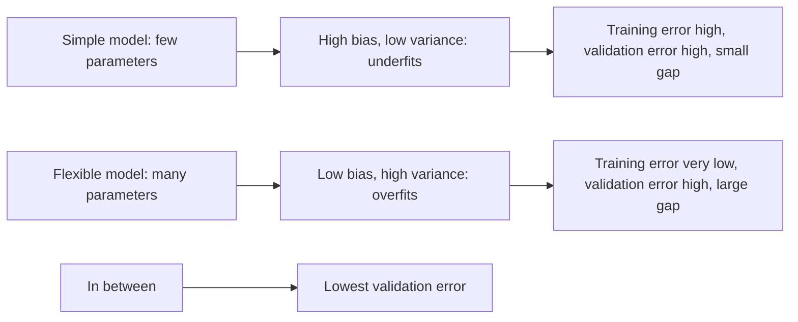
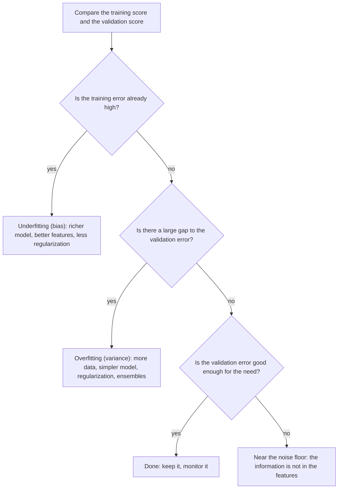
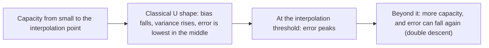

# Module 04: The Bias-Variance Tradeoff, Learning Curves, and Overfitting

> **Prerequisites:** [Module 03: Cross-Validation](../03-cross-validation-k-fold-stratified-and-time-based/README.md) and [Module 02: Splits and Data Leakage](../02-train-validation-test-splits-and-data-leakage/README.md).  
> **Estimated Reading Time:** 45 minutes  
> **Target Audience:** ML engineers and data scientists who must decide what to do when a model is not good enough: more data, a bigger model, a simpler model, or stop

> [!TIP]
> **The Golden Rule of Model Diagnosis:** The error of a model on new data has three parts: the **noise** nobody can predict, the **bias** (what the model systematically gets wrong because it is too simple) and the **variance** (how much the model changes with the particular training sample because it is too flexible). Look at the **gap between training and validation scores** and at the **learning curve** before you change anything: a high gap says "variance: more data, a simpler model or regularization"; a high error with no gap says "bias: a richer model or better features"; and if more data stops helping, you have met the noise floor.

---

## Why This Matters

"The model is not good enough" has several different causes, and each has a different cure. Adding data to a model that is too simple does nothing; simplifying a model that already underfits makes it worse; tuning a model whose features lack the signal wastes weeks. The bias-variance decomposition is the tool that tells these cases apart, and it is checkable: you do not have to take it on trust, because you can measure bias and variance directly when you know the true function. This module does that in four languages, and then does the same diagnosis with real data using the two standard instruments, **learning curves** and **validation curves**.

It also ends with a warning that the textbook picture is incomplete: very flexible models that fit the training data exactly can still do well, a result known as **double descent** (section 3). The classical advice is still the right starting point for tabular data and small samples, but you need to know where it stops.

---

## 1. Architectural Mental Model: Where Error Comes From

### The Decomposition

Suppose the world produces $y = f(x) + \varepsilon$ with noise of variance $\sigma^2$, and a model $\hat{f}$ is trained on a random training sample. For squared error, the expected error at a point $x$ splits exactly into three:

$$\mathbb{E}\big[(y - \hat{f}(x))^2\big] = \underbrace{\big(\mathbb{E}[\hat{f}(x)] - f(x)\big)^2}_{\text{bias}^2} + \underbrace{\mathbb{E}\Big[\big(\hat{f}(x) - \mathbb{E}[\hat{f}(x)]\big)^2\Big]}_{\text{variance}} + \underbrace{\sigma^2}_{\text{noise}}$$

- **Bias** is the gap between the model's *average* prediction (over many possible training samples) and the truth. A model that is too simple has high bias: even with infinite data it would be wrong in the same way.
- **Variance** is how much the prediction moves from one training sample to another. A model that is too flexible has high variance: it fits the quirks of the sample it saw.
- **Noise** is the part of $y$ that is not a function of $x$ at all. No model can remove it; it is the floor.

### Complexity Trades One for the Other



### Reading the Two Scores



### Learning Curves: Score Against the Amount of Data

A **learning curve** trains the same model on larger and larger parts of the data and plots the training and validation score. Its shape tells you what more data would do:

| Shape | What it means | More data will | What to do |
| :--- | :--- | :--- | :--- |
| Both curves flat, **close together, at a poor score** | High bias | Not help | A richer model or better features |
| **Wide gap**, training near perfect, validation rising | High variance | Help, slowly | More data, regularization, a simpler model |
| Curves have **converged at a good score** | Done, or at the noise floor | Not help | Ship, or look for new information |
| Validation still rising at the largest size | Data-limited | Help | Collect or label more |

---

## 2. Systematic Reference and Comparison Grids

### Symptoms and Their Usual Causes

| Observation | Most likely | First things to try |
| :--- | :--- | :--- |
| Train 0.99, validation 0.70 | Variance | Regularize, prune, more data, fewer features, bagging |
| Train 0.70, validation 0.68 | Bias | More capacity, interaction or non-linear features, less regularization |
| Train 0.85, validation 0.84, and a human gets 0.95 | Bias or missing information | Better features, a different model family, check the labels |
| Validation score changes a lot between folds | High variance, or too little data | More data, repeated cross-validation, a simpler model |
| Validation very different from the test score | Leakage or overfitting to the validation set | Module 02; a fresh test set |

### The Knobs, by Model Family

| Model | Raises capacity (less bias, more variance) | Lowers capacity (more bias, less variance) |
| :--- | :--- | :--- |
| Decision tree | Greater `max_depth`, smaller `min_samples_leaf` | Shallower, larger leaves, pruning |
| Linear or logistic regression | More or interaction features, smaller regularization penalty | Fewer features, a larger penalty (`alpha` in Ridge, smaller `C` in `LogisticRegression`) |
| k-nearest neighbours | Smaller k | Larger k |
| Random forest, gradient boosting | More depth, more boosting rounds | Shallower trees, fewer rounds, a smaller learning rate with early stopping |
| Neural network | More width and depth, more epochs | Weight decay, dropout, early stopping, fewer parameters |

### Regularization in One Line

A penalty on the size of the coefficients is added to the loss, so a flexible model is pulled towards a simple one. For ridge regression:

$$J(w) = \frac{1}{n}\sum_{i}(w^{\top}x_i - y_i)^2 + \lambda \lVert w \rVert_2^{2}$$

A larger $\lambda$ means more bias and less variance; $\lambda = 0$ is ordinary least squares. The right $\lambda$ is chosen on validation data, never on the training error, which always prefers $\lambda = 0$.

### The Two scikit-learn Instruments

| Instrument | What it varies | Shows |
| :--- | :--- | :--- |
| `learning_curve` | The number of training samples | Whether more data helps (variance) or not (bias, noise) |
| `validation_curve` | One setting of the model (depth, alpha, k) | Where on the complexity axis validation is best |

---

## 3. Real Case Study: Where the Textbook Curve Holds, and Where It Stops

Two documented results frame this module: one from the scikit-learn documentation showing the classical picture with numbers, and one research result showing its limits.

| Source | What it shows |
| :--- | :--- |
| scikit-learn example "Underfitting vs. Overfitting" | Polynomial regression on 30 noisy samples of a cosine, scored by 10-fold cross-validation (mean squared error): **degree 1: 0.408** (± 0.425), "a linear function ... is not sufficient to fit the training samples. This is called underfitting"; **degree 4: 0.0432** (± 0.0708), which "approximates the true function almost perfectly"; **degree 15: 1.83e+08** (± 5.48e+08), where "the model will overfit the training data, i.e. it learns the noise of the training data" |
| Mikhail Belkin, Daniel Hsu, Siyuan Ma and Soumik Mandal, "Reconciling modern machine learning practice and the bias-variance trade-off" (PNAS 2019; arXiv 1812.11118) | The paper starts from a tension: the classical trade-off seems to conflict with modern practice, in which very rich models such as neural networks "are trained to exactly fit (i.e., interpolate) the data". The authors describe a "double descent" curve that "subsumes the textbook U-shaped bias-variance trade-off curve": error rises towards the point where the model can just interpolate the data, then falls again as capacity grows beyond it |



### What to Take From It

1. **The classical picture is real and measurable.** The scikit-learn numbers span nine orders of magnitude between a well-chosen and an over-flexible model on 30 points, and the cross-validation spread (± 5.48e+08) shows how unstable the over-flexible model is.
2. **Capacity is not the same as the number of parameters you wrote down.** Regularization, early stopping and the way a model is fitted change its effective capacity.
3. **The peak is at the interpolation point.** Workflow 3 reproduces double descent with plain linear algebra: the worst error is exactly where the number of features equals the number of samples.
4. **For tabular data with a few thousand rows, use the classical diagnosis.** The interesting second descent needs very flexible models and very careful fitting, and it does not guarantee that the second minimum is better than the first (in Workflow 3 it is not).

---

## 4. Measuring Bias and Variance Directly, in Four Languages (`carousel`)

The program samples the curve $f(x) = 1/(1 + 25x^2)$ at 12 points with noise (level 0.1), fits polynomials of degree 0 to 11 to **100 different noisy samples**, and measures the three quantities from the decomposition: the **bias²** of the average fit, the **variance** across fits, and the error against the true curve. For squared error the last equals bias² plus variance exactly, and the program prints both sides. Noise comes from a small fixed generator, so every language draws the same 200 samples.

````carousel
```python
"""Bias and variance measured, not just described. A known curve f(x) = 1 / (1 + 25 x^2) is sampled at 12 points with noise; polynomials of
degree 0 to 11 are fitted to 100 different noisy samples of it. The average prediction over the 100 fits gives the bias; their spread gives the
variance. For squared error, the error against the true curve is exactly bias^2 + variance, and the program prints both sides."""
import math

POINTS, TEST, REPEATS, NOISE = 12, 51, 100, 0.1


def total(values):
    """Plain left-to-right addition: the same order, and so the same rounding, in every language."""
    result = 0.0
    for value in values:
        result += value
    return result


def square(x):
    return x * x


def truth(x):
    return 1.0 / (1.0 + 25.0 * x * x)


class Lcg:
    """A small, fixed random number generator, so that all four languages draw the same noise."""

    def __init__(self, seed):
        self.state = seed

    def uniform(self):
        self.state = (self.state * 1664525 + 1013904223) % 4294967296
        return self.state / 4294967296.0

    def noise(self):
        """Roughly normal: the sum of twelve uniform numbers, centred, times the noise level."""
        return NOISE * (total(self.uniform() for _ in range(12)) - 6.0)


def basis(x, degree):
    """Chebyshev polynomials T0..T_degree at x: a well-behaved set of polynomial building blocks."""
    values = [1.0, x]
    for k in range(1, degree):
        values.append(2.0 * x * values[k] - values[k - 1])
    return values[: degree + 1]


def solve(matrix, vector):
    """Gaussian elimination with partial pivoting."""
    n = len(vector)
    a = [row[:] + [vector[i]] for i, row in enumerate(matrix)]
    for col in range(n):
        pivot = max(range(col, n), key=lambda r: abs(a[r][col]))
        a[col], a[pivot] = a[pivot], a[col]
        for r in range(col + 1, n):
            factor = a[r][col] / a[col][col]
            for c in range(col, n + 1):
                a[r][c] -= factor * a[col][c]
    result = [0.0] * n
    for i in range(n - 1, -1, -1):
        total = a[i][n]
        for j in range(i + 1, n):
            total -= a[i][j] * result[j]
        result[i] = total / a[i][i]
    return result


def fit(rows, ys, degree):
    """Least squares by the normal equations: the coefficients that make the squared error on the training points smallest.
    `rows` holds the basis values of every training point; a model of this degree uses the first degree + 1 of them."""
    rows = [row[: degree + 1] for row in rows]
    size = degree + 1
    gram = [[total(row[i] * row[j] for row in rows) for j in range(size)] for i in range(size)]
    rhs = [total(row[i] * y for row, y in zip(rows, ys)) for i in range(size)]
    return solve(gram, rhs)


def predict(coefficients, values):
    """The model's value at a point whose basis values are `values`."""
    return total(c * b for c, b in zip(coefficients, values))


if __name__ == "__main__":
    train_x = [-1.0 + 2.0 * i / (POINTS - 1) for i in range(POINTS)]
    test_x = [-1.0 + 2.0 * j / (TEST - 1) for j in range(TEST)]
    truth_test = [truth(x) for x in test_x]
    train_basis = [basis(x, POINTS - 1) for x in train_x]  # computed once: every degree uses a prefix of these values
    test_basis = [basis(x, POINTS - 1) for x in test_x]
    rng = Lcg(2024)
    degrees = range(POINTS)
    sum_pred = [[0.0] * TEST for _ in degrees]
    sum_sq = [[0.0] * TEST for _ in degrees]
    sum_err = [0.0] * POINTS
    sum_train = [0.0] * POINTS
    for _ in range(REPEATS):
        ys = [truth(x) + rng.noise() for x in train_x]
        for d in degrees:
            coefficients = fit(train_basis, ys, d)
            sum_train[d] += total(square(predict(coefficients, values) - y) for values, y in zip(train_basis, ys)) / POINTS
            for j, values in enumerate(test_basis):
                p = predict(coefficients, values)
                sum_pred[d][j] += p
                sum_sq[d][j] += p * p
                sum_err[d] += square(p - truth_test[j]) / TEST
    print(f"{POINTS} training points, noise level {NOISE}, {REPEATS} noisy samples, error measured against the true curve at {TEST} points")
    print(f"{'degree':>6} {'train mse':>10} {'test mse':>10} {'bias^2':>10} {'variance':>10} {'bias^2+var':>11}")
    best = (None, math.inf)
    for d in degrees:
        bias2 = total(square((sum_pred[d][j] / REPEATS) - truth_test[j]) for j in range(TEST)) / TEST
        variance = total(sum_sq[d][j] / REPEATS - square(sum_pred[d][j] / REPEATS) for j in range(TEST)) / TEST
        test_mse = sum_err[d] / REPEATS
        if test_mse < best[1]:
            best = (d, test_mse)
        print(f"{d:>6} {sum_train[d] / REPEATS:>10.4f} {test_mse:>10.4f} {bias2:>10.4f} {variance:>10.4f} {bias2 + variance:>11.4f}")
    print(f"lowest test error at degree {best[0]}; training error at degree {POINTS - 1} is {sum_train[POINTS - 1] / REPEATS:.4f}, because 12 points can be fitted exactly by degree 11")
```

<!-- slide -->

```typescript
// Bias and variance measured, not just described. A known curve f(x) = 1 / (1 + 25 x^2) is sampled at 12 points with noise; polynomials of
// degree 0 to 11 are fitted to 100 different noisy samples of it. The average prediction over the 100 fits gives the bias; their spread gives the
// variance. For squared error, the error against the true curve is exactly bias^2 + variance, and the program prints both sides.

const POINTS = 12;
const TEST = 51;
const REPEATS = 100;
const NOISE = 0.1;

/** Plain left-to-right addition: the same order, and so the same rounding, in every language. */
function total(values: number[]): number {
  let result = 0.0;
  for (const value of values) result += value;
  return result;
}

const square = (x: number): number => x * x;
const truth = (x: number): number => 1.0 / (1.0 + 25.0 * x * x);

/** A small, fixed random number generator, so that all four languages draw the same noise. */
class Lcg {
  state: number;

  constructor(seed: number) {
    this.state = seed;
  }

  uniform(): number {
    this.state = (Math.imul(this.state, 1664525) + 1013904223) >>> 0;
    return this.state / 4294967296.0;
  }

  /** Roughly normal: the sum of twelve uniform numbers, centred, times the noise level. */
  noise(): number {
    const draws: number[] = [];
    for (let i = 0; i < 12; i++) draws.push(this.uniform());
    return NOISE * (total(draws) - 6.0);
  }
}

/** Chebyshev polynomials T0..T_degree at x: a well-behaved set of polynomial building blocks. */
function basis(x: number, degree: number): number[] {
  const values = [1.0, x];
  for (let k = 1; k < degree; k++) values.push(2.0 * x * values[k] - values[k - 1]);
  return values.slice(0, degree + 1);
}

/** Gaussian elimination with partial pivoting. */
function solve(matrix: number[][], vector: number[]): number[] {
  const n = vector.length;
  const a = matrix.map((row, i) => [...row, vector[i]]);
  for (let col = 0; col < n; col++) {
    let pivot = col;
    for (let r = col + 1; r < n; r++) if (Math.abs(a[r][col]) > Math.abs(a[pivot][col])) pivot = r;
    [a[col], a[pivot]] = [a[pivot], a[col]];
    for (let r = col + 1; r < n; r++) {
      const factor = a[r][col] / a[col][col];
      for (let c = col; c <= n; c++) a[r][c] -= factor * a[col][c];
    }
  }
  const result = new Array<number>(n).fill(0.0);
  for (let i = n - 1; i >= 0; i--) {
    let sum = a[i][n];
    for (let j = i + 1; j < n; j++) sum -= a[i][j] * result[j];
    result[i] = sum / a[i][i];
  }
  return result;
}

/** Least squares by the normal equations: the coefficients that make the squared error on the training points smallest. */
function fit(allRows: number[][], ys: number[], degree: number): number[] {
  const rows = allRows.map((row) => row.slice(0, degree + 1)); // a model of this degree uses the first degree + 1 basis values
  const size = degree + 1;
  const gram: number[][] = [];
  for (let i = 0; i < size; i++) {
    gram.push([]);
    for (let j = 0; j < size; j++) gram[i].push(total(rows.map((row) => row[i] * row[j])));
  }
  const rhs: number[] = [];
  for (let i = 0; i < size; i++) rhs.push(total(rows.map((row, k) => row[i] * ys[k])));
  return solve(gram, rhs);
}

/** The model's value at a point whose basis values are `b`. */
function predict(coefficients: number[], b: number[]): number {
  return total(coefficients.map((c, i) => c * b[i]));
}

const trainX = Array.from({ length: POINTS }, (_, i) => -1.0 + (2.0 * i) / (POINTS - 1));
const testX = Array.from({ length: TEST }, (_, j) => -1.0 + (2.0 * j) / (TEST - 1));
const truthTest = testX.map(truth);
const trainBasis = trainX.map((x) => basis(x, POINTS - 1)); // computed once: every degree uses a prefix of these values
const testBasis = testX.map((x) => basis(x, POINTS - 1));
const rng = new Lcg(2024);
const grid = (): number[][] => Array.from({ length: POINTS }, () => new Array<number>(TEST).fill(0.0));
const sumPred = grid();
const sumSq = grid();
const sumErr = new Array<number>(POINTS).fill(0.0);
const sumTrain = new Array<number>(POINTS).fill(0.0);
for (let r = 0; r < REPEATS; r++) {
  const ys = trainX.map((x) => truth(x) + rng.noise());
  for (let d = 0; d < POINTS; d++) {
    const coefficients = fit(trainBasis, ys, d);
    sumTrain[d] += total(trainBasis.map((values, k) => square(predict(coefficients, values) - ys[k]))) / POINTS;
    for (let j = 0; j < TEST; j++) {
      const p = predict(coefficients, testBasis[j]);
      sumPred[d][j] += p;
      sumSq[d][j] += p * p;
      sumErr[d] += square(p - truthTest[j]) / TEST;
    }
  }
}
const pad = (value: number, width: number, digits = 4): string => value.toFixed(digits).padStart(width);
console.log(`${POINTS} training points, noise level ${NOISE}, ${REPEATS} noisy samples, error measured against the true curve at ${TEST} points`);
console.log(`${"degree".padStart(6)} ${"train mse".padStart(10)} ${"test mse".padStart(10)} ${"bias^2".padStart(10)} ${"variance".padStart(10)} ${"bias^2+var".padStart(11)}`);
let bestDegree = -1;
let bestError = Infinity;
for (let d = 0; d < POINTS; d++) {
  const bias2 = total(truthTest.map((f, j) => square(sumPred[d][j] / REPEATS - f))) / TEST;
  const variance = total(truthTest.map((_, j) => sumSq[d][j] / REPEATS - square(sumPred[d][j] / REPEATS))) / TEST;
  const testMse = sumErr[d] / REPEATS;
  if (testMse < bestError) {
    bestError = testMse;
    bestDegree = d;
  }
  console.log(`${String(d).padStart(6)} ${pad(sumTrain[d] / REPEATS, 10)} ${pad(testMse, 10)} ${pad(bias2, 10)} ${pad(variance, 10)} ${pad(bias2 + variance, 11)}`);
}
console.log(`lowest test error at degree ${bestDegree}; training error at degree ${POINTS - 1} is ${(sumTrain[POINTS - 1] / REPEATS).toFixed(4)}, because 12 points can be fitted exactly by degree 11`);
```

<!-- slide -->

```go
// Bias and variance measured, not just described. A known curve f(x) = 1 / (1 + 25 x^2) is sampled at 12 points with noise; polynomials of
// degree 0 to 11 are fitted to 100 different noisy samples of it. The average prediction over the 100 fits gives the bias; their spread gives the
// variance. For squared error, the error against the true curve is exactly bias^2 + variance, and the program prints both sides.
package main

import (
	"fmt"
	"math"
)

const (
	points  = 12
	tests   = 51
	repeats = 100
	noise   = 0.1
)

// total is plain left-to-right addition: the same order, and so the same rounding, in every language.
func total(values []float64) float64 {
	result := 0.0
	for _, v := range values {
		result += v
	}
	return result
}

func square(x float64) float64 { return x * x }
func truth(x float64) float64  { return 1.0 / (1.0 + 25.0*x*x) }

// lcg is a small, fixed random number generator, so that all four languages draw the same noise.
type lcg struct{ state uint32 }

func (g *lcg) uniform() float64 {
	g.state = g.state*1664525 + 1013904223
	return float64(g.state) / 4294967296.0
}

// noise is roughly normal: the sum of twelve uniform numbers, centred, times the noise level.
func (g *lcg) noise() float64 {
	draws := make([]float64, 12)
	for i := range draws {
		draws[i] = g.uniform()
	}
	return noise * (total(draws) - 6.0)
}

// basis gives the Chebyshev polynomials T0..T_degree at x: a well-behaved set of polynomial building blocks.
func basis(x float64, degree int) []float64 {
	values := []float64{1.0, x}
	for k := 1; k < degree; k++ {
		values = append(values, 2.0*x*values[k]-values[k-1])
	}
	return values[:degree+1]
}

// solve is Gaussian elimination with partial pivoting.
func solve(matrix [][]float64, vector []float64) []float64 {
	n := len(vector)
	a := make([][]float64, n)
	for i, row := range matrix {
		a[i] = append(append([]float64(nil), row...), vector[i])
	}
	for col := 0; col < n; col++ {
		pivot := col
		for r := col + 1; r < n; r++ {
			if math.Abs(a[r][col]) > math.Abs(a[pivot][col]) {
				pivot = r
			}
		}
		a[col], a[pivot] = a[pivot], a[col]
		for r := col + 1; r < n; r++ {
			factor := a[r][col] / a[col][col]
			for c := col; c <= n; c++ {
				a[r][c] -= factor * a[col][c]
			}
		}
	}
	result := make([]float64, n)
	for i := n - 1; i >= 0; i-- {
		sum := a[i][n]
		for j := i + 1; j < n; j++ {
			sum -= a[i][j] * result[j]
		}
		result[i] = sum / a[i][i]
	}
	return result
}

// fit is least squares by the normal equations: the coefficients that make the squared error on the training points smallest.
func fit(allRows [][]float64, ys []float64, degree int) []float64 {
	rows := make([][]float64, len(allRows))
	for i, row := range allRows {
		rows[i] = row[:degree+1] // a model of this degree uses the first degree + 1 basis values
	}
	size := degree + 1
	gram := make([][]float64, size)
	rhs := make([]float64, size)
	for i := 0; i < size; i++ {
		gram[i] = make([]float64, size)
		for j := 0; j < size; j++ {
			products := make([]float64, len(rows))
			for k, row := range rows {
				products[k] = row[i] * row[j]
			}
			gram[i][j] = total(products)
		}
		products := make([]float64, len(rows))
		for k, row := range rows {
			products[k] = row[i] * ys[k]
		}
		rhs[i] = total(products)
	}
	return solve(gram, rhs)
}

// predict is the model's value at a point whose basis values are b.
func predict(coefficients []float64, b []float64) float64 {
	terms := make([]float64, len(coefficients))
	for i, c := range coefficients {
		terms[i] = c * b[i]
	}
	return total(terms)
}

func grid() [][]float64 {
	out := make([][]float64, points)
	for i := range out {
		out[i] = make([]float64, tests)
	}
	return out
}

func main() {
	trainX := make([]float64, points)
	for i := range trainX {
		trainX[i] = -1.0 + 2.0*float64(i)/float64(points-1)
	}
	testX := make([]float64, tests)
	truthTest := make([]float64, tests)
	for j := range testX {
		testX[j] = -1.0 + 2.0*float64(j)/float64(tests-1)
		truthTest[j] = truth(testX[j])
	}
	trainBasis := make([][]float64, points) // computed once: every degree uses a prefix of these values
	for i, x := range trainX {
		trainBasis[i] = basis(x, points-1)
	}
	testBasis := make([][]float64, tests)
	for j, x := range testX {
		testBasis[j] = basis(x, points-1)
	}
	rng := &lcg{2024}
	sumPred, sumSq := grid(), grid()
	sumErr := make([]float64, points)
	sumTrain := make([]float64, points)
	for r := 0; r < repeats; r++ {
		ys := make([]float64, points)
		for i, x := range trainX {
			ys[i] = truth(x) + rng.noise()
		}
		for d := 0; d < points; d++ {
			coefficients := fit(trainBasis, ys, d)
			errors := make([]float64, points)
			for k := range trainX {
				errors[k] = square(predict(coefficients, trainBasis[k]) - ys[k])
			}
			sumTrain[d] += total(errors) / points
			for j := 0; j < tests; j++ {
				p := predict(coefficients, testBasis[j])
				sumPred[d][j] += p
				sumSq[d][j] += p * p
				sumErr[d] += square(p-truthTest[j]) / tests
			}
		}
	}
	fmt.Printf("%d training points, noise level %v, %d noisy samples, error measured against the true curve at %d points\n", points, noise, repeats, tests)
	fmt.Printf("%6s %10s %10s %10s %10s %11s\n", "degree", "train mse", "test mse", "bias^2", "variance", "bias^2+var")
	bestDegree, bestError := -1, math.Inf(1)
	for d := 0; d < points; d++ {
		biasTerms := make([]float64, tests)
		varTerms := make([]float64, tests)
		for j := 0; j < tests; j++ {
			biasTerms[j] = square(sumPred[d][j]/repeats - truthTest[j])
			varTerms[j] = sumSq[d][j]/repeats - square(sumPred[d][j]/repeats)
		}
		bias2, variance := total(biasTerms)/tests, total(varTerms)/tests
		testMse := sumErr[d] / repeats
		if testMse < bestError {
			bestError, bestDegree = testMse, d
		}
		fmt.Printf("%6d %10.4f %10.4f %10.4f %10.4f %11.4f\n", d, sumTrain[d]/repeats, testMse, bias2, variance, bias2+variance)
	}
	fmt.Printf("lowest test error at degree %d; training error at degree %d is %.4f, because 12 points can be fitted exactly by degree 11\n", bestDegree, points-1, sumTrain[points-1]/repeats)
}
```

<!-- slide -->

```csharp
// Bias and variance measured, not just described. A known curve f(x) = 1 / (1 + 25 x^2) is sampled at 12 points with noise; polynomials of
// degree 0 to 11 are fitted to 100 different noisy samples of it. The average prediction over the 100 fits gives the bias; their spread gives the
// variance. For squared error, the error against the true curve is exactly bias^2 + variance, and the program prints both sides.
using System;
using System.Collections.Generic;
using System.Globalization;
using System.Linq;

CultureInfo.CurrentCulture = CultureInfo.InvariantCulture;

const int Points = 12;
const int Tests = 51;
const int Repeats = 100;
const double Noise = 0.1;

// Plain left-to-right addition: the same order, and so the same rounding, in every language.
double Total(IEnumerable<double> values)
{
    double result = 0.0;
    foreach (double value in values) result += value;
    return result;
}

double Square(double x) => x * x;
double Truth(double x) => 1.0 / (1.0 + 25.0 * x * x);

// Chebyshev polynomials T0..T_degree at x: a well-behaved set of polynomial building blocks.
double[] Basis(double x, int degree)
{
    var values = new List<double> { 1.0, x };
    for (int k = 1; k < degree; k++) values.Add(2.0 * x * values[k] - values[k - 1]);
    return values.Take(degree + 1).ToArray();
}

// Gaussian elimination with partial pivoting.
double[] Solve(double[][] matrix, double[] vector)
{
    int n = vector.Length;
    var a = matrix.Select((row, i) => row.Append(vector[i]).ToArray()).ToArray();
    for (int col = 0; col < n; col++)
    {
        int pivot = col;
        for (int r = col + 1; r < n; r++) if (Math.Abs(a[r][col]) > Math.Abs(a[pivot][col])) pivot = r;
        (a[col], a[pivot]) = (a[pivot], a[col]);
        for (int r = col + 1; r < n; r++)
        {
            double factor = a[r][col] / a[col][col];
            for (int c = col; c <= n; c++) a[r][c] -= factor * a[col][c];
        }
    }
    var result = new double[n];
    for (int i = n - 1; i >= 0; i--)
    {
        double sum = a[i][n];
        for (int j = i + 1; j < n; j++) sum -= a[i][j] * result[j];
        result[i] = sum / a[i][i];
    }
    return result;
}

// Least squares by the normal equations: the coefficients that make the squared error on the training points smallest.
double[] Fit(double[][] allRows, double[] ys, int degree)
{
    var rows = allRows.Select(row => row.Take(degree + 1).ToArray()).ToArray(); // a model of this degree uses the first degree + 1 basis values
    int size = degree + 1;
    var gram = new double[size][];
    var rhs = new double[size];
    for (int i = 0; i < size; i++)
    {
        gram[i] = new double[size];
        for (int j = 0; j < size; j++)
        {
            int ci = i, cj = j;
            gram[i][j] = Total(rows.Select(row => row[ci] * row[cj]));
        }
        int ri = i;
        rhs[i] = Total(rows.Select((row, k) => row[ri] * ys[k]));
    }
    return Solve(gram, rhs);
}

// The model's value at a point whose basis values are b.
double Predict(double[] coefficients, double[] b) => Total(coefficients.Select((c, i) => c * b[i]));

var trainX = Enumerable.Range(0, Points).Select(i => -1.0 + 2.0 * i / (Points - 1)).ToArray();
var testX = Enumerable.Range(0, Tests).Select(j => -1.0 + 2.0 * j / (Tests - 1)).ToArray();
var truthTest = testX.Select(Truth).ToArray();
var trainBasis = trainX.Select(x => Basis(x, Points - 1)).ToArray(); // computed once: every degree uses a prefix of these values
var testBasis = testX.Select(x => Basis(x, Points - 1)).ToArray();
var rng = new Lcg(2024);
double[][] Grid() => Enumerable.Range(0, Points).Select(_ => new double[Tests]).ToArray();
var sumPred = Grid();
var sumSq = Grid();
var sumErr = new double[Points];
var sumTrain = new double[Points];
for (int r = 0; r < Repeats; r++)
{
    var ys = trainX.Select(x => Truth(x) + rng.Noise(Noise)).ToArray();
    for (int d = 0; d < Points; d++)
    {
        var coefficients = Fit(trainBasis, ys, d);
        sumTrain[d] += Total(trainBasis.Select((values, k) => Square(Predict(coefficients, values) - ys[k]))) / Points;
        for (int j = 0; j < Tests; j++)
        {
            double p = Predict(coefficients, testBasis[j]);
            sumPred[d][j] += p;
            sumSq[d][j] += p * p;
            sumErr[d] += Square(p - truthTest[j]) / Tests;
        }
    }
}
Console.WriteLine($"{Points} training points, noise level {Noise.ToString("0.0#", CultureInfo.InvariantCulture)}, {Repeats} noisy samples, error measured against the true curve at {Tests} points");
Console.WriteLine($"{"degree",6} {"train mse",10} {"test mse",10} {"bias^2",10} {"variance",10} {"bias^2+var",11}");
int bestDegree = -1;
double bestError = double.PositiveInfinity;
for (int d = 0; d < Points; d++)
{
    int dd = d;
    double bias2 = Total(truthTest.Select((f, j) => Square(sumPred[dd][j] / Repeats - f))) / Tests;
    double variance = Total(truthTest.Select((_, j) => sumSq[dd][j] / Repeats - Square(sumPred[dd][j] / Repeats))) / Tests;
    double testMse = sumErr[d] / Repeats;
    if (testMse < bestError) { bestError = testMse; bestDegree = d; }
    Console.WriteLine($"{d,6} {sumTrain[d] / Repeats,10:F4} {testMse,10:F4} {bias2,10:F4} {variance,10:F4} {bias2 + variance,11:F4}");
}
Console.WriteLine($"lowest test error at degree {bestDegree}; training error at degree {Points - 1} is {sumTrain[Points - 1] / Repeats:F4}, because 12 points can be fitted exactly by degree 11");

// A small, fixed random number generator, so that all four languages draw the same noise.
class Lcg(uint seed)
{
    private uint _state = seed;

    public double Uniform()
    {
        _state = unchecked(_state * 1664525u + 1013904223u);
        return _state / 4294967296.0;
    }

    // Roughly normal: the sum of twelve uniform numbers, centred, times the noise level.
    public double Noise(double level)
    {
        double sum = 0.0;
        for (int i = 0; i < 12; i++) sum += Uniform();
        return level * (sum - 6.0);
    }
}
```
````

**Observed output (identical in Python 3.13.14, Node 24, Go 1.22 and .NET 10):**

```text
12 training points, noise level 0.1, 100 noisy samples, error measured against the true curve at 51 points
degree  train mse   test mse     bias^2   variance  bias^2+var
     0     0.0850     0.0815     0.0808     0.0007      0.0815
     1     0.0842     0.0822     0.0808     0.0014      0.0822
     2     0.0433     0.0405     0.0385     0.0020      0.0405
     3     0.0426     0.0410     0.0385     0.0026      0.0410
     4     0.0216     0.0211     0.0179     0.0032      0.0211
     5     0.0206     0.0220     0.0179     0.0041      0.0220
     6     0.0100     0.0134     0.0083     0.0051      0.0134
     7     0.0090     0.0147     0.0083     0.0064      0.0147
     8     0.0044     0.0126     0.0044     0.0082      0.0126
     9     0.0037     0.0171     0.0045     0.0126      0.0171
    10     0.0008     0.0757     0.0323     0.0434      0.0757
    11     0.0000     0.3538     0.0348     0.3190      0.3538
lowest test error at degree 8; training error at degree 11 is 0.0000, because 12 points can be fitted exactly by degree 11
```

What to notice:

- **The identity holds.** The `test mse` column equals `bias^2 + var` to four decimals on every row: the decomposition is arithmetic, not folklore.
- **Bias falls and variance rises with degree.** Bias² goes from 0.0808 (degree 0, a constant) to 0.0044 (degree 8); the variance goes the other way, 0.0007 to 0.0082 at degree 8 and then explodes to **0.3190 at degree 11**.
- **Training error always falls; test error does not.** The training MSE reaches 0.0000 at degree 11, because 12 points can be fitted exactly by 12 coefficients, while the test error is 0.3538: a model that has "learned" the noise perfectly.
- **The best degree is 8**, with a test error of 0.0126, narrowly ahead of degree 6 (0.0134). The training error would have chosen degree 11.
- **A detail about the data:** the curve is symmetric, so the odd degrees add nothing to the fit (bias² is the same for degrees 2 and 3, and for 4 and 5) but still add variance (0.0020 to 0.0026, 0.0032 to 0.0041). More capacity is not always more useful capacity.

---

## 5. Practical Hands-On Verification Workflows (Python 3.13 + scikit-learn)

Environment as in Module 00 (verified on **Python 3.13.14, scikit-learn 1.9.1, NumPy 2.5.5**).

### Workflow 1: Learning Curves of Three Models on Real Data

The 1,797 digit images. Three models: naive Bayes (strong assumptions), an RBF support-vector machine, and a decision tree with no depth limit:

```python
"""Learning curves on a real data set: 1,797 handwritten digits. The score on the training samples and on held-out samples, as the number of
training samples grows, for three kinds of model: one that assumes too much (naive Bayes), one that fits well (an RBF support-vector
machine), and one that can memorize anything (a decision tree with no depth limit)."""
import numpy as np
import sklearn
from sklearn.datasets import load_digits
from sklearn.model_selection import StratifiedKFold, learning_curve
from sklearn.naive_bayes import GaussianNB
from sklearn.svm import SVC
from sklearn.tree import DecisionTreeClassifier

print(f"scikit-learn {sklearn.__version__}")
X, y = load_digits(return_X_y=True)
cv = StratifiedKFold(5, shuffle=True, random_state=0)
sizes = [50, 100, 200, 400, 800, 1437]  # the largest is every training row of a 5-fold split
models = [("naive Bayes", GaussianNB()), ("SVC, RBF kernel (gamma 0.001)", SVC(gamma=0.001)), ("decision tree, no depth limit", DecisionTreeClassifier(random_state=0))]
for name, model in models:
    train_sizes, train_scores, val_scores = learning_curve(model, X, y, cv=cv, train_sizes=sizes, shuffle=True, random_state=0)
    print(f"\n{name}")
    print(f"{'training samples':>17} {'train accuracy':>15} {'validation accuracy':>20} {'gap':>7}")
    for size, tr, va in zip(train_sizes, train_scores.mean(axis=1), val_scores.mean(axis=1)):
        print(f"{size:>17} {tr:>15.3f} {va:>20.3f} {tr - va:>7.3f}")
```

**Observed Output:**

```text
scikit-learn 1.9.1

naive Bayes
 training samples  train accuracy  validation accuracy     gap
               50           0.992                0.523   0.469
              100           0.954                0.706   0.248
              200           0.937                0.790   0.147
              400           0.895                0.835   0.060
              800           0.863                0.836   0.027
             1437           0.860                0.851   0.009

SVC, RBF kernel (gamma 0.001)
 training samples  train accuracy  validation accuracy     gap
               50           0.996                0.717   0.279
              100           1.000                0.904   0.096
              200           1.000                0.947   0.053
              400           1.000                0.974   0.026
              800           0.999                0.988   0.011
             1437           0.999                0.990   0.009

decision tree, no depth limit
 training samples  train accuracy  validation accuracy     gap
               50           1.000                0.511   0.489
              100           1.000                0.655   0.345
              200           1.000                0.710   0.290
              400           1.000                0.766   0.234
              800           1.000                0.827   0.173
             1437           1.000                0.859   0.141
```

- **Naive Bayes: bias.** Its training accuracy falls with more data (0.992, 0.954, 0.937, 0.895, 0.863, 0.860) and its validation accuracy rises until they **meet at about 0.86 and 0.85**. The curves have converged at a modest score: more data will not help; a model with fewer assumptions will.
- **The SVC: a good fit.** Training stays near 1.000 and validation rises from 0.717 to **0.990**, with a gap of 0.009 at the end: the curves are nearly together at a high score.
- **The unlimited tree: variance.** Training accuracy is **1.000** at every size (it memorizes), while validation rises slowly from 0.511 to 0.859 and the gap is still **0.141** at the largest size. More data helps it a lot, and a simpler or averaged model (a pruned tree, or a forest) would help more.

### Workflow 2: Validation Curves on Real Data

A decision tree whose allowed depth runs from 1 to 12 on 442 diabetes patients, and ridge regression on all 286 degree-3 polynomial terms of the 10 measurements with the penalty $\lambda$ from 0.001 to 10,000:

```python
"""A validation curve: one setting that controls how flexible the model is, and the score on the training samples and on held-out samples at each
value. Real data: 442 diabetes patients, predicting a progression score (R2: 1 is perfect, 0 is no better than the average)."""
import numpy as np
import sklearn
from sklearn.datasets import load_diabetes
from sklearn.linear_model import Ridge
from sklearn.model_selection import KFold, validation_curve
from sklearn.pipeline import make_pipeline
from sklearn.preprocessing import PolynomialFeatures, StandardScaler
from sklearn.tree import DecisionTreeRegressor

X, y = load_diabetes(return_X_y=True)
cv = KFold(5, shuffle=True, random_state=0)
print(f"scikit-learn {sklearn.__version__}\n")

print("== 1. decision tree: allowed depth from 1 (a stump) to 12 ==")
depths = list(range(1, 13))
train, val = validation_curve(DecisionTreeRegressor(random_state=0), X, y, param_name="max_depth", param_range=depths, cv=cv, scoring="r2")
print(f"{'depth':>6} {'train R2':>9} {'validation R2':>14} {'+/-':>6}")
for depth, tr, va in zip(depths, train.mean(axis=1), val.mean(axis=1)):
    print(f"{depth:>6} {tr:>9.3f} {va:>14.3f} {val[depth - 1].std():>6.3f}")
print(f"best validation R2 at depth {depths[int(np.argmax(val.mean(axis=1)))]}; deeper trees fit the training rows better and the held-out rows worse")

print("\n== 2. the same idea with regularization: all degree-3 polynomial terms of the 10 measurements (286 features), ridge strength alpha ==")
alphas = [1e-3, 1e-1, 1, 10, 100, 1000, 10000]
model = make_pipeline(StandardScaler(), PolynomialFeatures(3), Ridge())
train, val = validation_curve(model, X, y, param_name="ridge__alpha", param_range=alphas, cv=cv, scoring="r2")
print(f"{'alpha':>8} {'train R2':>9} {'validation R2':>14}")
for alpha, tr, va in zip(alphas, train.mean(axis=1), val.mean(axis=1)):
    print(f"{alpha:>8g} {tr:>9.3f} {va:>14.3f}")
print("a weak penalty lets 286 features fit the noise; a very strong one flattens the model back towards the average: the best is in between")
```

**Observed Output:**

```text
scikit-learn 1.9.1

== 1. decision tree: allowed depth from 1 (a stump) to 12 ==
 depth  train R2  validation R2    +/-
     1     0.298          0.215  0.120
     2     0.442          0.339  0.135
     3     0.521          0.296  0.118
     4     0.598          0.287  0.124
     5     0.676          0.266  0.099
     6     0.757          0.150  0.123
     7     0.833          0.021  0.071
     8     0.895         -0.008  0.077
     9     0.941         -0.083  0.125
    10     0.968         -0.111  0.137
    11     0.981         -0.129  0.126
    12     0.990         -0.166  0.131
best validation R2 at depth 2; deeper trees fit the training rows better and the held-out rows worse

== 2. the same idea with regularization: all degree-3 polynomial terms of the 10 measurements (286 features), ridge strength alpha ==
   alpha  train R2  validation R2
   0.001     0.858         -7.625
     0.1     0.827         -2.468
       1     0.791         -0.765
      10     0.740         -0.042
     100     0.666          0.328
    1000     0.546          0.415
   10000     0.397          0.351
a weak penalty lets 286 features fit the noise; a very strong one flattens the model back towards the average: the best is in between
```

- **The tree:** training R² climbs from 0.298 to 0.990 as depth grows, but validation R² peaks at **depth 2 (0.339)** and then falls below zero (-0.166 at depth 12: worse than predicting the average). The spread across folds (0.07 to 0.14) is the same size as some of the differences: do not read depth 2 against depth 3 as a precise ranking.
- **The ridge:** with almost no penalty, 286 features fit the training rows (train R² 0.858) and the validation R² is **-7.625**, a catastrophic overfit; as the penalty grows the training score falls steadily and the validation score rises to **0.415 at alpha = 1000**, then falls again as the model is flattened (0.351 at 10,000). The best setting is in the middle, as the theory says.

### Workflow 3: Beyond the U: Double Descent With Plain Linear Algebra

40 training samples, 300 candidate features that are random numbers, and a signal spread over all of them. A linear model is fitted with the first $p$ features, for $p$ from 1 to 300. When $p$ is above 40 there are more unknowns than samples and the model with the smallest coefficients that fits the training data exactly is used:

```python
"""Beyond the U-shaped curve. 40 training samples, 300 candidate features that are random numbers, and a true signal spread thinly over all of
them. A linear model is fitted with the first p features, with p from 1 to 300; when p exceeds 40 there are more unknowns than samples and the
fit is the one with the smallest coefficients (the minimum-norm solution) that matches the training data exactly. Test error against the true signal."""
import numpy as np

D, N, SIGMA, TRIALS = 300, 40, 0.5, 200
beta = np.array([1.0 / np.sqrt(j + 1) for j in range(D)])
beta /= np.linalg.norm(beta)  # the true coefficients: the signal is strongest in the first features and thin in the rest

print(f"{N} training samples, noise level {SIGMA}, {TRIALS} trials per row; test error is against the true signal, so the noise-free floor is 0")
print(f"{'features used':>13} {'train mse (median)':>19} {'test mse (median)':>18} {'test mse (mean)':>16}")
for p in [1, 2, 5, 10, 20, 30, 36, 38, 40, 42, 44, 50, 60, 80, 120, 200, 300]:
    train, test = [], []
    for trial in range(TRIALS):
        rng = np.random.default_rng(10 * trial + p)
        X = rng.standard_normal((N, D))
        y = X @ beta + SIGMA * rng.standard_normal(N)
        coef = np.linalg.lstsq(X[:, :p], y, rcond=None)[0]  # least squares; the minimum-norm solution when p > N
        train.append(np.mean((X[:, :p] @ coef - y) ** 2))
        X_new = rng.standard_normal((500, D))
        test.append(np.mean((X_new[:, :p] @ coef - X_new @ beta) ** 2))
    marker = "   <- as many unknowns as samples" if p == N else ""
    print(f"{p:>13} {np.median(train):>19.4f} {np.median(test):>18.3f} {np.mean(test):>16.3f}{marker}")
```

**Observed Output:**

```text
40 training samples, noise level 0.5, 200 trials per row; test error is against the true signal, so the noise-free floor is 0
features used  train mse (median)  test mse (median)  test mse (mean)
            1              1.0458              0.861            0.865
            2              0.9326              0.811            0.817
            5              0.7410              0.750            0.767
           10              0.5547              0.767            0.800
           20              0.3274              1.061            1.118
           30              0.1332              2.077            2.499
           36              0.0518              4.878            7.765
           38              0.0197              9.336           22.774
           40              0.0000             45.711        32522.618   <- as many unknowns as samples
           42              0.0000             10.034           18.021
           44              0.0000              5.418            7.854
           50              0.0000              2.271            2.626
           60              0.0000              1.432            1.480
           80              0.0000              1.005            1.041
          120              0.0000              0.900            0.901
          200              0.0000              0.883            0.886
          300              0.0000              0.898            0.902
```

- **The classical U first:** the median test error falls from 0.861 (1 feature) to its minimum of **0.750 at 5 features**, then rises as extra features fit noise (1.061 at 20, 4.878 at 36).
- **The peak is where unknowns equal samples:** at 40 features the median test error is **45.7** and the mean is **32,522**, because a nearly singular system amplifies the noise enormously. Training error is exactly 0 from that point on: the model interpolates.
- **Then it falls again with more capacity:** 10.0 at 42, 2.27 at 50, 1.43 at 60, and about **0.88 to 0.90** from 120 to 300 features, with the training error still 0. This is the second descent.
- **Honest reading:** the second minimum (0.883) is **not better** than the first (0.750), because the signal here is thin and spread out. Double descent says more capacity need not be disastrous past the peak, not that it is a free improvement.

---

## 6. Hands-On Exercises and Independent Challenge

### Practical Exercises

1. **Change the noise.** In the carousel program set the noise level to 0.3 (three times larger) and rerun. Predict, before running, what happens to the bias², the variance, and the best degree. Then check.
2. **Diagnose from numbers.** For each pair (training, validation accuracy) say what is wrong and one fix: (a) 0.98 and 0.71; (b) 0.72 and 0.70; (c) 0.91 and 0.90 while a human expert gets 0.99; (d) 0.88 and 0.87 and the validation score rose steadily with each larger sample in the learning curve.
3. **Pick the lever.** A random forest has training accuracy 1.00 and validation 0.82. List three changes in order of how much you would expect each to help and why.
4. **Regularization by hand.** Using Workflow 2, explain why choosing the ridge penalty on the training score would always choose the smallest value, and which score you must use instead.

<details><summary>Answers</summary>

1. The bias² does not depend on the noise (it is a property of the model family and the true curve), so it is essentially unchanged: 0.0808 against 0.0807 at degree 0, 0.0044 against 0.0039 at degree 8. The variance scales with the **square** of the noise level, so it grows about 9 times: at degree 11 it goes from 0.3190 to 2.8708. The best degree moves down, from **8 to 4**, because a noisier sample supports less flexibility. The lesson: the right model complexity depends on how much data and noise you have, not only on the problem.
2. (a) Overfitting, a gap of 0.27: regularize or simplify, or add data. (b) Underfitting, both low and close: a richer model or better features. (c) Both are high and close but far below human performance: bias or missing information, so better features or a different model family, and check the labels. (d) The validation curve is still rising: the model is data-limited, so more data would help.
3. First, restrict the trees (a larger `min_samples_leaf`, a `max_depth`, fewer features per split) to reduce variance; second, more training data if the learning curve is still rising; third, tune the number of trees and use bagging or a simpler model. A forest with unlimited trees memorizes the training set, so the training score of 1.00 says little: the gap is the signal.
4. The training error never rises with flexibility, so it always picks the smallest penalty (ridge with alpha = 0.001 has a training R² of 0.858, the highest in the table, and a validation R² of -7.6). Choose on a **validation** score (cross-validation), as in the table: the best alpha is 1000.

</details>

### Independent Challenge

A team's classifier has a training AUC of 0.99 and a validation AUC of 0.71. A manager proposes buying ten times more labelled data. Decide whether to do it, say how you would find out, and list what else you would try first and why.

<details><summary>Architectural Discussion</summary>

**Diagnosis.** A gap of 0.28 with near-perfect training is a variance problem, so more data can help in principle, but ten times more labels is expensive, and the question is how much it would help.

**Find out cheaply.** Draw a learning curve: train on 10%, 20%, 40%, 80% and 100% of the current data and plot training and validation AUC. If validation is still rising steeply at 100%, extrapolate it to 10 times (using a fit on the log of the sample size) to estimate the gain. If it is flattening, more data of the same kind will not close the gap.

**Cheaper levers first.** Regularize or simplify the model; reduce the number of features; use bagging or an ensemble; stronger early stopping or weight decay; data augmentation if it applies; check for duplicates and leakage that make training look perfect (Module 02). These reduce variance without new labels.

**Also check the validation set.** A validation AUC of 0.71 from a small validation set has a wide error bar (Module 03), and a distribution shift between training and validation (a different time period or source) can produce a similar gap that more data of the old kind would not fix.

**Decision.** Buy data only if the curve says it will help by enough to matter for the product, and only after the cheaper levers have narrowed the gap. State the expected gain and its uncertainty in the request.

</details>

---

## 7. Common Mistakes and Troubleshooting

- **Judging a model by its training score.** It always improves with flexibility.
- **Adding data to an underfitting model.** Both curves are flat and close together; more rows change nothing.
- **Simplifying a model that already underfits.** Check the training error first.
- **Choosing hyperparameters on the training set.** Use validation or cross-validation.
- **Reading small differences between points on a curve as real.** The spread across folds can be as large as the difference (Workflow 2).
- **Ignoring the noise floor.** If a human expert or a much bigger model cannot do better, the information may not be in the features.
- **Forgetting that complexity depends on the data size.** A model that is right for 100,000 rows can overfit 1,000.
- **Assuming "more parameters" always means overfitting.** The double-descent results show it depends on how the model is fitted; do not assume either way, measure.

---

## 8. Operational Validation Checkpoints and Checkpoint Quiz

<details><summary><strong>Checkpoint 1: The validation score stopped improving as you made the model bigger, but the training score keeps climbing. What now?</strong></summary>

You are past the optimum on the complexity axis: the extra capacity is fitting noise. Go back to the setting where validation peaked, or regularize (a penalty, early stopping, dropout) so that the extra capacity is constrained, and confirm on a second validation split, because the peak of a noisy curve can be a few points wide.

</details>

<details><summary><strong>Checkpoint 2: Two curves converge at 0.74 and nothing you add to the model changes that. What have you found?</strong></summary>

Either a **bias** that your whole model family shares (a different family or new features might lift it) or the **noise floor** of this feature set (the information is not there). Test it by giving the model a much more flexible family on a subsample: if even that cannot beat 0.74 on validation, look at the data and the labels, not the algorithm.

</details>

<details><summary><strong>Checkpoint 3: A colleague says "bigger models always overfit, so we use small ones". What is your response?</strong></summary>

Size is not the same as capacity in use, and the picture changes with how the model is fitted. For small, noisy, tabular data the classical advice (control complexity, regularize, validate) is right, as Workflow 2 shows. But very flexible models fitted to interpolation can do well (double descent). Decide by measuring validation error as capacity grows, not by a rule.

</details>

### Checkpoint Quiz

1. Write the three parts of the expected squared error, and say which can be reduced by more data.
2. What does it mean when the training and validation curves are close together at a poor score?
3. In the carousel program, why did the training error reach 0.0000 at degree 11 while the test error was 0.3538?
4. How does a ridge penalty trade bias for variance?
5. In Workflow 3, where is the peak in error, and why there?

<details><summary>Answers</summary>

1. Bias squared, variance and noise. More data reduces the **variance** (the fit depends less on one sample) and, for a flexible enough model, can reduce bias too; it cannot reduce the noise.
2. High bias: the model is too simple (or lacks the right features) to fit even the training data. More data will not help; a richer model or better features might.
3. Twelve points can be fitted exactly by a polynomial with twelve coefficients, so the training error is zero, but the curve between the points oscillates wildly, so the variance (0.3190) and the error on new points are large.
4. A larger penalty shrinks the coefficients, so the model is less able to follow the training sample: bias goes up, variance goes down. A penalty of zero is ordinary least squares, with the lowest bias and the highest variance.
5. At 40 features, equal to the number of training samples: the system has just enough unknowns to fit the data exactly, but is nearly singular, so the noise in the data is amplified into the coefficients and the test error explodes (median 45.7, mean 32,522); with more features the minimum-norm solution is better behaved.

</details>

---

## 9. Interview Practice

> [!interview]
> Your model has 99% training accuracy and 70% validation accuracy. Walk me through what you do.

<details><summary>What a strong answer covers</summary>

- Diagnose overfitting (variance): a large gap with near-perfect training; first check for leakage and duplicates, since an unrealistically perfect training score can also mean the model memorizes identifiers.
- Draw a learning curve to see whether more data would help, and a validation curve over a complexity knob.
- Levers: regularization, simpler model, fewer features, early stopping, bagging, augmentation, more data.
- Validate the fix on data that was not used to choose it; mention the noise floor and the spread across folds.

</details>

> [!interview]
> Explain the bias-variance tradeoff, and what double descent says about it.

<details><summary>What a strong answer covers</summary>

- Expected squared error = bias² + variance + noise; simple models have high bias and low variance, flexible models the reverse; the best complexity minimizes the sum on validation data.
- It is measurable when the truth is known: average the fits for bias, measure the spread for variance.
- Double descent: with very flexible models that interpolate the training data, the error peaks at the interpolation threshold and can fall again beyond it; the classical curve is the first part of a longer story, and the practical advice (validate, regularize) still stands.

</details>

---

## Further Reading and Sources

- [scikit-learn: Underfitting vs. Overfitting](https://scikit-learn.org/stable/auto_examples/model_selection/plot_underfitting_overfitting.html) — polynomial regression of degrees 1, 4 and 15 on noisy cosine samples, with the cross-validated errors quoted above.
- [Belkin, Hsu, Ma and Mandal, "Reconciling modern machine learning practice and the bias-variance trade-off" (arXiv 1812.11118; PNAS 2019)](https://arxiv.org/abs/1812.11118) — the double descent curve and its relation to the textbook U-shaped curve.
- [scikit-learn: Learning curves and validation curves](https://scikit-learn.org/stable/modules/learning_curve.html) — `learning_curve`, `validation_curve` and how to read them.
- [scikit-learn: Ridge regression and classification](https://scikit-learn.org/stable/modules/linear_model.html#ridge-regression-and-classification) — the penalty $\lambda\lVert w\rVert_2^2$ (`alpha`) used in Workflow 2.

## Next

Continue to **[Module 05: Evaluation Metrics: Regression, Classification, and PR vs. ROC Curves](../05-evaluation-metrics-regression-and-classification/README.md)**, which turns the question "is it good enough?" into a choice of metric.
