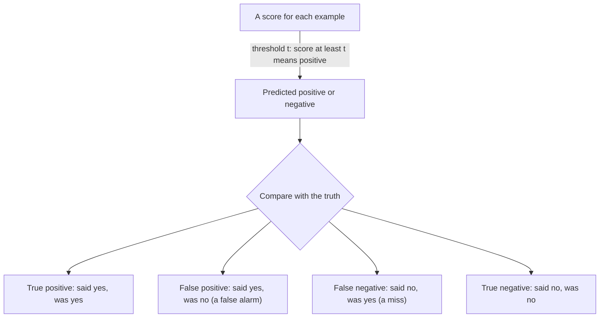
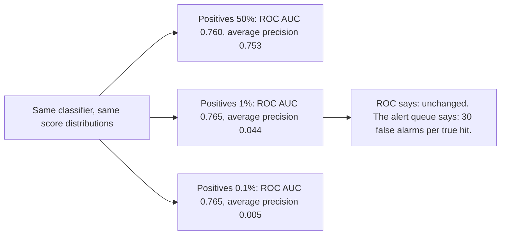

# Module 05: Evaluation Metrics: Regression, Classification, and PR vs. ROC Curves

> **Prerequisites:** [Module 04: Bias-Variance, Learning Curves, and Overfitting](../04-bias-variance-tradeoff-underfitting-overfitting/README.md) and [Module 01: Problem Framing](../01-problem-framing-supervised-unsupervised-rl/README.md) (the metric must match the decision).  
> **Estimated Reading Time:** 45 minutes  
> **Target Audience:** ML engineers, data scientists and analysts who choose, report and defend a model's numbers

> [!TIP]
> **The Golden Rule of Metrics:** A metric is the **cost of the decision written as a number**. Accuracy rewards the common class; **ROC AUC** measures how well positives are ranked above negatives and does not change with how rare positives are; **precision and recall** (and **average precision**) describe what the person acting on the alerts experiences; and a threshold of 0.5 is a default, not a decision: choose it from the costs. Report the metric that matches the decision, the **baseline** it must beat, and its **uncertainty**.

---

## Why This Matters

Every model comparison in this track ends in a number, and the number is only as good as the question it answers. A model with 99.5% accuracy can be useless, a model with a perfect ROC AUC can bury analysts under false alarms, and a regression model can win on one error metric and lose on another, as you will see in a table small enough to check by hand. The Prep Tracker, the Practice Center and every interview answer that says "I would measure this with ..." depend on the same skill: choosing the metric from the decision, computing it from its definition, and reading it with its baseline.

This module defines every metric from first principles, writes them out in four languages with identical results, checks them against scikit-learn, and then measures the three things that go wrong most often: accuracy on rare classes, ROC curves that hide the cost of false alarms, and error metrics that disagree about which model is better.

---

## 1. Architectural Mental Model: From Predictions to a Number

### The Confusion Matrix

For a binary classifier, every example falls in one of four cells once a threshold turns scores into answers:



| Metric | Formula | In words | When it misleads |
| :--- | :--- | :--- | :--- |
| Accuracy | $(TP+TN)/(TP+FP+FN+TN)$ | The share of answers that were right | Rare positives: "always no" scores high |
| Precision | $TP/(TP+FP)$ | Of the alerts raised, how many were real | Ignores the positives that were missed |
| Recall (sensitivity, TPR) | $TP/(TP+FN)$ | Of the real cases, how many were found | Ignores false alarms; recall 1.0 is easy: say yes to everything |
| Specificity | $TN/(TN+FP)$ | Of the negatives, how many were left alone | Hides the count of false alarms when negatives are many |
| False positive rate | $FP/(FP+TN)$ | Of the negatives, how many were wrongly flagged | A small rate on a huge negative class is still many alerts |
| F1 | $2PR/(P+R)$ | The harmonic mean of precision and recall | Treats a miss and a false alarm as equally bad |
| $F_\beta$ | $(1+\beta^2)PR/(\beta^2 P + R)$ | Weights recall $\beta$ times as much as precision | $\beta$ has to come from the costs |

### Sweeping the Threshold Draws the Curves

Move the threshold from high to low and the answers change from "nothing is positive" to "everything is positive". Plotting two of the rates against each other gives the two standard curves:

| Curve | x axis | y axis | A perfect classifier | A random classifier |
| :--- | :--- | :--- | :--- | :--- |
| **ROC** | False positive rate | Recall (true positive rate) | The top-left corner | The diagonal, area 0.5 |
| **Precision-recall (PR)** | Recall | Precision | The top-right corner | A horizontal line at the share of positives |

The **ROC AUC** has a plain meaning: it is the probability that a randomly chosen positive example gets a higher score than a randomly chosen negative one, which is the share of correctly ordered (positive, negative) pairs. The program in section 4 counts those pairs directly. **Average precision** summarises the PR curve by weighting each precision by the recall gained at that step:

$$\mathrm{AP} = \sum_{n}(R_n - R_{n-1})\,P_n$$

scikit-learn's own definition: "This implementation is not interpolated and is different from computing the area under the precision-recall curve with the trapezoidal rule, which uses linear interpolation and can be too optimistic."

### Regression Metrics

For true values $y_i$ and predictions $\hat{y}_i$ with errors $e_i = \hat{y}_i - y_i$:

$$\mathrm{MAE}=\frac{1}{n}\sum|e_i|,\qquad \mathrm{RMSE}=\sqrt{\frac{1}{n}\sum e_i^2},\qquad R^2 = 1-\frac{\sum e_i^2}{\sum (y_i-\bar{y})^2},\qquad \mathrm{MAPE}=\frac{100}{n}\sum\frac{|e_i|}{|y_i|}$$

| Metric | Units | Sensitive to a few large errors? | Good for | Watch out |
| :--- | :--- | :--- | :--- | :--- |
| MAE | Those of $y$ | No: every error counts in proportion | "How far off are we, on average" | Says nothing about rare big misses |
| Median absolute error | Those of $y$ | Hardly at all | A typical error that outliers cannot move | Ignores the tail entirely |
| RMSE | Those of $y$ | **Yes**: squaring weights big errors | Cases where a big miss is much worse than several small ones | One bad point can dominate it |
| $R^2$ | None | Yes | Comparing with "predict the mean" (0) and perfect (1) | **Can be negative**; depends on the spread of $y$ in the test set |
| MAPE | Percent | Depends | Communicating a relative error | Explodes when true values are near zero; punishes over-prediction and under-prediction unequally |

---

## 2. Systematic Reference and Comparison Grids

### Choosing the Metric From the Decision

| Situation | The cost structure | Use | Avoid on its own |
| :--- | :--- | :--- | :--- |
| Screening for a serious disease | A miss is far worse than a false alarm | Recall at an acceptable false alarm count; $F_2$; a cost-based threshold | Accuracy |
| Spam filter | A good mail lost is worse than a spam let through | Precision at a high recall of spam; false positive rate | Accuracy |
| Fraud alerts reviewed by a team of fixed size | Only the top $k$ alerts are looked at | Precision at $k$, recall at $k$, average precision | ROC AUC alone |
| Ranking search results | Only the top of the list is seen | NDCG at $k$ (Module 01) | RMSE of predicted relevance |
| Predicting delivery time | An error is an error in minutes | MAE (typical error), plus a high percentile of the absolute error (the bad days) | $R^2$ alone |
| A forecast where a big miss is costly | Large errors are disproportionately bad | RMSE | MAE alone |
| Comparing models across different products | The scales differ | A scale-free metric, with the baseline of each | Raw RMSE |

### Multi-Class and Multi-Label Averages

| Average | How | Gives weight to | Use when |
| :--- | :--- | :--- | :--- |
| **Micro** | Pool every decision, then compute the metric | Frequent classes | You care about overall counts (for single-label tasks it equals accuracy) |
| **Macro** | Compute per class, then average equally | Every class equally, rare ones included | Rare classes matter as much as common ones |
| **Weighted** | Per class, averaged by class size | Frequent classes | You want per-class numbers that reflect the data |

### Pitfalls

| Pitfall | Symptom | Fix |
| :--- | :--- | :--- |
| Accuracy on a rare class | 99% with no cases found | Report the baseline, precision, recall |
| A threshold of 0.5 taken as given | Many misses or many false alarms | Choose it from the costs on validation data |
| ROC AUC for a rare-positive task | A great AUC, a miserable alert queue | Add precision-recall, and precision at the review capacity |
| Averaging per-fold F1 without looking at the spread | A stable-looking number from a handful of positives | Report the spread and the number of positives per fold (Module 03) |
| Comparing models on different test sets | Differences that are only the data | One test set, one split, the same seed |
| Reporting only a mean error | The tail is hidden | Add a percentile of the absolute error |

---

## 3. Real Case Study: ROC Plots Can Be Deceptive on Imbalanced Data

This is documented research, not an invented story: Takaya Saito and Marc Rehmsmeier, "The Precision-Recall Plot Is More Informative than the ROC Plot When Evaluating Binary Classifiers on Imbalanced Datasets", *PLoS ONE* 10(3): e0118432 (4 March 2015).

| What the paper reports | Detail |
| :--- | :--- |
| The claim | "the visual interpretability of ROC plots in the context of imbalanced datasets can be deceptive", owing to "an intuitive but wrong interpretation of specificity" |
| The alternative | "PRC plots, on the other hand, can provide the viewer with an accurate prediction of future classification performance" |
| How the field behaves | Their literature survey found 63 articles, of which 58 were research articles with full text; "Only four papers use PRC", "whereas 22 papers use ROC" (three used both) |
| The implication | "Our findings have potential implications for the interpretation of a large number of studies" |

The mechanism is arithmetic, and you can run it: a false positive rate of 1% sounds negligible, but with one million negatives it is ten thousand false alarms, and with a hundred true positives that makes a precision of about 1%. The ROC curve, whose x axis is the *rate*, cannot see it; the PR curve, whose y axis is a *count-based* precision, can. Workflow 2 holds the classifier's quality fixed and changes only how rare the positives are.



### What to Take From It

1. **A metric that does not depend on the base rate cannot see what the base rate does to your alerts.** ROC AUC is such a metric.
2. **Always say which one you are quoting.** "AUC" alone is ambiguous; "ROC AUC" and "average precision" are different numbers.
3. **For rare positives, look at the precision at the volume you can handle.** This is the number an operations team lives with.
4. **Use ROC AUC for what it is good at:** comparing rankers when the base rate is not the issue, or when the two classes are of similar size.

---

## 4. The Metrics From Their Definitions, in Four Languages (`carousel`)

The program computes every classification metric from counts on **20 examples with 3 positives** (small enough to verify by hand): the confusion counts at five thresholds, precision, recall, F1 and accuracy, ROC AUC as a count of correctly ordered pairs, and average precision. It then computes MAE, RMSE, $R^2$ and MAPE for **two regression models of 8 values** built to disagree. Section 5 checks the numbers against scikit-learn.

````carousel
```python
"""The metrics of this module computed from their definitions, on two small data sets small enough to check by hand: a binary classifier that scores
20 examples (3 of them positive), and two regression models that predict 8 numbers. Every figure is a count or a division, so all four languages agree."""
import math

# (score the classifier gave, true label). Three positives among twenty, all scores different.
EXAMPLES = [(0.92, 1), (0.88, 0), (0.80, 0), (0.71, 1), (0.66, 0), (0.60, 0), (0.55, 0), (0.52, 0), (0.48, 0), (0.45, 1),
            (0.40, 0), (0.38, 0), (0.33, 0), (0.30, 0), (0.27, 0), (0.21, 0), (0.18, 0), (0.15, 0), (0.12, 0), (0.09, 0)]
Y_TRUE = [10, 12, 9, 11, 10, 13, 12, 8]
MODEL_A = [10, 12, 9, 11, 10, 13, 12, 14]  # exact seven times, and one miss of 6
MODEL_B = [11, 13, 10, 12, 11, 14, 13, 9]  # always off by exactly 1


def counts(threshold):
    """True positives, false positives, false negatives, true negatives when everything scoring at least `threshold` is called positive."""
    tp = sum(1 for s, y in EXAMPLES if s >= threshold and y == 1)
    fp = sum(1 for s, y in EXAMPLES if s >= threshold and y == 0)
    fn = sum(1 for s, y in EXAMPLES if s < threshold and y == 1)
    tn = sum(1 for s, y in EXAMPLES if s < threshold and y == 0)
    return tp, fp, fn, tn


def precision_recall_f1(tp, fp, fn):
    precision = tp / (tp + fp) if tp + fp else 0.0
    recall = tp / (tp + fn) if tp + fn else 0.0
    f1 = 2 * precision * recall / (precision + recall) if precision + recall else 0.0
    return precision, recall, f1


def roc_auc():
    """The share of (positive, negative) pairs in which the positive got the higher score: 1.0 is a perfect ranking, 0.5 a coin flip."""
    positives = [s for s, y in EXAMPLES if y == 1]
    negatives = [s for s, y in EXAMPLES if y == 0]
    wins = sum(1 for p in positives for n in negatives if p > n)
    return wins, len(positives) * len(negatives)


def average_precision():
    """Walk down the list from the highest score; at each positive, note the precision so far; average those precisions."""
    ranked = sorted(EXAMPLES, key=lambda pair: -pair[0])
    seen_positives, total, positives = 0, 0.0, sum(y for _, y in EXAMPLES)
    for rank, (_, label) in enumerate(ranked, start=1):
        if label == 1:
            seen_positives += 1
            total += seen_positives / rank
    return total / positives


def regression(pred):
    errors = [p - t for p, t in zip(pred, Y_TRUE)]
    mae = sum(abs(e) for e in errors) / len(errors)
    rmse = math.sqrt(sum(e * e for e in errors) / len(errors))
    mean = sum(Y_TRUE) / len(Y_TRUE)
    r2 = 1 - sum(e * e for e in errors) / sum((t - mean) ** 2 for t in Y_TRUE)
    mape = sum(abs(e) / t for e, t in zip(errors, Y_TRUE)) / len(errors) * 100
    return mae, rmse, r2, mape


if __name__ == "__main__":
    positives = sum(y for _, y in EXAMPLES)
    print(f"== a binary classifier: {len(EXAMPLES)} examples, {positives} positive ({positives / len(EXAMPLES):.0%}) ==")
    print(f"always answering 'negative': accuracy {(len(EXAMPLES) - positives) / len(EXAMPLES):.3f}, recall 0.000")
    print(f"{'threshold':>9} {'TP':>3} {'FP':>3} {'FN':>3} {'TN':>3} {'precision':>10} {'recall':>7} {'F1':>7} {'accuracy':>9}")
    best = None
    for threshold in (0.90, 0.70, 0.50, 0.40, 0.20):
        tp, fp, fn, tn = counts(threshold)
        precision, recall, f1 = precision_recall_f1(tp, fp, fn)
        print(f"{threshold:>9.2f} {tp:>3} {fp:>3} {fn:>3} {tn:>3} {precision:>10.3f} {recall:>7.3f} {f1:>7.3f} {(tp + tn) / len(EXAMPLES):>9.3f}")
        if best is None or f1 > best[1]:
            best = (threshold, f1)
    wins, pairs = roc_auc()
    print(f"best F1 among these thresholds: {best[1]:.3f} at {best[0]:.2f}")
    print(f"ROC AUC: {wins} of {pairs} positive-negative pairs ranked correctly = {wins / pairs:.4f}")
    print(f"average precision: {average_precision():.4f}")
    print("== two regression models, 8 true values ==")
    print(f"{'model':>28} {'MAE':>6} {'RMSE':>6} {'R2':>7} {'MAPE':>7}")
    for name, pred in (("A: exact, except one miss of 6", MODEL_A), ("B: always off by exactly 1", MODEL_B)):
        mae, rmse, r2, mape = regression(pred)
        print(f"{name:>28} {mae:>6.3f} {rmse:>6.3f} {r2:>7.3f} {mape:>6.2f}%")
```

<!-- slide -->

```typescript
// The metrics of this module computed from their definitions, on two small data sets small enough to check by hand: a binary classifier that scores
// 20 examples (3 of them positive), and two regression models that predict 8 numbers. Every figure is a count or a division, so all four languages agree.

// [score the classifier gave, true label]. Three positives among twenty, all scores different.
const EXAMPLES: [number, number][] = [[0.92, 1], [0.88, 0], [0.80, 0], [0.71, 1], [0.66, 0], [0.60, 0], [0.55, 0], [0.52, 0], [0.48, 0], [0.45, 1],
  [0.40, 0], [0.38, 0], [0.33, 0], [0.30, 0], [0.27, 0], [0.21, 0], [0.18, 0], [0.15, 0], [0.12, 0], [0.09, 0]];
const Y_TRUE = [10, 12, 9, 11, 10, 13, 12, 8];
const MODEL_A = [10, 12, 9, 11, 10, 13, 12, 14]; // exact seven times, and one miss of 6
const MODEL_B = [11, 13, 10, 12, 11, 14, 13, 9]; // always off by exactly 1

const count = (test: (score: number, label: number) => boolean): number => EXAMPLES.filter(([s, y]) => test(s, y)).length;

/** True positives, false positives, false negatives, true negatives when everything scoring at least `threshold` is called positive. */
function counts(threshold: number): [number, number, number, number] {
  return [
    count((s, y) => s >= threshold && y === 1),
    count((s, y) => s >= threshold && y === 0),
    count((s, y) => s < threshold && y === 1),
    count((s, y) => s < threshold && y === 0),
  ];
}

function precisionRecallF1(tp: number, fp: number, fn: number): [number, number, number] {
  const precision = tp + fp > 0 ? tp / (tp + fp) : 0.0;
  const recall = tp + fn > 0 ? tp / (tp + fn) : 0.0;
  const f1 = precision + recall > 0 ? (2 * precision * recall) / (precision + recall) : 0.0;
  return [precision, recall, f1];
}

/** The share of (positive, negative) pairs in which the positive got the higher score: 1.0 is a perfect ranking, 0.5 a coin flip. */
function rocAuc(): [number, number] {
  const positives = EXAMPLES.filter(([, y]) => y === 1).map(([s]) => s);
  const negatives = EXAMPLES.filter(([, y]) => y === 0).map(([s]) => s);
  let wins = 0;
  for (const p of positives) for (const n of negatives) if (p > n) wins += 1;
  return [wins, positives.length * negatives.length];
}

/** Walk down the list from the highest score; at each positive, note the precision so far; average those precisions. */
function averagePrecision(): number {
  const ranked = [...EXAMPLES].sort((a, b) => b[0] - a[0]);
  let seen = 0;
  let total = 0.0;
  ranked.forEach(([, label], index) => {
    if (label === 1) {
      seen += 1;
      total += seen / (index + 1);
    }
  });
  return total / EXAMPLES.filter(([, y]) => y === 1).length;
}

function regression(pred: number[]): [number, number, number, number] {
  const errors = pred.map((p, i) => p - Y_TRUE[i]);
  const mae = errors.reduce((a, e) => a + Math.abs(e), 0) / errors.length;
  const rmse = Math.sqrt(errors.reduce((a, e) => a + e * e, 0) / errors.length);
  const mean = Y_TRUE.reduce((a, t) => a + t, 0) / Y_TRUE.length;
  const r2 = 1 - errors.reduce((a, e) => a + e * e, 0) / Y_TRUE.reduce((a, t) => a + (t - mean) * (t - mean), 0);
  const mape = (errors.reduce((a, e, i) => a + Math.abs(e) / Y_TRUE[i], 0) / errors.length) * 100;
  return [mae, rmse, r2, mape];
}

const f = (value: number, width: number, digits: number): string => value.toFixed(digits).padStart(width);
const n = (value: number, width: number): string => String(value).padStart(width);

const positives = EXAMPLES.filter(([, y]) => y === 1).length;
console.log(`== a binary classifier: ${EXAMPLES.length} examples, ${positives} positive (${Math.round((positives / EXAMPLES.length) * 100)}%) ==`);
console.log(`always answering 'negative': accuracy ${((EXAMPLES.length - positives) / EXAMPLES.length).toFixed(3)}, recall 0.000`);
console.log(`${"threshold".padStart(9)} ${"TP".padStart(3)} ${"FP".padStart(3)} ${"FN".padStart(3)} ${"TN".padStart(3)} ${"precision".padStart(10)} ${"recall".padStart(7)} ${"F1".padStart(7)} ${"accuracy".padStart(9)}`);
let bestThreshold = -1;
let bestF1 = -1;
for (const threshold of [0.9, 0.7, 0.5, 0.4, 0.2]) {
  const [tp, fp, fn, tn] = counts(threshold);
  const [precision, recall, f1] = precisionRecallF1(tp, fp, fn);
  console.log(`${f(threshold, 9, 2)} ${n(tp, 3)} ${n(fp, 3)} ${n(fn, 3)} ${n(tn, 3)} ${f(precision, 10, 3)} ${f(recall, 7, 3)} ${f(f1, 7, 3)} ${f((tp + tn) / EXAMPLES.length, 9, 3)}`);
  if (bestThreshold < 0 || f1 > bestF1) {
    bestThreshold = threshold;
    bestF1 = f1;
  }
}
const [wins, pairs] = rocAuc();
console.log(`best F1 among these thresholds: ${bestF1.toFixed(3)} at ${bestThreshold.toFixed(2)}`);
console.log(`ROC AUC: ${wins} of ${pairs} positive-negative pairs ranked correctly = ${(wins / pairs).toFixed(4)}`);
console.log(`average precision: ${averagePrecision().toFixed(4)}`);
console.log("== two regression models, 8 true values ==");
console.log(`${"model".padStart(28)} ${"MAE".padStart(6)} ${"RMSE".padStart(6)} ${"R2".padStart(7)} ${"MAPE".padStart(7)}`);
for (const [name, pred] of [["A: exact, except one miss of 6", MODEL_A], ["B: always off by exactly 1", MODEL_B]] as [string, number[]][]) {
  const [mae, rmse, r2, mape] = regression(pred);
  console.log(`${name.padStart(28)} ${f(mae, 6, 3)} ${f(rmse, 6, 3)} ${f(r2, 7, 3)} ${f(mape, 6, 2)}%`);
}
```

<!-- slide -->

```go
// The metrics of this module computed from their definitions, on two small data sets small enough to check by hand: a binary classifier that scores
// 20 examples (3 of them positive), and two regression models that predict 8 numbers. Every figure is a count or a division, so all four languages agree.
package main

import (
	"fmt"
	"math"
	"sort"
)

type example struct {
	score float64
	label int
}

// examples are the score the classifier gave and the true label. Three positives among twenty, all scores different.
var examples = []example{{0.92, 1}, {0.88, 0}, {0.80, 0}, {0.71, 1}, {0.66, 0}, {0.60, 0}, {0.55, 0}, {0.52, 0}, {0.48, 0}, {0.45, 1},
	{0.40, 0}, {0.38, 0}, {0.33, 0}, {0.30, 0}, {0.27, 0}, {0.21, 0}, {0.18, 0}, {0.15, 0}, {0.12, 0}, {0.09, 0}}

var yTrue = []float64{10, 12, 9, 11, 10, 13, 12, 8}
var modelA = []float64{10, 12, 9, 11, 10, 13, 12, 14} // exact seven times, and one miss of 6
var modelB = []float64{11, 13, 10, 12, 11, 14, 13, 9} // always off by exactly 1

// counts gives the true positives, false positives, false negatives and true negatives when everything scoring at least threshold is called positive.
func counts(threshold float64) (tp, fp, fn, tn int) {
	for _, e := range examples {
		switch {
		case e.score >= threshold && e.label == 1:
			tp++
		case e.score >= threshold && e.label == 0:
			fp++
		case e.score < threshold && e.label == 1:
			fn++
		default:
			tn++
		}
	}
	return
}

func precisionRecallF1(tp, fp, fn int) (precision, recall, f1 float64) {
	if tp+fp > 0 {
		precision = float64(tp) / float64(tp+fp)
	}
	if tp+fn > 0 {
		recall = float64(tp) / float64(tp+fn)
	}
	if precision+recall > 0 {
		f1 = 2 * precision * recall / (precision + recall)
	}
	return
}

// rocAuc counts the (positive, negative) pairs in which the positive got the higher score: all of them is a perfect ranking, half a coin flip.
func rocAuc() (wins, pairs int) {
	var positives, negatives []float64
	for _, e := range examples {
		if e.label == 1 {
			positives = append(positives, e.score)
		} else {
			negatives = append(negatives, e.score)
		}
	}
	for _, p := range positives {
		for _, n := range negatives {
			if p > n {
				wins++
			}
		}
	}
	return wins, len(positives) * len(negatives)
}

// averagePrecision walks down the list from the highest score; at each positive it notes the precision so far; it averages those precisions.
func averagePrecision() float64 {
	ranked := append([]example(nil), examples...)
	sort.SliceStable(ranked, func(a, b int) bool { return ranked[a].score > ranked[b].score })
	seen, total, positives := 0, 0.0, 0
	for _, e := range examples {
		positives += e.label
	}
	for index, e := range ranked {
		if e.label == 1 {
			seen++
			total += float64(seen) / float64(index+1)
		}
	}
	return total / float64(positives)
}

func regression(pred []float64) (mae, rmse, r2, mape float64) {
	n := float64(len(yTrue))
	var abs, squares, total, spread, percent float64
	for i := range yTrue {
		total += yTrue[i]
	}
	mean := total / n
	for i, p := range pred {
		e := p - yTrue[i]
		abs += math.Abs(e)
		squares += e * e
		spread += (yTrue[i] - mean) * (yTrue[i] - mean)
		percent += math.Abs(e) / yTrue[i]
	}
	return abs / n, math.Sqrt(squares / n), 1 - squares/spread, percent / n * 100
}

func main() {
	positives := 0
	for _, e := range examples {
		positives += e.label
	}
	total := float64(len(examples))
	fmt.Printf("== a binary classifier: %d examples, %d positive (%.0f%%) ==\n", len(examples), positives, float64(positives)/total*100)
	fmt.Printf("always answering 'negative': accuracy %.3f, recall 0.000\n", (total-float64(positives))/total)
	fmt.Printf("%9s %3s %3s %3s %3s %10s %7s %7s %9s\n", "threshold", "TP", "FP", "FN", "TN", "precision", "recall", "F1", "accuracy")
	bestThreshold, bestF1 := -1.0, -1.0
	for _, threshold := range []float64{0.90, 0.70, 0.50, 0.40, 0.20} {
		tp, fp, fn, tn := counts(threshold)
		precision, recall, f1 := precisionRecallF1(tp, fp, fn)
		fmt.Printf("%9.2f %3d %3d %3d %3d %10.3f %7.3f %7.3f %9.3f\n", threshold, tp, fp, fn, tn, precision, recall, f1, float64(tp+tn)/total)
		if bestThreshold < 0 || f1 > bestF1 {
			bestThreshold, bestF1 = threshold, f1
		}
	}
	wins, pairs := rocAuc()
	fmt.Printf("best F1 among these thresholds: %.3f at %.2f\n", bestF1, bestThreshold)
	fmt.Printf("ROC AUC: %d of %d positive-negative pairs ranked correctly = %.4f\n", wins, pairs, float64(wins)/float64(pairs))
	fmt.Printf("average precision: %.4f\n", averagePrecision())
	fmt.Println("== two regression models, 8 true values ==")
	fmt.Printf("%28s %6s %6s %7s %7s\n", "model", "MAE", "RMSE", "R2", "MAPE")
	for _, m := range []struct {
		name string
		pred []float64
	}{{"A: exact, except one miss of 6", modelA}, {"B: always off by exactly 1", modelB}} {
		mae, rmse, r2, mape := regression(m.pred)
		fmt.Printf("%28s %6.3f %6.3f %7.3f %6.2f%%\n", m.name, mae, rmse, r2, mape)
	}
}
```

<!-- slide -->

```csharp
// The metrics of this module computed from their definitions, on two small data sets small enough to check by hand: a binary classifier that scores
// 20 examples (3 of them positive), and two regression models that predict 8 numbers. Every figure is a count or a division, so all four languages agree.
using System;
using System.Globalization;
using System.Linq;

CultureInfo.CurrentCulture = CultureInfo.InvariantCulture;

// (score the classifier gave, true label). Three positives among twenty, all scores different.
(double Score, int Label)[] examples =
{
    (0.92, 1), (0.88, 0), (0.80, 0), (0.71, 1), (0.66, 0), (0.60, 0), (0.55, 0), (0.52, 0), (0.48, 0), (0.45, 1),
    (0.40, 0), (0.38, 0), (0.33, 0), (0.30, 0), (0.27, 0), (0.21, 0), (0.18, 0), (0.15, 0), (0.12, 0), (0.09, 0),
};
double[] yTrue = { 10, 12, 9, 11, 10, 13, 12, 8 };
double[] modelA = { 10, 12, 9, 11, 10, 13, 12, 14 }; // exact seven times, and one miss of 6
double[] modelB = { 11, 13, 10, 12, 11, 14, 13, 9 }; // always off by exactly 1

// True positives, false positives, false negatives, true negatives when everything scoring at least `threshold` is called positive.
(int Tp, int Fp, int Fn, int Tn) Counts(double threshold) => (
    examples.Count(e => e.Score >= threshold && e.Label == 1),
    examples.Count(e => e.Score >= threshold && e.Label == 0),
    examples.Count(e => e.Score < threshold && e.Label == 1),
    examples.Count(e => e.Score < threshold && e.Label == 0));

(double Precision, double Recall, double F1) PrecisionRecallF1(int tp, int fp, int fn)
{
    double precision = tp + fp > 0 ? (double)tp / (tp + fp) : 0.0;
    double recall = tp + fn > 0 ? (double)tp / (tp + fn) : 0.0;
    double f1 = precision + recall > 0 ? 2 * precision * recall / (precision + recall) : 0.0;
    return (precision, recall, f1);
}

// The share of (positive, negative) pairs in which the positive got the higher score: 1.0 is a perfect ranking, 0.5 a coin flip.
(int Wins, int Pairs) RocAuc()
{
    var positives = examples.Where(e => e.Label == 1).Select(e => e.Score).ToArray();
    var negatives = examples.Where(e => e.Label == 0).Select(e => e.Score).ToArray();
    int wins = 0;
    foreach (double p in positives) foreach (double n in negatives) if (p > n) wins++;
    return (wins, positives.Length * negatives.Length);
}

// Walk down the list from the highest score; at each positive, note the precision so far; average those precisions.
double AveragePrecision()
{
    var ranked = examples.OrderByDescending(e => e.Score).ToArray();
    int seen = 0;
    double total = 0.0;
    for (int index = 0; index < ranked.Length; index++)
    {
        if (ranked[index].Label != 1) continue;
        seen++;
        total += (double)seen / (index + 1);
    }
    return total / examples.Count(e => e.Label == 1);
}

(double Mae, double Rmse, double R2, double Mape) Regression(double[] pred)
{
    double n = yTrue.Length, abs = 0, squares = 0, spread = 0, percent = 0;
    double mean = yTrue.Sum() / n;
    for (int i = 0; i < pred.Length; i++)
    {
        double e = pred[i] - yTrue[i];
        abs += Math.Abs(e);
        squares += e * e;
        spread += (yTrue[i] - mean) * (yTrue[i] - mean);
        percent += Math.Abs(e) / yTrue[i];
    }
    return (abs / n, Math.Sqrt(squares / n), 1 - squares / spread, percent / n * 100);
}

int positives = examples.Count(e => e.Label == 1);
double count = examples.Length;
Console.WriteLine($"== a binary classifier: {examples.Length} examples, {positives} positive ({positives / count * 100:F0}%) ==");
Console.WriteLine($"always answering 'negative': accuracy {(count - positives) / count:F3}, recall 0.000");
Console.WriteLine($"{"threshold",9} {"TP",3} {"FP",3} {"FN",3} {"TN",3} {"precision",10} {"recall",7} {"F1",7} {"accuracy",9}");
double bestThreshold = -1, bestF1 = -1;
foreach (double threshold in new[] { 0.90, 0.70, 0.50, 0.40, 0.20 })
{
    var (tp, fp, fn, tn) = Counts(threshold);
    var (precision, recall, f1) = PrecisionRecallF1(tp, fp, fn);
    Console.WriteLine($"{threshold,9:F2} {tp,3} {fp,3} {fn,3} {tn,3} {precision,10:F3} {recall,7:F3} {f1,7:F3} {(tp + tn) / count,9:F3}");
    if (bestThreshold < 0 || f1 > bestF1) { bestThreshold = threshold; bestF1 = f1; }
}
var (wins, pairs) = RocAuc();
Console.WriteLine($"best F1 among these thresholds: {bestF1:F3} at {bestThreshold:F2}");
Console.WriteLine($"ROC AUC: {wins} of {pairs} positive-negative pairs ranked correctly = {(double)wins / pairs:F4}");
Console.WriteLine($"average precision: {AveragePrecision():F4}");
Console.WriteLine("== two regression models, 8 true values ==");
Console.WriteLine($"{"model",28} {"MAE",6} {"RMSE",6} {"R2",7} {"MAPE",7}");
foreach (var (name, pred) in new (string, double[])[] { ("A: exact, except one miss of 6", modelA), ("B: always off by exactly 1", modelB) })
{
    var (mae, rmse, r2, mape) = Regression(pred);
    Console.WriteLine($"{name,28} {mae,6:F3} {rmse,6:F3} {r2,7:F3} {mape,6:F2}%");
}
```
````

**Observed output (identical in Python 3.13.14, Node 24, Go 1.22 and .NET 10):**

```text
== a binary classifier: 20 examples, 3 positive (15%) ==
always answering 'negative': accuracy 0.850, recall 0.000
threshold  TP  FP  FN  TN  precision  recall      F1  accuracy
     0.90   1   0   2  17      1.000   0.333   0.500     0.900
     0.70   2   2   1  15      0.500   0.667   0.571     0.850
     0.50   2   6   1  11      0.250   0.667   0.364     0.650
     0.40   3   8   0   9      0.273   1.000   0.429     0.600
     0.20   3  13   0   4      0.188   1.000   0.316     0.350
best F1 among these thresholds: 0.571 at 0.70
ROC AUC: 42 of 51 positive-negative pairs ranked correctly = 0.8235
average precision: 0.6000
== two regression models, 8 true values ==
                       model    MAE   RMSE      R2    MAPE
A: exact, except one miss of 6  0.750  2.121  -0.811   9.38%
  B: always off by exactly 1  1.000  1.000   0.597   9.63%
```

What to notice:

- **Accuracy is highest where nothing is found.** Always answering "negative" scores 0.850; the threshold of 0.90 scores 0.900 and finds one of three positives (recall 0.333). By accuracy alone the threshold of 0.90 ranks first (0.900), and the useless "always negative" answer (0.850) ties with the threshold of 0.70, which finds two of three positives.
- **The thresholds trade precision for recall.** Lowering the threshold from 0.90 to 0.40 takes recall from 0.333 to 1.000 and precision from 1.000 to 0.273; **F1 is best at 0.70 (0.571)**, which is not the default of 0.50 (0.364).
- **ROC AUC counted by hand:** 42 of the 51 positive-negative pairs are ordered correctly, 0.8235. **Average precision** is 0.6000: the positives are found at ranks 1, 4 and 10, so the precisions are 1/1, 2/4 and 3/10, and their mean is 0.6. The two summaries of the same scores differ, and AP is the lower because the false alarms come early.
- **Two regression models, two orders.** Model A is exact seven times and misses once by 6; model B is off by exactly 1 every time. By **MAE, A is better (0.750 against 1.000)**; by **RMSE, B is better (1.000 against 2.121)**; and A's $R^2$ is **negative (-0.811)**, worse than predicting the mean, while B's is 0.597. MAPE is almost equal (9.38% and 9.63%). Which model is "better" depends on whether one large miss is worse than many small ones.

---

## 5. Practical Hands-On Verification Workflows (Python 3.13 + scikit-learn)

Environment as in Module 00 (verified on **Python 3.13.14, scikit-learn 1.9.1, NumPy 2.5.5**). Workflow 1 imports the program above: save it as `metrics.py` next to the script and run the script with `python`.

### Workflow 1: Check the Definitions, Then Rare Positives and a Cost-Based Threshold

Part 1 gives the 20 examples to scikit-learn. Part 2 keeps all 357 benign tumours and only 11 malignant ones (3%) from the real breast-cancer data, and measures the usual metrics over 50 folds. Part 3 chooses the threshold from costs:

```python
"""Classification metrics against scikit-learn, then on imbalanced real data, then a threshold chosen by cost. Part 1 feeds the lesson's 20 examples
to scikit-learn and compares. Part 2 keeps all 357 benign tumours but only 11 malignant ones (3%), so the 'positive' class is rare."""
import numpy as np
import sklearn
from sklearn.datasets import load_breast_cancer
from sklearn.linear_model import LogisticRegression
from sklearn.metrics import accuracy_score, average_precision_score, f1_score, precision_score, recall_score, roc_auc_score
from sklearn.model_selection import RepeatedStratifiedKFold, cross_val_predict
from sklearn.pipeline import make_pipeline
from sklearn.preprocessing import StandardScaler

from metrics import EXAMPLES

print(f"scikit-learn {sklearn.__version__}\n")
print("== 1. the lesson's 20 examples, computed by scikit-learn ==")
scores = np.array([s for s, _ in EXAMPLES])
labels = np.array([y for _, y in EXAMPLES])
called = scores >= 0.70
print(f"ROC AUC {roc_auc_score(labels, scores):.4f}   average precision {average_precision_score(labels, scores):.4f}   at threshold 0.70: "
      f"precision {precision_score(labels, called):.3f} recall {recall_score(labels, called):.3f} F1 {f1_score(labels, called):.3f} accuracy {accuracy_score(labels, called):.3f}")

print("\n== 2. a rare positive class on real data: 368 samples, 11 of them malignant (3%) ==")
X_all, target = load_breast_cancer(return_X_y=True)
malignant = np.flatnonzero(target == 0)[:11]
benign = np.flatnonzero(target == 1)
keep = np.concatenate([malignant, benign])
X, y = X_all[keep], (target[keep] == 0).astype(int)  # 1 = malignant, the rare thing we want to find
print(f"positives {int(y.sum())} of {len(y)} = {y.mean():.1%}; always answering 'benign' has accuracy {1 - y.mean():.3f}")
model = make_pipeline(StandardScaler(), LogisticRegression(max_iter=1000))
rows = {"accuracy": [], "precision": [], "recall": [], "F1": [], "ROC AUC": [], "average precision": []}
cv = RepeatedStratifiedKFold(n_splits=5, n_repeats=10, random_state=0)
for train, test in cv.split(X, y):
    fitted = model.fit(X[train], y[train])
    probability = fitted.predict_proba(X[test])[:, 1]
    answer = probability >= 0.5
    rows["accuracy"].append(accuracy_score(y[test], answer))
    rows["precision"].append(precision_score(y[test], answer, zero_division=0))
    rows["recall"].append(recall_score(y[test], answer))
    rows["F1"].append(f1_score(y[test], answer, zero_division=0))
    rows["ROC AUC"].append(roc_auc_score(y[test], probability))
    rows["average precision"].append(average_precision_score(y[test], probability))
for name, values in rows.items():
    print(f"{name:>18} {np.mean(values):.3f}  (+/- {np.std(values):.3f} over 50 folds)")

print("\n== 3. choosing the threshold by cost: a missed malignant case costs 50, a false alarm costs 1 (assumed) ==")
probability = cross_val_predict(model, X, y, cv=5, method="predict_proba")[:, 1]  # each sample is scored by a model that did not see it


def cost(threshold):
    called = probability >= threshold
    return int(((called == 0) & (y == 1)).sum()) * 50 + int(((called == 1) & (y == 0)).sum()) * 1


candidates = np.round(np.arange(0.01, 1.0, 0.01), 2)
best = min(candidates, key=cost)
print(f"threshold 0.50: cost {cost(0.5)}; best threshold {best:.2f}: cost {cost(best)}; calling everything benign: cost {int(y.sum()) * 50}")
called = probability >= best
print(f"at {best:.2f}: precision {precision_score(y, called):.3f}, recall {recall_score(y, called):.3f}  (a threshold of 0.5 is only a default, not a decision)")
```

**Observed Output:**

```text
scikit-learn 1.9.1

== 1. the lesson's 20 examples, computed by scikit-learn ==
ROC AUC 0.8235   average precision 0.6000   at threshold 0.70: precision 0.500 recall 0.667 F1 0.571 accuracy 0.850

== 2. a rare positive class on real data: 368 samples, 11 of them malignant (3%) ==
positives 11 of 368 = 3.0%; always answering 'benign' has accuracy 0.970
          accuracy 0.995  (+/- 0.008 over 50 folds)
         precision 1.000  (+/- 0.000 over 50 folds)
            recall 0.830  (+/- 0.241 over 50 folds)
                F1 0.885  (+/- 0.165 over 50 folds)
           ROC AUC 0.998  (+/- 0.006 over 50 folds)
 average precision 0.971  (+/- 0.078 over 50 folds)

== 3. choosing the threshold by cost: a missed malignant case costs 50, a false alarm costs 1 (assumed) ==
threshold 0.50: cost 100; best threshold 0.02: cost 14; calling everything benign: cost 550
at 0.02: precision 0.440, recall 1.000  (a threshold of 0.5 is only a default, not a decision)
```

- **Part 1 agrees with the lesson's program:** ROC AUC 0.8235, average precision 0.6000, and at threshold 0.70 precision 0.500, recall 0.667, F1 0.571, accuracy 0.850.
- **Part 2: accuracy is not the story.** Accuracy is 0.995, but always answering "benign" scores **0.970**. The informative numbers are recall, **0.830 with a spread of 0.241**, and F1, 0.885 with 0.165: with only 11 positives, each test fold has about two of them, so recall jumps in steps of 50% and the estimate is unstable (Module 03). ROC AUC (0.998) and average precision (0.971) are high on this easy data, which is why a second look at a harder case (Workflow 2) matters.
- **Part 3: the threshold is a decision.** If a missed malignant case costs 50 and a false alarm costs 1 (an assumption for the exercise), the default threshold of 0.50 costs **100** (two misses); the best threshold on these predictions is **0.02** at a cost of **14**, with recall 1.000 and precision 0.440, against 550 for calling everything benign. This cost was chosen and measured on the same predictions, so it is optimistic: in practice choose the threshold on validation data and report on the test set.

### Workflow 2: The Same Classifier at Different Base Rates

Scores of positives come from a normal distribution centred at 1 and those of negatives from one centred at 0, whatever the share of positives; 400,000 generated examples per row:

```python
"""The same classifier quality at different base rates. Scores of positives are drawn from a normal distribution centred at 1, scores of negatives
from one centred at 0 (both with spread 1), whatever the share of positives. The ranking quality is therefore the same in every row; what changes
is how rare the positives are. 400,000 examples per row (generated)."""
import numpy as np
from sklearn.metrics import average_precision_score, precision_recall_curve, roc_auc_score

N = 400_000
print(f"{'positives':>10} {'ROC AUC':>8} {'avg precision':>14} {'precision at recall 0.5':>24} {'false alarms per true hit':>26}")
for share in (0.5, 0.1, 0.01, 0.001):
    rng = np.random.default_rng(0)
    y = (rng.random(N) < share).astype(int)
    score = rng.standard_normal(N) + y  # a positive's score is shifted up by 1
    precision, recall, _ = precision_recall_curve(y, score)
    at_half = float(precision[np.argmax(recall <= 0.5)])  # precision at the first point where recall has fallen to 0.5
    print(f"{share:>10.1%} {roc_auc_score(y, score):>8.3f} {average_precision_score(y, score):>14.3f} {at_half:>24.3f} {(1 - at_half) / at_half:>26.1f}")
print("\nthe ROC AUC does not move, because it compares positives with negatives pair by pair; precision, and with it average precision, depends on how many")
print("negatives there are for every positive, which is what an analyst who has to review the alerts experiences")
```

**Observed Output:**

```text
 positives  ROC AUC  avg precision  precision at recall 0.5  false alarms per true hit
     50.0%    0.760          0.753                    0.759                        0.3
     10.0%    0.759          0.292                    0.259                        2.9
      1.0%    0.765          0.044                    0.032                       30.4
      0.1%    0.765          0.005                    0.003                      288.4

the ROC AUC does not move, because it compares positives with negatives pair by pair; precision, and with it average precision, depends on how many
negatives there are for every positive, which is what an analyst who has to review the alerts experiences
```

The ranking quality is constant: **ROC AUC is 0.760, 0.759, 0.765 and 0.765** for 50%, 10%, 1% and 0.1% positives. But average precision falls from **0.753 to 0.292, 0.044 and 0.005**, and the precision at a recall of 0.5 falls from 0.759 to 0.003. In the language an analyst uses: at 1% positives the team sees about **30 false alarms for every real case**, and at 0.1% about **288**. The ROC curve showed none of it.

### Workflow 3: Regression Metrics on Real Data, and What One Bad Prediction Does

Three models on the 442 diabetes patients (a progression score from 25 to 346), five metrics, a single corrupted prediction, and the relative error on small and large values:

```python
"""Regression metrics on real data: 442 diabetes patients, predicting a progression score (values from 25 to 346). Three models, five metrics,
and what one wild prediction does to each metric."""
import numpy as np
import sklearn
from sklearn.datasets import load_diabetes
from sklearn.dummy import DummyRegressor
from sklearn.ensemble import RandomForestRegressor
from sklearn.linear_model import Ridge
from sklearn.metrics import mean_absolute_error, mean_absolute_percentage_error, median_absolute_error, r2_score, root_mean_squared_error
from sklearn.model_selection import train_test_split

print(f"scikit-learn {sklearn.__version__}")
X, y = load_diabetes(return_X_y=True)
X_train, X_test, y_train, y_test = train_test_split(X, y, test_size=0.25, random_state=0)
print(f"target: mean {y.mean():.0f}, from {y.min():.0f} to {y.max():.0f}; {len(y_test)} test patients\n")
models = [("always the training mean", DummyRegressor()), ("ridge regression", Ridge(alpha=1.0)), ("random forest", RandomForestRegressor(n_estimators=200, min_samples_leaf=5, random_state=0))]
print(f"{'model':>26} {'MAE':>6} {'median AE':>10} {'RMSE':>6} {'R2':>7} {'MAPE':>7}")
predictions = {}
for name, model in models:
    p = model.fit(X_train, y_train).predict(X_test)
    predictions[name] = p
    print(f"{name:>26} {mean_absolute_error(y_test, p):>6.1f} {median_absolute_error(y_test, p):>10.1f} {root_mean_squared_error(y_test, p):>6.1f} "
          f"{r2_score(y_test, p):>7.3f} {mean_absolute_percentage_error(y_test, p):>7.1%}")
print("the training mean has an R2 just below zero on new patients: it cannot be better than the mean of the test set itself, and is a little worse")

print("\none corrupted prediction: the ridge model's answer for one patient is replaced by 2,000")
p = predictions["ridge regression"].copy()
before = (mean_absolute_error(y_test, p), median_absolute_error(y_test, p), root_mean_squared_error(y_test, p))
p[0] = 2000.0
after = (mean_absolute_error(y_test, p), median_absolute_error(y_test, p), root_mean_squared_error(y_test, p))
for name, b, a in zip(("MAE", "median absolute error", "RMSE"), before, after):
    print(f"{name:>22} {b:>7.1f} -> {a:>7.1f}   ({a / b:.1f} times)")

print("\nthe same errors, scored in relative terms: MAPE divides by the true value, so small true values count for much more")
small, large = y_test < 100, y_test > 250
for name, mask in (("true value below 100", small), ("true value above 250", large)):
    errors = np.abs(predictions["ridge regression"][mask] - y_test[mask])
    print(f"{name:>22}: {int(mask.sum()):>3} patients, mean absolute error {errors.mean():>5.1f}, mean absolute percentage error {np.mean(errors / y_test[mask]):.1%}")
```

**Observed Output:**

```text
scikit-learn 1.9.1
target: mean 152, from 25 to 346; 111 test patients

                     model    MAE  median AE   RMSE      R2    MAPE
  always the training mean   58.3       50.9   70.5  -0.000   52.6%
          ridge regression   44.9       38.9   56.5   0.357   39.5%
             random forest   47.2       38.2   60.4   0.266   38.7%
the training mean has an R2 just below zero on new patients: it cannot be better than the mean of the test set itself, and is a little worse

one corrupted prediction: the ridge model's answer for one patient is replaced by 2,000
                   MAE    44.9 ->    59.0   (1.3 times)
 median absolute error    38.9 ->    38.9   (1.0 times)
                  RMSE    56.5 ->   168.7   (3.0 times)

the same errors, scored in relative terms: MAPE divides by the true value, so small true values count for much more
  true value below 100:  31 patients, mean absolute error  55.3, mean absolute percentage error 86.8%
  true value above 250:  13 patients, mean absolute error 101.3, mean absolute percentage error 35.5%
```

- **The baseline is part of the table:** always predicting the training mean has MAE 58.3 and $R^2$ of about 0 (-0.000); ridge regression reaches MAE 44.9 and $R^2$ 0.357. The metrics are meaningful only against that row.
- **Different metrics, different winners:** ridge is better by MAE (44.9 against 47.2) and RMSE (56.5 against 60.4), but the forest is better by MAPE (38.7% against 39.5%) and by median absolute error (38.2 against 38.9).
- **One bad prediction:** replacing a single answer with 2,000 leaves the median absolute error at **38.9 (1.0 times)**, raises MAE to 59.0 (1.3 times) and raises **RMSE from 56.5 to 168.7 (3.0 times)**. RMSE is the metric that cannot be ignored when one wild prediction would be a disaster, and the one to be wary of when it might be a data glitch.
- **MAPE is not scale-free in a useful way:** the same ridge model has a mean absolute error of 101.3 on patients with a true value above 250 (a 35.5% error) and a smaller 55.3 on those below 100 (an **86.8%** error). A percentage error makes small true values look terrible.

---

## 6. Hands-On Exercises and Independent Challenge

### Practical Exercises

1. **By hand.** For the 20 examples in the program, write the confusion counts at the threshold 0.50, then precision, recall, F1 and accuracy, and check them against the table.
2. **Pick the metric.** For each, name the main metric and one to report alongside it: (a) cancer screening; (b) a spam filter; (c) fraud with a team that can review 200 alerts a day; (d) predicting the delivery time of an order; (e) a model that ranks candidates for a job posting.
3. **Break the metrics.** Find a set of scores for which the ROC AUC is 1.0 and the F1 at a threshold of 0.5 is 0. Then find regression predictions with a better MAE than another model and a worse $R^2$.
4. **Pay for mistakes.** With a missed positive costing 50 and a false alarm costing 1, compute the total cost at each of the five thresholds in the program's table, and say which threshold you would choose.

<details><summary>Answers</summary>

1. At 0.50: TP 2, FP 6, FN 1, TN 11. Precision 2/8 = 0.250; recall 2/3 = 0.667; F1 = 2(0.25)(0.667)/(0.25+0.667) = 0.364; accuracy 13/20 = 0.650, as in the table.
2. (a) Recall (sensitivity) at an acceptable false alarm count, with the cost-based threshold; also precision. (b) Precision of the "spam" decision (a good mail lost is worse), with recall of spam. (c) Precision at 200 and recall at 200, and average precision; ROC AUC is context only. (d) MAE, with a high percentile of the absolute error. (e) A ranking metric such as NDCG at the number of candidates a recruiter reads.
3. All positives scoring 0.4 and all negatives 0.1: every positive is ranked above every negative, so ROC AUC is 1.0, but at a threshold of 0.5 nothing is called positive, so recall and F1 are 0. For the regression pair, the program's models A and B: A has the better MAE (0.750 against 1.000) and the worse $R^2$ (-0.811 against 0.597).
4. Cost = 50 x FN + 1 x FP: threshold 0.90: 2 x 50 + 0 = 100; 0.70: 1 x 50 + 2 = 52; 0.50: 50 + 6 = 56; 0.40: 0 + 8 = **8**; 0.20: 0 + 13 = 13. Choose 0.40 here, which is a threshold that no accuracy-driven default would pick. On 20 examples with 3 positives this is only an illustration, not an estimate.

</details>

### Independent Challenge

A payments company has 100,000 transactions a day, about 0.2% of them fraudulent. A team of analysts can review 200 alerts a day. The data science team reports "AUC 0.97" for a new model and asks for approval. Say what you would ask for, which metrics you would compute and report, how you would choose the threshold, and what could go wrong after launch.

<details><summary>Architectural Discussion</summary>

**What "AUC 0.97" does not say.** About 200 frauds a day among 100,000 transactions: at an AUC of 0.97 the model ranks well, but the alert queue is made of the false positives among 99,800 legitimate transactions. A false positive rate of 1% is 998 false alarms a day, so with 200 slots a day most alerts could be false.

**Metrics to compute.** Precision at 200 (the share of the 200 reviewed alerts that are fraud), recall at 200 (the share of the day's frauds that are in those 200), average precision, and the same on **future** days, not on a random split (Module 02). Compare with the current rules as the baseline. Add the money: the average cost of a missed fraud against that of reviewing and of blocking a good customer.

**Threshold.** The capacity decides it: score the day's transactions and send the top 200 to review, or the number that maximizes expected value when the cost of review is included. Re-estimate precision and recall at that volume on held-out recent days, with a confidence interval, which will be wide if there are only a few hundred positives.

**After launch.** Fraudsters adapt, so performance drifts (monitor precision at 200 weekly); labels arrive late (chargebacks), so recent days look cleaner than they are; the analysts' decisions become the labels, so the model learns from the transactions it chose to show (Module 01, partial feedback). Keep a small random sample reviewed for unbiased evaluation.

</details>

---

## 7. Common Mistakes and Troubleshooting

- **Quoting accuracy on imbalanced data.** Always print the baseline of "always the common class".
- **Using 0.5 as the threshold without thinking.** Choose it from costs or capacity on validation data.
- **Quoting "AUC" without saying ROC or PR.** They can differ enormously on rare positives (Workflow 2).
- **Using ROC AUC to judge an alert queue.** Use precision at the number of alerts you can review.
- **Averaging per-fold metrics from a handful of positives.** Report the spread and the counts (Workflow 1).
- **Using MAPE with true values near zero.** It explodes; use MAE or a scaled error.
- **Reading $R^2$ as accuracy.** It is relative to the mean, it can be negative, and it depends on the spread of the test set.
- **Choosing the threshold and reporting its cost on the same data.** That cost is optimistic.
- **Comparing models by one metric when the decision has two costs.** Show the trade-off, not a single number.

---

## 8. Operational Validation Checkpoints and Checkpoint Quiz

<details><summary><strong>Checkpoint 1: A model has accuracy 0.998 on a data set with 0.2% positives. What is your first question?</strong></summary>

What does the baseline "always negative" score? It is 0.998, so the model has shown nothing. Ask for the confusion matrix, precision and recall of the positive class on held-out data, and the number of positives in the test set.

</details>

<details><summary><strong>Checkpoint 2: Two fraud models have the same ROC AUC of 0.96. Which do you ship?</strong></summary>

Whichever has the better precision at the review capacity (and recall at that volume) on recent held-out data. Equal ROC AUC says only that the two rank pairs equally well on average; it says nothing about the top of the list, which is all the analysts see.

</details>

<details><summary><strong>Checkpoint 3: Your delivery-time model improved its RMSE but its MAE got worse. What happened?</strong></summary>

It reduced a few large errors at the cost of slightly larger typical errors (or the reverse: more big misses, fewer typical ones). The two metrics weight errors differently, so decide from the cost: if one big miss (a delivery hours late) is worse than several small ones, RMSE and a high percentile of the error matter; if the typical error matters, MAE and the median do.

</details>

### Checkpoint Quiz

1. Write the formulas of precision and recall, and say which one "say yes to everything" maximizes.
2. What is the probabilistic meaning of ROC AUC?
3. In Workflow 2, ROC AUC stayed at about 0.76 while average precision fell from 0.753 to 0.005. Why?
4. Model A has a lower MAE and a higher RMSE than model B. What does that tell you about their errors?
5. Why can $R^2$ be negative on a test set?

<details><summary>Answers</summary>

1. Precision = TP / (TP + FP); recall = TP / (TP + FN). Saying yes to everything gives recall 1.0 (no misses) and a precision equal to the share of positives.
2. It is the probability that a randomly chosen positive gets a higher score than a randomly chosen negative, equal to the share of correctly ordered positive-negative pairs (ties count one half).
3. ROC AUC compares positives with negatives pair by pair and does not depend on how many negatives there are. Precision depends on the count of false positives per true positive, which grows when positives are rare, so average precision falls; the quality of the ranking did not change, the number of false alarms per hit did.
4. A makes smaller errors most of the time but has some large ones; B's errors are uniformly moderate. MAE averages the absolute errors; RMSE squares them first, so a few large errors dominate it.
5. $R^2$ compares the model's squared error with that of always predicting the mean of the test set. A model that is worse than that (for instance a training mean applied to a test set with a different mean, or a model with some very bad predictions) has a negative $R^2$.

</details>

---

## 9. Interview Practice

> [!interview]
> Your fraud model has 99.7% accuracy. Is that good?

<details><summary>What a strong answer covers</summary>

- Ask for the base rate: if 0.3% of transactions are fraud, "always legitimate" scores 99.7%, so the number says nothing.
- Ask for precision and recall for the fraud class on held-out future data, and precision at the review capacity.
- Mention the threshold and costs, the uncertainty with few positives, and ROC against PR curves for rare positives.

</details>

> [!interview]
> When would you prefer ROC AUC, and when average precision?

<details><summary>What a strong answer covers</summary>

- ROC AUC when the classes are of similar size or when you compare rankers independent of the base rate; it equals the probability that a positive outranks a negative.
- Average precision (or precision at k) when positives are rare and false alarms are costly, because precision reflects the number of false positives per true positive; cite the Saito and Rehmsmeier result and give the arithmetic (1% false positive rate times a million negatives).
- Either way, say which you quote, and report the base rate and a baseline.

</details>

---

## Further Reading and Sources

- [Saito and Rehmsmeier, "The Precision-Recall Plot Is More Informative than the ROC Plot When Evaluating Binary Classifiers on Imbalanced Datasets" (PLoS ONE 10(3), 2015)](https://journals.plos.org/plosone/article?id=10.1371/journal.pone.0118432) — the case study of section 3, including the literature survey.
- [scikit-learn: `average_precision_score`](https://scikit-learn.org/stable/modules/generated/sklearn.metrics.average_precision_score.html) — the formula, and why the non-interpolated definition differs from the trapezoidal area under the PR curve.
- [scikit-learn: Metrics and scoring: quantifying the quality of predictions](https://scikit-learn.org/stable/modules/model_evaluation.html) — the reference for the classification, regression and ranking metrics used here, and for averaging in the multi-class case.
- [scikit-learn: Precision-Recall](https://scikit-learn.org/stable/auto_examples/model_selection/plot_precision_recall.html) — worked precision-recall curves and average precision.
- [scikit-learn: Receiver Operating Characteristic (ROC)](https://scikit-learn.org/stable/auto_examples/model_selection/plot_roc.html) — worked ROC curves and AUC.

## Next

Continue to **[Module 06: Probability Calibration (Platt, Isotonic) and Error Analysis](../06-probability-calibration-and-error-analysis/README.md)**, where a score becomes a probability you can trust, and the model's mistakes become a to-do list.
