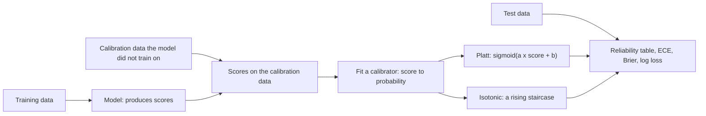
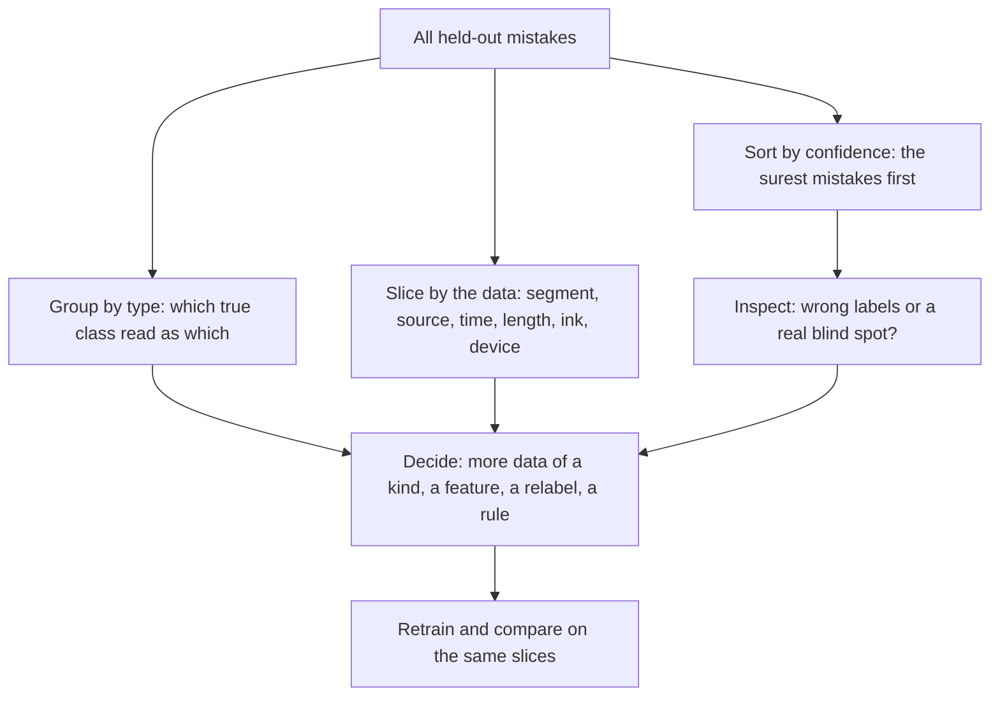
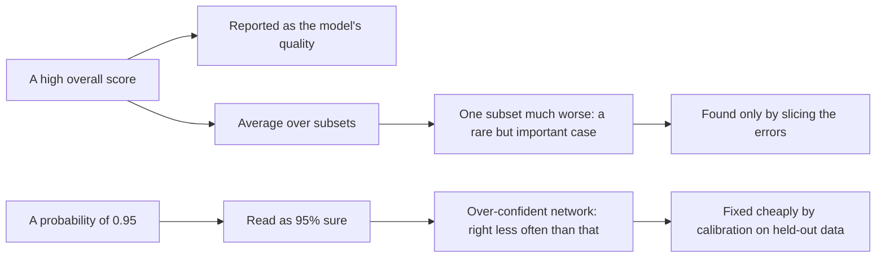

# Module 06: Probability Calibration (Platt, Isotonic) and Error Analysis

> **Prerequisites:** [Module 05: Evaluation Metrics](../05-evaluation-metrics-regression-and-classification/README.md) and [Module 03: Cross-Validation](../03-cross-validation-k-fold-stratified-and-time-based/README.md).  
> **Estimated Reading Time:** 45 minutes  
> **Target Audience:** ML engineers and data scientists whose model's probabilities feed a decision (a price, a threshold, a ranking mixed with costs), and anyone who must explain where a model fails

> [!TIP]
> **The Golden Rule of Calibration and Error Analysis:** A score is not a probability until you have checked it. A model is **calibrated** when, among the cases it gives 0.8, about 80% really are positive. Check that with a **reliability table** on held-out data, fix it with **Platt scaling** (a sigmoid, for small calibration sets) or **isotonic regression** (a monotone staircase, for roughly a thousand examples or more), and fit the calibrator on data the model did not train on. Then read the model's **mistakes**, not just its score: group them by type, by slice of the data and by confidence, because an average can hide a segment where the model is no better than a coin.

---

## Why This Matters

Many systems use a model's output as a number, not only as an order: an expected loss is probability times amount, a bid is probability times value, a threshold is chosen from costs (Module 05), and an alert says "87% likely". All of those break if 0.87 does not mean 87%. Ranking metrics such as ROC AUC cannot tell you this, because a model can rank perfectly and still be badly over-confident.

The second half of the module is about what to do after the metric: **error analysis**. An overall accuracy of 75% can be 79% on two segments and a coin flip on the third. Finding that is the most direct route to the next improvement, and missing it is how a model that "passed evaluation" harms one group of users.

---

## 1. Architectural Mental Model: Scores, Probabilities and Mistakes

### What Calibrated Means

scikit-learn's definition: "a well calibrated (binary) classifier should classify the samples such that among the samples to which it gave a predict_proba value close to, say, 0.8, approximately 80% actually belong to the positive class." Formally, for a predicted probability $\hat{p}$,

$$P(Y = 1 \mid \hat{p} = q) = q \quad \text{for every } q.$$

A **reliability diagram** (or calibration curve) bins the predictions and plots the average prediction in each bin against the share of positives in it: "Calibration curves, also referred to as reliability diagrams (Wilks 1995), compare how well the probabilistic predictions of a binary classifier are calibrated." A calibrated model lies on the diagonal. The **expected calibration error** summarises the gaps, weighting each bin by its size $n_b$:

$$\mathrm{ECE} = \sum_{b} \frac{n_b}{n}\,\bigl|\,\overline{\hat{p}}_b - \overline{y}_b\,\bigr|$$

Two proper scoring rules measure probabilistic predictions as a whole: the **Brier score** $\frac{1}{n}\sum(\hat{p}_i - y_i)^2$ and the **log loss** $-\frac{1}{n}\sum[y_i\log\hat{p}_i + (1-y_i)\log(1-\hat{p}_i)]$. They mix calibration with discrimination; scikit-learn warns that "a lower Brier loss, for instance, does not necessarily mean a better calibrated model, it could also mean a worse calibrated model with much more discriminatory power". Report them together with the ECE.

### Calibration as a Second, Small Model



| Method | Shape it can fix | Parameters | Needs | scikit-learn's guidance |
| :--- | :--- | :--- | :--- | :--- |
| **Platt scaling** (`method="sigmoid"`) | An S-shaped distortion, symmetric around the middle | 2 | Little data | "Most effective for small sample sizes or when the un-calibrated model is under-confident and has similar calibration errors for both high and low outputs" |
| **Isotonic regression** (`method="isotonic"`) | Any monotone distortion | One step per block | More data | "More prone to overfitting, especially on small datasets"; it "will perform as well as or better than 'sigmoid' when there is enough data (greater than ~ 1000 samples)" |
| **Temperature scaling** | A uniformly over- or under-confident multi-class model | 1 | Little data | Introduced for neural networks (section 3) |

Calibration preserves the order of the scores (both methods are monotone), so ranking metrics barely move; what changes is what the numbers mean.

### Error Analysis as a Loop



---

## 2. Systematic Reference and Comparison Grids

### How Common Models Behave Before Calibration

| Model | Typical distortion | Why |
| :--- | :--- | :--- |
| Logistic regression | Usually close to calibrated | It is fitted by minimising log loss |
| Gaussian naive Bayes | Extremely over-confident (probabilities near 0 and 1) | It multiplies evidence from features it wrongly treats as independent |
| Random forest | Pulled towards the middle near 0 and 1 | Averaging many trees rarely makes all of them agree |
| Linear SVM | No probabilities at all, only decision values | It optimises a margin, not a likelihood |
| Modern deep networks | Often over-confident | Section 3 |

Workflow 1 measures the first four on real data.

### Doing It Without Leakage

| Do | Do not |
| :--- | :--- |
| Fit the calibrator on predictions for data the model did not train on: a separate set, or out-of-fold predictions (`CalibratedClassifierCV` with `cv=5`) | Fit it on the training predictions, which are over-confident by construction |
| Evaluate calibration on a test set used for nothing else | Report the ECE of the data the calibrator was fitted on |
| Re-check calibration after the input distribution changes | Assume a calibrated model stays calibrated when the base rate moves |
| Calibrate per segment only with enough data per segment | Fit isotonic regression on fifty examples |

### Error Analysis Checklist

| Look at | Question | Typical action |
| :--- | :--- | :--- |
| The confusion pairs | Which classes does it mix, and are a few pairs most of the mistakes? | Targeted data or features for those pairs |
| Recall per class | Is one class neglected? | Class weights, more examples, a threshold per class |
| Slices of the data | Is one segment much worse than the average? | A segment feature, more data from it, a separate model, or a rule |
| The most confident mistakes | Wrong labels, or a real blind spot? | Relabel; or collect cases like these |
| Mistakes over time | Did a change in the world start them? | Retrain; monitor that slice |

---

## 3. Real Case Studies: Over-Confident Networks, and Failures Hidden by an Average

Two documented results, one for each half of the module.

| Source | What it reports |
| :--- | :--- |
| Chuan Guo, Geoff Pleiss, Yu Sun and Kilian Q. Weinberger, "On Calibration of Modern Neural Networks" (ICML 2017; arXiv 1706.04599) | "We discover that modern neural networks, unlike those from a decade ago, are poorly calibrated." The authors find that "depth, width, weight decay, and Batch Normalization are important factors influencing calibration", and that "temperature scaling -- a single-parameter variant of Platt Scaling -- is surprisingly effective at calibrating predictions." |
| Luke Oakden-Rayner, Jared Dunnmon, Gustavo Carneiro and Christopher Ré, "Hidden Stratification Causes Clinically Meaningful Failures in Machine Learning for Medical Imaging" (ML4H at NeurIPS 2019; arXiv 1909.12475) | Models can perform poorly on "important subsets of a population that are not identified during training or testing", for example a cancer detector that "consistently misses a rare but aggressive cancer subtype" despite high overall performance; on medical imaging data sets they found "relative performance differences of over 20% on clinically important subsets". |



### What to Take From Them

1. **Better models are not automatically better calibrated.** Guo and colleagues found the more accurate modern networks *less* calibrated than older ones; check every model.
2. **The fix can be tiny.** One parameter (a temperature) or two (Platt) fitted on held-out data often repairs calibration without touching accuracy.
3. **An average is a summary, not a guarantee.** The hidden-stratification paper shows a 20% relative gap on clinically important subsets behind a high overall score; the program in section 4 shows a coin-flip segment behind 65% accuracy.
4. **Slice by what matters, including what nobody labelled.** The subsets that fail are often defined by a property that is not a column in the data set (a subtype, a device, a writing style).

---

## 4. Calibration and Error Analysis Written Out, in Four Languages (`carousel`)

The program generates an **over-confident scorer** (its scores are stretched away from 0.5) whose scores carry no information at all for **one of three customer segments**. It prints the reliability table of the raw scores, fits **Platt scaling** (Newton's method on two parameters) and **isotonic regression** (pool-adjacent-violators) on a separate calibration set of 600, compares Brier, log loss and ECE on 600 test examples, and then slices the errors by segment. A fixed generator makes the four languages draw the same data. Workflow 1 checks the Platt fit against scikit-learn.

````carousel
```python
"""Calibration and error analysis written out in full. A scorer is over-confident (its scores are stretched away from 0.5) and, for one of three
customer segments, tells nothing at all. The scores are calibrated by two methods fitted on a separate set, Platt scaling (a sigmoid with two parameters) and isotonic
regression (a monotone step function), then judged by three numbers, and finally the errors are sliced by segment. Everything is deterministic."""
import math

N = 600


class Lcg:
    """A small, fixed random number generator, so that all four languages draw the same data."""

    def __init__(self, seed):
        self.state = seed

    def uniform(self):
        self.state = (self.state * 1664525 + 1013904223) % 4294967296
        return self.state / 4294967296.0


def make_set(rng, count):
    """Rows of (score, label, segment). The true chance of a positive is p; the scorer stretches it away from 0.5 and adds a little noise,
    so its scores are over-confident. For customers of segment 2 the score tells nothing: their label is a coin flip, whatever the score."""
    rows = []
    for _ in range(count):
        p, coin, wobble, pick = rng.uniform(), rng.uniform(), rng.uniform(), rng.uniform()
        segment = int(pick * 3)
        score = min(0.99, max(0.01, 0.5 + 1.8 * (p - 0.5) + 0.15 * (wobble - 0.5)))
        chance = 0.5 if segment == 2 else p
        rows.append((score, 1 if coin < chance else 0, segment))
    return rows


def sigmoid(x):
    return 1.0 / (1.0 + math.exp(-x))


def fit_platt(rows):
    """Platt scaling: choose a and b so that sigmoid(a * score + b) has the smallest log loss on the calibration rows (Newton's method)."""
    a = b = 0.0
    for _ in range(30):
        ga = gb = haa = hab = hbb = 0.0
        for score, label, _ in rows:
            p = sigmoid(a * score + b)
            w = p * (1.0 - p)
            ga += (p - label) * score
            gb += p - label
            haa += w * score * score
            hab += w * score
            hbb += w
        det = haa * hbb - hab * hab
        a, b = a - (hbb * ga - hab * gb) / det, b - (haa * gb - hab * ga) / det
    return a, b


def fit_isotonic(rows):
    """Isotonic regression by pooling adjacent violators: walk up the scores; whenever a block's positive rate is lower than the block
    before it, merge the two. The result is a rising staircase of positive rates."""
    blocks = []  # [sum of labels, count, lowest score in the block]
    for score, label, _ in sorted(rows, key=lambda row: row[0]):
        blocks.append([label, 1, score])
        while len(blocks) > 1 and blocks[-1][0] / blocks[-1][1] < blocks[-2][0] / blocks[-2][1]:
            top = blocks.pop()
            blocks[-1][0] += top[0]
            blocks[-1][1] += top[1]
    return [(start, total / count) for total, count, start in blocks]


def isotonic_predict(steps, score):
    value = steps[0][1]
    for start, rate in steps:
        if start <= score:
            value = rate
    return value


def brier(probabilities, labels):
    """The mean squared gap between the predicted probability and what happened (1 or 0): lower is better."""
    total = 0.0
    for p, y in zip(probabilities, labels):
        total += (p - y) * (p - y)
    return total / len(labels)


def log_loss(probabilities, labels):
    total = 0.0
    for p, y in zip(probabilities, labels):
        p = min(1 - 1e-6, max(1e-6, p))
        total -= y * math.log(p) + (1 - y) * math.log(1 - p)
    return total / len(labels)


def reliability(probabilities, labels, bins=10):
    """Per bin of predicted probability: how many, the average prediction, and the share that really were positive."""
    table = [[0, 0.0, 0] for _ in range(bins)]
    for p, y in zip(probabilities, labels):
        cell = table[min(bins - 1, int(p * bins))]
        cell[0] += 1
        cell[1] += p
        cell[2] += y
    return table


def ece(probabilities, labels, bins=10):
    """Expected calibration error: the average gap between what was predicted and what happened, weighted by how many examples are in each bin."""
    total = 0.0
    for count, predicted, positive in reliability(probabilities, labels, bins):
        if count:
            total += count / len(labels) * abs(predicted / count - positive / count)
    return total


if __name__ == "__main__":
    rng = Lcg(99)
    calibration, test = make_set(rng, N), make_set(rng, N)
    raw = [score for score, _, _ in test]
    labels = [label for _, label, _ in test]
    a, b = fit_platt(calibration)
    steps = fit_isotonic(calibration)
    platt = [sigmoid(a * s + b) for s in raw]
    isotonic = [isotonic_predict(steps, s) for s in raw]

    print(f"== reliability of the raw scores on {N} test examples: what a score of 0.8 really means ==")
    print(f"{'bin':>9} {'n':>4} {'mean score':>11} {'share positive':>15} {'gap':>7}")
    for index, (count, predicted, positive) in enumerate(reliability(raw, labels)):
        if count:
            print(f"{index / 10:>4.1f}-{(index + 1) / 10:<4.1f} {count:>4} {predicted / count:>11.3f} {positive / count:>15.3f} {predicted / count - positive / count:>+7.3f}")
    print(f"== calibrated on a separate set of {N}: Platt scaling a={a:.3f}, b={b:.3f}; isotonic has {len(steps)} steps ==")
    print(f"{'scores':>16} {'Brier':>7} {'log loss':>9} {'ECE':>7}")
    for name, values in (("raw", raw), ("Platt (sigmoid)", platt), ("isotonic", isotonic)):
        print(f"{name:>16} {brier(values, labels):>7.4f} {log_loss(values, labels):>9.4f} {ece(values, labels):>7.4f}")

    print("== error analysis: the calibrated (isotonic) classifier at 0.5, by customer segment ==")
    errors = [(1 if p >= 0.5 else 0) != y for p, y in zip(isotonic, labels)]
    segments = [segment for _, _, segment in test]
    total_errors = sum(errors)
    print(f"{'segment':>8} {'n':>4} {'errors':>7} {'error rate':>11} {'share of data':>14} {'share of errors':>16}")
    for segment in range(3):
        members = [e for e, s in zip(errors, segments) if s == segment]
        print(f"{segment:>8} {len(members):>4} {sum(members):>7} {sum(members) / len(members):>11.3f} {len(members) / N:>14.3f} {sum(members) / total_errors:>16.3f}")
    print(f"{'all':>8} {N:>4} {total_errors:>7} {total_errors / N:>11.3f}")
```

<!-- slide -->

```typescript
// Calibration and error analysis written out in full. A scorer is over-confident (its scores are stretched away from 0.5) and, for one of three
// customer segments, tells nothing at all. The scores are calibrated by two methods fitted on a separate set, Platt scaling (a sigmoid with two parameters) and isotonic
// regression (a monotone step function), then judged by three numbers, and finally the errors are sliced by segment. Everything is deterministic.

const N = 600;

type Row = { score: number; label: number; segment: number };

/** A small, fixed random number generator, so that all four languages draw the same data. */
class Lcg {
  state: number;

  constructor(seed: number) {
    this.state = seed;
  }

  uniform(): number {
    this.state = (Math.imul(this.state, 1664525) + 1013904223) >>> 0;
    return this.state / 4294967296.0;
  }
}

/**
 * Rows of (score, label, segment). The true chance of a positive is p; the scorer stretches it away from 0.5 and adds a little noise,
 * so its scores are over-confident. For customers of segment 2 the score tells nothing: their label is a coin flip, whatever the score.
 */
function makeSet(rng: Lcg, count: number): Row[] {
  const rows: Row[] = [];
  for (let i = 0; i < count; i++) {
    const p = rng.uniform();
    const coin = rng.uniform();
    const wobble = rng.uniform();
    const pick = rng.uniform();
    const segment = Math.trunc(pick * 3);
    const score = Math.min(0.99, Math.max(0.01, 0.5 + 1.8 * (p - 0.5) + 0.15 * (wobble - 0.5)));
    const chance = segment === 2 ? 0.5 : p;
    rows.push({ score, label: coin < chance ? 1 : 0, segment });
  }
  return rows;
}

const sigmoid = (x: number): number => 1.0 / (1.0 + Math.exp(-x));

/** Platt scaling: choose a and b so that sigmoid(a * score + b) has the smallest log loss on the calibration rows (Newton's method). */
function fitPlatt(rows: Row[]): [number, number] {
  let a = 0.0;
  let b = 0.0;
  for (let iteration = 0; iteration < 30; iteration++) {
    let ga = 0.0;
    let gb = 0.0;
    let haa = 0.0;
    let hab = 0.0;
    let hbb = 0.0;
    for (const { score, label } of rows) {
      const p = sigmoid(a * score + b);
      const w = p * (1.0 - p);
      ga += (p - label) * score;
      gb += p - label;
      haa += w * score * score;
      hab += w * score;
      hbb += w;
    }
    const det = haa * hbb - hab * hab;
    const nextA = a - (hbb * ga - hab * gb) / det;
    const nextB = b - (haa * gb - hab * ga) / det;
    a = nextA;
    b = nextB;
  }
  return [a, b];
}

/**
 * Isotonic regression by pooling adjacent violators: walk up the scores; whenever a block's positive rate is lower than the block
 * before it, merge the two. The result is a rising staircase of positive rates.
 */
function fitIsotonic(rows: Row[]): [number, number][] {
  const blocks: [number, number, number][] = []; // [sum of labels, count, lowest score in the block]
  for (const { score, label } of [...rows].sort((a, b) => a.score - b.score)) {
    blocks.push([label, 1, score]);
    while (blocks.length > 1 && blocks[blocks.length - 1][0] / blocks[blocks.length - 1][1] < blocks[blocks.length - 2][0] / blocks[blocks.length - 2][1]) {
      const top = blocks.pop()!;
      blocks[blocks.length - 1][0] += top[0];
      blocks[blocks.length - 1][1] += top[1];
    }
  }
  return blocks.map(([total, count, start]) => [start, total / count]);
}

function isotonicPredict(steps: [number, number][], score: number): number {
  let value = steps[0][1];
  for (const [start, rate] of steps) if (start <= score) value = rate;
  return value;
}

/** The mean squared gap between the predicted probability and what happened (1 or 0): lower is better. */
function brier(probabilities: number[], labels: number[]): number {
  let total = 0.0;
  probabilities.forEach((p, i) => {
    total += (p - labels[i]) * (p - labels[i]);
  });
  return total / labels.length;
}

function logLoss(probabilities: number[], labels: number[]): number {
  let total = 0.0;
  probabilities.forEach((raw, i) => {
    const p = Math.min(1 - 1e-6, Math.max(1e-6, raw));
    total -= labels[i] * Math.log(p) + (1 - labels[i]) * Math.log(1 - p);
  });
  return total / labels.length;
}

/** Per bin of predicted probability: how many, the average prediction, and the share that really were positive. */
function reliability(probabilities: number[], labels: number[], bins = 10): [number, number, number][] {
  const table: [number, number, number][] = Array.from({ length: bins }, () => [0, 0.0, 0]);
  probabilities.forEach((p, i) => {
    const cell = table[Math.min(bins - 1, Math.trunc(p * bins))];
    cell[0] += 1;
    cell[1] += p;
    cell[2] += labels[i];
  });
  return table;
}

/** Expected calibration error: the average gap between what was predicted and what happened, weighted by how many examples are in each bin. */
function ece(probabilities: number[], labels: number[], bins = 10): number {
  let total = 0.0;
  for (const [count, predicted, positive] of reliability(probabilities, labels, bins)) {
    if (count > 0) total += (count / labels.length) * Math.abs(predicted / count - positive / count);
  }
  return total;
}

const rng = new Lcg(99);
const calibration = makeSet(rng, N);
const test = makeSet(rng, N);
const raw = test.map((r) => r.score);
const labels = test.map((r) => r.label);
const [a, b] = fitPlatt(calibration);
const steps = fitIsotonic(calibration);
const platt = raw.map((s) => sigmoid(a * s + b));
const isotonic = raw.map((s) => isotonicPredict(steps, s));

const f = (value: number, width: number, digits: number): string => value.toFixed(digits).padStart(width);
const signed = (value: number, width: number): string => ((value >= 0 ? "+" : "") + value.toFixed(3)).padStart(width);

console.log(`== reliability of the raw scores on ${N} test examples: what a score of 0.8 really means ==`);
console.log(`${"bin".padStart(9)} ${"n".padStart(4)} ${"mean score".padStart(11)} ${"share positive".padStart(15)} ${"gap".padStart(7)}`);
reliability(raw, labels).forEach(([count, predicted, positive], index) => {
  if (count > 0) {
    console.log(`${f(index / 10, 4, 1)}-${f((index + 1) / 10, 3, 1)}  ${String(count).padStart(4)} ${f(predicted / count, 11, 3)} ${f(positive / count, 15, 3)} ${signed(predicted / count - positive / count, 7)}`);
  }
});
console.log(`== calibrated on a separate set of ${N}: Platt scaling a=${a.toFixed(3)}, b=${b.toFixed(3)}; isotonic has ${steps.length} steps ==`);
console.log(`${"scores".padStart(16)} ${"Brier".padStart(7)} ${"log loss".padStart(9)} ${"ECE".padStart(7)}`);
for (const [name, values] of [["raw", raw], ["Platt (sigmoid)", platt], ["isotonic", isotonic]] as [string, number[]][]) {
  console.log(`${name.padStart(16)} ${f(brier(values, labels), 7, 4)} ${f(logLoss(values, labels), 9, 4)} ${f(ece(values, labels), 7, 4)}`);
}

console.log("== error analysis: the calibrated (isotonic) classifier at 0.5, by customer segment ==");
const errors = isotonic.map((p, i) => (p >= 0.5 ? 1 : 0) !== labels[i]);
const totalErrors = errors.filter(Boolean).length;
console.log(`${"segment".padStart(8)} ${"n".padStart(4)} ${"errors".padStart(7)} ${"error rate".padStart(11)} ${"share of data".padStart(14)} ${"share of errors".padStart(16)}`);
for (let segment = 0; segment < 3; segment++) {
  const members = errors.filter((_, i) => test[i].segment === segment);
  const wrong = members.filter(Boolean).length;
  console.log(`${String(segment).padStart(8)} ${String(members.length).padStart(4)} ${String(wrong).padStart(7)} ${f(wrong / members.length, 11, 3)} ${f(members.length / N, 14, 3)} ${f(wrong / totalErrors, 16, 3)}`);
}
console.log(`${"all".padStart(8)} ${String(N).padStart(4)} ${String(totalErrors).padStart(7)} ${f(totalErrors / N, 11, 3)}`);
```

<!-- slide -->

```go
// Calibration and error analysis written out in full. A scorer is over-confident (its scores are stretched away from 0.5) and, for one of three
// customer segments, tells nothing at all. The scores are calibrated by two methods fitted on a separate set, Platt scaling (a sigmoid with two parameters) and isotonic
// regression (a monotone step function), then judged by three numbers, and finally the errors are sliced by segment. Everything is deterministic.
package main

import (
	"fmt"
	"math"
	"sort"
)

const n = 600

type row struct {
	score   float64
	label   int
	segment int
}

// lcg is a small, fixed random number generator, so that all four languages draw the same data.
type lcg struct{ state uint32 }

func (g *lcg) uniform() float64 {
	g.state = g.state*1664525 + 1013904223
	return float64(g.state) / 4294967296.0
}

// makeSet gives rows of (score, label, segment). The true chance of a positive is p; the scorer stretches it away from 0.5 and adds a little noise,
// so its scores are over-confident. For customers of segment 2 the score tells nothing: their label is a coin flip, whatever the score.
func makeSet(g *lcg, count int) []row {
	rows := make([]row, 0, count)
	for i := 0; i < count; i++ {
		p, coin, wobble, pick := g.uniform(), g.uniform(), g.uniform(), g.uniform()
		segment := int(pick * 3)
		score := math.Min(0.99, math.Max(0.01, 0.5+1.8*(p-0.5)+0.15*(wobble-0.5)))
		chance := p
		if segment == 2 {
			chance = 0.5
		}
		label := 0
		if coin < chance {
			label = 1
		}
		rows = append(rows, row{score, label, segment})
	}
	return rows
}

func sigmoid(x float64) float64 { return 1.0 / (1.0 + math.Exp(-x)) }

// fitPlatt chooses a and b so that sigmoid(a * score + b) has the smallest log loss on the calibration rows (Newton's method).
func fitPlatt(rows []row) (float64, float64) {
	a, b := 0.0, 0.0
	for iteration := 0; iteration < 30; iteration++ {
		var ga, gb, haa, hab, hbb float64
		for _, r := range rows {
			p := sigmoid(a*r.score + b)
			w := p * (1.0 - p)
			label := float64(r.label)
			ga += (p - label) * r.score
			gb += p - label
			haa += w * r.score * r.score
			hab += w * r.score
			hbb += w
		}
		det := haa*hbb - hab*hab
		nextA := a - (hbb*ga-hab*gb)/det
		nextB := b - (haa*gb-hab*ga)/det
		a, b = nextA, nextB
	}
	return a, b
}

type step struct{ start, rate float64 }

// fitIsotonic is isotonic regression by pooling adjacent violators: walk up the scores; whenever a block's positive rate is lower than the block
// before it, merge the two. The result is a rising staircase of positive rates.
func fitIsotonic(rows []row) []step {
	sorted := append([]row(nil), rows...)
	sort.SliceStable(sorted, func(i, j int) bool { return sorted[i].score < sorted[j].score })
	type block struct {
		sum, count float64
		start      float64
	}
	var blocks []block
	for _, r := range sorted {
		blocks = append(blocks, block{float64(r.label), 1, r.score})
		for len(blocks) > 1 && blocks[len(blocks)-1].sum/blocks[len(blocks)-1].count < blocks[len(blocks)-2].sum/blocks[len(blocks)-2].count {
			top := blocks[len(blocks)-1]
			blocks = blocks[:len(blocks)-1]
			blocks[len(blocks)-1].sum += top.sum
			blocks[len(blocks)-1].count += top.count
		}
	}
	steps := make([]step, len(blocks))
	for i, bl := range blocks {
		steps[i] = step{bl.start, bl.sum / bl.count}
	}
	return steps
}

func isotonicPredict(steps []step, score float64) float64 {
	value := steps[0].rate
	for _, s := range steps {
		if s.start <= score {
			value = s.rate
		}
	}
	return value
}

// brier is the mean squared gap between the predicted probability and what happened (1 or 0): lower is better.
func brier(probabilities []float64, labels []int) float64 {
	total := 0.0
	for i, p := range probabilities {
		y := float64(labels[i])
		total += (p - y) * (p - y)
	}
	return total / float64(len(labels))
}

func logLoss(probabilities []float64, labels []int) float64 {
	total := 0.0
	for i, raw := range probabilities {
		p := math.Min(1-1e-6, math.Max(1e-6, raw))
		y := float64(labels[i])
		total -= y*math.Log(p) + (1-y)*math.Log(1-p)
	}
	return total / float64(len(labels))
}

type cell struct {
	count     int
	predicted float64
	positive  int
}

// reliability gives, per bin of predicted probability: how many, the average prediction, and the share that really were positive.
func reliability(probabilities []float64, labels []int, bins int) []cell {
	table := make([]cell, bins)
	for i, p := range probabilities {
		index := int(p * float64(bins))
		if index > bins-1 {
			index = bins - 1
		}
		table[index].count++
		table[index].predicted += p
		table[index].positive += labels[i]
	}
	return table
}

// ece is the expected calibration error: the average gap between what was predicted and what happened, weighted by how many examples are in each bin.
func ece(probabilities []float64, labels []int, bins int) float64 {
	total := 0.0
	for _, c := range reliability(probabilities, labels, bins) {
		if c.count > 0 {
			count := float64(c.count)
			total += count / float64(len(labels)) * math.Abs(c.predicted/count-float64(c.positive)/count)
		}
	}
	return total
}

func main() {
	g := &lcg{99}
	calibration, test := makeSet(g, n), makeSet(g, n)
	raw := make([]float64, n)
	labels := make([]int, n)
	for i, r := range test {
		raw[i], labels[i] = r.score, r.label
	}
	a, b := fitPlatt(calibration)
	steps := fitIsotonic(calibration)
	platt := make([]float64, n)
	isotonic := make([]float64, n)
	for i, s := range raw {
		platt[i] = sigmoid(a*s + b)
		isotonic[i] = isotonicPredict(steps, s)
	}

	fmt.Printf("== reliability of the raw scores on %d test examples: what a score of 0.8 really means ==\n", n)
	fmt.Printf("%9s %4s %11s %15s %7s\n", "bin", "n", "mean score", "share positive", "gap")
	for index, c := range reliability(raw, labels, 10) {
		if c.count > 0 {
			count := float64(c.count)
			gap := c.predicted/count - float64(c.positive)/count
			fmt.Printf("%4.1f-%-4.1f %4d %11.3f %15.3f %+7.3f\n", float64(index)/10, float64(index+1)/10, c.count, c.predicted/count, float64(c.positive)/count, gap)
		}
	}
	fmt.Printf("== calibrated on a separate set of %d: Platt scaling a=%.3f, b=%.3f; isotonic has %d steps ==\n", n, a, b, len(steps))
	fmt.Printf("%16s %7s %9s %7s\n", "scores", "Brier", "log loss", "ECE")
	for _, s := range []struct {
		name   string
		values []float64
	}{{"raw", raw}, {"Platt (sigmoid)", platt}, {"isotonic", isotonic}} {
		fmt.Printf("%16s %7.4f %9.4f %7.4f\n", s.name, brier(s.values, labels), logLoss(s.values, labels), ece(s.values, labels, 10))
	}

	fmt.Println("== error analysis: the calibrated (isotonic) classifier at 0.5, by customer segment ==")
	wrong := make([]bool, n)
	totalErrors := 0
	for i, p := range isotonic {
		predicted := 0
		if p >= 0.5 {
			predicted = 1
		}
		wrong[i] = predicted != labels[i]
		if wrong[i] {
			totalErrors++
		}
	}
	fmt.Printf("%8s %4s %7s %11s %14s %16s\n", "segment", "n", "errors", "error rate", "share of data", "share of errors")
	for segment := 0; segment < 3; segment++ {
		members, bad := 0, 0
		for i, r := range test {
			if r.segment == segment {
				members++
				if wrong[i] {
					bad++
				}
			}
		}
		fmt.Printf("%8d %4d %7d %11.3f %14.3f %16.3f\n", segment, members, bad, float64(bad)/float64(members), float64(members)/n, float64(bad)/float64(totalErrors))
	}
	fmt.Printf("%8s %4d %7d %11.3f\n", "all", n, totalErrors, float64(totalErrors)/n)
}
```

<!-- slide -->

```csharp
// Calibration and error analysis written out in full. A scorer is over-confident (its scores are stretched away from 0.5) and, for one of three
// customer segments, tells nothing at all. The scores are calibrated by two methods fitted on a separate set, Platt scaling (a sigmoid with two parameters) and isotonic
// regression (a monotone step function), then judged by three numbers, and finally the errors are sliced by segment. Everything is deterministic.
using System;
using System.Collections.Generic;
using System.Globalization;
using System.Linq;

CultureInfo.CurrentCulture = CultureInfo.InvariantCulture;

const int N = 600;

// Rows of (score, label, segment). The true chance of a positive is p; the scorer stretches it away from 0.5 and adds a little noise,
// so its scores are over-confident. For customers of segment 2 the score tells nothing: their label is a coin flip, whatever the score.
List<Row> MakeSet(Lcg rng, int count)
{
    var rows = new List<Row>();
    for (int i = 0; i < count; i++)
    {
        double p = rng.Uniform(), coin = rng.Uniform(), wobble = rng.Uniform(), pick = rng.Uniform();
        int segment = (int)(pick * 3);
        double score = Math.Min(0.99, Math.Max(0.01, 0.5 + 1.8 * (p - 0.5) + 0.15 * (wobble - 0.5)));
        double chance = segment == 2 ? 0.5 : p;
        rows.Add(new Row(score, coin < chance ? 1 : 0, segment));
    }
    return rows;
}

double Sigmoid(double x) => 1.0 / (1.0 + Math.Exp(-x));

// Platt scaling: choose a and b so that sigmoid(a * score + b) has the smallest log loss on the calibration rows (Newton's method).
(double, double) FitPlatt(List<Row> rows)
{
    double a = 0.0, b = 0.0;
    for (int iteration = 0; iteration < 30; iteration++)
    {
        double ga = 0.0, gb = 0.0, haa = 0.0, hab = 0.0, hbb = 0.0;
        foreach (var r in rows)
        {
            double p = Sigmoid(a * r.Score + b);
            double w = p * (1.0 - p);
            ga += (p - r.Label) * r.Score;
            gb += p - r.Label;
            haa += w * r.Score * r.Score;
            hab += w * r.Score;
            hbb += w;
        }
        double det = haa * hbb - hab * hab;
        double nextA = a - (hbb * ga - hab * gb) / det;
        double nextB = b - (haa * gb - hab * ga) / det;
        a = nextA;
        b = nextB;
    }
    return (a, b);
}

// Isotonic regression by pooling adjacent violators: walk up the scores; whenever a block's positive rate is lower than the block
// before it, merge the two. The result is a rising staircase of positive rates.
List<(double Start, double Rate)> FitIsotonic(List<Row> rows)
{
    var blocks = new List<(double Sum, double Count, double Start)>();
    foreach (var r in rows.OrderBy(r => r.Score))
    {
        blocks.Add((r.Label, 1, r.Score));
        while (blocks.Count > 1 && blocks[^1].Sum / blocks[^1].Count < blocks[^2].Sum / blocks[^2].Count)
        {
            var top = blocks[^1];
            blocks.RemoveAt(blocks.Count - 1);
            var below = blocks[^1];
            blocks[^1] = (below.Sum + top.Sum, below.Count + top.Count, below.Start);
        }
    }
    return blocks.Select(bl => (bl.Start, bl.Sum / bl.Count)).ToList();
}

double IsotonicPredict(List<(double Start, double Rate)> steps, double score)
{
    double value = steps[0].Rate;
    foreach (var s in steps) if (s.Start <= score) value = s.Rate;
    return value;
}

// The mean squared gap between the predicted probability and what happened (1 or 0): lower is better.
double Brier(double[] probabilities, int[] labels)
{
    double total = 0.0;
    for (int i = 0; i < probabilities.Length; i++) total += (probabilities[i] - labels[i]) * (probabilities[i] - labels[i]);
    return total / labels.Length;
}

double LogLoss(double[] probabilities, int[] labels)
{
    double total = 0.0;
    for (int i = 0; i < probabilities.Length; i++)
    {
        double p = Math.Min(1 - 1e-6, Math.Max(1e-6, probabilities[i]));
        total -= labels[i] * Math.Log(p) + (1 - labels[i]) * Math.Log(1 - p);
    }
    return total / labels.Length;
}

// Per bin of predicted probability: how many, the average prediction, and the share that really were positive.
(int Count, double Predicted, int Positive)[] Reliability(double[] probabilities, int[] labels, int bins)
{
    var table = new (int Count, double Predicted, int Positive)[bins];
    for (int i = 0; i < probabilities.Length; i++)
    {
        int index = Math.Min(bins - 1, (int)(probabilities[i] * bins));
        table[index] = (table[index].Count + 1, table[index].Predicted + probabilities[i], table[index].Positive + labels[i]);
    }
    return table;
}

// Expected calibration error: the average gap between what was predicted and what happened, weighted by how many examples are in each bin.
double Ece(double[] probabilities, int[] labels, int bins)
{
    double total = 0.0;
    foreach (var (count, predicted, positive) in Reliability(probabilities, labels, bins))
    {
        if (count > 0) total += (double)count / labels.Length * Math.Abs(predicted / count - (double)positive / count);
    }
    return total;
}

var rng = new Lcg(99);
var calibration = MakeSet(rng, N);
var test = MakeSet(rng, N);
double[] raw = test.Select(r => r.Score).ToArray();
int[] labels = test.Select(r => r.Label).ToArray();
var (a, b) = FitPlatt(calibration);
var steps = FitIsotonic(calibration);
double[] platt = raw.Select(s => Sigmoid(a * s + b)).ToArray();
double[] isotonic = raw.Select(s => IsotonicPredict(steps, s)).ToArray();

Console.WriteLine($"== reliability of the raw scores on {N} test examples: what a score of 0.8 really means ==");
Console.WriteLine($"{"bin",9} {"n",4} {"mean score",11} {"share positive",15} {"gap",7}");
var table = Reliability(raw, labels, 10);
for (int index = 0; index < table.Length; index++)
{
    var (count, predicted, positive) = table[index];
    if (count == 0) continue;
    double gap = predicted / count - (double)positive / count;
    Console.WriteLine($"{index / 10.0,4:F1}-{(index + 1) / 10.0,-4:F1} {count,4} {predicted / count,11:F3} {(double)positive / count,15:F3} {gap.ToString("+0.000;-0.000"),7}");
}
Console.WriteLine($"== calibrated on a separate set of {N}: Platt scaling a={a:F3}, b={b:F3}; isotonic has {steps.Count} steps ==");
Console.WriteLine($"{"scores",16} {"Brier",7} {"log loss",9} {"ECE",7}");
foreach (var (name, values) in new (string, double[])[] { ("raw", raw), ("Platt (sigmoid)", platt), ("isotonic", isotonic) })
{
    Console.WriteLine($"{name,16} {Brier(values, labels),7:F4} {LogLoss(values, labels),9:F4} {Ece(values, labels, 10),7:F4}");
}

Console.WriteLine("== error analysis: the calibrated (isotonic) classifier at 0.5, by customer segment ==");
bool[] wrong = isotonic.Select((p, i) => (p >= 0.5 ? 1 : 0) != labels[i]).ToArray();
int totalErrors = wrong.Count(w => w);
Console.WriteLine($"{"segment",8} {"n",4} {"errors",7} {"error rate",11} {"share of data",14} {"share of errors",16}");
for (int segment = 0; segment < 3; segment++)
{
    int members = 0, bad = 0;
    for (int i = 0; i < test.Count; i++)
    {
        if (test[i].Segment != segment) continue;
        members++;
        if (wrong[i]) bad++;
    }
    Console.WriteLine($"{segment,8} {members,4} {bad,7} {(double)bad / members,11:F3} {(double)members / N,14:F3} {(double)bad / totalErrors,16:F3}");
}
Console.WriteLine($"{"all",8} {N,4} {totalErrors,7} {(double)totalErrors / N,11:F3}");

record Row(double Score, int Label, int Segment);

// A small, fixed random number generator, so that all four languages draw the same data.
class Lcg(uint seed)
{
    private uint _state = seed;

    public double Uniform()
    {
        _state = unchecked(_state * 1664525u + 1013904223u);
        return _state / 4294967296.0;
    }
}
```
````

**Observed output (identical in Python 3.13.14, Node 24, Go 1.22 and .NET 10):**

```text
== reliability of the raw scores on 600 test examples: what a score of 0.8 really means ==
      bin    n  mean score  share positive     gap
 0.0-0.1   165       0.017           0.279  -0.262
 0.1-0.2    30       0.150           0.267  -0.117
 0.2-0.3    35       0.250           0.514  -0.265
 0.3-0.4    43       0.349           0.442  -0.092
 0.4-0.5    25       0.452           0.520  -0.068
 0.5-0.6    33       0.551           0.545  +0.006
 0.6-0.7    39       0.644           0.487  +0.157
 0.7-0.8    40       0.745           0.550  +0.195
 0.8-0.9    33       0.840           0.667  +0.173
 0.9-1.0   157       0.977           0.745  +0.232
== calibrated on a separate set of 600: Platt scaling a=2.313, b=-1.025; isotonic has 10 steps ==
          scores   Brier  log loss     ECE
             raw  0.2600    0.9522  0.1966
 Platt (sigmoid)  0.2193    0.6293  0.0379
        isotonic  0.2183    0.6273  0.0306
== error analysis: the calibrated (isotonic) classifier at 0.5, by customer segment ==
 segment    n  errors  error rate  share of data  share of errors
       0  210      45       0.214          0.350            0.215
       1  182      51       0.280          0.303            0.244
       2  208     113       0.543          0.347            0.541
     all  600     209       0.348
```

What to notice:

- **Over-confidence in both directions.** In the top bin the scores average **0.977** but only **74.5%** of those cases are positive (a gap of +0.232); in the bottom bin they average 0.017 while 27.9% are positive. A reader who took the scores as probabilities would be wrong by more than twenty points at both ends.
- **Calibration fixes the meaning, not the order.** Platt scaling (a = 2.313, b = -1.025) cuts the ECE from **0.1966 to 0.0379** and the log loss from 0.9522 to 0.6293; isotonic regression (10 steps) reaches **0.0306** and 0.6273. The Brier score improves less (0.2600 to 0.2183), because most of it is the irreducible uncertainty of labels drawn as coin flips.
- **The error analysis finds the dead segment.** Overall error is 0.348. By segment it is 0.214, 0.280 and **0.543**: segment 2 is **34.7% of the data and 54.1% of the errors**, and its error rate is that of a coin. No amount of calibration helps there; the model has no information about those customers.

---

## 5. Practical Hands-On Verification Workflows (Python 3.13 + scikit-learn)

Environment as in Module 00 (verified on **Python 3.13.14, scikit-learn 1.9.1, NumPy 2.5.5**). Workflow 1 imports the program above: save it as `calibrate.py` next to the script and run it with `python`.

### Workflow 1: How Calibrated Are Real Models, and What Calibration Does

The question "is this digit an 8?" on the 1,797 handwritten digits (9.7% positive). Four models give a probability, three are calibrated with `CalibratedClassifierCV`, and the lesson's own Platt fit is compared with scikit-learn's:

```python
"""Are the probabilities of real models trustworthy? Handwritten digits, with the question 'is this an 8?' (1,797 images, 10% positive). Four models give
a probability; three of them are then calibrated by scikit-learn. Judged by Brier score, log loss and expected calibration error. The lesson's own
program is checked against scikit-learn as well."""
import numpy as np
import sklearn
from sklearn.calibration import CalibratedClassifierCV
from sklearn.datasets import load_digits
from sklearn.ensemble import RandomForestClassifier
from sklearn.isotonic import IsotonicRegression
from sklearn.linear_model import LogisticRegression
from sklearn.metrics import brier_score_loss, log_loss
from sklearn.model_selection import train_test_split
from sklearn.naive_bayes import GaussianNB
from sklearn.pipeline import make_pipeline
from sklearn.preprocessing import StandardScaler
from sklearn.svm import LinearSVC

from calibrate import Lcg, ece, fit_isotonic, fit_platt, isotonic_predict, make_set, sigmoid

print(f"scikit-learn {sklearn.__version__}\n")
X, digit = load_digits(return_X_y=True)
y = (digit == 8).astype(int)
X_train, X_rest, y_train, y_rest = train_test_split(X, y, test_size=0.5, stratify=y, random_state=0)
X_cal, X_test, y_cal, y_test = train_test_split(X_rest, y_rest, test_size=0.5, stratify=y_rest, random_state=0)
print(f"{len(y_train)} images to train on, {len(y_cal)} to calibrate on, {len(y_test)} to test on; {y.mean():.1%} are 8s\n")


def report(name, probability):
    print(f"{name:42} Brier {brier_score_loss(y_test, probability):.4f}   log loss {log_loss(y_test, np.clip(probability, 1e-6, 1 - 1e-6)):.4f}   ECE {ece(list(probability), list(y_test)):.4f}")


models = {
    "logistic regression": make_pipeline(StandardScaler(), LogisticRegression(max_iter=2000)),
    "Gaussian naive Bayes": GaussianNB(),
    "random forest (200 trees)": RandomForestClassifier(n_estimators=200, random_state=0),
    "linear SVM (decision values, not probabilities)": LinearSVC(C=1.0, max_iter=20000),
}
print("== 1. the probability each model gives, as it comes ==")
for name, model in models.items():
    model.fit(X_train, y_train)
    if hasattr(model, "predict_proba"):
        report(name, model.predict_proba(X_test)[:, 1])
    else:
        report("linear SVM, decision value through a sigmoid", 1 / (1 + np.exp(-model.decision_function(X_test))))

print("\n== 2. the same models calibrated by 5-fold cross-validation on the training and calibration images together ==")
X_fit, y_fit = np.vstack([X_train, X_cal]), np.concatenate([y_train, y_cal])
for name in ("Gaussian naive Bayes", "random forest (200 trees)", "linear SVM (decision values, not probabilities)"):
    for method in ("sigmoid", "isotonic"):
        calibrated = CalibratedClassifierCV(models[name], method=method, cv=5).fit(X_fit, y_fit)
        report(f"{name.split(' (')[0]}, {method}", calibrated.predict_proba(X_test)[:, 1])

print("\n== 3. the lesson's own Platt scaling and isotonic regression against scikit-learn's, on the generated scores ==")
rng = Lcg(99)
calibration, _ = make_set(rng, 600), make_set(rng, 600)
a, b = fit_platt(calibration)
scores = np.array([s for s, _, _ in calibration]).reshape(-1, 1)
labels = np.array([l for _, l, _ in calibration])
ours = LogisticRegression(C=1e10, max_iter=10000).fit(scores, labels)
print(f"Platt: ours a={a:.3f} b={b:.3f}; scikit-learn's unpenalised logistic fit a={ours.coef_[0][0]:.3f} b={ours.intercept_[0]:.3f}")
steps = fit_isotonic(calibration)
sk = IsotonicRegression(y_min=0, y_max=1, out_of_bounds="clip").fit(scores.ravel(), labels)
grid = np.linspace(0.05, 0.95, 19)
gap = max(abs(isotonic_predict(steps, g) - sk.predict([g])[0]) for g in grid)
print(f"isotonic: {len(steps)} steps; the largest difference from scikit-learn's staircase over 19 scores is {gap:.3f} (scikit-learn interpolates between steps, ours holds them flat)")
```

**Observed Output (about 25 seconds):**

```text
scikit-learn 1.9.1

898 images to train on, 449 to calibrate on, 450 to test on; 9.7% are 8s

== 1. the probability each model gives, as it comes ==
logistic regression                        Brier 0.0412   log loss 0.1470   ECE 0.0244
Gaussian naive Bayes                       Brier 0.4990   log loss 6.5978   ECE 0.5028
random forest (200 trees)                  Brier 0.0277   log loss 0.1096   ECE 0.0687
linear SVM, decision value through a sigmoid Brier 0.0510   log loss 0.1754   ECE 0.0586

== 2. the same models calibrated by 5-fold cross-validation on the training and calibration images together ==
Gaussian naive Bayes, sigmoid              Brier 0.0804   log loss 0.2666   ECE 0.0037
Gaussian naive Bayes, isotonic             Brier 0.0777   log loss 0.2514   ECE 0.0109
random forest, sigmoid                     Brier 0.0140   log loss 0.0518   ECE 0.0228
random forest, isotonic                    Brier 0.0127   log loss 0.0418   ECE 0.0123
linear SVM, sigmoid                        Brier 0.0412   log loss 0.1403   ECE 0.0158
linear SVM, isotonic                       Brier 0.0429   log loss 0.1524   ECE 0.0203

== 3. the lesson's own Platt scaling and isotonic regression against scikit-learn's, on the generated scores ==
Platt: ours a=2.313 b=-1.025; scikit-learn's unpenalised logistic fit a=2.313 b=-1.025
isotonic: 10 steps; the largest difference from scikit-learn's staircase over 19 scores is 0.031 (scikit-learn interpolates between steps, ours holds them flat)
```

- **Naive Bayes is catastrophically over-confident:** ECE **0.5028** and log loss **6.5978**; its probabilities are near 0 or 1 and often on the wrong side. After sigmoid calibration its ECE is **0.0037** and its log loss 0.2666.
- **The forest is under-confident** (ECE 0.0687 although its Brier score is the best of the four); isotonic calibration brings it to ECE 0.0123 and log loss **0.0418**, the best probabilities in the table.
- **Logistic regression is close to calibrated as it comes** (ECE 0.0244), as expected for a model fitted on log loss.
- **The linear SVM gives no probabilities.** Pushing its decision value through a sigmoid is not calibration (ECE 0.0586); fitting the sigmoid on held-out data (Platt) gives 0.0158.
- **Sigmoid or isotonic?** On these 1,347 fitting images isotonic was better for the forest and sigmoid for naive Bayes and the SVM; Workflow 2 shows how the data size decides.
- **The lesson's Platt fit equals scikit-learn's unpenalised logistic fit** (a = 2.313, b = -1.025 in both). Its isotonic staircase differs by at most 0.031 because scikit-learn interpolates between steps.

### Workflow 2: How Many Examples Does Each Calibrator Need?

The same over-confident scorer, calibrated on 50 to 5,000 examples and tested on 20,000, averaged over 40 repeats:

```python
"""Sigmoid or isotonic: it depends on how many examples you can calibrate on. The over-confident scorer of the lesson's program (generated with
NumPy here), calibrated on 50 to 5,000 examples and tested on 20,000, 40 repeats per size."""
import numpy as np
from sklearn.isotonic import IsotonicRegression
from sklearn.linear_model import LogisticRegression
from sklearn.metrics import log_loss


def draw(rng, n):
    p, coin, wobble = rng.random(n), rng.random(n), rng.random(n)
    score = np.clip(0.5 + 1.8 * (p - 0.5) + 0.15 * (wobble - 0.5), 0.01, 0.99)
    return score, (coin < p).astype(int)


test_score, test_label = draw(np.random.default_rng(12345), 20_000)
print(f"raw scores on the test set: log loss {log_loss(test_label, test_score):.4f}")
print(f"{'calibration examples':>21} {'sigmoid (Platt)':>16} {'isotonic':>9} {'better':>9}")
for size in (50, 100, 200, 500, 1000, 2000, 5000):
    platt, iso = [], []
    for repeat in range(40):
        score, label = draw(np.random.default_rng(1000 * size + repeat), size)
        if label.min() == label.max():
            continue
        sigmoid = LogisticRegression(C=1e10, max_iter=10000).fit(score.reshape(-1, 1), label)
        platt.append(log_loss(test_label, sigmoid.predict_proba(test_score.reshape(-1, 1))[:, 1]))
        isotonic = IsotonicRegression(y_min=0, y_max=1, out_of_bounds="clip").fit(score, label)
        iso.append(log_loss(test_label, np.clip(isotonic.predict(test_score), 1e-6, 1 - 1e-6)))
    winner = "sigmoid" if np.mean(platt) < np.mean(iso) else "isotonic"
    print(f"{size:>21,} {np.mean(platt):>16.4f} {np.mean(iso):>9.4f} {winner:>9}")
print("(log loss on the 20,000 test examples, averaged over the repeats; lower is better)")
```

**Observed Output:**

```text
raw scores on the test set: log loss 0.6235
 calibration examples  sigmoid (Platt)  isotonic    better
                   50           0.5340    0.8096   sigmoid
                  100           0.5263    0.5890   sigmoid
                  200           0.5180    0.5245   sigmoid
                  500           0.5163    0.5167   sigmoid
                1,000           0.5156    0.5129  isotonic
                2,000           0.5148    0.5107  isotonic
                5,000           0.5146    0.5092  isotonic
(log loss on the 20,000 test examples, averaged over the repeats; lower is better)
```

With 50 calibration examples isotonic regression is **far worse** (log loss 0.8096 against 0.5340): its staircase overfits. The two are level by about 500, and from **1,000 examples isotonic wins** (0.5129 against 0.5156) and keeps improving while the sigmoid stops, because the true distortion here is not a sigmoid. This is scikit-learn's "greater than ~ 1000 samples" guidance, measured.

### Workflow 3: Error Analysis on Real Data

A logistic regression on the digits, then its 33 mistakes on 899 test images: by confusion pair, by class, by a slice nobody labelled (how much ink an image has), and by confidence:

```python
"""Error analysis on real data: which mistakes, how many of each, where they concentrate, and which ones the model was sure about. Handwritten digits
(1,797 images, 10 classes), a logistic regression trained on half and examined on the other half."""
from collections import Counter

import numpy as np
from sklearn.datasets import load_digits
from sklearn.linear_model import LogisticRegression
from sklearn.model_selection import train_test_split
from sklearn.pipeline import make_pipeline
from sklearn.preprocessing import StandardScaler

X, y = load_digits(return_X_y=True)
X_train, X_test, y_train, y_test = train_test_split(X, y, test_size=0.5, stratify=y, random_state=0)
model = make_pipeline(StandardScaler(), LogisticRegression(max_iter=5000)).fit(X_train, y_train)
probability = model.predict_proba(X_test)
predicted = probability.argmax(axis=1)
wrong = predicted != y_test
print(f"{len(y_test)} test images, {int(wrong.sum())} mistakes, accuracy {1 - wrong.mean():.3f}\n")

print("== 1. which confusions: the most frequent (true -> predicted) pairs ==")
pairs = Counter(zip(y_test[wrong].tolist(), predicted[wrong].tolist()))
running = 0
for (true, guess), count in pairs.most_common(5):
    running += count
    print(f"  a {true} read as a {guess}: {count} times   (these pairs so far: {running / wrong.sum():.0%} of all mistakes)")

print("\n== 2. per class: recall (share of each digit found) ==")
for digit in range(10):
    mask = y_test == digit
    print(f"  {digit}: {np.mean(predicted[mask] == digit):.3f} of {int(mask.sum())}", end="\n" if digit % 5 == 4 else "   ")

print("\n== 3. a slice nobody labelled: how much ink is in the image (sum of pixel values), in quarters ==")
ink = X_test.sum(axis=1)
edges = np.quantile(ink, [0.25, 0.5, 0.75])
quarter = np.searchsorted(edges, ink, side="right")
for q in range(4):
    mask = quarter == q
    print(f"  quarter {q + 1} (ink {ink[mask].min():.0f} to {ink[mask].max():.0f}): {int(mask.sum())} images, error rate {wrong[mask].mean():.3f}, {wrong[mask].sum() / wrong.sum():.0%} of the mistakes")

print("\n== 4. the mistakes the model was most sure of: look at these images first (a wrong label, or a real blind spot) ==")
confidence = probability.max(axis=1)
for index in np.flatnonzero(wrong)[np.argsort(-confidence[wrong])][:5]:
    print(f"  test image {index}: labelled {y_test[index]}, predicted {predicted[index]} with probability {confidence[index]:.3f}")
```

**Observed Output:**

```text
899 test images, 33 mistakes, accuracy 0.963

== 1. which confusions: the most frequent (true -> predicted) pairs ==
  a 8 read as a 1: 5 times   (these pairs so far: 15% of all mistakes)
  a 3 read as a 8: 3 times   (these pairs so far: 24% of all mistakes)
  a 1 read as a 9: 2 times   (these pairs so far: 30% of all mistakes)
  a 4 read as a 1: 2 times   (these pairs so far: 36% of all mistakes)
  a 6 read as a 1: 2 times   (these pairs so far: 42% of all mistakes)

== 2. per class: recall (share of each digit found) ==
  0: 1.000 of 89     1: 0.967 of 91     2: 0.989 of 88     3: 0.935 of 92     4: 0.945 of 91
  5: 0.934 of 91     6: 0.945 of 91     7: 1.000 of 89     8: 0.931 of 87     9: 0.989 of 90

== 3. a slice nobody labelled: how much ink is in the image (sum of pixel values), in quarters ==
  quarter 1 (ink 185 to 286): 225 images, error rate 0.053, 36% of the mistakes
  quarter 2 (ink 287 to 313): 224 images, error rate 0.022, 15% of the mistakes
  quarter 3 (ink 314 to 340): 220 images, error rate 0.050, 33% of the mistakes
  quarter 4 (ink 341 to 433): 230 images, error rate 0.022, 15% of the mistakes

== 4. the mistakes the model was most sure of: look at these images first (a wrong label, or a real blind spot) ==
  test image 367: labelled 4, predicted 7 with probability 0.944
  test image 727: labelled 6, predicted 1 with probability 0.938
  test image 567: labelled 9, predicted 5 with probability 0.929
  test image 365: labelled 2, predicted 1 with probability 0.922
  test image 428: labelled 4, predicted 9 with probability 0.898
```

- **A few pairs are a large share of the mistakes:** an 8 read as a 1 (5 times) and a 3 read as an 8 (3 times) are already **24%** of all mistakes, and five pairs are 42%. That is a short, concrete list of what to fix.
- **Per-class recall** ranges from 0.931 (eights) to 1.000 (zeros and sevens), so the overall 0.963 hides which digits suffer.
- **The unlabelled slice:** images in the lightest quarter (ink 185 to 286) and in the third quarter have error rates of **0.053 and 0.050**, more than twice the **0.022** of the other two. With 33 mistakes in all this is a lead to investigate, not a conclusion, but it is exactly the kind of property that hidden-stratification failures turn out to depend on.
- **The surest mistakes come first:** image 367 is labelled 4 and predicted 7 with probability 0.944. Looking at such images is how you find wrong labels and genuine blind spots, and it takes minutes.

---

## 6. Hands-On Exercises and Independent Challenge

### Practical Exercises

1. **Read a reliability table.** In the program's output, in which bins are the raw scores over-confident and in which under-confident? What does the sign of the gap tell you?
2. **Platt by hand.** With a = 2.313 and b = -1.025, what calibrated probability does a raw score of 0.99 get, and a raw score of 0.01? Compare with the shares of positives in the top and bottom bins.
3. **Break isotonic.** Change the program's calibration set to 50 examples (the first 50 rows) and rerun. What happens to the number of steps and to the test log loss of isotonic regression compared with Platt?
4. **Slice your own model.** For any classifier you have, list three slices you would check that are not columns in the training data, and say how you would compute each.

<details><summary>Answers</summary>

1. Where the gap is negative (the bottom bins, 0.0 to 0.5 apart from small noise) the scores are lower than the real share of positives: those predictions of "very unlikely" are too sure. Where it is positive (from 0.6 up) the scores are higher than reality: the "very likely" predictions are too sure. Negative at the bottom and positive at the top is the signature of an over-confident model.
2. Platt maps 0.99 to sigmoid(2.313 x 0.99 - 1.025) = sigmoid(1.265), about **0.78**, and 0.01 to sigmoid(-1.002), about **0.27**. The raw top and bottom bins had 74.5% and 27.9% positives, so the calibrated values are close to what actually happens.
3. Expect a staircase with only a few steps, each fitted to the noise of a handful of examples, and a test log loss worse than Platt's. Workflow 2 measured the effect over 40 repeats: 0.81 for isotonic against 0.53 for the sigmoid at 50 examples. Use the sigmoid when the calibration set is small.
4. Examples: the source or device of the input; the time period (before and after a product change); a property you can compute, such as length of a text or brightness of an image; a user group defined by behaviour (new or returning). Compute each as a column on the held-out predictions and report the error rate and the share of errors per slice, as Workflow 3 does.

</details>

### Independent Challenge

A loan model outputs "probability of default", and the business sets interest rates from it. The model was trained two years ago, it ranks well (ROC AUC 0.82 on last month's data), but the finance team says defaults are running at half the predicted rate. Diagnose, fix and design the monitoring.

<details><summary>Architectural Discussion</summary>

**Diagnosis.** Ranking is fine (AUC), the probabilities are not: the model is over-predicting defaults, a calibration problem. The likely cause is a change in the base rate (the economy, a new customer mix, tighter approval rules), which shifts every probability without changing the order. Confirm with a reliability table on the most recent months whose outcomes are known.

**Fix.** Recalibrate on recent, held-out, matured loans: Platt scaling if there are a few hundred defaults, isotonic if there are thousands; leave the ranking model alone if its AUC is stable. Account for label delay: a loan's default is known only months later, so the calibration set must use loans old enough to have an outcome.

**Error analysis.** Slice the calibration gap by segment (product, region, income band, channel). If one segment drives the gap, a per-segment calibration or a segment feature may be needed; check that pricing is not systematically unfair to a group.

**Monitoring.** Track predicted against observed default rates per month and per segment as outcomes mature, the ECE on matured loans, and the base rate; alert when the gap exceeds a tolerance agreed with finance; recalibrate on a schedule.

</details>

---

## 7. Common Mistakes and Troubleshooting

- **Treating a score as a probability without checking.** Draw the reliability table on held-out data.
- **Calibrating on the training data.** The training predictions are over-confident; use a separate set or out-of-fold predictions.
- **Isotonic regression on a small set.** It overfits below roughly a thousand examples (Workflow 2).
- **Judging calibration by the Brier score alone.** It mixes calibration and discrimination; add the ECE and a reliability table.
- **Assuming calibration survives a change in the base rate.** It does not; recalibrate.
- **Expecting calibration to improve ranking.** It is monotone: the order, and so ROC AUC, stays nearly the same.
- **Stopping at the overall metric.** Slice the errors; a segment can be at chance behind a good average.
- **Ignoring the most confident mistakes.** They are where wrong labels and blind spots are found fastest.

---

## 8. Operational Validation Checkpoints and Checkpoint Quiz

<details><summary><strong>Checkpoint 1: Your model's predictions of 0.9 are right only 70% of the time. What do you do, and what do you not do?</strong></summary>

Fit a calibrator (Platt for a small set, isotonic for a large one) on held-out predictions and re-check the reliability table and ECE on a separate test set. Do not retrain or retune the model just for this: calibration is a cheap, separate step and leaves the ranking unchanged. If the gap appeared recently, look for a change in the base rate.

</details>

<details><summary><strong>Checkpoint 2: Accuracy is 0.92 overall, but a customer complains that the model is always wrong for people like them. How do you check?</strong></summary>

Slice the held-out errors by the attributes that describe that group (and nearby proxies), compute the error rate and the share of errors per slice, and compare with the overall rate. A slice with a much higher error rate is a hidden-stratification failure; report it, and decide between more data from that group, a feature that captures it, or a separate treatment.

</details>

<details><summary><strong>Checkpoint 3: After isotonic calibration on 200 examples, the test log loss got worse. Why?</strong></summary>

Isotonic regression is flexible and overfits small calibration sets: its staircase follows the noise of 200 examples. Use Platt scaling, collect more calibration data, or calibrate with cross-validation over a larger pool (Workflow 2: sigmoid wins below about 500 examples here).

</details>

### Checkpoint Quiz

1. What does it mean for a classifier to be calibrated?
2. Why can a model have an excellent ROC AUC and poor calibration?
3. When would you choose Platt scaling over isotonic regression?
4. Why must the calibrator be fitted on data the model did not train on?
5. What did slicing the errors by segment reveal in the program, and why could the overall accuracy not show it?

<details><summary>Answers</summary>

1. Among the cases given a predicted probability q, the share that are really positive is about q, for every q: 0.8 means about 80%.
2. ROC AUC depends only on the order of the scores; calibration depends on their values. Any monotone distortion (stretching scores towards 0 and 1, for instance) keeps the order and the AUC while ruining the probabilities.
3. With a small calibration set (up to a few hundred examples) or an S-shaped distortion, because it has only two parameters; isotonic needs roughly a thousand examples or more, then it can fix any monotone distortion.
4. On its own training data a model is more confident (and more often right) than on new data, so a calibrator fitted there would learn the wrong mapping; held-out or out-of-fold predictions show the model as it will behave.
5. That segment 2, 34.7% of the customers, had an error rate of 0.543 (a coin flip) and caused 54.1% of the errors. The overall error of 0.348 averages it with two segments at 0.214 and 0.280, so it looks like a mediocre model everywhere rather than a useless one for a third of the customers.

</details>

---

## 9. Interview Practice

> [!interview]
> Your model's probabilities are used to price insurance. How do you make sure they mean what they say?

<details><summary>What a strong answer covers</summary>

- Check calibration on held-out data with a reliability table and ECE, not only AUC.
- Calibrate with Platt or isotonic (by data size) on data the model did not train on; validate on a separate set.
- Recheck when the base rate or the population changes; account for delayed outcomes.
- Slice the calibration by segment and check for systematic over- or under-pricing of a group.

</details>

> [!interview]
> A model's accuracy has plateaued. How do you decide what to work on next?

<details><summary>What a strong answer covers</summary>

- Error analysis: confusion pairs and their share, per-class recall, slices including properties that are not columns, and the most confident mistakes.
- Inspect examples to separate wrong labels from blind spots.
- Turn the largest bucket into an action (data, a feature, a relabel, a rule) and measure the change on the same slices.
- Mention that a good average can hide a failing subset (hidden stratification).

</details>

---

## Further Reading and Sources

- [scikit-learn: Probability calibration](https://scikit-learn.org/stable/modules/calibration.html) — the definition of calibration, reliability diagrams, Platt and isotonic methods and the guidance quoted above.
- [Guo, Pleiss, Sun and Weinberger, "On Calibration of Modern Neural Networks" (ICML 2017; arXiv 1706.04599)](https://arxiv.org/abs/1706.04599) — modern networks are poorly calibrated; temperature scaling.
- [Oakden-Rayner, Dunnmon, Carneiro and Ré, "Hidden Stratification Causes Clinically Meaningful Failures in Machine Learning for Medical Imaging" (arXiv 1909.12475)](https://arxiv.org/abs/1909.12475) — failures on unidentified subsets behind high overall performance.
- [scikit-learn: `CalibratedClassifierCV`](https://scikit-learn.org/stable/modules/generated/sklearn.calibration.CalibratedClassifierCV.html) — calibration with cross-validation, as used in Workflow 1.

## Next

Continue to **[Module 07: Capstone: End-to-End Baseline ML Pipeline](../07-capstone-end-to-end-baseline-pipeline/README.md)**, where every step of this track comes together in one pipeline you build and defend.
