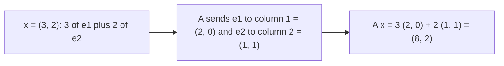
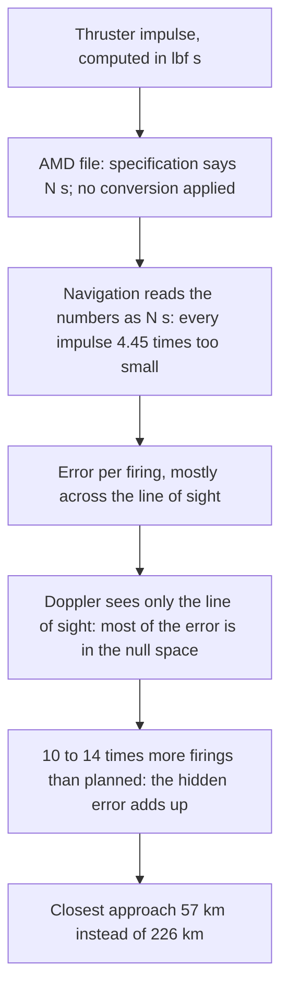

# Module 00: Vectors, Matrices, and Linear Transformations

> **Prerequisites:** [Track 00, Module 02: NumPy Indexing, Boolean Masks, Broadcasting, and Vectorization](../../00-python-data-stack-and-eda/02-numpy-indexing-slicing-and-broadcasting/README.md) and [Module 03: NumPy Aggregations, Matrix Ops (@, linalg), and Generator RNG](../../00-python-data-stack-and-eda/03-numpy-linear-algebra-random-and-aggregations/README.md). School algebra is enough; no earlier linear algebra is assumed.  
> **Estimated Reading Time:** 45 minutes  
> **Target Audience:** Engineers who use models built from matrix products (linear models, embeddings, neural network layers) and want to know what those products do, so that shapes, units and orders stop being guesswork

> [!TIP]
> **The Golden Rule of Linear Transformations:** A matrix is a **function**, and its columns say where each basis vector goes. Know what space it maps **from** and **to**, in which **units**, and read products **right to left**: `A @ B @ x` applies `B` first. Before trusting a transformation, ask what it **loses**: a determinant of zero, or a rank below the number of columns, means some direction is sent to zero and cannot be recovered from the output.

---

## Why This Matters

Almost every model in this curriculum is built from one operation: multiply a vector by a matrix. A linear regression is a matrix times a vector of coefficients; a neural network layer is a weight matrix applied to a batch; an embedding lookup, a PCA, an attention score and a feature-scaling step are all matrix products. When the shapes match, NumPy and PyTorch will compute any of them without complaint, so the mistakes that matter are not shape errors. They are a matrix applied in the wrong order, to data in the wrong units, or to a quantity that the transformation partly throws away.

Section 3 is a documented loss of this kind. NASA's Mars Climate Orbiter was lost in 1999 because one program wrote thruster impulses in pound-force seconds and the next program read them as newton seconds: a missing scaling matrix. The navigators did not notice for months because their measurements saw mostly one direction of the spacecraft's motion, and the error lay in the direction they could not see: a projection, with a null space. Both are ideas from this module.

---

## 1. Architectural Mental Model: A Matrix Is a Function

### Vectors Are Coordinates With a Meaning

A vector in ML is a list of numbers in which **each position has a meaning**: a customer's `[age, tenure_months, spend]`, a word's 768 embedding coordinates, a spacecraft's impulse `[along_line_of_sight, across]`. Two vectors can be added and scaled only if their positions mean the same things in the same units. The numbers `[-0.66, 0.62]` in pound-force seconds and the same numbers in newton seconds are different vectors that happen to have the same coordinates.

### Linear Means "Respects Sums and Scaling"

A function $T$ from vectors to vectors is **linear** when

$$T(a\,\mathbf{u} + b\,\mathbf{v}) = a\,T(\mathbf{u}) + b\,T(\mathbf{v})$$

for all vectors $\mathbf{u}, \mathbf{v}$ and numbers $a, b$. The consequence is the whole idea of this module: every vector is a combination of the basis vectors, $\mathbf{x} = x_1\mathbf{e}_1 + x_2\mathbf{e}_2$, so

$$T(\mathbf{x}) = x_1\,T(\mathbf{e}_1) + x_2\,T(\mathbf{e}_2)$$

A linear function is completely determined by **where it sends the basis vectors**. Write those images as the columns of a matrix, and the matrix *is* the function:

$$A = \begin{bmatrix} | & | \\ T(\mathbf{e}_1) & T(\mathbf{e}_2) \\ | & | \end{bmatrix}, \qquad A\mathbf{x} = x_1 (\text{column } 1) + x_2 (\text{column } 2)$$



Two readings of the same product are both worth keeping: **row by row**, each output entry is a dot product of a row of $A$ with $\mathbf{x}$ (how you compute it); **column by column**, the output is a combination of the columns of $A$ with weights from $\mathbf{x}$ (what it means).

### Shapes Are Domains and Codomains

A matrix of shape `(m, n)` maps vectors with `n` entries to vectors with `m` entries. Products chain when the inner sizes agree, and they are read **right to left**, because the vector meets the rightmost matrix first:


`A @ B` is the single matrix of "first `B`, then `A`", with shape `(2, 3)`. In general $AB \ne BA$: rotating and then stretching is not stretching and then rotating (section 4 shows both). Transposing reverses the order: $(AB)^\top = B^\top A^\top$.

### What a Transformation Keeps and What It Loses

| Idea | For a square matrix | What it tells you |
| :--- | :--- | :--- |
| **Determinant** $\det A$ | The factor by which areas (volumes) are multiplied; negative if orientation flips | $\det A = 0$: some direction is flattened to nothing |
| **Rank** | The number of independent directions in the output (the dimension of the column space) | Rank below `n`: information is lost |
| **Null space** (kernel) | All $\mathbf{x}$ with $A\mathbf{x} = \mathbf{0}$ | Differences in these directions are invisible in the output |
| **Inverse** $A^{-1}$ | Exists exactly when $\det A \ne 0$ | Undoes the transformation; numerically, also check the condition number ([Track 00, Module 03](../../00-python-data-stack-and-eda/03-numpy-linear-algebra-random-and-aggregations/README.md)) |

For a matrix with `n` columns, **rank + dimension of the null space = n** (the rank–nullity theorem). A projection onto a line in the plane has rank 1 and a one-dimensional null space: every vector perpendicular to the line is sent to zero. Two inputs that differ only in that direction give the same output, and no computation on the output can tell them apart.

### Projections

For a unit vector $\mathbf{u}$, the matrix $P = \mathbf{u}\mathbf{u}^\top$ projects any vector onto the line through $\mathbf{u}$: $P\mathbf{x} = (\mathbf{u}\cdot\mathbf{x})\,\mathbf{u}$. Projecting twice changes nothing ($P^2 = P$), $P$ is symmetric, and its determinant is 0. Projections are what measurements do: a Doppler radar sees the velocity along its line of sight; a dashboard with one metric sees the data along one direction.

### Affine Maps and the Column of Ones

A linear map always sends $\mathbf{0}$ to $\mathbf{0}$, so a model with an intercept, $\mathbf{x} \mapsto W\mathbf{x} + \mathbf{b}$, is **affine**, not linear. Appending a constant 1 to every input turns it back into one matrix product: $[\,W \mid \mathbf{b}\,]\,[\mathbf{x}; 1]$. This is why linear regression textbooks add a column of ones to the design matrix, and why graphics libraries use 3 by 3 matrices for 2-D transformations.

### Where the Matrices Are in ML

| Model or step | The matrix | Maps |
| :--- | :--- | :--- |
| Linear regression | Coefficient vector $\mathbf{w}$ (a 1 by `d` matrix) | `d` features to 1 prediction |
| Data matrix $X$, shape `(n, d)` | One sample per row | Applying $A$ to every sample is `X @ A.T` |
| Neural network layer (`torch.nn.Linear`) | Weight of shape `(out, in)`, applied as $\mathbf{y} = \mathbf{x}W^\top + \mathbf{b}$ | `in` features to `out` features |
| Feature scaling | A diagonal matrix (and a shift) | Same space, new units |
| Embedding lookup | One-hot row vector times the embedding table | Token ids to vectors |
| PCA (Module 02) | The top principal directions | `d` features to `k < d` |

---

## 2. Systematic Reference and Comparison Grids

### NumPy Operations

| Expression | Shapes | Meaning |
| :--- | :--- | :--- |
| `A @ x` | `(m, n) @ (n,) -> (m,)` | Apply `A` to the vector `x` |
| `A @ B` | `(m, k) @ (k, n) -> (m, n)` | First `B`, then `A` |
| `X @ A.T` | `(N, n) @ (n, m) -> (N, m)` | Apply `A` to every row of `X` |
| `x @ A` | `(m,) @ (m, n) -> (n,)` | `x` treated as a row: the same as `A.T @ x` |
| `A * x` | Broadcast | Elementwise: column `j` times `x[j]`, not a matrix product |
| `np.outer(u, v)` | `(m,), (n,) -> (m, n)` | $\mathbf{u}\mathbf{v}^\top$; with `u = v` a unit vector, a projection |
| `np.linalg.det(A)` | Square | Area factor; 0 means singular |
| `np.linalg.matrix_rank(A)` | Any | Independent directions, with a tolerance for rounding |
| `np.linalg.inv(A)` | Square | Use `solve` to solve systems; may return huge numbers instead of raising for a nearly singular matrix |
| `stack @ x` | `(k, m, n) @ (n,) -> (k, m)` | Apply `k` matrices at once |

### Six 2 by 2 Transformations

| Transformation | Matrix | det | Inverse |
| :--- | :--- | :--- | :--- |
| Stretch by $s$ and $t$ | $\begin{bmatrix} s & 0 \\ 0 & t \end{bmatrix}$ | $st$ | Stretch by $\frac{1}{s}$ and $\frac{1}{t}$ |
| Rotate by $\theta$ | $\begin{bmatrix} \cos\theta & -\sin\theta \\ \sin\theta & \cos\theta \end{bmatrix}$ | 1 | Rotate by $-\theta$ |
| Shear | $\begin{bmatrix} 1 & k \\ 0 & 1 \end{bmatrix}$ | 1 | Shear by $-k$ |
| Reflect (x axis) | $\begin{bmatrix} 1 & 0 \\ 0 & -1 \end{bmatrix}$ | -1 | Itself |
| Project onto unit $\mathbf{u}$ | $\mathbf{u}\mathbf{u}^\top$ | 0 | None: rank 1 |
| Change units by $c$ | $cI$ | $c^2$ | $\frac{1}{c}I$ |


*Four matrices acting on a grid: the faint lines are the original grid, the darker lines its image, the orange shape the image of the unit square and the arrows the images of the basis vectors, which are the matrix's columns (Workflow 2).*

### Linear Algebra Words and Their Engineering Meaning

| Term | Engineering meaning |
| :--- | :--- |
| Basis | The coordinate system: what each position of the vector measures, and in which unit |
| Column space (range) | Every output the transformation can produce |
| Null space (kernel) | Every input change the output cannot see |
| Composition | A pipeline of transformations; the matrix product, read right to left |
| Transpose | Swaps rows and columns; turns "apply to a column vector" into "apply to rows" |
| Change of basis | The same vector written in another coordinate system or units: a matrix, usually diagonal for units |

---

## 3. Real Case Study: Mars Climate Orbiter

This case is documented in the **Mars Climate Orbiter Mishap Investigation Board Phase I Report** (NASA, 10 November 1999). Every quotation and figure below is from that report.

| What the report says | Detail |
| :--- | :--- |
| The loss | The spacecraft was lost during Mars orbit insertion on 23 September 1999; its signal was last seen at "approximately 09:04:52 UTC" |
| The root cause | "the failure to use metric units in the coding of a ground software file, 'Small Forces,' used in trajectory models" |
| The interface | "The data in the AMD file was required to be in metric units per existing software interface documentation, and the trajectory modelers assumed the data was provided in metric units per the requirements" |
| The size of the error | The navigation software "underestimated the effect of the thruster firings on the spacecraft trajectory by a factor of 4.45 (1 pound force=4.45 Newtons)" |
| The other computation was right | "The AMD software installed on the spacecraft used metric units for the computation and was correct" |
| Why the error grew | The thruster firings (Angular Momentum Desaturation events) "occurred 10-14 times more often than was expected by the operations navigation team" |
| Why it was hard to see | "The navigation team can only directly observe the thrust effects along the line of sight using the measurements of the spacecraft's Doppler shift"; on this spacecraft "the major component of thrust during an AMD event was perpendicular to the line-of-sight", so "a systematic error due to the incorrect modeling of the thruster effects was present but undetected in the trajectory estimation" |
| The warnings | Residuals for the firings were "noted but only informally reported"; "The Doppler-only solutions consistently indicated a flight path insertion closer to the planet. These discrepancies were not resolved." |
| The outcome | The planned closest approach was 226 km; estimates fell to 150 to 170 km and, about an hour before insertion, to "as low as 110km"; the minimum considered survivable was 80 km; the after-the-fact estimate was 57 km |



### What to Take From It

1. **A unit is part of the vector.** The numbers in the file were right; their meaning was not. A units conversion is a matrix (here $4.448\,I$), and skipping it is applying the identity where a scaling was required.
2. **Linear errors add up.** Each firing's error was small; because the effect of many firings is the sum of their effects, the total grew with the number of firings, and there were 10 to 14 times more than planned.
3. **Ask what your measurement cannot see.** A measurement that projects onto one direction has a null space. An error in that direction leaves the measurement unchanged, so "the residuals look fine" means only "the error is not along the directions I measure".
4. **Two computations of the same quantity are a check.** The spacecraft computed the impulses correctly; comparing its values with the ground file's would have shown a constant ratio of about 0.22. Section 4 ends with that check.

---

## 4. Matrices as Functions, and the Orbiter's Error, in Four Languages (`carousel`)

The program writes 2 by 2 matrices as plain arrays, so that nothing is hidden in a library. It shows that a matrix's columns are the images of the basis vectors, that the order of two transformations matters, and then rebuilds the orbiter's mechanism: a skipped units conversion (a scaling), an observation along the line of sight (a projection), and many firings (a sum). The impulse values and the planned number of firings are **simulated**, chosen to make the mechanism visible; only the conversion factor and the "10 to 14 times" range come from the report.

````carousel
```python
"""Matrices as functions, in plain Python: where a matrix sends the basis vectors, why the order of two transformations
matters, and the mechanism of the Mars Climate Orbiter loss as two matrices: a units conversion that was skipped (a scaling)
and an observation that sees only the line of sight (a projection). The impulse values are simulated; the conversion factor
and the "10 to 14 times" range are from the Mishap Investigation Board's Phase I report (1999)."""
import math

LBF_S_TO_N_S = 4.4482216152605   # 1 pound-force second in newton seconds (exact by definition; the report rounds it to 4.45)
PLANNED_EVENTS = 20              # simulated: desaturation events the navigators planned for
MORE_OFTEN = [1, 10, 12, 14]     # the report: events happened 10 to 14 times more often than expected


def fmt(x):
    s = f"{x:.4f}"
    return "0.0000" if s == "-0.0000" else s


def vec(v):
    return "(" + ", ".join(fmt(x) for x in v) + ")"


def mat(m):
    return "[" + ", ".join("[" + ", ".join(fmt(x) for x in row) + "]" for row in m) + "]"


def apply(m, v):
    return [m[0][0] * v[0] + m[0][1] * v[1], m[1][0] * v[0] + m[1][1] * v[1]]


def compose(a, b):
    """The matrix of 'first b, then a', that is a @ b."""
    return [[a[i][0] * b[0][j] + a[i][1] * b[1][j] for j in range(2)] for i in range(2)]


def det(m):
    return m[0][0] * m[1][1] - m[0][1] * m[1][0]


def add(u, v):
    return [u[0] + v[0], u[1] + v[1]]


def scale(c, v):
    return [c * v[0], c * v[1]]


def dot(u, v):
    return u[0] * v[0] + u[1] * v[1]


def norm(v):
    return math.sqrt(dot(v, v))


print("== 1. a matrix is what it does to the basis vectors ==")
A = [[2.0, 1.0], [0.0, 1.0]]
e1, e2, v = [1.0, 0.0], [0.0, 1.0], [3.0, 2.0]
print(f"  A = {mat(A)}")
print(f"  A e1 = {vec(apply(A, e1))}   (the first column)")
print(f"  A e2 = {vec(apply(A, e2))}   (the second column)")
print(f"  A (3, 2) = {vec(apply(A, v))} = 3 * {vec(apply(A, e1))} + 2 * {vec(apply(A, e2))}")
u, w = [1.0, -1.0], [0.5, 4.0]
left = apply(A, add(scale(2, u), scale(3, w)))
right = add(scale(2, apply(A, u)), scale(3, apply(A, w)))
print(f"  linear: A(2u + 3w) = {vec(left)}, 2Au + 3Aw = {vec(right)}")
print(f"  det A = {fmt(det(A))}: every area is multiplied by 2")

print("\n== 2. order matters ==")
R = [[0.0, -1.0], [1.0, 0.0]]   # rotate a quarter turn anticlockwise
S = [[2.0, 0.0], [0.0, 1.0]]    # stretch x by 2
p = [1.0, 1.0]
print(f"  stretch, then rotate: R(S p) = {vec(apply(R, apply(S, p)))}   R @ S = {mat(compose(R, S))}")
print(f"  rotate, then stretch: S(R p) = {vec(apply(S, apply(R, p)))}   S @ R = {mat(compose(S, R))}")
print(f"  det R = {fmt(det(R))}, det S = {fmt(det(S))}, det(R @ S) = {fmt(det(compose(R, S)))}")

print("\n== 3. a skipped units conversion is a scaling matrix (simulated impulses) ==")
los = [0.6, 0.8]                                  # unit vector towards Earth: the line of sight
across = [-0.8, 0.6]                              # unit vector perpendicular to it
impulse_lbf = add(scale(0.1, los), scale(0.9, across))   # one desaturation event, written in lbf s
C = [[LBF_S_TO_N_S, 0.0], [0.0, LBF_S_TO_N_S]]    # the conversion the interface specification required
true_ns = apply(C, impulse_lbf)                   # what the thrusters really did, in N s
modeled_ns = impulse_lbf                          # what the navigation software read: the same numbers, taken as N s
error = add(true_ns, scale(-1, modeled_ns))
print(f"  impulse as written (lbf s): {vec(impulse_lbf)}, size {fmt(norm(impulse_lbf))}")
print(f"  true impulse (N s):         {vec(true_ns)}, size {fmt(norm(true_ns))}")
print(f"  modeled impulse (N s):      {vec(modeled_ns)}, size {fmt(norm(modeled_ns))}")
print(f"  modeled / true = {fmt(norm(modeled_ns) / norm(true_ns))}: low by a factor of {fmt(norm(true_ns) / norm(modeled_ns))}")

print("\n== 4. the navigators saw only the line of sight: a projection ==")
P = [[los[0] * los[0], los[0] * los[1]], [los[1] * los[0], los[1] * los[1]]]   # P = u u^T
print(f"  P = {mat(P)}, det P = {fmt(det(P))}")
print(f"  P across = {vec(apply(P, across))}: a whole direction is invisible")
print(f"  P (P x) = P x: {vec(apply(P, apply(P, error)))} = {vec(apply(P, error))}")
seen, hidden = dot(error, los), dot(error, across)
print(f"  error per event: {fmt(norm(error))} N s, of which {fmt(seen)} along the line of sight and {fmt(hidden)} across it")
print(f"  the Doppler data saw {fmt(abs(seen) / norm(error))} of the error's size")

print(f"\n== 5. linear maps add up: the error after many events ({PLANNED_EVENTS} planned, simulated) ==")
print("  times as often   events   seen (N s)   hidden (N s)")
for k in MORE_OFTEN:
    n = PLANNED_EVENTS * k
    total = [0.0, 0.0]
    for _ in range(n):
        total = add(total, error)
    print(f"  {k:>14}   {n:>6}   {fmt(dot(total, los)):>10}   {fmt(dot(total, across)):>12}")

print("\n== 6. the check that catches it: compare two computations of the same vector ==")
onboard_ns = apply(C, impulse_lbf)   # the report: the spacecraft's own software used metric units and was correct
ratio = norm(modeled_ns) / norm(onboard_ns)
print(f"  ground / onboard size = {fmt(ratio)} -> {'accept' if abs(ratio - 1) < 0.01 else 'REJECT the file'}")
```

<!-- slide -->

```typescript
// Matrices as functions, in plain TypeScript: where a matrix sends the basis vectors, why the order of two transformations
// matters, and the mechanism of the Mars Climate Orbiter loss as two matrices: a units conversion that was skipped (a scaling)
// and an observation that sees only the line of sight (a projection). The impulse values are simulated; the conversion factor
// and the "10 to 14 times" range are from the Mishap Investigation Board's Phase I report (1999).
type Vec = number[];
type Mat = number[][];

const LBF_S_TO_N_S = 4.4482216152605; // 1 pound-force second in newton seconds (exact by definition; the report rounds it to 4.45)
const PLANNED_EVENTS = 20; // simulated: desaturation events the navigators planned for
const MORE_OFTEN = [1, 10, 12, 14]; // the report: events happened 10 to 14 times more often than expected

const fmt = (x: number): string => {
  const s = x.toFixed(4);
  return s === "-0.0000" ? "0.0000" : s;
};
const vec = (v: Vec): string => "(" + v.map(fmt).join(", ") + ")";
const mat = (m: Mat): string => "[" + m.map((row) => "[" + row.map(fmt).join(", ") + "]").join(", ") + "]";
const apply = (m: Mat, v: Vec): Vec => [m[0][0] * v[0] + m[0][1] * v[1], m[1][0] * v[0] + m[1][1] * v[1]];
// The matrix of "first b, then a", that is a @ b.
const compose = (a: Mat, b: Mat): Mat =>
  [0, 1].map((i) => [0, 1].map((j) => a[i][0] * b[0][j] + a[i][1] * b[1][j]));
const det = (m: Mat): number => m[0][0] * m[1][1] - m[0][1] * m[1][0];
const add = (u: Vec, v: Vec): Vec => [u[0] + v[0], u[1] + v[1]];
const scale = (c: number, v: Vec): Vec => [c * v[0], c * v[1]];
const dot = (u: Vec, v: Vec): number => u[0] * v[0] + u[1] * v[1];
const norm = (v: Vec): number => Math.sqrt(dot(v, v));
const right = (s: string | number, w: number): string => String(s).padStart(w);

console.log("== 1. a matrix is what it does to the basis vectors ==");
const A: Mat = [[2, 1], [0, 1]];
const e1: Vec = [1, 0], e2: Vec = [0, 1], v: Vec = [3, 2];
console.log(`  A = ${mat(A)}`);
console.log(`  A e1 = ${vec(apply(A, e1))}   (the first column)`);
console.log(`  A e2 = ${vec(apply(A, e2))}   (the second column)`);
console.log(`  A (3, 2) = ${vec(apply(A, v))} = 3 * ${vec(apply(A, e1))} + 2 * ${vec(apply(A, e2))}`);
const u: Vec = [1, -1], w: Vec = [0.5, 4];
const lhs = apply(A, add(scale(2, u), scale(3, w)));
const rhs = add(scale(2, apply(A, u)), scale(3, apply(A, w)));
console.log(`  linear: A(2u + 3w) = ${vec(lhs)}, 2Au + 3Aw = ${vec(rhs)}`);
console.log(`  det A = ${fmt(det(A))}: every area is multiplied by 2`);

console.log("\n== 2. order matters ==");
const R: Mat = [[0, -1], [1, 0]]; // rotate a quarter turn anticlockwise
const S: Mat = [[2, 0], [0, 1]]; // stretch x by 2
const p: Vec = [1, 1];
console.log(`  stretch, then rotate: R(S p) = ${vec(apply(R, apply(S, p)))}   R @ S = ${mat(compose(R, S))}`);
console.log(`  rotate, then stretch: S(R p) = ${vec(apply(S, apply(R, p)))}   S @ R = ${mat(compose(S, R))}`);
console.log(`  det R = ${fmt(det(R))}, det S = ${fmt(det(S))}, det(R @ S) = ${fmt(det(compose(R, S)))}`);

console.log("\n== 3. a skipped units conversion is a scaling matrix (simulated impulses) ==");
const los: Vec = [0.6, 0.8]; // unit vector towards Earth: the line of sight
const across: Vec = [-0.8, 0.6]; // unit vector perpendicular to it
const impulseLbf = add(scale(0.1, los), scale(0.9, across)); // one desaturation event, written in lbf s
const C: Mat = [[LBF_S_TO_N_S, 0], [0, LBF_S_TO_N_S]]; // the conversion the interface specification required
const trueNs = apply(C, impulseLbf); // what the thrusters really did, in N s
const modeledNs = impulseLbf; // what the navigation software read: the same numbers, taken as N s
const error = add(trueNs, scale(-1, modeledNs));
console.log(`  impulse as written (lbf s): ${vec(impulseLbf)}, size ${fmt(norm(impulseLbf))}`);
console.log(`  true impulse (N s):         ${vec(trueNs)}, size ${fmt(norm(trueNs))}`);
console.log(`  modeled impulse (N s):      ${vec(modeledNs)}, size ${fmt(norm(modeledNs))}`);
console.log(`  modeled / true = ${fmt(norm(modeledNs) / norm(trueNs))}: low by a factor of ${fmt(norm(trueNs) / norm(modeledNs))}`);

console.log("\n== 4. the navigators saw only the line of sight: a projection ==");
const P: Mat = [[los[0] * los[0], los[0] * los[1]], [los[1] * los[0], los[1] * los[1]]]; // P = u u^T
console.log(`  P = ${mat(P)}, det P = ${fmt(det(P))}`);
console.log(`  P across = ${vec(apply(P, across))}: a whole direction is invisible`);
console.log(`  P (P x) = P x: ${vec(apply(P, apply(P, error)))} = ${vec(apply(P, error))}`);
const seen = dot(error, los), hidden = dot(error, across);
console.log(`  error per event: ${fmt(norm(error))} N s, of which ${fmt(seen)} along the line of sight and ${fmt(hidden)} across it`);
console.log(`  the Doppler data saw ${fmt(Math.abs(seen) / norm(error))} of the error's size`);

console.log(`\n== 5. linear maps add up: the error after many events (${PLANNED_EVENTS} planned, simulated) ==`);
console.log("  times as often   events   seen (N s)   hidden (N s)");
for (const k of MORE_OFTEN) {
  const n = PLANNED_EVENTS * k;
  let total: Vec = [0, 0];
  for (let i = 0; i < n; i++) total = add(total, error);
  console.log(`  ${right(k, 14)}   ${right(n, 6)}   ${right(fmt(dot(total, los)), 10)}   ${right(fmt(dot(total, across)), 12)}`);
}

console.log("\n== 6. the check that catches it: compare two computations of the same vector ==");
const onboardNs = apply(C, impulseLbf); // the report: the spacecraft's own software used metric units and was correct
const ratio = norm(modeledNs) / norm(onboardNs);
console.log(`  ground / onboard size = ${fmt(ratio)} -> ${Math.abs(ratio - 1) < 0.01 ? "accept" : "REJECT the file"}`);
```

<!-- slide -->

```go
// Matrices as functions, in plain Go: where a matrix sends the basis vectors, why the order of two transformations
// matters, and the mechanism of the Mars Climate Orbiter loss as two matrices: a units conversion that was skipped (a scaling)
// and an observation that sees only the line of sight (a projection). The impulse values are simulated; the conversion factor
// and the "10 to 14 times" range are from the Mishap Investigation Board's Phase I report (1999).
package main

import (
	"fmt"
	"math"
	"strconv"
	"strings"
)

type vector [2]float64
type matrix [2][2]float64

const lbfSToNS = 4.4482216152605 // 1 pound-force second in newton seconds (exact by definition; the report rounds it to 4.45)
const plannedEvents = 20         // simulated: desaturation events the navigators planned for

var moreOften = []int{1, 10, 12, 14} // the report: events happened 10 to 14 times more often than expected

func f(x float64) string {
	s := strconv.FormatFloat(x, 'f', 4, 64)
	if s == "-0.0000" {
		return "0.0000"
	}
	return s
}

func vec(v vector) string { return "(" + f(v[0]) + ", " + f(v[1]) + ")" }

func mat(m matrix) string {
	rows := []string{}
	for _, r := range m {
		rows = append(rows, "["+f(r[0])+", "+f(r[1])+"]")
	}
	return "[" + strings.Join(rows, ", ") + "]"
}

func apply(m matrix, v vector) vector {
	return vector{m[0][0]*v[0] + m[0][1]*v[1], m[1][0]*v[0] + m[1][1]*v[1]}
}

// compose returns the matrix of "first b, then a", that is a @ b.
func compose(a, b matrix) matrix {
	var c matrix
	for i := 0; i < 2; i++ {
		for j := 0; j < 2; j++ {
			c[i][j] = a[i][0]*b[0][j] + a[i][1]*b[1][j]
		}
	}
	return c
}

func det(m matrix) float64             { return m[0][0]*m[1][1] - m[0][1]*m[1][0] }
func add(u, v vector) vector           { return vector{u[0] + v[0], u[1] + v[1]} }
func scale(c float64, v vector) vector { return vector{c * v[0], c * v[1]} }
func dot(u, v vector) float64          { return u[0]*v[0] + u[1]*v[1] }
func norm(v vector) float64            { return math.Sqrt(dot(v, v)) }

func main() {
	fmt.Println("== 1. a matrix is what it does to the basis vectors ==")
	A := matrix{{2, 1}, {0, 1}}
	e1, e2, v := vector{1, 0}, vector{0, 1}, vector{3, 2}
	fmt.Printf("  A = %s\n", mat(A))
	fmt.Printf("  A e1 = %s   (the first column)\n", vec(apply(A, e1)))
	fmt.Printf("  A e2 = %s   (the second column)\n", vec(apply(A, e2)))
	fmt.Printf("  A (3, 2) = %s = 3 * %s + 2 * %s\n", vec(apply(A, v)), vec(apply(A, e1)), vec(apply(A, e2)))
	u, w := vector{1, -1}, vector{0.5, 4}
	lhs := apply(A, add(scale(2, u), scale(3, w)))
	rhs := add(scale(2, apply(A, u)), scale(3, apply(A, w)))
	fmt.Printf("  linear: A(2u + 3w) = %s, 2Au + 3Aw = %s\n", vec(lhs), vec(rhs))
	fmt.Printf("  det A = %s: every area is multiplied by 2\n", f(det(A)))

	fmt.Println("\n== 2. order matters ==")
	R := matrix{{0, -1}, {1, 0}} // rotate a quarter turn anticlockwise
	S := matrix{{2, 0}, {0, 1}}  // stretch x by 2
	p := vector{1, 1}
	fmt.Printf("  stretch, then rotate: R(S p) = %s   R @ S = %s\n", vec(apply(R, apply(S, p))), mat(compose(R, S)))
	fmt.Printf("  rotate, then stretch: S(R p) = %s   S @ R = %s\n", vec(apply(S, apply(R, p))), mat(compose(S, R)))
	fmt.Printf("  det R = %s, det S = %s, det(R @ S) = %s\n", f(det(R)), f(det(S)), f(det(compose(R, S))))

	fmt.Println("\n== 3. a skipped units conversion is a scaling matrix (simulated impulses) ==")
	los := vector{0.6, 0.8}                                // unit vector towards Earth: the line of sight
	across := vector{-0.8, 0.6}                            // unit vector perpendicular to it
	impulseLbf := add(scale(0.1, los), scale(0.9, across)) // one desaturation event, written in lbf s
	C := matrix{{lbfSToNS, 0}, {0, lbfSToNS}}              // the conversion the interface specification required
	trueNs := apply(C, impulseLbf)                         // what the thrusters really did, in N s
	modeledNs := impulseLbf                                // what the navigation software read: the same numbers, taken as N s
	errv := add(trueNs, scale(-1, modeledNs))
	fmt.Printf("  impulse as written (lbf s): %s, size %s\n", vec(impulseLbf), f(norm(impulseLbf)))
	fmt.Printf("  true impulse (N s):         %s, size %s\n", vec(trueNs), f(norm(trueNs)))
	fmt.Printf("  modeled impulse (N s):      %s, size %s\n", vec(modeledNs), f(norm(modeledNs)))
	fmt.Printf("  modeled / true = %s: low by a factor of %s\n", f(norm(modeledNs)/norm(trueNs)), f(norm(trueNs)/norm(modeledNs)))

	fmt.Println("\n== 4. the navigators saw only the line of sight: a projection ==")
	P := matrix{{los[0] * los[0], los[0] * los[1]}, {los[1] * los[0], los[1] * los[1]}} // P = u u^T
	fmt.Printf("  P = %s, det P = %s\n", mat(P), f(det(P)))
	fmt.Printf("  P across = %s: a whole direction is invisible\n", vec(apply(P, across)))
	fmt.Printf("  P (P x) = P x: %s = %s\n", vec(apply(P, apply(P, errv))), vec(apply(P, errv)))
	seen, hidden := dot(errv, los), dot(errv, across)
	fmt.Printf("  error per event: %s N s, of which %s along the line of sight and %s across it\n", f(norm(errv)), f(seen), f(hidden))
	fmt.Printf("  the Doppler data saw %s of the error's size\n", f(math.Abs(seen)/norm(errv)))

	fmt.Printf("\n== 5. linear maps add up: the error after many events (%d planned, simulated) ==\n", plannedEvents)
	fmt.Println("  times as often   events   seen (N s)   hidden (N s)")
	for _, k := range moreOften {
		n := plannedEvents * k
		total := vector{0, 0}
		for i := 0; i < n; i++ {
			total = add(total, errv)
		}
		fmt.Printf("  %14d   %6d   %10s   %12s\n", k, n, f(dot(total, los)), f(dot(total, across)))
	}

	fmt.Println("\n== 6. the check that catches it: compare two computations of the same vector ==")
	onboardNs := apply(C, impulseLbf) // the report: the spacecraft's own software used metric units and was correct
	ratio := norm(modeledNs) / norm(onboardNs)
	verdict := "REJECT the file"
	if math.Abs(ratio-1) < 0.01 {
		verdict = "accept"
	}
	fmt.Printf("  ground / onboard size = %s -> %s\n", f(ratio), verdict)
}
```

<!-- slide -->

```csharp
// Matrices as functions, in plain C#: where a matrix sends the basis vectors, why the order of two transformations
// matters, and the mechanism of the Mars Climate Orbiter loss as two matrices: a units conversion that was skipped (a scaling)
// and an observation that sees only the line of sight (a projection). The impulse values are simulated; the conversion factor
// and the "10 to 14 times" range are from the Mishap Investigation Board's Phase I report (1999).
using System;
using System.Globalization;
using System.Linq;

const double LbfSToNS = 4.4482216152605; // 1 pound-force second in newton seconds (exact by definition; the report rounds it to 4.45)
const int PlannedEvents = 20;            // simulated: desaturation events the navigators planned for
int[] moreOften = { 1, 10, 12, 14 };     // the report: events happened 10 to 14 times more often than expected

string F(double x)
{
    var s = x.ToString("F4", CultureInfo.InvariantCulture);
    return s == "-0.0000" ? "0.0000" : s;
}
string Vec(double[] v) => "(" + string.Join(", ", v.Select(F)) + ")";
string Mat(double[][] m) => "[" + string.Join(", ", m.Select(r => "[" + string.Join(", ", r.Select(F)) + "]")) + "]";
double[] Apply(double[][] m, double[] v) => new[] { m[0][0] * v[0] + m[0][1] * v[1], m[1][0] * v[0] + m[1][1] * v[1] };
// The matrix of "first b, then a", that is a @ b.
double[][] Compose(double[][] a, double[][] b) =>
    new[] { 0, 1 }.Select(i => new[] { 0, 1 }.Select(j => a[i][0] * b[0][j] + a[i][1] * b[1][j]).ToArray()).ToArray();
double Det(double[][] m) => m[0][0] * m[1][1] - m[0][1] * m[1][0];
double[] Add(double[] u, double[] v) => new[] { u[0] + v[0], u[1] + v[1] };
double[] Scale(double c, double[] v) => new[] { c * v[0], c * v[1] };
double Dot(double[] u, double[] v) => u[0] * v[0] + u[1] * v[1];
double Norm(double[] v) => Math.Sqrt(Dot(v, v));

Console.WriteLine("== 1. a matrix is what it does to the basis vectors ==");
double[][] A = { new[] { 2.0, 1.0 }, new[] { 0.0, 1.0 } };
double[] e1 = { 1, 0 }, e2 = { 0, 1 }, v = { 3, 2 };
Console.WriteLine($"  A = {Mat(A)}");
Console.WriteLine($"  A e1 = {Vec(Apply(A, e1))}   (the first column)");
Console.WriteLine($"  A e2 = {Vec(Apply(A, e2))}   (the second column)");
Console.WriteLine($"  A (3, 2) = {Vec(Apply(A, v))} = 3 * {Vec(Apply(A, e1))} + 2 * {Vec(Apply(A, e2))}");
double[] u = { 1, -1 }, w = { 0.5, 4 };
var lhs = Apply(A, Add(Scale(2, u), Scale(3, w)));
var rhs = Add(Scale(2, Apply(A, u)), Scale(3, Apply(A, w)));
Console.WriteLine($"  linear: A(2u + 3w) = {Vec(lhs)}, 2Au + 3Aw = {Vec(rhs)}");
Console.WriteLine($"  det A = {F(Det(A))}: every area is multiplied by 2");

Console.WriteLine("\n== 2. order matters ==");
double[][] R = { new[] { 0.0, -1.0 }, new[] { 1.0, 0.0 } }; // rotate a quarter turn anticlockwise
double[][] S = { new[] { 2.0, 0.0 }, new[] { 0.0, 1.0 } };  // stretch x by 2
double[] p = { 1, 1 };
Console.WriteLine($"  stretch, then rotate: R(S p) = {Vec(Apply(R, Apply(S, p)))}   R @ S = {Mat(Compose(R, S))}");
Console.WriteLine($"  rotate, then stretch: S(R p) = {Vec(Apply(S, Apply(R, p)))}   S @ R = {Mat(Compose(S, R))}");
Console.WriteLine($"  det R = {F(Det(R))}, det S = {F(Det(S))}, det(R @ S) = {F(Det(Compose(R, S)))}");

Console.WriteLine("\n== 3. a skipped units conversion is a scaling matrix (simulated impulses) ==");
double[] los = { 0.6, 0.8 };                                 // unit vector towards Earth: the line of sight
double[] across = { -0.8, 0.6 };                             // unit vector perpendicular to it
var impulseLbf = Add(Scale(0.1, los), Scale(0.9, across));   // one desaturation event, written in lbf s
double[][] C = { new[] { LbfSToNS, 0.0 }, new[] { 0.0, LbfSToNS } }; // the conversion the interface specification required
var trueNs = Apply(C, impulseLbf);                           // what the thrusters really did, in N s
var modeledNs = impulseLbf;                                  // what the navigation software read: the same numbers, taken as N s
var error = Add(trueNs, Scale(-1, modeledNs));
Console.WriteLine($"  impulse as written (lbf s): {Vec(impulseLbf)}, size {F(Norm(impulseLbf))}");
Console.WriteLine($"  true impulse (N s):         {Vec(trueNs)}, size {F(Norm(trueNs))}");
Console.WriteLine($"  modeled impulse (N s):      {Vec(modeledNs)}, size {F(Norm(modeledNs))}");
Console.WriteLine($"  modeled / true = {F(Norm(modeledNs) / Norm(trueNs))}: low by a factor of {F(Norm(trueNs) / Norm(modeledNs))}");

Console.WriteLine("\n== 4. the navigators saw only the line of sight: a projection ==");
double[][] P = { new[] { los[0] * los[0], los[0] * los[1] }, new[] { los[1] * los[0], los[1] * los[1] } }; // P = u u^T
Console.WriteLine($"  P = {Mat(P)}, det P = {F(Det(P))}");
Console.WriteLine($"  P across = {Vec(Apply(P, across))}: a whole direction is invisible");
Console.WriteLine($"  P (P x) = P x: {Vec(Apply(P, Apply(P, error)))} = {Vec(Apply(P, error))}");
double seen = Dot(error, los), hidden = Dot(error, across);
Console.WriteLine($"  error per event: {F(Norm(error))} N s, of which {F(seen)} along the line of sight and {F(hidden)} across it");
Console.WriteLine($"  the Doppler data saw {F(Math.Abs(seen) / Norm(error))} of the error's size");

Console.WriteLine($"\n== 5. linear maps add up: the error after many events ({PlannedEvents} planned, simulated) ==");
Console.WriteLine("  times as often   events   seen (N s)   hidden (N s)");
foreach (var k in moreOften)
{
    var n = PlannedEvents * k;
    double[] total = { 0, 0 };
    for (var i = 0; i < n; i++) total = Add(total, error);
    Console.WriteLine($"  {k,14}   {n,6}   {F(Dot(total, los)),10}   {F(Dot(total, across)),12}");
}

Console.WriteLine("\n== 6. the check that catches it: compare two computations of the same vector ==");
var onboardNs = Apply(C, impulseLbf); // the report: the spacecraft's own software used metric units and was correct
var ratio = Norm(modeledNs) / Norm(onboardNs);
Console.WriteLine($"  ground / onboard size = {F(ratio)} -> {(Math.Abs(ratio - 1) < 0.01 ? "accept" : "REJECT the file")}");
```
````

**Observed output (identical in Python 3.13.14, Node 24, Go 1.22 and .NET 10):**

```text
== 1. a matrix is what it does to the basis vectors ==
  A = [[2.0000, 1.0000], [0.0000, 1.0000]]
  A e1 = (2.0000, 0.0000)   (the first column)
  A e2 = (1.0000, 1.0000)   (the second column)
  A (3, 2) = (8.0000, 2.0000) = 3 * (2.0000, 0.0000) + 2 * (1.0000, 1.0000)
  linear: A(2u + 3w) = (17.0000, 10.0000), 2Au + 3Aw = (17.0000, 10.0000)
  det A = 2.0000: every area is multiplied by 2

== 2. order matters ==
  stretch, then rotate: R(S p) = (-1.0000, 2.0000)   R @ S = [[0.0000, -1.0000], [2.0000, 0.0000]]
  rotate, then stretch: S(R p) = (-2.0000, 1.0000)   S @ R = [[0.0000, -2.0000], [1.0000, 0.0000]]
  det R = 1.0000, det S = 2.0000, det(R @ S) = 2.0000

== 3. a skipped units conversion is a scaling matrix (simulated impulses) ==
  impulse as written (lbf s): (-0.6600, 0.6200), size 0.9055
  true impulse (N s):         (-2.9358, 2.7579), size 4.0280
  modeled impulse (N s):      (-0.6600, 0.6200), size 0.9055
  modeled / true = 0.2248: low by a factor of 4.4482

== 4. the navigators saw only the line of sight: a projection ==
  P = [[0.3600, 0.4800], [0.4800, 0.6400]], det P = 0.0000
  P across = (0.0000, 0.0000): a whole direction is invisible
  P (P x) = P x: (0.2069, 0.2759) = (0.2069, 0.2759)
  error per event: 3.1225 N s, of which 0.3448 along the line of sight and 3.1034 across it
  the Doppler data saw 0.1104 of the error's size

== 5. linear maps add up: the error after many events (20 planned, simulated) ==
  times as often   events   seen (N s)   hidden (N s)
               1       20       6.8964        62.0680
              10      200      68.9644       620.6799
              12      240      82.7573       744.8159
              14      280      96.5502       868.9518

== 6. the check that catches it: compare two computations of the same vector ==
  ground / onboard size = 0.2248 -> REJECT the file
```

What to notice:

- **The columns are the function.** `A e1` and `A e2` are the columns of `A`, and `A (3, 2)` is 3 times the first column plus 2 times the second. Linearity holds exactly: `A(2u + 3w)` and `2Au + 3Aw` are both (17, 10).
- **Order matters.** Stretching then rotating sends (1, 1) to (-1, 2); rotating then stretching sends it to (-2, 1). The two products are different matrices with the same determinant, 2.
- **The skipped conversion is a factor of 4.4482 in every direction.** The modeled impulse is 0.2248 of the true one, in the same direction: the error is a scaled copy of the impulse.
- **The projection sees 11% of it.** Of an error of 3.1225 N s per firing, 0.3448 lies along the line of sight and 3.1034 across it. `P across` is (0, 0): the across direction is the projection's null space.
- **The error is linear in the number of firings.** With 12 times as many firings as the 20 planned, the hidden error is 744.8 N s, twelve times the planned amount; the seen part also grows, but stays a ninth of the hidden part.
- **The check needs no physics.** Two computations of the same impulse, ground and onboard, should have a ratio of 1. A ratio of 0.2248 rejects the file.

---

## 5. Practical Hands-On Verification Workflows (Python 3.13 + NumPy 2.5.5)

The workflows run in the environment of Track 00 (Python 3.13.14, NumPy 2.5.5, scikit-learn 1.9.1, Matplotlib 3.11.2).

### Workflow 1: Shapes, Columns, and Composition in NumPy

```python
"""Vectors and matrices in NumPy: shapes, matrices as functions (columns are where the basis vectors go), composition order,
the transpose rule, and applying one matrix to every row of a data matrix."""
import numpy as np

np.set_printoptions(precision=4, suppress=True)

print("== shapes ==")
A = np.array([[2.0, 1.0], [0.0, 1.0]])
v = np.array([3.0, 2.0])
col = v.reshape(2, 1)
print("A", A.shape, "| v", v.shape, "| column", col.shape, "| row", v.reshape(1, 2).shape)
print("A @ v      ->", A @ v, (A @ v).shape)
print("A @ column ->", (A @ col).ravel(), (A @ col).shape)
print("v @ A      ->", v @ A, "(v is treated as a row: this is A.T @ v, not A @ v)")
print("A * v      ->", (A * v).tolist(), "(elementwise with broadcasting: column j multiplied by v[j])")

print("\n== a matrix is where it sends the basis vectors ==")
e1, e2 = np.eye(2)
print("A @ e1 =", A @ e1, "= A[:, 0] =", A[:, 0])
print("A @ e2 =", A @ e2, "= A[:, 1] =", A[:, 1])
theta = np.deg2rad(30)
R = np.column_stack([[np.cos(theta), np.sin(theta)],      # where e1 goes
                     [-np.sin(theta), np.cos(theta)]])    # where e2 goes
print("rotation by 30 degrees, built from its columns:\n", R)
print("lengths before and after:", np.linalg.norm(v), np.linalg.norm(R @ v))

print("\n== composition reads right to left ==")
S = np.diag([2.0, 1.0])
x = np.array([1.0, 1.0])
print("R @ (S @ x) =", R @ (S @ x), "| (R @ S) @ x =", (R @ S) @ x)
print("S @ (R @ x) =", S @ (R @ x), "| R @ S == S @ R?", np.allclose(R @ S, S @ R))
print("(A @ R).T == R.T @ A.T?", np.allclose((A @ R).T, R.T @ A.T), "| == A.T @ R.T?", np.allclose((A @ R).T, A.T @ R.T))

print("\n== one matrix applied to every row of a data matrix ==")
X = np.array([[1.0, 0.0], [0.0, 1.0], [3.0, 2.0], [-1.0, 4.0]])   # 4 points, one per row: shape (n, 2)
right = X @ A.T          # row i becomes A @ X[i]
wrong = X @ A            # row i becomes A.T @ X[i]
print("X @ A.T:\n", right)
print("check row 2 against A @ X[2]:", A @ X[2])
print("X @ A (the common slip):\n", wrong)
print("same?", np.allclose(right, wrong))

print("\n== a stack of matrices applied at once ==")
angles = np.deg2rad([0, 90, 180])
stack = np.stack([np.array([[np.cos(a), -np.sin(a)], [np.sin(a), np.cos(a)]]) for a in angles])   # shape (3, 2, 2)
print("stack", stack.shape, "@ e1 ->\n", stack @ e1)
```

**Observed Output:**

```text
== shapes ==
A (2, 2) | v (2,) | column (2, 1) | row (1, 2)
A @ v      -> [8. 2.] (2,)
A @ column -> [8. 2.] (2, 1)
v @ A      -> [6. 5.] (v is treated as a row: this is A.T @ v, not A @ v)
A * v      -> [[6.0, 2.0], [0.0, 2.0]] (elementwise with broadcasting: column j multiplied by v[j])

== a matrix is where it sends the basis vectors ==
A @ e1 = [2. 0.] = A[:, 0] = [2. 0.]
A @ e2 = [1. 1.] = A[:, 1] = [1. 1.]
rotation by 30 degrees, built from its columns:
 [[ 0.866 -0.5  ]
 [ 0.5    0.866]]
lengths before and after: 3.605551275463989 3.605551275463989

== composition reads right to left ==
R @ (S @ x) = [1.2321 1.866 ] | (R @ S) @ x = [1.2321 1.866 ]
S @ (R @ x) = [0.7321 1.366 ] | R @ S == S @ R? False
(A @ R).T == R.T @ A.T? True | == A.T @ R.T? False

== one matrix applied to every row of a data matrix ==
X @ A.T:
 [[2. 0.]
 [1. 1.]
 [8. 2.]
 [2. 4.]]
check row 2 against A @ X[2]: [8. 2.]
X @ A (the common slip):
 [[ 2.  1.]
 [ 0.  1.]
 [ 6.  5.]
 [-2.  3.]]
same? False

== a stack of matrices applied at once ==
stack (3, 2, 2) @ e1 ->
 [[ 1.  0.]
 [ 0.  1.]
 [-1.  0.]]
```

- A 1-D array of shape `(2,)` is neither a row nor a column; `A @ v` treats it as a column and `v @ A` as a row, and the two give different answers ((8, 2) and (6, 5)). Say which one you mean, or reshape to `(n, 1)` when it matters.
- `A * v` is not a matrix product: it broadcast `v` across the rows and multiplied column `j` by `v[j]`.
- The rotation was **built from its columns**: where `e1` and `e2` should go. It kept the length of `v` (3.6056 before and after), as a rotation must.
- `X @ A.T` applied `A` to every row of the data (row 2 became (8, 2), the same as `A @ X[2]`); `X @ A` ran without an error and gave different numbers. This is the most common silent matrix bug in data code.
- `(A @ R).T` equals `R.T @ A.T`, not `A.T @ R.T`.

### Workflow 2: What a Matrix Does to Space

```python
"""What four 2 x 2 matrices do to the plane: the determinant as the area factor, rank and the direction a projection loses,
inverses that undo a transformation and the one that cannot exist, and a figure of each matrix acting on a grid."""
import pathlib

import matplotlib

matplotlib.use("Agg")  # draw to files, no window
import matplotlib.pyplot as plt
import numpy as np
from matplotlib.patches import FancyBboxPatch, Polygon

INK, MUTED, RULE, CARD, CARD_EDGE, ACCENT, ACCENT_TEXT = "#16181c", "#575c65", "#cdcdc5", "#fbfbf9", "#e4e4de", "#e9a053", "#9a4f06"
plt.rcParams.update({
    "font.size": 13, "font.family": "sans-serif", "font.sans-serif": ["Arial", "Liberation Sans", "DejaVu Sans"], "svg.fonttype": "none", "svg.hashsalt": "fixed",
    "text.color": INK, "axes.labelcolor": INK, "xtick.color": MUTED, "ytick.color": MUTED, "axes.edgecolor": RULE,
    "axes.facecolor": "none", "axes.spines.top": False, "axes.spines.right": False,
})


def save_svg(fig, path, title, description):
    """Save on a rounded card (readable on light and dark pages), with no timestamp, plus a title and description for screen readers."""
    fig.patch.set_alpha(0)
    fig.patches.append(FancyBboxPatch((0.004, 0.004), 0.992, 0.992, boxstyle="round,pad=0,rounding_size=0.025",
                                      transform=fig.transFigure, facecolor=CARD, edgecolor=CARD_EDGE, zorder=-10))
    fig.savefig(path, format="svg", metadata={"Date": None})
    svg = path.read_text(encoding="utf-8")
    svg = svg.replace("<svg ", '<svg role="img" ', 1)
    for attr in ("width", "height"):  # pixel sizes, so 13-point text is 13 px at the image's natural width
        start = svg.index(f'{attr}="') + len(attr) + 2
        end = svg.index('"', start)
        svg = svg[:start] + str(round(float(svg[start:end].removesuffix("pt")))) + svg[end:]
    head_end = svg.index(">", svg.index("<svg ")) + 1
    svg = svg[:head_end] + f"\n <title>{title}</title>\n <desc>{description}</desc>" + svg[head_end:]
    path.write_text(svg, encoding="utf-8")
    return path.stat().st_size


def area(points):
    """Shoelace formula: the area of a polygon from its corners in order."""
    x, y = points[:, 0], points[:, 1]
    return abs(np.dot(x, np.roll(y, -1)) - np.dot(y, np.roll(x, -1))) / 2


theta = np.deg2rad(30)
los = np.array([0.6, 0.8])
MATRICES = {
    "stretch": np.diag([1.5, 0.5]),
    "shear": np.array([[1.0, 1.0], [0.0, 1.0]]),
    "rotate 30 degrees": np.array([[np.cos(theta), -np.sin(theta)], [np.sin(theta), np.cos(theta)]]),
    "project onto a line": np.outer(los, los),
}
square = np.array([[0.0, 0.0], [1.0, 0.0], [1.0, 1.0], [0.0, 1.0]])

print("== determinant, rank, and the area of the unit square's image ==")
print(f"{'matrix':<20} {'det':>7} {'rank':>4} {'area':>6}")
for name, M in MATRICES.items():
    image = square @ M.T
    print(f"{name:<20} {np.linalg.det(M):>7.3f} {np.linalg.matrix_rank(M):>4} {area(image):>6.3f}")

print("\n== an inverse undoes a transformation ==")
shear = MATRICES["shear"]
print("inv(shear) =", np.linalg.inv(shear).tolist(), "| inv(shear) @ shear == I?", np.allclose(np.linalg.inv(shear) @ shear, np.eye(2)))
P = MATRICES["project onto a line"]
print(f"projection: det = {np.linalg.det(P):.3e}, condition number = {np.linalg.cond(P):.3e}, rank = {np.linalg.matrix_rank(P)}")
try:
    print("inv(projection) did NOT raise; it returned", np.linalg.inv(P).tolist())
except np.linalg.LinAlgError as e:
    print("inv(projection) raised LinAlgError:", e)
print("exactly singular [[1, 2], [2, 4]]:", end=" ")
try:
    np.linalg.inv(np.array([[1.0, 2.0], [2.0, 4.0]]))
except np.linalg.LinAlgError as e:
    print("LinAlgError:", e)
across = np.array([-0.8, 0.6])
print("P @ across =", np.round(P @ across, 12) + 0.0, "-> across is in the null space: rank 1 + nullity 1 = 2 dimensions")
a, b = np.array([1.0, 2.0]), np.array([1.0, 2.0]) + 5 * across
print("two different inputs", a, b, "give the same output", P @ a, P @ b)
print("P @ P == P?", np.allclose(P @ P, P), "| P symmetric?", np.allclose(P, P.T))

print("\n== the figure ==")
fig, axes = plt.subplots(2, 2, figsize=(6.4, 6.6))
ticks = np.linspace(-1, 2, 7)
for ax, (name, M) in zip(axes.ravel(), MATRICES.items()):
    for t in ticks:   # the original grid, faint, and its image, darker
        for line in (np.array([[t, -1.0], [t, 2.0]]), np.array([[-1.0, t], [2.0, t]])):
            ax.plot(*line.T, color=RULE, linewidth=0.8, zorder=1)
            ax.plot(*(line @ M.T).T, color=MUTED, linewidth=1.0, alpha=0.55, zorder=2)
    ax.add_patch(Polygon(square @ M.T, closed=True, facecolor=ACCENT, edgecolor=ACCENT_TEXT, alpha=0.75, linewidth=1.4, zorder=3))
    for k, colname in enumerate(["e1", "e2"]):
        end = M[:, k]
        ax.annotate("", xy=end, xytext=(0, 0), arrowprops={"arrowstyle": "-|>", "color": INK, "linewidth": 1.6}, zorder=4)
    ax.set_xlim(-1.1, 2.1)
    ax.set_ylim(-1.1, 2.1)
    ax.set_aspect("equal")
    ax.set_xticks([])
    ax.set_yticks([])
    for side in ("left", "bottom"):
        ax.spines[side].set_visible(False)
    ax.set_title(name, loc="left", fontsize=13)
    ax.text(-1.0, -1.0, f"det {np.linalg.det(M):.2f}", color=ACCENT_TEXT, fontsize=13, va="bottom", zorder=5,
            bbox={"boxstyle": "round,pad=0.25", "facecolor": CARD, "edgecolor": "none"})
fig.tight_layout()
out = pathlib.Path("images") / "four-matrices-on-a-grid.svg"
out.parent.mkdir(exist_ok=True)
size = save_svg(fig, out, "Four matrices acting on the plane",
                "Each panel shows a faint original grid, its image under the matrix, the image of the unit square in orange and "
                "the images of the two basis vectors as arrows. Stretch: det 0.75. Shear: det 1. Rotation by 30 degrees: det 1. "
                "Projection onto a line: det 0, the square collapses onto a segment.")
print(f"saved {out.as_posix()}: {size / 1024:.1f} KB")
```

**Observed Output:**

```text
== determinant, rank, and the area of the unit square's image ==
matrix                   det rank   area
stretch                0.750    2  0.750
shear                  1.000    2  1.000
rotate 30 degrees      1.000    2  1.000
project onto a line    0.000    1  0.000

== an inverse undoes a transformation ==
inv(shear) = [[1.0, -1.0], [0.0, 1.0]] | inv(shear) @ shear == I? True
projection: det = 5.329e-17, condition number = inf, rank = 1
inv(projection) did NOT raise; it returned [[1.2009599006321326e+16, -9007199254740992.0], [-9007199254740992.0, 6755399441055744.0]]
exactly singular [[1, 2], [2, 4]]: LinAlgError: Singular matrix
P @ across = [0. 0.] -> across is in the null space: rank 1 + nullity 1 = 2 dimensions
two different inputs [1. 2.] [-3.  5.] give the same output [1.32 1.76] [1.32 1.76]
P @ P == P? True | P symmetric? True

== the figure ==
saved images/four-matrices-on-a-grid.svg: 33.8 KB
```

- **The determinant is the area factor.** The image of the unit square, measured with the shoelace formula, has exactly the area `|det|`: 0.75 for the stretch, 1 for the shear and the rotation, 0 for the projection.
- **`inv` did not refuse the projection.** Its determinant came out as $5.3 \times 10^{-17}$ instead of 0, because 0.6 and 0.8 have no exact binary form, and `np.linalg.inv` returned entries near $10^{16}$. Only an exactly singular matrix such as `[[1, 2], [2, 4]]` raised `LinAlgError`. Check `matrix_rank` or the condition number (here infinite) before inverting, not whether an exception was raised.
- **The null space in action:** (1, 2) and (-3, 5) differ by 5 times the across direction and have the same projection, (1.32, 1.76). Nothing computed from the output can separate them.
- The figure above is this workflow's output.

### Workflow 3: Linear Maps Inside a Model

```python
"""A linear model is a matrix: predictions are X @ w + b, the bias folds into the matrix with a column of ones, changing a
feature's units is a diagonal matrix the coefficients absorb, and StandardScaler is an affine map. Then the orbiter's bug in
model form: a model trained on N s, fed lbf s. The thruster data is simulated."""
import numpy as np
from sklearn.linear_model import LinearRegression
from sklearn.preprocessing import StandardScaler

LBF_S_TO_N_S = 4.4482216152605
MASS_KG = 600.0                   # simulated spacecraft mass
rng = np.random.default_rng(2026)
np.set_printoptions(suppress=True)

n = 200
impulse_ns = rng.uniform(1.0, 6.0, n)                 # simulated impulse per event, N s
burn_s = rng.uniform(0.5, 3.0, n)                     # simulated firing time, s (does not affect the velocity change)
dv_mm_s = impulse_ns / MASS_KG * 1000 + rng.normal(0, 0.05, n)   # velocity change, mm/s, with measurement noise
X = np.column_stack([impulse_ns, burn_s])

print("== a fitted linear model is a vector and a number ==")
model = LinearRegression().fit(X, dv_mm_s)
w, b = model.coef_, model.intercept_
print(f"coefficients {np.round(w, 4)} (mm/s per N s, per s), intercept {b:.4f}; physics says {1000 / MASS_KG:.4f} per N s")
print("model.predict(X) == X @ w + b?", np.allclose(model.predict(X), X @ w + b))
X1 = np.column_stack([X, np.ones(n)])                  # homogeneous coordinates: the bias becomes a weight
w1 = np.append(w, b)
print("with a column of ones, X1 @ [w, b] == predictions?", np.allclose(X1 @ w1, model.predict(X)))

print("\n== changing a feature's units is a diagonal matrix ==")
D = np.diag([1 / LBF_S_TO_N_S, 1.0])                   # N s -> lbf s for column 0, seconds unchanged
X_lbf = X @ D
model_lbf = LinearRegression().fit(X_lbf, dv_mm_s)
print(f"coefficients after refitting on lbf s: {np.round(model_lbf.coef_, 4)}")
print("equal to inv(D) @ w?", np.allclose(model_lbf.coef_, np.linalg.inv(D) @ w), "| same predictions?",
      np.allclose(model_lbf.predict(X_lbf), model.predict(X)))

print("\n== StandardScaler is an affine map: (X - mean) @ diag(1 / scale) ==")
scaler = StandardScaler().fit(X)
by_hand = (X - scaler.mean_) @ np.diag(1 / scaler.scale_)
print("scaler.transform(X) == by hand?", np.allclose(scaler.transform(X), by_hand))
print("standardized coefficients, the same in N s or lbf s:",
      np.round(LinearRegression().fit(StandardScaler().fit_transform(X), dv_mm_s).coef_, 4),
      np.round(LinearRegression().fit(StandardScaler().fit_transform(X_lbf), dv_mm_s).coef_, 4))

print("\n== the bug: a model trained on N s, fed a file written in lbf s ==")
new_ns = np.column_stack([rng.uniform(1.0, 6.0, 5), rng.uniform(0.5, 3.0, 5)])
new_as_written = new_ns @ D                             # the ground file wrote lbf s
right = model.predict(new_ns)
wrong = model.predict(new_as_written)                   # no error, no warning: just smaller numbers
print("correct predictions (mm/s):", np.round(right, 3))
print("fed lbf s (mm/s):          ", np.round(wrong, 3))
print(f"mean ratio wrong / right: {np.mean(wrong / right):.3f} (not 1 / 4.448 = {1 / LBF_S_TO_N_S:.3f}: the intercept and the other column are unchanged)")

print("\n== a guard at the interface ==")
TRAINED_UNITS = {"impulse": "N s", "burn": "s"}


def predict_checked(model, X, units):
    if units != TRAINED_UNITS:
        raise ValueError(f"units {units} do not match the training units {TRAINED_UNITS}")
    return model.predict(X)


try:
    predict_checked(model, new_as_written, {"impulse": "lbf s", "burn": "s"})
except ValueError as e:
    print("rejected:", e)
print("accepted after converting:", np.round(predict_checked(model, new_as_written @ np.linalg.inv(D), {"impulse": "N s", "burn": "s"}), 3))
```

**Observed Output:**

```text
== a fitted linear model is a vector and a number ==
coefficients [ 1.6625 -0.0011] (mm/s per N s, per s), intercept 0.0178; physics says 1.6667 per N s
model.predict(X) == X @ w + b? True
with a column of ones, X1 @ [w, b] == predictions? True

== changing a feature's units is a diagonal matrix ==
coefficients after refitting on lbf s: [ 7.3952 -0.0011]
equal to inv(D) @ w? True | same predictions? True

== StandardScaler is an affine map: (X - mean) @ diag(1 / scale) ==
scaler.transform(X) == by hand? True
standardized coefficients, the same in N s or lbf s: [ 2.2331 -0.0008] [ 2.2331 -0.0008]

== the bug: a model trained on N s, fed a file written in lbf s ==
correct predictions (mm/s): [9.215 3.661 6.653 6.952 9.219]
fed lbf s (mm/s):           [2.085 0.835 1.508 1.574 2.085]
mean ratio wrong / right: 0.227 (not 1 / 4.448 = 0.225: the intercept and the other column are unchanged)

== a guard at the interface ==
rejected: units {'impulse': 'lbf s', 'burn': 's'} do not match the training units {'impulse': 'N s', 'burn': 's'}
accepted after converting: [9.215 3.661 6.653 6.952 9.219]
```

- **A fitted linear model is a matrix product plus a number:** `predict(X)` equals `X @ w + b`, and with a column of ones the intercept becomes one more coefficient. The fitted coefficient, 1.6625 mm/s per N s, is close to the 1.6667 of the simulated physics (1000 / 600 kg).
- **Changing units is a diagonal matrix that the coefficients absorb.** Refitting on lbf s multiplied the impulse coefficient by 4.448 (to 7.3952), exactly `inv(D) @ w`, and the predictions did not change. Neither did the standardized coefficients: standardizing removes the units.
- **Feeding the wrong units raises nothing.** The model trained on N s, given numbers written in lbf s, returned predictions about 0.227 of the right ones: plausible, smaller numbers. This is the orbiter's error inside an ML pipeline.
- **A guard at the interface** that compares the input's declared units with the training units rejected the file, and the converted data gave the right predictions.

---

## 6. Hands-On Exercises and Independent Challenge

### Practical Exercises

1. **Build from columns.** Write the matrix $F$ that reflects across the x axis and the matrix $R_c$ that rotates a quarter turn clockwise, by writing where $\mathbf{e}_1$ and $\mathbf{e}_2$ go. Compute $F R_c$ and $R_c F$. Are they equal? What single transformation is each, and what are their determinants?
2. **Shapes in a pipeline.** A data matrix $X$ has shape `(1000, 3)`. A matrix $M$ of shape `(2, 3)` maps 3 features to 2. Write the NumPy expression that applies $M$ to every sample, and give its shape.
3. **Change the geometry.** In the program, make the thrust mostly **along** the line of sight: `impulse_lbf = 0.9 * los + 0.1 * across`. What share of the error's size does the Doppler data see now, and what would that have meant for the orbiter's navigators?
4. **A projection's null space.** Write $P$ for the projection onto the line through (1, 1). Which vectors does it send to zero? What is $P$ applied to (3, 1)?
5. **Units in a model.** A model's feature is a distance in metres with coefficient 0.002. The feature is changed to kilometres and the model refitted. What is the new coefficient, and what happens to the standardized coefficient?

<details><summary>Answers</summary>

1. $F = \begin{bmatrix} 1 & 0 \\ 0 & -1 \end{bmatrix}$ ($\mathbf{e}_1$ stays, $\mathbf{e}_2$ flips) and $R_c = \begin{bmatrix} 0 & 1 \\ -1 & 0 \end{bmatrix}$ ($\mathbf{e}_1 \to (0, -1)$, $\mathbf{e}_2 \to (1, 0)$). $F R_c = \begin{bmatrix} 0 & 1 \\ 1 & 0 \end{bmatrix}$, the reflection across the line $y = x$; $R_c F = \begin{bmatrix} 0 & -1 \\ -1 & 0 \end{bmatrix}$, the reflection across $y = -x$. They are not equal (for example they send (1, 0) to (0, 1) and to (0, -1)). Both determinants are -1: a rotation (det 1) times a reflection (det -1) is a reflection.
2. `X @ M.T`, shape `(1000, 2)`.
3. The Doppler data would see 0.9939 of the error's size: 3.1034 N s along the line of sight per firing and only 0.3448 across. The residuals the navigators noted would have been about nine times larger, and a factor-of-4.45 error that large is hard to leave "informally reported". The report names the geometry ("limited observability", with the thrust "perpendicular to the line-of-sight") as one of two factors that influenced the investigation of the anomaly.
4. With $\mathbf{u} = (1, 1)/\sqrt{2}$, $P = \mathbf{u}\mathbf{u}^\top = \begin{bmatrix} 0.5 & 0.5 \\ 0.5 & 0.5 \end{bmatrix}$. It sends every multiple of (1, -1) to zero. $P(3, 1) = (2, 2)$.
5. One kilometre is 1000 metres, so the coefficient becomes $0.002 \times 1000 = 2$ per km: the units matrix is diagonal with $1/1000$ and the coefficient is multiplied by its inverse. Predictions are unchanged, and so is the standardized coefficient, because standardizing divides out the units.

</details>

### Independent Challenge

A recommendation team computes item embeddings in one service and user embeddings in another, and scores a user against an item with a dot product. After the item service is retrained, scores drop for every user although no error is logged, and the offline metrics of both models are fine. A colleague suggests multiplying the scores by a constant to restore the old range. Explain, with the ideas of this module, what may have happened and what you would check and change.

<details><summary>Architectural Discussion</summary>

**What may have happened.** A dot product between two vectors is only meaningful if both are written in the same basis: position $k$ of a user vector must mean the same thing as position $k$ of an item vector. Retraining one model independently gives it a new basis (embeddings are defined only up to a rotation or other invertible transformation, because $\mathbf{u}^\top\mathbf{v} = (\mathbf{u}^\top Q^{-1})(Q\mathbf{v})$), so old user vectors and new item vectors are coordinates in different systems. The shapes still match, so nothing fails. It is the orbiter's interface problem in embedding form: the numbers are right and their meaning has changed.

**Why scaling will not fix it.** A constant rescales every score by the same factor; the problem is a change of basis, which changes the order of the scores, not just their size. Multiplying by a constant restores the range and leaves the ranking wrong.

**What to check.** Version every embedding with the model that produced it and refuse to score across versions (a guard like Workflow 3's units check). Compare a fixed set of known pairs before and after the release: rankings, not only score levels. If both sides must be retrained separately, learn an alignment map between the spaces from shared anchors and validate it, or retrain and redeploy both together.

**What to monitor.** A canary that scores fixed user–item pairs on every deploy, and an alert on a shift in the score distribution, which here would have been the equivalent of the orbiter's "informally reported" residuals.

</details>

---

## 7. Common Mistakes and Troubleshooting

- **`X @ A` instead of `X @ A.T`.** When samples are rows, apply a matrix with `X @ A.T`. Check one row by hand against `A @ X[i]`.
- **Reading a product left to right.** `A @ B @ x` applies `B` first. Write the pipeline as a chain of shapes before writing the product.
- **`*` for a matrix product.** It broadcasts elementwise; use `@`.
- **1-D arrays as rows and columns.** `v @ A` and `A @ v` differ; reshape to `(n, 1)` or `(1, n)` when the orientation carries meaning.
- **Assuming units.** Record the units of every feature and of every column in an interface file, and check them where data crosses a boundary between programs or teams.
- **Trusting `inv` because it did not raise.** A nearly singular matrix returns huge numbers. Check the rank or condition number, and solve instead of inverting.
- **Treating a matching shape as a matching meaning.** Two vectors of length 768 from different models live in different bases.
- **Concluding "no error" from a projection of the data.** A metric, a residual or a sensor that sees some directions cannot see errors in the others. Ask what is in the null space of your measurement.

---

## 8. Operational Validation Checkpoints and Checkpoint Quiz

<details><summary><strong>Checkpoint 1: You are handed a 3 by 3 matrix and told it "rotates the features". How do you check what it really does?</strong></summary>

Apply it to each basis vector (its columns are the images), and check the properties a rotation must have: columns of length 1 and perpendicular to each other ($R^\top R = I$) and determinant +1. A determinant of -1 means it also reflects; columns of other lengths mean it also scales.

</details>

<details><summary><strong>Checkpoint 2: A pipeline step multiplies the data matrix by a weight matrix and the results look plausible but disagree with a hand calculation for one row. What do you check first?</strong></summary>

Orientation: whether samples are rows or columns, and whether the step used `X @ W` where `X @ W.T` was meant (or the reverse). Then order (which transformation is applied first) and units of the input columns.

</details>

<details><summary><strong>Checkpoint 3: Your monitoring shows no change in a model's mean prediction after an upstream change, yet business metrics fell. How can both be true?</strong></summary>

The mean prediction is a projection of the predictions onto one direction (the all-ones vector, divided by n). Changes that keep the mean, such as a different ranking, a swapped segment or a rotated embedding space, are in its null space. Monitor more than one direction: distributions, rankings on fixed examples, and per-segment metrics.

</details>

### Checkpoint Quiz

1. What do the columns of a matrix tell you?
2. In `A @ B @ x`, which transformation is applied first, and what is the shape rule for the product to exist?
3. What does a determinant of 0 mean geometrically, and for solving $A\mathbf{x} = \mathbf{b}$?
4. What is the null space of a projection onto a line in the plane, and why does it matter for measurements?
5. Why is $\mathbf{x} \mapsto W\mathbf{x} + \mathbf{b}$ not linear, and how is it written as one matrix product?
6. In the Mars Climate Orbiter loss, which matrix was skipped, and which matrix explains why the error went unnoticed?

<details><summary>Answers</summary>

1. Where the transformation sends each basis vector; any output is a combination of the columns with weights from the input.
2. `B` first, then `A`. The number of columns of each matrix must equal the number of rows of the one to its right (the length of the vector for the last one).
3. Some direction is flattened to zero, so areas become 0 and the map is not invertible: $A\mathbf{x} = \mathbf{b}$ has either no solution or infinitely many.
4. The line of vectors perpendicular to the projection's direction. A measurement that projects cannot see any change in those directions, so an error there leaves it unchanged.
5. It sends $\mathbf{0}$ to $\mathbf{b}$, not to $\mathbf{0}$. Append a 1 to the input and the column $\mathbf{b}$ to the matrix: $[W \mid \mathbf{b}][\mathbf{x}; 1]$.
6. The units conversion from pound-force seconds to newton seconds, a scaling by about 4.45 (applied as the identity instead). The projection onto the line of sight explains the delay: the Doppler measurements saw only that direction, and most of the error was perpendicular to it.

</details>

---

## 9. Interview Practice

> [!interview]
> Explain what a matrix multiplication does, without using the formula.

<details><summary>What a strong answer covers</summary>

- A matrix is a linear function; its columns are where the basis vectors go, so multiplying a vector takes the combination of the columns with the vector's entries as weights.
- Multiplying two matrices composes two functions: `A @ B` is "B, then A", which is why the order matters and why the inner dimensions must agree.
- An ML example: a dense layer maps an input feature vector to a new set of features, each a weighted combination of the inputs; a batch is many vectors at once, as rows of a matrix.

</details>

> [!interview]
> A model in production gives plausible but systematically smaller predictions than in testing. No errors are logged. How do you investigate?

<details><summary>What a strong answer covers</summary>

- Suspect the input contract before the model: units, scaling, column order, and feature versions. A model is a function of numbers and cannot detect that their meaning changed.
- Compare the production inputs' distributions with the training data per feature; a constant ratio (as with the 4.45 of Mars Climate Orbiter) points to units, a permutation to column order.
- Check that preprocessing (scalers, encoders) is the same fitted object in both places.
- Fix at the interface: declared units and schemas, checks that reject mismatches, and a canary of fixed inputs with known outputs.

</details>

> [!interview]
> What is the rank of a matrix, and why might a feature matrix with fewer independent columns than columns cause problems?

<details><summary>What a strong answer covers</summary>

- Rank is the number of independent directions in the column space; rank below the number of columns means some combination of features is (nearly) zero: duplicate, collinear or derived columns.
- Then $X^\top X$ is singular or badly conditioned, coefficients are not unique and swing with small changes in the data, and their individual values cannot be interpreted.
- Remedies: remove or combine collinear features, regularize (ridge), and solve with least squares or QR rather than inverting $X^\top X$.

</details>

---

## Further Reading and Sources

- [Mars Climate Orbiter Mishap Investigation Board, Phase I Report (NASA, 10 November 1999)](https://llis.nasa.gov/llis_lib/pdf/1009464main1_0641-mr.pdf) — the source of the case study and of every quotation in it.
- [NIST Special Publication 811, Guide for the Use of the International System of Units](https://www.nist.gov/pml/special-publication-811) — Appendix B.9 gives 1 pound-force = 4.448 222 newtons, the factor the report rounds to 4.45.
- [Deisenroth, Faisal and Ong, *Mathematics for Machine Learning*](https://mml-book.github.io/) — chapter 2 covers vectors, matrices, linear maps, rank and bases, with ML in view; the PDF is free.
- [Gilbert Strang, MIT 18.06 Linear Algebra (OpenCourseWare)](https://ocw.mit.edu/courses/18-06-linear-algebra-spring-2010/) — lectures on the column picture, the four fundamental subspaces and rank.
- [3Blue1Brown, Essence of Linear Algebra](https://www.3blue1brown.com/topics/linear-algebra) — animations of matrices as transformations of the plane, the picture behind this module's figure.
- [NumPy: `numpy.matmul`](https://numpy.org/doc/stable/reference/generated/numpy.matmul.html) — the `@` operator's rules for 1-D arrays and stacks of matrices.
- [PyTorch: `torch.nn.Linear`](https://docs.pytorch.org/docs/stable/generated/torch.nn.Linear.html) — a layer as $\mathbf{y} = \mathbf{x}A^\top + \mathbf{b}$ with weight shape `(out_features, in_features)`.

## Next

Continue to **[Module 01: Norms, Dot Products, Projections, and Cosine Similarity](../01-norms-dot-products-and-cosine-similarity/README.md)**, where the dot product used here for projections becomes a way to measure length, angle and similarity between vectors.
