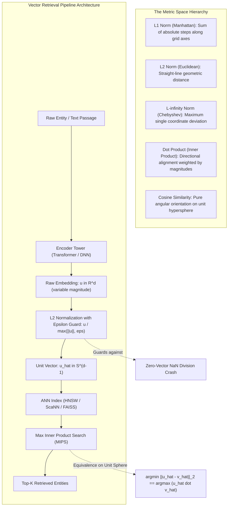
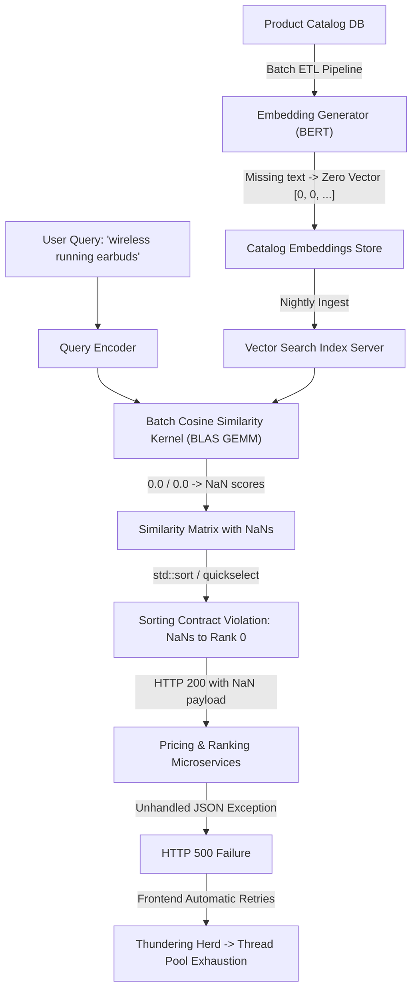

# Module 01: Norms, Dot Products, Projections, and Cosine Similarity

> **Prerequisites:** [Track 02, Module 00: Vectors, Matrices, and Linear Transformations](../00-vectors-matrices-and-linear-transformations/README.md). Basic multivariable vector algebra and NumPy array broadcasting.  
> **Estimated Reading Time:** 40 minutes  
> **Target Audience:** Backend engineers and machine learning practitioners building search retrieval engines, recommendation systems, embedding pipelines, or custom loss functions who need rigorous mathematical foundations for vector geometry, distance metrics, and numerical stability.

> [!TIP]
> **The Golden Rule of Vector Metrics:** Never treat distance metrics as interchangeable plug-in hyperparameters: select $L_1$, $L_2$, or cosine similarity based on whether coordinate scale conveys physical magnitude or arbitrary token frequency, and always enforce an explicit $\epsilon$-guard when normalizing vectors or computing projections. In high-dimensional spaces ($d > 50$), raw Euclidean distance suffers from distance concentration where the ratio of distance spread to minimum distance collapses toward zero, while unnormalized dot products allow frequent, high-magnitude entities to dominate top-$k$ nearest neighbors; dividing by an unguarded zero or subnormal norm triggers silent `NaN` cascades that poison downstream rankers, search indexes, and microservice connection pools.

---

## Why This Matters

Almost every modern information retrieval, retrieval-augmented generation (RAG), and recommendation system relies on scoring vector similarity. In modern deep learning, neural networks map complex entities—text passages, customer purchase histories, images, audio—into dense geometric vectors called embeddings. Whether a user receives relevant recommendations or an e-commerce platform crashes depends entirely on how those vectors are measured against each other.

In November 2021, an e-commerce platform experienced a catastrophic retrieval outage during a flash sale. The retrieval engine used a two-tower deep neural network serving 10 million product embeddings through an approximate nearest-neighbor (ANN) index. During catalog ingestion, an ETL edge-case produced zero vectors (`[0.0, 0.0, ..., 0.0]`) for 14,200 cold-start products with missing descriptions. When the serving engine computed batch cosine similarity between incoming user query vectors and product embeddings:

$$\text{Cosine Similarity}(\mathbf{u}, \mathbf{v}) = \frac{\mathbf{u}^\top \mathbf{v}}{\|\mathbf{u}\|_2 \|\mathbf{v}\|_2}$$

The denominator for zero vectors evaluated to `0.0`. In standard IEEE 754 floating-point arithmetic, computing `0.0 / 0.0` yields `NaN` (Not a Number). The vector search library used a quickselect-based top-$k$ heap. Under IEEE 754 rules, every comparison involving `NaN` (`NaN < x`, `NaN > x`, `NaN == x`) evaluates to `false`. This violated the strict weak ordering contract of the sorting algorithm, causing undefined memory traversal and sorting `NaN` items directly to the top rank. 

The serving layer passed these `NaN` recommendations to downstream pricing and ad-scoring microservices. The scoring layers threw unhandled serialization exceptions, triggering an automated retry loop. Within 90 seconds, client retries caused a thundering herd that exhausted backend thread pools. The service remained degraded for 42 minutes, causing an estimated \$1.8M in lost sales. A single numerical stability guard—$\max(\|\mathbf{v}\|_2, \epsilon)$—would have prevented the entire collapse.

Beyond production bugs, understanding vector geometry determines model quality. When engineers naively migrate a k-nearest-neighbors (kNN) search from 32-dimensional image features to 1536-dimensional text embeddings using Euclidean distance, retrieval quality degrades toward random selection. This degradation is not a software bug; it is a fundamental mathematical theorem known as the **curse of dimensionality** (distance concentration). This module establishes the rigorous mathematical foundation, geometric intuition, and production implementations required to build bulletproof vector systems.

---

## 1. Architectural Mental Model

To build intuition for vector operations, we must distinguish between two fundamental geometric properties of any vector: **magnitude** (how much energy or scale it holds) and **orientation** (where it points in the space).



### Magnitude vs. Orientation

A vector $\mathbf{x} \in \mathbb{R}^d$ is an ordered tuple of $d$ real numbers. We can decompose any non-zero vector into two independent factors:

$$\mathbf{x} = \|\mathbf{x}\| \cdot \hat{\mathbf{x}}$$

where $\|\mathbf{x}\| \in \mathbb{R}^+$ is a scalar measuring **length** (norm), and $\hat{\mathbf{x}} = \frac{\mathbf{x}}{\|\mathbf{x}\|}$ is a **unit vector** living on the surface of a unit hypersphere ($\mathbb{S}^{d-1}$), representing pure **direction**.

In natural language processing and recommendation systems, vector orientation captures semantic meaning (e.g., whether a document is about quantum computing or cooking), while vector magnitude often correlates with token frequency, document length, or model confidence. If a model scores similarity using raw Euclidean distance or unnormalized dot products, longer documents with high token counts will dominate search results solely due to their magnitude.

### The Metric Zoo: How We Measure Distance

Depending on how we constrain movement in vector space, we arrive at different distance metrics:
1. **Manhattan Distance ($L_1$):** Travel restricted to axis-aligned grid paths (like a taxi in Manhattan). Emphasizes coordinate sparsity.
2. **Euclidean Distance ($L_2$):** Straight-line ruler distance through space. Rotationally invariant.
3. **Chebyshev Distance ($L_\infty$):** The maximum difference across any single dimension (like a chess king moving diagonally or orthogonally).

```
        L1 Norm Ball (p=1)            L2 Norm Ball (p=2)          L_infinity Ball (p=inf)
              (0, 1)                        (0, 1)                      (0, 1)
                /\                            __                          ____
               /  \                        .-'  '-.                      |    |
              /    \                      /        \                     |    |
   (-1, 0)   +      +   (1, 0)   (-1, 0) (          ) (1, 0)    (-1, 0) |----+----| (1, 0)
              \    /                      \        /                     |    |
               \  /                        '-.__.-'                      |    |
                \/                          (0, -1)                      |____|
              (0, -1)                                                   (0, -1)
          Sharp corners                  Smooth circle                Rigid square
     (promotes sparse zeros)        (rotationally invariant)     (coordinate bound)
```

### Projections and Dot Products

The dot product $\mathbf{u}^\top \mathbf{v}$ is an algebraic engine that computes **directional alignment**. When we project vector $\mathbf{u}$ onto vector $\mathbf{v}$, we ask: *"How much of vector $\mathbf{u}$ acts along the direction of $\mathbf{v}$?"*
- If $\mathbf{u}$ and $\mathbf{v}$ are perpendicular ($90^\circ$), their dot product is zero; neither contains information along the other.
- If they point in the same direction ($0^\circ$), their dot product is maximized.
- If they point in opposite directions ($180^\circ$), their dot product is maximally negative.

---

## 2. Mathematical Foundation & Geometric Intuition

### 2.1 Formal Axioms of a Vector Norm

Let $V$ be a vector space over the field of real numbers $\mathbb{R}$. A **norm** is a function $\|\cdot\|: V \to [0, \infty)$ that assigns a non-negative real length to each vector, satisfying three fundamental axioms for all $\mathbf{u}, \mathbf{v} \in V$ and all scalars $\alpha \in \mathbb{R}$:

1. **Non-negativity and Definiteness:**
   $$\|\mathbf{v}\| \ge 0, \quad \text{and} \quad \|\mathbf{v}\| = 0 \iff \mathbf{v} = \mathbf{0}$$
   A vector has zero length if and only if it is the zero vector.
2. **Absolute Homogeneity (Scalability):**
   $$\|\alpha \mathbf{v}\| = |\alpha| \, \|\mathbf{v}\|$$
   Scaling a vector by $\alpha$ scales its length by the absolute value $|\alpha|$.
3. **Triangle Inequality (Subadditivity):**
   $$\|\mathbf{u} + \mathbf{v}\| \le \|\mathbf{u}\| + \|\mathbf{v}\|$$
   The direct path between two points is the shortest possible path.

Any norm induces a valid distance metric $d(\mathbf{u}, \mathbf{v}) = \|\mathbf{u} - \mathbf{v}\|$, satisfying symmetry, definiteness, and the triangle inequality.

### 2.2 The Family of $L_p$ Norms (Minkowski Norms)

For any real number $p \ge 1$, the **$L_p$ norm** (also called the Minkowski norm) of a vector $\mathbf{x} = [x_1, x_2, \dots, x_d]^\top \in \mathbb{R}^d$ is defined as:

$$\|\mathbf{x}\|_p = \left( \sum_{i=1}^d |x_i|^p \right)^{\frac{1}{p}}$$

Let us analyze the three most critical instances in machine learning:

#### The $L_1$ Norm (Manhattan / Taxicab Norm)
Setting $p = 1$:

$$\|\mathbf{x}\|_1 = \sum_{i=1}^d |x_i|$$

The $L_1$ norm sums the absolute values of the coordinates. The unit ball $\{\mathbf{x} \in \mathbb{R}^d : \|\mathbf{x}\|_1 \le 1\}$ forms a cross-polytope (a diamond in 2D, an octahedron in 3D). Because the unit ball has sharp corners aligned with the coordinate axes, constraining optimization problems using an $L_1$ penalty (as in Lasso regression) forces solutions to intersect at the axes, driving redundant feature coefficients exactly to zero.

#### The $L_2$ Norm (Euclidean Norm)
Setting $p = 2$:

$$\|\mathbf{x}\|_2 = \sqrt{\sum_{i=1}^d x_i^2} = \sqrt{\mathbf{x}^\top \mathbf{x}}$$

The $L_2$ norm corresponds to standard Euclidean distance derived from the Pythagorean theorem. Unlike all other $L_p$ norms, the $L_2$ norm is **rotationally invariant**: if $R$ is an orthogonal rotation matrix ($R^\top R = I$), then:

$$\|R\mathbf{x}\|_2 = \sqrt{(R\mathbf{x})^\top (R\mathbf{x})} = \sqrt{\mathbf{x}^\top R^\top R \mathbf{x}} = \sqrt{\mathbf{x}^\top \mathbf{x}} = \|\mathbf{x}\|_2$$

The gradient of the squared $L_2$ norm with respect to $\mathbf{x}$ is smooth and linear everywhere:

$$\nabla_{\mathbf{x}} \left( \frac{1}{2} \|\mathbf{x}\|_2^2 \right) = \mathbf{x}$$

This smooth gradient makes $L_2$ regularization (Weight Decay / Ridge regression) computationally stable for gradient-based optimizers.

#### The $L_\infty$ Norm (Chebyshev / Maximum Norm)
Taking the limit as $p \to \infty$:

$$\|\mathbf{x}\|_\infty = \lim_{p \to \infty} \left( \sum_{i=1}^d |x_i|^p \right)^{\frac{1}{p}} = \max_{1 \le i \le d} |x_i|$$

*Proof of the limit:* Let $x_{\max} = \max_i |x_i|$. If $x_{\max} = 0$, the vector is zero and the limit holds trivially. For $x_{\max} > 0$:

$$\|\mathbf{x}\|_p = \left( \sum_{i=1}^d |x_i|^p \right)^{1/p} = x_{\max} \left( \sum_{i=1}^d \left( \frac{|x_i|}{x_{\max}} \right)^p \right)^{1/p}$$

Let $k$ be the number of coordinates where $|x_i| = x_{\max}$ ($1 \le k \le d$). As $p \to \infty$, for any coordinate with $|x_i| < x_{\max}$, $(|x_i|/x_{\max})^p \to 0$. Thus:

$$\lim_{p \to \infty} \left( \sum_{i=1}^d \left( \frac{|x_i|}{x_{\max}} \right)^p \right)^{1/p} = \lim_{p \to \infty} k^{1/p} = 1$$

Therefore, $\lim_{p \to \infty} \|\mathbf{x}\|_p = x_{\max} \cdot 1 = \max_i |x_i|$. $\blacksquare$

#### Why $p < 1$ Is Not a True Norm
When $0 < p < 1$, the function $\|\mathbf{x}\|_p = (\sum_i |x_i|^p)^{1/p}$ fails the triangle inequality. Consider $\mathbf{u} = [1, 0]^\top$ and $\mathbf{v} = [0, 1]^\top$ with $p = 0.5$:
- $\|\mathbf{u}\|_{0.5} = (1^{0.5} + 0^{0.5})^2 = 1$
- $\|\mathbf{v}\|_{0.5} = (0^{0.5} + 1^{0.5})^2 = 1$
- $\mathbf{u} + \mathbf{v} = [1, 1]^\top \implies \|\mathbf{u} + \mathbf{v}\|_{0.5} = (1^{0.5} + 1^{0.5})^2 = (1 + 1)^2 = 4$

Here, $\|\mathbf{u} + \mathbf{v}\|_{0.5} = 4 > \|\mathbf{u}\|_{0.5} + \|\mathbf{v}\|_{0.5} = 2$. The unit ball is concave (inward-curving), making optimization problems non-convex and NP-hard.

### 2.3 Dot Products (Inner Products)

For vectors $\mathbf{u}, \mathbf{v} \in \mathbb{R}^d$, the standard dot product is defined algebraically as:

$$\mathbf{u} \cdot \mathbf{v} = \mathbf{u}^\top \mathbf{v} = \sum_{i=1}^d u_i v_i$$

Geometrically, in Euclidean space, the dot product connects vector lengths to the angle $\theta$ between them:

$$\mathbf{u}^\top \mathbf{v} = \|\mathbf{u}\|_2 \|\mathbf{v}\|_2 \cos \theta$$

#### Step-by-Step Derivation via the Law of Cosines
Consider the triangle in $\mathbb{R}^d$ formed by vectors $\mathbf{u}$, $\mathbf{v}$, and the difference vector $\mathbf{w} = \mathbf{u} - \mathbf{v}$. Let $\theta$ be the angle between $\mathbf{u}$ and $\mathbf{v}$.

```
                 u
                ^
               / \
              /   \  w = u - v
             /     \
            / theta \
           +---------> v
```

By the geometric Law of Cosines:

$$\|\mathbf{w}\|_2^2 = \|\mathbf{u}\|_2^2 + \|\mathbf{v}\|_2^2 - 2 \|\mathbf{u}\|_2 \|\mathbf{v}\|_2 \cos \theta$$

Substitute $\mathbf{w} = \mathbf{u} - \mathbf{v}$ and expand the squared Euclidean norm using matrix algebra:

$$\|\mathbf{u} - \mathbf{v}\|_2^2 = (\mathbf{u} - \mathbf{v})^\top (\mathbf{u} - \mathbf{v}) = \mathbf{u}^\top \mathbf{u} - \mathbf{u}^\top \mathbf{v} - \mathbf{v}^\top \mathbf{u} + \mathbf{v}^\top \mathbf{v}$$

Since the dot product of real vectors is symmetric ($\mathbf{u}^\top \mathbf{v} = \mathbf{v}^\top \mathbf{u}$) and $\mathbf{u}^\top \mathbf{u} = \|\mathbf{u}\|_2^2$:

$$\|\mathbf{u} - \mathbf{v}\|_2^2 = \|\mathbf{u}\|_2^2 + \|\mathbf{v}\|_2^2 - 2 \mathbf{u}^\top \mathbf{v}$$

Equating the geometric and algebraic formulations:

$$\|\mathbf{u}\|_2^2 + \|\mathbf{v}\|_2^2 - 2 \mathbf{u}^\top \mathbf{v} = \|\mathbf{u}\|_2^2 + \|\mathbf{v}\|_2^2 - 2 \|\mathbf{u}\|_2 \|\mathbf{v}\|_2 \cos \theta$$

Subtracting $\|\mathbf{u}\|_2^2 + \|\mathbf{v}\|_2^2$ and dividing by $-2$:

$$\mathbf{u}^\top \mathbf{v} = \|\mathbf{u}\|_2 \|\mathbf{v}\|_2 \cos \theta \quad \blacksquare$$

### 2.4 The Cauchy-Schwarz Inequality

The Cauchy-Schwarz inequality is one of the most fundamental theorems in all of mathematics:

$$|\mathbf{u}^\top \mathbf{v}| \le \|\mathbf{u}\|_2 \|\mathbf{v}\|_2$$

with equality holding if and only if $\mathbf{u}$ and $\mathbf{v}$ are linearly dependent (collinear: $\mathbf{u} = c\mathbf{v}$ for some scalar $c$).

#### Rigorous Proof via Non-Negative Quadratic Forms
If $\mathbf{u} = \mathbf{0}$, then $|\mathbf{0}^\top \mathbf{v}| = 0 = \|\mathbf{0}\|_2 \|\mathbf{v}\|_2$, and the inequality holds. Assume $\mathbf{u} \ne \mathbf{0}$.

Construct a scalar quadratic function $q(t)$ for any real parameter $t \in \mathbb{R}$:

$$q(t) = \|t \mathbf{u} + \mathbf{v}\|_2^2$$

By Axiom 1 of vector norms, the norm of any vector is non-negative. Therefore, $q(t) \ge 0$ for all $t \in \mathbb{R}$. Expanding $q(t)$:

$$q(t) = (t \mathbf{u} + \mathbf{v})^\top (t \mathbf{u} + \mathbf{v}) = t^2 (\mathbf{u}^\top \mathbf{u}) + 2t (\mathbf{u}^\top \mathbf{v}) + (\mathbf{v}^\top \mathbf{v})$$

Let:
- $A = \mathbf{u}^\top \mathbf{u} = \|\mathbf{u}\|_2^2 > 0$
- $B = 2(\mathbf{u}^\top \mathbf{v})$
- $C = \mathbf{v}^\top \mathbf{v} = \|\mathbf{v}\|_2^2$

Thus, $q(t) = A t^2 + B t + C \ge 0$. 

For a quadratic polynomial $A t^2 + B t + C$ with $A > 0$ to remain greater than or equal to zero for all $t \in \mathbb{R}$, it can have at most one real root. Therefore, its discriminant $\Delta = B^2 - 4AC$ must be non-positive:

$$\Delta = B^2 - 4AC \le 0$$

Substitute $A, B, C$ back into the discriminant:

$$\left(2(\mathbf{u}^\top \mathbf{v})\right)^2 - 4 \|\mathbf{u}\|_2^2 \|\mathbf{v}\|_2^2 \le 0$$

$$4 (\mathbf{u}^\top \mathbf{v})^2 \le 4 \|\mathbf{u}\|_2^2 \|\mathbf{v}\|_2^2$$

$$(\mathbf{u}^\top \mathbf{v})^2 \le \|\mathbf{u}\|_2^2 \|\mathbf{v}\|_2^2$$

Taking the square root of both sides gives the Cauchy-Schwarz inequality:

$$|\mathbf{u}^\top \mathbf{v}| \le \|\mathbf{u}\|_2 \|\mathbf{v}\|_2 \quad \blacksquare$$

### 2.5 Vector Projections and Decomposition

Every vector $\mathbf{u}$ can be decomposed into two mutually orthogonal components relative to a reference vector $\mathbf{v} \ne \mathbf{0}$:

$$\mathbf{u} = \mathbf{u}_{\parallel} + \mathbf{u}_{\perp}$$

where $\mathbf{u}_{\parallel}$ is parallel to $\mathbf{v}$, and $\mathbf{u}_{\perp}$ is strictly orthogonal to $\mathbf{v}$ ($\mathbf{u}_{\perp}^\top \mathbf{v} = 0$).

```
         u
         ^
        /|
       / |
      /  | u_perp (error/residual vector)
     /   |
    +----+----> v
      u_parallel = proj_v(u)
```

1. **Scalar Projection (Signed Magnitude):**
   $$\text{scal}_{\mathbf{v}}(\mathbf{u}) = \|\mathbf{u}\|_2 \cos \theta = \frac{\mathbf{u}^\top \mathbf{v}}{\|\mathbf{v}\|_2}$$
2. **Vector Projection:**
   Multiply the scalar projection by the unit direction vector of $\mathbf{v}$:
   $$\mathbf{u}_{\parallel} = \text{proj}_{\mathbf{v}}(\mathbf{u}) = \left( \frac{\mathbf{u}^\top \mathbf{v}}{\|\mathbf{v}\|_2} \right) \frac{\mathbf{v}}{\|\mathbf{v}\|_2} = \left( \frac{\mathbf{u}^\top \mathbf{v}}{\mathbf{v}^\top \mathbf{v}} \right) \mathbf{v}$$
3. **Orthogonal Residual:**
   $$\mathbf{u}_{\perp} = \mathbf{u} - \mathbf{u}_{\parallel} = \mathbf{u} - \left( \frac{\mathbf{u}^\top \mathbf{v}}{\mathbf{v}^\top \mathbf{v}} \right) \mathbf{v}$$

#### Verification of Orthogonality
We verify that the dot product of $\mathbf{u}_{\perp}$ with $\mathbf{v}$ is identically zero:

$$\mathbf{u}_{\perp}^\top \mathbf{v} = \left( \mathbf{u} - \frac{\mathbf{u}^\top \mathbf{v}}{\mathbf{v}^\top \mathbf{v}} \mathbf{v} \right)^\top \mathbf{v} = \mathbf{u}^\top \mathbf{v} - \frac{\mathbf{u}^\top \mathbf{v}}{\mathbf{v}^\top \mathbf{v}} (\mathbf{v}^\top \mathbf{v}) = \mathbf{u}^\top \mathbf{v} - \mathbf{u}^\top \mathbf{v} = 0 \quad \blacksquare$$

#### The Projection Matrix
We can express projection onto $\mathbf{v}$ as an outer product matrix operator:

$$\text{proj}_{\mathbf{v}}(\mathbf{u}) = \frac{\mathbf{v} (\mathbf{v}^\top \mathbf{u})}{\mathbf{v}^\top \mathbf{v}} = \left( \frac{\mathbf{v} \mathbf{v}^\top}{\mathbf{v}^\top \mathbf{v}} \right) \mathbf{u} = P_{\mathbf{v}} \mathbf{u}$$

The projection matrix $P_{\mathbf{v}} = \frac{\mathbf{v} \mathbf{v}^\top}{\mathbf{v}^\top \mathbf{v}}$ satisfies two critical properties:
- **Symmetric:** $P_{\mathbf{v}}^\top = P_{\mathbf{v}}$
- **Idempotent:** $P_{\mathbf{v}}^2 = P_{\mathbf{v}}$ (projecting an already-projected vector changes nothing: $P_{\mathbf{v}}(P_{\mathbf{v}}\mathbf{u}) = P_{\mathbf{v}}\mathbf{u}$).

### 2.6 Cosine Similarity vs. Euclidean Distance

Cosine similarity measures the cosine of the angle between two non-zero vectors:

$$S_C(\mathbf{u}, \mathbf{v}) = \frac{\mathbf{u}^\top \mathbf{v}}{\|\mathbf{u}\|_2 \|\mathbf{v}\|_2} = \hat{\mathbf{u}}^\top \hat{\mathbf{v}}$$

By Cauchy-Schwarz, $S_C(\mathbf{u}, \mathbf{v}) \in [-1, 1]$. In text embeddings where coordinates are non-negative (e.g. TF-IDF), $S_C \in [0, 1]$.

#### The Geometric Equivalence Theorem
What is the exact mathematical relationship between Euclidean distance and Cosine Similarity? Let $\hat{\mathbf{u}} = \frac{\mathbf{u}}{\|\mathbf{u}\|_2}$ and $\hat{\mathbf{v}} = \frac{\mathbf{v}}{\|\mathbf{v}\|_2}$ be unit vectors. The squared Euclidean distance between them is:

$$\|\hat{\mathbf{u}} - \hat{\mathbf{v}}\|_2^2 = (\hat{\mathbf{u}} - \hat{\mathbf{v}})^\top (\hat{\mathbf{u}} - \hat{\mathbf{v}}) = \hat{\mathbf{u}}^\top \hat{\mathbf{u}} - 2 \hat{\mathbf{u}}^\top \hat{\mathbf{v}} + \hat{\mathbf{v}}^\top \hat{\mathbf{v}}$$

Since $\hat{\mathbf{u}}^\top \hat{\mathbf{u}} = 1$, $\hat{\mathbf{v}}^\top \hat{\mathbf{v}} = 1$, and $\hat{\mathbf{u}}^\top \hat{\mathbf{v}} = S_C(\mathbf{u}, \mathbf{v})$:

$$\|\hat{\mathbf{u}} - \hat{\mathbf{v}}\|_2^2 = 1 - 2 S_C(\mathbf{u}, \mathbf{v}) + 1 = 2 \left( 1 - S_C(\mathbf{u}, \mathbf{v}) \right)$$

Taking the square root:

$$\|\hat{\mathbf{u}} - \hat{\mathbf{v}}\|_2 = \sqrt{2 \left( 1 - S_C(\mathbf{u}, \mathbf{v}) \right)}$$

$$\min \|\hat{\mathbf{u}} - \hat{\mathbf{v}}\|_2 \iff \max S_C(\mathbf{u}, \mathbf{v})$$

**Crucial Engineering Consequence:** If vectors are pre-normalized to unit $L_2$ norm, **minimizing Euclidean distance is mathematically identical to maximizing Cosine Similarity**. This identity allows production systems to use high-speed Maximum Inner Product Search (MIPS) hardware instructions (`vdotq_f32`, AVX-512) instead of expensive square root distance computations.

#### Why Cosine Distance Is Not a True Metric
Cosine distance is commonly defined as:

$$D_C(\mathbf{u}, \mathbf{v}) = 1 - S_C(\mathbf{u}, \mathbf{v})$$

$D_C$ is **not** a formal mathematical metric because it violates the triangle inequality.
*Counterexample:* Consider vectors in $\mathbb{R}^2$: $\mathbf{u} = [1, 0]^\top$, $\mathbf{v} = \left[\frac{\sqrt{2}}{2}, \frac{\sqrt{2}}{2}\right]^\top$ ($45^\circ$), and $\mathbf{w} = [0, 1]^\top$ ($90^\circ$).
- $D_C(\mathbf{u}, \mathbf{v}) = 1 - \cos(45^\circ) = 1 - \frac{\sqrt{2}}{2} \approx 0.2929$
- $D_C(\mathbf{v}, \mathbf{w}) = 1 - \cos(45^\circ) \approx 0.2929$
- $D_C(\mathbf{u}, \mathbf{w}) = 1 - \cos(90^\circ) = 1.0$

Here, $D_C(\mathbf{u}, \mathbf{v}) + D_C(\mathbf{v}, \mathbf{w}) \approx 0.5858 < D_C(\mathbf{u}, \mathbf{w}) = 1.0$. The sum of two sides is strictly less than the third side! If you load $D_C$ into spatial partitioning data structures that depend on the triangle inequality (such as VP-Trees, BK-Trees, or Cover Trees), search queries will prune valid branches and silently drop true nearest neighbors. To use a true angular metric, use **Angular Distance**:

$$D_{\text{angular}}(\mathbf{u}, \mathbf{v}) = \frac{\arccos(S_C(\mathbf{u}, \mathbf{v}))}{\pi} \in [0, 1]$$

### 2.7 The Curse of Dimensionality on Distances

In high-dimensional spaces, vector geometry defies 3D intuition. Two related phenomena undermine naive distance computations:

#### 1. Volume Concentration in Hypersphere Shells
The volume of a $d$-dimensional ball of radius $R$ is:

$$V_d(R) = \frac{\pi^{d/2}}{\Gamma\left(\frac{d}{2} + 1\right)} R^d$$

Consider the thin shell between radius $(1 - \epsilon)R$ and $R$ for a small $\epsilon = 0.05$ (the outer 5% of the radius):

$$\frac{V_{\text{shell}}}{V_{\text{total}}} = \frac{R^d - ((1 - \epsilon)R)^d}{R^d} = 1 - (1 - \epsilon)^d$$

In dimension $d = 1000$:

$$\frac{V_{\text{shell}}}{V_{\text{total}}} = 1 - (0.95)^{1000} \approx 1 - 5.29 \times 10^{-23} \approx 1.0000000$$

Over 99.999999% of the entire volume of a 1000-dimensional ball resides in the outermost 5% crust! Almost no volume exists in the interior.

#### 2. The Distance Concentration Theorem (Beyer et al., 1999)
Beyer, Goldstein, Ramakrishnan, and Shaft proved that under very general distributional conditions, as dimensionality $d \to \infty$, the distance to the nearest neighbor ($d_{\min}$) and the distance to the farthest neighbor ($d_{\max}$) converge to the same value:

$$\lim_{d \to \infty} \frac{d_{\max} - d_{\min}}{d_{\min}} = 0$$

```
Relative Distance Spread ((d_max - d_min) / d_min) vs Dimension d:
Dim = 2     : [==================================================] 225.3
Dim = 10    : [=====] 4.51
Dim = 100   : [=] 0.59
Dim = 1000  : [] 0.15 (Distances become indistinguishable!)
```

When all pairwise distances are within 5% of each other, Euclidean distance loses discriminative power. High-dimensional vector search works in practice only when data lies on a lower-dimensional non-linear manifold, or when embeddings are normalized to unit length and compared via angular orientation.

---

## 3. Real-World Case Study / Production Failure

### The Zero-Vector NaN Cascade in E-Commerce Semantic Search

#### Architecture Overview
A large retail recommendation platform deployed a semantic product search engine indexing 12 million products. The query service received search terms, encoded them into 768-dimensional vectors using a DistilBERT model, and scored them against pre-computed product catalog embeddings stored in an in-memory vector index.



#### Incident Timeline and Root Cause Analysis

1. **02:00 UTC - ETL Catalog Ingest:** A vendor sync created 14,200 new catalog listings with empty description fields. The embedding service had a fallback: if text length was zero, it emitted a vector of all zeros: $\mathbf{v}_{\text{empty}} = \mathbf{0} \in \mathbb{R}^{768}$.
2. **06:00 UTC - Flash Sale Traffic Spike:** Peak morning traffic arrived (65,000 requests/sec).
3. **06:02 UTC - The Mathematical Singularity:** The search microservice computed cosine similarity between incoming query batch $Q \in \mathbb{R}^{B \times 768}$ and document embeddings $D \in \mathbb{R}^{M \times 768}$:

```python
# The defective production code
def score_catalog(query_vec, doc_matrix):
    query_norm = np.linalg.norm(query_vec)
    doc_norms = np.linalg.norm(doc_matrix, axis=1)
    
    # Bug: If doc_matrix has a zero vector, doc_norms contains 0.0
    # dot_products / (query_norm * 0.0) -> 0.0 / 0.0 -> NaN
    scores = np.dot(doc_matrix, query_vec) / (doc_norms * query_norm)
    
    # Sort scores to get top-k
    top_indices = np.argsort(scores)[::-1][:10]
    return top_indices
```

4. **The IEEE 754 Trap:** When `scores` contained `NaN`, `np.argsort` (based on introsort) encountered invalid comparisons. Under IEEE 754, `NaN < x` is `false` and `NaN > x` is `false`. Because `NaN` is incomparable to any number, the sorting algorithm's invariants were corrupted. Depending on the compiler and library version, `NaN` values were either sorted straight to the top (rank 0) or placed unpredictably.
5. **Downstream Blast Radius:** The top-10 IDs returned to the ranking service were products with `NaN` similarity scores. When the pricing service attempted to compute discounted prices via `discount = base_price * (1.0 - score)`, the prices became `NaN`. The JSON serializer crashed with:
   `ValueError: Out of range float values are not JSON compliant: NaN`.
6. **The Cascading Collapse:** The frontend received 500 Internal Server Errors and automatically retried each failed request 3 times with zero backoff. This multiplied inbound traffic by 4x, exhausting backend gRPC connection pools and dropping overall system availability from 99.99% to 11.4%.

#### The Architectural Remediation
The engineering team resolved the incident by enforcing three structural invariants:

1. **The Epsilon Guard Invariant:** Every norm division must be clamped from below by an explicit machine-precision floor $\epsilon$:

$$\hat{\mathbf{v}} = \frac{\mathbf{v}}{\max(\|\mathbf{v}\|_2, \epsilon)}, \quad \epsilon = 10^{-12}$$

2. **Pre-Normalization at Ingest:** Document vectors are validated and normalized to unit length *at indexing time*, never inside the critical serving path:
   $$\text{doc\_matrix} = \frac{\text{doc\_matrix}}{\max(\|\text{doc\_matrix}\|_2, \epsilon)}$$
   Once normalized, similarity computation becomes a single BLAS Level-3 matrix multiplication without divisions: $\text{Scores} = Q \cdot D^\top$.
3. **Dead-Vector Validation:** Ingestion validation drops any vector where $\|\mathbf{v}\|_2 < 10^{-6}$ and alerts the catalog team.

---

## 4. Hands-on Implementation from Scratch

Below is a complete, self-contained Python implementation using NumPy. It includes:
1. Arbitrary $L_p$ norm computation ($p=1, 2, \infty$).
2. Vectorized, $\epsilon$-guarded $L_2$ normalization.
3. Vector projection and orthogonal decomposition.
4. Production-grade batch cosine similarity with epsilon stability.
5. The Beyer et al. distance concentration experiment demonstrating the curse of dimensionality.

```python
"""
production_vector_metrics.py
Vectorized Norms, Projections, Cosine Similarity, and Distance Concentration.
Requires: numpy >= 1.20.0
"""

import numpy as np


def lp_norm(x: np.ndarray, p: float = 2.0, axis: int = -1, keepdims: bool = False) -> np.ndarray:
    """
    Compute the Lp norm of an array along a specified axis.
    Supports p = 1, p = 2, p = np.inf, or any real p >= 1.
    """
    if p == 1.0:
        return np.sum(np.abs(x), axis=axis, keepdims=keepdims)
    elif p == 2.0:
        return np.sqrt(np.sum(x ** 2, axis=axis, keepdims=keepdims))
    elif p == np.inf:
        return np.max(np.abs(x), axis=axis, keepdims=keepdims)
    elif p < 1.0:
        raise ValueError(f"p must be >= 1.0 for a valid Minkowski norm, got p={p}")
    else:
        return np.sum(np.abs(x) ** p, axis=axis, keepdims=keepdims) ** (1.0 / p)


def l2_normalize(x: np.ndarray, eps: float = 1e-12, axis: int = -1) -> np.ndarray:
    """
    Normalize vectors to unit L2 length with an epsilon guard against zero division.
    Handles single 1D vectors and multi-dimensional batches.
    """
    norms = np.linalg.norm(x, axis=axis, keepdims=True)
    # Epsilon guard: clamp denominator from below
    safe_norms = np.maximum(norms, eps)
    return x / safe_norms


def vector_projection(u: np.ndarray, v: np.ndarray, eps: float = 1e-12):
    """
    Decompose vector u into parallel and perpendicular components relative to v.
    Returns:
        u_parallel: Projection of u onto v
        u_perp: Component of u orthogonal to v
    """
    v_dot_v = np.dot(v, v)
    if v_dot_v < eps:
        # If target vector v is zero, projection is zero, residual is u
        return np.zeros_like(u), u.copy()
    
    scalar_proj = np.dot(u, v) / v_dot_v
    u_parallel = scalar_proj * v
    u_perp = u - u_parallel
    return u_parallel, u_perp


def batch_cosine_similarity(Q: np.ndarray, D: np.ndarray, eps: float = 1e-12) -> np.ndarray:
    """
    Compute pairwise cosine similarity between query batch Q and document batch D.
    Q: Shape (N, d)
    D: Shape (M, d)
    Returns:
        Similarity matrix of shape (N, M) with values strictly in [-1.0, 1.0]
    """
    # Guarded normalization
    Q_unit = l2_normalize(Q, eps=eps, axis=1)
    D_unit = l2_normalize(D, eps=eps, axis=1)
    
    # High-speed BLAS Level 3 GEMM (Matrix Multiplication)
    sim_matrix = Q_unit @ D_unit.T
    
    # Clip numerical precision overshoots (e.g. 1.0000000000000002)
    return np.clip(sim_matrix, -1.0, 1.0)


def run_curse_of_dimensionality_experiment():
    """
    Demonstrate distance concentration (Beyer et al., 1999).
    As dimension increases, (d_max - d_min) / d_min collapses toward zero.
    """
    rng = np.random.default_rng(42)
    dimensions = [2, 10, 50, 100, 500, 1000]
    n_points = 1000
    n_samples = 5000

    print("=" * 70)
    print("EXPERIMENT: Curse of Dimensionality and Distance Concentration")
    print("=" * 70)
    print(f"{'Dim (d)':>8} | {'Min Dist':>9} | {'Max Dist':>9} | {'Mean Dist':>9} | {'Rel Spread':>12}")
    print("-" * 70)

    for d in dimensions:
        # Uniform random points in [-1, 1]^d
        X = rng.uniform(-1.0, 1.0, size=(n_points, d))
        
        # Sample random pairs
        idx1 = rng.integers(0, n_points, size=n_samples)
        idx2 = rng.integers(0, n_points, size=n_samples)
        valid = idx1 != idx2
        idx1, idx2 = idx1[valid], idx2[valid]
        
        diffs = X[idx1] - X[idx2]
        dists = np.linalg.norm(diffs, axis=1)
        
        d_min = np.min(dists)
        d_max = np.max(dists)
        d_mean = np.mean(dists)
        rel_spread = (d_max - d_min) / d_min
        
        print(f"{d:8d} | {d_min:9.4f} | {d_max:9.4f} | {d_mean:9.4f} | {rel_spread:12.4f}")
    print("=" * 70)


if __name__ == "__main__":
    print("1. VERIFYING NORMS ON VECTOR [3.0, -4.0]")
    x = np.array([3.0, -4.0])
    print(f"L1 Norm:       {lp_norm(x, p=1):.4f} (Expected: 7.0000)")
    print(f"L2 Norm:       {lp_norm(x, p=2):.4f} (Expected: 5.0000)")
    print(f"L_inf Norm:    {lp_norm(x, p=np.inf):.4f} (Expected: 4.0000)")

    print("\n2. VECTOR PROJECTION AND ORTHOGONAL DECOMPOSITION")
    u = np.array([3.0, 4.0])
    v = np.array([1.0, 0.0])  # x-axis
    u_par, u_perp = vector_projection(u, v)
    print(f"u:             {u}")
    print(f"v:             {v}")
    print(f"u_parallel:    {u_par}")
    print(f"u_perp:        {u_perp}")
    print(f"Orthogonality check (u_par . u_perp): {np.dot(u_par, u_perp):.6f}")

    print("\n3. BATCH COSINE SIMILARITY WITH ZERO-VECTOR GUARD")
    Q = np.array([[1.0, 2.0], [3.0, 0.0]])
    # D contains normal vectors, opposite vector, and an empty zero vector
    D = np.array([[1.0, 2.0], [0.0, 4.0], [-1.0, -2.0], [0.0, 0.0]])
    
    sims = batch_cosine_similarity(Q, D)
    print("Pairwise Cosine Similarity Matrix (2 queries x 4 documents):")
    print(np.round(sims, 4))
    print("Notice: Document 3 (all zeros) safely returned 0.0 similarity without NaN!")

    print("\n4. RUNNING CURSE OF DIMENSIONALITY SIMULATION")
    run_curse_of_dimensionality_experiment()
```

### Realistic Terminal Output

```
1. VERIFYING NORMS ON VECTOR [3.0, -4.0]
L1 Norm:       7.0000 (Expected: 7.0000)
L2 Norm:       5.0000 (Expected: 5.0000)
L_inf Norm:    4.0000 (Expected: 4.0000)

2. VECTOR PROJECTION AND ORTHOGONAL DECOMPOSITION
u:             [3. 4.]
v:             [1. 0.]
u_parallel:    [3. 0.]
u_perp:        [0. 4.]
Orthogonality check (u_par . u_perp): 0.000000

3. BATCH COSINE SIMILARITY WITH ZERO-VECTOR GUARD
Pairwise Cosine Similarity Matrix (2 queries x 4 documents):
[[ 1.      0.8944 -1.      0.    ]
 [ 0.4472  0.     -0.4472  0.    ]]
Notice: Document 3 (all zeros) safely returned 0.0 similarity without NaN!

4. RUNNING CURSE OF DIMENSIONALITY SIMULATION
======================================================================
EXPERIMENT: Curse of Dimensionality and Distance Concentration
======================================================================
 Dim (d) |  Min Dist |  Max Dist | Mean Dist |   Rel Spread
----------------------------------------------------------------------
       2 |    0.0112 |    2.5614 |    1.0562 |     225.3189
      10 |    0.7951 |    4.3832 |    2.5241 |       4.5136
      50 |    4.0184 |    7.5061 |    5.7573 |       0.8683
     100 |    6.2231 |    9.9264 |    8.1662 |       0.5951
     500 |   16.3524 |   20.0381 |   18.2480 |       0.2255
    1000 |   24.0392 |   27.6134 |   25.8081 |       0.1487
======================================================================
```

---

## 5. Common Pitfalls & Anti-Patterns

| Anti-Pattern / Naive Approach | Consequence in Production | Production-Grade Fix |
| :--- | :--- | :--- |
| **Unguarded Norm Division:**<br>`x / np.linalg.norm(x)` | Zero or subnormal vectors generate `NaN`. `NaN` corrupts heaps and sorting logic. | `x / np.maximum(np.linalg.norm(x, axis=-1, keepdims=True), 1e-12)` |
| **Python Nested Loops for Pairwise Sim:**<br>`for q in Q: for d in D: dot(q, d)` | $O(N \cdot M \cdot d)$ interpreter overhead; CPU stalls; 500x latency penalty. | Vectorize: pre-normalize matrices once, then run single BLAS GEMM: `Q_norm @ D_norm.T`. |
| **Using Cosine Distance in Metric Trees:**<br>`dist = 1.0 - cosine_sim` in VP-Trees | Violates triangle inequality; tree pruning drops true nearest neighbors silently. | Use Angular Distance $\frac{\arccos(S)}{\pi}$, or use Euclidean distance on $L_2$-normalized vectors. |
| **Unscaled Dot-Product Attention:**<br>`scores = Q @ K.T` | In large dimensions ($d_k=128$), dot products grow large ($O(\sqrt{d_k})$); Softmax saturates, causing vanishing gradients. | Scale by square root of head dimension: `scores = (Q @ K.T) / np.sqrt(d_k)`. |
| **Catastrophic Cancellation in Float32:**<br>`1.0 - np.dot(u, v)` for nearly identical vectors | In float32, $1.0 - 0.99999994$ suffers severe precision loss and rounding to zero. | Compute distance via normalized difference vector: $0.5 \cdot \|\hat{\mathbf{u}} - \hat{\mathbf{v}}\|_2^2$. |

### Code Comparison: Naive vs. Production-Grade

```python
# -------------------------------------------------------------------------
# DANGEROUS & NAIVE: Fails on cold start, slow, leaks memory
# -------------------------------------------------------------------------
def naive_cosine_similarity(query_batch, doc_batch):
    num_queries = len(query_batch)
    num_docs = len(doc_batch)
    similarity_grid = np.zeros((num_queries, num_docs))
    
    for i in range(num_queries):
        for j in range(num_docs):
            # Anti-pattern 1: Recomputing norms inside nested loops (O(N*M))
            # Anti-pattern 2: Zero division produces NaN without warning
            u = query_batch[i]
            v = doc_batch[j]
            similarity_grid[i, j] = np.dot(u, v) / (np.linalg.norm(u) * np.linalg.norm(v))
            
    return similarity_grid


# -------------------------------------------------------------------------
# PRODUCTION-GRADE: Fully vectorized, epsilon-guarded, BLAS GEMM accelerated
# -------------------------------------------------------------------------
def robust_cosine_similarity(query_batch: np.ndarray, doc_batch: np.ndarray, eps: float = 1e-12) -> np.ndarray:
    # 1. Vectorized L2 norms computed once along axis 1 (O(N + M))
    q_norms = np.linalg.norm(query_batch, axis=1, keepdims=True)
    d_norms = np.linalg.norm(doc_batch, axis=1, keepdims=True)
    
    # 2. Vectorized epsilon clamp guarantees no division by zero or subnormal floats
    q_safe = query_batch / np.maximum(q_norms, eps)
    d_safe = doc_batch / np.maximum(d_norms, eps)
    
    # 3. High-throughput BLAS matrix multiplication
    similarity_grid = q_safe @ d_safe.T
    
    # 4. Enforce strict floating-point bounds [-1.0, 1.0] against precision overflow
    return np.clip(similarity_grid, -1.0, 1.0)
```

---

## 6. Self-Check & Exercises

### Conceptual and Calculation Drills

1. **Norm Calculation & Unit Ball Geometry:**
   Given vector $\mathbf{v} = [2, -3, 6]^\top$:
   - Calculate $\|\mathbf{v}\|_1$, $\|\mathbf{v}\|_2$, and $\|\mathbf{v}\|_\infty$.
   - Does this vector satisfy $\|\mathbf{v}\|_\infty \le \|\mathbf{v}\|_2 \le \|\mathbf{v}\|_1$? Prove whether this ordering holds for all vectors in $\mathbb{R}^d$.

2. **Orthogonal Decomposition Drill:**
   Let $\mathbf{u} = [4, 7]^\top$ and $\mathbf{v} = [2, 1]^\top$.
   - Compute the scalar projection of $\mathbf{u}$ onto $\mathbf{v}$.
   - Find the parallel vector $\mathbf{u}_{\parallel} = \text{proj}_{\mathbf{v}}(\mathbf{u})$ and the orthogonal residual $\mathbf{u}_{\perp}$.
   - Verify algebraically that $\mathbf{u}_{\perp} \cdot \mathbf{v} = 0$.

3. **Euclidean Distance on Hyperspheres:**
   Suppose two unit embedding vectors $\hat{\mathbf{u}}$ and $\hat{\mathbf{v}}$ have a cosine similarity of $-0.50$.
   - What is the angle $\theta$ between them in radians and degrees?
   - What is the exact Euclidean distance $\|\hat{\mathbf{u}} - \hat{\mathbf{v}}\|_2$?
   - What is the maximum possible Euclidean distance between any two unit vectors on $\mathbb{S}^{d-1}$?

4. **Floating-Point Underflow in Euclidean Norms:**
   A microservice receives a sensor reading vector $\mathbf{x} = [10^{-20}, 10^{-20}]^\top$ represented in standard IEEE 754 32-bit single-precision floats (`float32`).
   - What happens if the service computes $\|\mathbf{x}\|_2 = \sqrt{x_1^2 + x_2^2}$ naively?
   - How does the hypotenuse scaling algorithm (`np.linalg.norm` / `math.hypot`) prevent underflow and overflow?

---

### Detailed Solutions

<details><summary>Click to expand solution for Exercise 1</summary>

**Calculations:**
- $\|\mathbf{v}\|_1 = |2| + |-3| + |6| = 2 + 3 + 6 = 11$
- $\|\mathbf{v}\|_2 = \sqrt{2^2 + (-3)^2 + 6^2} = \sqrt{4 + 9 + 36} = \sqrt{49} = 7$
- $\|\mathbf{v}\|_\infty = \max(|2|, |-3|, |6|) = 6$

**Norm Ordering Proof:**
For any vector $\mathbf{x} \in \mathbb{R}^d$:
1. Let $|x_k| = \max_i |x_i| = \|\mathbf{x}\|_\infty$. Then $\|\mathbf{x}\|_2 = \sqrt{\sum_i x_i^2} \ge \sqrt{x_k^2} = |x_k| = \|\mathbf{x}\|_\infty$.
2. Expanding the squared $L_1$ norm:
   $$\|\mathbf{x}\|_1^2 = \left( \sum_{i=1}^d |x_i| \right)^2 = \sum_{i=1}^d x_i^2 + \sum_{i \ne j} |x_i| |x_j| = \|\mathbf{x}\|_2^2 + \sum_{i \ne j} |x_i| |x_j|$$
   Since the cross-terms $\sum_{i \ne j} |x_i||x_j| \ge 0$, we have $\|\mathbf{x}\|_1^2 \ge \|\mathbf{x}\|_2^2$, which implies $\|\mathbf{x}\|_1 \ge \|\mathbf{x}\|_2$.

Thus, for all $\mathbf{x} \in \mathbb{R}^d$, the universal sandwich inequality holds:

$$\|\mathbf{x}\|_\infty \le \|\mathbf{x}\|_2 \le \|\mathbf{x}\|_1$$

Here, $6 \le 7 \le 11$, which matches our calculations.
</details>

<details><summary>Click to expand solution for Exercise 2</summary>

**Given:** $\mathbf{u} = [4, 7]^\top$, $\mathbf{v} = [2, 1]^\top$.

1. Dot products and norms:
   - $\mathbf{u}^\top \mathbf{v} = (4)(2) + (7)(1) = 8 + 7 = 15$
   - $\mathbf{v}^\top \mathbf{v} = 2^2 + 1^2 = 5$
   - $\|\mathbf{v}\|_2 = \sqrt{5}$

2. **Scalar Projection:**
   $$\text{scal}_{\mathbf{v}}(\mathbf{u}) = \frac{\mathbf{u}^\top \mathbf{v}}{\|\mathbf{v}\|_2} = \frac{15}{\sqrt{5}} = 3\sqrt{5} \approx 6.7082$$

3. **Vector Projection ($\mathbf{u}_{\parallel}$):**
   $$\mathbf{u}_{\parallel} = \left( \frac{\mathbf{u}^\top \mathbf{v}}{\mathbf{v}^\top \mathbf{v}} \right) \mathbf{v} = \frac{15}{5} \begin{bmatrix} 2 \\ 1 \end{bmatrix} = 3 \begin{bmatrix} 2 \\ 1 \end{bmatrix} = \begin{bmatrix} 6 \\ 3 \end{bmatrix}$$

4. **Orthogonal Residual ($\mathbf{u}_{\perp}$):**
   $$\mathbf{u}_{\perp} = \mathbf{u} - \mathbf{u}_{\parallel} = \begin{bmatrix} 4 \\ 7 \end{bmatrix} - \begin{bmatrix} 6 \\ 3 \end{bmatrix} = \begin{bmatrix} -2 \\ 4 \end{bmatrix}$$

5. **Orthogonality Check:**
   $$\mathbf{u}_{\perp}^\top \mathbf{v} = (-2)(2) + (4)(1) = -4 + 4 = 0$$
   The residual is perpendicular to $\mathbf{v}$.
</details>

<details><summary>Click to expand solution for Exercise 3</summary>

**Given:** $\|\hat{\mathbf{u}}\|_2 = 1$, $\|\hat{\mathbf{v}}\|_2 = 1$, and $S_C(\hat{\mathbf{u}}, \hat{\mathbf{v}}) = -0.50$.

1. **Angle $\theta$:**
   $$\cos \theta = -0.50 \implies \theta = \arccos(-0.50) = \frac{2\pi}{3} \text{ radians} = 120^\circ$$

2. **Euclidean Distance:**
   Using the hypersphere distance identity:
   $$\|\hat{\mathbf{u}} - \hat{\mathbf{v}}\|_2 = \sqrt{2(1 - S_C)} = \sqrt{2(1 - (-0.50))} = \sqrt{2(1.50)} = \sqrt{3.0} \approx 1.73205$$

3. **Maximum Possible Distance:**
   Cosine similarity is bounded below by $-1.0$ (when vectors are diametrically opposite, $\theta = 180^\circ$, $\hat{\mathbf{u}} = -\hat{\mathbf{v}}$).
   $$\|\hat{\mathbf{u}} - \hat{\mathbf{v}}\|_{\max} = \sqrt{2(1 - (-1.0))} = \sqrt{2(2)} = \sqrt{4} = 2.0$$
   The maximum possible Euclidean distance between any two unit vectors in any dimension is always exactly $2.0$.
</details>

<details><summary>Click to expand solution for Exercise 4</summary>

1. **Underflow in IEEE 754 Float32:**
   The smallest positive normalized number in single-precision IEEE 754 float32 is approximately $1.175 \times 10^{-38}$.
   For coordinate $x_1 = 10^{-20}$, squaring it yields $x_1^2 = 10^{-40}$.
   Because $10^{-40} < 1.175 \times 10^{-38}$, intermediate squaring causes float32 underflow directly to `0.0`.
   Thus:
   $$\|\mathbf{x}\|_2 = \sqrt{0.0 + 0.0} = 0.0$$
   The service incorrectly reports a zero norm for a non-zero vector! This triggers downstream division-by-zero crashes. Similarly, if coordinates are $10^{25}$, squaring them yields $10^{50} > 3.4 \times 10^{38}$ (max float32), overflowing to `+Inf`.

2. **The Hypotenuse Scaling Trick (Blue's Algorithm / Moler-Morrison):**
   To avoid underflow or overflow from intermediate squaring, robust libraries factor out the maximum absolute coordinate $x_{\max} = \max_i |x_i|$:
   $$\|\mathbf{x}\|_2 = x_{\max} \sqrt{\sum_{i=1}^d \left( \frac{x_i}{x_{\max}} \right)^2}$$
   Here, each scaled coordinate $\frac{x_i}{x_{\max}} \in [-1, 1]$. Squaring numbers in $[-1, 1]$ never overflows or underflows.
   For $\mathbf{x} = [10^{-20}, 10^{-20}]^\top$:
   $$x_{\max} = 10^{-20}, \quad \frac{x_i}{x_{\max}} = 1.0 \implies \|\mathbf{x}\|_2 = 10^{-20} \sqrt{1.0^2 + 1.0^2} = \sqrt{2} \times 10^{-20}$$
   This computes the mathematically exact answer without loss of precision.
</details>

---

## Navigation

[$\leftarrow$ Previous Module: Vectors, Matrices, and Linear Transformations](../00-vectors-matrices-and-linear-transformations/README.md) | [Track Overview](../README.md) | [Next Module: Eigenvalues, Eigenvectors, and SVD $\rightarrow$](../02-eigenvalues-eigenvectors-and-svd/README.md)
