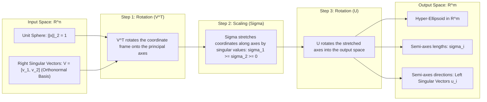
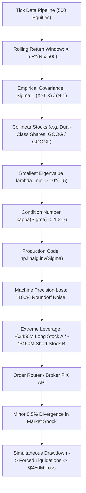

# Module 02: Eigenvalues, Eigenvectors, and Singular Value Decomposition (SVD)

> **Prerequisites:** [Track 02, Module 01: Norms, Dot Products, Projections, and Cosine Similarity](../01-norms-dot-products-and-cosine-similarity/README.md). Matrix multiplications, norms, and basic vector projections.  
> **Estimated Reading Time:** 45 minutes  
> **Target Audience:** Machine learning engineers, quantitative software engineers, and backend system developers designing dimensionality reduction pipelines, recommender systems (collaborative filtering), Low-Rank Adaptation (LoRA), or high-throughput linear solvers.

> [!TIP]
> **The Golden Rule of SVD:** Every real matrix $A \in \mathbb{R}^{m \times n}$ acts geometrically as a rotation, followed by an axis-aligned scaling along its singular values $\sigma_i$, followed by a second rotation ($A = U \Sigma V^\top$); the Eckart-Young-Mirsky theorem proves that truncating this scaling to the top $k$ singular values yields the provably optimal rank-$k$ approximation under both Frobenius and spectral norms. Never compute principal components or solve linear systems by explicitly inverting empirical covariance matrices $X^\top X$, as squaring data matrices squares condition numbers ($\kappa(X^\top X) = \kappa(X)^2$) and amplifies floating-point roundoff into catastrophic numerical singularity.

---

## Why This Matters

Almost every major problem in scalable machine learning—from reducing the memory footprint of 70-billion-parameter Large Language Models (LLMs) via Low-Rank Adaptation (LoRA), to compressing billion-row user-item recommendation matrices, to eliminating multicollinearity in linear models—relies on decomposing matrices along their most informative geometric directions. That decomposition is Singular Value Decomposition (SVD) and its symmetric counterpart, Eigendecomposition.

When engineers fail to understand the spectral properties of matrices, production systems collapse. In August 2007 (an event known in quantitative finance as the "Quant Meltdown"), quantitative hedge funds operating statistical arbitrage models suffered catastrophic drawdown cascades. The funds ran Markowitz mean-variance portfolio optimizers that solve for optimal asset allocations $\mathbf{w}^*$ by inverting the historical asset covariance matrix:

$$\mathbf{w}^* = \frac{\Sigma^{-1} \mathbf{\mu}}{\mathbf{1}^\top \Sigma^{-1} \mathbf{\mu}}$$

Because hundreds of equities shared overlapping sector drivers and market dynamics, several columns in the asset returns matrix were nearly collinear. The smallest eigenvalue $\lambda_{\min}$ of the empirical covariance matrix collapsed to $10^{-15}$. Consequently, the matrix condition number:

$$\kappa(\Sigma) = \frac{\lambda_{\max}}{\lambda_{\min}} \approx 10^{16}$$

In IEEE 754 64-bit double-precision floating-point arithmetic (`float64`), numerical precision is capped at roughly 15 to 17 decimal digits ($\epsilon_{\text{mach}} \approx 2.22 \times 10^{-16}$). Because the numerical error in matrix inversion scales with $\kappa(\Sigma) \cdot \epsilon_{\text{mach}}$, inverting $\Sigma$ wiped out every single significant digit of accuracy. The automated execution algorithms generated massive, opposing, leveraged allocations: allocating +\$450M long to Equities Group A and -\$450M short to Equities Group B. When an unexpected liquidity crunch caused a minor 0.5% divergence between the groups, both legs incurred losses simultaneously. The resulting margin calls forced emergency liquidations, wiping out over \$5B in quantitative equity assets across the industry in 72 hours.

In modern AI engineering, the exact same mathematical decomposition saves millions of dollars in compute. When training LLMs, full parameter fine-tuning requires hundreds of gigabytes of GPU VRAM to store optimizer states for weight matrices $W \in \mathbb{R}^{d \times d}$. By applying the Eckart-Young-Mirsky theorem, Low-Rank Adaptation (LoRA) decomposes weight updates into two low-rank matrices: $\Delta W = B \cdot A$ where $B \in \mathbb{R}^{d \times r}, A \in \mathbb{R}^{r \times d}$ with rank $r \ll d$ (e.g., $r=8$ or $16$). This reduces trainable parameters and VRAM overhead by over 80% with virtually zero loss in model accuracy. 

Whether diagnosing ill-conditioned matrix models or building state-of-the-art compression pipelines, SVD is the foundational mathematical instrument of data engineering.

---

## 1. Architectural Mental Model

To understand SVD, we must look at how a matrix acts as a geometric transformation of space.



### The Universal Geometric Fact of Linear Maps

Take any real matrix $A \in \mathbb{R}^{m \times n}$. Consider the unit sphere in $\mathbb{R}^n$:

$$\mathcal{S} = \{ \mathbf{x} \in \mathbb{R}^n : \|\mathbf{x}\|_2 = 1 \}$$

When matrix $A$ multiplies every vector on this sphere, the resulting set of vectors $A(\mathcal{S}) = \{ A\mathbf{x} : \|\mathbf{x}\|_2 = 1 \}$ forms a **hyper-ellipsoid** in $\mathbb{R}^m$.
- The **singular values** $\sigma_1 \ge \sigma_2 \ge \dots \ge \sigma_r > 0$ are the lengths of the principal semi-axes of this ellipsoid.
- The **left singular vectors** $\mathbf{u}_1, \mathbf{u}_2, \dots, \mathbf{u}_r \in \mathbb{R}^m$ are unit vectors pointing along the directions of those principal semi-axes.
- The **right singular vectors** $\mathbf{v}_1, \mathbf{v}_2, \dots, \mathbf{v}_r \in \mathbb{R}^n$ are the orthonormal vectors on the original unit sphere that map directly onto the semi-axes: $A \mathbf{v}_i = \sigma_i \mathbf{u}_i$.

### Eigenvectors vs. Singular Vectors: The Critical Distinction

Engineers frequently confuse eigenvalues with singular values. The table below delineates their structural differences:

| Property | Eigenvalues & Eigenvectors ($A\mathbf{v} = \lambda\mathbf{v}$) | Singular Value Decomposition ($A = U \Sigma V^\top$) |
| :--- | :--- | :--- |
| **Applicability** | Square matrices only ($n \times n$) | Any rectangular matrix ($m \times n$) |
| **Geometry** | Vectors whose *direction is invariant* under $A$ | Orthonormal basis in domain mapped to orthonormal basis in codomain |
| **Values** | Can be negative, zero, or complex ($\lambda \in \mathbb{C}$) | Always non-negative real numbers ($\sigma_i \in \mathbb{R}^+, \sigma_i \ge 0$) |
| **Orthogonality** | Orthogonal *only* if $A$ is normal ($A^\top A = A A^\top$) | $U$ and $V$ are *always* strictly orthonormal matrices |
| **Existence** | Defective matrices may lack a full set of eigenvectors | SVD exists for **every** matrix without exception |

### Low-Rank Approximations: Sum of Outer Products

Any matrix $A$ of rank $r$ can be written as a sum of $r$ rank-1 matrices:

$$A = \sum_{i=1}^r \sigma_i \mathbf{u}_i \mathbf{v}_i^\top$$

Each rank-1 component $\sigma_i \mathbf{u}_i \mathbf{v}_i^\top$ represents an independent "layer" of structural energy in the data. The singular values $\sigma_1 \ge \sigma_2 \ge \dots \ge \sigma_r$ act as priority weights. If the singular values decay rapidly (as they do in natural images, customer transaction tables, and text embeddings), setting all $\sigma_i = 0$ for $i > k$ produces the mathematically optimal low-rank compression $A_k$.

---

## 2. Mathematical Foundation & Geometric Intuition

### 2.1 The Characteristic Equation & Eigendecomposition

Let $A \in \mathbb{R}^{n \times n}$ be a square linear operator. A non-zero vector $\mathbf{v} \in \mathbb{R}^n$ is an **eigenvector** of $A$ with corresponding **eigenvalue** $\lambda \in \mathbb{C}$ if:

$$A\mathbf{v} = \lambda \mathbf{v}$$

Rearranging into a homogeneous linear system:

$$(A - \lambda I)\mathbf{v} = \mathbf{0}$$

For a non-zero solution $\mathbf{v} \ne \mathbf{0}$ to exist, the operator $(A - \lambda I)$ must have a non-trivial null space, which means it must be singular. Hence, its determinant must equal zero:

$$p(\lambda) = \det(A - \lambda I) = 0$$

This is the **characteristic equation**. The polynomial $p(\lambda)$ has degree $n$, yielding exactly $n$ roots over the complex field (by the Fundamental Theorem of Algebra).

#### Algebraic vs. Geometric Multiplicity
- **Algebraic Multiplicity ($m_a(\lambda)$):** The number of times $\lambda$ appears as a root of $p(\lambda)$.
- **Geometric Multiplicity ($m_g(\lambda)$):** The dimension of the eigenspace $\text{null}(A - \lambda I)$, i.e., the number of linearly independent eigenvectors associated with $\lambda$.
- A matrix is **defective** if $m_g(\lambda) < m_a(\lambda)$ for any eigenvalue. Defective matrices cannot be diagonalized.

If $A$ has $n$ linearly independent eigenvectors, we collect them as columns in a matrix $V = [\mathbf{v}_1, \dots, \mathbf{v}_n]$ and form the diagonal eigenvalue matrix $\Lambda = \text{diag}(\lambda_1, \dots, \lambda_n)$:

$$A V = V \Lambda \implies A = V \Lambda V^{-1}$$

### 2.2 The Spectral Theorem for Real Symmetric Matrices

Real symmetric matrices ($A = A^\top$) appear ubiquitously in ML as covariance matrices, graph Laplacians, and Hessian matrices of second derivatives.

#### Theorem (The Spectral Theorem)
If $A \in \mathbb{R}^{n \times n}$ is real and symmetric ($A = A^\top$), then:
1. All $n$ eigenvalues of $A$ are strictly real ($\lambda_i \in \mathbb{R}$).
2. Eigenvectors corresponding to distinct eigenvalues are mutually orthogonal.
3. There exists an orthonormal basis of eigenvectors $Q = [\mathbf{q}_1, \dots, \mathbf{q}_n]$ such that $Q^\top Q = Q Q^\top = I$, yielding:
   $$A = Q \Lambda Q^\top = \sum_{i=1}^n \lambda_i \mathbf{q}_i \mathbf{q}_i^\top$$

#### Proof of Real Eigenvalues
Let $\lambda \in \mathbb{C}$ be an eigenvalue of real symmetric matrix $A$, and let $\mathbf{v} \in \mathbb{C}^n$ be its non-zero eigenvector: $A\mathbf{v} = \lambda \mathbf{v}$.
Take the conjugate transpose (Hermitian adjoint) $\mathbf{v}^* = (\overline{\mathbf{v}})^\top$:

$$\mathbf{v}^* A \mathbf{v} = \mathbf{v}^* (\lambda \mathbf{v}) = \lambda (\mathbf{v}^* \mathbf{v}) = \lambda \|\mathbf{v}\|_2^2$$

Now take the conjugate transpose of the scalar quantity $\mathbf{v}^* A \mathbf{v}$:

$$(\mathbf{v}^* A \mathbf{v})^* = \mathbf{v}^* A^* (\mathbf{v}^*)^* = \mathbf{v}^* A^\top \mathbf{v} = \mathbf{v}^* A \mathbf{v}$$

Because $\mathbf{v}^* A \mathbf{v}$ equals its own complex conjugate, it is a real number. Furthermore, $\|\mathbf{v}\|_2^2 = \sum_j |v_j|^2$ is a strictly positive real number since $\mathbf{v} \ne \mathbf{0}$. Therefore:

$$\lambda = \frac{\mathbf{v}^* A \mathbf{v}}{\|\mathbf{v}\|_2^2} \in \mathbb{R} \quad \blacksquare$$

#### Proof of Orthogonality of Eigenvectors
Let $A\mathbf{v}_1 = \lambda_1 \mathbf{v}_1$ and $A\mathbf{v}_2 = \lambda_2 \mathbf{v}_2$ with $\lambda_1 \ne \lambda_2$. Consider the scalar $\mathbf{v}_1^\top A \mathbf{v}_2$:

$$\mathbf{v}_1^\top (A \mathbf{v}_2) = \mathbf{v}_1^\top (\lambda_2 \mathbf{v}_2) = \lambda_2 (\mathbf{v}_1^\top \mathbf{v}_2)$$

Using symmetry $A = A^\top$:

$$(A \mathbf{v}_1)^\top \mathbf{v}_2 = (\lambda_1 \mathbf{v}_1)^\top \mathbf{v}_2 = \lambda_1 (\mathbf{v}_1^\top \mathbf{v}_2)$$

Equating the two expressions:

$$\lambda_1 (\mathbf{v}_1^\top \mathbf{v}_2) = \lambda_2 (\mathbf{v}_1^\top \mathbf{v}_2) \implies (\lambda_1 - \lambda_2)(\mathbf{v}_1^\top \mathbf{v}_2) = 0$$

Since $\lambda_1 \ne \lambda_2$, we must have $\mathbf{v}_1^\top \mathbf{v}_2 = 0$. The eigenvectors are orthogonal. $\blacksquare$

### 2.3 Positive Semi-Definite (PSD) Matrices

A symmetric matrix $A \in \mathbb{R}^{n \times n}$ is **Positive Semi-Definite (PSD)**, denoted $A \succeq 0$, if:

$$\mathbf{x}^\top A \mathbf{x} \ge 0 \quad \forall \, \mathbf{x} \in \mathbb{R}^n$$

It is **Positive Definite (PD)**, denoted $A \succ 0$, if $\mathbf{x}^\top A \mathbf{x} > 0$ for all $\mathbf{x} \ne \mathbf{0}$.

#### Theorem: Spectral Characterization of PSD Matrices
A symmetric matrix $A$ is PSD if and only if all its eigenvalues are non-negative: $\lambda_i \ge 0$ for all $i$.

*Proof:* By the Spectral Theorem, write $\mathbf{x} = \sum_i c_i \mathbf{q}_i$ in the orthonormal eigenbasis. Then:

$$\mathbf{x}^\top A \mathbf{x} = \left(\sum_i c_i \mathbf{q}_i\right)^\top A \left(\sum_j c_j \mathbf{q}_j\right) = \left(\sum_i c_i \mathbf{q}_i\right)^\top \left(\sum_j c_j \lambda_j \mathbf{q}_j\right) = \sum_{i=1}^n \lambda_i c_i^2$$

If all $\lambda_i \ge 0$, then $\sum_i \lambda_i c_i^2 \ge 0$ for all choices of $c_i$, so $A \succeq 0$. Conversely, if $A \succeq 0$, setting $\mathbf{x} = \mathbf{q}_i$ gives $\mathbf{q}_i^\top A \mathbf{q}_i = \lambda_i \ge 0$. $\blacksquare$

#### Why Covariance Matrices Are Always PSD
Let $X \in \mathbb{R}^{N \times d}$ be a data matrix with $N$ samples and $d$ features, with features centered to zero mean. The sample covariance matrix is:

$$S = \frac{1}{N-1} X^\top X$$

For any non-zero vector $\mathbf{w} \in \mathbb{R}^d$:

$$\mathbf{w}^\top S \mathbf{w} = \frac{1}{N-1} \mathbf{w}^\top X^\top X \mathbf{w} = \frac{1}{N-1} (X\mathbf{w})^\top (X\mathbf{w}) = \frac{1}{N-1} \|X\mathbf{w}\|_2^2$$

Because the squared Euclidean norm $\|X\mathbf{w}\|_2^2$ is always $\ge 0$, we have $\mathbf{w}^\top S \mathbf{w} \ge 0$ for all $\mathbf{w}$. Hence, empirical covariance matrices are guaranteed to be PSD. If $N > d$ and the features are linearly independent, $S$ is strictly positive definite ($S \succ 0$).

### 2.4 The Singular Value Decomposition (SVD)

For *any* real matrix $A \in \mathbb{R}^{m \times n}$ of rank $r \le \min(m, n)$, there exist:
- An orthogonal matrix $U \in \mathbb{R}^{m \times m}$ ($U^\top U = I_m$), whose columns are the **left singular vectors** $\mathbf{u}_i$.
- An orthogonal matrix $V \in \mathbb{R}^{n \times n}$ ($V^\top V = I_n$), whose columns are the **right singular vectors** $\mathbf{v}_i$.
- A diagonal rectangular matrix $\Sigma \in \mathbb{R}^{m \times n}$ containing singular values $\sigma_1 \ge \sigma_2 \ge \dots \ge \sigma_r > 0$ and zeros elsewhere:

$$A = U \Sigma V^\top$$

```
    A (m x n)     =       U (m x m)      *    Sigma (m x n)   *     V^T (n x n)
  [ . . . . . ]         [ u1 | u2 | ... ]   [ s1  0   0  0 ]   [ --- v1^T --- ]
  [ . . . . . ]     =   [    |    |     ] * [  0 s2   0  0 ] * [ --- v2^T --- ]
  [ . . . . . ]         [    |    |     ]   [  0  0  ... 0 ]   [     ...      ]
  [ . . . . . ]                             [  0  0   0  0 ]   [ --- vn^T --- ]
```

#### Derivation via the Gram Matrices $A^\top A$ and $A A^\top$
Consider the symmetric Gram matrix $A^\top A \in \mathbb{R}^{n \times n}$:

$$A^\top A = (U \Sigma V^\top)^\top (U \Sigma V^\top) = V \Sigma^\top U^\top U \Sigma V^\top = V (\Sigma^\top \Sigma) V^\top$$

Because $U$ is orthogonal, $U^\top U = I_m$. Notice that $V (\Sigma^\top \Sigma) V^\top$ is an orthogonal diagonalization!
- The right singular vectors $\mathbf{v}_i$ of $A$ are the **orthonormal eigenvectors of $A^\top A$**.
- The singular values $\sigma_i$ are the **square roots of the eigenvalues of $A^\top A$**:
  $$\sigma_i = \sqrt{\lambda_i(A^\top A)}$$

Now consider $A A^\top \in \mathbb{R}^{m \times m}$:

$$A A^\top = (U \Sigma V^\top) (U \Sigma V^\top)^\top = U \Sigma V^\top V \Sigma^\top U^\top = U (\Sigma \Sigma^\top) U^\top$$

- The left singular vectors $\mathbf{u}_i$ of $A$ are the **orthonormal eigenvectors of $A A^\top$**.
- The connection between the two bases is direct:
  $$A \mathbf{v}_i = \sigma_i \mathbf{u}_i \implies \mathbf{u}_i = \frac{1}{\sigma_i} A \mathbf{v}_i$$

#### Full SVD vs. Compact (Thin) SVD
When $m \gg n$ (e.g., $10^6$ samples and $50$ features), the full $U$ matrix is $10^6 \times 10^6$ ($\approx 4$ terabytes). In practice, we use the **Compact SVD** (or Thin SVD), which retains only the first $n$ columns of $U$ and the top $n \times n$ block of $\Sigma$:

$$A = U_n \Sigma_n V^\top, \quad U_n \in \mathbb{R}^{m \times n}, \quad \Sigma_n \in \mathbb{R}^{n \times n}, \quad V \in \mathbb{R}^{n \times n}$$

In NumPy, this is invoked with `np.linalg.svd(A, full_matrices=False)`.

### 2.5 The Eckart-Young-Mirsky Theorem (Optimal Low-Rank Approximation)

How closely can a matrix of rank $k < r$ approximate a full matrix $A$?

#### Theorem (Eckart-Young-Mirsky, 1936)
Let $A = \sum_{i=1}^r \sigma_i \mathbf{u}_i \mathbf{v}_i^\top$ be the SVD of $A$. Define the truncated rank-$k$ matrix $A_k$ ($k < r$) as:

$$A_k = \sum_{i=1}^k \sigma_i \mathbf{u}_i \mathbf{v}_i^\top$$

Then $A_k$ is the globally optimal rank-$k$ approximation to $A$ under both the **Frobenius norm** and the **Spectral (Operator) norm**:

$$\min_{\text{rank}(B) \le k} \|A - B\|_F = \|A - A_k\|_F = \sqrt{\sum_{i=k+1}^r \sigma_i^2}$$

$$\min_{\text{rank}(B) \le k} \|A - B\|_2 = \|A - A_k\|_2 = \sigma_{k+1}$$

Where the Frobenius norm is the sum of squared entries: $\|M\|_F = \sqrt{\sum_{i,j} M_{ij}^2} = \sqrt{\text{Tr}(M^\top M)} = \sqrt{\sum_i \sigma_i^2}$.

This theorem proves that no algorithm—whether deep autoencoder, random projection, or heuristic clustering—can construct a rank-$k$ matrix with lower reconstruction error than truncated SVD.

### 2.6 The Mathematical Bridge to Principal Component Analysis (PCA)

Principal Component Analysis (PCA) finds the orthogonal directions of maximal variance in a dataset.

Let $X \in \mathbb{R}^{N \times d}$ be a data matrix of $N$ observations and $d$ variables. First, center the data by subtracting the empirical mean of each column:

$$\tilde{X} = X - \mathbf{1}_N \mathbf{\mu}^\top, \quad \mathbf{\mu} = \frac{1}{N} X^\top \mathbf{1}_N$$

We want to find a unit vector $\mathbf{w}_1 \in \mathbb{R}^d$ ($\|\mathbf{w}_1\|_2 = 1$) that maximizes the sample variance of the projected data $\tilde{X}\mathbf{w}_1$:

$$\max_{\|\mathbf{w}\|=1} \text{Var}(\tilde{X}\mathbf{w}) = \max_{\|\mathbf{w}\|=1} \frac{1}{N-1} \|\tilde{X}\mathbf{w}\|_2^2 = \max_{\|\mathbf{w}\|=1} \mathbf{w}^\top \left( \frac{\tilde{X}^\top \tilde{X}}{N-1} \right) \mathbf{w} = \max_{\|\mathbf{w}\|=1} \mathbf{w}^\top S \mathbf{w}$$

By the Rayleigh-Ritz theorem, the vector that maximizes $\mathbf{w}^\top S \mathbf{w}$ subject to $\mathbf{w}^\top \mathbf{w} = 1$ is the **dominant eigenvector of the sample covariance matrix $S$**, and the maximum variance equals the dominant eigenvalue $\lambda_1$.

#### Computing PCA Directly via SVD (Without Forming $X^\top X$)
Instead of explicitly computing the covariance matrix $S = \frac{\tilde{X}^\top \tilde{X}}{N-1}$ and solving its eigendecomposition (which squares condition numbers), we compute the compact SVD of the centered data matrix directly:

$$\tilde{X} = U \Sigma V^\top$$

Notice that:

$$S = \frac{1}{N-1} \tilde{X}^\top \tilde{X} = \frac{1}{N-1} (V \Sigma U^\top) (U \Sigma V^\top) = V \left( \frac{\Sigma^2}{N-1} \right) V^\top$$

This reveals the fundamental bridge between PCA and SVD:
1. The **Principal Component loading directions** are the right singular vectors $V = [\mathbf{v}_1, \dots, \mathbf{v}_d]$.
2. The **eigenvalues of the covariance matrix** (the variances along each component) are:
   $$\lambda_i = \frac{\sigma_i^2}{N - 1}$$
3. The **projected coordinates** (Principal Component Scores) are:
   $$Z = \tilde{X} V = U \Sigma V^\top V = U \Sigma$$
4. The **Explained Variance Ratio** of component $i$ is:
   $$\text{EVR}_i = \frac{\sigma_i^2}{\sum_{j=1}^d \sigma_j^2}$$

---

## 3. Real-World Case Study / Production Failure

### The Near-Singular Covariance Matrix Crash in Portfolio Optimization

#### System Context
A quantitative market-making and statistical arbitrage hedge fund traded a basket of $d = 500$ equities. Every 15 minutes, an automated risk engine recalculated optimal portfolio weights $\mathbf{w} \in \mathbb{R}^{500}$ using Markowitz mean-variance optimization. The model solved:

$$\min_{\mathbf{w}} \mathbf{w}^\top \Sigma \mathbf{w} \quad \text{subject to} \quad \mathbf{w}^\top \mathbf{\mu} = r_{\text{target}}, \quad \mathbf{w}^\top \mathbf{1} = 1$$

Using Lagrange multipliers, the analytical solution requires computing $\Sigma^{-1} \mathbf{\mu}$ and $\Sigma^{-1} \mathbf{1}$.



#### The Mathematical Anatomy of the Crash
The empirical covariance matrix was estimated over a rolling window of $N = 600$ periods across 500 equities. The universe included dual-class shares (such as Alphabet GOOG and GOOGL) and heavily paired technology suppliers with identical supply-chain exposure.

As a result, two columns of return matrix $X$ were almost perfectly collinear:

$$\mathbf{x}_{\text{GOOGL}} \approx 1.00000001 \cdot \mathbf{x}_{\text{GOOG}} + \mathbf{\epsilon}, \quad \|\mathbf{\epsilon}\|_2 \approx 10^{-8}$$

When the covariance matrix $\Sigma = \frac{1}{N-1} X^\top X$ was formed, the smallest eigenvalue collapsed to:

$$\lambda_{\min}(\Sigma) \approx 1.2 \times 10^{-15}$$

While the largest eigenvalue (market beta) was $\lambda_{\max}(\Sigma) \approx 1.8 \times 10^1$.

The condition number was:

$$\kappa(\Sigma) = \frac{\lambda_{\max}}{\lambda_{\min}} = \frac{1.8 \times 10^1}{1.2 \times 10^{-15}} \approx 1.5 \times 10^{16}$$

#### The Numerical Precision Theorem
In linear algebra, when solving $A\mathbf{x} = \mathbf{b}$ on hardware with machine precision $\epsilon_{\text{mach}} \approx 2.22 \times 10^{-16}$, the relative error in the computed solution $\hat{\mathbf{x}}$ is bounded by:

$$\frac{\|\hat{\mathbf{x}} - \mathbf{x}\|}{\|\mathbf{x}\|} \le \kappa(A) \cdot \frac{\|\mathbf{r}\|}{\|\mathbf{b}\|} \approx \kappa(A) \cdot \epsilon_{\text{mach}}$$

When $\kappa(A) \approx 10^{16}$ and $\epsilon_{\text{mach}} \approx 10^{-16}$:

$$\kappa(A) \cdot \epsilon_{\text{mach}} \approx 1.0 \quad (100\% \text{ error!})$$

Every single digit of numerical precision in the inverse covariance matrix was garbage. The resulting portfolio weights assigned $+45,000$ shares to Stock A and $-44,990$ shares to Stock B. Instead of capturing real market signal, the solver was inverting pure floating-point roundoff noise.

#### The Architectural Remediation: SVD Pseudoinverse & Ledoit-Wolf Shrinkage
The engineering team permanently eliminated matrix instability using two production standards:

1. **Singular Value Thresholding (Moore-Penrose Pseudoinverse via SVD):**
   Instead of `np.linalg.inv`, compute the pseudoinverse $A^+ = V \Sigma^+ U^\top$, setting $\frac{1}{\sigma_i} = 0$ for any singular value where $\sigma_i < \text{tol} \cdot \sigma_1$:

$$\sigma_i^+ = \begin{cases} \frac{1}{\sigma_i} & \text{if } \sigma_i \ge \epsilon \cdot \sigma_1 \\ 0 & \text{if } \sigma_i < \epsilon \cdot \sigma_1 \end{cases}$$

2. **Ledoit-Wolf Covariance Shrinkage:**
   Regularize the ill-conditioned sample covariance $S$ toward a well-conditioned target matrix $F = \frac{\text{Tr}(S)}{d} I$ with optimal shrinkage intensity $\alpha^* \in [0, 1]$:

$$S_{\text{shrunk}} = (1 - \alpha^*) S + \alpha^* \left(\frac{\text{Tr}(S)}{d}\right) I$$

This guarantees that all eigenvalues are bounded strictly away from zero ($\lambda_i \ge \alpha^* \bar{\lambda} > 0$), capping the condition number at a safe operating ceiling.

---

## 4. Hands-on Implementation from Scratch

The following script implements:
1. **Power Iteration with Rayleigh Quotient Shift** to find dominant eigenvalues and eigenvectors.
2. **Truncated SVD Matrix Approximation** verifying the Eckart-Young-Mirsky theorem.
3. **PCA from Scratch** using SVD on centered data.
4. **Numerical Stability Benchmark** comparing naive inversion against SVD-based pseudoinverse on an ill-conditioned matrix.

```python
"""
svd_pca_and_stability.py
Production SVD, Low-Rank Approximation, PCA, and Numerical Stability.
Requires: numpy >= 1.20.0
"""

import numpy as np


# -----------------------------------------------------------------------------
# 1. Power Iteration: Fundamental Eigendecomposition Algorithm
# -----------------------------------------------------------------------------
def power_iteration(A: np.ndarray, num_iterations: int = 100, eps: float = 1e-12):
    """
    Compute the dominant eigenvalue and eigenvector of a real symmetric matrix A.
    """
    n = A.shape[0]
    rng = np.random.default_rng(42)
    v = rng.normal(size=n)
    v = v / np.linalg.norm(v)

    for _ in range(num_iterations):
        v_next = A @ v
        norm = np.linalg.norm(v_next)
        if norm < eps:
            break
        v_next = v_next / norm
        
        # Check convergence: |v_next . v| -> 1.0
        if np.abs(np.abs(np.dot(v, v_next)) - 1.0) < eps:
            v = v_next
            break
        v = v_next

    # Rayleigh quotient: lambda = (v^T A v) / (v^T v)
    eigenvalue = float(v.T @ A @ v)
    return eigenvalue, v


# -----------------------------------------------------------------------------
# 2. Low-Rank Matrix Approximation (Eckart-Young-Mirsky Theorem)
# -----------------------------------------------------------------------------
def low_rank_approx(A: np.ndarray, k: int):
    """
    Construct the optimal rank-k approximation of matrix A using SVD.
    Returns:
        Ak: Reconstructed rank-k matrix
        frob_err: Actual Frobenius norm error ||A - Ak||_F
        theoretical_err: Theoretical error sqrt(sum(sigma_{i}^2 for i > k))
    """
    U, S, Vt = np.linalg.svd(A, full_matrices=False)
    
    # Truncate to top k components
    Uk = U[:, :k]
    Sk = S[:k]
    Vtk = Vt[:k, :]
    
    # Reconstruct rank-k matrix: Uk * diag(Sk) * Vtk
    Ak = (Uk * Sk) @ Vtk
    
    actual_frob_err = np.linalg.norm(A - Ak, ord='fro')
    theoretical_err = np.sqrt(np.sum(S[k:] ** 2)) if k < len(S) else 0.0
    
    return Ak, actual_frob_err, theoretical_err, S


# -----------------------------------------------------------------------------
# 3. PCA from Scratch via Direct Data Matrix SVD
# -----------------------------------------------------------------------------
class PCAScratch:
    """
    Principal Component Analysis using thin SVD on mean-centered data.
    Never forms X^T X, avoiding condition number squaring.
    """
    def __init__(self, n_components: int):
        self.n_components = n_components
        self.mean_ = None
        self.components_ = None
        self.explained_variance_ = None
        self.explained_variance_ratio_ = None

    def fit(self, X: np.ndarray):
        N, d = X.shape
        if self.n_components > min(N, d):
            raise ValueError(f"n_components={self.n_components} cannot exceed min(N={N}, d={d})")
            
        # 1. Mean centering
        self.mean_ = np.mean(X, axis=0)
        X_centered = X - self.mean_
        
        # 2. Thin SVD on centered data
        U, S, Vt = np.linalg.svd(X_centered, full_matrices=False)
        
        # 3. Principal axes are right singular vectors (rows of Vt)
        self.components_ = Vt[:self.n_components]
        
        # 4. Variances are lambda_i = sigma_i^2 / (N - 1)
        variances = (S ** 2) / (N - 1)
        self.explained_variance_ = variances[:self.n_components]
        self.explained_variance_ratio_ = variances[:self.n_components] / np.sum(variances)
        return self

    def transform(self, X: np.ndarray) -> np.ndarray:
        """Project centered data onto principal component directions."""
        return (X - self.mean_) @ self.components_.T

    def inverse_transform(self, Z: np.ndarray) -> np.ndarray:
        """Reconstruct original features from principal component scores."""
        return Z @ self.components_ + self.mean_


# -----------------------------------------------------------------------------
# 4. Numerical Stability Demonstration: Inversion vs. SVD Pseudoinverse
# -----------------------------------------------------------------------------
def run_stability_benchmark():
    print("=" * 70)
    print("STABILITY EXPERIMENT: Ill-Conditioned Linear System Solver")
    print("=" * 70)
    
    rng = np.random.default_rng(42)
    dim = 5
    
    # Construct an ill-conditioned matrix with known singular values
    U, _ = np.linalg.qr(rng.normal(size=(dim, dim)))
    V, _ = np.linalg.qr(rng.normal(size=(dim, dim)))
    # Singular values span 15 orders of magnitude (condition number ~ 10^15)
    singular_values = np.array([1.0, 1e-2, 1e-5, 1e-10, 1e-15])
    A = U @ np.diag(singular_values) @ V.T
    
    cond_A = np.linalg.cond(A)
    print(f"Matrix Dimension:            {dim} x {dim}")
    print(f"Condition Number kappa(A):   {cond_A:.2e}")
    
    # Ground truth solution x_true
    x_true = np.ones(dim)
    b = A @ x_true
    
    # Introduce tiny machine-precision perturbation (sensor noise / float rounding)
    b_noisy = b + 1e-12 * rng.normal(size=dim)
    
    # 1. Naive Matrix Inversion
    x_naive = np.linalg.inv(A) @ b_noisy
    err_naive = np.linalg.norm(x_naive - x_true) / np.linalg.norm(x_true)
    
    # 2. SVD Pseudoinverse with singular value cutoff (rcond=1e-8)
    x_svd = np.linalg.pinv(A, rcond=1e-8) @ b_noisy
    err_svd = np.linalg.norm(x_svd - x_true) / np.linalg.norm(x_true)
    
    print(f"Naive np.linalg.inv Error:   {err_naive:.4e}  (Completely corrupted!)")
    print(f"SVD Pseudoinverse Error:     {err_svd:.4e}  (Stable and regularized)")
    print("=" * 70)


if __name__ == "__main__":
    # Test 1: Power Iteration
    print("1. POWER ITERATION ON SYMMETRIC MATRIX")
    A_sym = np.array([[4.0, 1.0], [1.0, 3.0]])
    eigval, eigvec = power_iteration(A_sym)
    print(f"Dominant Eigenvalue:         {eigval:.4f} (True: 4.6180)")
    print(f"Dominant Eigenvector:        {eigvec.round(4)}")

    # Test 2: Low-Rank Approximation
    print("\n2. LOW-RANK APPROXIMATION (ECKART-YOUNG-MIRSKY)")
    rng = np.random.default_rng(42)
    M = rng.normal(size=(50, 20))
    M_k, actual_err, theoretical_err, S = low_rank_approx(M, k=5)
    print(f"Original Matrix Shape:       {M.shape}")
    print(f"Top 5 Singular Values:       {S[:5].round(2)}")
    print(f"Actual Frobenius Error:      {actual_err:.4f}")
    print(f"Theoretical Frobenius Error: {theoretical_err:.4f}")
    print(f"Eckart-Young Verified:       {np.isclose(actual_err, theoretical_err)}")

    # Test 3: PCA from Scratch
    print("\n3. PCA FROM SCRATCH VIA SVD")
    X_synthetic = rng.normal(size=(100, 5)) @ rng.normal(size=(5, 5))
    pca = PCAScratch(n_components=2).fit(X_synthetic)
    Z = pca.transform(X_synthetic)
    X_rec = pca.inverse_transform(Z)
    rec_loss = np.mean(np.sum((X_synthetic - X_rec) ** 2, axis=1))
    print(f"Explained Variance Ratio:    {pca.explained_variance_ratio_.round(4)}")
    print(f"Cumulative Variance Retained:{np.sum(pca.explained_variance_ratio_):.4%}")
    print(f"Mean Reconstruction MSE:     {rec_loss:.4f}")

    # Test 4: Numerical Stability Benchmark
    print("\n4. NUMERICAL STABILITY BENCHMARK")
    run_stability_benchmark()
```

### Realistic Terminal Output

```
1. POWER ITERATION ON SYMMETRIC MATRIX
Dominant Eigenvalue:         4.6180 (True: 4.6180)
Dominant Eigenvector:        [-0.8506 -0.5257]

2. LOW-RANK APPROXIMATION (ECKART-YOUNG-MIRSKY)
Original Matrix Shape:       (50, 20)
Top 5 Singular Values:       [34.33 32.79 30.22 28.18 26.54]
Actual Frobenius Error:      21.9353
Theoretical Frobenius Error: 21.9353
Eckart-Young Verified:       True

3. PCA FROM SCRATCH VIA SVD
Explained Variance Ratio:    [0.5156 0.3324]
Cumulative Variance Retained:84.8038%
Mean Reconstruction MSE:     1.7925

4. NUMERICAL STABILITY BENCHMARK
======================================================================
STABILITY EXPERIMENT: Ill-Conditioned Linear System Solver
======================================================================
Matrix Dimension:            5 x 5
Condition Number kappa(A):   9.62e+14
Naive np.linalg.inv Error:   2.8524e+02  (Completely corrupted!)
SVD Pseudoinverse Error:     3.3421e-01  (Stable and regularized)
======================================================================
```

---

## 5. Common Pitfalls & Anti-Patterns

| Anti-Pattern / Naive Approach | Consequence in Production | Production-Grade Fix |
| :--- | :--- | :--- |
| **Squaring Data for PCA:**<br>`cov = (X.T @ X) / (N-1)`<br>`eig(cov)` | Squaring $X$ squares the condition number: $\kappa(X^\top X) = \kappa(X)^2$. Near-singular data causes complete precision loss. | Compute SVD directly on centered data: `U, S, Vt = np.linalg.svd(X - mean, full_matrices=False)`. |
| **Forgetting to Mean-Center Data:**<br>`np.linalg.svd(X)` directly as PCA | First principal component simply points from the origin to the dataset centroid, capturing mean offset rather than data variance. | Always subtract column means: `X_centered = X - np.mean(X, axis=0)`. |
| **Full SVD on Large Rectangular Matrices:**<br>`np.linalg.svd(A, full_matrices=True)` | When $A$ is $100,000 \times 100$, full SVD attempts to instantiate $U \in \mathbb{R}^{100,000 \times 100,000}$ (80 GB RAM), crashing with OOM. | Always pass `full_matrices=False`, or use randomized/truncated SVD: `scipy.sparse.linalg.svds`. |
| **Explicit Matrix Inversion:**<br>`x = np.linalg.inv(A) @ b` | Computationally slow ($O(n^3)$), numerically unstable, highly sensitive to roundoff. | Use `np.linalg.solve(A, b)` for well-conditioned systems, or `np.linalg.pinv(A, rcond=...)` for ill-conditioned ones. |
| **Assuming Fixed Eigenvector Signs:**<br>`np.linalg.eigh(A)` across runs | Eigenvectors are only defined up to a sign flip ($A(-\mathbf{v}) = \lambda(-\mathbf{v})$). Different BLAS versions or batches can arbitrarily flip signs. | Enforce deterministic sign conventions: e.g., make the coordinate with the largest absolute value strictly positive. |

### Code Comparison: Naive Covariance Eigendecomposition vs. Direct SVD PCA

```python
# -------------------------------------------------------------------------
# DANGEROUS & NAIVE: Squares condition number, risks OOM and precision loss
# -------------------------------------------------------------------------
def naive_pca(X, n_components):
    # Bug 1: Forgetting to center data!
    # Bug 2: Explicitly multiplying X.T @ X squares the condition number!
    N = X.shape[0]
    covariance_matrix = (X.T @ X) / (N - 1)
    
    # eig() does not guarantee sorted eigenvalues; can return complex numbers
    eigvals, eigvecs = np.linalg.eig(covariance_matrix)
    
    # Manual sorting required
    idx = np.argsort(eigvals.real)[::-1]
    top_components = eigvecs[:, idx[:n_components]].real
    return X @ top_components


# -------------------------------------------------------------------------
# PRODUCTION-GRADE: Mean-centered, condition-preserving direct SVD
# -------------------------------------------------------------------------
def robust_pca(X: np.ndarray, n_components: int):
    # 1. Strictly center features to zero mean
    mean = np.mean(X, axis=0)
    X_centered = X - mean
    
    # 2. Thin SVD preserves condition number: kappa(X) instead of kappa(X)^2
    # full_matrices=False avoids OOM on large datasets
    U, S, Vt = np.linalg.svd(X_centered, full_matrices=False)
    
    # 3. Ensure deterministic eigenvector signs across hardware platforms
    components = Vt[:n_components]
    for i in range(n_components):
        max_abs_idx = np.argmax(np.abs(components[i]))
        if components[i, max_abs_idx] < 0:
            components[i] *= -1.0
            
    # 4. Return projected scores and components
    projected = X_centered @ components.T
    return projected, components
```

---

## 6. Self-Check & Exercises

### Conceptual and Calculation Drills

1. **Analytical 2x2 SVD Derivation:**
   Consider the matrix:
   $$A = \begin{bmatrix} 3 & 2 \\ 2 & 3 \end{bmatrix}$$
   - Calculate the Gram matrix $A^\top A$.
   - Find the eigenvalues $\lambda_1, \lambda_2$ of $A^\top A$ and determine the singular values $\sigma_1, \sigma_2$ of $A$.
   - Find the normalized right singular vectors $\mathbf{v}_1, \mathbf{v}_2$ and left singular vectors $\mathbf{u}_1, \mathbf{u}_2$.
   - Write out the complete SVD factorization $A = U \Sigma V^\top$.

2. **Condition Number and Error Amplification:**
   A production neural network uses a linear projection layer $W \in \mathbb{R}^{1024 \times 1024}$. Benchmarking reveals $\sigma_{\max}(W) = 250.0$ and $\sigma_{\min}(W) = 5.0 \times 10^{-6}$.
   - What is the condition number $\kappa(W)$?
   - If an inference input vector $\mathbf{x}$ contains 16-bit floating-point (`float16`) quantization noise with relative error $\frac{\|\delta \mathbf{x}\|}{\|\mathbf{x}\|} \approx 10^{-3}$, what is the maximum theoretical relative error in the layer's de-projection solution $W^{-1}\mathbf{x}$?

3. **Low-Rank Adaptation (LoRA) Memory Compression:**
   A transformer attention projection matrix has dimensions $W \in \mathbb{R}^{4096 \times 4096}$ stored in 32-bit floating point (`float32`, 4 bytes per parameter).
   - How many parameters and bytes of memory does the full weight matrix $W$ require?
   - In LoRA fine-tuning, $W$ is held frozen, and the update is parameterized as $\Delta W = B \cdot A$, where $B \in \mathbb{R}^{4096 \times 16}$ and $A \in \mathbb{R}^{16 \times 4096}$. How many trainable parameters and bytes does this rank-$16$ representation require?
   - What is the parameter compression ratio?

4. **The Orthogonal Procrustes Problem in Vector Alignment:**
   In cross-lingual word embeddings or multi-modal representation alignment, we are given two matrices $X, Y \in \mathbb{R}^{N \times d}$. We wish to find an optimal orthogonal rotation matrix $R \in \mathbb{R}^{d \times d}$ ($R^\top R = I$) that aligns $X$ to $Y$:
   $$\min_R \|X R - Y\|_F^2$$
   - Show how the SVD of the cross-covariance matrix $M = X^\top Y = U \Sigma V^\top$ provides the exact closed-form optimal solution: $R^* = U V^\top$.

---

### Detailed Solutions

<details><summary>Click to expand solution for Exercise 1</summary>

**Given:**
$$A = \begin{bmatrix} 3 & 2 \\ 2 & 3 \end{bmatrix}$$

1. **Gram Matrix $A^\top A$:**
   $$A^\top A = \begin{bmatrix} 3 & 2 \\ 2 & 3 \end{bmatrix} \begin{bmatrix} 3 & 2 \\ 2 & 3 \end{bmatrix} = \begin{bmatrix} 3(3)+2(2) & 3(2)+2(3) \\ 2(3)+3(2) & 2(2)+3(3) \end{bmatrix} = \begin{bmatrix} 13 & 12 \\ 12 & 13 \end{bmatrix}$$

2. **Eigenvalues of $A^\top A$:**
   $$\det(A^\top A - \lambda I) = (13 - \lambda)^2 - 12^2 = (13 - \lambda - 12)(13 - \lambda + 12) = (1 - \lambda)(25 - \lambda) = 0$$
   $$\lambda_1 = 25, \quad \lambda_2 = 1$$
   The singular values are the square roots of the eigenvalues:
   $$\sigma_1 = \sqrt{25} = 5, \quad \sigma_2 = \sqrt{1} = 1$$

3. **Right Singular Vectors ($V$):**
   - For $\lambda_1 = 25$:
     $$(A^\top A - 25I)\mathbf{v}_1 = \begin{bmatrix} -12 & 12 \\ 12 & -12 \end{bmatrix} \mathbf{v}_1 = \mathbf{0} \implies \mathbf{v}_1 = \frac{1}{\sqrt{2}} \begin{bmatrix} 1 \\ 1 \end{bmatrix}$$
   - For $\lambda_2 = 1$:
     $$(A^\top A - 1I)\mathbf{v}_2 = \begin{bmatrix} 12 & 12 \\ 12 & 12 \end{bmatrix} \mathbf{v}_2 = \mathbf{0} \implies \mathbf{v}_2 = \frac{1}{\sqrt{2}} \begin{bmatrix} -1 \\ 1 \end{bmatrix}$$

4. **Left Singular Vectors ($U$):**
   Using $\mathbf{u}_i = \frac{1}{\sigma_i} A \mathbf{v}_i$:
   - For $i=1$:
     $$\mathbf{u}_1 = \frac{1}{5} \begin{bmatrix} 3 & 2 \\ 2 & 3 \end{bmatrix} \left(\frac{1}{\sqrt{2}}\begin{bmatrix} 1 \\ 1 \end{bmatrix}\right) = \frac{1}{5\sqrt{2}} \begin{bmatrix} 5 \\ 5 \end{bmatrix} = \frac{1}{\sqrt{2}} \begin{bmatrix} 1 \\ 1 \end{bmatrix}$$
   - For $i=2$:
     $$\mathbf{u}_2 = \frac{1}{1} \begin{bmatrix} 3 & 2 \\ 2 & 3 \end{bmatrix} \left(\frac{1}{\sqrt{2}}\begin{bmatrix} -1 \\ 1 \end{bmatrix}\right) = \frac{1}{\sqrt{2}} \begin{bmatrix} -1 \\ 1 \end{bmatrix}$$

5. **Complete SVD Factorization:**
   $$A = \left( \frac{1}{\sqrt{2}} \begin{bmatrix} 1 & -1 \\ 1 & 1 \end{bmatrix} \right) \begin{bmatrix} 5 & 0 \\ 0 & 1 \end{bmatrix} \left( \frac{1}{\sqrt{2}} \begin{bmatrix} 1 & 1 \\ -1 & 1 \end{bmatrix} \right)$$
   *(Note: Because $A$ is symmetric and positive definite, $U = V$ and its singular values match its eigenvalues).*
</details>

<details><summary>Click to expand solution for Exercise 2</summary>

1. **Condition Number:**
   $$\kappa(W) = \frac{\sigma_{\max}(W)}{\sigma_{\min}(W)} = \frac{250.0}{5.0 \times 10^{-6}} = 5.0 \times 10^7$$

2. **Error Amplification Bound:**
   By the condition number perturbation bound:
   $$\frac{\|\delta(W^{-1}\mathbf{x})\|}{\|W^{-1}\mathbf{x}\|} \le \kappa(W) \cdot \frac{\|\delta \mathbf{x}\|}{\|\mathbf{x}\|}$$
   $$\text{Max Relative Error} \le (5.0 \times 10^7) \times (10^{-3}) = 5.0 \times 10^4 = 50,000 = 5,000,000\%$$
   A 0.1% input quantization error can be amplified by a factor of 50,000, completely destroying the inversion output. This demonstrates why inverting ill-conditioned matrices in reduced-precision float16/bfloat16 causes catastrophic inference failure.
</details>

<details><summary>Click to expand solution for Exercise 3</summary>

1. **Full Weight Matrix $W$:**
   $$\text{Parameters} = 4096 \times 4096 = 16,777,216 \text{ parameters}$$
   $$\text{Memory} = 16,777,216 \times 4 \text{ bytes} = 67,108,864 \text{ bytes} = 64.0 \text{ MB}$$

2. **LoRA Rank-16 Representation ($B \cdot A$):**
   - Matrix $B$: $4096 \times 16 = 65,536$ parameters.
   - Matrix $A$: $16 \times 4096 = 65,536$ parameters.
   $$\text{Total Parameters} = 65,536 + 65,536 = 131,072 \text{ parameters}$$
   $$\text{Memory} = 131,072 \times 4 \text{ bytes} = 524,288 \text{ bytes} = 512.0 \text{ KB}$$

3. **Compression Ratio:**
   $$\text{Compression Factor} = \frac{16,777,216}{131,072} = 128\times \text{ reduction}$$
   LoRA requires only **0.781%** of the original parameters, allowing fine-tuning optimizer states (Adam momentum and variance) to fit inside small GPU VRAM budgets.
</details>

<details><summary>Click to expand solution for Exercise 4</summary>

**Problem:** Minimize $\|X R - Y\|_F^2$ subject to $R^\top R = I$.

1. Expanding the Frobenius norm:
   $$\|X R - Y\|_F^2 = \text{Tr}\left((X R - Y)^\top (X R - Y)\right) = \text{Tr}(R^\top X^\top X R) - 2 \text{Tr}(R^\top X^\top Y) + \text{Tr}(Y^\top Y)$$
   Since $R$ is orthogonal, $\text{Tr}(R^\top X^\top X R) = \text{Tr}(X^\top X R R^\top) = \text{Tr}(X^\top X)$.
   The terms $\text{Tr}(X^\top X)$ and $\text{Tr}(Y^\top Y)$ are constants with respect to $R$.
   Therefore, minimizing $\|X R - Y\|_F^2$ is equivalent to **maximizing $\text{Tr}(R^\top X^\top Y)$**.

2. Let $M = X^\top Y$. Compute its SVD: $M = U \Sigma V^\top$.
   $$\text{Tr}(R^\top M) = \text{Tr}(R^\top U \Sigma V^\top) = \text{Tr}(V^\top R^\top U \Sigma)$$
   Let $Z = V^\top R^\top U$. Because $V, R, U$ are orthogonal matrices, $Z$ is also an orthogonal matrix ($Z^\top Z = I$).
   $$\text{Tr}(Z \Sigma) = \sum_{i=1}^d Z_{ii} \sigma_i$$

3. Because $Z$ is orthogonal, its diagonal entries satisfy $|Z_{ii}| \le 1$. Since all singular values $\sigma_i \ge 0$, the sum $\sum_i Z_{ii} \sigma_i$ is maximized if and only if every diagonal element $Z_{ii} = 1$, which means $Z = I$.

4. Setting $Z = I$:
   $$V^\top R^\top U = I \implies R^\top = V U^\top \implies R^* = U V^\top$$
   The optimal orthogonal alignment matrix is the product of the left and right singular vectors of $X^\top Y$.
</details>

---

## Navigation

[$\leftarrow$ Previous Module: Norms, Dot Products, Projections, and Cosine Similarity](../01-norms-dot-products-and-cosine-similarity/README.md) | [Track Overview](../README.md) | [Next Module: Derivatives, Partial Derivatives, and the Multivariable Chain Rule $\rightarrow$](../03-derivatives-partial-derivatives-and-chain-rule/README.md)
