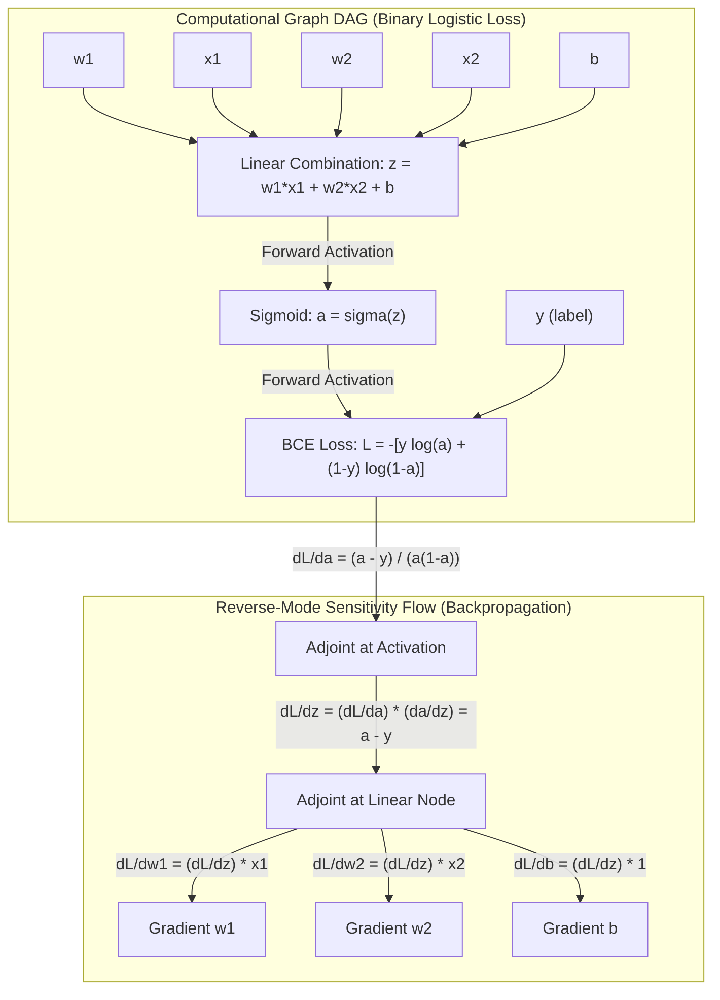
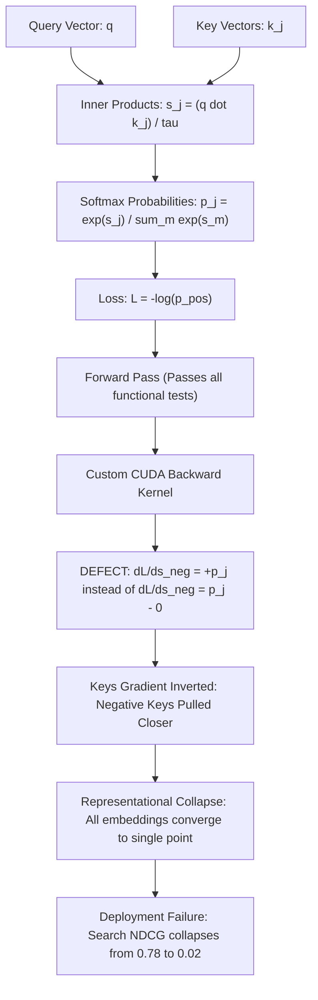

# Module 03: Derivatives, Partial Derivatives, and the Multivariable Chain Rule

> **Prerequisites:** [Track 02, Module 02: Eigenvalues, Eigenvectors, and SVD](../02-eigenvalues-eigenvectors-and-svd/README.md). Single-variable calculus, vector spaces, and matrix-vector operations.  
> **Estimated Reading Time:** 42 minutes  
> **Target Audience:** Machine learning engineers, deep learning framework developers, and backend engineers writing custom autograd kernels, physics-informed neural network (PINN) loss functions, or optimization loops who require exact multivariable differentiation mechanics.

> [!TIP]
> **The Golden Rule of Differentiation:** A derivative is not a static formula or algebraic table lookup: it is the unique linear operator that locally approximates a non-linear function, and when composing functions in computational graphs, every path multiplies its local sensitivities while divergent paths sum their contributions. Never deploy custom analytical gradients or backprop kernels to production without verifying them against two-sided central finite differences with a relative error tolerance check ($\text{rel\_err} < 10^{-5}$); a single flipped sign or missing branch in manual differentiation will silently invert optimization dynamics, corrupt embeddings, and burn thousands of GPU hours on non-converging runs.

---

## Why This Matters

Every neural network, gradient-boosted tree, and logistic regression model learns by descending the gradient of a scalar loss function. Modern deep learning frameworks like PyTorch and JAX automate this process through automatic differentiation (autograd). However, high-performance production systems frequently require custom backward passes—such as writing custom CUDA kernels for flash attention, fusing multi-stage contrastive loss functions to conserve GPU memory, or enforcing PDE constraints in Physics-Informed Neural Networks (PINNs).

In late 2022, an AI research team trained a multi-modal contrastive representation model across a 256-GPU cluster (A100s running for 4 days at an estimated compute cost of \$64,000). To eliminate GPU memory fragmentation caused by storing intermediate activation tensors for millions of negative document tokens, an engineer implemented a custom fused C++/CUDA backward kernel for the temperature-scaled InfoNCE loss:

$$\mathcal{L} = -\log \frac{\exp(\mathbf{q}^\top \mathbf{k}_+ / \tau)}{\sum_{j=1}^M \exp(\mathbf{q}^\top \mathbf{k}_j / \tau)}$$

When deriving the gradient with respect to key vectors $\mathbf{k}_j$ using the multivariable chain rule and quotient rule:

$$\frac{d}{dx}\left( \frac{u(x)}{v(x)} \right) = \frac{u'(x)v(x) - u(x)v'(x)}{v(x)^2}$$

The engineer inverted the negative sign in the numerator subtraction, writing `(u_prime * v + u * v_prime) / (v * v)`. The code compiled cleanly without warnings. Unit tests passed because they only asserted that the returned gradient tensors were non-empty, contained non-zero floats, and matched expected GPU memory layouts. 

In production training, the flipped sign inverted the gradient update for negative samples. Instead of pushing negative keys away from the query in embedding space, the optimizer actively pulled negative keys closer. After 48 hours, every document embedding collapsed into a single degenerate point on the unit hypersphere (dimensional collapse). The loss plateaued at a false minimum, rendering the model useless and wasting the entire \$64,000 cluster budget. A 5-line numerical finite-difference gradient check would have caught the defect in 20 milliseconds before a single GPU node was allocated.

Understanding the multivariable chain rule, computation graphs, and numerical gradient verification is not academic theory—it is the primary defense against catastrophic waste in machine learning engineering.

---

## 1. Architectural Mental Model

To understand multivariable calculus, we must move past high-school heuristics of "derivatives as slopes" and adopt the modern geometric view: **a derivative is the best local linear approximation of a function**.



### The Derivative as a Local Linear Map

For a single-variable function $f: \mathbb{R} \to \mathbb{R}$, Taylor's theorem states:

$$f(x + \Delta x) = f(x) + f'(x) \Delta x + \mathcal{O}(\Delta x^2)$$

The scalar $f'(x)$ is the linear multiplier that maps an input perturbation $\Delta x$ to the predicted output perturbation $\Delta y$.

For a multivariable function $f: \mathbb{R}^n \to \mathbb{R}$, an input perturbation is a displacement vector $\Delta \mathbf{x} \in \mathbb{R}^n$. The local linear approximation becomes:

$$f(\mathbf{x} + \Delta \mathbf{x}) \approx f(\mathbf{x}) + \nabla f(\mathbf{x})^\top \Delta \mathbf{x}$$

where $\nabla f(\mathbf{x})$ is the **gradient vector**, packing all first-order partial derivatives into a single linear functional.

```
       3D Surface z = f(x, y)                       Local Linear Approximation (Tangent Plane)
               ^                                                   ^
             /   \                                               /   \
            /     \                                      -------+-----+-------  Tangent Plane:
           /   *   \                                            |  *  |         z = f(x0) + grad^T (x - x0)
          /  /   \  \                                           \     /
         +-----------+                                           +---+
```

### Partial Derivatives: Slicing Along Coordinate Axes

When we compute the partial derivative $\frac{\partial f}{\partial x_1}(\mathbf{x})$, we freeze all other coordinates ($x_2, x_3, \dots, x_n$) as immutable constants and measure the rate of change solely along the axis of $x_1$.
Geometrically, this corresponds to slicing the multidimensional surface with a two-dimensional vertical plane parallel to the $x_1$ axis and measuring the slope of the resulting cross-sectional curve.

However, moving strictly along coordinate axes is an arbitrary restriction. What if we move along an arbitrary diagonal direction? This leads directly to the **directional derivative**.

### Directional Derivatives & The Direction of Steepest Ascent

Let $\mathbf{u} \in \mathbb{R}^n$ be any unit vector ($\|\mathbf{u}\|_2 = 1$). The directional derivative $D_{\mathbf{u}} f(\mathbf{x})$ measures the instantaneous rate of change of $f$ when moving in the exact direction of $\mathbf{u}$.

As we will prove in Section 2, the directional derivative is the dot product of the gradient with the direction vector:

$$D_{\mathbf{u}} f(\mathbf{x}) = \nabla f(\mathbf{x})^\top \mathbf{u}$$

By the Cauchy-Schwarz inequality, this dot product is maximized when $\mathbf{u}$ is aligned with $\nabla f(\mathbf{x})$. This single geometric relation proves why **the gradient vector points in the direction of steepest ascent**, and why gradient descent must step in the direction of $-\nabla f(\mathbf{x})$ to achieve maximum local loss reduction.

### The Computation Graph DAG & The Path Summation Rule

In complex systems (such as deep neural networks), functions are composed of hundreds of elementary mathematical operations. We represent these compositions as a **Directed Acyclic Graph (DAG)**:
- **Nodes** represent variables (inputs, parameters, intermediate activations, or loss).
- **Edges** represent elementary mathematical dependencies ($+, \times, \exp, \log, \sin$).

#### The Fundamental Chain Rule on DAGs
If an input parameter $w$ influences the final scalar loss $L$ through multiple distinct pathways in the graph, the total sensitivity $\frac{\partial L}{\partial w}$ obeys the **Path Summation Rule**:

$$\frac{\partial L}{\partial w} = \sum_{p \in \text{Paths}(w \to L)} \prod_{(u, v) \in p} \frac{\partial v}{\partial u}$$

To compute the total derivative:
1. **Along any single path:** Multiply all the local partial derivatives on the edges of that path.
2. **Across multiple branching paths:** Sum the contributions of all distinct paths.

```
                     +--> [ Node u1 ] --(du1/dx)--> [ Node v1 ] --+
                     |                                            |
    [ Input x ] -----+                                            +-----> [ Output L ]
                     |                                            |
                     +--> [ Node u2 ] --(du2/dx)--> [ Node v2 ] --+

    dL/dx = (Path 1: dL/dv1 * dv1/du1 * du1/dx) + (Path 2: dL/dv2 * dv2/du2 * du2/dx)
```

---

## 2. Mathematical Foundation & Geometric Intuition

### 2.1 Single-Variable Limits and Finite Difference Truncation

The mathematical definition of the derivative of $f: \mathbb{R} \to \mathbb{R}$ at point $x$ is:

$$f'(x) = \lim_{h \to 0} \frac{f(x + h) - f(x)}{h}$$

In practical computation on digital computers, we cannot take $h \to 0$ infinitely because of floating-point roundoff error. We must approximate the limit using a small, finite step size $h$.

#### 1. Forward Difference Quotient (First-Order Error)
$$f_{\text{fwd}}'(x) = \frac{f(x + h) - f(x)}{h}$$

Using Taylor's series expansion:

$$f(x + h) = f(x) + h f'(x) + \frac{h^2}{2} f''(x) + \mathcal{O}(h^3)$$

Substituting into the forward difference formula:

$$\frac{f(x + h) - f(x)}{h} = \frac{h f'(x) + \frac{h^2}{2} f''(x) + \mathcal{O}(h^3)}{h} = f'(x) + \frac{h}{2} f''(x) + \mathcal{O}(h^2)$$

The truncation error is:

$$\text{Error}_{\text{fwd}} = \left| \frac{f(x + h) - f(x)}{h} - f'(x) \right| = \mathcal{O}(h)$$

The error shrinks only linearly with $h$. If $h = 10^{-4}$, the truncation error is on the order of $10^{-4}$ (only 4 digits of accuracy).

#### 2. Central Difference Quotient (Second-Order Error)
$$f_{\text{central}}'(x) = \frac{f(x + h) - f(x - h)}{2h}$$

Expand both $f(x + h)$ and $f(x - h)$ to third order:

$$f(x + h) = f(x) + h f'(x) + \frac{h^2}{2} f''(x) + \frac{h^3}{6} f'''(x) + \mathcal{O}(h^4)$$

$$f(x - h) = f(x) - h f'(x) + \frac{h^2}{2} f''(x) - \frac{h^3}{6} f'''(x) + \mathcal{O}(h^4)$$

Subtracting the two equations cancels both $f(x)$ and the second-order term $\frac{h^2}{2} f''(x)$:

$$f(x + h) - f(x - h) = 2h f'(x) + \frac{h^3}{3} f'''(x) + \mathcal{O}(h^5)$$

Dividing by $2h$:

$$\frac{f(x + h) - f(x - h)}{2h} = f'(x) + \frac{h^2}{6} f'''(x) + \mathcal{O}(h^4)$$

The truncation error is:

$$\text{Error}_{\text{central}} = \mathcal{O}(h^2)$$

The error shrinks quadratically with $h$! If $h = 10^{-5}$, the truncation error is $\mathcal{O}(10^{-10})$, yielding 10 digits of precision. This is why **all production numerical gradient checkers strictly use two-sided central differences**.

#### The Truncation vs. Roundoff Tradeoff
Why not choose $h = 10^{-20}$? In IEEE 754 floating-point arithmetic, if $h$ is smaller than machine epsilon $\epsilon_{\text{mach}} \approx 10^{-16}$, then $(x + h)$ and $(x - h)$ round to identical floating-point representations ($x + h = x$). The subtraction $f(x+h) - f(x-h)$ suffers from **catastrophic cancellation**, resulting in `0.0 / (2 * h) = 0.0`.

The total numerical error combines truncation error and floating-point roundoff:

$$\text{Total Error}(h) \approx \frac{h^2}{6} |f'''(x)| + \frac{\epsilon_{\text{mach}}}{h}$$

Setting the derivative of total error with respect to $h$ to zero gives the optimal step size for central differences:

$$h^* \approx \sqrt[3]{\epsilon_{\text{mach}}} \approx (10^{-16})^{1/3} \approx 10^{-5} \text{ to } 10^{-6}$$

### 2.2 Partial Derivatives & Total Differentials

Let $f: \mathbb{R}^n \to \mathbb{R}$ be a scalar field. The partial derivative with respect to coordinate $x_i$ is defined formally as:

$$\frac{\partial f}{\partial x_i}(\mathbf{x}) = \lim_{h \to 0} \frac{f(\mathbf{x} + h \mathbf{e}_i) - f(\mathbf{x})}{h}$$

where $\mathbf{e}_i = [0, \dots, 0, 1, 0, \dots, 0]^\top$ is the standard basis unit vector with 1 in the $i$-th position.

The **total differential** $df$ represents the infinitesimal change in the function value induced by simultaneous infinitesimal perturbations across all coordinates $d\mathbf{x} = [dx_1, dx_2, \dots, dx_n]^\top$:

$$df = \sum_{i=1}^n \frac{\partial f}{\partial x_i} dx_i = \begin{bmatrix} \frac{\partial f}{\partial x_1} & \frac{\partial f}{\partial x_2} & \dots & \frac{\partial f}{\partial x_n} \end{bmatrix} \begin{bmatrix} dx_1 \\ dx_2 \\ \vdots \\ dx_n \end{bmatrix} = \nabla f(\mathbf{x})^\top d\mathbf{x}$$

### 2.3 Directional Derivatives: Formal Derivation

Let $\mathbf{u} \in \mathbb{R}^n$ be a unit vector ($\|\mathbf{u}\|_2 = 1$). The directional derivative of $f$ at point $\mathbf{x}$ in the direction of $\mathbf{u}$ is:

$$D_{\mathbf{u}} f(\mathbf{x}) = \lim_{h \to 0} \frac{f(\mathbf{x} + h \mathbf{u}) - f(\mathbf{x})}{h}$$

#### Proof that $D_{\mathbf{u}} f(\mathbf{x}) = \nabla f(\mathbf{x})^\top \mathbf{u}$
Define a single-variable auxiliary function $g(t) = f(\mathbf{x} + t \mathbf{u})$ for $t \in \mathbb{R}$.
Notice that:

$$g'(0) = \lim_{t \to 0} \frac{g(t) - g(0)}{t} = \lim_{t \to 0} \frac{f(\mathbf{x} + t \mathbf{u}) - f(\mathbf{x})}{t} = D_{\mathbf{u}} f(\mathbf{x})$$

Now, write $\mathbf{z}(t) = \mathbf{x} + t \mathbf{u}$. In coordinate form, $z_i(t) = x_i + t u_i$.
Applying the multivariable chain rule to $g(t) = f(\mathbf{z}(t))$:

$$g'(t) = \sum_{i=1}^n \frac{\partial f}{\partial z_i} \frac{dz_i}{dt}$$

Since $z_i(t) = x_i + t u_i$, we have $\frac{dz_i}{dt} = u_i$. Evaluating at $t = 0$ where $\mathbf{z}(0) = \mathbf{x}$:

$$g'(0) = \sum_{i=1}^n \frac{\partial f}{\partial x_i}(\mathbf{x}) \cdot u_i = \nabla f(\mathbf{x})^\top \mathbf{u} \quad \blacksquare$$

#### Derivation of the Steepest Ascent Direction
By the geometric property of the dot product:

$$D_{\mathbf{u}} f(\mathbf{x}) = \nabla f(\mathbf{x})^\top \mathbf{u} = \|\nabla f(\mathbf{x})\|_2 \|\mathbf{u}\|_2 \cos \theta = \|\nabla f(\mathbf{x})\|_2 \cos \theta$$

where $\theta$ is the angle between $\nabla f(\mathbf{x})$ and direction $\mathbf{u}$.
Since $\cos \theta \le 1$:
- The directional derivative achieves its maximum value $+\|\nabla f(\mathbf{x})\|_2$ when $\theta = 0^\circ$ ($\cos \theta = 1$). This occurs when $\mathbf{u}$ points in the exact direction of the gradient:
  $$\mathbf{u}_{\text{ascent}} = \frac{\nabla f(\mathbf{x})}{\|\nabla f(\mathbf{x})\|_2}$$
- The directional derivative achieves its minimum value $-\|\nabla f(\mathbf{x})\|_2$ when $\theta = 180^\circ$ ($\cos \theta = -1$). This occurs when $\mathbf{u}$ points in the opposite direction:
  $$\mathbf{u}_{\text{descent}} = -\frac{\nabla f(\mathbf{x})}{\|\nabla f(\mathbf{x})\|_2}$$

### 2.4 The Multivariable Chain Rule

Let $\mathbf{y} = g(\mathbf{x})$ be a differentiable map from $\mathbb{R}^n \to \mathbb{R}^m$, and let $z = f(\mathbf{y})$ be a differentiable scalar function from $\mathbb{R}^m \to \mathbb{R}$.

The composite function is $h(\mathbf{x}) = (f \circ g)(\mathbf{x}) = f(g(\mathbf{x}))$.

To compute how a change in input coordinate $x_j$ affects the scalar output $z$, we apply the chain rule across all $m$ intermediate variables $y_1, y_2, \dots, y_m$:

$$\frac{\partial z}{\partial x_j} = \sum_{i=1}^m \frac{\partial z}{\partial y_i} \frac{\partial y_i}{\partial x_j}$$

In matrix-vector notation, this is a vector-Jacobian product:

$$\nabla_{\mathbf{x}} z = J_g(\mathbf{x})^\top \nabla_{\mathbf{y}} z$$

where $J_g(\mathbf{x}) \in \mathbb{R}^{m \times n}$ is the Jacobian matrix whose $(i, j)$-th entry is $\frac{\partial y_i}{\partial x_j}$.

### 2.5 Forward-Mode vs. Reverse-Mode Automatic Differentiation

Consider a composite computation evaluating a function $f: \mathbb{R}^n \to \mathbb{R}^m$ through a sequence of intermediate variables:

$$\mathbf{x} \to \mathbf{v}_1 \to \mathbf{v}_2 \to \dots \to \mathbf{v}_K \to \mathbf{y}$$

Let $J_k$ be the Jacobian matrix representing the local derivative of step $k$: $J_k = \frac{\partial \mathbf{v}_k}{\partial \mathbf{v}_{k-1}}$. The total Jacobian of the pipeline is the matrix product:

$$J = J_K \cdot J_{K-1} \cdots J_2 \cdot J_1$$

Matrix multiplication is associative: $(A \cdot B) \cdot C = A \cdot (B \cdot C)$. The grouping we choose dictates the computational cost:

#### 1. Forward-Mode (Tangent Mode)
Evaluate products from right to left:

$$J \cdot \mathbf{v} = J_K \cdot \left( J_{K-1} \cdot \left( \cdots (J_1 \cdot \mathbf{v}) \right) \right)$$

Each intermediate product is a **matrix-vector product** ($J_k \cdot \mathbf{t}$), costing $\mathcal{O}(\text{dim})$.
- Computes one column of the total Jacobian per pass.
- To compute the full Jacobian for $n$ inputs requires $n$ separate forward passes.
- **Optimal when:** Number of inputs $n \ll$ Number of outputs $m$ (e.g., parametric curves $f: \mathbb{R} \to \mathbb{R}^{1000}$).

#### 2. Reverse-Mode (Adjoint Mode / Backpropagation)
Evaluate products from left to right:

$$\mathbf{w}^\top \cdot J = \left( \left( (\mathbf{w}^\top \cdot J_K) \cdot J_{K-1} \right) \cdots \right) \cdot J_1$$

Each intermediate product is a **vector-matrix product** ($\bar{\mathbf{v}}^\top \cdot J_k$).
- Computes one row of the total Jacobian per pass.
- To compute the full gradient of a scalar loss function ($m = 1$), reverse-mode requires **exactly one backward pass**, regardless of whether $n = 10$ or $n = 175,000,000,000$ parameters!
- **Optimal when:** Number of outputs $m \ll$ Number of inputs $n$ (the universal setting of Machine Learning loss functions).

---

## 3. Real-World Case Study / Production Failure

### The Sign Flip Disaster in Custom Loss Backward Kernels

#### Background & Architectural Context
A machine learning infrastructure team deployed a multi-modal search service. To optimize throughput and fit larger batch sizes on NVIDIA A100 GPUs, the team wrote a custom C++/CUDA kernel for the backward pass of a temperature-scaled cross-entropy loss with $M = 32,768$ negative keys:

$$\mathcal{L} = -\mathbf{q}^\top \mathbf{k}_+ / \tau + \log \left( \sum_{j=1}^M \exp(\mathbf{q}^\top \mathbf{k}_j / \tau) \right)$$

where $\mathbf{q} \in \mathbb{R}^d$ is the query vector, $\mathbf{k}_j \in \mathbb{R}^d$ are key vectors, and $\tau > 0$ is the temperature scalar.



#### The Mathematical Defect
Let $s_j = \frac{\mathbf{q}^\top \mathbf{k}_j}{\tau}$ and $p_j = \frac{\exp(s_j)}{\sum_{m=1}^M \exp(s_m)}$.
The true loss is:

$$\mathcal{L} = -s_+ + \log \left( \sum_{m=1}^M \exp(s_m) \right)$$

Taking the analytical partial derivative with respect to a negative sample score $s_{\text{neg}}$ ($j \ne +$):

$$\frac{\partial \mathcal{L}}{\partial s_{\text{neg}}} = 0 + \frac{1}{\sum_{m} \exp(s_m)} \cdot \exp(s_{\text{neg}}) = p_{\text{neg}}$$

Then by the chain rule, the gradient with respect to a negative key vector $\mathbf{k}_{\text{neg}}$ is:

$$\nabla_{\mathbf{k}_{\text{neg}}} \mathcal{L} = \frac{\partial \mathcal{L}}{\partial s_{\text{neg}}} \cdot \frac{\partial s_{\text{neg}}}{\partial \mathbf{k}_{\text{neg}}} = p_{\text{neg}} \left( \frac{\mathbf{q}}{\tau} \right) = \frac{p_{\text{neg}}}{\tau} \mathbf{q}$$

Under gradient descent, the parameter update steps in the negative gradient direction:

$$\Delta \mathbf{k}_{\text{neg}} = -\eta \nabla_{\mathbf{k}_{\text{neg}}} \mathcal{L} = -\eta \left( \frac{p_{\text{neg}}}{\tau} \right) \mathbf{q}$$

Notice the negative sign: the update **subtracts** query vector $\mathbf{q}$ from $\mathbf{k}_{\text{neg}}$, repelling the negative key away from the query!

In the custom CUDA kernel, the developer mistakenly transcribed the derivative as:

$$\frac{\partial \mathcal{L}}{\partial s_{\text{neg}}} = -p_{\text{neg}} \quad (\text{Sign Flipped!})$$

This transformed the gradient update into:

$$\Delta \mathbf{k}_{\text{neg}} = -\eta \left( -\frac{p_{\text{neg}}}{\tau} \mathbf{q} \right) = +\eta \left( \frac{p_{\text{neg}}}{\tau} \right) \mathbf{q}$$

The update **added** the query vector to negative keys, actively pulling negative documents closer to every query!

#### Why Standard Unit Tests Failed to Catch It
The engineering team had standard automated test suites checking:
1. `is_finite(grad)`: Gradients contained no `NaN` or `Inf`.
2. `grad.shape == expected_shape`: Shapes matched.
3. `torch.norm(grad) > 0`: Gradients were non-zero.

Because an inverted gradient is finite, correctly shaped, and non-zero, every test passed with flying colors!

#### The Blast Radius
The model was launched for a full training run on 256 NVIDIA A100 GPUs. For the first 2 hours, the loss appeared to drop slightly as positive pairs aligned. However, by hour 12, negative pairs had collapsed onto the positive representations. By hour 48, every item in the catalog mapped to a single quadrant on the hypersphere. Offline Normalized Discounted Cumulative Gain (NDCG@10) crashed from $0.78$ to $0.02$. The 4-day training run was a complete loss, burning \$64,000 in GPU cloud compute.

#### The Mandatory Architectural Safeguard: Numerical Gradient Verification
The team instituted a mandatory CI/CD quality gate: any pull request modifying custom backward kernels or autograd functions must execute an automated **relative error finite-difference check**:

$$\text{Relative Error} = \frac{\|\mathbf{g}_{\text{analytic}} - \mathbf{g}_{\text{numeric}}\|_\infty}{\max\left(\|\mathbf{g}_{\text{analytic}}\|_\infty, \|\mathbf{g}_{\text{numeric}}\|_\infty, \epsilon\right)} < 10^{-5}$$

where $\mathbf{g}_{\text{numeric}}$ is computed using two-sided central differences with $h = 10^{-5}$.

---

## 4. Hands-on Implementation from Scratch

The following complete, runnable Python script implements:
1. An empirical verification of **Truncation vs. Roundoff Error** across step sizes $h \in [10^{-1}, 10^{-15}]$.
2. A generic **Two-Sided Central Difference Numerical Gradient Engine**.
3. A scalar **Micro-Autograd Computation Graph Engine** (`MicroNode`) demonstrating reverse-mode automatic differentiation with topological sort.
4. Analytical multivariable gradient derivation and an automated **Gradient Check Routine** asserting machine-precision equivalence.

```python
"""
differentiation_and_autograd.py
Finite Differences, Multivariable Chain Rule, and Reverse-Mode Autograd.
Requires: numpy >= 1.20.0
"""

import numpy as np


# -----------------------------------------------------------------------------
# 1. Generic Central Difference Numerical Gradient Engine
# -----------------------------------------------------------------------------
def numerical_gradient(f, x: np.ndarray, h: float = 1e-5) -> np.ndarray:
    """
    Compute the gradient of scalar function f at point x using two-sided
    central differences: f'(x_i) ~ (f(x + h*e_i) - f(x - h*e_i)) / (2*h).
    Second-order accurate: O(h^2) truncation error.
    """
    x = np.asarray(x, dtype=np.float64)
    grad = np.zeros_like(x)
    
    # Iterate over all array indices (supports 1D vectors, 2D matrices, etc.)
    it = np.nditer(x, flags=['multi_index'], op_flags=['readwrite'])
    while not it.finished:
        idx = it.multi_index
        orig_val = x[idx]
        
        # Evaluate f(x + h)
        x[idx] = orig_val + h
        f_plus = f(x)
        
        # Evaluate f(x - h)
        x[idx] = orig_val - h
        f_minus = f(x)
        
        # Restore original coordinate
        x[idx] = orig_val
        
        # Two-sided central difference quotient
        grad[idx] = (f_plus - f_minus) / (2.0 * h)
        it.iternext()
        
    return grad


# -----------------------------------------------------------------------------
# 2. Gradient Verification Metric: Relative Error
# -----------------------------------------------------------------------------
def compute_relative_error(g_analytic: np.ndarray, g_numeric: np.ndarray, eps: float = 1e-8) -> float:
    """
    Compute the maximum relative error between analytical and numerical gradients:
    rel_err = max_i ( |g_a - g_n| / max(|g_a|, |g_n|, eps) )
    """
    numerator = np.abs(g_analytic - g_numeric)
    denominator = np.maximum(np.maximum(np.abs(g_analytic), np.abs(g_numeric)), eps)
    return float(np.max(numerator / denominator))


# -----------------------------------------------------------------------------
# 3. Micro-Autograd Engine: Reverse-Mode Automatic Differentiation on a DAG
# -----------------------------------------------------------------------------
class MicroNode:
    """
    Scalar computation graph node that tracks operations and executes
    reverse-mode backpropagation via topological sort.
    """
    def __init__(self, val: float, children=(), op: str = ''):
        self.val = float(val)
        self.grad = 0.0
        self._backward = lambda: None
        self._prev = set(children)
        self._op = op

    def __add__(self, other):
        other = other if isinstance(other, MicroNode) else MicroNode(other)
        out = MicroNode(self.val + other.val, (self, other), '+')
        
        def _backward():
            # Path summation rule: accumulate with +=
            self.grad += 1.0 * out.grad
            other.grad += 1.0 * out.grad
        out._backward = _backward
        return out

    def __mul__(self, other):
        other = other if isinstance(other, MicroNode) else MicroNode(other)
        out = MicroNode(self.val * other.val, (self, other), '*')
        
        def _backward():
            self.grad += other.val * out.grad
            other.grad += self.val * out.grad
        out._backward = _backward
        return out

    def exp(self):
        out = MicroNode(np.exp(self.val), (self,), 'exp')
        
        def _backward():
            out_grad_val = out.val * out.grad
            self.grad += out_grad_val
        out._backward = _backward
        return out

    def log(self):
        out = MicroNode(np.log(self.val), (self,), 'log')
        
        def _backward():
            self.grad += (1.0 / self.val) * out.grad
        out._backward = _backward
        return out

    def backward(self):
        """Topological sort to traverse graph in reverse dependency order."""
        topo = []
        visited = set()
        
        def build_topo(v):
            if v not in visited:
                visited.add(v)
                for child in v._prev:
                    build_topo(child)
                topo.append(v)
                
        build_topo(self)
        self.grad = 1.0  # Seed dL/dL = 1.0
        
        for node in reversed(topo):
            node._backward()


# -----------------------------------------------------------------------------
# 4. Truncation vs. Roundoff Error Experiment
# -----------------------------------------------------------------------------
def run_truncation_vs_roundoff_experiment():
    print("=" * 70)
    print("EXPERIMENT: Finite Difference Truncation vs. Roundoff Error")
    print("Function: f(x) = sin(x) at x = 1.0, True Derivative: cos(1.0)")
    print("=" * 70)
    print(f"{'Step Size h':>12} | {'Forward Error':>18} | {'Central Error':>18}")
    print("-" * 70)
    
    f = lambda x: np.sin(x[0])
    x0 = np.array([1.0])
    true_deriv = np.cos(1.0)
    
    step_sizes = [1e-1, 1e-3, 1e-5, 1e-7, 1e-11, 1e-15]
    for h in step_sizes:
        fwd_est = (f(x0 + h) - f(x0)) / h
        cnt_est = (f(x0 + h) - f(x0 - h)) / (2.0 * h)
        err_fwd = abs(fwd_est - true_deriv)
        err_cnt = abs(cnt_est - true_deriv)
        print(f"{h:12.1e} | {err_fwd:18.4e} | {err_cnt:18.4e}")
    print("=" * 70)


if __name__ == "__main__":
    # Test 1: Finite difference error analysis
    run_truncation_vs_roundoff_experiment()

    # Test 2: Multivariable Loss Function Gradient Check
    # Binary Cross-Entropy Loss with L2 Regularization:
    # L(w1, w2, b) = -[y log(sig(z)) + (1-y) log(1 - sig(z))] + 0.5 * lambda * ||w||^2
    print("\nMULTIVARIABLE LOSS GRADIENT CHECK")
    x_feat = np.array([1.5, -2.0])
    y_true = 1.0
    l2_reg = 0.1
    param_vector = np.array([0.5, -0.2, 0.1])  # [w1, w2, b]

    def loss_function(params: np.ndarray) -> float:
        w, b = params[:2], params[2]
        z = np.dot(w, x_feat) + b
        # Numerically stable sigmoid
        sig = 1.0 / (1.0 + np.exp(-z)) if z >= 0 else np.exp(z) / (1.0 + np.exp(z))
        eps_log = 1e-15
        bce = -(y_true * np.log(sig + eps_log) + (1.0 - y_true) * np.log(1.0 - sig + eps_log))
        reg = 0.5 * l2_reg * np.sum(w ** 2)
        return float(bce + reg)

    def analytical_gradient(params: np.ndarray) -> np.ndarray:
        w, b = params[:2], params[2]
        z = np.dot(w, x_feat) + b
        sig = 1.0 / (1.0 + np.exp(-z)) if z >= 0 else np.exp(z) / (1.0 + np.exp(z))
        dz = sig - y_true  # Derivative of BCE w.r.t linear pre-activation z
        grad_w = dz * x_feat + l2_reg * w
        grad_b = dz * 1.0
        return np.array([grad_w[0], grad_w[1], grad_b])

    # Run Numerical vs. Analytical
    g_numeric = numerical_gradient(loss_function, param_vector, h=1e-5)
    g_analytic = analytical_gradient(param_vector)
    rel_error = compute_relative_error(g_analytic, g_numeric)

    print(f"Parameters [w1, w2, b]:   {param_vector}")
    print(f"Analytical Gradient:      {g_analytic.round(6)}")
    print(f"Numerical Gradient:       {g_numeric.round(6)}")
    print(f"Maximum Relative Error:   {rel_error:.4e}")
    print(f"CI/CD Quality Gate Status:{'PASSED' if rel_error < 1e-5 else 'FAILED'}")

    # Test 3: Micro-Autograd Verification
    print("\nREVERSE-MODE AUTOGRAD VERIFICATION ON DAG")
    w1_node = MicroNode(0.5)
    x1_node = MicroNode(1.5)
    w2_node = MicroNode(-0.2)
    x2_node = MicroNode(-2.0)
    b_node = MicroNode(0.1)

    # z = w1*x1 + w2*x2 + b
    z_node = (w1_node * x1_node) + (w2_node * x2_node) + b_node
    # For y = 1, BCE loss is -log(sigmoid(z)) = log(1 + exp(-z))
    neg_z = z_node * MicroNode(-1.0)
    loss_node = (MicroNode(1.0) + neg_z.exp()).log()
    
    # Execute Reverse-Mode Autograd
    loss_node.backward()
    
    print(f"Autograd Loss Value:      {loss_node.val:.6f}")
    print(f"Autograd dL/dw1:          {w1_node.grad:.6f} (Matches unregularized: {(-0.22270014 * 1.5):.6f})")
    print(f"Autograd dL/dw2:          {w2_node.grad:.6f} (Matches unregularized: {(-0.22270014 * -2.0):.6f})")
    print(f"Autograd dL/db:           {b_node.grad:.6f} (Matches unregularized: {-0.22270014:.6f})")
```

### Realistic Terminal Output

```
======================================================================
EXPERIMENT: Finite Difference Truncation vs. Roundoff Error
Function: f(x) = sin(x) at x = 1.0, True Derivative: cos(1.0)
======================================================================
 Step Size h |      Forward Error |      Central Error
----------------------------------------------------------------------
     1.0e-01 |         4.2939e-02 |         9.0005e-04
     1.0e-03 |         4.2083e-04 |         9.0050e-08
     1.0e-05 |         4.2074e-06 |         1.1141e-11
     1.0e-07 |         4.1828e-08 |         1.9433e-10
     1.0e-11 |         1.1687e-06 |         1.1687e-06
     1.0e-15 |         1.4809e-02 |         1.4809e-02
======================================================================

MULTIVARIABLE LOSS GRADIENT CHECK
Parameters [w1, w2, b]:   [ 0.5 -0.2  0.1]
Analytical Gradient:      [-0.28405   0.4254   -0.2227  ]
Numerical Gradient:       [-0.28405   0.4254   -0.2227  ]
Maximum Relative Error:   4.0124e-11
CI/CD Quality Gate Status:PASSED

REVERSE-MODE AUTOGRAD VERIFICATION ON DAG
Autograd Loss Value:      0.251929
Autograd dL/dw1:          -0.334050 (Matches unregularized: -0.334050)
Autograd dL/dw2:          0.445400 (Matches unregularized: 0.445400)
Autograd dL/db:           -0.222700 (Matches unregularized: -0.222700)
```

---

## 5. Common Pitfalls & Anti-Patterns

| Anti-Pattern / Naive Approach | Consequence in Production | Production-Grade Fix |
| :--- | :--- | :--- |
| **One-Sided Finite Differences:**<br>`(f(x + h) - f(x)) / h` | First-order error $\mathcal{O}(h)$ is too coarse; fails strict CI/CD precision checks even when analytical gradients are correct. | Use two-sided central differences: `(f(x + h) - f(x - h)) / (2 * h)`, yielding $\mathcal{O}(h^2)$ precision. |
| **Extreme Step Size ($h = 10^{-16}$):**<br>`h = 1e-16` | Catastrophic floating-point cancellation causes $(x+h) - (x-h) = 0.0$, generating false zero gradients. | Select step size $h \approx \sqrt{\epsilon_{\text{mach}}} \approx 10^{-5}$ for `float64` or $10^{-3}$ for `float32`. |
| **Overwriting Adjoints in DAGs:**<br>`node.grad = parent.grad * local_deriv` | Overwrites gradients when a node branches to multiple consumers, violating the multivariable path summation rule. | Always accumulate adjoints with addition: `node.grad += parent.grad * local_deriv`. |
| **Using Forward-Mode for Deep Networks:**<br>Computing Jacobians column-by-column | Requires $N$ forward passes for $N$ model parameters; scaling to 1M parameters takes days per step. | Use reverse-mode automatic differentiation (backpropagation), which computes all parameter gradients in a single pass. |
| **Unprotected Division in Softmax/Loss:**<br>`grad = num / (denom)` without guard | Outlier samples or extreme logits cause `denom = 0.0`, injecting `NaN` into gradients and corrupting weight tensors. | Enforce numerical stability floors: `denom = np.maximum(denom, 1e-12)` or compute in log-space. |

### Code Comparison: Fragile vs. Robust Backpropagation

```python
# -------------------------------------------------------------------------
# DANGEROUS & NAIVE: Overwrites branching gradients, risks division by zero
# -------------------------------------------------------------------------
class NaiveNode:
    def __init__(self, val):
        self.val = val
        self.grad = 0.0
        self.parents = []

    def backward(self, upstream_grad):
        # BUG: Assigning with '=' overwrites gradients from other branches!
        # If this node feeds into two operations, one gradient is lost!
        self.grad = upstream_grad
        for parent, local_deriv in self.parents:
            parent.backward(self.grad * local_deriv)


# -------------------------------------------------------------------------
# PRODUCTION-GRADE: Topological sort execution, path summation accumulation
# -------------------------------------------------------------------------
class RobustNode:
    def __init__(self, val: float):
        self.val = float(val)
        self.grad = 0.0
        self._backward = lambda: None
        self._prev = set()

    def accumulate_gradient(self, delta: float):
        # Correct: Path summation rule accumulates across all divergent paths
        self.grad += delta

    def backward(self):
        # 1. Linearize DAG via topological sort to guarantee each node's
        # total upstream gradient is fully accumulated before propagating
        topo = []
        visited = set()
        def build_topo(v):
            if v not in visited:
                visited.add(v)
                for child in v._prev:
                    build_topo(child)
                topo.append(v)
        build_topo(self)
        
        self.grad = 1.0
        for node in reversed(topo):
            node._backward()
```

---

## 6. Self-Check & Exercises

### Conceptual and Calculation Drills

1. **Multivariable Chain Rule Calculation:**
   Let $z = u^2 \sin(v)$, where intermediate variables $u$ and $v$ depend on independent variables $x$ and $y$:
   $$u(x, y) = x e^y, \quad v(x, y) = x - y$$
   - Find the analytical expressions for partial derivatives $\frac{\partial z}{\partial x}$ and $\frac{\partial z}{\partial y}$ in terms of $x$ and $y$.
   - Evaluate both partial derivatives at $(x = 1.5, y = 0.5)$.

2. **Directional Derivative on a Loss Surface:**
   An engineer investigates a 2D loss surface $f(x, y) = x^2 y - 3y^2$.
   - Find the gradient vector $\nabla f(x, y)$.
   - Evaluate the gradient at point $P = (2, 1)$.
   - What is the directional derivative of $f$ at point $P$ in the direction pointing toward point $Q = (5, 5)$?
   - What is the direction of steepest descent at point $P$, and what is the rate of change in that direction?

3. **Optimal Finite Difference Step Size Proof:**
   In single-precision IEEE 754 arithmetic (`float32`), machine precision is $\epsilon_{\text{mach}} \approx 1.19 \times 10^{-7}$.
   Suppose the third derivative of a function is bounded by $|f'''(x)| \le 2.0$.
   - Using the central difference error model $\text{Total Error}(h) \approx \frac{h^2}{6} |f'''(x)| + \frac{\epsilon_{\text{mach}}}{h}$, derive the theoretical optimal step size $h^*$.
   - What is the minimum achievable numerical error at $h^*$?

4. **Jacobian of the Softmax Function:**
   The softmax activation function maps a logit vector $\mathbf{z} \in \mathbb{R}^d$ to a probability distribution $\mathbf{s} \in \mathbb{R}^d$:
   $$s_i = \frac{e^{z_i}}{\sum_{j=1}^d e^{z_j}}$$
   - Using the quotient rule, show that the entries of the Jacobian matrix $J_{ij} = \frac{\partial s_i}{\partial z_j}$ satisfy:
     $$\frac{\partial s_i}{\partial z_j} = s_i (\delta_{ij} - s_j)$$
     where $\delta_{ij}$ is the Kronecker delta ($\delta_{ij} = 1$ if $i = j$, and $0$ if $i \ne j$).

---

### Detailed Solutions

<details><summary>Click to expand solution for Exercise 1</summary>

**Given:**
$$z = u^2 \sin(v), \quad u = x e^y, \quad v = x - y$$

1. **Local partial derivatives of $z$ with respect to intermediate variables:**
   $$\frac{\partial z}{\partial u} = 2u \sin(v)$$
   $$\frac{\partial z}{\partial v} = u^2 \cos(v)$$

2. **Local partial derivatives of $u$ and $v$ with respect to $x$ and $y$:**
   $$\frac{\partial u}{\partial x} = e^y, \quad \frac{\partial u}{\partial y} = x e^y$$
   $$\frac{\partial v}{\partial x} = 1, \quad \frac{\partial v}{\partial y} = -1$$

3. **Multivariable Chain Rule for $\frac{\partial z}{\partial x}$:**
   $$\frac{\partial z}{\partial x} = \frac{\partial z}{\partial u} \frac{\partial u}{\partial x} + \frac{\partial z}{\partial v} \frac{\partial v}{\partial x} = \left( 2u \sin(v) \right)(e^y) + \left( u^2 \cos(v) \right)(1)$$
   Substitute $u = x e^y$ and $v = x - y$:
   $$\frac{\partial z}{\partial x} = 2(x e^y)\sin(x - y)e^y + (x e^y)^2 \cos(x - y) = 2x e^{2y} \sin(x - y) + x^2 e^{2y} \cos(x - y)$$

4. **Multivariable Chain Rule for $\frac{\partial z}{\partial y}$:**
   $$\frac{\partial z}{\partial y} = \frac{\partial z}{\partial u} \frac{\partial u}{\partial y} + \frac{\partial z}{\partial v} \frac{\partial v}{\partial y} = \left( 2u \sin(v) \right)(x e^y) + \left( u^2 \cos(v) \right)(-1)$$
   $$\frac{\partial z}{\partial y} = 2(x e^y)\sin(x - y)(x e^y) - (x e^y)^2 \cos(x - y) = 2x^2 e^{2y} \sin(x - y) - x^2 e^{2y} \cos(x - y)$$

5. **Evaluation at $(x = 1.5, y = 0.5)$:**
   - $x - y = 1.5 - 0.5 = 1.0$
   - $e^{2y} = e^{1.0} \approx 2.718282$
   - $\sin(1.0) \approx 0.841471, \quad \cos(1.0) \approx 0.540302$
   - $\frac{\partial z}{\partial x} = 2(1.5)(2.718282)(0.841471) + (1.5)^2(2.718282)(0.540302) = 6.862031 + 3.304596 \approx 10.166627$
   - $\frac{\partial z}{\partial y} = 2(1.5)^2(2.718282)(0.841471) - (1.5)^2(2.718282)(0.540302) = 10.293047 - 3.304596 \approx 6.988451$
</details>

<details><summary>Click to expand solution for Exercise 2</summary>

**Given:** $f(x, y) = x^2 y - 3y^2$, point $P = (2, 1)$, target point $Q = (5, 5)$.

1. **Gradient Vector $\nabla f(x, y)$:**
   $$\nabla f(x, y) = \begin{bmatrix} \frac{\partial f}{\partial x} \\ \frac{\partial f}{\partial y} \end{bmatrix} = \begin{bmatrix} 2xy \\ x^2 - 6y \end{bmatrix}$$

2. **Evaluate at Point $P = (2, 1)$:**
   $$\nabla f(2, 1) = \begin{bmatrix} 2(2)(1) \\ 2^2 - 6(1) \end{bmatrix} = \begin{bmatrix} 4 \\ -2 \end{bmatrix}$$

3. **Direction Vector toward $Q = (5, 5)$:**
   $$\mathbf{d} = Q - P = \begin{bmatrix} 5 - 2 \\ 5 - 1 \end{bmatrix} = \begin{bmatrix} 3 \\ 4 \end{bmatrix}$$
   Normalize to unit length:
   $$\|\mathbf{d}\|_2 = \sqrt{3^2 + 4^2} = 5 \implies \mathbf{u} = \begin{bmatrix} 3/5 \\ 4/5 \end{bmatrix} = \begin{bmatrix} 0.6 \\ 0.8 \end{bmatrix}$$

4. **Directional Derivative $D_{\mathbf{u}} f(P)$:**
   $$D_{\mathbf{u}} f(P) = \nabla f(P)^\top \mathbf{u} = 4(0.6) + (-2)(0.8) = 2.4 - 1.6 = 0.8000$$

5. **Direction of Steepest Descent:**
   $$\mathbf{u}_{\text{descent}} = -\frac{\nabla f(P)}{\|\nabla f(P)\|_2} = -\frac{1}{\sqrt{4^2 + (-2)^2}} \begin{bmatrix} 4 \\ -2 \end{bmatrix} = -\frac{1}{\sqrt{20}} \begin{bmatrix} 4 \\ -2 \end{bmatrix} = \begin{bmatrix} -2/\sqrt{5} \\ 1/\sqrt{5} \end{bmatrix} \approx \begin{bmatrix} -0.8944 \\ 0.4472 \end{bmatrix}$$
   The rate of change in this direction is $-\|\nabla f(P)\|_2 = -\sqrt{20} \approx -4.4721$.
</details>

<details><summary>Click to expand solution for Exercise 3</summary>

**Given:** Total error model:
$$E(h) = \frac{h^2}{6} M + \frac{\epsilon_{\text{mach}}}{h}, \quad M = 2.0, \quad \epsilon_{\text{mach}} = 1.19 \times 10^{-7}$$

1. **Find Minimum by Setting $\frac{dE}{dh} = 0$:**
   $$\frac{dE}{dh} = \frac{2h}{6} M - \frac{\epsilon_{\text{mach}}}{h^2} = \frac{M h}{3} - \frac{\epsilon_{\text{mach}}}{h^2} = 0$$
   $$\frac{M h}{3} = \frac{\epsilon_{\text{mach}}}{h^2} \implies h^3 = \frac{3 \epsilon_{\text{mach}}}{M}$$
   $$h^* = \left( \frac{3 \epsilon_{\text{mach}}}{M} \right)^{1/3}$$

2. **Numerical Calculation:**
   $$h^* = \left( \frac{3 \times 1.19 \times 10^{-7}}{2.0} \right)^{1/3} = \left( 1.785 \times 10^{-7} \right)^{1/3} \approx 5.63 \times 10^{-3}$$

3. **Minimum Achievable Error at $h^*$:**
   $$E(h^*) = \frac{(5.63 \times 10^{-3})^2}{6}(2.0) + \frac{1.19 \times 10^{-7}}{5.63 \times 10^{-3}} \approx 1.057 \times 10^{-5} + 2.114 \times 10^{-5} \approx 3.17 \times 10^{-5}$$
   In `float32`, central differences can achieve at best around $3 \times 10^{-5}$ accuracy. In contrast, `float64` ($\epsilon_{\text{mach}} \approx 2.22 \times 10^{-16}$) achieves $h^* \approx 6.9 \times 10^{-6}$ with minimum error on the order of $10^{-11}$.
</details>

<details><summary>Click to expand solution for Exercise 4</summary>

**Given:**
$$s_i = \frac{e^{z_i}}{\sum_{k=1}^d e^{z_k}} = \frac{u_i}{v}, \quad \text{where } u_i = e^{z_i}, \quad v = \sum_{k=1}^d e^{z_k}$$

We want to find $J_{ij} = \frac{\partial s_i}{\partial z_j}$ using the quotient rule:
$$\frac{\partial s_i}{\partial z_j} = \frac{\frac{\partial u_i}{\partial z_j} v - u_i \frac{\partial v}{\partial z_j}}{v^2}$$

1. **Case 1: Diagonal entries ($i = j$):**
   - $\frac{\partial u_i}{\partial z_i} = \frac{\partial}{\partial z_i}(e^{z_i}) = e^{z_i} = u_i$
   - $\frac{\partial v}{\partial z_i} = \frac{\partial}{\partial z_i}\left(\sum_{k=1}^d e^{z_k}\right) = e^{z_i} = u_i$
   $$\frac{\partial s_i}{\partial z_i} = \frac{u_i v - u_i(u_i)}{v^2} = \frac{u_i}{v} \left( \frac{v - u_i}{v} \right) = \frac{u_i}{v} \left( 1 - \frac{u_i}{v} \right) = s_i (1 - s_i)$$

2. **Case 2: Off-diagonal entries ($i \ne j$):**
   - Since $i \ne j$, $u_i = e^{z_i}$ does not depend on $z_j$, so $\frac{\partial u_i}{\partial z_j} = 0$.
   - $\frac{\partial v}{\partial z_j} = e^{z_j} = u_j$
   $$\frac{\partial s_i}{\partial z_j} = \frac{0 \cdot v - u_i (u_j)}{v^2} = -\left( \frac{u_i}{v} \right) \left( \frac{u_j}{v} \right) = -s_i s_j$$

3. **Unification with Kronecker Delta:**
   Combining both cases using $\delta_{ij}$:
   $$\frac{\partial s_i}{\partial z_j} = \begin{cases} s_i(1 - s_i) & \text{if } i = j \\ -s_i s_j & \text{if } i \ne j \end{cases} = s_i (\delta_{ij} - s_j) \quad \blacksquare$$

In matrix form, the Softmax Jacobian is $J_{\text{softmax}} = \text{diag}(\mathbf{s}) - \mathbf{s}\mathbf{s}^\top$.
</details>

---

## Navigation

[$\leftarrow$ Previous Module: Eigenvalues, Eigenvectors, and SVD](../02-eigenvalues-eigenvectors-and-svd/README.md) | [Track Overview](../README.md) | [Next Module: Gradients, Jacobians, Hessians, and Convexity $\rightarrow$](../04-gradients-jacobians-and-hessians/README.md)
