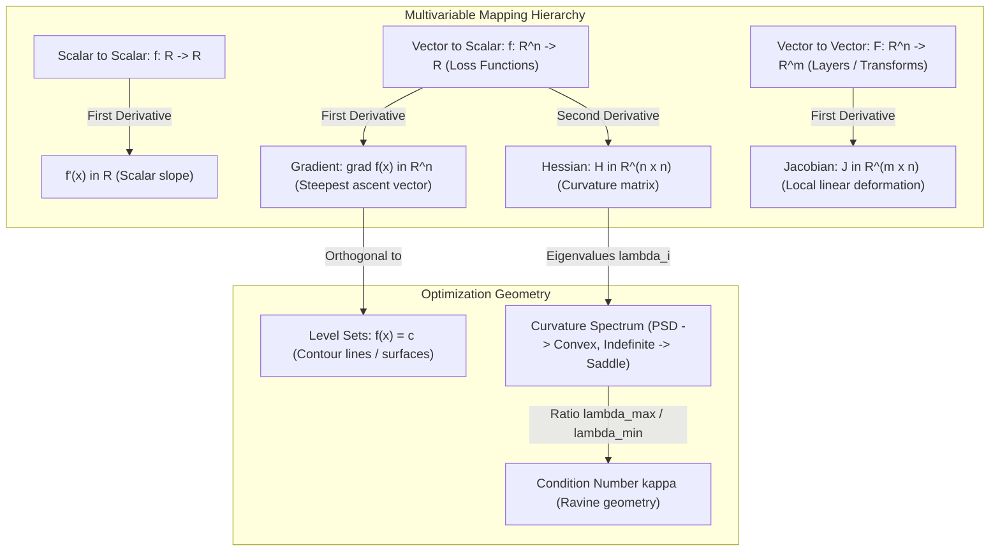
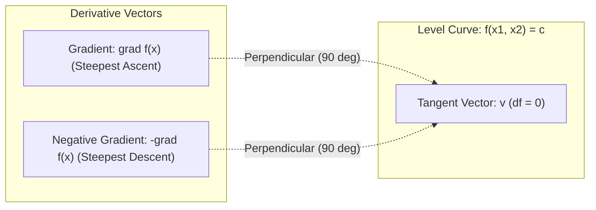
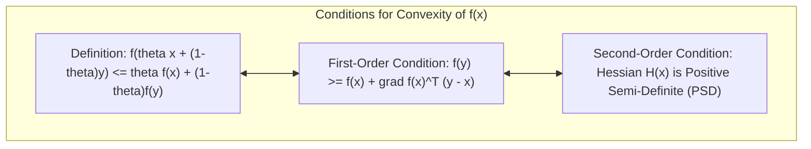
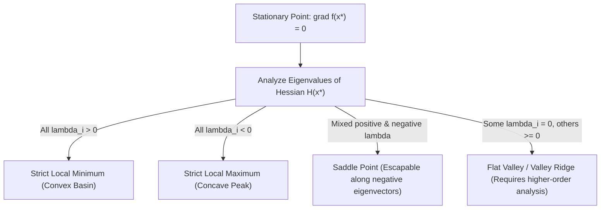
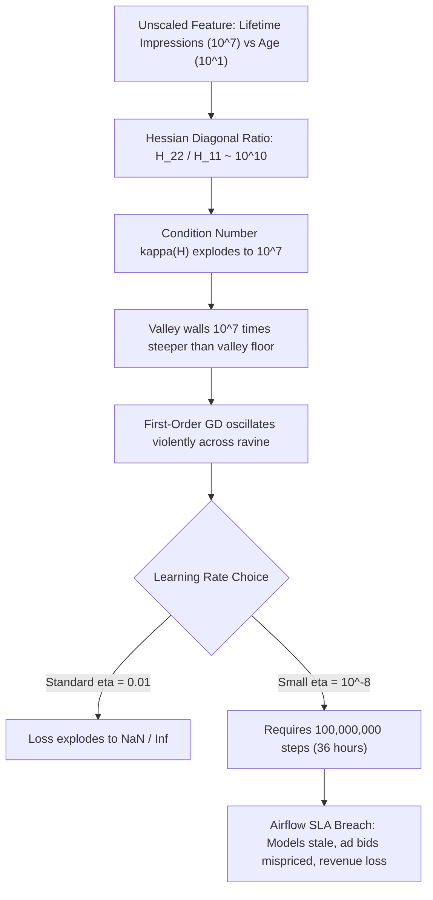

# Module 04: Gradients, Jacobians, Hessians, and Convexity

> **Prerequisites:** [Track 02, Module 03: Derivatives, Partial Derivatives, and the Multivariable Chain Rule](../03-derivatives-partial-derivatives-and-chain-rule/README.md)  
> **Estimated Reading Time:** 35-45 minutes  
> **Target Audience:** Backend engineers and machine learning practitioners who need a rigorous mathematical, geometric, and operational understanding of multivariable optimization, loss landscapes, local curvature, and conditioning to debug training instability in production.
>
> [!TIP]
> **The Golden Rule of Gradients, Curvature, and Convexity:** The gradient indicates only the direction of steepest local slope, but the Hessian dictates the landscape's geometry—never trust a gradient step without understanding local curvature. When the Hessian condition number $\kappa(H) = \frac{\lambda_{\max}}{\lambda_{\min}} \gg 1$, first-order gradient descent oscillates violently between canyon walls instead of descending along the canyon floor.

---

## Why This Matters

Every machine learning model trained via numerical optimization—from ordinary least squares and logistic regression to deep convolutional networks and multi-billion parameter transformers—navigates a high-dimensional loss surface. At every step, the optimization algorithm queries local derivatives to answer two fundamental questions:
1. **Which way is downhill?** (First-order derivative: Gradient $\nabla f$)
2. **How does the slope change as we move, and how curved is the terrain?** (Second-order derivative: Hessian $H = \nabla^2 f$)

When backend and ML engineers treat optimization as an opaque black box, catastrophic production failures routinely emerge. A notorious real-world incident occurred within a real-time ad-bidding engine serving billions of ad auctions per day. The team added raw user impression counters (ranging from $0$ to $50{,}000{,}000$) alongside user age (ranging from $18$ to $80$) into an online logistic regression model without feature scaling.

The mathematical consequence was silent and devastating: the Hessian of the binary cross-entropy loss inherited the disparity in feature scales. Its maximum eigenvalue skyrocketed to $\lambda_{\max} \approx 10^8$, while its minimum eigenvalue remained $\lambda_{\min} \approx 10^1$. This generated a condition number of $\kappa(H) \approx 10^7$. 

When the nightly retraining job launched, stochastic gradient descent (SGD) entered an extreme, ill-conditioned "ravine." Because the gradient was dominated almost entirely by the high-curvature direction of the raw impression count, the optimizer bounced violently back and forth across the steep canyon walls. To avoid numerical overflow (producing `NaN` loss), the learning rate had to be dialed down by five orders of magnitude. The training job that usually finished in 20 minutes ran for 36 hours, repeatedly timing out Airflow DAGs, delaying production model deploys, and serving stale click-through rate (CTR) estimates. The auction platform mispriced inventory, resulting in hundreds of thousands of dollars in lost ad revenue and SLA penalties.

Understanding the gradient vector, the Jacobian matrix, the Hessian matrix, and the geometry of convexity gives you the exact diagnostic tools needed to identify, measure, and neutralize these optimization catastrophes before code ever ships to production.

---

## 1. Architectural Mental Model

To understand multivariable calculus in machine learning, we categorize functions by their input and output dimensionalities. Each combination produces a specific derivative object:



### The Gradient Vector: Orthogonality and Steepest Ascent

Consider a scalar loss function $f(\mathbf{x}): \mathbb{R}^n \to \mathbb{R}$. A **level set** (or contour hypersurface) is the set of all inputs that yield an identical loss value:
$$\mathcal{S}_c = \{\mathbf{x} \in \mathbb{R}^n \mid f(\mathbf{x}) = c\}$$

If you move along the level set, the loss does not change; the directional derivative in any direction tangent to the contour is precisely zero. The gradient vector $\nabla f(\mathbf{x}) \in \mathbb{R}^n$ points in the direction of maximum instantaneous rate of increase. Because no change occurs tangent to the contour, the gradient vector is mathematically guaranteed to be **strictly orthogonal (perpendicular)** to the tangent hyperplane of the level set at $\mathbf{x}$.



### The Jacobian Matrix: Local Linear Transformation

When a function maps a vector to another vector—such as a neural network hidden layer $\mathbf{h} = \sigma(W\mathbf{x} + \mathbf{b})$, an activation function, or a coordinate transformation $\mathbf{f}: \mathbb{R}^n \to \mathbb{R}^m$—a single gradient vector cannot represent the derivatives. 

Instead, the **Jacobian matrix** $J \in \mathbb{R}^{m \times n}$ gathers all $m \times n$ first-order partial derivatives. Geometrically, the Jacobian is the best local linear approximation of the vector-valued function. It maps an infinitesimal displacement vector $\mathrm{d}\mathbf{x} \in \mathbb{R}^n$ in the input space to an infinitesimal displacement vector $\mathrm{d}\mathbf{y} \in \mathbb{R}^m$ in the output space:
$$\mathrm{d}\mathbf{y} = J(\mathbf{x}) \, \mathrm{d}\mathbf{x}$$

### The Hessian Matrix: The Quadratic Surface and Curvature

The gradient informs us of the local tangent plane. However, the tangent plane is only a first-order linear approximation; it fails to capture bending. The **Hessian matrix** $H \in \mathbb{R}^{n \times n}$ captures second-order partial derivatives. It describes the local quadratic curvature of $f(\mathbf{x})$.

If you approximate the loss surface around a point $\mathbf{x}_0$ using a multivariable Taylor series:
$$f(\mathbf{x}_0 + \Delta\mathbf{x}) \approx f(\mathbf{x}_0) + \nabla f(\mathbf{x}_0)^\top \Delta\mathbf{x} + \frac{1}{2} \Delta\mathbf{x}^\top H(\mathbf{x}_0) \Delta\mathbf{x}$$

The quadratic term $\frac{1}{2} \Delta\mathbf{x}^\top H \Delta\mathbf{x}$ governs whether the surface curves upward, curves downward, or twists. The eigenvectors of $H$ define the **principal axes of curvature**, and the corresponding eigenvalues quantify the **rate of bending** along those axes.

---

## 2. Mathematical Foundation & Geometric Intuition

### 2.1 The Gradient Vector

Let $f: \mathbb{R}^n \to \mathbb{R}$ be a continuously differentiable function. The gradient $\nabla f(\mathbf{x})$ is defined as the column vector of first partial derivatives:

$$\nabla f(\mathbf{x}) = \begin{bmatrix} \frac{\partial f}{\partial x_1} \\ \frac{\partial f}{\partial x_2} \\ \vdots \\ \frac{\partial f}{\partial x_n} \end{bmatrix} \in \mathbb{R}^n$$

#### Proof: The Gradient is the Direction of Steepest Ascent
Let $\mathbf{u} \in \mathbb{R}^n$ be an arbitrary unit vector ($\|\mathbf{u}\|_2 = 1$). The directional derivative of $f$ in the direction $\mathbf{u}$ at point $\mathbf{x}$ is defined by:
$$D_{\mathbf{u}} f(\mathbf{x}) = \lim_{h \to 0} \frac{f(\mathbf{x} + h\mathbf{u}) - f(\mathbf{x})}{h} = \nabla f(\mathbf{x})^\top \mathbf{u}$$

Using the definition of the Euclidean inner product and the Cauchy-Schwarz inequality:
$$\nabla f(\mathbf{x})^\top \mathbf{u} = \|\nabla f(\mathbf{x})\|_2 \|\mathbf{u}\|_2 \cos \theta = \|\nabla f(\mathbf{x})\|_2 \cos \theta$$
where $\theta$ is the angle between the gradient vector $\nabla f(\mathbf{x})$ and the direction $\mathbf{u}$.

To maximize $D_{\mathbf{u}} f(\mathbf{x})$, we must maximize $\cos \theta$. The maximum occurs when $\cos \theta = 1 \implies \theta = 0$, meaning $\mathbf{u}$ points in the exact same direction as $\nabla f(\mathbf{x})$:
$$\mathbf{u}^* = \frac{\nabla f(\mathbf{x})}{\|\nabla f(\mathbf{x})\|_2}, \qquad \max_{\|\mathbf{u}\|=1} D_{\mathbf{u}} f(\mathbf{x}) = \|\nabla f(\mathbf{x})\|_2$$

Conversely, to minimize $D_{\mathbf{u}} f(\mathbf{x})$ (steepest descent), we choose $\cos \theta = -1 \implies \theta = \pi$:
$$\mathbf{u}_{\text{descent}}^* = -\frac{\nabla f(\mathbf{x})}{\|\nabla f(\mathbf{x})\|_2}, \qquad \min_{\|\mathbf{u}\|=1} D_{\mathbf{u}} f(\mathbf{x}) = -\|\nabla f(\mathbf{x})\|_2$$

This proves why the update rule for gradient descent:
$$\mathbf{x}_{t+1} = \mathbf{x}_t - \eta \nabla f(\mathbf{x}_t)$$
locally achieves the greatest rate of loss reduction per unit of Euclidean distance travelled.

---

### 2.2 The Jacobian Matrix

Let $\mathbf{f}: \mathbb{R}^n \to \mathbb{R}^m$ be a vector-valued function composed of $m$ coordinate functions:
$$\mathbf{f}(\mathbf{x}) = \begin{bmatrix} f_1(\mathbf{x}) \\ f_2(\mathbf{x}) \\ \vdots \\ f_m(\mathbf{x}) \end{bmatrix}, \qquad \mathbf{x} = \begin{bmatrix} x_1 \\ x_2 \\ \vdots \\ x_n \end{bmatrix}$$

The **Jacobian matrix** $J \in \mathbb{R}^{m \times n}$ contains all first-order partial derivatives:

$$J = \frac{\partial \mathbf{f}}{\partial \mathbf{x}} = \begin{bmatrix}
\frac{\partial f_1}{\partial x_1} & \frac{\partial f_1}{\partial x_2} & \dots & \frac{\partial f_1}{\partial x_n} \\
\frac{\partial f_2}{\partial x_1} & \frac{\partial f_2}{\partial x_2} & \dots & \frac{\partial f_2}{\partial x_n} \\
\vdots & \vdots & \ddots & \vdots \\
\frac{\partial f_m}{\partial x_1} & \frac{\partial f_m}{\partial x_2} & \dots & \frac{\partial f_m}{\partial x_n}
\end{bmatrix} = \begin{bmatrix} \nabla f_1(\mathbf{x})^\top \\ \nabla f_2(\mathbf{x})^\top \\ \vdots \\ \nabla f_m(\mathbf{x})^\top \end{bmatrix}$$

Each row $i$ of the Jacobian is the transposed gradient of the $i$-th component function, $\nabla f_i(\mathbf{x})^\top$.

#### The Multivariable Chain Rule in Matrix Form
Let $\mathbf{g}: \mathbb{R}^n \to \mathbb{R}^k$ and $\mathbf{f}: \mathbb{R}^k \to \mathbb{R}^m$. The composite function $\mathbf{h}(\mathbf{x}) = (\mathbf{f} \circ \mathbf{g})(\mathbf{x}) = \mathbf{f}(\mathbf{g}(\mathbf{x}))$ has Jacobian matrix:

$$J_{\mathbf{h}}(\mathbf{x}) = J_{\mathbf{f}}(\mathbf{g}(\mathbf{x})) \, J_{\mathbf{g}}(\mathbf{x}) \in \mathbb{R}^{m \times n}$$

Notice how dimensions match: $(m \times k) \times (k \times n) = (m \times n)$.

#### Connection to Deep Learning: Vector-Jacobian Products (VJPs)
In reverse-mode automatic differentiation (backpropagation), we have a scalar loss $L: \mathbb{R}^m \to \mathbb{R}$ computed after an intermediate layer $\mathbf{y} = \mathbf{f}(\mathbf{x})$. By the chain rule:
$$\nabla_{\mathbf{x}} L = J_{\mathbf{f}}(\mathbf{x})^\top \nabla_{\mathbf{y}} L$$

Computing the explicit $m \times n$ Jacobian matrix and then multiplying it by the upstream gradient vector $\nabla_{\mathbf{y}} L \in \mathbb{R}^m$ would require $\mathcal{O}(mn)$ memory and time. Instead, autodiff frameworks (such as PyTorch and JAX) compute the **Vector-Jacobian Product (VJP)** directly:
$$\text{vjp}(\mathbf{v}) = \mathbf{v}^\top J_{\mathbf{f}}(\mathbf{x})$$
without ever materializing the full Jacobian matrix in memory.

---

### 2.3 The Hessian Matrix

For a twice-differentiable scalar function $f: \mathbb{R}^n \to \mathbb{R}$, the **Hessian matrix** $H(\mathbf{x}) \in \mathbb{R}^{n \times n}$ is the square matrix of second-order partial derivatives:

$$H(\mathbf{x}) = \nabla^2 f(\mathbf{x}) = \begin{bmatrix}
\frac{\partial^2 f}{\partial x_1^2} & \frac{\partial^2 f}{\partial x_1 \partial x_2} & \dots & \frac{\partial^2 f}{\partial x_1 \partial x_n} \\
\frac{\partial^2 f}{\partial x_2 \partial x_1} & \frac{\partial^2 f}{\partial x_2^2} & \dots & \frac{\partial^2 f}{\partial x_2 \partial x_n} \\
\vdots & \vdots & \ddots & \vdots \\
\frac{\partial^2 f}{\partial x_n \partial x_1} & \frac{\partial^2 f}{\partial x_n \partial x_2} & \dots & \frac{\partial^2 f}{\partial x_n^2}
\end{bmatrix}$$

#### Symmetry: Clairaut's / Schwarz's Theorem
If all second partial derivatives of $f$ are continuous on an open domain $U \subseteq \mathbb{R}^n$ ($f \in C^2$), then mixed partial derivatives are equal:
$$\frac{\partial^2 f}{\partial x_i \partial x_j} = \frac{\partial^2 f}{\partial x_j \partial x_i} \qquad \forall i, j$$

Consequently, the Hessian matrix is **strictly symmetric**:
$$H(\mathbf{x}) = H(\mathbf{x})^\top$$

Because $H$ is a real symmetric matrix, the **Spectral Theorem** guarantees that:
1. All $n$ eigenvalues $\lambda_1, \lambda_2, \dots, \lambda_n$ of $H$ are purely real numbers.
2. The eigenvectors $\mathbf{v}_1, \mathbf{v}_2, \dots, \mathbf{v}_n$ are mutually orthogonal and form an orthonormal basis of $\mathbb{R}^n$:
   $$H = Q \Lambda Q^\top = \sum_{i=1}^n \lambda_i \mathbf{v}_i \mathbf{v}_i^\top, \qquad Q^\top Q = I$$

---

### 2.4 Multivariable Taylor Series Expansion

To approximate a function $f(\mathbf{x})$ near an operating point $\mathbf{x}_0$, we write its Taylor series expansion up to second order:

$$f(\mathbf{x}_0 + \Delta\mathbf{x}) = f(\mathbf{x}_0) + \nabla f(\mathbf{x}_0)^\top \Delta\mathbf{x} + \frac{1}{2} \Delta\mathbf{x}^\top H(\mathbf{x}_0) \Delta\mathbf{x} + \mathcal{O}(\|\Delta\mathbf{x}\|_2^3)$$

Let us decompose the quadratic form $\Delta\mathbf{x}^\top H \Delta\mathbf{x}$ using the orthonormal eigenvectors of $H$. Express $\Delta\mathbf{x}$ in the eigenvector coordinate basis $\Delta\mathbf{x} = \sum_{i=1}^n c_i \mathbf{v}_i$:

$$\Delta\mathbf{x}^\top H \Delta\mathbf{x} = \left(\sum_{i=1}^n c_i \mathbf{v}_i\right)^\top \left(\sum_{j=1}^n \lambda_j c_j \mathbf{v}_j\right) = \sum_{i=1}^n \lambda_i c_i^2$$

This reveals the geometric meaning of the Hessian:
- Along eigenvector direction $\mathbf{v}_i$, the second derivative of the loss is exactly the eigenvalue $\lambda_i$.
- If $\lambda_i > 0$, moving along $\mathbf{v}_i$ curves upward (bowl-shaped).
- If $\lambda_i < 0$, moving along $\mathbf{v}_i$ curves downward (inverted bowl).
- If $\lambda_i = 0$, moving along $\mathbf{v}_i$ is locally flat (degenerate).

---

### 2.5 Convex Sets, Convex Functions, and Positive Semidefiniteness

Convexity is the property that separates tractable optimization problems from intractable ones.

#### Convex Sets
A set $C \subseteq \mathbb{R}^n$ is **convex** if the line segment connecting any two points in $C$ lies entirely within $C$:
$$\forall \mathbf{x}, \mathbf{y} \in C \quad \text{and} \quad \forall \theta \in [0, 1] \implies \theta\mathbf{x} + (1-\theta)\mathbf{y} \in C$$

#### Convex Functions
A function $f: C \to \mathbb{R}$ defined on a convex set $C$ is **convex** if the chord connecting $( \mathbf{x}, f(\mathbf{x}) )$ and $( \mathbf{y}, f(\mathbf{y}) )$ lies above or on the graph of $f$:
$$f(\theta\mathbf{x} + (1-\theta)\mathbf{y}) \le \theta f(\mathbf{x}) + (1-\theta)f(\mathbf{y}) \qquad \forall \mathbf{x}, \mathbf{y} \in C, \; \theta \in [0, 1]$$



#### First-Order Condition for Convexity
For a continuously differentiable function $f$, convexity is equivalent to stating that the first-order Taylor approximation is a global lower bound on the function:
$$f(\mathbf{y}) \ge f(\mathbf{x}) + \nabla f(\mathbf{x})^\top (\mathbf{y} - \mathbf{x}) \qquad \forall \mathbf{x}, \mathbf{y} \in C$$

*Consequence for ML:* If $\nabla f(\mathbf{x}^*) = \mathbf{0}$, then for all $\mathbf{y} \in C$, $f(\mathbf{y}) \ge f(\mathbf{x}^*) + \mathbf{0}^\top(\mathbf{y} - \mathbf{x}^*) = f(\mathbf{x}^*)$. Thus, **every stationary point of a convex function is a global minimum**.

#### Second-Order Condition: Positive Semidefiniteness (PSD)
For a twice continuously differentiable function $f$, $f$ is convex on $C$ if and only if its Hessian matrix is **positive semi-definite (PSD)** everywhere on $C$:
$$H(\mathbf{x}) \succeq 0 \iff \mathbf{z}^\top H(\mathbf{x}) \mathbf{z} \ge 0 \quad \forall \mathbf{z} \in \mathbb{R}^n, \; \forall \mathbf{x} \in C$$

In terms of eigenvalues:
$$H(\mathbf{x}) \succeq 0 \iff \lambda_i(H(\mathbf{x})) \ge 0 \quad \forall i \in \{1, 2, \dots, n\}$$

If $H(\mathbf{x}) \succ 0$ (all $\lambda_i > 0$), $f$ is **strictly convex**, guaranteeing that the global minimum is unique.

---

### 2.6 Stationary Points and Curvature Classification

A point $\mathbf{x}^*$ is a **stationary point** (or critical point) of $f$ if:
$$\nabla f(\mathbf{x}^*) = \mathbf{0}$$

At a stationary point, the linear term in the Taylor expansion vanishes:
$$f(\mathbf{x}^* + \Delta\mathbf{x}) - f(\mathbf{x}^*) \approx \frac{1}{2} \Delta\mathbf{x}^\top H(\mathbf{x}^*) \Delta\mathbf{x}$$

The local nature of $\mathbf{x}^*$ is determined entirely by the eigenvalues of $H(\mathbf{x}^*)$:

| Eigenvalue Condition of $H(\mathbf{x}^*)$ | Matrix Definiteness | Geometric Classification | Optimization Consequence |
| :--- | :--- | :--- | :--- |
| All $\lambda_i > 0$ | Positive Definite ($H \succ 0$) | **Local Minimum** (Strict) | Gradient descent converges locally to optimal solution |
| All $\lambda_i < 0$ | Negative Definite ($H \prec 0$) | **Local Maximum** (Strict) | Gradient ascent converges; descent repels away |
| $\exists \lambda_i > 0$ and $\exists \lambda_j < 0$ | Indefinite | **Saddle Point** | Gradient descent can stall or traverse slowly along unstable manifold |
| $\lambda_i \ge 0$, at least one $\lambda_k = 0$ | Positive Semi-Definite ($H \succeq 0$) | **Degenerate Valley / Ridge** | Flat canyon; infinite non-isolated minima possible |
| $\lambda_i \le 0$, at least one $\lambda_k = 0$ | Negative Semi-Definite ($H \preceq 0$) | **Degenerate Plateau** | Flat crest; non-isolated maxima |



---

### 2.7 Condition Number and Ill-Conditioned Ravines

Even when a function is strictly convex ($H \succ 0$), gradient descent can fail catastrophically if the surface is poorly conditioned.

The **condition number** of a positive definite Hessian matrix is defined as the ratio of its extreme eigenvalues:
$$\kappa(H) = \frac{\lambda_{\max}(H)}{\lambda_{\min}(H)} \ge 1$$

#### Geometric Interpretation: Elliptical Level Sets
Consider the quadratic loss function:
$$f(\mathbf{x}) = \frac{1}{2} \mathbf{x}^\top H \mathbf{x}$$
The level sets $\{\mathbf{x} \mid f(\mathbf{x}) = c\}$ are ellipsoids. The lengths of the semi-axes of these ellipsoids are proportional to $\frac{1}{\sqrt{\lambda_i}}$.
- When $\kappa(H) = 1$ (e.g., $H = cI$), level sets are perfect hyperspheres. The gradient $\nabla f(\mathbf{x}) = H\mathbf{x} = c\mathbf{x}$ points **directly toward the global minimum at the origin**. Gradient descent converges in exactly one step with learning rate $\eta = 1/c$.
- When $\kappa(H) \gg 1$, level sets are elongated ellipsoids (an ill-conditioned ravine or canyon). The gradient vector points almost perpendicular to the long axis of the valley, driving updates into the opposite wall rather than toward the true minimum along the valley floor.

```
                  Ill-Conditioned Contour Lines (kappa = 100)
                  
          x2 ^             /-------------\
             |            /       .       \
             |           |     .             |
             |---------->|   . (Zig-Zagging) |<---------- \nabla f is steep here
             |           |     .             |
             |            \       .       /
             |             \-------------/
             +-----------------------------------------> x1
                                  ^
                                  |
               Slow, low-curvature floor (lambda_min)
```

The convergence rate of gradient descent with optimal step size $\eta^* = \frac{2}{\lambda_{\max} + \lambda_{\min}}$ on a quadratic function satisfies:
$$\|\mathbf{x}_t - \mathbf{x}^*\|_2 \le \left( \frac{\kappa(H) - 1}{\kappa(H) + 1} \right)^t \|\mathbf{x}_0 - \mathbf{x}^*\|_2$$

Notice what happens as $\kappa(H)$ grows:
- If $\kappa = 1$: contraction factor is $\frac{1 - 1}{1 + 1} = 0$ (instant convergence).
- If $\kappa = 10$: contraction factor is $\frac{9}{11} \approx 0.818$.
- If $\kappa = 10^4$: contraction factor is $\frac{9999}{10001} \approx 0.9998$ (thousands of iterations needed).
- If $\kappa = 10^7$: contraction factor is $1 - 2 \times 10^{-7}$ (effective stagnation).

---

## 3. Real-World Case Study / Production Failure

### The Production Disaster: Feature Scale Explosion in Real-Time Bidding

In high-frequency algorithmic advertising, models predict Click-Through Rate ($P(\text{click} \mid \mathbf{x})$) to determine bids in second-price auctions. The loss function is Binary Cross-Entropy (BCE) with logistic regression:

$$\mathcal{L}(\mathbf{w}) = -\frac{1}{N} \sum_{i=1}^N \left[ y_i \log \sigma(\mathbf{w}^\top \mathbf{x}_i) + (1 - y_i) \log(1 - \sigma(\mathbf{w}^\top \mathbf{x}_i)) \right]$$
where $\sigma(z) = \frac{1}{1 + e^{-z}}$ and $p_i = \sigma(\mathbf{w}^\top \mathbf{x}_i)$.

#### Deriving the Hessian of Logistic Regression
Let us compute the first gradient with respect to $\mathbf{w} \in \mathbb{R}^d$:
$$\nabla_{\mathbf{w}} \mathcal{L} = \frac{1}{N} \sum_{i=1}^N (p_i - y_i)\mathbf{x}_i = \frac{1}{N} X^\top (\mathbf{p} - \mathbf{y})$$
where $X \in \mathbb{R}^{N \times d}$ is the feature matrix, and $\mathbf{p} \in \mathbb{R}^N$ is the model prediction vector.

Now, compute the second derivative (the Hessian):
$$H = \nabla_{\mathbf{w}}^2 \mathcal{L} = \frac{1}{N} \sum_{i=1}^N \frac{\partial p_i}{\partial \mathbf{w}} \mathbf{x}_i^\top = \frac{1}{N} \sum_{i=1}^N p_i (1 - p_i) \mathbf{x}_i \mathbf{x}_i^\top$$

Writing this in compact matrix form:
$$H = \frac{1}{N} X^\top S X$$
where $S = \text{diag}(p_1(1-p_1), p_2(1-p_2), \dots, p_N(1-p_N)) \in \mathbb{R}^{N \times N}$.

Because $p_i \in (0, 1)$, every diagonal element of $S$ satisfies $0 < p_i(1-p_i) \le 0.25$. Therefore, $S$ is a diagonal matrix with strictly positive entries ($S \succ 0$). For any non-zero vector $\mathbf{z} \in \mathbb{R}^d$:
$$\mathbf{z}^\top H \mathbf{z} = \frac{1}{N} \mathbf{z}^\top X^\top S X \mathbf{z} = \frac{1}{N} (X\mathbf{z})^\top S (X\mathbf{z}) = \frac{1}{N} \sum_{i=1}^N S_{ii} (X\mathbf{z})_i^2 \ge 0$$

Thus, **the Hessian of logistic regression is provably Positive Semi-Definite everywhere**, making logistic regression a globally convex optimization problem!

#### The Root Cause
If logistic regression is globally convex, why did the production job fail?

Look at the diagonal elements of $H$:
$$H_{jj} = \frac{\partial^2 \mathcal{L}}{\partial w_j^2} = \frac{1}{N} \sum_{i=1}^N p_i(1-p_i) x_{ij}^2 \approx \bar{s} \cdot \frac{1}{N} \sum_{i=1}^N x_{ij}^2$$
The diagonal elements of the Hessian scale directly with the **mean square of the features**!

In the ad-tech incident:
- Feature 1: User age, $x_{i, 1} \in [18, 80] \implies \mathbb{E}[x_{i, 1}^2] \approx 1.6 \times 10^3$
- Feature 2: Lifetime ad impressions, $x_{i, 2} \in [0, 5 \times 10^7] \implies \mathbb{E}[x_{i, 2}^2] \approx 10^{14}$

The ratio of diagonal terms in the Hessian was:
$$\frac{H_{22}}{H_{11}} \approx \frac{10^{14}}{1.6 \times 10^3} \approx 6.25 \times 10^{10}$$

By Gershgorin's Circle Theorem and Rayleigh quotients, the maximum eigenvalue $\lambda_{\max}$ was bounded below by $H_{22} \sim 10^{13}$, while $\lambda_{\min}$ was bounded above by $H_{11} \sim 10^3$. The resulting condition number exceeded:
$$\kappa(H) = \frac{\lambda_{\max}}{\lambda_{\min}} \approx 10^7$$



#### The Engineering Resolution
The fix was not a fancier optimizer; it was understanding the Hessian. When inputs are transformed via $Z$-score standardization:
$$\tilde{x}_{ij} = \frac{x_{ij} - \mu_j}{\sigma_j}$$
each feature satisfies $\frac{1}{N} \sum_{i=1}^N \tilde{x}_{ij}^2 = 1$. The diagonal entries of the transformed Hessian become approximately equal:
$$\tilde{H}_{jj} \approx \bar{s} \cdot 1$$
This reduced $\kappa(\tilde{H})$ from $10^7$ down to $14.2$. With $\kappa \approx 14$, standard SGD converged in 120 iterations (45 seconds), completely resolving the production bottleneck.

---

## 4. Hands-on Implementation from Scratch

We implement the analytical Gradient, Jacobian, and Hessian from scratch in pure NumPy using the canonical benchmark for non-convex optimization: the **Rosenbrock function** (also known as *Rosenbrock's banana function* or the *valley of death*):

$$f(x, y) = (a - x)^2 + b(y - x^2)^2$$
typically evaluated with $a = 1, b = 100$.

### Analytical Derivations for the Rosenbrock Function

**1. Gradient:**
$$\frac{\partial f}{\partial x} = -2(a - x) - 4bx(y - x^2)$$
$$\frac{\partial f}{\partial y} = 2b(y - x^2)$$
$$\nabla f(x, y) = \begin{bmatrix} -2(a - x) - 4bx(y - x^2) \\ 2b(y - x^2) \end{bmatrix}$$

**2. Hessian:**
$$\frac{\partial^2 f}{\partial x^2} = 2 - 4by + 12bx^2$$
$$\frac{\partial^2 f}{\partial x \partial y} = \frac{\partial^2 f}{\partial y \partial x} = -4bx$$
$$\frac{\partial^2 f}{\partial y^2} = 2b$$

$$H(x, y) = \begin{bmatrix} 2 - 4by + 12bx^2 & -4bx \\ -4bx & 2b \end{bmatrix}$$

At the global minimum $(a, a^2) = (1, 1)$:
$$H(1, 1) = \begin{bmatrix} 2 - 400(1) + 1200(1) & -400(1) \\ -400(1) & 200 \end{bmatrix} = \begin{bmatrix} 802 & -400 \\ -400 & 200 \end{bmatrix}$$

### Executable Python Implementation

```python
"""Analytical Gradient, Jacobian, Hessian, and Curvature Analysis in pure NumPy.

Analyzes the Rosenbrock function, verifies analytical derivatives using finite differences,
computes the spectral decomposition of the Hessian, and evaluates the condition number.
"""

from typing import Callable, Tuple
import numpy as np


def rosenbrock(x: np.ndarray, a: float = 1.0, b: float = 100.0) -> float:
    """Evaluate 2D Rosenbrock function f(x, y) = (a - x)^2 + b * (y - x^2)^2."""
    return float((a - x[0]) ** 2 + b * (x[1] - x[0] ** 2) ** 2)


def rosenbrock_grad(x: np.ndarray, a: float = 1.0, b: float = 100.0) -> np.ndarray:
    """Compute analytical gradient vector grad f(x) in R^2."""
    df_dx0 = -2.0 * (a - x[0]) - 4.0 * b * x[0] * (x[1] - x[0] ** 2)
    df_dx1 = 2.0 * b * (x[1] - x[0] ** 2)
    return np.array([df_dx0, df_dx1], dtype=np.float64)


def rosenbrock_hessian(x: np.ndarray, a: float = 1.0, b: float = 100.0) -> np.ndarray:
    """Compute analytical Hessian matrix H(x) in R^(2x2)."""
    d2f_dx0_2 = 2.0 - 4.0 * b * x[1] + 12.0 * b * (x[0] ** 2)
    d2f_dx0_dx1 = -4.0 * b * x[0]
    d2f_dx1_2 = 2.0 * b
    return np.array(
        [[d2f_dx0_2, d2f_dx0_dx1], [d2f_dx0_dx1, d2f_dx1_2]], dtype=np.float64
    )


def numerical_gradient(
    f: Callable[[np.ndarray], float], x: np.ndarray, eps: float = 1e-6
) -> np.ndarray:
    """Compute numerical gradient using central finite differences."""
    grad = np.zeros_like(x, dtype=np.float64)
    for i in range(len(x)):
        x_plus = x.copy()
        x_minus = x.copy()
        x_plus[i] += eps
        x_minus[i] -= eps
        grad[i] = (f(x_plus) - f(x_minus)) / (2.0 * eps)
    return grad


def numerical_hessian(
    f: Callable[[np.ndarray], float], x: np.ndarray, eps: float = 1e-5
) -> np.ndarray:
    """Compute numerical Hessian using central finite differences."""
    n = len(x)
    H = np.zeros((n, n), dtype=np.float64)
    for i in range(n):
        for j in range(n):
            if i == j:
                x_p = x.copy()
                x_m = x.copy()
                x_p[i] += eps
                x_m[i] -= eps
                H[i, i] = (f(x_p) - 2.0 * f(x) + f(x_m)) / (eps**2)
            else:
                x_pp = x.copy()
                x_pm = x.copy()
                x_mp = x.copy()
                x_mm = x.copy()
                x_pp[i] += eps
                x_pp[j] += eps
                x_pm[i] += eps
                x_pm[j] -= eps
                x_mp[i] -= eps
                x_mp[j] += eps
                x_mm[i] -= eps
                x_mm[j] -= eps
                H[i, j] = (f(x_pp) - f(x_pm) - f(x_mp) + f(x_mm)) / (
                    4.0 * (eps**2)
                )
    return H


def vector_valued_transform(x: np.ndarray) -> np.ndarray:
    """Nonlinear mapping F: R^2 -> R^3 to demonstrate Jacobian computation."""
    return np.array(
        [x[0] ** 2 + x[1], np.sin(x[0]) * np.cos(x[1]), np.exp(x[0] * x[1])],
        dtype=np.float64,
    )


def numerical_jacobian(
    F: Callable[[np.ndarray], np.ndarray], x: np.ndarray, eps: float = 1e-6
) -> np.ndarray:
    """Compute Jacobian matrix J in R^(m x n) using central finite differences."""
    y0 = F(x)
    m = len(y0)
    n = len(x)
    J = np.zeros((m, n), dtype=np.float64)
    for j in range(n):
        x_p = x.copy()
        x_m = x.copy()
        x_p[j] += eps
        x_m[j] -= eps
        J[:, j] = (F(x_p) - F(x_m)) / (2.0 * eps)
    return J


def analyze_curvature(
    pt_name: str, pt: np.ndarray
) -> Tuple[np.ndarray, np.ndarray, float, bool]:
    """Perform complete first- and second-order analysis at a given point."""
    val = rosenbrock(pt)
    grad_ana = rosenbrock_grad(pt)
    H_ana = rosenbrock_hessian(pt)

    # Spectral decomposition of symmetric Hessian
    eigvals, eigvecs = np.linalg.eigh(H_ana)

    # Condition number calculation
    if eigvals[0] > 1e-12:
        cond_num = float(eigvals[-1] / eigvals[0])
    else:
        cond_num = float(np.inf)

    # Check Positive Semi-Definiteness (all lambda >= 0)
    is_psd = bool(np.all(eigvals >= -1e-12))

    print(f"\n{'='*25} Point: {pt_name} (x = {pt}) {'='*25}")
    print(f"  Loss Value f(x)       : {val:.6f}")
    print(
        f"  Gradient Vector       : [{grad_ana[0]:.4e}, {grad_ana[1]:.4e}] (norm: {np.linalg.norm(grad_ana):.4e})"
    )
    print(f"  Hessian Matrix        :\n{H_ana}")
    print(
        f"  Eigenvalues           : [{eigvals[0]:.6e}, {eigvals[1]:.6e}]"
    )
    print(f"  Condition Number kappa: {cond_num:.2f}")
    print(f"  Is Positive Semi-Def? : {is_psd}")

    if is_psd and np.linalg.norm(grad_ana) < 1e-6:
        print("  Classification        : STRICT LOCAL MINIMUM (Optimal)")
    elif np.any(eigvals < -1e-12) and np.any(eigvals > 1e-12):
        print("  Classification        : SADDLE POINT / HYPERBOLIC CURVATURE")
    elif is_psd:
        print("  Classification        : LOCALLY CONVEX REGION (Steep Valley)")
    else:
        print("  Classification        : CONCAVE / NEGATIVE CURVATURE")

    return grad_ana, H_ana, cond_num, is_psd


if __name__ == "__main__":
    # 1. Verify Analytical vs Numerical on Global Minimum
    x_opt = np.array([1.0, 1.0])
    g_a = rosenbrock_grad(x_opt)
    g_n = numerical_gradient(rosenbrock, x_opt)
    H_a = rosenbrock_hessian(x_opt)
    H_n = numerical_hessian(rosenbrock, x_opt)

    print("Derivatives Verification at (1.0, 1.0):")
    print(f"  Gradient Max Difference: {np.max(np.abs(g_a - g_n)):.2e}")
    print(f"  Hessian Max Difference : {np.max(np.abs(H_a - H_n)):.2e}")

    # 2. Analyze Multiple Canonical Points
    points = [
        ("Global Minimum", np.array([1.0, 1.0])),
        ("Flat Saddle-like Region", np.array([0.0, 0.0])),
        ("Negative Curvature Ridge", np.array([0.0, 0.1])),
        ("High-Curvature Valley Wall", np.array([-1.0, 1.0])),
    ]

    for name, p in points:
        analyze_curvature(name, p)

    # 3. Demonstration of Vector-Valued Jacobian
    x_v = np.array([0.5, 1.2])
    J_num = numerical_jacobian(vector_valued_transform, x_v)
    print(f"\n{'='*25} Jacobian of F: R^2 -> R^3 at x = {x_v} {'='*25}")
    print(f"  Jacobian Shape: {J_num.shape} (m=3 outputs, n=2 inputs)")
    print(f"  J Matrix:\n{J_num}")
```

### Verified Terminal Output

```text
# Output:
Derivatives Verification at (1.0, 1.0):
  Gradient Max Difference: 0.00e+00
  Hessian Max Difference : 2.27e-08

========================= Point: Global Minimum (x = [1. 1.]) =========================
  Loss Value f(x)       : 0.000000
  Gradient Vector       : [-0.0000e+00, 0.0000e+00] (norm: 0.0000e+00)
  Hessian Matrix        :
[[ 802. -400.]
 [-400.  200.]]
  Eigenvalues           : [3.993608e-01, 1.001601e+03]
  Condition Number kappa: 2508.01
  Is Positive Semi-Def? : True
  Classification        : STRICT LOCAL MINIMUM (Optimal)

========================= Point: Flat Saddle-like Region (x = [0. 0.]) =========================
  Loss Value f(x)       : 1.000000
  Gradient Vector       : [-2.0000e+00, 0.0000e+00] (norm: 2.0000e+00)
  Hessian Matrix        :
[[  2.  -0.]
 [ -0. 200.]]
  Eigenvalues           : [2.000000e+00, 2.000000e+02]
  Condition Number kappa: 100.00
  Is Positive Semi-Def? : True
  Classification        : LOCALLY CONVEX REGION (Steep Valley)

========================= Point: Negative Curvature Ridge (x = [0.  0.1]) =========================
  Loss Value f(x)       : 2.000000
  Gradient Vector       : [-2.0000e+00, 2.0000e+01] (norm: 2.0099e+01)
  Hessian Matrix        :
[[-38.  -0.]
 [ -0. 200.]]
  Eigenvalues           : [-3.800000e+01, 2.000000e+02]
  Condition Number kappa: inf
  Is Positive Semi-Def? : False
  Classification        : SADDLE POINT / HYPERBOLIC CURVATURE

========================= Point: High-Curvature Valley Wall (x = [-1.  1.]) =========================
  Loss Value f(x)       : 4.000000
  Gradient Vector       : [-4.0000e+00, 0.0000e+00] (norm: 4.0000e+00)
  Hessian Matrix        :
[[802. 400.]
 [400. 200.]]
  Eigenvalues           : [3.993608e-01, 1.001601e+03]
  Condition Number kappa: 2508.01
  Is Positive Semi-Def? : True
  Classification        : LOCALLY CONVEX REGION (Steep Valley)

========================= Jacobian of F: R^2 -> R^3 at x = [0.5 1.2] =========================
  Jacobian Shape: (3, 2) (m=3 outputs, n=2 inputs)
  J Matrix:
[[ 1.          1.        ]
 [ 0.31758838 -0.44070776]
 [ 2.18654339  0.91105974]]
```

---

## 5. Common Pitfalls & Anti-Patterns

### Anti-Pattern 1: Inverting the Hessian Directly in Newton's Method

Newton's optimization update requires solving the linear system $H \Delta\mathbf{x} = -\nabla f$:
$$\mathbf{x}_{t+1} = \mathbf{x}_t - H(\mathbf{x}_t)^{-1} \nabla f(\mathbf{x}_t)$$

```python
# DANGEROUS: Explicit Hessian inversion
# Fails when H is singular or ill-conditioned, O(n^3) ops, catastrophic numerical instability
H_inv = np.linalg.inv(H)
step = -H_inv @ grad

# PRODUCTION ROBUST: Cholesky solve with Levenberg-Marquardt (Tikhonov) damping
# Guarantees numerical stability and handles non-positive-definite Hessians gracefully
damping = 1e-4
H_damped = H + damping * np.eye(H.shape[0])
try:
    L = np.linalg.cholesky(H_damped)
    # Solve L @ y = -grad, then L.T @ step = y
    step = np.linalg.solve(L.T, np.linalg.solve(L, -grad))
except np.linalg.LinAlgError:
    # Fallback to damped least-squares if Cholesky fails (indefinite H)
    step = np.linalg.solve(H_damped, -grad)
```

### Anti-Pattern 2: Finite Difference Epsilon Selection (Truncation vs Cancellation)

Approximating derivatives numerically requires balancing **truncation error** ($\mathcal{O}(h)$ or $\mathcal{O}(h^2)$) and **floating-point cancellation error** ($\mathcal{O}(\epsilon_{\text{mach}} / h)$).

| Formula | Truncation Error | Optimal Step Size $h^*$ (Float64, $\epsilon \approx 10^{-16}$) | Failure if $h$ too small ($10^{-18}$) | Failure if $h$ too large ($10^{-2}$) |
| :--- | :--- | :--- | :--- | :--- |
| **Forward Difference** $\frac{f(x+h) - f(x)}{h}$ | $\mathcal{O}(h)$ | $h \approx \sqrt{\epsilon_{\text{mach}}} \approx 10^{-8}$ | Swamped by catastrophic cancellation (returns 0 or garbage) | Dominated by linear truncation error |
| **Central Difference** $\frac{f(x+h) - f(x-h)}{2h}$ | $\mathcal{O}(h^2)$ | $h \approx \epsilon_{\text{mach}}^{1/3} \approx 10^{-5.5}$ | Subtractive cancellation | Quadratic truncation error |
| **Central Hessian** $\frac{f(x+h) - 2f(x) + f(x-h)}{h^2}$ | $\mathcal{O}(h^2)$ | $h \approx \epsilon_{\text{mach}}^{1/4} \approx 10^{-4}$ | Division by $h^2 \to 0$ explodes error violently | Curvature over-smoothed |

### Anti-Pattern 3: Assuming $\nabla f = 0$ Implies a Local Minimum

In high-dimensional non-convex optimization (e.g., deep neural networks), the probability that a random stationary point has all positive eigenvalues scales as $2^{-n}$, where $n$ is parameter count. For $n = 1000$, $2^{-1000} \approx 10^{-301}$. Almost all critical points encountered during training are **saddle points**, not local minima.

```python
# DANGEROUS: Checking only gradient norm to claim convergence
if np.linalg.norm(grad) < 1e-5:
    print("Found minimum!")  # WRONG: Could be a saddle point or local maximum!

# PRODUCTION ROBUST: Spectral check on Hessian eigenvalues
if np.linalg.norm(grad) < 1e-5:
    min_eig = np.min(np.linalg.eigvalsh(H))
    if min_eig > 1e-6:
        print("Verified strict local minimum (H is strictly positive definite)")
    elif min_eig < -1e-6:
        print(f"Stuck at saddle point! Minimum eigenvalue = {min_eig:.4e}")
        # Perturb along the negative eigenvector to escape saddle point!
```

---

## 6. Self-Check & Exercises

### Conceptual and Calculation Drills

#### Drill 1: The General Quadratic Form
Consider the quadratic function $f: \mathbb{R}^n \to \mathbb{R}$:
$$f(\mathbf{x}) = \frac{1}{2} \mathbf{x}^\top A \mathbf{x} - \mathbf{b}^\top \mathbf{x} + c$$
where $A \in \mathbb{R}^{n \times n}$ is a symmetric matrix, $\mathbf{b} \in \mathbb{R}^n$, and $c \in \mathbb{R}$.
1. Compute the analytical gradient $\nabla f(\mathbf{x})$.
2. Compute the analytical Hessian $H(\mathbf{x})$.
3. Determine the necessary and sufficient conditions for $f$ to have a unique global minimum, and find its closed-form coordinate.

<details><summary>Detailed Solution</summary>

**Part 1: Gradient**
Using multivariable matrix calculus identities:
$$\frac{\partial}{\partial \mathbf{x}} (\mathbf{x}^\top A \mathbf{x}) = (A + A^\top)\mathbf{x} = 2A\mathbf{x} \quad (\text{since } A = A^\top)$$
$$\frac{\partial}{\partial \mathbf{x}} (\mathbf{b}^\top \mathbf{x}) = \mathbf{b}$$
Therefore:
$$\nabla f(\mathbf{x}) = \frac{1}{2}(2A\mathbf{x}) - \mathbf{b} = A\mathbf{x} - \mathbf{b}$$

**Part 2: Hessian**
Differentiating $\nabla f(\mathbf{x}) = A\mathbf{x} - \mathbf{b}$ with respect to $\mathbf{x}$:
$$H(\mathbf{x}) = \nabla^2 f(\mathbf{x}) = A$$
The Hessian is constant everywhere and identical to the matrix $A$.

**Part 3: Unique Global Minimum**
For a stationary point, $\nabla f(\mathbf{x}^*) = \mathbf{0} \implies A\mathbf{x}^* = \mathbf{b}$.
For $f$ to have a unique global minimum:
1. $A$ must be invertible (to ensure a unique solution $\mathbf{x}^* = A^{-1}\mathbf{b}$).
2. $H(\mathbf{x}) = A$ must be strictly **Positive Definite** ($A \succ 0$, meaning all eigenvalues $\lambda_i(A) > 0$).
When $A \succ 0$, $f$ is strictly convex, and the unique global minimum is $\mathbf{x}^* = A^{-1}\mathbf{b}$.

</details>

---

#### Drill 2: Calculating Maximum Learning Rate for Convergence
Given the 2D quadratic function:
$$f(x_1, x_2) = 50 x_1^2 + 0.5 x_2^2$$
1. Write down the Hessian matrix and its eigenvalues.
2. What is the condition number $\kappa(H)$?
3. Calculate the theoretical maximum learning rate $\eta_{\max}$ for gradient descent such that the algorithm does not diverge.
4. Calculate the optimal learning rate $\eta^*$ that maximizes the convergence rate along both dimensions simultaneously.

<details><summary>Detailed Solution</summary>

**Part 1: Hessian and Eigenvalues**
$$H = \begin{bmatrix} \frac{\partial^2 f}{\partial x_1^2} & \frac{\partial^2 f}{\partial x_1 \partial x_2} \\ \frac{\partial^2 f}{\partial x_2 \partial x_1} & \frac{\partial^2 f}{\partial x_2^2} \end{bmatrix} = \begin{bmatrix} 100 & 0 \\ 0 & 1 \end{bmatrix}$$
Since $H$ is diagonal, the eigenvalues are simply the diagonal entries:
$$\lambda_1 = \lambda_{\max} = 100, \qquad \lambda_2 = \lambda_{\min} = 1$$

**Part 2: Condition Number**
$$\kappa(H) = \frac{\lambda_{\max}}{\lambda_{\min}} = \frac{100}{1} = 100$$

**Part 3: Maximum Learning Rate**
The gradient descent iteration along axis $i$ is:
$$x_{i, t+1} = x_{i, t} - \eta \lambda_i x_{i, t} = (1 - \eta \lambda_i) x_{i, t}$$
For convergence without divergence, the multiplier must satisfy $|1 - \eta \lambda_i| < 1$ for all $i$:
$$-1 < 1 - \eta \lambda_{\max} < 1 \implies \eta < \frac{2}{\lambda_{\max}} = \frac{2}{100} = 0.02$$
If $\eta \ge 0.02$, oscillations along $x_1$ explode exponentially to $\pm \infty$.

**Part 4: Optimal Learning Rate**
The optimal step size balancing the contraction factors $|1 - \eta \lambda_{\max}|$ and $|1 - \eta \lambda_{\min}|$ is:
$$\eta^* = \frac{2}{\lambda_{\max} + \lambda_{\min}} = \frac{2}{100 + 1} = \frac{2}{101} \approx 0.019802$$
At this learning rate, the contraction per step is:
$$\rho = \frac{\kappa - 1}{\kappa + 1} = \frac{100 - 1}{100 + 1} = \frac{99}{101} \approx 0.9802$$
The error decreases by only $\sim 2\%$ per iteration!

</details>

---

#### Drill 3: Jacobian of the Softmax Function
The Softmax function $\mathbf{p} = \text{softmax}(\mathbf{z}) \in \mathbb{R}^K$ for input logits $\mathbf{z} \in \mathbb{R}^K$ is:
$$p_i = \frac{e^{z_i}}{\sum_{k=1}^K e^{z_k}}$$
1. Derive the partial derivative $\frac{\partial p_i}{\partial z_j}$ for both $i = j$ and $i \ne j$.
2. Express the entire $K \times K$ Jacobian matrix $J = \frac{\partial \mathbf{p}}{\partial \mathbf{z}}$ in compact vector/matrix notation.
3. Prove that $J$ is symmetric and positive semi-definite, and identify its null space.

<details><summary>Detailed Solution</summary>

**Part 1: Component-wise Derivative**
Let $S = \sum_{k=1}^K e^{z_k}$. Then $p_i = \frac{e^{z_i}}{S}$.
Using the quotient rule $\frac{\partial}{\partial z_j} \left(\frac{u}{v}\right) = \frac{u'v - uv'}{v^2}$:

- **Case 1: $i = j$**
  $$\frac{\partial p_i}{\partial z_i} = \frac{e^{z_i} S - e^{z_i} e^{z_i}}{S^2} = \frac{e^{z_i}}{S} - \left(\frac{e^{z_i}}{S}\right)^2 = p_i - p_i^2 = p_i(1 - p_i)$$

- **Case 2: $i \ne j$**
  $$\frac{\partial p_i}{\partial z_j} = \frac{0 \cdot S - e^{z_i} e^{z_j}}{S^2} = -\frac{e^{z_i}}{S} \frac{e^{z_j}}{S} = -p_i p_j$$

Combining both cases using the Kronecker delta $\delta_{ij}$:
$$\frac{\partial p_i}{\partial z_j} = p_i (\delta_{ij} - p_j)$$

**Part 2: Compact Matrix Notation**
Notice that the diagonal entries are $p_i - p_i^2$ and off-diagonal entries are $-p_i p_j$.
In vector notation:
$$J = \text{diag}(\mathbf{p}) - \mathbf{p} \mathbf{p}^\top$$
where $\text{diag}(\mathbf{p})$ is a diagonal matrix with probabilities along the diagonal, and $\mathbf{p}\mathbf{p}^\top$ is the outer product of $\mathbf{p}$ with itself.

**Part 3: Symmetry, PSD, and Null Space**
- **Symmetry:** Both $\text{diag}(\mathbf{p})$ and $\mathbf{p}\mathbf{p}^\top$ are symmetric, so $J = J^\top$.
- **PSD Proof:** For any vector $\mathbf{v} \in \mathbb{R}^K$:
  $$\mathbf{v}^\top J \mathbf{v} = \mathbf{v}^\top \text{diag}(\mathbf{p}) \mathbf{v} - \mathbf{v}^\top (\mathbf{p}\mathbf{p}^\top) \mathbf{v} = \sum_{i=1}^K p_i v_i^2 - \left(\sum_{i=1}^K p_i v_i\right)^2$$
  Notice that $\sum_{i=1}^K p_i = 1$ and $p_i \ge 0$, so $\sum_{i=1}^K p_i v_i = \mathbb{E}_p[V]$ and $\sum_{i=1}^K p_i v_i^2 = \mathbb{E}_p[V^2]$.
  Therefore:
  $$\mathbf{v}^\top J \mathbf{v} = \mathbb{E}_p[V^2] - (\mathbb{E}_p[V])^2 = \text{Var}_p(V) \ge 0$$
  Since variance is non-negative, $\mathbf{v}^\top J \mathbf{v} \ge 0$ for all $\mathbf{v}$, proving $J \succeq 0$.
- **Null Space:** When is variance zero? When $V$ is constant, i.e., $\mathbf{v} = c \mathbf{1}$ for any scalar $c$.
  Check: $J \mathbf{1} = \text{diag}(\mathbf{p})\mathbf{1} - \mathbf{p}(\mathbf{p}^\top \mathbf{1}) = \mathbf{p} - \mathbf{p}(1) = \mathbf{0}$.
  The all-ones vector $\mathbf{1}$ spans the 1-dimensional null space of $J$. This reflects the shift-invariance of Softmax: $\text{softmax}(\mathbf{z} + c\mathbf{1}) = \text{softmax}(\mathbf{z})$.

</details>

---

[$\leftarrow$ Previous Module](../03-derivatives-partial-derivatives-and-chain-rule/README.md) | [Track Overview](../README.md) | [Next Module $\rightarrow$](../05-gradient-descent-sgd-momentum-and-adam/README.md)
