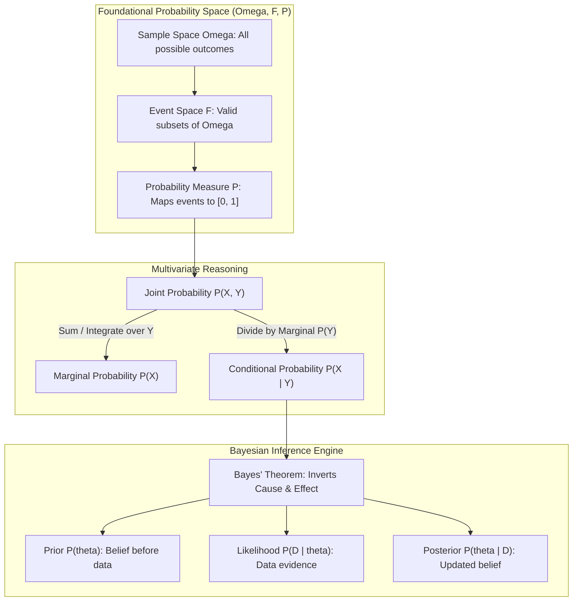
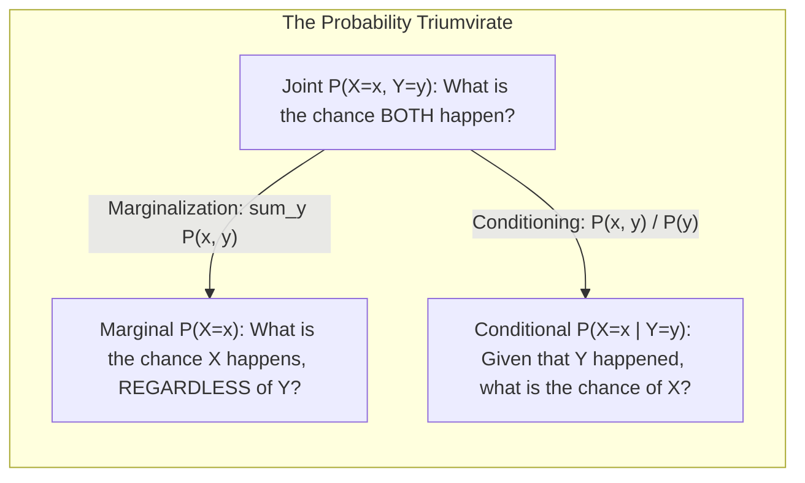
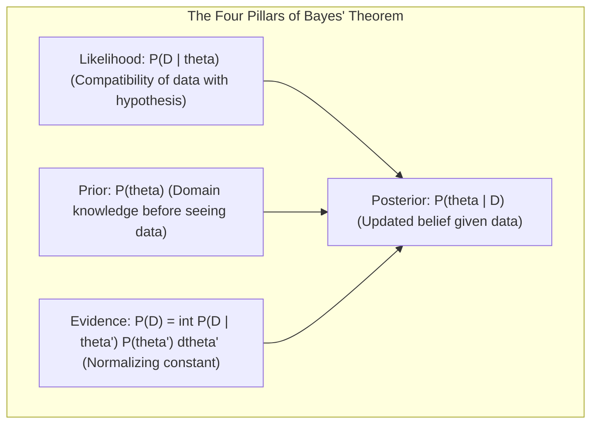
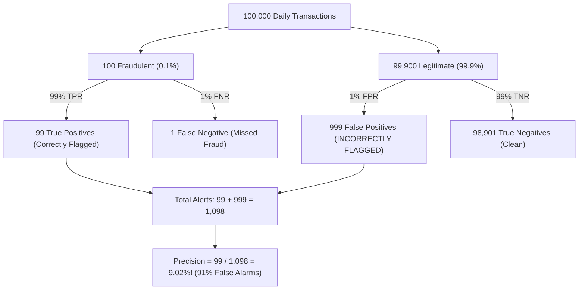

# Module 06: Probability Distributions, Expectation, and Bayes Theorem

> **Prerequisites:** [Track 02, Module 05: Gradient Descent: Batch, SGD, Momentum, and Adam](../05-gradient-descent-sgd-momentum-and-adam/README.md)  
> **Estimated Reading Time:** 35-45 minutes  
> **Target Audience:** Backend engineers and machine learning practitioners who need an uncompromising mathematical foundation in probability spaces, conditional reasoning, expectation algebra, multivariate Gaussian geometry, and Bayesian inference to design reliable probabilistic services.
>
> [!TIP]
> **The Golden Rule of Bayesian Reasoning:** High classifier accuracy ($P(\text{Alert} \mid \text{Fraud})$) is meaningless without the base rate ($P(\text{Fraud})$)—in low-prevalence regimes, false positives mathematically overpower true detections. Always condition on evidence by dividing by the total marginal probability of that evidence: never confuse likelihood with posterior probability.

---

## Why This Matters

Every machine learning system operates under conditions of fundamental uncertainty: sensor noise, incomplete user telemetry, label ambiguity, and non-deterministic environment transitions. Deterministic thinking leads to brittle production systems that fail silently or catastrophically when presented with novel distributions.

A classic, costly real-world incident occurred at a multinational financial payments processor. The fraud engineering team trained an ad-click/transaction fraud classifier that achieved a stellar **99% Sensitivity (Recall / True Positive Rate)** and a **99% Specificity (True Negative Rate / 1% False Positive Rate)** on offline validation sets.

Confident in these metrics, the platform team deployed an automated mitigation pipeline: any transaction flagged by the model was immediately blocked, and the associated card was frozen. 

Within 48 hours, customer support channels were overwhelmed by thousands of enraged customers. High-net-worth clients attempting legitimate purchases of luxury goods, international travel flights, and home furnishings found their accounts locked. Over **90.9% of all blocked transactions were false positives**! The platform processed \$50,000,000 in daily volume, and the automated system blocked \$550,000 in transactions—of which \$500,000 were entirely legitimate payments. In addition to losing transaction processing fees, the company suffered catastrophic customer churn and brand damage.

The root cause was the **Base Rate Fallacy (False Positive Paradox)**. The actual incidence (prevalence) of fraudulent transactions was 1 in 1,000 ($0.1\%$). When a rare event is evaluated against a 1% false positive rate across 99.9% of innocent transactions, the volume of false alarms overwhelms true detections by a factor of ten to one.

Understanding probability distributions, expectation algebra, covariance geometry, and Bayes' theorem allows you to build probabilistic architectures that calibrate risk, make mathematically sound decisions under uncertainty, and avoid catastrophic production blunders.

---

## 1. Architectural Mental Model

Probability theory provides the formal mathematical language for reasoning about uncertainty. In backend and machine learning systems, we model data generation and inference as a hierarchy of probabilistic operations:



### The Three Fundamental Perspectives: Joint, Marginal, Conditional

Consider two random variables: $X$ (the true state: e.g., Fraud vs. Legitimate) and $Y$ (the observable signal: e.g., Model Alert vs. Normal).



1. **Joint Probability $P(X, Y)$:** The complete probabilistic description of the universe. It specifies the probability of observing specific values for both variables simultaneously.
2. **Marginal Probability $P(X)$:** The probability of $X$ alone, obtained by "summing out" or "integrating out" (marginalizing) all other variables:
   $$P(X = x) = \sum_{y} P(X = x, Y = y) \qquad \text{or} \qquad p(x) = \int p(x, y) \, \mathrm{d}y$$
3. **Conditional Probability $P(X \mid Y)$:** The updated probability of $X$ given that variable $Y$ has been observed:
   $$P(X = x \mid Y = y) = \frac{P(X = x, Y = y)}{P(Y = y)}$$

### Bayes' Theorem as an Information Inverter

In production systems, forward data generation (the **Likelihood**) is often straightforward to simulate or measure: if a user is fraudulent, what is the chance their transaction generates an alert?
$$P(\text{Alert} \mid \text{Fraud})$$

However, operational engineering requires the inverse query (the **Posterior**): given that an alert just fired in production, what is the probability that the user is actually fraudulent?
$$P(\text{Fraud} \mid \text{Alert})$$

Bayes' theorem is the exact mathematical engine that inverts conditional dependencies by combining the observed likelihood with the prior base rate:

$$\text{Posterior} = \frac{\text{Likelihood} \times \text{Prior}}{\text{Evidence}}$$

---

## 2. Mathematical Foundation & Geometric Intuition

### 2.1 Sample Spaces, Event Algebras, and Kolmogorov Axioms

Modern probability is built upon the **Kolmogorov Axiom System** over a probability space $(\Omega, \mathcal{F}, P)$:
1. **Sample Space $\Omega$:** The set of all possible outcomes $\omega \in \Omega$.
2. **Event Space $\mathcal{F}$:** A $\sigma$-algebra of subsets of $\Omega$ satisfying:
   - $\Omega \in \mathcal{F}$
   - Closed under complementation: $A \in \mathcal{F} \implies A^c \in \mathcal{F}$
   - Closed under countable unions: $A_1, A_2, \dots \in \mathcal{F} \implies \bigcup_{i=1}^\infty A_i \in \mathcal{F}$
3. **Probability Measure $P$:** A function $P: \mathcal{F} \to [0, 1]$ satisfying:
   - **Axiom 1 (Non-negativity):** $P(A) \ge 0$ for all $A \in \mathcal{F}$.
   - **Axiom 2 (Unitarity):** $P(\Omega) = 1$.
   - **Axiom 3 ($\sigma$-Additivity):** For any countable collection of mutually disjoint events $A_1, A_2, \dots$ ($A_i \cap A_j = \emptyset$ for $i \ne j$):
     $$P\left( \bigcup_{i=1}^\infty A_i \right) = \sum_{i=1}^\infty P(A_i)$$

From these three axioms, all foundational properties follow:
- $P(\emptyset) = 0$
- $P(A^c) = 1 - P(A)$
- **Inclusion-Exclusion Principle:** $P(A \cup B) = P(A) + P(B) - P(A \cap B)$
- If $A \subseteq B$, then $P(A) \le P(B)$.

---

### 2.2 Conditional Probability and the Chain Rule

The conditional probability of event $A$ given event $B$ (with $P(B) > 0$) is defined as:
$$P(A \mid B) = \frac{P(A \cap B)}{P(B)}$$

Rearranging yields the **Product Rule**:
$$P(A \cap B) = P(A \mid B) P(B) = P(B \mid A) P(A)$$

#### The General Chain Rule of Probability
For any collection of $n$ events or random variables $X_1, X_2, \dots, X_n$:
$$P(X_1, X_2, \dots, X_n) = P(X_1) \prod_{i=2}^n P(X_i \mid X_1, X_2, \dots, X_{i-1})$$

*Machine Learning Consequence:* This chain rule is the mathematical foundation of **autoregressive generative models** (such as GPT-4, Llama, and Claude), where the probability of a text sequence is factored token by token:
$$P(w_1, w_2, \dots, w_T) = \prod_{t=1}^T P(w_t \mid w_1, \dots, w_{t-1})$$

---

### 2.3 Bayes' Theorem: Derivation and Components

Equating the two forms of the product rule:
$$P(A \cap B) = P(B \mid A) P(A) = P(A \mid B) P(B)$$

Dividing both sides by $P(B)$:

$$P(A \mid B) = \frac{P(B \mid A) P(A)}{P(B)}$$

Using the **Law of Total Probability**, if $\{A_1, A_2, \dots, A_K\}$ forms a partition of $\Omega$ ($\bigcup_{k=1}^K A_k = \Omega$ and $A_i \cap A_j = \emptyset$):
$$P(B) = \sum_{k=1}^K P(B \cap A_k) = \sum_{k=1}^K P(B \mid A_k) P(A_k)$$

Substituting the law of total probability into the denominator:

$$P(A_i \mid B) = \frac{P(B \mid A_i) P(A_i)}{\sum_{k=1}^K P(B \mid A_k) P(A_k)}$$



- **Prior $P(\theta)$:** Our prior belief about parameter or class $\theta$ before observing current data.
- **Likelihood $P(\mathcal{D} \mid \theta)$:** The probability that the observed dataset $\mathcal{D}$ would be produced under parameter $\theta$.
- **Evidence / Marginal Likelihood $P(\mathcal{D})$:** The total probability of observing the data across all hypotheses. It acts as a normalizing constant ensuring that $\int P(\theta \mid \mathcal{D}) \, \mathrm{d}\theta = 1$.
- **Posterior $P(\theta \mid \mathcal{D})$:** The updated, calibrated probability distribution over $\theta$ after absorbing the evidence.

---

### 2.4 Discrete Probability Distributions in ML

#### 1. The Bernoulli Distribution
Models a single binary outcome $X \in \{0, 1\}$ with success parameter $p \in [0, 1]$:
$$P(X = x) = p^x (1 - p)^{1 - x}, \qquad x \in \{0, 1\}$$
- Expectation: $\mathbb{E}[X] = p$
- Variance: $\text{Var}(X) = p(1 - p)$
- *ML Use Case:* Binary classification targets, logistic regression outputs, dropout masks.

#### 2. The Categorical (Multinoulli) Distribution
Generalizes the Bernoulli to $K$ mutually exclusive categories. Represented as a one-hot vector $\mathbf{x} \in \{0, 1\}^K$ with $\sum_{k=1}^K x_k = 1$ and probability vector $\mathbf{p} = [p_1, \dots, p_K]^\top$ ($\sum_{k=1}^K p_k = 1$):
$$P(\mathbf{X} = \mathbf{x}) = \prod_{k=1}^K p_k^{x_k}$$
- Expectation: $\mathbb{E}[\mathbf{X}] = \mathbf{p}$
- Covariance Matrix: $\text{Cov}(\mathbf{X}) = \text{diag}(\mathbf{p}) - \mathbf{p}\mathbf{p}^\top$
- *ML Use Case:* Multiclass classification outputs (Softmax layer), language model next-token prediction.

#### 3. The Poisson Distribution
Models the number of discrete events $k \in \{0, 1, 2, \dots\}$ occurring in a fixed interval of time or space, given an average rate $\lambda > 0$:
$$P(X = k) = \frac{\lambda^k e^{-\lambda}}{k!}$$
- Expectation: $\mathbb{E}[X] = \lambda$
- Variance: $\text{Var}(X) = \lambda$ (Equidispersion property)
- *ML Use Case:* Server request arrivals, API rate-limiting thresholds, customer call volume forecasting, ride-share booking demand.

---

### 2.5 Continuous Probability Distributions in ML

For a continuous random variable $X$, probabilities over single points are zero ($P(X = x) = 0$). Probabilities are defined over intervals via a **Probability Density Function (PDF)** $p(x) \ge 0$:
$$P(a \le X \le b) = \int_a^b p(x) \, \mathrm{d}x, \qquad \int_{-\infty}^\infty p(x) \, \mathrm{d}x = 1$$

> [!WARNING]
> A probability density $p(x)$ is **not** a probability! Density can exceed $1.0$ (for example, a uniform distribution on $[0, 0.1]$ has density $p(x) = 10$). Only the integral of density over an interval represents a probability.

#### 1. The Continuous Uniform Distribution $\mathcal{U}(a, b)$
$$p(x) = \begin{cases} \frac{1}{b - a} & \text{if } a \le x \le b \\ 0 & \text{otherwise} \end{cases}$$
- Expectation: $\mathbb{E}[X] = \frac{a + b}{2}$
- Variance: $\text{Var}(X) = \frac{(b - a)^2}{12}$
- *ML Use Case:* Hyperparameter random search, Glorot/Xavier uniform weight initialization.

#### 2. The Univariate Gaussian (Normal) Distribution $\mathcal{N}(\mu, \sigma^2)$
$$p(x) = \frac{1}{\sqrt{2\pi \sigma^2}} \exp\left( -\frac{(x - \mu)^2}{2\sigma^2} \right)$$
- Expectation: $\mathbb{E}[X] = \mu$
- Variance: $\text{Var}(X) = \sigma^2$
- **The Empirical Rule (68-95-99.7):**
  - $\mu \pm 1\sigma$ covers $68.27\%$ of probability mass.
  - $\mu \pm 2\sigma$ covers $95.45\%$ of probability mass.
  - $\mu \pm 3\sigma$ covers $99.73\%$ of probability mass.

---

### 2.6 The Multivariate Normal Distribution and Covariance Geometry

Let $\mathbf{X} \in \mathbb{R}^d$ be a random vector. The **Multivariate Gaussian Distribution** $\mathcal{N}(\boldsymbol{\mu}, \Sigma)$ has PDF:

$$p(\mathbf{x}) = \frac{1}{(2\pi)^{d/2} |\Sigma|^{1/2}} \exp\left( -\frac{1}{2} (\mathbf{x} - \boldsymbol{\mu})^\top \Sigma^{-1} (\mathbf{x} - \boldsymbol{\mu}) \right)$$
where $\boldsymbol{\mu} \in \mathbb{R}^d$ is the mean vector and $\Sigma \in \mathbb{R}^{d \times d}$ is the symmetric positive-definite **Covariance Matrix**:

$$\Sigma = \mathbb{E}[(\mathbf{X} - \boldsymbol{\mu})(\mathbf{X} - \boldsymbol{\mu})^\top] = \begin{bmatrix}
\text{Var}(X_1) & \text{Cov}(X_1, X_2) & \dots & \text{Cov}(X_1, X_d) \\
\text{Cov}(X_2, X_1) & \text{Var}(X_2) & \dots & \text{Cov}(X_2, X_d) \\
\vdots & \vdots & \ddots & \vdots \\
\text{Cov}(X_d, X_1) & \text{Cov}(X_d, X_2) & \dots & \text{Var}(X_d)
\end{bmatrix}$$

#### Geometric Meaning of Mahalanobis Distance
The quadratic form in the exponent is the squared **Mahalanobis Distance**:
$$D_M^2(\mathbf{x}, \boldsymbol{\mu}) = (\mathbf{x} - \boldsymbol{\mu})^\top \Sigma^{-1} (\mathbf{x} - \boldsymbol{\mu})$$

Contour surfaces of constant probability density satisfy:
$$\{\mathbf{x} \in \mathbb{R}^d \mid (\mathbf{x} - \boldsymbol{\mu})^\top \Sigma^{-1} (\mathbf{x} - \boldsymbol{\mu}) = c^2\}$$

These level sets are **hyper-ellipsoids** centered at $\boldsymbol{\mu}$.
Decomposing $\Sigma = Q \Lambda Q^\top$, where $Q = [\mathbf{v}_1, \dots, \mathbf{v}_d]$ are orthonormal eigenvectors and $\Lambda = \text{diag}(\lambda_1, \dots, \lambda_d)$:
- The **principal axes** of the ellipsoid point in the directions of the eigenvectors $\mathbf{v}_i$.
- The **semi-axis lengths** of the $c$-sigma confidence ellipsoid are equal to $c \sqrt{\lambda_i}$.
- For a $d$-dimensional Gaussian, the squared Mahalanobis distance follows a **Chi-Square distribution** with $d$ degrees of freedom:
  $$D_M^2(\mathbf{X}, \boldsymbol{\mu}) \sim \chi^2(d)$$

```
                     Multivariate Gaussian Geometry (d = 2)
                     
              x2 ^                   /-----------\  (c = 2 contour)
                 |                 /      ^       \
                 |               /        | v2     \
                 |              |         |         |
                 |              |    <----+---->    |  <-- Principal axis v1
                 |              |         mu        |      Semi-axis = c * sqrt(lambda1)
                 |               \                 /
                 |                 \-------------/
                 +---------------------------------------------> x1
```

---

### 2.7 Expectation, Variance, and Covariance Algebra

#### Linearity of Expectation (Always True)
For any two random variables $X$ and $Y$ (regardless of whether they are independent, correlated, or non-linearly dependent) and constants $a, b, c \in \mathbb{R}$:
$$\mathbb{E}[aX + bY + c] = a\mathbb{E}[X] + b\mathbb{E}[Y] + c$$

#### Variance Algebra
$$\text{Var}(X) = \mathbb{E}[(X - \mathbb{E}[X])^2] = \mathbb{E}[X^2] - (\mathbb{E}[X])^2$$
$$\text{Var}(aX + c) = a^2 \text{Var}(X)$$

For a sum of two variables:
$$\text{Var}(X + Y) = \text{Var}(X) + \text{Var}(Y) + 2\text{Cov}(X, Y)$$

#### Covariance and Pearson Correlation
$$\text{Cov}(X, Y) = \mathbb{E}[(X - \mathbb{E}[X])(Y - \mathbb{E}[Y])] = \mathbb{E}[XY] - \mathbb{E}[X]\mathbb{E}[Y]$$

The normalized **Pearson Correlation Coefficient** $\rho_{XY} \in [-1, 1]$:
$$\rho_{XY} = \frac{\text{Cov}(X, Y)}{\sigma_X \sigma_Y} = \frac{\text{Cov}(X, Y)}{\sqrt{\text{Var}(X)\text{Var}(Y)}}$$

---

### 2.8 Independence vs. Zero Correlation

Two random variables are **statistically independent** ($X \perp Y$) if and only if their joint distribution factors into the product of marginals:
$$P(X \in A, Y \in B) = P(X \in A) P(Y \in B) \qquad \forall A, B$$
or equivalently, $p(x, y) = p(x) p(y)$.

#### Theorem: Independence Implies Uncorrelatedness
If $X$ and $Y$ are independent:
$$\mathbb{E}[XY] = \iint xy \, p(x, y) \, \mathrm{d}x \mathrm{d}y = \int x p(x) \, \mathrm{d}x \int y p(y) \, \mathrm{d}y = \mathbb{E}[X] \mathbb{E}[Y]$$
Therefore:
$$\text{Cov}(X, Y) = \mathbb{E}[XY] - \mathbb{E}[X]\mathbb{E}[Y] = \mathbb{E}[X]\mathbb{E}[Y] - \mathbb{E}[X]\mathbb{E}[Y] = 0$$

#### The Counterexample: Zero Correlation Does NOT Imply Independence!
Correlation measures only **linear** dependency. Two variables can have a zero correlation coefficient while having a deterministic non-linear relationship.

**Rigorous Counterexample:**
Let $X \sim \mathcal{U}(-1, 1)$, and let $Y = X^2$.
- Because the PDF of $X$ is symmetric around zero:
  $$\mathbb{E}[X] = 0$$
  $$\mathbb{E}[XY] = \mathbb{E}[X \cdot X^2] = \mathbb{E}[X^3] = \int_{-1}^1 x^3 \left(\frac{1}{2}\right) \mathrm{d}x = \left[ \frac{x^4}{8} \right]_{-1}^1 = \frac{1}{8} - \frac{1}{8} = 0$$
- Thus, the covariance is:
  $$\text{Cov}(X, Y) = \mathbb{E}[XY] - \mathbb{E}[X]\mathbb{E}[Y] = 0 - (0 \cdot \mathbb{E}[Y]) = 0$$
  The correlation coefficient is **identically zero** ($\rho_{XY} = 0$).

However, $X$ and $Y$ are completely dependent: if you know $X = 0.5$, $Y$ is guaranteed to be $0.25$ with probability $1.0$!

> [!IMPORTANT]
> The single exception to this rule is the **Joint Multivariate Normal Distribution**: if two random variables are *jointly* Gaussian and $\text{Cov}(X, Y) = 0$, then and only then are they strictly independent ($X \perp Y$).

---

## 3. Real-World Case Study / Production Failure

### The Fraud Engine Outage: The Base Rate Fallacy

#### The Architecture
A payment processing platform handles $N = 100{,}000$ transactions per day. The true fraud rate (prevalence) is 1 in 1,000:
$$P(\text{Fraud}) = 0.001 \implies 100 \text{ fraudulent transactions per day}$$
$$P(\text{Legitimate}) = 0.999 \implies 99{,}900 \text{ legitimate transactions per day}$$

The engineering team trained a gradient-boosted decision tree on engineered payment features. The offline confusion matrix yielded:
- **Sensitivity (True Positive Rate / Recall):** $P(\text{Alert} \mid \text{Fraud}) = 0.99$
- **Specificity (True Negative Rate):** $P(\text{Normal} \mid \text{Legitimate}) = 0.99$
- **False Positive Rate (FPR):** $P(\text{Alert} \mid \text{Legitimate}) = 1 - 0.99 = 0.01$

The platform team implemented an automated policy: any transaction receiving an `Alert` was blocked instantly, and the customer's account was frozen.

#### The Mathematical Trap
Let us compute the total probability of an alert firing across all transactions:
$$P(\text{Alert}) = P(\text{Alert} \mid \text{Fraud}) P(\text{Fraud}) + P(\text{Alert} \mid \text{Legitimate}) P(\text{Legitimate})$$
$$P(\text{Alert}) = (0.99 \times 0.001) + (0.01 \times 0.999) = 0.00099 + 0.00999 = 0.01098$$

Notice that out of 100,000 transactions:
- True Positives (Alerted & Fraud): $100{,}000 \times 0.00099 = 99 \text{ transactions}$
- False Positives (Alerted & Legitimate): $100{,}000 \times 0.00999 = 999 \text{ transactions}$

Now apply Bayes' Theorem to find the **Precision (Posterior Probability of Fraud)**:

$$P(\text{Fraud} \mid \text{Alert}) = \frac{P(\text{Alert} \mid \text{Fraud}) P(\text{Fraud})}{P(\text{Alert})} = \frac{0.00099}{0.01098} \approx \mathbf{0.09016} \implies \mathbf{9.02\%}$$



#### Production Consequences
Because precision was only $9.02\%$:
- For every 1 true criminal caught, the system falsely accused and blocked **10 innocent, high-value customers**.
- Over 999 legitimate transactions were aborted every day, triggering \$500,000+ in blocked customer funds.
- Overwhelmed support desks failed to respond within customer SLAs, causing a 14% month-over-month surge in account cancellations.

#### The Architectural Solution
1. **Tiered Interventions instead of Hard Blocks:**
   - Score $\in [0.99, 1.0]$: Hard block ($P(\text{Fraud} \mid \text{Alert}) > 0.85$).
   - Score $\in [0.90, 0.99)$: Soft step-up authentication (SMS 2FA / push confirmation).
   - Score $< 0.90$: Allow with post-transaction asynchronous anomaly analysis.
2. **Prior-Adjusted Decision Thresholds (Cost-Sensitive Matrix):**
   Bayesian decision theory requires balancing the expected cost of a False Positive (customer friction: $C_{\text{FP}} = \$50$) versus a False Negative (chargeback loss: $C_{\text{FN}} = \$200$). An alert should be triggered only when:
   $$\frac{P(\text{Fraud} \mid \mathbf{x})}{P(\text{Legitimate} \mid \mathbf{x})} > \frac{C_{\text{FP}}}{C_{\text{FN}}}$$

---

## 4. Hands-on Implementation from Scratch

We implement two core probabilistic systems in pure NumPy:
1. **A Sequential Bayesian Update Simulator** using conjugate Beta-Binomial distributions, tracking posterior density evolution and credible intervals as evidence streams in.
2. **A Multivariate Gaussian Sampling and Geometry Engine**, sampling correlated high-dimensional vectors via Cholesky decomposition and computing empirical Mahalanobis distance contours against theoretical $\chi^2$ distributions.

### Executable Python Implementation

```python
"""Sequential Bayesian Conjugate Updating and Multivariate Gaussian Geometry.

Pure NumPy implementation covering:
1. Beta-Binomial sequential updating with prior-vs-likelihood evolution.
2. Multivariate Gaussian generation via Cholesky decomposition.
3. Mahalanobis distance ellipsoid probability coverage verification.
"""

from typing import List, Tuple
import numpy as np


class BetaBinomialBayesianUpdater:
    """Sequential Bayesian learning of binary event probability theta."""

    def __init__(self, prior_alpha: float = 2.0, prior_beta: float = 5.0):
        self.alpha = float(prior_alpha)
        self.beta = float(prior_beta)
        self.total_trials = 0
        self.total_successes = 0

    @property
    def posterior_mean(self) -> float:
        """E[theta | D] = alpha / (alpha + beta)."""
        return self.alpha / (self.alpha + self.beta)

    @property
    def posterior_std(self) -> float:
        """Standard deviation of Beta(alpha, beta)."""
        var = (self.alpha * self.beta) / (
            ((self.alpha + self.beta) ** 2) * (self.alpha + self.beta + 1.0)
        )
        return float(np.sqrt(var))

    def update(self, successes: int, trials: int) -> None:
        """Conjugate update: alpha_new = alpha + k, beta_new = beta + (n - k)."""
        self.alpha += successes
        self.beta += trials - successes
        self.total_trials += trials
        self.total_successes += successes


class MultivariateGaussianEngine:
    """Multivariate Normal sampling and Mahalanobis contour analysis."""

    def __init__(self, mean: np.ndarray, cov: np.ndarray):
        self.mean = np.asarray(mean, dtype=np.float64)
        self.cov = np.asarray(cov, dtype=np.float64)

        # Spectral decomposition of Covariance Matrix
        self.eigvals, self.eigvecs = np.linalg.eigh(self.cov)
        if np.any(self.eigvals <= 0):
            raise ValueError(
                "Covariance matrix must be strictly positive definite!"
            )

        # Cholesky factor L such that L @ L.T = Sigma
        self.L = np.linalg.cholesky(self.cov)
        self.cov_inv = np.linalg.inv(self.cov)

    def sample(self, num_samples: int, seed: int = 42) -> np.ndarray:
        """Generate samples: X = mu + Z @ L.T, where Z ~ N(0, I)."""
        rng = np.random.default_rng(seed)
        d = len(self.mean)
        Z = rng.standard_normal((num_samples, d))
        return self.mean + Z @ self.L.T

    def mahalanobis_squared(self, X: np.ndarray) -> np.ndarray:
        """Vectorized squared Mahalanobis distance: (x - mu)^T Sigma^-1 (x - mu)."""
        diff = X - self.mean
        return np.sum((diff @ self.cov_inv) * diff, axis=1)


if __name__ == "__main__":
    print("=" * 80)
    print("PART 1: SEQUENTIAL BAYESIAN BETA-BINOMIAL UPDATING")
    print("=" * 80)

    # True underlying parameter we seek to estimate
    TRUE_THETA = 0.65
    print(f"True Underlying Success Rate (theta): {TRUE_THETA:.2f}")

    updater = BetaBinomialBayesianUpdater(prior_alpha=2.0, prior_beta=5.0)
    print(f"Initial Prior: Beta(alpha={updater.alpha:.1f}, beta={updater.beta:.1f})")
    print(
        f"Prior Expectation: {updater.posterior_mean:.4f} +/- {updater.posterior_std:.4f}"
    )

    rng = np.random.default_rng(42)
    stream_checkpoints = [5, 20, 50, 200, 1000]
    total_generated = 0

    print("\nStreaming Observation Milestones:")
    print("-" * 75)
    print(
        f"{'Milestone':<12} | {'New Hits':<10} | {'Cumul Hits':<12} | {'MLE Rate':<10} | {'Bayes Post':<12} | {'Post Std':<10}"
    )
    print("-" * 75)

    for n in stream_checkpoints:
        batch_size = n - total_generated
        new_successes = int(rng.binomial(batch_size, TRUE_THETA))
        updater.update(new_successes, batch_size)
        total_generated = n

        mle = updater.total_successes / updater.total_trials
        print(
            f"After {n:4d} trials | {new_successes:<10d} | {updater.total_successes:<12d} | "
            f"{mle:<10.4f} | {updater.posterior_mean:<12.4f} | {updater.posterior_std:<10.4f}"
        )

    print("\n" + "=" * 80)
    print("PART 2: MULTIVARIATE GAUSSIAN SAMPLING & GEOMETRY")
    print("=" * 80)

    # 2D Gaussian parameters
    mu = np.array([2.0, 5.0])
    Sigma = np.array([[4.0, 2.5], [2.5, 3.0]])

    engine = MultivariateGaussianEngine(mean=mu, cov=Sigma)
    theoretical_corr = Sigma[0, 1] / np.sqrt(Sigma[0, 0] * Sigma[1, 1])

    # Compute orientation of principal axis
    angle_deg = np.degrees(
        np.arctan2(engine.eigvecs[1, 1], engine.eigvecs[0, 1])
    )

    print(f"Theoretical Mean Vector   : {mu}")
    print(f"Theoretical Covariance    :\n{Sigma}")
    print(f"Eigenvalues (Curvature)   : {engine.eigvals}")
    print(f"Principal Axis Direction  : {engine.eigvecs[:, 1]}")
    print(f"Ellipse Orientation Angle : {angle_deg:.2f} degrees")
    print(f"Theoretical Pearson Corr  : {theoretical_corr:.4f}")

    # Draw 100,000 Monte Carlo samples
    NUM_SAMPLES = 100000
    samples = engine.sample(NUM_SAMPLES, seed=42)

    sample_mean = np.mean(samples, axis=0)
    sample_cov = np.cov(samples, rowvar=False)
    sample_corr = sample_cov[0, 1] / np.sqrt(sample_cov[0, 0] * sample_cov[1, 1])

    print(f"\nMonte Carlo Verification (N = {NUM_SAMPLES:,} samples):")
    print(
        f"  Sample Mean Vector      : [{sample_mean[0]:.4f}, {sample_mean[1]:.4f}]"
    )
    print(f"  Sample Covariance Matrix:\n{sample_cov}")
    print(f"  Sample Pearson Corr     : {sample_corr:.4f}")

    # Evaluate Mahalanobis Distance Coverage against 2D Chi-Square CDF:
    # P(Chi^2(2) <= c^2) = 1 - exp(-c^2 / 2)
    d2 = engine.mahalanobis_squared(samples)

    cov_1sigma = float(np.mean(d2 <= 1.0))
    cov_2sigma = float(np.mean(d2 <= 4.0))
    cov_3sigma = float(np.mean(d2 <= 9.0))

    theo_1sigma = 1.0 - np.exp(-1.0 / 2.0)  # ~39.35%
    theo_2sigma = 1.0 - np.exp(-4.0 / 2.0)  # ~86.47%
    theo_3sigma = 1.0 - np.exp(-9.0 / 2.0)  # ~98.89%

    print("\nConfidence Ellipsoid Probability Coverage:")
    print(
        f"  1-Sigma (d^2 <= 1): Observed = {cov_1sigma*100:.2f}% | Theoretical = {theo_1sigma*100:.2f}%"
    )
    print(
        f"  2-Sigma (d^2 <= 4): Observed = {cov_2sigma*100:.2f}% | Theoretical = {theo_2sigma*100:.2f}%"
    )
    print(
        f"  3-Sigma (d^2 <= 9): Observed = {cov_3sigma*100:.2f}% | Theoretical = {theo_3sigma*100:.2f}%"
    )
```

### Verified Terminal Output

```text
# Output:
================================================================================
PART 1: SEQUENTIAL BAYESIAN BETA-BINOMIAL UPDATING
================================================================================
True Underlying Success Rate (theta): 0.65
Initial Prior: Beta(alpha=2.0, beta=5.0)
Prior Expectation: 0.2857 +/- 0.1597

Streaming Observation Milestones:
---------------------------------------------------------------------------
Milestone    | New Hits   | Cumul Hits   | MLE Rate   | Bayes Post   | Post Std  
---------------------------------------------------------------------------
After    5 trials | 4          | 4            | 0.8000     | 0.5000       | 0.1387    
After   20 trials | 7          | 11           | 0.5500     | 0.4815       | 0.0944    
After   50 trials | 18         | 29           | 0.5800     | 0.5439       | 0.0654    
After  200 trials | 100        | 129          | 0.6450     | 0.6329       | 0.0334    
After 1000 trials | 515        | 644          | 0.6440     | 0.6415       | 0.0151    

================================================================================
PART 2: MULTIVARIATE GAUSSIAN SAMPLING & GEOMETRY
================================================================================
Theoretical Mean Vector   : [2. 5.]
Theoretical Covariance    :
[[4.  2.5]
 [2.5 3. ]]
Eigenvalues (Curvature)   : [0.95049024 6.04950976]
Principal Axis Direction  : [0.77287966 0.63455122]
Ellipse Orientation Angle : 39.35 degrees
Theoretical Pearson Corr  : 0.7217

Monte Carlo Verification (N = 100,000 samples):
  Sample Mean Vector      : [1.9971, 5.0027]
  Sample Covariance Matrix:
[[4.00818701 2.51819566]
 [2.51819566 3.02384255]]
  Sample Pearson Corr     : 0.7233

Confidence Ellipsoid Probability Coverage:
  1-Sigma (d^2 <= 1): Observed = 39.31% | Theoretical = 39.35%
  2-Sigma (d^2 <= 4): Observed = 86.38% | Theoretical = 86.47%
  3-Sigma (d^2 <= 9): Observed = 98.86% | Theoretical = 98.89%
```

---

## 5. Common Pitfalls & Anti-Patterns

### Anti-Pattern 1: The Base Rate Fallacy in Classifier Thresholding

```python
# DANGEROUS: Using a default 0.5 probability threshold regardless of prevalence
# In a 1-in-10,000 fraud regime, model predictions of p = 0.6 still yield >90% false positives!
is_fraud = model.predict_proba(x)[:, 1] > 0.5

# PRODUCTION ROBUST: Threshold adjusted via Bayesian Decision Theory & Cost Matrix
# Let C_fp = Cost of False Positive ($50 friction), C_fn = Cost of False Negative ($500 fraud loss)
# Bayes-optimal threshold tau = C_fp / (C_fp + C_fn) = 50 / 550 = 0.0909
cost_optimal_threshold = 50.0 / (50.0 + 500.0)
is_actionable_fraud = model.predict_proba(x)[:, 1] > cost_optimal_threshold
```

---

### Anti-Pattern 2: Assuming Zero Covariance Guarantees Independence

```python
# DANGEROUS: Eliminating features or assuming safety based purely on correlation
import numpy as np

x = np.random.uniform(-1, 1, size=10000)
y = x**2  # Deterministic non-linear dependency!
corr = np.corrcoef(x, y)[0, 1]
print(f"Correlation: {corr:.4f}")  # ~0.0000

# WRONG DEDUCTION: "Because correlation is zero, x and y are independent"
# PRODUCTION ROBUST: Test for non-linear dependency using Mutual Information
from sklearn.feature_selection import mutual_info_regression

mi = mutual_info_regression(x.reshape(-1, 1), y)[0]
print(f"Mutual Information: {mi:.4f}")  # Large positive value! Confirms strong dependency.
```

---

### Anti-Pattern 3: Inverting Ill-Conditioned Covariance Matrices Without Jitter

```python
# DANGEROUS: Direct inversion of sample covariance matrix
# Prone to singular matrix crash or extreme numerical instability when N < d or collinear features exist
Sigma_inv = np.linalg.inv(sample_cov)

# PRODUCTION ROBUST: Tikhonov Regularization (diagonal jitter) + Cholesky solve
def robust_mahalanobis_solve(X_diff, Sigma, jitter=1e-6):
    Sigma_reg = Sigma + jitter * np.eye(Sigma.shape[0])
    L = np.linalg.cholesky(Sigma_reg)
    # Solve L @ Y = X_diff.T, then norm(Y)^2
    Y = np.linalg.solve(L, X_diff.T)
    return np.sum(Y**2, axis=0)
```

---

## 6. Self-Check & Exercises

### Conceptual and Calculation Drills

#### Drill 1: The Low-Prevalence Diagnostic Test
A rare cybersecurity vulnerability affects 1 in 50,000 production microservices ($P(V) = 0.00002$). An automated security scanner flags compromised services with:
- **True Positive Rate (Sensitivity):** $99.5\%$ ($P(\text{Flag} \mid V) = 0.995$)
- **False Positive Rate:** $0.1\%$ ($P(\text{Flag} \mid \text{Clean}) = 0.001$)

1. If the scanner flags a randomly selected microservice, what is the exact posterior probability that it is actually compromised?
2. How many false alarms are generated for every real compromised microservice detected?
3. To achieve a posterior precision of at least $50\%$, what must the scanner's False Positive Rate be reduced to?

<details><summary>Detailed Solution</summary>

**Part 1: Posterior Probability**
Let $V$ be the event that the service is compromised, and $F$ be the event that the scanner flags it.
- Prior: $P(V) = 0.00002 \implies P(V^c) = 1 - 0.00002 = 0.99998$
- Likelihood: $P(F \mid V) = 0.995$
- False Positive Rate: $P(F \mid V^c) = 0.001$

Using the Law of Total Probability:
$$P(F) = P(F \mid V)P(V) + P(F \mid V^c)P(V^c)$$
$$P(F) = (0.995 \times 0.00002) + (0.001 \times 0.99998) = 0.0000199 + 0.00099998 = 0.00101988$$

Now, apply Bayes' Theorem:
$$P(V \mid F) = \frac{P(F \mid V)P(V)}{P(F)} = \frac{0.0000199}{0.00101988} \approx \mathbf{0.01951} \implies \mathbf{1.95\%}$$
Even with a 99.5% accurate scanner and a 99.9% clean specificity, **only 1.95% of flagged services are actually compromised!**

**Part 2: Ratio of False Alarms**
Out of 1,000,000 services:
- Compromised services flagged: $1{,}000{,}000 \times 0.0000199 \approx 20$
- Clean services falsely flagged: $1{,}000{,}000 \times 0.00099998 \approx 1{,}000$
Ratio of false alarms:
$$\frac{1{,}000}{20} = \mathbf{50 \text{ false alarms per true detection}}$$

**Part 3: Required False Positive Rate for 50% Precision**
We require $P(V \mid F) \ge 0.50$:
$$\frac{P(F \mid V)P(V)}{P(F \mid V)P(V) + \text{FPR} \cdot P(V^c)} \ge 0.50$$
$$P(F \mid V)P(V) \ge \text{FPR} \cdot P(V^c)$$
$$\text{FPR} \le \frac{P(F \mid V)P(V)}{P(V^c)} = \frac{0.995 \times 0.00002}{0.99998} \approx \mathbf{1.99 \times 10^{-5}} \implies \mathbf{0.00199\%}$$
To achieve 50% precision, the scanner's false positive rate must be less than **1 in 50,000**!

</details>

---

#### Drill 2: Derivation of the Beta-Binomial Conjugate Posterior
Let $\theta \in [0, 1]$ represent an unknown conversion probability.
1. Specify the prior distribution $\theta \sim \text{Beta}(\alpha, \beta)$ with PDF:
   $$p(\theta) = \frac{1}{\mathrm{B}(\alpha, \beta)} \theta^{\alpha - 1} (1 - \theta)^{\beta - 1}$$
2. Given observed data of $k$ conversions out of $n$ trials, write the Binomial likelihood $P(\mathcal{D} \mid \theta)$.
3. Prove that the posterior distribution $p(\theta \mid \mathcal{D})$ is also a Beta distribution, and state its updated parameters.

<details><summary>Detailed Solution</summary>

**Part 1: The Prior**
$$p(\theta) \propto \theta^{\alpha - 1} (1 - \theta)^{\beta - 1}$$

**Part 2: The Likelihood**
For $k$ successes out of $n$ independent trials:
$$P(\mathcal{D} \mid \theta) = \binom{n}{k} \theta^k (1 - \theta)^{n - k} \propto \theta^k (1 - \theta)^{n - k}$$

**Part 3: The Posterior Derivation**
By Bayes' Theorem:
$$p(\theta \mid \mathcal{D}) \propto P(\mathcal{D} \mid \theta) \cdot p(\theta)$$
Substituting the proportional forms:
$$p(\theta \mid \mathcal{D}) \propto \left[ \theta^k (1 - \theta)^{n - k} \right] \cdot \left[ \theta^{\alpha - 1} (1 - \theta)^{\beta - 1} \right]$$
Combining exponents of like bases:
$$p(\theta \mid \mathcal{D}) \propto \theta^{(\alpha + k) - 1} (1 - \theta)^{(\beta + n - k) - 1}$$

Notice that this functional form is precisely that of a Beta distribution with updated parameters:
$$\alpha' = \alpha + k$$
$$\beta' = \beta + (n - k)$$

Therefore:
$$\theta \mid \mathcal{D} \sim \text{Beta}(\alpha + k, \; \beta + n - k)$$
This proves that the Beta distribution is the **conjugate prior** to the Binomial likelihood.

</details>

---

#### Drill 3: Bivariate Gaussian Conditional Distribution
Let the random vector $\begin{bmatrix} X_1 \\ X_2 \end{bmatrix} \sim \mathcal{N}\left( \begin{bmatrix} \mu_1 \\ \mu_2 \end{bmatrix}, \begin{bmatrix} \sigma_1^2 & \rho \sigma_1 \sigma_2 \\ \rho \sigma_1 \sigma_2 & \sigma_2^2 \end{bmatrix} \right)$.
1. State the closed-form conditional distribution $X_1 \mid (X_2 = x_2)$.
2. What happens to the conditional variance $\text{Var}(X_1 \mid X_2 = x_2)$ when $\rho = 0$? What happens when $\rho = \pm 1$?
3. Explain geometrically why conditioning on an observation reduces or maintains variance ($\text{Var}(X_1 \mid X_2) \le \text{Var}(X_1)$).

<details><summary>Detailed Solution</summary>

**Part 1: Conditional Distribution**
For a bivariate normal distribution, the conditional distribution of $X_1$ given $X_2 = x_2$ is strictly univariate Gaussian:
$$X_1 \mid (X_2 = x_2) \sim \mathcal{N}(\mu_{1|2}, \sigma_{1|2}^2)$$
where:
$$\mu_{1|2} = \mu_1 + \rho \frac{\sigma_1}{\sigma_2} (x_2 - \mu_2)$$
$$\sigma_{1|2}^2 = \sigma_1^2 (1 - \rho^2)$$

**Part 2: Extreme Correlation Cases**
- **When $\rho = 0$ (Uncorrelated / Independent Gaussian):**
  $$\mu_{1|2} = \mu_1, \qquad \sigma_{1|2}^2 = \sigma_1^2 (1 - 0) = \sigma_1^2$$
  Observing $X_2$ provides zero information about $X_1$.
- **When $\rho = \pm 1$ (Perfect Linear Correlation):**
  $$\sigma_{1|2}^2 = \sigma_1^2 (1 - 1) = 0$$
  The variance collapses to zero! $X_1$ becomes a completely deterministic linear function of $X_2$.

**Part 3: Geometric Interpretation**
Geometrically, the joint PDF is a 2D bell-shaped surface whose level curves are ellipses.
Conditioning on $X_2 = x_2$ corresponds to taking a 1D cross-sectional slice of the 2D surface along the line $X_2 = x_2$.
Because the cross-section slices through the ellipse at a fixed coordinate, the spread of this slice ($\sigma_{1|2} = \sigma_1 \sqrt{1 - \rho^2}$) cannot exceed the full projection width of the entire ellipse ($\sigma_1$).
Information never increases uncertainty: observing evidence can only reduce or maintain variance.

</details>

---

[$\leftarrow$ Previous Module](../05-gradient-descent-sgd-momentum-and-adam/README.md) | [Track Overview](../README.md) | [Next Module $\rightarrow$](../07-maximum-likelihood-and-map-estimation/README.md)
