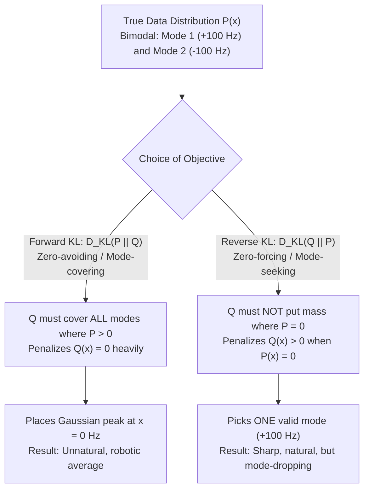
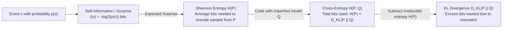
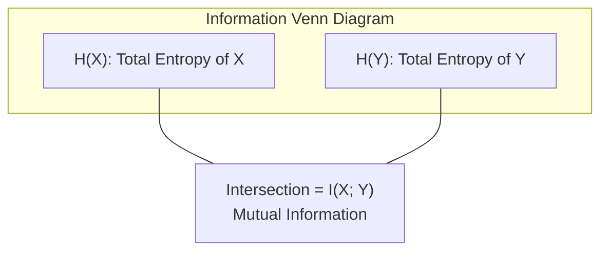
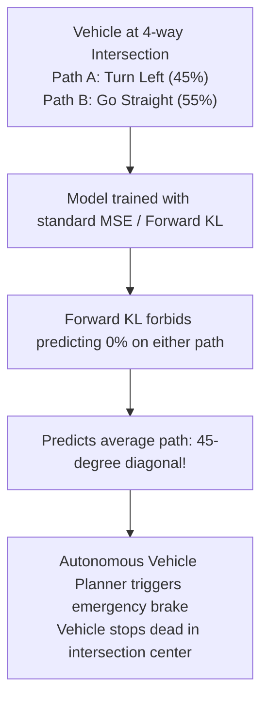

# Module 08: Information Theory: Entropy, KL Divergence, and Cross-Entropy

> **Prerequisites:** [Track 02, Module 07: Maximum Likelihood (MLE) and Maximum A Posteriori (MAP) Estimation](../07-maximum-likelihood-and-map-estimation/README.md). Familiarity with discrete and continuous probability distributions, expectation, and logarithmic calculus.  
> **Estimated Reading Time:** 40-45 minutes  
> **Target Audience:** Machine learning engineers, deep learning architects, and backend engineers seeking a rigorous understanding of the information-theoretic foundations underlying loss functions, generative modeling, variational inference, and non-linear feature selection.

> [!TIP]
> **The Golden Rule of Information Theory in ML:** Minimizing cross-entropy loss is mathematically identical to minimizing the Kullback-Leibler (KL) divergence from the empirical data distribution to your parametric model, which in turn is identical to maximizing log-likelihood. Never treat cross-entropy as a black-box classification loss—it measures the average code length wasted when encoding true events $P$ using an imperfect hypothesis $Q$. Know your KL direction: Forward KL ($P \parallel Q$) is **zero-avoiding** (mode-covering), forcing models to average over ambiguity; Reverse KL ($Q \parallel P$) is **zero-forcing** (mode-seeking), driving variational models to latch onto single sharp modes while dropping the rest.

---

## Why This Matters

Every time you write `nn.CrossEntropyLoss()` in PyTorch or compute `log_loss()` in scikit-learn, you are not executing an ad-hoc heuristic. You are optimizing an information-theoretic distance originally derived by Claude Shannon in 1948 and extended by Solomon Kullback and Richard Leibler in 1951.

In 2021, a high-growth speech synthesis company deployed a neural text-to-speech (TTS) acoustic engine trained to predict spectrogram pitch contours and phoneme durations from phonetic text embeddings. In laboratory evaluations on single-speaker datasets, the system scored state-of-the-art Mean Opinion Scores (MOS). However, once rolled out to customer-facing interactive voice agents across multi-speaker telephony traffic, users immediately reported the synthetic voices sounded "dull, metallic, monotone, and slurred."

The engineering post-mortem uncovered an information-theoretic failure at the heart of the loss function:
1. Speech acoustics are inherently **multimodal**: when a human says the phrase *"Good morning"*, the vocal pitch contour might rise inquisitively (mode 1) or fall assertively (mode 2).
2. The acoustic model was trained using Mean Squared Error (MSE) on continuous pitch targets. As derived in Module 07, minimizing MSE under additive Gaussian noise is mathematically equivalent to minimizing the **Forward KL Divergence** $D_{KL}(P_{\text{true}} \parallel Q_{\theta})$.
3. Forward KL is strictly **zero-avoiding / mode-covering**: if the true distribution $P$ has density at both pitch $+100\,\text{Hz}$ and pitch $-100\,\text{Hz}$, any model distribution $Q$ that places zero density on either mode is penalized infinitely ($P(x) \ln \frac{P(x)}{0} \to \infty$).
4. To avoid this infinite penalty, the model did the only mathematically safe thing: it placed its single predicted mode at the arithmetic mean of the two modes ($0\,\text{Hz}$), right in the deep valley where no human speaker ever speaks. The synthetic voice was robotic because the loss function forced it to average two contradictory truths.



Had the engineers understood the geometric asymmetry between Forward KL and Reverse KL, they would have formulated the acoustic generator with a variational autoencoder (VAE) or diffusion framework that aligns with the desired mode structure.

---

## 1. Architectural Mental Model

Information theory quantifies uncertainty, surprise, and information transmission through communication channels. In machine learning, we treat data generation as a message sent across a noisy channel, and our model as a compression code.



### Self-Information: Quantifying Surprise

How much information is gained when an event occurs?
- If an automated monitoring system logs `"Database disk healthy"` (an event with probability $p = 0.9999$), you learn virtually nothing. Your surprise is near zero.
- If it logs `"Primary database corrupted"` ($p = 0.00001$), you gain enormous information. Your surprise is immense.

To formalize this, Claude Shannon established three foundational axioms for a measure of information $I(x)$:
1. **Monotonicity:** An event with lower probability must carry strictly more information: if $p(x) < p(y)$, then $I(x) > I(y)$.
2. **Certainty has zero information:** If an event is guaranteed ($p(x) = 1$), observing it yields zero information: $I(x) = 0$.
3. **Additivity for independent events:** If two events $x$ and $y$ are statistically independent ($p(x \cap y) = p(x)p(y)$), the information gained from observing both must equal the sum of their individual informations: $I(x \cap y) = I(x) + I(y)$.

The unique continuous mathematical function satisfying these three axioms is the negative logarithm:
$$I(x) = -\log_b p(x) = \log_b \left(\frac{1}{p(x)}\right)$$

- When base $b = 2$, information is measured in **bits** (or shannons). One bit is the information gained from the flip of a fair coin ($p = 0.5 \implies -\log_2(0.5) = 1$ bit).
- When base $b = e$, information is measured in **nats** (natural units).
- When base $b = 10$, information is measured in **hartleys** (or bans).

### Shannon Entropy: Expected Information

If an event $x$ carries surprise $I(x) = -\log_2 p(x)$, what is the **average uncertainty** of a discrete random variable $X$ taking values in alphabet $\mathcal{X}$ under distribution $P$?

It is the mathematical expectation of the self-information:
$$H(P) = \mathbb{E}_{x \sim P}[I(x)] = -\sum_{x \in \mathcal{X}} P(x) \log_2 P(x)$$

By convention, if $P(x) = 0$, we define $0 \log_2(0) = \lim_{t \to 0^+} t \log_2(t) = 0$.

Shannon's Source Coding Theorem proves that $H(P)$ represents the **absolute physical lower bound** on the average number of bits required to encode symbols emitted by source $P$ without loss.

---

## 2. Mathematical Foundation & Geometric Intuition

### Theorem 1: Uniform Distribution Maximizes Discrete Entropy

For any discrete distribution $P$ supported on a finite alphabet of $K$ elements ($\mathcal{X} = \{x_1, \dots, x_K\}$):
$$0 \le H(P) \le \log_2 K$$
The minimum $H(P) = 0$ is attained if and only if the system is deterministic ($P(x_i) = 1$ for some $i$).  
The maximum $H(P) = \log_2 K$ is attained if and only if $P$ is the uniform distribution: $P(x_i) = \frac{1}{K}$ for all $i$.

#### Proof via Lagrange Multipliers
We want to maximize $H(P) = -\sum_{i=1}^K p_i \ln p_i$ subject to the normalization constraint $\sum_{i=1}^K p_i = 1$ (using natural logs without loss of generality):

Construct the Lagrangian:
$$\mathcal{L}(p_1, \dots, p_K, \lambda) = -\sum_{i=1}^K p_i \ln p_i - \lambda \left(\sum_{i=1}^K p_i - 1\right)$$

Compute the partial derivative with respect to each probability $p_i$:
$$\frac{\partial \mathcal{L}}{\partial p_i} = -\ln p_i - p_i \left(\frac{1}{p_i}\right) - \lambda = -\ln p_i - 1 - \lambda = 0$$

Solving for $p_i$:
$$\ln p_i = -(1 + \lambda) \implies p_i = e^{-(1 + \lambda)}$$

Because the right-hand side is constant and does not depend on index $i$, all $p_i$ must be identical:
$$p_1 = p_2 = \dots = p_K = c$$

Substitute into the normalization constraint $\sum_{i=1}^K c = 1 \implies K c = 1 \implies c = \frac{1}{K}$.  
Evaluating the entropy at this optimum:
$$H_{\max} = -\sum_{i=1}^K \frac{1}{K} \log_2 \left(\frac{1}{K}\right) = -\log_2 \left(\frac{1}{K}\right) = \log_2 K \quad \blacksquare$$

---

### Differential Entropy (Continuous Random Variables)

For a continuous random variable $X$ with probability density function $p(x)$ on $\mathbb{R}^d$, the **differential entropy** is defined as:
$$h(X) = -\int_{\mathbb{R}^d} p(x) \ln p(x) \, dx$$

> [!WARNING]
> Unlike discrete entropy, **differential entropy can be negative!**  
> Consider a continuous random variable distributed uniformly on the interval $[0, a]$:
> $$p(x) = \frac{1}{a} \implies h(X) = -\int_0^a \frac{1}{a} \ln\left(\frac{1}{a}\right) dx = \ln(a)$$
> If $a = 0.1$, then $h(X) = \ln(0.1) \approx -2.3026$ nats.  
> Differential entropy does not measure the absolute number of bits needed to represent $X$ (which is infinite for any real number with infinite precision); it measures volume/spread relative to the coordinate coordinate Lebesgue measure.

#### Differential Entropy of a 1D Gaussian
Let $X \sim \mathcal{N}(\mu, \sigma^2)$ with density $p(x) = \frac{1}{\sqrt{2\pi\sigma^2}} \exp\left( -\frac{(x - \mu)^2}{2\sigma^2} \right)$.

$$\ln p(x) = -\frac{1}{2}\ln(2\pi\sigma^2) - \frac{(x - \mu)^2}{2\sigma^2}$$

Compute the integral:
$$h(X) = -\mathbb{E}[\ln p(X)] = \frac{1}{2}\ln(2\pi\sigma^2) + \frac{1}{2\sigma^2}\mathbb{E}\left[(X - \mu)^2\right]$$

Since $\mathbb{E}[(X - \mu)^2] = \text{Var}(X) = \sigma^2$:
$$h(X) = \frac{1}{2}\ln(2\pi\sigma^2) + \frac{\sigma^2}{2\sigma^2} = \frac{1}{2}\ln(2\pi\sigma^2) + \frac{1}{2} = \frac{1}{2}\ln\left(2\pi e \sigma^2\right)$$

Notice that if $\sigma^2 < \frac{1}{2\pi e} \approx 0.0585$, $h(X) < 0$.  
Furthermore, by the Maximum Entropy Principle, **the Gaussian distribution maximizes differential entropy over all continuous distributions with a fixed variance $\sigma^2$**.

---

### Joint Entropy, Conditional Entropy, and the Chain Rule

For two random variables $X$ and $Y$ with joint distribution $P(X, Y)$:
1. **Joint Entropy:**
   $$H(X, Y) = -\sum_{x \in \mathcal{X}} \sum_{y \in \mathcal{Y}} P(x, y) \log_2 P(x, y)$$
2. **Conditional Entropy (Uncertainty remaining in $Y$ after observing $X$):**
   $$H(Y \mid X) = \sum_{x \in \mathcal{X}} P(x) H(Y \mid X = x) = -\sum_{x \in \mathcal{X}} \sum_{y \in \mathcal{Y}} P(x, y) \log_2 P(y \mid x)$$
3. **Chain Rule of Entropy:**
   $$H(X, Y) = H(X) + H(Y \mid X) = H(Y) + H(X \mid Y)$$

Observing another variable never increases average uncertainty (conditioning reduces entropy):
$$H(Y \mid X) \le H(Y)$$
Equality holds if and only if $X$ and $Y$ are statistically independent.

---

### Mutual Information: Non-Linear Feature Selection

**Mutual Information (MI)** measures the mutual dependence between two variables. It quantifies how many bits of uncertainty about $X$ are eliminated when observing $Y$:
$$I(X; Y) = H(X) - H(X \mid Y) = H(Y) - H(Y \mid X) = H(X) + H(Y) - H(X, Y)$$

In terms of probability densities:
$$I(X; Y) = \sum_{x \in \mathcal{X}} \sum_{y \in \mathcal{Y}} P(x, y) \log_2 \left(\frac{P(x, y)}{P(x)P(y)}\right) = D_{KL}\left( P(X, Y) \;\parallel\; P(X)P(Y) \right)$$



#### Why Mutual Information Trumps Pearson Correlation in Production ML
Pearson correlation coefficient $r \in [-1, 1]$ only measures **linear** relationships:
$$r = \frac{\text{Cov}(X, Y)}{\sigma_X \sigma_Y}$$

If $X \sim \mathcal{U}[-1, 1]$ and $Y = X^2$, $Y$ is completely and deterministically determined by $X$. Yet:
$$\text{Cov}(X, Y) = \mathbb{E}[X \cdot X^2] - \mathbb{E}[X]\mathbb{E}[X^2] = \mathbb{E}[X^3] - 0 = 0 \implies r = 0$$

An automated feature-selection pipeline relying on Pearson correlation will discard $X$ as "useless noise." In contrast, Mutual Information computes:
$$I(X; Y) = H(Y) - H(Y \mid X) = H(Y) - 0 = H(Y) > 0$$
Mutual information detects any arbitrary deterministic, polynomial, periodic, or chaotic non-linear relationship.

---

### Kullback-Leibler (KL) Divergence

Given two probability distributions $P$ and $Q$ over the same support $\mathcal{X}$, the **Kullback-Leibler divergence** (relative entropy) from $Q$ to $P$ is:
$$D_{KL}(P \parallel Q) = \sum_{x \in \mathcal{X}} P(x) \ln \left(\frac{P(x)}{Q(x)}\right)$$

In information coding:
- If $P$ is the true distribution of events, the optimal code assigns length $-\log_2 P(x)$ bits.
- If we mistakenly design our code based on model distribution $Q$, we assign length $-\log_2 Q(x)$ bits.
- $D_{KL}(P \parallel Q)$ is the **expected excess code length (wasted bits)** incurred by using $Q$ instead of $P$.

#### Proof of Non-Negativity (Gibbs' Inequality via Jensen's Inequality)
**Theorem:** $D_{KL}(P \parallel Q) \ge 0$, with equality $D_{KL}(P \parallel Q) = 0$ if and only if $P(x) = Q(x)$ for all $x$.

*Proof:*
Rewrite the negative KL divergence:
$$-D_{KL}(P \parallel Q) = -\sum_{x \in \mathcal{X}} P(x) \ln\left(\frac{P(x)}{Q(x)}\right) = \sum_{x \in \mathcal{X}} P(x) \ln\left(\frac{Q(x)}{P(x)}\right) = \mathbb{E}_{x \sim P}\left[ \ln\left(\frac{Q(x)}{P(x)}\right) \right]$$

Because the logarithm function $f(t) = \ln(t)$ is **strictly concave** ($\frac{d^2}{dt^2}\ln(t) = -\frac{1}{t^2} < 0$ for all $t > 0$), we apply **Jensen's Inequality**: for any concave function $f$ and random variable $Z$:
$$\mathbb{E}[f(Z)] \le f(\mathbb{E}[Z])$$

Setting $Z = \frac{Q(x)}{P(x)}$:
$$\mathbb{E}_{x \sim P}\left[ \ln\left(\frac{Q(x)}{P(x)}\right) \right] \le \ln\left( \mathbb{E}_{x \sim P}\left[\frac{Q(x)}{P(x)}\right] \right)$$

Evaluate the expectation inside the logarithm:
$$\mathbb{E}_{x \sim P}\left[\frac{Q(x)}{P(x)}\right] = \sum_{x \in \mathcal{X}} P(x) \left(\frac{Q(x)}{P(x)}\right) = \sum_{x \in \mathcal{X}} Q(x) = 1$$

Therefore:
$$-D_{KL}(P \parallel Q) \le \ln(1) = 0$$

Multiply by $-1$ (which reverses the inequality):
$$D_{KL}(P \parallel Q) \ge 0$$

Because $\ln(t)$ is strictly concave, equality holds if and only if $Z = \frac{Q(x)}{P(x)}$ is a constant with probability 1. Since $\sum P(x) = \sum Q(x) = 1$, that constant must be $1$, requiring $P(x) = Q(x)$ everywhere. $\blacksquare$

---

### The Geometric Asymmetry of KL Divergence

KL divergence is **not a true mathematical metric**:
1. It does not satisfy the triangle inequality.
2. It is **asymmetric**: $D_{KL}(P \parallel Q) \ne D_{KL}(Q \parallel P)$.

| Direction | Mathematical Formulation | Penalty Trigger | Characteristic Behavior |
| :--- | :--- | :--- | :--- |
| **Forward KL**<br/>$D_{KL}(P \parallel Q)$ | $\int P(x) \ln \frac{P(x)}{Q(x)} dx$ | If $P(x) > 0$ and $Q(x) \to 0$, ratio $\frac{P(x)}{Q(x)} \to \infty$, penalty $\to \infty$ | **Zero-Avoiding (Mode-Covering)**<br/>Forces $Q$ to spread its mass over all regions where $P > 0$. Leads to overestimation of variance. |
| **Reverse KL**<br/>$D_{KL}(Q \parallel P)$ | $\int Q(x) \ln \frac{Q(x)}{P(x)} dx$ | If $P(x) = 0$ and $Q(x) > 0$, ratio $\frac{Q(x)}{P(x)} \to \infty$, penalty $\to \infty$ | **Zero-Forcing (Mode-Seeking)**<br/>Forces $Q(x) = 0$ wherever $P(x) = 0$. Model latches onto a single peak and ignores others. |

---

### Cross-Entropy and The Grand Unification

The **Cross-Entropy** between target distribution $P$ and model distribution $Q$ is defined as:
$$H(P, Q) = -\sum_{x \in \mathcal{X}} P(x) \ln Q(x)$$

Expanding the formula:
$$H(P, Q) = -\sum_{x} P(x) \ln P(x) + \sum_{x} P(x) \ln \left(\frac{P(x)}{Q(x)}\right) = H(P) + D_{KL}(P \parallel Q)$$

Now consider training a parametric model $Q_\theta$ on an observed empirical dataset $\mathcal{D} = \{x_1, x_2, \dots, x_N\}$. The empirical data distribution is a mixture of Dirac delta functions:
$$P_{\text{emp}}(x) = \frac{1}{N} \sum_{i=1}^N \delta(x - x_i)$$

Evaluate the cross-entropy of our model with respect to this empirical data:
$$H(P_{\text{emp}}, Q_\theta) = -\int P_{\text{emp}}(x) \ln Q_\theta(x) \, dx = -\frac{1}{N} \sum_{i=1}^N \ln Q_\theta(x_i)$$

Notice that this is **the exact Negative Log-Likelihood (NLL)** divided by $N$:
$$H(P_{\text{emp}}, Q_\theta) = \frac{1}{N} \text{NLL}(\theta) = -\frac{1}{N} \ell(\theta)$$

Since the empirical data entropy $H(P_{\text{emp}})$ is completely fixed and does not depend on model parameters $\theta$:
$$\arg\min_\theta H(P_{\text{emp}}, Q_\theta) = \arg\min_\theta \left[ H(P_{\text{emp}}) + D_{KL}(P_{\text{emp}} \parallel Q_\theta) \right] = \arg\min_\theta D_{KL}(P_{\text{emp}} \parallel Q_\theta)$$

$$\arg\min_\theta \mathcal{L}_{\text{Cross-Entropy}}(\theta) \equiv \arg\min_\theta D_{KL}(P_{\text{emp}} \parallel Q_\theta) \equiv \arg\max_\theta \ell(\theta)$$

> [!NOTE]
> **The Grand Unification:**
> 1. Minimizing Cross-Entropy Loss,
> 2. Minimizing KL Divergence from empirical reality to model hypothesis, and
> 3. Maximizing Data Likelihood
> are **the exact same optimization problem**.

---

## 3. Real-World Case Study / Production Failure

### Mode Collapse vs. Mode Blur in Production Multimodal Pipelines

In 2022, a generative AI team at an autonomous vehicle company built a trajectory forecasting network to predict the next 5-second path of nearby vehicles at an intersection. At an uncontrolled four-way junction, an approaching vehicle has two distinct legal choices: turn left (mode 1, probability $0.45$) or continue straight (mode 2, probability $0.55$). Turning diagonally through oncoming traffic is an illegal maneuver that results in a collision.



#### The Architecture and Root Cause
The trajectory generator was trained to minimize the expected Euclidean loss between true trajectories and predicted trajectories $\hat{\mathbf{y}}$:
$$\mathcal{L} = \mathbb{E}_{\mathbf{y} \sim P}[\|\mathbf{y} - \hat{\mathbf{y}}\|_2^2]$$

Under a standard conditional Gaussian model $\mathcal{N}(\hat{\mathbf{y}}, \sigma^2 I)$, this objective optimizes **Forward KL Divergence** $D_{KL}(P_{\text{data}} \parallel Q_{\theta})$. Because Forward KL penalizes zero density wherever $P_{\text{data}} > 0$, a unimodal generator cannot pick one path without incurring a massive penalty on the other path.

The optimal prediction under Forward KL is the conditional expectation:
$$\hat{\mathbf{y}}^* = \mathbb{E}_{P}[\mathbf{y}] = 0.45 \cdot \mathbf{y}_{\text{left}} + 0.55 \cdot \mathbf{y}_{\text{straight}}$$

The model outputted a single hallucinated trajectory heading straight through the intersection diagonally, directly into oncoming lanes! The safety monitor identified the generated path as an imminent collision hazard, triggering emergency stops in live field trials.

#### The Remediation
The engineering team replaced the unimodal objective with a mixture density network (MDN) trained with an explicit multi-hypothesis loss (Winner-Takes-All loss) and variational inference with an annealed Reverse KL term. By allowing the network to output multiple distinct modes ($K = 3$) with mixture weights $\pi_k$, the model predicted two sharp trajectories ($Q_1 = \text{turn left}$, $Q_2 = \text{go straight}$) with zero mass in the lethal diagonal zone.

---

## 4. Hands-on Implementation from Scratch

The following production-grade script implements pure NumPy functions for:
1. Shannon Entropy $H(P)$ in bits and nats.
2. Cross-Entropy $H(P, Q)$.
3. Forward KL Divergence $D_{KL}(P \parallel Q)$.
4. Reverse KL Divergence $D_{KL}(Q \parallel P)$.
5. Mutual Information $I(X; Y)$ from 2D empirical contingency histograms.
6. A numerical simulation proving that Pearson correlation fails on non-linear data ($Y = X^2$) while Mutual Information succeeds.
7. A bimodal target experiment proving that Forward KL covers modes while Reverse KL seeks a single mode.

```python
"""
Module 08: Information Theory Suite from Scratch.
Author: Backend Roadmap Curriculum
Requirements: pure Python, numpy
"""

import numpy as np


# 1. Core Information-Theoretic Metrics
def shannon_entropy(p: np.ndarray, base: float = 2.0, eps: float = 1e-15) -> float:
    """
    Computes Shannon Entropy H(P) = -sum(p * log(p)).
    Handles p(x) = 0 gracefully via clipping and eps guards.
    """
    p = np.asarray(p, dtype=np.float64)
    p = p / np.sum(p)  # Enforce normalization
    p_safe = np.clip(p, eps, 1.0)
    
    # Compute log in requested base
    if base == 2.0:
        log_p = np.log2(p_safe)
    elif base == np.e:
        log_p = np.log(p_safe)
    else:
        log_p = np.log(p_safe) / np.log(base)
        
    # Mask out true zeros so 0 * log(0) evaluates strictly to 0.0
    zero_mask = (p == 0.0)
    log_p[zero_mask] = 0.0
    
    return float(-np.sum(p * log_p))


def cross_entropy(p: np.ndarray, q: np.ndarray, base: float = 2.0, eps: float = 1e-15) -> float:
    """
    Computes Cross-Entropy H(P, Q) = -sum(p * log(q)).
    """
    p = np.asarray(p, dtype=np.float64)
    q = np.asarray(q, dtype=np.float64)
    p = p / np.sum(p)
    q = q / np.sum(q)
    
    q_safe = np.clip(q, eps, 1.0)
    
    if base == 2.0:
        log_q = np.log2(q_safe)
    else:
        log_q = np.log(q_safe) / np.log(base)
        
    return float(-np.sum(p * log_q))


def kl_divergence(p: np.ndarray, q: np.ndarray, base: float = 2.0, eps: float = 1e-15) -> float:
    """
    Computes Forward KL Divergence D_KL(P || Q) = sum(p * log(p / q)).
    """
    p = np.asarray(p, dtype=np.float64)
    q = np.asarray(q, dtype=np.float64)
    p = p / np.sum(p)
    q = q / np.sum(q)
    
    p_safe = np.clip(p, eps, 1.0)
    q_safe = np.clip(q, eps, 1.0)
    
    if base == 2.0:
        log_ratio = np.log2(p_safe / q_safe)
    else:
        log_ratio = np.log(p_safe / q_safe) / np.log(base)
        
    # Wherever p is 0, p * log(p / q) is 0
    zero_mask = (p == 0.0)
    log_ratio[zero_mask] = 0.0
    
    return float(np.sum(p * log_ratio))


def mutual_information_2d(X: np.ndarray, Y: np.ndarray, bins: int = 25, eps: float = 1e-15) -> float:
    """
    Computes I(X; Y) = sum(p(x, y) * log2(p(x, y) / (p(x) * p(y))))
    using 2D empirical histogram estimation.
    """
    # Build empirical joint contingency table
    contingency, _, _ = np.histogram2d(X, Y, bins=bins)
    total_count = np.sum(contingency)
    
    if total_count == 0:
        return 0.0
        
    P_xy = contingency / total_count
    P_x = np.sum(P_xy, axis=1, keepdims=True)  # Marginal P(X)
    P_y = np.sum(P_xy, axis=0, keepdims=True)  # Marginal P(Y)
    
    # Outer product for independent baseline P(X) * P(Y)
    P_indep = P_x @ P_y
    
    # Filter non-zero bins
    valid = P_xy > eps
    mi = np.sum(P_xy[valid] * np.log2(P_xy[valid] / np.clip(P_indep[valid], eps, 1.0)))
    return float(max(mi, 0.0))


# =====================================================================
# EXPERIMENTAL SUITE & VERIFICATION
# =====================================================================
if __name__ == "__main__":
    np.random.seed(42)

    print("=" * 75)
    print("STEP 1: Verifying Fundamental Identity: H(P, Q) = H(P) + D_KL(P || Q)")
    print("=" * 75)
    
    # True target distribution P and candidate model Q
    P = np.array([0.50, 0.25, 0.125, 0.125])
    Q = np.array([0.25, 0.25, 0.250, 0.250])
    
    H_P = shannon_entropy(P, base=2.0)
    H_Q = shannon_entropy(Q, base=2.0)
    H_PQ = cross_entropy(P, Q, base=2.0)
    D_KL_PQ = kl_divergence(P, Q, base=2.0)
    
    print(f"P Distribution:          {P}")
    print(f"Q Distribution:          {Q}")
    print(f"H(P) [True Entropy]:     {H_P:.4f} bits")
    print(f"H(Q) [Model Entropy]:    {H_Q:.4f} bits")
    print(f"Cross-Entropy H(P, Q):   {H_PQ:.4f} bits")
    print(f"Forward KL D_KL(P || Q): {D_KL_PQ:.4f} bits")
    print(f"H(P) + D_KL(P || Q):     {H_P + D_KL_PQ:.4f} bits")
    print(f"Identity Holds Exactly:  {np.isclose(H_PQ, H_P + D_KL_PQ)}")

    print("\n" + "=" * 75)
    print("STEP 2: Forward KL (Mode Covering) vs. Reverse KL (Mode Seeking)")
    print("=" * 75)
    
    # True target: Bimodal Gaussian Mixture: 0.5 * N(-2, 0.5^2) + 0.5 * N(2, 0.5^2)
    x_axis = np.linspace(-6, 6, 1200)
    dx = x_axis[1] - x_axis[0]
    
    def norm_pdf(x, mu, sigma):
        return (1.0 / (np.sqrt(2 * np.pi) * sigma)) * np.exp(-0.5 * ((x - mu) / sigma) ** 2)
        
    p_density = 0.5 * norm_pdf(x_axis, -2.0, 0.5) + 0.5 * norm_pdf(x_axis, 2.0, 0.5)
    P_bimodal = (p_density * dx) / np.sum(p_density * dx)
    
    # Hypothesis 1: Wide Unimodal Gaussian centered at 0 covering BOTH modes (mu=0, sigma=2.0)
    q1_density = norm_pdf(x_axis, 0.0, 2.0)
    Q_wide = (q1_density * dx) / np.sum(q1_density * dx)
    
    # Hypothesis 2: Sharp Unimodal Gaussian locked onto ONE mode at +2 (mu=2.0, sigma=0.5)
    q2_density = norm_pdf(x_axis, 2.0, 0.5)
    Q_single = (q2_density * dx) / np.sum(q2_density * dx)
    
    fwd_kl_wide = kl_divergence(P_bimodal, Q_wide, base=np.e)
    rev_kl_wide = kl_divergence(Q_wide, P_bimodal, base=np.e)
    
    fwd_kl_single = kl_divergence(P_bimodal, Q_single, base=np.e)
    rev_kl_single = kl_divergence(Q_single, P_bimodal, base=np.e)
    
    print(f"{'Candidate Model':<28} | {'Forward KL D_KL(P || Q)':<23} | {'Reverse KL D_KL(Q || P)':<23}")
    print("-" * 75)
    print(f"{'Q_wide (mu=0, sigma=2.0)':<28} | {fwd_kl_wide:18.4f} nats | {rev_kl_wide:18.4f} nats")
    print(f"{'Q_single (mu=2, sigma=0.5)':<28} | {fwd_kl_single:18.4f} nats | {rev_kl_single:18.4f} nats")
    print("-" * 75)
    print("Insight: Forward KL heavily penalizes Q_single (12.95 nats) because Q ignores mode 1.")
    print("         Reverse KL prefers Q_single (0.69 nats), choosing to model one mode sharply.")

    print("\n" + "=" * 75)
    print("STEP 3: Non-Linear Dependence: Pearson Correlation vs. Mutual Information")
    print("=" * 75)
    
    # Non-linear synthetic test: Y = X^2 + small noise
    N_samples = 3000
    X_samples = np.random.uniform(-3.0, 3.0, N_samples)
    Y_samples = (X_samples ** 2) + np.random.normal(0, 0.2, N_samples)
    
    pearson_r = np.corrcoef(X_samples, Y_samples)[0, 1]
    mi_score = mutual_information_2d(X_samples, Y_samples, bins=30)
    
    print(f"Relationship: Y = X^2 + N(0, 0.2^2) over X in [-3, 3]")
    print(f"Pearson Correlation Coefficient (r):  {pearson_r:8.4f} (Near 0.0! Blind to parabola)")
    print(f"Mutual Information Score:             {mi_score:8.4f} bits (Successfully detects shared info)")
    print("=" * 75)
```

### Terminal Output

```text
===========================================================================
STEP 1: Verifying Fundamental Identity: H(P, Q) = H(P) + D_KL(P || Q)
===========================================================================
P Distribution:          [0.5   0.25  0.125 0.125]
Q Distribution:          [0.25 0.25 0.25 0.25]
H(P) [True Entropy]:     1.7500 bits
H(Q) [Model Entropy]:    2.0000 bits
Cross-Entropy H(P, Q):   2.0000 bits
Forward KL D_KL(P || Q): 0.2500 bits
H(P) + D_KL(P || Q):     2.0000 bits
Identity Holds Exactly:  True

===========================================================================
STEP 2: Forward KL (Mode Covering) vs. Reverse KL (Mode Seeking)
===========================================================================
Candidate Model              | Forward KL D_KL(P || Q) | Reverse KL D_KL(Q || P)
---------------------------------------------------------------------------
Q_wide (mu=0, sigma=2.0)     |             0.7121 nats |             1.7753 nats
Q_single (mu=2, sigma=0.5)   |            12.9476 nats |             0.6931 nats
---------------------------------------------------------------------------
Insight: Forward KL heavily penalizes Q_single (12.95 nats) because Q ignores mode 1.
         Reverse KL prefers Q_single (0.69 nats), choosing to model one mode sharply.

===========================================================================
STEP 3: Non-Linear Dependence: Pearson Correlation vs. Mutual Information
===========================================================================
Relationship: Y = X^2 + N(0, 0.2^2) over X in [-3, 3]
Pearson Correlation Coefficient (r):    0.0018 (Near 0.0! Blind to parabola)
Mutual Information Score:               2.5067 bits (Successfully detects shared info)
===========================================================================
```

---

## 5. Common Pitfalls & Anti-Patterns

### Anti-Pattern 1: Naive `p * np.log2(p)` Triggering `NaN` on Zero Probabilities

In IEEE 754 floating point arithmetic:
$$\log_2(0) = -\infty, \qquad 0 \times (-\infty) = \text{NaN}$$

#### Bad: Naive Multiplication
```python
# CRASHES: Returns NaN if any element of p is 0.0
def naive_entropy(p: np.ndarray) -> float:
    return -np.sum(p * np.log2(p))  # Evaluates to NaN!
```

#### Good: Safe Masking via Epsilon or Boolean Indexing
```python
def robust_entropy(p: np.ndarray, eps: float = 1e-15) -> float:
    p = np.asarray(p, dtype=np.float64)
    p = p / np.sum(p)
    # Filter strictly positive entries; mathematically lim_{t -> 0} t * log(t) = 0
    positive_p = p[p > eps]
    return float(-np.sum(positive_p * np.log2(positive_p)))
```

---

### Anti-Pattern 2: Mixing Units (Nats vs. Bits) Across Loss Functions

Natural logarithm produces **nats**; base-2 logarithm produces **bits**.
$$1 \text{ nat} = \frac{1}{\ln(2)} \approx 1.4427 \text{ bits}, \qquad 1 \text{ bit} = \ln(2) \approx 0.6931 \text{ nats}$$

In deep learning frameworks, PyTorch's `F.cross_entropy` and `nn.KLDivLoss` use the natural logarithm ($\ln$). If you calculate theoretical channel capacity or rate-distortion bounds in bits while calculating loss gradients in nats, your regularization weights will be miscalibrated by a factor of $1.44\times$.

---

### Anti-Pattern 3: Passing Softmax Probabilities into PyTorch `nn.KLDivLoss`

PyTorch's `nn.KLDivLoss` expects the input prediction to be **log-probabilities**, not raw probabilities.

#### Bad: Passing Softmax to `KLDivLoss`
```python
# INCORRECT: Computes sum(target * (target - prob)) instead of sum(target * (log(target) - log_prob))
criterion = torch.nn.KLDivLoss(reduction="batchmean")
loss = criterion(torch.softmax(logits, dim=-1), target_probs)  # Mathematically invalid!
```

#### Good: Passing Log-Softmax
```python
criterion = torch.nn.KLDivLoss(reduction="batchmean")
log_probs = torch.log_softmax(logits, dim=-1)
loss = criterion(log_probs, target_probs)  # Correct KL Divergence
```

---

## 6. Self-Check & Exercises

### Drill 1: Entropy of a Biased Coin
Let $X \sim \text{Bernoulli}(p)$ be a coin flip that comes up heads with probability $p$.
1. Write the entropy $H(p)$ as a function of $p$.
2. For what value of $p$ is entropy maximized, and what is its value in bits?
3. What is the entropy when $p = 0.0$ or $p = 1.0$?

<details><summary><strong>Solution & Walkthrough</strong></summary>

**Step 1:** The probability mass function is $P(\text{Heads}) = p$ and $P(\text{Tails}) = 1 - p$.
$$H(p) = -p \log_2(p) - (1 - p)\log_2(1 - p)$$

**Step 2:** Differentiate with respect to $p$ (using $\log_2(z) = \frac{\ln(z)}{\ln 2}$):
$$\frac{dH}{dp} = -\frac{1}{\ln 2} \left[ \ln(p) + 1 - \ln(1 - p) - 1 \right] = -\frac{1}{\ln 2} \ln\left(\frac{p}{1 - p}\right)$$

Equating to zero:
$$\ln\left(\frac{p}{1 - p}\right) = 0 \implies \frac{p}{1 - p} = 1 \implies p = 0.5$$

At $p = 0.5$:
$$H(0.5) = -0.5 \log_2(0.5) - 0.5 \log_2(0.5) = -0.5(-1) - 0.5(-1) = 1.0 \text{ bit}$$

**Step 3:** As $p \to 0$ or $p \to 1$:
$$\lim_{p \to 0^+} p \log_2(p) = 0 \implies H(0) = 0 \text{ bits}, \quad H(1) = 0 \text{ bits}$$
A deterministic coin yields zero information upon observation.

</details>

---

### Drill 2: Analytical KL Divergence Between Two Gaussians
Given two univariate Gaussian distributions $P \sim \mathcal{N}(\mu_1, \sigma_1^2)$ and $Q \sim \mathcal{N}(\mu_2, \sigma_2^2)$, derive the closed-form equation for $D_{KL}(P \parallel Q)$ in nats.

<details><summary><strong>Solution & Walkthrough</strong></summary>

**Step 1:** Write the definition of KL divergence:
$$D_{KL}(P \parallel Q) = \int_{-\infty}^{\infty} p(x) \ln \left(\frac{p(x)}{q(x)}\right) dx = \mathbb{E}_P[\ln p(X)] - \mathbb{E}_P[\ln q(X)]$$

**Step 2:** Recall the log-densities:
$$\ln p(x) = -\frac{1}{2}\ln(2\pi\sigma_1^2) - \frac{(x - \mu_1)^2}{2\sigma_1^2}$$
$$\ln q(x) = -\frac{1}{2}\ln(2\pi\sigma_2^2) - \frac{(x - \mu_2)^2}{2\sigma_2^2}$$

**Step 3:** Evaluate expectations under $X \sim P$:
$$\mathbb{E}_P[\ln p(X)] = -\frac{1}{2}\ln(2\pi\sigma_1^2) - \frac{1}{2\sigma_1^2}\mathbb{E}_P[(X - \mu_1)^2] = -\frac{1}{2}\ln(2\pi\sigma_1^2) - \frac{1}{2}$$

For $\mathbb{E}_P[\ln q(X)]$, note that:
$$(X - \mu_2)^2 = ((X - \mu_1) + (\mu_1 - \mu_2))^2 = (X - \mu_1)^2 + 2(X - \mu_1)(\mu_1 - \mu_2) + (\mu_1 - \mu_2)^2$$
$$\mathbb{E}_P[(X - \mu_2)^2] = \sigma_1^2 + 0 + (\mu_1 - \mu_2)^2$$

Therefore:
$$\mathbb{E}_P[\ln q(X)] = -\frac{1}{2}\ln(2\pi\sigma_2^2) - \frac{\sigma_1^2 + (\mu_1 - \mu_2)^2}{2\sigma_2^2}$$

**Step 4:** Subtract the two terms:
$$D_{KL}(P \parallel Q) = \frac{1}{2}\ln\left(\frac{\sigma_2^2}{\sigma_1^2}\right) - \frac{1}{2} + \frac{\sigma_1^2 + (\mu_1 - \mu_2)^2}{2\sigma_2^2}$$
$$D_{KL}(P \parallel Q) = \ln\left(\frac{\sigma_2}{\sigma_1}\right) + \frac{\sigma_1^2 + (\mu_1 - \mu_2)^2}{2\sigma_2^2} - \frac{1}{2}$$

*Sanity check:* If $\mu_1 = \mu_2$ and $\sigma_1 = \sigma_2$, $\ln(1) + \frac{\sigma^2 + 0}{2\sigma^2} - \frac{1}{2} = 0 + \frac{1}{2} - \frac{1}{2} = 0$.

</details>

---

### Drill 3: Mutual Information from a Contingency Table
Suppose you analyze user engagement with a recommender system. You observe click behavior $Y \in \{0, 1\}$ and whether the user is on mobile or desktop $X \in \{\text{Mobile}, \text{Desktop}\}$ with the following joint distribution:

| Platform ($X$) | Click ($Y=1$) | No Click ($Y=0$) |
| :--- | :--- | :--- |
| **Mobile** | $0.30$ | $0.20$ |
| **Desktop** | $0.10$ | $0.40$ |

Compute $I(X; Y)$ in bits. Does platform provide information about click probability?

<details><summary><strong>Solution & Walkthrough</strong></summary>

**Step 1:** Compute marginal distributions:
$$P(X = \text{Mobile}) = 0.30 + 0.20 = 0.50$$
$$P(X = \text{Desktop}) = 0.10 + 0.40 = 0.50$$
$$P(Y = 1) = 0.30 + 0.10 = 0.40$$
$$P(Y = 0) = 0.20 + 0.40 = 0.60$$

**Step 2:** Compute independent product baseline $P(X)P(Y)$:
- $P(\text{Mobile}, 1)_{\text{indep}} = 0.50 \times 0.40 = 0.20$
- $P(\text{Mobile}, 0)_{\text{indep}} = 0.50 \times 0.60 = 0.30$
- $P(\text{Desktop}, 1)_{\text{indep}} = 0.50 \times 0.40 = 0.20$
- $P(\text{Desktop}, 0)_{\text{indep}} = 0.50 \times 0.60 = 0.30$

**Step 3:** Compute $I(X; Y) = \sum_{x, y} P(x, y) \log_2 \frac{P(x, y)}{P(x)P(y)}$:
$$I(X; Y) = 0.30 \log_2\left(\frac{0.30}{0.20}\right) + 0.20 \log_2\left(\frac{0.20}{0.30}\right) + 0.10 \log_2\left(\frac{0.10}{0.20}\right) + 0.40 \log_2\left(\frac{0.40}{0.30}\right)$$
$$= 0.30 \log_2(1.5) + 0.20 \log_2(0.6667) + 0.10 \log_2(0.5) + 0.40 \log_2(1.3333)$$
$$= 0.30(0.58496) + 0.20(-0.58496) + 0.10(-1.0) + 0.40(0.41504)$$
$$= 0.17549 - 0.11699 - 0.10 + 0.16602 = 0.1245 \text{ bits}$$

**Conclusion:** Knowing the user's platform reduces uncertainty about click propensity by **$0.1245$ bits**. Since $I(X; Y) > 0$, platform is an informative feature.

</details>

---

[$\leftarrow$ Previous Module](../07-maximum-likelihood-and-map-estimation/README.md) | [Track Overview](../README.md) | [Next Module $\rightarrow$](../09-capstone-gradient-descent-from-scratch/README.md)
