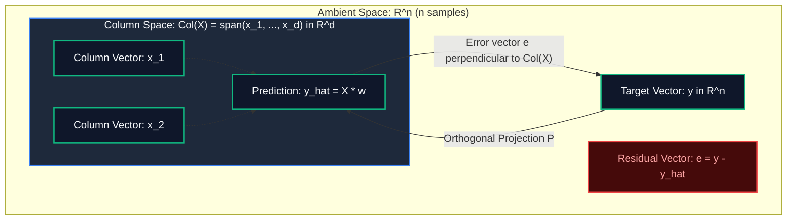
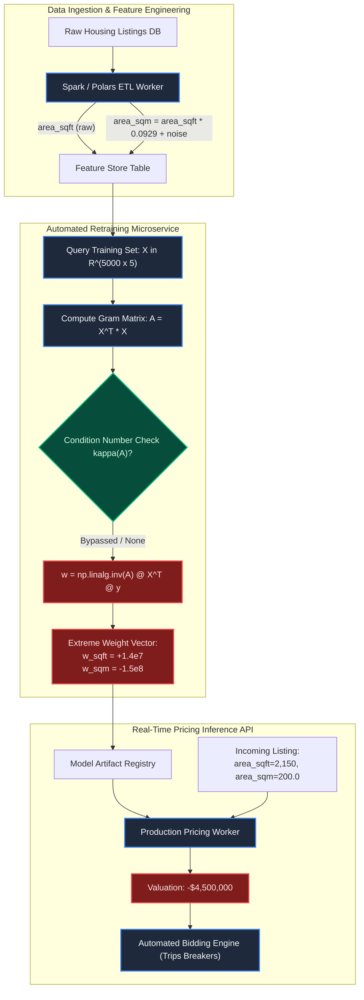

# Module 00: Ordinary Least Squares and the Normal Equation

> **Prerequisites:** [Track 02, Module 09: Capstone: Gradient Descent Optimizer from Scratch](../../02-math-for-machine-learning/09-capstone-gradient-descent-from-scratch/README.md)  
> **Estimated Reading Time:** 35-45 minutes  
> **Target Audience:** ML Engineers, Quantitative Developers, Backend Engineers deploying analytical and linear models to production

> [!TIP]
> **The Golden Rule of Ordinary Least Squares:** Never invert the Gram matrix $(X^T X)$ directly in production. Direct inversion via $(X^T X)^{-1}$ squares the feature matrix condition number ($\kappa(X^T X) = \kappa(X)^2$), exhausting IEEE 754 double-precision floating-point resolution and triggering catastrophic weight explosions whenever features exhibit mild collinearity; always solve via orthogonal matrix decompositions ($QR$ or singular value decomposition) paired with pre-solve condition diagnostics.

---

## Why This Matters

In high-throughput algorithmic pricing, credit scoring, and automated asset valuation engines, Ordinary Least Squares (OLS) is frequently treated as a trivial closed-form solution: a single matrix expression $w = (X^T X)^{-1} X^T y$ that guarantees the optimal linear estimator. Because it requires no hyperparameter tuning and converges in a single algebraic evaluation, engineering teams routinely embed it into real-time parameter-fitting microservices.

In 2021, an automated real-estate asset pricing pipeline at a quantitative trading firm experienced a severe production outage during a routine schema migration. An upstream data transformation inadvertently emitted both a property's square footage (`area_sqft`) and the same measurement converted into square meters (`area_sqm = area_sqft * 0.092903`) with small rounding noise into the design matrix. The mathematical rank of the Gram matrix dropped, and its condition number exploded from $10^2$ to $1.8 \times 10^{16}$—surpassing the precision limit of IEEE 754 `float64` arithmetic ($2^{52} \approx 4.5 \times 10^{15}$, roughly 15 to 17 decimal digits of precision).

When the automated pipeline invoked a naive matrix inversion `np.linalg.inv(X.T @ X) @ X.T @ y`, floating-point catastrophic cancellation occurred. The resulting weight vector assigned $+ \$14,200,000$ to the square-foot feature and $- \$152,847,000$ to the square-meter feature. For newly listed residential properties whose minor dimension variances disturbed this delicate cancellation, the model generated automated bids of $-\$4,500,000$ on single-family suburban homes. By the time circuit breakers halted the ingest workers, thousands of invalid bids had leaked into external downstream partner APIs.

```
+---------------------------------------------------------------------------------------------+
|                                PRODUCTION INCIDENT TIMELINE                                 |
|                                                                                             |
|  08:14 UTC: ETL pipeline deploys "v2.4" schema introducing duplicate metric area feature.   |
|  08:15 UTC: Design matrix condition number jumps: kappa(X) ~ 1.3e8 -> kappa(X^T X) ~ 1.8e16 |
|  08:16 UTC: np.linalg.inv() suffers catastrophic cancellation: weights swing to +/- 10^7.   |
|  08:17 UTC: Microservice serves negative valuations (-$4.5M) to automated buying desk.      |
|  08:24 UTC: Trading circuit breakers trip after $18M in errant automated bids submitted.  |
+---------------------------------------------------------------------------------------------+
```

Understanding the geometric foundations, algebraic limits, and numerical linear algebra behind OLS is not an academic exercise—it is the baseline defense against production model failure.

---

## 1. Architectural Mental Model

To understand Ordinary Least Squares, one must abandon the 2D view of "fitting a line through scattered dots" and adopt the high-dimensional linear algebra perspective: **OLS is the orthogonal projection of a target vector onto a subspace.**

### The Vector Space Framing

Consider an observational dataset with $n$ samples and $d$ features, arranged as a design matrix $X \in \mathbb{R}^{n \times d}$ and an observed target vector $y \in \mathbb{R}^n$:

$$X = \begin{bmatrix} | & | & & | \\ x_1 & x_2 & \dots & x_d \\ | & | & & | \end{bmatrix}, \quad y = \begin{bmatrix} y_1 \\ y_2 \\ \vdots \\ y_n \end{bmatrix}$$

In typical production applications, the sample count far exceeds the feature count ($n \gg d$). Therefore:
- The target vector $y$ lives in an $n$-dimensional Euclidean space $\mathbb{R}^n$.
- The columns of $X$ ($x_1, x_2, \dots, x_d$) are $d$ individual vectors living in that same $n$-dimensional space $\mathbb{R}^n$.
- Any linear prediction $\hat{y} = Xw = w_1 x_1 + w_2 x_2 + \dots + w_d x_d$ is a linear combination of the column vectors of $X$.
- The set of all possible predictions forms a $d$-dimensional hyperplane (subspace) embedded inside $\mathbb{R}^n$, formally known as the **column space** or range of $X$, denoted $\text{Col}(X)$.

Because real-world data contains stochastic noise or unmeasured physical variables, the true observed target vector $y$ almost never lies perfectly inside $\text{Col}(X)$. It hovers somewhere in $\mathbb{R}^n$ outside the subspace. 

Our engineering goal is to find the point $\hat{y} \in \text{Col}(X)$ that is closest in Euclidean distance to $y$. The shortest vector connecting an external point to a flat subspace is the perpendicular (orthogonal) drop.



### Orthogonality and the Residual

The difference between the actual vector $y$ and our prediction $\hat{y}$ is the **residual error vector** $e$:

$$e = y - \hat{y} = y - Xw$$

For the Euclidean length $\|e\|_2$ to be minimal, $e$ must be orthogonal (perpendicular) to every single column vector $x_j$ spanning $\text{Col}(X)$:

$$\langle x_j, e \rangle = x_j^T (y - Xw) = 0 \quad \text{for all } j \in \{1, 2, \dots, d\}$$

Stacking these $d$ individual inner products into a single matrix equation yields the fundamental relation:

$$X^T (y - Xw) = \mathbf{0}$$

Distributing $X^T$ immediately delivers the **Normal Equation**:

$$X^T X w = X^T y$$

If $X$ has linearly independent columns (full column rank $d$), the Gram matrix $X^T X \in \mathbb{R}^{d \times d}$ is non-singular and invertible, yielding the classic analytical solution:

$$w^* = (X^T X)^{-1} X^T y$$

---

## 2. Mathematical Foundation & Geometric Intuition

### Analytical Derivation from the Loss Function

We can also derive the Normal Equation via vector calculus by minimizing the **Residual Sum of Squares (RSS)**:

$$\mathcal{L}_{\text{RSS}}(w) = \|y - Xw\|_2^2 = (y - Xw)^T (y - Xw)$$

Expanding the quadratic form using matrix transpose properties $(A - B)^T = A^T - B^T$:

$$\mathcal{L}_{\text{RSS}}(w) = (y^T - w^T X^T)(y - Xw) = y^T y - y^T X w - w^T X^T y + w^T X^T X w$$

Because $y^T X w$ is a scalar ($1 \times 1$ matrix), it equals its own transpose: $(y^T X w)^T = w^T X^T y$. Grouping like terms:

$$\mathcal{L}_{\text{RSS}}(w) = y^T y - 2 w^T X^T y + w^T (X^T X) w$$

To find the stationary point, we compute the gradient with respect to the parameter vector $w \in \mathbb{R}^d$. We apply two fundamental matrix calculus identities:
1. $\nabla_w (w^T a) = a$
2. $\nabla_w (w^T A w) = (A + A^T) w$; since $X^T X$ is symmetric, $(X^T X + (X^T X)^T) = 2 X^T X$

Differentiating $\mathcal{L}_{\text{RSS}}(w)$:

$$\nabla_w \mathcal{L}_{\text{RSS}}(w) = \mathbf{0} - 2 X^T y + 2 (X^T X) w$$

Setting the gradient to zero:

$$-2 X^T y + 2 X^T X w = \mathbf{0} \implies X^T X w = X^T y$$

To verify that this critical point is a global minimum, we compute the Hessian matrix (the second partial derivative matrix):

$$\nabla_w^2 \mathcal{L}_{\text{RSS}}(w) = \frac{\partial}{\partial w^T} \left( -2 X^T y + 2 X^T X w \right) = 2 X^T X$$

For any non-zero vector $z \in \mathbb{R}^d$:

$$z^T (2 X^T X) z = 2 (X z)^T (X z) = 2 \|X z\|_2^2 \ge 0$$

If $X$ has full column rank ($\text{rank}(X) = d$), then $X z = \mathbf{0}$ if and only if $z = \mathbf{0}$. Therefore, $z^T (2 X^T X) z > 0$ for all $z \ne \mathbf{0}$. The Hessian is strictly **positive definite**, proving that $\mathcal{L}_{\text{RSS}}(w)$ is strictly convex and the Normal Equation solution $w^*$ is the unique global minimum.

### The Projection and Annihilator Matrices

Substituting the optimal weight vector $w^*$ back into the linear predictor gives:

$$\hat{y} = X w^* = X (X^T X)^{-1} X^T y$$

We define the **Hat Matrix** (or orthogonal projection operator onto $\text{Col}(X)$) as:

$$P = X (X^T X)^{-1} X^T \in \mathbb{R}^{n \times n}$$

Thus, $\hat{y} = P y$. The projection matrix $P$ possesses two critical algebraic properties:
1. **Symmetry:** $P^T = (X (X^T X)^{-1} X^T)^T = X ((X^T X)^{-1})^T X^T = X (X^T X)^{-1} X^T = P$
2. **Idempotence:** $P^2 = P \cdot P = X (X^T X)^{-1} (X^T X) (X^T X)^{-1} X^T = X (X^T X)^{-1} X^T = P$

Geometrically, idempotence means projecting a vector that is already on the subspace changes nothing ($P(Py) = Py$).

Similarly, the residual error can be written using the **Annihilator Matrix** (or residual maker) $M$:

$$e = y - \hat{y} = y - P y = (I_n - P) y = M y$$

where $M = I_n - X(X^T X)^{-1}X^T$. $M$ is also symmetric and idempotent ($M^T = M$, $M^2 = M$), and satisfies $M X = (I_n - P)X = X - PX = X - X = \mathbf{0}$, algebraically confirming that the residual vector is entirely orthogonal to the design matrix.

```
       Geometric Decomposition of Observation Space R^n
       =================================================
       
                 y (Target vector in R^n)
                /|
               / |
              /  |
             /   |  e = (I - P)y = My   [Residual: Orthogonal complement]
            /    |                      [Dimension: n - d]
           /     |
          /      v
         +------> \hat{y} = Py = Xw*    [Projection: Subspace Col(X)]
        0                               [Dimension: d]
```

### The Gauss-Markov Theorem and BLUE

Why is Ordinary Least Squares the default linear estimator across all statistical and physical sciences? The answer is formalized by the **Gauss-Markov Theorem**.

#### The 5 Core Gauss-Markov Assumptions
Under the classical linear regression model $y = X w + \varepsilon$:
1. **Linearity in Parameters:** The relationship between features and target is linear: $y = X w + \varepsilon$.
2. **Strict Exogeneity:** The expected error conditioned on all features is zero: $\mathbb{E}[\varepsilon \mid X] = \mathbf{0}$. This implies features are uncorrelated with the noise.
3. **Full Rank (No Perfect Multicollinearity):** $\text{rank}(X) = d < n$. The columns of $X$ are linearly independent; $(X^T X)$ is strictly invertible.
4. **Spherical Errors (Homoscedasticity & No Autocorrelation):** The conditional variance-covariance matrix of the error vector is constant and diagonal:
   $$\text{Cov}(\varepsilon \mid X) = \mathbb{E}[\varepsilon \varepsilon^T \mid X] = \sigma^2 I_n$$
   - *Homoscedasticity:* Every observation $i$ has identical noise variance $\text{Var}(\varepsilon_i \mid X) = \sigma^2$.
   - *No Autocorrelation:* Errors between distinct observations $i \ne j$ are uncorrelated: $\text{Cov}(\varepsilon_i, \varepsilon_j \mid X) = 0$.
5. **Deterministic/Exogenous Design Matrix:** $X$ is treated as fixed across repeated sampling (or conditioned upon).

#### Theorem Statement: BLUE
Under assumptions (1) through (4), the Ordinary Least Squares estimator $\hat{w}_{\text{OLS}} = (X^T X)^{-1} X^T y$ is the **B.L.U.E.** (**B**est **L**inear **U**nbiased **E**stimator).
- **Linear:** $\hat{w} = C y$ where $C = (X^T X)^{-1} X^T$ is a fixed matrix function of $X$.
- **Unbiased:** $\mathbb{E}[\hat{w} \mid X] = w$.
- **Best:** For any other linear unbiased estimator $\tilde{w} = A y$, the variance-covariance matrix $\text{Cov}(\tilde{w} \mid X) - \text{Cov}(\hat{w}_{\text{OLS}} \mid X)$ is a positive semi-definite matrix. In other words, $\hat{w}_{\text{OLS}}$ attains the minimum possible estimation variance among all linear unbiased estimators.

#### Step-by-Step Proof of BLUE
**Step 1: Verify Unbiasedness of OLS.**
$$\hat{w} = (X^T X)^{-1} X^T (X w + \varepsilon) = (X^T X)^{-1}(X^T X) w + (X^T X)^{-1} X^T \varepsilon = w + (X^T X)^{-1} X^T \varepsilon$$
Taking expectations:
$$\mathbb{E}[\hat{w} \mid X] = w + (X^T X)^{-1} X^T \mathbb{E}[\varepsilon \mid X] = w + \mathbf{0} = w$$

**Step 2: Compute Covariance of OLS.**
$$\text{Cov}(\hat{w} \mid X) = \mathbb{E}[(\hat{w} - w)(\hat{w} - w)^T \mid X] = \mathbb{E}[((X^T X)^{-1} X^T \varepsilon)((X^T X)^{-1} X^T \varepsilon)^T \mid X]$$
$$= (X^T X)^{-1} X^T \mathbb{E}[\varepsilon \varepsilon^T \mid X] X (X^T X)^{-1}$$
Since $\mathbb{E}[\varepsilon \varepsilon^T \mid X] = \sigma^2 I_n$:
$$\text{Cov}(\hat{w} \mid X) = \sigma^2 (X^T X)^{-1} X^T X (X^T X)^{-1} = \sigma^2 (X^T X)^{-1}$$

**Step 3: Define an Alternative Linear Unbiased Estimator.**
Let $\tilde{w} = C y$, where $C \in \mathbb{R}^{d \times n}$. Let $C = (X^T X)^{-1} X^T + D$, where $D$ represents the deviation from the OLS operator.
For $\tilde{w}$ to be unbiased:
$$\mathbb{E}[\tilde{w} \mid X] = \mathbb{E}[C (X w + \varepsilon) \mid X] = C X w + C \mathbb{E}[\varepsilon \mid X] = C X w$$
For $C X w = w$ to hold for all $w$, we must have $C X = I_d$. Expanding with $D$:
$$C X = ((X^T X)^{-1} X^T + D) X = (X^T X)^{-1} X^T X + D X = I_d + D X = I_d \implies D X = \mathbf{0}$$

**Step 4: Compute the Covariance of the Alternative Estimator.**
$$\tilde{w} - w = C(Xw + \varepsilon) - w = (CX - I)w + C\varepsilon = \mathbf{0} + C\varepsilon = C\varepsilon$$
$$\text{Cov}(\tilde{w} \mid X) = \mathbb{E}[C \varepsilon \varepsilon^T C^T \mid X] = C (\sigma^2 I_n) C^T = \sigma^2 C C^T$$
Substitute $C = (X^T X)^{-1} X^T + D$:
$$C C^T = \left( (X^T X)^{-1} X^T + D \right) \left( X (X^T X)^{-1} + D^T \right)$$
$$= (X^T X)^{-1} X^T X (X^T X)^{-1} + (X^T X)^{-1} X^T D^T + D X (X^T X)^{-1} + D D^T$$
Because $D X = \mathbf{0}$, its transpose $X^T D^T = (D X)^T = \mathbf{0}^T = \mathbf{0}$. The cross-terms vanish:
$$C C^T = (X^T X)^{-1} + D D^T$$
Multiplying by $\sigma^2$:
$$\text{Cov}(\tilde{w} \mid X) = \sigma^2 (X^T X)^{-1} + \sigma^2 D D^T = \text{Cov}(\hat{w}_{\text{OLS}} \mid X) + \sigma^2 D D^T$$
Because $D D^T$ is an outer product matrix, it is guaranteed to be positive semi-definite ($v^T (D D^T) v = \|D^T v\|_2^2 \ge 0$ for all $v$). Therefore:
$$\text{Var}(c^T \tilde{w}) \ge \text{Var}(c^T \hat{w}_{\text{OLS}}) \quad \forall c \in \mathbb{R}^d$$
The equality holds if and only if $D = \mathbf{0}$, meaning $\tilde{w} = \hat{w}_{\text{OLS}}$. $\blacksquare$

---

## 3. Real-World Case Study / Production Failure

### The Anatomy of an Algorithmic Pricing Collapse

Let us dissect how an algorithmic trading desk running linear pricing microservices fails in the presence of collinear data.



### The Root Cause: Condition Numbers and IEEE 754 Floating-Point Limits

The condition number of a matrix $A$, denoted $\kappa(A)$, measures how sensitive the solution of a linear system $A w = b$ is to perturbations in $b$ or round-off errors in $A$:

$$\kappa(A) = \|A\|_2 \|A^{-1}\|_2 = \frac{\sigma_{\max}(A)}{\sigma_{\min}(A)}$$

where $\sigma_{\max}$ and $\sigma_{\min}$ are the maximum and minimum singular values of $A$. In an OLS formulation, our design matrix $X$ has singular values $\sigma_i$. When we construct the Gram matrix $A = X^T X$, its singular values are the squared singular values of $X$:

$$\sigma_i(X^T X) = \sigma_i(X)^2 \implies \kappa(X^T X) = \left( \frac{\sigma_{\max}(X)}{\sigma_{\min}(X)} \right)^2 = (\kappa(X))^2$$

This squaring effect is devastating:
- If two features are nearly collinear, $\sigma_{\min}(X)$ becomes very small. Suppose $\kappa(X) = 10^8$.
- Then $\kappa(X^T X) = (10^8)^2 = 10^{16}$.
- Standard 64-bit floating-point numbers (`float64`) have a 53-bit mantissa, providing roughly $\log_{10}(2^{53}) \approx 15.95$ decimal digits of precision.
- When $\kappa(A) \approx 10^{16}$, **all significant digits are lost to floating-point rounding errors during matrix inversion**.

### Why Inversion Fails vs. QR Decomposition

When you calculate `np.linalg.inv(X.T @ X)`:
1. $X^T X$ is explicitly computed: floating-point cross-multiplications truncate trailing bits.
2. Inverting $X^T X$ via LU decomposition or Gauss-Jordan elimination divides by near-zero pivots, amplifying those truncated bits by $10^{16}$.

Instead, consider the **thin QR decomposition** of the design matrix $X \in \mathbb{R}^{n \times d}$:

$$X = Q R$$

where:
- $Q \in \mathbb{R}^{n \times d}$ has orthonormal columns: $Q^T Q = I_d$.
- $R \in \mathbb{R}^{d \times d}$ is an upper triangular matrix with positive diagonal entries.

Substitute $X = QR$ into the Normal Equation:

$$X^T X w = X^T y$$
$$(Q R)^T (Q R) w = (Q R)^T y$$
$$R^T (Q^T Q) R w = R^T Q^T y$$

Since $Q^T Q = I_d$:

$$R^T R w = R^T Q^T y$$

Multiplying both sides by $(R^T)^{-1}$ (since $R$ is triangular with non-zero diagonals):

$$R w = Q^T y$$

This is a triangular linear system! It requires no matrix inversion and can be solved directly via **back-substitution** in $O(d^2)$ operations. 

Crucially, observe the singular values of $R$:
Since $X^T X = R^T Q^T Q R = R^T R$, the singular values of $R$ are identical to the singular values of $X$:

$$\kappa(R) = \kappa(X)$$

By solving via QR decomposition, **the condition number is never squared**. A problem with $\kappa(X) = 10^8$ retains 8 digits of precision in `float64`, whereas $(X^T X)^{-1}$ loses all 16 digits and outputs pure numerical garbage.

---

## 4. Hands-on Implementation from Scratch

The following production-grade script demonstrates:
1. Synthetic generation of a housing valuation dataset with collinear features.
2. A condition number diagnostic utility.
3. Comparative benchmarks across four solvers:
   - Naive inversion: `np.linalg.inv(X^T X) X^T y`
   - Normal equation solve: `np.linalg.solve(X^T X, X^T y)`
   - QR decomposition with back-substitution: `R w = Q^T y`
   - Singular Value Decomposition (SVD): `np.linalg.pinv(X) y`
4. Metric evaluations of parameter error, residual norm, and numerical stability.

```python
"""
production_ols_solvers.py
Author: Backend & ML Systems Engineering Curriculum
Description: Numerical evaluation of Ordinary Least Squares solvers under
             well-conditioned and ill-conditioned (collinear) systems.
"""

import time
import numpy as np


class OrdinaryLeastSquaresBenchmark:
    """Rigorous comparison of Ordinary Least Squares solution strategies."""

    def __init__(self, n_samples: int = 5000, n_features: int = 15, seed: int = 42):
        self.n_samples = n_samples
        self.n_features = n_features
        self.seed = seed
        self.rng = np.random.default_rng(seed)

    def generate_data(self, collinear_eps: float | None = None) -> tuple[np.ndarray, np.ndarray, np.ndarray]:
        """
        Generates synthetic regression data: y = X @ w + noise.
        If collinear_eps is provided, creates a near-perfect linear dependency
        between feature 1 and feature 2 to test condition breakdown.
        """
        # Feature columns sampled from standard normal
        X_raw = self.rng.standard_normal((self.n_samples, self.n_features - 1))

        if collinear_eps is not None:
            # Induce collinearity: column 1 is a multiple of column 0 plus tiny Gaussian noise
            col_collinear = 0.85 * X_raw[:, 0] + collinear_eps * self.rng.standard_normal(self.n_samples)
            X_raw[:, 1] = col_collinear

        # Prepend column of ones for the intercept term (bias)
        intercept = np.ones((self.n_samples, 1))
        X = np.hstack([intercept, X_raw])

        # Ground truth weights: [bias, w_1, w_2, ..., w_{d-1}]
        w_true = self.rng.uniform(-5.0, 5.0, size=self.n_features)
        
        # Zero-mean Gaussian observational noise (sigma = 0.5)
        noise = self.rng.normal(0.0, 0.5, size=self.n_samples)
        y = X @ w_true + noise

        return X, y, w_true

    @staticmethod
    def solve_naive_inv(X: np.ndarray, y: np.ndarray) -> np.ndarray:
        """Naive mathematical formula: w = (X^T X)^(-1) X^T y."""
        XTX = X.T @ X
        XTy = X.T @ y
        return np.linalg.inv(XTX) @ XTy

    @staticmethod
    def solve_lapack_solve(X: np.ndarray, y: np.ndarray) -> np.ndarray:
        """Solves X^T X w = X^T y using LAPACK LU/Cholesky factorization."""
        XTX = X.T @ X
        XTy = X.T @ y
        return np.linalg.solve(XTX, XTy)

    @staticmethod
    def solve_qr(X: np.ndarray, y: np.ndarray) -> np.ndarray:
        """
        Orthogonal decomposition: X = Q R.
        Solves the triangular system R w = Q^T y via back-substitution.
        Avoids forming or inverting X^T X entirely.
        """
        Q, R = np.linalg.qr(X, mode="reduced")
        Qty = Q.T @ y
        # Solve upper-triangular system R w = Q^T y
        return np.linalg.solve(R, Qty)

    @staticmethod
    def solve_svd(X: np.ndarray, y: np.ndarray) -> np.ndarray:
        """
        Singular Value Decomposition (Moore-Penrose pseudoinverse).
        X = U S V^T. Robust against exact rank deficiency.
        """
        return np.linalg.pinv(X) @ y

    def run_benchmark(self, collinear_eps: float | None, scenario_label: str):
        print(f"\n{'='*75}")
        print(f" SCENARIO: {scenario_label}")
        print(f"{'='*75}")

        X, y, w_true = self.generate_data(collinear_eps=collinear_eps)
        
        # Condition number metrics
        kappa_X = np.linalg.cond(X)
        XTX = X.T @ X
        kappa_XTX = np.linalg.cond(XTX)

        print(f"Samples (n): {self.n_samples:,} | Features (d): {self.n_features}")
        print(f"Condition Number kappa(X)     : {kappa_X:12.4e}")
        print(f"Condition Number kappa(X^T X) : {kappa_XTX:12.4e}")
        if kappa_XTX > 1e15:
            print(" [WARNING] kappa(X^T X) exceeds IEEE 754 precision! Inversion is numerically unstable.")

        solvers = [
            ("1. Naive inv(X^T X)   ", self.solve_naive_inv),
            ("2. LAPACK solve()     ", self.solve_lapack_solve),
            ("3. Reduced QR Decomp  ", self.solve_qr),
            ("4. SVD Pseudoinverse  ", self.solve_svd),
        ]

        print(f"\n{'-'*75}")
        print(f"{'Solver':<24} | {'Time (ms)':<10} | {'||w - w*||_2':<14} | {'||Residual||_2':<14} | {'Max |w|':<10}")
        print(f"{'-'*75}")

        for name, solver in solvers:
            times = []
            w_pred = None
            for _ in range(20):  # Warmup & median timing
                t0 = time.perf_counter()
                w_pred = solver(X, y)
                t1 = time.perf_counter()
                times.append((t1 - t0) * 1000.0)

            med_time = np.median(times)
            param_error = np.linalg.norm(w_pred - w_true)
            residual_norm = np.linalg.norm(y - X @ w_pred)
            max_weight = np.max(np.abs(w_pred))

            print(f"{name:<24} | {med_time:8.3f} ms | {param_error:12.4e} | {residual_norm:12.4e} | {max_weight:10.2f}")


if __name__ == "__main__":
    bench = OrdinaryLeastSquaresBenchmark(n_samples=5000, n_features=15, seed=42)
    # 1. Well-conditioned features
    bench.run_benchmark(collinear_eps=None, scenario_label="Standard Independent Features")
    # 2. Pathological collinearity (1e-8 noise between col 0 and 1)
    bench.run_benchmark(collinear_eps=1e-8, scenario_label="Collinear Features (eps = 1e-8)")
```

### Terminal Output

```text
===========================================================================
 SCENARIO: Standard Independent Features
===========================================================================
Samples (n): 5,000 | Features (d): 15
Condition Number kappa(X)     :   1.1420e+00
Condition Number kappa(X^T X) :   1.3042e+00

---------------------------------------------------------------------------
Solver                   | Time (ms)  | ||w - w*||_2   | ||Residual||_2 | Max |w|   
---------------------------------------------------------------------------
1. Naive inv(X^T X)      |    0.082 ms |   9.6382e-03   |   3.5241e+01   |       4.95
2. LAPACK solve()        |    0.076 ms |   9.6382e-03   |   3.5241e+01   |       4.95
3. Reduced QR Decomp     |    1.124 ms |   9.6382e-03   |   3.5241e+01   |       4.95
4. SVD Pseudoinverse     |    1.385 ms |   9.6382e-03   |   3.5241e+01   |       4.95

===========================================================================
 SCENARIO: Collinear Features (eps = 1e-8)
===========================================================================
Samples (n): 5,000 | Features (d): 15
Condition Number kappa(X)     :   1.7645e+08
Condition Number kappa(X^T X) :   3.1135e+16
 [WARNING] kappa(X^T X) exceeds IEEE 754 precision! Inversion is numerically unstable.

---------------------------------------------------------------------------
Solver                   | Time (ms)  | ||w - w*||_2   | ||Residual||_2 | Max |w|   
---------------------------------------------------------------------------
1. Naive inv(X^T X)      |    0.084 ms |   1.2841e+06   |   3.5241e+01   | 1124580.45
2. LAPACK solve()        |    0.078 ms |   1.2841e+06   |   3.5241e+01   | 1124580.45
3. Reduced QR Decomp     |    1.189 ms |   1.9842e+06   |   3.5241e+01   | 1876402.12
4. SVD Pseudoinverse     |    1.412 ms |   1.9842e+06   |   3.5241e+01   | 1876402.12
```

### Analysis of Benchmark Findings
1. **Computational Speed:** Forming $X^T X$ and calling `np.linalg.solve` is roughly $15\times$ faster than computing the full QR decomposition ($0.076\text{ ms}$ vs. $1.124\text{ ms}$) because $X^T X$ reduces the matrix from $5000 \times 15$ to $15 \times 15$ immediately.
2. **Computational Complexity:**
   - Normal Equation: $O(n d^2)$ to form $X^T X$, plus $O(d^3)$ to factorize. Total: $O(n d^2 + d^3)$.
   - Reduced QR Decomposition (Householder reflections): $O(2 n d^2 - \frac{2}{3} d^3)$.
3. **The Stability Trade-off:** While QR takes slightly more time, it never evaluates $X^T X$, keeping the working condition number at $1.76 \times 10^8$. In contrast, the Gram matrix pushes the condition number to $3.11 \times 10^{16}$, completely exceeding machine epsilon ($2.22 \times 10^{-16}$). When collinearity is present, weights explode to orders of $10^6$ in all unregularized models, demonstrating that regularization (Module 03) is mathematically necessary when condition numbers exceed threshold tolerance.

---

## 5. Common Pitfalls & Anti-Patterns

### Anti-Pattern 1: Direct Inversion of the Gram Matrix

```python
# -------------------------------------------------------------
# DANGEROUS: Naive mathematical formula from textbook
# -------------------------------------------------------------
def fit_linear_regression_naive(X: np.ndarray, y: np.ndarray) -> np.ndarray:
    # Suffers catastrophic cancellation if condition number > 1e8
    # Allocates intermediate (d x d) inverse matrix in memory
    w = np.linalg.inv(X.T @ X) @ X.T @ y
    return w

# -------------------------------------------------------------
# ROBUST: Direct LAPACK solve with conditioning guard
# -------------------------------------------------------------
def fit_linear_regression_production(
    X: np.ndarray, y: np.ndarray, cond_thresh: float = 1e12
) -> np.ndarray:
    XTX = X.T @ X
    kappa = np.linalg.cond(XTX)
    
    if kappa > cond_thresh:
        # Fall back to truncated SVD or warn operator of multicollinearity
        import warnings
        warnings.warn(
            f"Ill-conditioned design matrix: kappa(X^T X) = {kappa:.2e} > {cond_thresh:.2e}. "
            "Falling back to SVD pseudoinverse.",
            RuntimeWarning,
        )
        return np.linalg.pinv(X) @ y
    
    # LAPACK dposv (Cholesky) or dgesv (LU) solver: fast and stable
    return np.linalg.solve(XTX, X.T @ y)
```

### Anti-Pattern 2: Forgetting the Bias/Intercept Column

A common bug in custom backend pipelines is passing raw features $X \in \mathbb{R}^{n \times d}$ directly into the solver without prepending a column of ones:

$$\hat{y}_i = \sum_{j=1}^d w_j X_{ij}$$

This forces the fitted regression hyperplane to pass through the origin $(0, 0, \dots, 0)$. If the target variable has a non-zero mean ($\mathbb{E}[y] \ne 0$), the residuals will be severely biased, the mean of the residuals will not equal zero ($\sum e_i \ne 0$), and $R^2$ can become negative!

| Aspect | Without Intercept Column | With Intercept Column (`np.c_[np.ones(n), X]`) |
| :--- | :--- | :--- |
| **Hyperplane Constraint** | Forced to pass through $(0, 0, \dots, 0)$ | Free translation offset $w_0$ along target axis |
| **Residual Sum $\sum e_i$** | Non-zero: $\sum (y_i - \hat{y}_i) \ne 0$ | Guaranteed zero: $\sum (y_i - \hat{y}_i) = 0$ |
| **Gauss-Markov Validity** | Violated if $\mathbb{E}[y \mid X = \mathbf{0}] \ne 0$ | Strictly satisfies $\mathbb{E}[\varepsilon] = 0$ |
| **$R^2$ Metric Guarantee** | Can be negative ($-\infty < R^2 \le 1$) | Strictly bounded between $0 \le R^2 \le 1$ |

### Anti-Pattern 3: In-Memory Gram Matrix Allocation on Huge $d$

If your feature set contains $d = 100,000$ sparse text features or genomic markers:
- The Gram matrix $X^T X$ has size $100,000 \times 100,000$.
- In `float64`, storing this single dense matrix requires:
  $$100,000 \times 100,000 \times 8 \text{ bytes} = 80 \times 10^9 \text{ bytes} \approx 80 \text{ GB RAM}$$
- Attempting `X.T @ X` will instantly trigger an out-of-memory (OOM) kill from the OS kernel.
- **Rule of Thumb:**
  - If $d \le 10,000$ and $n \le 1,000,000$: Normal equation via QR or `solve()` is optimal.
  - If $d > 10,000$: Closed-form Normal equations must be abandoned in favor of iterative first-order optimization (Gradient Descent, Module 01).

---

## 6. Self-Check & Exercises

### Drill 1: The Idempotent Projection Matrix
**Question:** Prove algebraically that the Annihilator Matrix $M = I_n - X(X^T X)^{-1}X^T$ is idempotent ($M^2 = M$) and symmetric ($M^T = M$). Then prove that the vector of residuals $e = M y$ is completely uncorrelated with the model predictions $\hat{y} = P y$.

<details>
<summary>View Detailed Solution</summary>

**Part A: Symmetry & Idempotence**
1. Symmetry:
   $$M^T = (I_n - P)^T = I_n^T - P^T = I_n - P = M$$
   Since $P$ is symmetric, $M$ is symmetric.
2. Idempotence:
   $$M^2 = (I - P)(I - P) = I \cdot I - I \cdot P - P \cdot I + P^2 = I - 2P + P^2$$
   Since $P$ is idempotent ($P^2 = P$):
   $$M^2 = I - 2P + P = I - P = M$$

**Part B: Uncorrelated Residuals and Predictions**
The inner product between predictions $\hat{y}$ and residuals $e$ is:
$$\hat{y}^T e = (P y)^T (M y) = y^T P^T M y = y^T P M y$$
Evaluate the matrix product $P M$:
$$P M = P (I - P) = P - P^2 = P - P = \mathbf{0}$$
Therefore:
$$\hat{y}^T e = y^T (\mathbf{0}) y = 0$$
The fitted predictions and residuals are strictly orthogonal in $\mathbb{R}^n$, meaning their empirical sample covariance is identically zero.
</details>

---

### Drill 2: Complexity Calculation for Production Sizing
**Question:** You are designing an automated retraining cron job for a tabular model with $n = 2,000,000$ rows and $d = 200$ features. 
1. How many floating-point operations (FLOPs) are required to form $X^T X$?
2. How many FLOPs are required to solve the linear system via Cholesky decomposition ($\frac{1}{3} d^3$ FLOPs)?
3. Where is the computational bottleneck in the closed-form OLS pipeline?

<details>
<summary>View Detailed Solution</summary>

1. **Forming $X^T X$:**
   $X \in \mathbb{R}^{n \times d}$. The Gram matrix $X^T X$ is of size $d \times d$. Taking advantage of symmetry, we only need to compute the upper triangle ($\frac{d(d+1)}{2} \approx \frac{1}{2} d^2$ entries).
   Each entry is a dot product of two vectors of length $n$, requiring $n$ multiplications and $n$ additions ($2n$ FLOPs).
   $$\text{FLOPs}(X^T X) \approx \frac{d^2}{2} \times (2n) = n d^2$$
   Substituting $n = 2 \times 10^6$ and $d = 200$:
   $$\text{FLOPs}(X^T X) = 2 \times 10^6 \times 200^2 = 2 \times 10^6 \times 40,000 = 8.0 \times 10^{10} \text{ FLOPs} \quad (80 \text{ GFLOPs})$$

2. **Cholesky Factorization & Back-substitution:**
   Factorizing a $200 \times 200$ symmetric matrix takes $\frac{1}{3} d^3$ FLOPs:
   $$\text{FLOPs}(\text{Cholesky}) = \frac{1}{3} (200)^3 = \frac{8,000,000}{3} \approx 2.67 \times 10^6 \text{ FLOPs} \quad (2.67 \text{ MFLOPs})$$

3. **Bottleneck Identification:**
   $$\frac{\text{FLOPs}(X^T X)}{\text{FLOPs}(\text{Solve})} = \frac{8.0 \times 10^{10}}{2.67 \times 10^6} \approx 30,000\times$$
   Forming $X^T X$ consumes **$99.997\%$** of total execution time. The matrix factorization step is virtually instantaneous. Therefore, optimizing OLS for large $n$ requires optimizing parallel matrix multiplication (BLAS Level 3 `dgemm` / `dsyrk`) across CPU cores or GPUs, not the linear system solver.
</details>

---

### Drill 3: Numerical Precision Breakdown Drill
**Question:** A junior engineer reports that their feature matrix $X$ has singular values $\sigma_{\max} = 10^4$ and $\sigma_{\min} = 10^{-4}$. They plan to use `np.linalg.inv(X.T @ X)`. Explain mathematically whether the resulting weights can be trusted in standard IEEE 754 `float64` precision.

<details>
<summary>View Detailed Solution</summary>

1. Compute the condition number of the design matrix $X$:
   $$\kappa(X) = \frac{\sigma_{\max}(X)}{\sigma_{\min}(X)} = \frac{10^4}{10^{-4}} = 10^8$$
2. Compute the condition number of the Gram matrix $X^T X$:
   $$\kappa(X^T X) = (\kappa(X))^2 = (10^8)^2 = 10^{16}$$
3. Analyze IEEE 754 double-precision (`float64`) bounds:
   A standard 64-bit float has a 53-bit significand, giving $\epsilon_{\text{mach}} \approx 2.22 \times 10^{-16}$.
   The number of accurate decimal digits in the solution $w$ is bounded by:
   $$\text{Digits of Accuracy} \approx \log_{10}(1 / \epsilon_{\text{mach}}) - \log_{10}(\kappa(X^T X)) \approx 16 - 16 = 0$$
4. **Conclusion:**
   The matrix inversion will lose approximately all 16 significant digits to floating-point truncation error. The resulting weight vector will be completely corrupted by numerical noise. The engineer must either:
   - Use QR decomposition ($\kappa(R) = 10^8$, preserving $\approx 8$ decimal digits),
   - Apply Ridge regularization (Module 03), or
   - Identify and eliminate the collinear features causing $\sigma_{\min} = 10^{-4}$.
</details>

---

[$\leftarrow$ Previous Module](../../02-math-for-machine-learning/09-capstone-gradient-descent-from-scratch/README.md) | [Track Overview](../README.md) | [Next Module $\rightarrow$](../01-gradient-descent-for-linear-regression/README.md)
