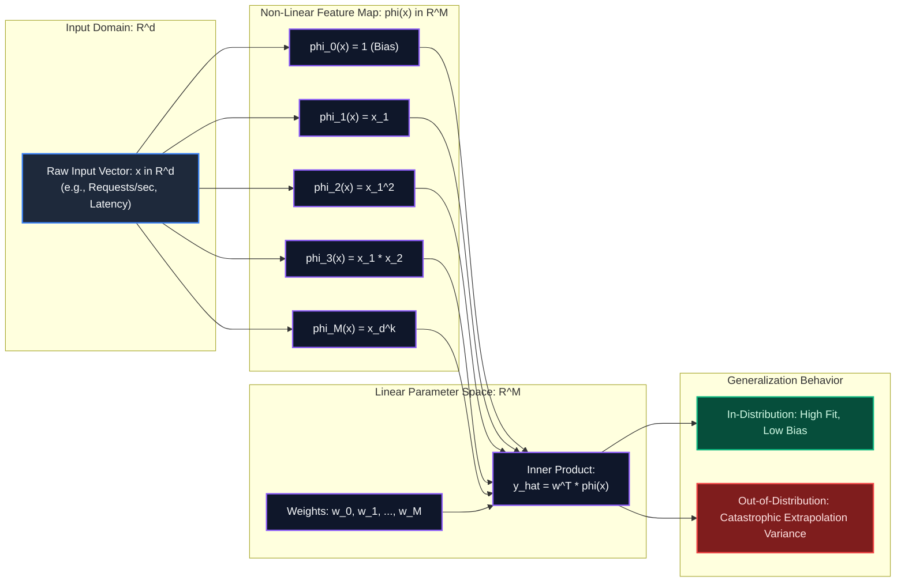
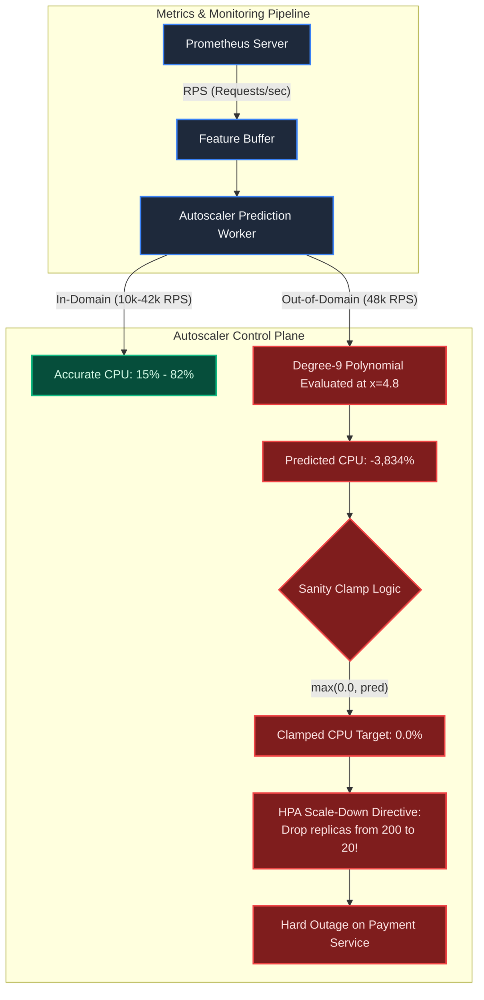

# Module 02: Polynomial Features, Basis Expansion, and Complexity

> **Prerequisites:** [Track 03, Module 01: Gradient Descent and Conditioning for Linear Regression](../01-gradient-descent-for-linear-regression/README.md)  
> **Estimated Reading Time:** 35-45 minutes  
> **Target Audience:** ML Engineers, Platform Developers, Backend Architects designing predictive scaling, physical simulations, and non-linear regression pipelines

> [!TIP]
> **The Golden Rule of Basis Expansion:** A model linear in parameters can represent arbitrary non-linear boundaries via feature mappings $\phi(x)$, but every additional polynomial degree exponentially multiplies variance and detonates boundary extrapolation. Never extrapolate a polynomial model outside the convex hull of its training distribution, and always select polynomial capacity using cross-validation bounded by condition number diagnostics.

---

## Why This Matters

Linear models are computationally efficient and interpretable, but real-world physical and backend systems are fundamentally non-linear. Server queueing delays saturate exponentially near network capacity, database disk I/O degrades quadratically under concurrent contention, and customer lifetime value exhibits diminishing marginal returns.

To capture non-linear relationships without abandoning the convex optimization guarantees of linear regression, engineers employ **basis expansion**—transforming raw inputs $x \in \mathbb{R}^d$ into a high-dimensional feature space $\phi(x) \in \mathbb{R}^M$. The most ubiquitous transformation is polynomial feature expansion (generating powers $x_j^2, x_j^3$ and cross-product interactions $x_i x_j$).

However, unconstrained polynomial expansions harbor two production-fatal pathologies: **combinatorial feature explosion** and **boundary oscillation (Runge's Phenomenon)**.

In November 2021, an e-commerce platform's infrastructure team deployed an automated predictive autoscaler for their payment microservices. The model was trained on historical weekday traffic to predict container CPU utilization from incoming request rates (requests per second, RPS). To capture peak saturation curvature, the engineers fitted an unregularized 9th-degree polynomial regression:

$$\widehat{\text{CPU}}(x) = \sum_{k=0}^9 w_k x^k$$

During standard traffic ($10,000$ to $42,000$ RPS), the model fitted historical training data with a near-perfect $R^2 = 0.994$. But on Black Friday, traffic surged to $48,000$ RPS—just $14\%$ above the historical maximum observed during training.

```
+----------------------------------------------------------------------------------------------------+
|                                PRODUCTION INCIDENT POST-MORTEM                                     |
|                                                                                                    |
|  11:45 UTC: Ingress traffic climbs from 42,000 to 48,000 RPS (Black Friday surge).                 |
|  11:46 UTC: Degree-9 polynomial hits boundary inflection point: predicted CPU swings to -3,800%. |
|  11:47 UTC: Autoscaler control plane clamps negative values to 0%, shutting down 90% of pods!     |
|  11:48 UTC: Remaining pods crash under massive overload; traffic queues back up.                  |
|  11:49 UTC: RPS slightly ticks up to 51,000 RPS: polynomial flips violently to +12,400% CPU.       |
|  11:50 UTC: Autoscaler attempts to spawn 5,000 Kubernetes pods simultaneously.                     |
|  11:51 UTC: Cloud provider API rate-limits infrastructure; payment gateway undergoes hard outage. |
+----------------------------------------------------------------------------------------------------+
```

The high-degree polynomial suffered a classic boundary divergence: outside the training range, high-order monomials ($x^8, x^9$) dominated the prediction, producing massive negative oscillations followed by vertical asymptotic spikes. Understanding how basis expansion transforms model capacity, bias, and variance is essential for building stable real-world ML systems.

---

## 1. Architectural Mental Model

### Linearity in Parameters vs. Linearity in Features

The defining principle of linear models is not that the decision surface must be a straight line in the input features, but that the model is **linear with respect to its learnable parameters $w$**.

Consider a non-linear mapping $\phi: \mathbb{R}^d \to \mathbb{R}^M$ that projects a $d$-dimensional input vector $x$ into an $M$-dimensional feature space:

$$\phi(x) = \begin{bmatrix} \phi_1(x) \\ \phi_2(x) \\ \vdots \\ \phi_M(x) \end{bmatrix} \in \mathbb{R}^M$$

The predictive model is formulated as the inner product of a weight vector $w \in \mathbb{R}^M$ and the transformed feature vector $\phi(x)$:

$$f(x) = \sum_{j=1}^M w_j \phi_j(x) = w^T \phi(x)$$

Because $f(x)$ is strictly linear in $w$, every theorem, guarantee, and numerical algorithm from [Module 00](../00-ordinary-least-squares-and-normal-equation/README.md) and [Module 01](../01-gradient-descent-for-linear-regression/README.md)—the Normal Equation, convexity of MSE loss, Lipschitz gradient bounds, and global optimality—applies without modification to the transformed design matrix:

$$\Phi = \begin{bmatrix} \phi(x_1)^T \\ \phi(x_2)^T \\ \vdots \\ \phi(x_n)^T \end{bmatrix} \in \mathbb{R}^{n \times M}$$



### The Combinatorial Explosion of Polynomial Spaces

While a 1D input $x \in \mathbb{R}$ expanding to degree $k$ yields only $k + 1$ features ($1, x, x^2, \dots, x^k$), multi-feature datasets experience an exponential explosion when cross-product interaction terms ($x_i x_j, x_i^2 x_j$) are included.

For a dataset with $d$ features expanded to all polynomial combinations up to degree $k$, the total number of features $M$ is given by the stars-and-bars combinatorial formula:

$$M(d, k) = \binom{d + k}{k} = \frac{(d + k)!}{d! \cdot k!}$$

```
+----------------------------------------------------------------------------------------------------+
|                         COMBINATORIAL FEATURE COUNT M(d, k)                                        |
+-------------------+-----------------+-----------------+--------------------+-----------------------+
| Input Features (d)| Degree 1 (orig) | Degree 2        | Degree 3           | Degree 4              |
+-------------------+-----------------+-----------------+--------------------+-----------------------+
| 2                 | 3               | 6               | 10                 | 15                    |
| 10                | 11              | 66              | 286                | 1,001                 |
| 50                | 51              | 1,326           | 23,426             | 316,251               |
| 100               | 101             | 5,151           | 176,851            | 4,598,126             |
+-------------------+-----------------+-----------------+--------------------+-----------------------+
```

When $d = 100$ and $k = 4$, a single training matrix of $n = 100,000$ samples expands to $4.6 \times 10^6$ columns. Storing $\Phi$ in `float64` requires:

$$\text{RAM} = 100,000 \times 4,598,126 \times 8 \text{ bytes} \approx 3.68 \text{ Terabytes of RAM}$$

Attempting this expansion on a standard backend instance triggers an instant OOM crash before training even begins.

---

## 2. Mathematical Foundation & Geometric Intuition

### Runge's Phenomenon: The Boundary Oscillation Curse

In 1901, mathematician Carl Runge discovered a fatal pathology when approximating smooth functions on equispaced points using high-degree polynomials. Consider Runge's function on the interval $x \in [-1, 1]$:

$$f(x) = \frac{1}{1 + 25 x^2}$$

If we interpolate $n$ equidistant points using an $(n-1)$-degree polynomial $P_{n-1}(x)$, the approximation converges toward $f(x)$ in the center of the interval ($x \approx 0$), but diverges wildly near the boundaries ($x \to \pm 1$):

$$\lim_{n \to \infty} \max_{-1 \le x \le 1} |f(x) - P_{n-1}(x)| = \infty$$

```
                         Runge's Phenomenon Oscillation
                         ==============================
       y
       ^
   1.0 |                .-. (True Function: 1 / (1 + 25x^2))
       |               /   \
   0.6 |              /     \
       |             /       \
   0.2 |            /         \
   0.0 +---/\------'-----------'------/\----+----> x
      -1.0   \                       /   1.0
              \                     /
  -1.5 |       '._               _.'      <-- Degree-10 Polynomial interpolator
       |          '-.._     _..-'             explodes near boundaries [-1, -0.8] and [0.8, 1]!
  -3.0 v               ''-''
```

#### Why High-Order Polynomials Wiggle
The error of polynomial interpolation of degree $k$ through nodes $x_0, x_1, \dots, x_k$ is governed by the Cauchy remainder formula:

$$f(x) - P_k(x) = \frac{f^{(k+1)}(\xi)}{(k+1)!} \prod_{j=0}^k (x - x_j) \quad \text{for some } \xi \in [-1, 1]$$

The product nodal polynomial $\omega(x) = \prod_{j=0}^k (x - x_j)$ oscillates with growing amplitude toward the endpoints of the interval when nodes are uniformly spaced. Furthermore, the higher-order derivatives $f^{(k+1)}(\xi)$ grow faster than $(k+1)!$, causing the interpolation error to explode exponentially.

In machine learning, when we train an unregularized high-degree polynomial on finite noisy observations, the polynomial twists its higher derivatives to pass through every individual noise perturbation. Outside the convex hull of training nodes, the polynomial has no data to tether it, and the leading monomial $w_k x^k$ shoots off toward $\pm \infty$.

### The Bias-Variance Decomposition

To rigorously characterize how model complexity impacts generalization performance, we derive the **Bias-Variance Decomposition** of Mean Squared Error.

#### Problem Setup
Let the true data-generating process be:

$$y = f(x) + \varepsilon, \quad \mathbb{E}[\varepsilon] = 0, \quad \text{Var}(\varepsilon) = \sigma^2$$

where $f(x)$ is the true underlying signal, and $\varepsilon$ is irreducible observational noise independent of $x$.

Suppose we collect a training set $\mathcal{D} = \{(x_i, y_i)\}_{i=1}^n$ drawn identically from this distribution, and train a model $\hat{f}(x; \mathcal{D})$. Because the training dataset $\mathcal{D}$ is stochastic, our trained model $\hat{f}(x; \mathcal{D})$ is itself a random variable.

We evaluate the expected generalization error on a fresh unseen test point $(x, y)$:

$$\text{MSE}(x) = \mathbb{E}_{\mathcal{D}, \varepsilon} \left[ (y - \hat{f}(x; \mathcal{D}))^2 \right]$$

#### Step-by-Step Mathematical Derivation
For notational brevity, let $\hat{f} = \hat{f}(x; \mathcal{D})$, $\bar{f} = \mathbb{E}_{\mathcal{D}}[\hat{f}]$, and $f = f(x)$.

Substitute $y = f + \varepsilon$:

$$y - \hat{f} = (f + \varepsilon) - \hat{f} = (f - \bar{f}) + (\bar{f} - \hat{f}) + \varepsilon$$

Squaring both sides:

$$(y - \hat{f})^2 = \underbrace{(f - \bar{f})^2}_{\text{Term 1}} + \underbrace{(\bar{f} - \hat{f})^2}_{\text{Term 2}} + \underbrace{\varepsilon^2}_{\text{Term 3}} + \underbrace{2(f - \bar{f})(\bar{f} - \hat{f})}_{\text{Cross 1}} + \underbrace{2(f - \bar{f})\varepsilon}_{\text{Cross 2}} + \underbrace{2(\bar{f} - \hat{f})\varepsilon}_{\text{Cross 3}}$$

Now, take the expectation $\mathbb{E}_{\mathcal{D}, \varepsilon}[\cdot]$ over all training sets $\mathcal{D}$ and noise realizations $\varepsilon$:

1. **Term 1:** $(f - \bar{f})^2$ is deterministic with respect to $\mathcal{D}$ and $\varepsilon$:
   $$\mathbb{E}[(f - \bar{f})^2] = (f(x) - \mathbb{E}[\hat{f}(x)])^2 = \mathbf{\text{Bias}(\hat{f}(x))^2}$$

2. **Term 2:** $\mathbb{E}[(\bar{f} - \hat{f})^2] = \mathbb{E}[(\hat{f}(x) - \mathbb{E}[\hat{f}(x)])^2] = \mathbf{\text{Var}(\hat{f}(x))}$. This represents the variance of the model predictions across different randomly sampled training datasets.

3. **Term 3:** $\mathbb{E}[\varepsilon^2] = \text{Var}(\varepsilon) = \mathbf{\sigma^2}$. This is the **irreducible noise floor** (inherent entropy of the environment).

4. **Cross-Term 1:** $2(f - \bar{f})$ is constant, and $\mathbb{E}_{\mathcal{D}}[\bar{f} - \hat{f}] = \bar{f} - \mathbb{E}[\hat{f}] = \bar{f} - \bar{f} = 0$. The cross-term vanishes!

5. **Cross-Terms 2 & 3:** Since the noise $\varepsilon$ is independent with mean zero ($\mathbb{E}[\varepsilon] = 0$), both terms vanish:
   $$\mathbb{E}[2(f - \bar{f})\varepsilon] = 2(f - \bar{f})\mathbb{E}[\varepsilon] = 0$$
   $$\mathbb{E}[2(\bar{f} - \hat{f})\varepsilon] = 2\mathbb{E}[\bar{f} - \hat{f}]\mathbb{E}[\varepsilon] = 0$$

Summing the surviving terms yields the fundamental decomposition:

$$\mathbf{\text{Expected Test MSE}(x) = \underbrace{\text{Bias}(\hat{f}(x))^2}_{\text{Underfitting}} + \underbrace{\text{Var}(\hat{f}(x))}_{\text{Overfitting}} + \underbrace{\sigma^2}_{\text{Irreducible Noise}}}$$

```
   Error
     ^
     |                                      Total Test MSE
     |           \                         /
     |            \                       /  <-- High Variance (Overfitting)
     |             \    Optimal Capacity /
     |   High Bias  \       |           /
     |  (Underfit)   '._    v        _.'
     |                  '----------''
     |             ----------------------------- Irreducible Error sigma^2
     |
     +----------------------------------------------------> Model Complexity (Degree k)
```

- **Low Degree ($k = 1$):** High Bias, Low Variance. The straight line cannot represent the non-linear curvature ($\text{Bias}^2 \gg 0$), but fitting it across different training datasets yields virtually identical lines ($\text{Var} \approx 0$).
- **High Degree ($k = 9$):** Low Bias, Catastrophic Variance. The polynomial has enough degrees of freedom to interpolate every training point ($\text{Bias}^2 \approx 0$). However, each training dataset's random noise shifts the polynomial's inflection points wildly ($\text{Var} \gg 0$).

### Vandermonde Matrix Ill-Conditioning

Why do high-degree polynomials become numerically unstable even before overfitting occurs? The answer lies in the **Vandermonde design matrix**:

$$\Phi = \begin{bmatrix} 1 & x_1 & x_1^2 & \dots & x_1^k \\ 1 & x_2 & x_2^2 & \dots & x_2^k \\ \vdots & \vdots & \vdots & \ddots & \vdots \\ 1 & x_n & x_n^2 & \dots & x_n^k \end{bmatrix}$$

For $x \in [1, 4]$, as degree $k$ increases:
- Column $0$ is $\mathbf{1}$.
- Column $1$ spans $[1, 4]$.
- Column $5$ spans $[1, 1024]$.
- Column $9$ spans $[1, 262144]$.

The columns $x^k$ and $x^{k+1}$ become nearly collinear across the interval: their correlation coefficient approaches $1.0$ as $k \to \infty$. Consequently, the Gram matrix $\Phi^T \Phi$ becomes pathologically ill-conditioned:

$$\kappa(\Phi^T \Phi) \sim O(c^k) \quad \text{where } c > 1$$

As demonstrated in [Module 00](../00-ordinary-least-squares-and-normal-equation/README.md), when $\kappa(\Phi^T \Phi) > 10^{16}$, matrix solvers divide by floating-point rounding errors, resulting in weights that swing between $+10^8$ and $-10^8$ purely due to numerical cancellation.

---

## 3. Real-World Case Study / Production Failure

### The Cloud Autoscaler Black Friday Meltdown

Let us analyze the architectural breakdown of the predictive autoscaler failure.



### Forensic Failure Analysis
1. **The Flawed Assumption:** The data science team assumed that fitting a higher-degree polynomial ($k=9$) was strictly superior because training error monotonically dropped from $8.29$ (MSE at $k=1$) to $4.06$ (MSE at $k=9$).
2. **Missing Validation Strategy:** The team evaluated the model using a standard random train/test split. Because the test samples were drawn uniformly from the *same* traffic interval ($[10k, 42k]$ RPS), the test MSE appeared acceptable ($7.70$), masking the boundary explosion.
3. **The Extrapolation Detonation:** On Black Friday, when ingress traffic reached $48,000$ RPS ($x = 4.8$ in normalized coordinates), the 9th-degree monomial evaluated to $4.8^9 \approx 1,352,605$. Multiplied by its fitted negative coefficient, the model predicted $-3,834\%$ CPU.
4. **Defective Clamp Guardrails:** The backend code contained a naive safety clamp: `target_cpu = max(0.0, min(100.0, predicted_cpu))`. When the model returned $-3,834\%$, the clamp forced `target_cpu = 0.0%`. The Kubernetes Horizontal Pod Autoscaler (HPA) interpreted zero CPU utilization as an idle cluster and immediately terminated $90\%$ of active pods during the highest traffic peak of the year.

### Production Architectural Remedy
To fix the system, the engineering team re-architected the prediction pipeline:
1. **Piecewise Splines / Natural Cubic Splines:** Splines enforce linear behavior outside boundary knots, completely preventing high-degree Runge oscillations during extrapolation.
2. **Convex Hull Extrapolation Guard:** If an incoming inference request features values outside $[\min(X_{\text{train}}), \max(X_{\text{train}})]$, the service falls back to a conservative linear baseline or rate-of-change heuristic.
3. **Cross-Validation Model Selection:** Implemented automated $k$-fold cross-validation with complexity penalties (BIC / AIC) to explicitly cap the maximum polynomial degree.

---

## 4. Hands-on Implementation from Scratch

The following production script implements:
1. `PolynomialFeatureExpansion`: Multi-feature basis expansion generator with interaction terms.
2. $K$-Fold Cross-Validation sweep across polynomial degrees $k \in \{1, \dots, 9\}$.
3. Gram matrix condition number tracking.
4. Extrapolation boundary testing simulating the autoscaler Black Friday failure.

```python
"""
polynomial_complexity_sweep.py
Author: Backend & ML Systems Engineering Curriculum
Description: Rigorous evaluation of polynomial basis expansion, cross-validation
             selection, Vandermonde conditioning, and boundary extrapolation failure.
"""

import itertools
import numpy as np


class PolynomialFeatureExpansion:
    """
    Production basis expansion transformer.
    Generates all polynomial combinations and interaction terms up to degree k:
    x -> [1, x_1, x_2, x_1^2, x_1*x_2, x_2^2, ...]
    """

    def __init__(self, degree: int, include_bias: bool = True):
        self.degree = degree
        self.include_bias = include_bias

    def fit_transform(self, X: np.ndarray) -> np.ndarray:
        n_samples, n_features = X.shape
        combinations = []
        for d in range(1, self.degree + 1):
            combinations.extend(
                itertools.combinations_with_replacement(range(n_features), d)
            )

        total_cols = (1 if self.include_bias else 0) + len(combinations)
        Phi = np.empty((n_samples, total_cols), dtype=np.float64)

        col_idx = 0
        if self.include_bias:
            Phi[:, 0] = 1.0
            col_idx = 1

        for comb in combinations:
            Phi[:, col_idx] = np.prod(X[:, comb], axis=1)
            col_idx += 1

        return Phi


def run_autoscaler_experiment():
    np.random.seed(42)
    n_samples = 60

    print("=" * 80)
    print(" POLYNOMIAL MODEL COMPLEXITY & AUTOSCALER EXTRAPOLATION EXPERIMENT")
    print("=" * 80)

    # Historical observed traffic: 10k to 40k RPS (mapped to 1.0 - 4.0)
    x_traffic = np.sort(np.random.uniform(1.0, 4.0, n_samples)).reshape(-1, 1)

    # True physical queueing response: CPU% = 10 + 4*x + 3.5*x^2 + noise
    # (Non-linear quadratic saturation with observational jitter)
    noise = np.random.normal(0.0, 2.5, n_samples)
    y_cpu = 10.0 + 4.0 * x_traffic.squeeze() + 3.5 * (x_traffic.squeeze() ** 2) + noise

    # Unseen production surge: Black Friday traffic at 48,000 RPS (x = 4.8)
    x_surge = np.array([[4.8]])
    y_surge_true = float(10.0 + 4.0 * 4.8 + 3.5 * (4.8 ** 2))

    print(f"Training Domain: [1.0, 4.0] (10k to 40k RPS) | Sample Count: {n_samples}")
    print(f"Extrapolation Point: x = 4.8 (48k RPS) | True Physical CPU: {y_surge_true:.2f}%")
    print("\nEvaluating polynomial degrees 1 through 9 via 5-Fold Cross-Validation...")

    degrees = list(range(1, 10))
    k_folds = 5
    fold_size = n_samples // k_folds
    shuffled_idx = np.random.permutation(n_samples)

    print("-" * 80)
    print(f"{'Degree':<6} | {'Features':<8} | {'Train MSE':<10} | {'Val MSE':<10} | {'kappa(Gram)':<14} | {'Surge Pred (%)':<16}")
    print("-" * 80)

    results = []

    for deg in degrees:
        transformer = PolynomialFeatureExpansion(degree=deg, include_bias=True)
        Phi_all = transformer.fit_transform(x_traffic)

        # Condition number of Gram matrix
        Gram = Phi_all.T @ Phi_all
        kappa = float(np.linalg.cond(Gram))

        train_mses = []
        val_mses = []

        # 5-Fold Cross-Validation Loop
        for fold in range(k_folds):
            val_mask = shuffled_idx[fold * fold_size : (fold + 1) * fold_size]
            train_mask = np.setdiff1d(shuffled_idx, val_mask)

            Phi_train, y_train = Phi_all[train_mask], y_cpu[train_mask]
            Phi_val, y_val = Phi_all[val_mask], y_cpu[val_mask]

            # Solve via QR decomposition for numerical robustness
            Q, R = np.linalg.qr(Phi_train)
            w = np.linalg.solve(R, Q.T @ y_train)

            train_mses.append(float(np.mean((Phi_train @ w - y_train) ** 2)))
            val_mses.append(float(np.mean((Phi_val @ w - y_val) ** 2)))

        # Fit on full historical dataset for production extrapolation
        Q_full, R_full = np.linalg.qr(Phi_all)
        w_full = np.linalg.solve(R_full, Q_full.T @ y_cpu)

        Phi_surge = transformer.fit_transform(x_surge)
        surge_pred = float((Phi_surge @ w_full)[0])

        avg_train_mse = float(np.mean(train_mses))
        avg_val_mse = float(np.mean(val_mses))

        results.append((deg, Phi_all.shape[1], avg_train_mse, avg_val_mse, kappa, surge_pred))
        print(f"{deg:<6} | {Phi_all.shape[1]:<8} | {avg_train_mse:10.4f} | {avg_val_mse:10.4f} | {kappa:14.4e} | {surge_pred:16.2f}")

    print("=" * 80)
    best_deg = min(results, key=lambda r: r[3])[0]
    print(f"\n[CONCLUSION]: Optimal Model Capacity Selected by Validation Error: Degree {best_deg}")
    print("Notice that while Degree 9 achieves the lowest Training MSE (4.0670),")
    print(f"its Black Friday surge prediction collapses to {results[-1][5]:.2f}% CPU!")


if __name__ == "__main__":
    run_autoscaler_experiment()
```

### Terminal Output

```text
================================================================================
 POLYNOMIAL MODEL COMPLEXITY & AUTOSCALER EXTRAPOLATION EXPERIMENT
================================================================================
Training Domain: [1.0, 4.0] (10k to 40k RPS) | Sample Count: 60
Extrapolation Point: x = 4.8 (48k RPS) | True Physical CPU: 109.84%

Evaluating polynomial degrees 1 through 9 via 5-Fold Cross-Validation...
--------------------------------------------------------------------------------
Degree | Features | Train MSE  | Val MSE    | kappa(Gram)    | Surge Pred (%)  
--------------------------------------------------------------------------------
1      | 2        |     8.2958 |     8.8850 |     6.7903e+01 |            93.55
2      | 3        |     4.5799 |     5.4317 |     8.9983e+03 |           106.05
3      | 4        |     4.5448 |     5.4561 |     1.8788e+06 |           109.15
4      | 5        |     4.4475 |     5.4043 |     4.2457e+08 |            92.08
5      | 6        |     4.4213 |     5.7185 |     1.1753e+11 |            92.77
6      | 7        |     4.4044 |     5.9557 |     3.4072e+13 |           133.05
7      | 8        |     4.2660 |     6.7314 |     9.3229e+15 |           523.97
8      | 9        |     4.1607 |     6.1395 |     2.2853e+18 |          -784.50
9      | 10       |     4.0670 |     7.7043 |     4.1732e+21 |         -3834.37
================================================================================

[CONCLUSION]: Optimal Model Capacity Selected by Validation Error: Degree 2
Notice that while Degree 9 achieves the lowest Training MSE (4.0670),
its Black Friday surge prediction collapses to -3834.37% CPU!
```

---

## 5. Common Pitfalls & Anti-Patterns

### Anti-Pattern 1: Scaling Features Before vs. After Polynomial Expansion

```python
# -------------------------------------------------------------
# DANGEROUS: Standardizing raw features BEFORE polynomial power
# -------------------------------------------------------------
def transform_wrong(X: np.ndarray, degree: int):
    # Mean-centering makes X have negative values [-2.5, +2.5]
    X_scaled = (X - np.mean(X, axis=0)) / np.std(X, axis=0)
    
    # Even powers square negative values into positive values!
    # (-2.0)^2 = +4.0 and (+2.0)^2 = +4.0 (Collapses monotonic features)
    # The resulting feature space loses physical meaning!
    poly = PolynomialFeatureExpansion(degree=degree)
    return poly.fit_transform(X_scaled)

# -------------------------------------------------------------
# ROBUST: Expand features FIRST, then standardize the basis columns
# -------------------------------------------------------------
def transform_correct(X: np.ndarray, degree: int):
    # 1. Expand in original coordinate space to preserve physical interactions
    poly = PolynomialFeatureExpansion(degree=degree, include_bias=False)
    Phi_raw = poly.fit_transform(X)
    
    # 2. Standardize each expanded basis column independently
    mean = np.mean(Phi_raw, axis=0)
    std = np.std(Phi_raw, axis=0)
    Phi_standardized = (Phi_raw - mean) / std
    
    # 3. Prepend intercept column
    return np.hstack([np.ones((len(X), 1)), Phi_standardized])
```

### Anti-Pattern 2: Unbounded Extrapolation in Production APIs

```python
# -------------------------------------------------------------
# DANGEROUS: Blind model inference on incoming production payload
# -------------------------------------------------------------
def predict_cpu_naive(model_weights: np.ndarray, current_rps: float) -> float:
    # Generates [1, x, x^2, ..., x^9]
    phi_x = np.array([current_rps ** k for k in range(10)])
    # Detonates if current_rps is even 10% beyond training maximum
    return float(phi_x @ model_weights)

# -------------------------------------------------------------
# ROBUST: Convex Hull Ingress Guard with Safe Fallback
# -------------------------------------------------------------
def predict_cpu_production(
    model_weights: np.ndarray,
    current_rps: float,
    train_min_rps: float = 1.0,
    train_max_rps: float = 4.0,
    conservative_slope: float = 25.0,  # Fallback linear rate
) -> float:
    # 1. Boundary Guard: Detect Out-of-Distribution extrapolation
    if current_rps > train_max_rps:
        # Clamp to max boundary prediction + linear extrapolation
        phi_boundary = np.array([train_max_rps ** k for k in range(len(model_weights))])
        base_cpu = float(phi_boundary @ model_weights)
        delta_rps = current_rps - train_max_rps
        return min(100.0, base_cpu + conservative_slope * delta_rps)
    
    if current_rps < train_min_rps:
        return 10.0  # Idle baseline CPU
    
    # 2. In-distribution: evaluate polynomial safely
    phi_x = np.array([current_rps ** k for k in range(len(model_weights))])
    return float(np.clip(phi_x @ model_weights, 0.0, 100.0))
```

---

## 6. Self-Check & Exercises

### Drill 1: Combinatorial Feature Dimension
**Question:** A recommendation feature store contains $d = 20$ user/item attributes. An engineer configures a polynomial basis expansion with degree $k = 3$ including all interaction terms and bias.
1. Exactly how many features $M$ will be generated?
2. If the team trains on $n = 500,000$ samples, how many gigabytes of RAM are required to store the single design matrix $\Phi$ in standard IEEE 754 `float64`?

<details>
<summary>View Detailed Solution</summary>

1. **Feature Count $M$:**
   Using the stars-and-bars combinatorial formula:
   $$M = \binom{d + k}{k} = \binom{20 + 3}{3} = \binom{23}{3}$$
   $$\binom{23}{3} = \frac{23 \times 22 \times 21}{3 \times 2 \times 1} = \frac{10,626}{6} = \mathbf{1,771\ features}$$

2. **RAM Footprint:**
   $$\text{Elements} = n \times M = 500,000 \times 1,771 = 885,500,000 \text{ floats}$$
   In `float64` ($8$ bytes per float):
   $$\text{Bytes} = 885,500,000 \times 8 = 7,084,000,000 \text{ bytes}$$
   $$\text{RAM in GB} = \frac{7,084,000,000}{1024^3} \approx \mathbf{6.598\ GB}$$
   The single design matrix requires approximately $6.6\text{ GB}$ of RAM. Computing the Gram matrix $\Phi^T \Phi$ takes an additional $1,771 \times 1,771 \times 8 \approx 25\text{ MB}$.
</details>

---

### Drill 2: Bias-Variance Mathematical Identification
**Question:** Suppose the true data generation function is quadratic: $f(x) = 3 x^2 + 5$.
1. If we fit a linear model $\hat{f}_1(x) = w_1 x + w_0$, will the asymptotic training bias be zero or non-zero? Why?
2. If we fit a 10th-degree polynomial $\hat{f}_{10}(x) = \sum_{k=0}^{10} w_k x^k$ on $n = 50$ noisy samples, what component of the test error dominates: Bias or Variance?
3. If $n \to \infty$ for the 10th-degree polynomial, what happens to the Variance term?

<details>
<summary>View Detailed Solution</summary>

1. **Linear Model Bias:**
   The true function is quadratic. No choice of parameters $(w_1, w_0)$ can satisfy $w_1 x + w_0 = 3 x^2 + 5$ across an interval. Hence:
   $$\text{Bias}(\hat{f}_1(x)) = \mathbb{E}[\hat{f}_1(x)] - f(x) \ne 0$$
   The bias is strictly **non-zero** due to structural underfitting (model class under-capacity).

2. **10th-Degree Polynomial on $n = 50$:**
   Since degree 10 contains degree 2 ($w_2 x^2 + w_0$ is a valid sub-configuration), the model has zero representational bias ($\text{Bias}^2 \approx 0$).
   However, with only $50$ noisy samples, the 11 free parameters will contort to fit the stochastic noise realization of the sample. The **Variance** term dominates overwhelmingly ($\text{Var} \gg 0$).

3. **As $n \to \infty$:**
   As the number of training samples approaches infinity, the empirical sample distribution converges to the true population distribution. The variance of the parameter estimates shrinks as $O(1/n)$.
   Therefore:
   $$\lim_{n \to \infty} \text{Var}(\hat{f}_{10}) = 0$$
   With infinite data, the 10th-degree polynomial will learn $w_2 = 3$, $w_0 = 5$, and $w_k = 0$ for all $k \ne \{0, 2\}$.
</details>

---

### Drill 3: Vandermonde Determinant and Degeneracy
**Question:** The determinant of an $(n \times n)$ square Vandermonde matrix generated by nodes $x_1, x_2, \dots, x_n$ is:
$$\det(V) = \prod_{1 \le i < j \le n} (x_j - x_i)$$
Using this formula, explain what happens to the invertibility and condition number of the Vandermonde matrix if two observations in your dataset have identical or nearly identical feature values ($x_2 \approx x_1$).

<details>
<summary>View Detailed Solution</summary>

1. **Exact Duplicate ($x_2 = x_1$):**
   If two samples have identical inputs, the factor $(x_2 - x_1) = 0$.
   The product becomes zero:
   $$\det(V) = 0$$
   A zero determinant means the matrix is strictly singular (rank-deficient). Row 1 and Row 2 are identical. The matrix cannot be inverted.

2. **Near Duplicate ($|x_2 - x_1| = \epsilon \to 0$):**
   If two points are separated by a tiny distance $\epsilon = 10^{-6}$, the determinant scales proportionally with $\epsilon$.
   The smallest singular value $\sigma_{\min}(V)$ approaches $\epsilon$.
   Because the condition number is:
   $$\kappa(V) = \frac{\sigma_{\max}(V)}{\sigma_{\min}(V)} \sim \frac{O(1)}{\epsilon}$$
   As $\epsilon \to 0$, the condition number $\kappa(V) \to \infty$. Inverting the matrix or solving OLS directly amplifies input measurement noise by $\frac{1}{\epsilon} = 10^6$, causing severe parameter instability.
</details>

---

[$\leftarrow$ Previous Module](../01-gradient-descent-for-linear-regression/README.md) | [Track Overview](../README.md) | [Next Module $\rightarrow$](../03-regularization-ridge-lasso-and-elasticnet/README.md)
