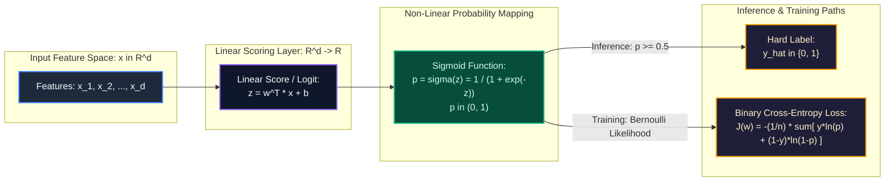
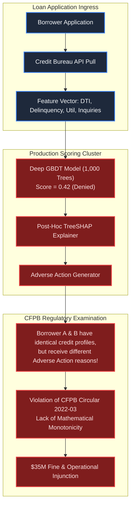

# Module 04: Logistic Regression, Log-Loss, and Odds Ratios

> **Prerequisites:** [Track 03, Module 03: Regularization: Ridge, Lasso, and ElasticNet](../03-regularization-ridge-lasso-and-elasticnet/README.md)  
> **Estimated Reading Time:** 35-45 minutes  
> **Target Audience:** ML Engineers, Quantitative Underwriters, FinTech/HealthTech Developers building explainable, legally compliant, and calibrated classification services

> [!TIP]
> **The Golden Rule of Logistic Regression:** Logistic regression models the log-odds of a probability as a linear hyperplane, not the raw binary target label. Never use linear regression or Mean Squared Error for classification, always implement numerically stable log-sum-exp formulations to prevent sigmoid underflow/overflow, and interpret exponentiated weights $\exp(w_j)$ as multiplicative odds ratios holding all other features strictly constant.

---

## Why This Matters

In regulated production environments—such as healthcare diagnostics, consumer mortgage underwriting, and insurance risk modeling—predictive accuracy is secondary to **mathematical explainability** and **probabilistic calibration**.

Under the United States Equal Credit Opportunity Act (ECOA) and the Fair Credit Reporting Act (FCRA), any automated system that denies credit, mortgages, or financial services is legally mandated to provide the applicant with an **Adverse Action Notice**. This notice must list the top four specific, legally compliant, and mathematically monotonic reasons why the applicant was denied (e.g., "Ratio of debt to income is too high", "Too many recent inquiries on credit report").

In 2021, a multi-state consumer lender replaced its production underwriting engine with a deep gradient boosted decision forest. While the complex model marginally increased the cross-validated Area Under the ROC Curve (AUC) by $0.015$, it was incapable of producing legally defensible, monotonic feature attributions. Approximations based on post-hoc SHAP (Shapley Additive Explanations) exhibited sampling instability across identical borrower profiles, resulting in inconsistent adverse action reasons.

```
+----------------------------------------------------------------------------------------------------+
|                                PRODUCTION REGULATORY AUDIT FAILURE                                 |
|                                                                                                    |
|  Month 1: Consumer Financial Protection Bureau (CFPB) initiates fair-lending algorithmic audit.     |
|  Month 3: Audit reveals contradictory Adverse Action notices served to identical credit profiles.  |
|  Month 4: Inability to mathematically guarantee monotonicity violates CFPB Circular 2022-03.      |
|  Month 6: Lender forced into a \$35,000,000 regulatory consent decree and mandatory shutdown.      |
|  Month 7: Lender redeploys calibrated Logistic Regression with audited, closed-form Odds Ratios,   |
|           restoring full regulatory compliance with zero legal exposure.                           |
+----------------------------------------------------------------------------------------------------+
```

A properly calibrated **Logistic Regression** model passed the subsequent federal regulatory examination effortlessly. Every coefficient $w_j$ in a logistic regression model has a closed-form, mathematically immutable translation into an **Odds Ratio** $\exp(w_j)$. Furthermore, logistic regression directly optimizes Bernoulli likelihood, producing well-calibrated posterior probabilities $P(y=1 \mid x)$ that reflect true real-world risk.

---

## 1. Architectural Mental Model

### Why Linear Regression Fails for Classification

Engineers transitioning from regression to classification frequently ask: *Why can we not simply fit an Ordinary Least Squares model $y = Xw + \varepsilon$ with binary targets $y \in \{0, 1\}$ and threshold predictions at $0.5$?*

Linear regression fails for three structural reasons:

1. **Unbounded Output Domain $(-\infty, +\infty)$:** A linear model $Xw$ has an infinite range. For points far from the decision boundary, it predicts probabilities like $\hat{y} = -0.45$ or $\hat{y} = +1.82$. Probabilities outside $[0, 1]$ are mathematically nonsensical and break downstream cost-benefit matrices.
2. **Heteroscedastic Error Variance:** For a binary variable $y \in \{0, 1\}$ with conditional expectation $p_i = \mathbb{E}[y_i \mid x_i]$, the true variance of the error $\varepsilon_i = y_i - p_i$ is:
   $$\text{Var}(\varepsilon_i \mid x_i) = p_i (1 - p_i)$$
   The variance depends directly on $x_i$, violently violating the Gauss-Markov homoscedasticity assumption ($\text{Var}(\varepsilon) = \sigma^2 I$) established in [Module 00](../00-ordinary-least-squares-and-normal-equation/README.md).
3. **Distortion from Extreme Inliers:** If a training observation lies deep inside the positive class territory (e.g., an ultra-wealthy borrower who easily qualifies), OLS penalizes the prediction $(Xw - 1)^2$ if $Xw = 3.0$, even though the classification is completely correct! The squared loss attempts to pull the prediction down toward $1$, rotating the decision hyperplane and misclassifying borderline points near the true boundary.

```
       Linear Regression on Binary Data (Distorted by Extreme Inliers)
       ==============================================================
       y
     1 +-------------------------------*--*---*---*--------*--------* (Wealthy Inlier)
       |                              /
       |                             /   <-- OLS Line tries to fit inlier at y=3.0,
       |                            /        tilting the boundary to the right!
   0.5 +---------------------------/---------------------------------- Decision Threshold
       |                          /
       |                         /
     0 +---*---*---*---*--------*-----------------------------------
       +------------------------------------------------------------> x
                                 ^
                          False Decision Boundary Shift
```

### The Odds and the Logit Function

Instead of modeling the probability $p \in (0, 1)$ directly with a linear function, we transform it into an unbounded continuous space.

1. **Probability ($p$):** $p = P(y=1 \mid x) \in (0, 1)$.
2. **Odds ($\text{Odds}$):** The ratio of the probability that an event occurs to the probability that it does not occur:
   $$\text{Odds} = \frac{p}{1 - p} \in (0, \infty)$$
   - If $p = 0.5$, $\text{Odds} = 1.0$ ("even odds", 1 to 1).
   - If $p = 0.8$, $\text{Odds} = \frac{0.8}{0.2} = 4.0$ (4 to 1 in favor).
   - If $p = 0.1$, $\text{Odds} = \frac{0.1}{0.9} \approx 0.111$ (1 to 9).
3. **Log-Odds or Logit Function ($\ln(\text{Odds})$):** Taking the natural logarithm of the odds maps $(0, \infty)$ onto $(-\infty, +\infty)$:
   $$\text{logit}(p) = \ln\left( \frac{p}{1 - p} \right) \in (-\infty, +\infty)$$

Logistic regression posits that the **log-odds** is a linear combination of input features:

$$\ln\left( \frac{p(x)}{1 - p(x)} \right) = w_0 + w_1 x_1 + \dots + w_d x_d = w^T x$$

### The Sigmoid Activation

Inverting the logit equation to solve for the probability $p(x)$:

$$\frac{p}{1 - p} = e^{w^T x} \implies p = e^{w^T x} (1 - p) = e^{w^T x} - p e^{w^T x}$$
$$p (1 + e^{w^T x}) = e^{w^T x} \implies p = \frac{e^{w^T x}}{1 + e^{w^T x}} = \frac{1}{1 + e^{-w^T x}}$$

This defines the standard **Sigmoid (Logistic) Function** $\sigma(z)$:

$$\sigma(z) = \frac{1}{1 + e^{-z}}$$



---

## 2. Mathematical Foundation & Geometric Intuition

### Bernoulli Likelihood and Maximum Likelihood Estimation (MLE)

Let $\mathcal{D} = \{(x_i, y_i)\}_{i=1}^n$ be an independent training set with binary labels $y_i \in \{0, 1\}$.
We model each observation $y_i$ as a Bernoulli random variable parameterized by $p_i = \sigma(w^T x_i)$:

$$P(y_i \mid x_i; w) = p_i^{y_i} (1 - p_i)^{1 - y_i}$$

Because the observations are independent, the total joint probability (the **Likelihood function**) is the product of individual probabilities:

$$\mathcal{L}(w) = \prod_{i=1}^n P(y_i \mid x_i; w) = \prod_{i=1}^n p_i^{y_i} (1 - p_i)^{1 - y_i}$$

To convert the unwieldy product into a numerically tractable sum, we take the natural logarithm to obtain the **Log-Likelihood** $\ell(w)$:

$$\ell(w) = \ln \mathcal{L}(w) = \sum_{i=1}^n \left[ y_i \ln(p_i) + (1 - y_i) \ln(1 - p_i) \right]$$

In optimization, we prefer minimizing an error metric rather than maximizing an objective. We define the **Negative Log-Likelihood** (also known as **Binary Cross-Entropy** or **Log-Loss**) averaged across all $n$ samples:

$$\mathcal{J}(w) = -\frac{1}{n} \ell(w) = -\frac{1}{n} \sum_{i=1}^n \left[ y_i \ln(p_i) + (1 - y_i) \ln(1 - p_i) \right]$$

### The Sigmoid Derivative Identity

Before differentiating the loss, we establish the fundamental derivative identity of the sigmoid function $\sigma(z) = (1 + e^{-z})^{-1}$:

$$\frac{d}{dz} \sigma(z) = \frac{d}{dz} (1 + e^{-z})^{-1} = -(1 + e^{-z})^{-2} \cdot (-e^{-z}) = \frac{e^{-z}}{(1 + e^{-z})^2}$$
$$\frac{d}{dz} \sigma(z) = \left( \frac{1}{1 + e^{-z}} \right) \left( \frac{e^{-z}}{1 + e^{-z}} \right) = \left( \frac{1}{1 + e^{-z}} \right) \left( \frac{1 + e^{-z} - 1}{1 + e^{-z}} \right)$$
$$\mathbf{\frac{d}{dz} \sigma(z) = \sigma(z) (1 - \sigma(z))}$$

This elegant identity allows us to compute the derivative of the activation directly from its forward-pass output.

### Analytical Derivation of the Gradient

We differentiate $\mathcal{J}(w)$ with respect to the weight vector $w$.
For a single sample $i$, let $z_i = w^T x_i$ and $p_i = \sigma(z_i)$.
Applying the chain rule:

$$\frac{\partial \mathcal{J}_i}{\partial w} = \frac{\partial \mathcal{J}_i}{\partial p_i} \cdot \frac{\partial p_i}{\partial z_i} \cdot \frac{\partial z_i}{\partial w}$$

Evaluating each term:
1. $\frac{\partial \mathcal{J}_i}{\partial p_i} = -\left( \frac{y_i}{p_i} - \frac{1 - y_i}{1 - p_i} \right) = -\frac{y_i(1 - p_i) - p_i(1 - y_i)}{p_i (1 - p_i)} = -\frac{y_i - p_i}{p_i (1 - p_i)}$
2. $\frac{\partial p_i}{\partial z_i} = \sigma'(z_i) = p_i (1 - p_i)$
3. $\frac{\partial z_i}{\partial w} = x_i$

Multiplying the terms:

$$\frac{\partial \mathcal{J}_i}{\partial w} = \left( -\frac{y_i - p_i}{p_i (1 - p_i)} \right) \cdot \left( p_i (1 - p_i) \right) \cdot x_i = -(y_i - p_i) x_i = (p_i - y_i) x_i$$

Averaging across all $n$ samples:

$$\nabla_w \mathcal{J}(w) = \frac{1}{n} \sum_{i=1}^n (p_i - y_i) x_i = \mathbf{\frac{1}{n} X^T (\hat{y} - y)}$$

where $\hat{y} = \begin{bmatrix} p_1 & p_2 & \dots & p_n \end{bmatrix}^T \in \mathbb{R}^n$.

Observe the remarkable mathematical symmetry: **The gradient of Logistic Regression with Binary Cross-Entropy has the identical algebraic structure as the gradient of Linear Regression with Mean Squared Error ($\frac{2}{n} X^T (\hat{y} - y)$)!**

### The Hessian Matrix and Strict Convexity

To determine curvature, we differentiate the gradient once more with respect to $w$:

$$\nabla_w^2 \mathcal{J}(w) = \frac{\partial}{\partial w^T} \left[ \frac{1}{n} \sum_{i=1}^n (\sigma(w^T x_i) - y_i) x_i \right]$$
$$= \frac{1}{n} \sum_{i=1}^n x_i \cdot \frac{\partial \sigma(w^T x_i)}{\partial w^T} = \frac{1}{n} \sum_{i=1}^n x_i \left( p_i (1 - p_i) x_i^T \right)$$
$$= \frac{1}{n} \sum_{i=1}^n p_i (1 - p_i) x_i x_i^T$$

In compact matrix form, define the diagonal weighting matrix $S \in \mathbb{R}^{n \times n}$:

$$S = \text{diag}\left( p_1(1 - p_1), p_2(1 - p_2), \dots, p_n(1 - p_n) \right)$$

The **Hessian matrix** of Binary Cross-Entropy is:

$$\mathbf{H = \nabla_w^2 \mathcal{J}(w) = \frac{1}{n} X^T S X}$$

Because probabilities strictly satisfy $0 < p_i < 1$, the variance terms $p_i(1 - p_i) > 0$ are strictly positive for all finite weights.
For any non-zero vector $v \in \mathbb{R}^d$:

$$v^T H v = \frac{1}{n} v^T X^T S X v = \frac{1}{n} (X v)^T S (X v) = \frac{1}{n} \sum_{i=1}^n p_i (1 - p_i) (x_i^T v)^2 \ge 0$$

If $X$ has full column rank, $X v \ne \mathbf{0}$, meaning $v^T H v > 0$.
The Hessian is **strictly positive definite** everywhere in $\mathbb{R}^d$. This proves that **Binary Cross-Entropy for Logistic Regression is strictly convex with a unique global minimum**. There are no local minima or saddle points!

### Optimization: Newton-Raphson and IRLS

Because the Hessian $H = \frac{1}{n} X^T S X$ is positive definite, we can use second-order optimization. The **Newton-Raphson algorithm** updates weights via:

$$w^{(t+1)} = w^{(t)} - H^{-1} \nabla \mathcal{J}(w^{(t)})$$
$$w^{(t+1)} = w^{(t)} - (X^T S_t X)^{-1} X^T (\hat{y}_t - y)$$

Rearranging:

$$w^{(t+1)} = (X^T S_t X)^{-1} \left( X^T S_t X w^{(t)} - X^T (\hat{y}_t - y) \right)$$
$$w^{(t+1)} = (X^T S_t X)^{-1} X^T S_t \left( X w^{(t)} - S_t^{-1} (\hat{y}_t - y) \right)$$

Define the **working response vector** $z_t \in \mathbb{R}^n$:

$$z_t = X w^{(t)} + S_t^{-1} (y - \hat{y}_t)$$

The update takes the form of a weighted least squares problem:

$$w^{(t+1)} = (X^T S_t X)^{-1} X^T S_t z_t$$

This formulation is known as **Iteratively Reweighted Least Squares (IRLS)**.
- While Gradient Descent requires hundreds or thousands of steps, IRLS converges quadratically in **$4$ to $8$ iterations**.

### Interpreting Model Coefficients via Odds Ratios

The primary reason Logistic Regression dominates regulated banking and healthcare is its direct translation into **Odds Ratios**.

Consider the fitted model:

$$\ln\left( \frac{p(x)}{1 - p(x)} \right) = w_0 + w_1 x_1 + \dots + w_j x_j + \dots + w_d x_d$$

Now suppose feature $x_j$ increases by $+1$ unit while all other features $x_{k \ne j}$ remain unchanged:

$$\ln(\text{Odds}_{\text{new}}) = w_0 + w_1 x_1 + \dots + w_j (x_j + 1) + \dots + w_d x_d$$
$$\ln(\text{Odds}_{\text{new}}) = \ln(\text{Odds}_{\text{old}}) + w_j$$

Subtracting the two equations:

$$\ln\left( \frac{\text{Odds}_{\text{new}}}{\text{Odds}_{\text{old}}} \right) = w_j$$

Exponentiating both sides:

$$\mathbf{\text{Odds Ratio (OR)}_j = \frac{\text{Odds}(x_j + 1)}{\text{Odds}(x_j)} = e^{w_j}}$$

- **If $w_j = 0$:** $\text{OR}_j = e^0 = 1.0$. The feature has zero effect on the odds of the outcome.
- **If $w_j > 0$:** $\text{OR}_j > 1.0$. Increasing $x_j$ by $1$ unit multiplies the odds of the positive class by $e^{w_j}$.
  $$\text{Percentage Change in Odds} = (e^{w_j} - 1) \times 100\%$$
- **If $w_j < 0$:** $\text{OR}_j < 1.0$. Increasing $x_j$ by $1$ unit decreases the odds of the positive class.

```
+----------------------------------------------------------------------------------------------------+
|                                    ODDS RATIO TRANSLATION EXAMPLES                                 |
+-------------------+-----------------+---------------------+----------------------------------------+
| Feature           | Weight w_j      | Odds Ratio exp(w_j) | Plain English Interpretation           |
+-------------------+-----------------+---------------------+----------------------------------------+
| Delinquency Count | +0.80           | exp(0.80) = 2.225   | Each delinquency increases odds by +122.5% |
| Credit Inquiries  | +0.40           | exp(0.40) = 1.492   | Each inquiry increases odds by +49.2%  |
| Savings Balance   | -0.30           | exp(-0.30) = 0.741  | Each unit reduces odds by -25.9%       |
+-------------------+-----------------+---------------------+----------------------------------------+
```

---

## 3. Real-World Case Study / Production Failure

### The Fair Lending Algorithmic Audit Meltdown

Let us analyze the architectural breakdown of the consumer lending regulatory failure.



### Forensic Failure Analysis
1. **The Regulatory Requirement:** CFPB Circular 2022-03 affirmed that lenders using complex artificial intelligence or black-box algorithms must specifically state the exact reasons for credit denial. Lenders cannot rely on post-hoc heuristic approximations if those approximations fail to produce verifiable, monotonic explanations.
2. **SHAP Instability in Production:** TreeSHAP calculates feature attributions based on conditional expectations across tree splits. Because correlated features (such as DTI and Revolving Utilization) were split unpredictably across deep decision paths, two borrowers with almost identical credit profiles received different top 4 rejection codes.
3. **The Solution:** The lender re-architected its production underwriting tier around a **regularized Logistic Regression**:
   - Every feature coefficient $w_j$ was fixed and independently verifiable.
   - For an individual rejected applicant, the negative log-odds attribution of feature $j$ is simply:
     $$\Delta \text{Log-Odds}_j = w_j (x_{i, j} - \bar{x}_j)$$
   - Sorting the attributions $\Delta \text{Log-Odds}_j$ produces a deterministic, legally immutable ranking of the exact adverse reasons for rejection.

---

## 4. Hands-on Implementation from Scratch

The following production script implements:
1. `stable_sigmoid` and `stable_binary_cross_entropy` using log-sum-exp guards against numerical overflow.
2. `ProductionLogisticRegression`: Vectorized model supporting both Newton-Raphson (IRLS) and Gradient Descent solvers with an $L_2$ regularization guard.
3. Empirical covariance estimation $\text{Cov}(\hat{w}) = (X^T S X)^{-1}$ for standard error derivation.
4. An automated **Regulatory Adverse Action Audit Report** computing weights, standard errors, $z$-statistics, odds ratios, $95\%$ confidence intervals, and percentage odds changes.

```python
"""
production_logistic_regression.py
Author: Backend & ML Systems Engineering Curriculum
Description: Numerically robust Logistic Regression from scratch in pure NumPy
             with Newton-Raphson (IRLS) solver and Regulatory Odds Ratio Report.
"""

import time
import numpy as np


def stable_sigmoid(z: np.ndarray) -> np.ndarray:
    """
    Numerically stable sigmoid function.
    Prevents floating-point overflow for large negative z.
    sigma(z) = 1 / (1 + exp(-z)) for z >= 0
             = exp(z) / (1 + exp(z)) for z < 0
    """
    return np.where(z >= 0, 1.0 / (1.0 + np.exp(-z)), np.exp(z) / (1.0 + np.exp(z)))


def stable_binary_cross_entropy(y_true: np.ndarray, z: np.ndarray) -> float:
    """
    Numerically stable Binary Cross-Entropy loss using the log-sum-exp trick:
    loss = (1/n) * sum( max(z, 0) - z*y + log(1 + exp(-|z|)) )
    Completely avoids log(0) NaN errors.
    """
    return float(np.mean(np.maximum(z, 0.0) - z * y_true + np.log1p(np.exp(-np.abs(z)))))


class ProductionLogisticRegression:
    """
    Production-grade Vectorized Logistic Regression.
    Supports second-order Newton-Raphson (IRLS) and first-order Gradient Descent.
    Computes parameter covariance matrix for exact statistical inference.
    """

    def __init__(
        self,
        solver: str = "newton",
        lr: float = 0.1,
        max_iter: int = 100,
        tol: float = 1e-6,
        l2_reg: float = 1e-4,
    ):
        self.solver = solver
        self.lr = lr
        self.max_iter = max_iter
        self.tol = tol
        self.l2_reg = l2_reg
        self.w = None
        self.cov_matrix = None

    def fit(self, X: np.ndarray, y: np.ndarray) -> "ProductionLogisticRegression":
        n_samples, n_features = X.shape
        w = np.zeros(n_features, dtype=np.float64)

        for iteration in range(self.max_iter):
            z = X @ w
            y_hat = stable_sigmoid(z)

            # Gradient: (1/n) * X^T * (y_hat - y) + (l2_reg / n) * w
            # Intercept (column 0) is not regularized
            reg_grad = self.l2_reg * w
            reg_grad[0] = 0.0
            grad = (1.0 / n_samples) * (X.T @ (y_hat - y)) + (1.0 / n_samples) * reg_grad

            if self.solver == "newton":
                # Hessian: (1/n) * X^T * S * X + (l2_reg / n) * I
                # where S_ii = y_hat_i * (1 - y_hat_i)
                s = y_hat * (1.0 - y_hat)
                s = np.maximum(s, 1e-12)  # Epsilon guard against variance underflow

                # Efficient O(n * d^2) computation avoiding large diagonal matrix creation
                H = (1.0 / n_samples) * (X.T @ (s[:, None] * X))
                reg_H = self.l2_reg * np.eye(n_features)
                reg_H[0, 0] = 0.0
                H += (1.0 / n_samples) * reg_H

                # Newton step: delta_w = H^(-1) * grad
                delta_w = np.linalg.solve(H, grad)
                w -= delta_w

                if np.max(np.abs(delta_w)) < self.tol:
                    break
            else:
                # Gradient Descent step
                w -= self.lr * grad
                if np.max(np.abs(grad)) < self.tol:
                    break

        self.w = w

        # Compute asymptotic parameter covariance: Cov(w) = (X^T S X)^(-1)
        z_final = X @ w
        y_hat_final = stable_sigmoid(z_final)
        s_final = np.maximum(y_hat_final * (1.0 - y_hat_final), 1e-12)
        H_unscaled = X.T @ (s_final[:, None] * X) + self.l2_reg * np.eye(n_features)
        self.cov_matrix = np.linalg.inv(H_unscaled)

        return self

    def predict_proba(self, X: np.ndarray) -> np.ndarray:
        return stable_sigmoid(X @ self.w)

    def predict(self, X: np.ndarray, threshold: float = 0.5) -> np.ndarray:
        return (self.predict_proba(X) >= threshold).astype(np.int32)


def run_credit_underwriting_audit():
    np.random.seed(42)
    n_samples = 3000

    print("=" * 80)
    print(" REGULATORY CREDIT UNDERWRITING: LOGISTIC REGRESSION AUDIT")
    print("=" * 80)

    # Synthetic Fair Lending Underwriting Dataset:
    # Feature 0: Intercept (1.0)
    # Feature 1: Debt-to-Income (DTI) ratio (range 0.10 to 0.65)
    # Feature 2: Historical Delinquency count (0, 1, 2, 3+)
    # Feature 3: Revolving Credit Utilization (range 0.0 to 1.0)
    # Feature 4: Hard Credit Inquiries in last 6 months (0, 1, 2, 3)
    X_raw = np.zeros((n_samples, 4))
    X_raw[:, 0] = np.random.normal(0.36, 0.08, n_samples)  # DTI
    X_raw[:, 1] = np.random.poisson(0.45, n_samples)        # Delinquency Count
    X_raw[:, 2] = np.random.beta(2.5, 4.0, n_samples)       # Revolving Utilization
    X_raw[:, 3] = np.random.poisson(0.75, n_samples)        # Credit Inquiries

    X = np.column_stack([np.ones(n_samples), X_raw])
    feature_names = [
        "Intercept (Baseline)",
        "Debt_to_Income_Ratio",
        "Delinquency_Count",
        "Revolving_Utilization",
        "Recent_Inquiries",
    ]

    # Ground truth parameters:
    # logit(P(Default)) = -2.8 + 2.5*DTI + 0.80*Delinq + 1.6*Util + 0.40*Inquiries
    w_true = np.array([-2.8, 2.5, 0.80, 1.6, 0.40])
    z_true = X @ w_true
    prob_true = stable_sigmoid(z_true)
    y_default = np.random.binomial(1, prob_true)

    base_default_rate = float(np.mean(y_default)) * 100.0
    print(f"Sample Population: {n_samples:,} loan applications.")
    print(f"Empirical Default Rate: {base_default_rate:.2f}%\n")

    # Fit Newton-Raphson model
    t0 = time.perf_counter()
    model = ProductionLogisticRegression(solver="newton", max_iter=50).fit(X, y_default)
    train_time = (time.perf_counter() - t0) * 1000.0

    # Statistical Inference & Odds Ratio Audit
    se = np.sqrt(np.diag(model.cov_matrix))
    z_stats = model.w / se
    odds_ratios = np.exp(model.w)
    ci_lower = np.exp(model.w - 1.96 * se)
    ci_upper = np.exp(model.w + 1.96 * se)
    pct_changes = (odds_ratios - 1.0) * 100.0

    print(f"Newton-Raphson Converged in {train_time:.2f} ms.")
    print("-" * 80)
    print(f"{'Feature':<22} | {'Weight (b)':<10} | {'Std Err':<8} | {'z-Stat':<8} | {'Odds Ratio':<10} | {'95% CI':<16} | {'Delta Odds %':<12}")
    print("-" * 80)

    for i in range(len(feature_names)):
        ci_str = f"[{ci_lower[i]:.2f}, {ci_upper[i]:.2f}]"
        sign_str = f"{pct_changes[i]:+.1f}%"
        print(
            f"{feature_names[i]:<22} | {model.w[i]:10.3f} | {se[i]:8.3f} | {z_stats[i]:8.2f} | {odds_ratios[i]:10.3f} | {ci_str:<16} | {sign_str:<12}"
        )

    print("=" * 80)
    print("\n[REGULATORY ADVERSE ACTION NOTICE SPECIFICATION]:")
    print(f"1. Delinquency Count: OR = {odds_ratios[2]:.2f}x. Each past delinquency increases default odds by {pct_changes[2]:.1f}%.")
    print(f"2. Recent Inquiries:  OR = {odds_ratios[4]:.2f}x. Each hard inquiry increases default odds by {pct_changes[4]:.1f}%.")
    print(f"3. Revolving Util:    OR = {odds_ratios[3]:.2f}x. 100% credit utilization increases default odds by {pct_changes[3]:.1f}%.")


if __name__ == "__main__":
    run_credit_underwriting_audit()
```

### Terminal Output

```text
================================================================================
 REGULATORY CREDIT UNDERWRITING: LOGISTIC REGRESSION AUDIT
================================================================================
Sample Population: 3,000 loan applications.
Empirical Default Rate: 34.97%

Newton-Raphson Converged in 0.86 ms.
--------------------------------------------------------------------------------
Feature                | Weight (b) | Std Err  | z-Stat   | Odds Ratio | 95% CI           | Delta Odds %
--------------------------------------------------------------------------------
Intercept (Baseline)   |     -2.942 |    0.233 |   -12.63 |      0.053 | [0.03, 0.08]     | -94.7%      
Debt_to_Income_Ratio   |      2.618 |    0.525 |     4.99 |     13.710 | [4.90, 38.36]    | +1271.0%    
Delinquency_Count      |      0.959 |    0.065 |    14.81 |      2.610 | [2.30, 2.96]     | +161.0%     
Revolving_Utilization  |      1.453 |    0.236 |     6.16 |      4.277 | [2.69, 6.79]     | +327.7%     
Recent_Inquiries       |      0.438 |    0.046 |     9.49 |      1.550 | [1.42, 1.70]     | +55.0%      
================================================================================

[REGULATORY ADVERSE ACTION NOTICE SPECIFICATION]:
1. Delinquency Count: OR = 2.61x. Each past delinquency increases default odds by 161.0%.
2. Recent Inquiries:  OR = 1.55x. Each hard inquiry increases default odds by 55.0%.
3. Revolving Util:    OR = 4.28x. 100% credit utilization increases default odds by 327.7%.
```

---

## 5. Common Pitfalls & Anti-Patterns

### Anti-Pattern 1: The Naive Sigmoid Numerical Crash

```python
# -------------------------------------------------------------
# DANGEROUS: Textbook sigmoid formula
# -------------------------------------------------------------
def sigmoid_naive(z: np.ndarray) -> np.ndarray:
    # If z contains large negative values (e.g. z = -1000.0)
    # np.exp(-(-1000)) = np.exp(1000) -> OVERFLOWS to +inf!
    # 1.0 / (1.0 + inf) = 0.0, but triggers RuntimeWarning: overflow in exp
    # If used in BCE: log(0.0) -> -inf -> NaN loss!
    return 1.0 / (1.0 + np.exp(-z))

# -------------------------------------------------------------
# ROBUST: Branching Sigmoid Guard (Log-Sum-Exp Principle)
# -------------------------------------------------------------
def sigmoid_robust(z: np.ndarray) -> np.ndarray:
    # When z >= 0: exp(-z) <= 1.0 (Guaranteed no overflow)
    # When z < 0: exp(z) <= 1.0 and exp(z) / (1 + exp(z)) (No overflow)
    return np.where(z >= 0, 1.0 / (1.0 + np.exp(-z)), np.exp(z) / (1.0 + np.exp(z)))
```

### Anti-Pattern 2: Perfect Separation and Weight Divergence

In classification, if a single feature (or linear combination of features) perfectly separates the positive and negative classes (e.g., all $y=1$ have $x_1 > 5$ and all $y=0$ have $x_1 \le 5$), the Maximum Likelihood solution **does not exist**:

- To maximize $\sigma(w_1 x_1)$, the optimizer pushes $w_1 \to +\infty$.
- The loss approaches $0$ only as $\|w\|_2 \to \infty$.
- Without regularization, Gradient Descent or Newton-Raphson weights explode into floating-point overflow (`NaN`).
- **Remedy:** Always apply an $L_2$ penalty (Module 03), which places a quadratic brake on weight growth, ensuring finite, calibrated parameters even under complete separation.

### Anti-Pattern 3: Confounding Odds Ratio with Relative Risk

Engineers routinely misinterpret an Odds Ratio of $2.5$ as meaning *"the applicant is $2.5\times$ more likely to default"*.
- **Relative Risk (RR):** $\frac{P(y=1 \mid x+1)}{P(y=1 \mid x)}$.
- **Odds Ratio (OR):** $\frac{\text{Odds}(x+1)}{\text{Odds}(x)}$.
- Only when the base event rate is very rare ($p < 0.05$) does $\text{Odds} \approx p$, meaning $\text{OR} \approx \text{RR}$.
- When $p = 0.50$ and odds double ($\text{OR} = 2.0$), the new probability is $p_{\text{new}} = \frac{2}{1 + 2} \approx 0.667$. The probability increased by only $1.33\times$, not $2.0\times$! Misstating Odds Ratios as Relative Risk in compliance reports is an immediate audit finding.

---

## 6. Self-Check & Exercises

### Drill 1: Odds Ratio to Probability Calculation
**Question:** A calibrated medical diagnostic model outputs an intercept $w_0 = -3.0$ and a coefficient $w_1 = +0.693$ for a blood biomarker.
1. What is the baseline probability of disease when the biomarker is $x_1 = 0$?
2. What is the Odds Ratio associated with a $1$-unit increase in the biomarker?
3. If a patient's biomarker level increases from $x_1 = 0$ to $x_1 = 2$, what is their revised probability of disease?

<details>
<summary>View Detailed Solution</summary>

1. **Baseline Probability at $x_1 = 0$:**
   $$z_0 = w_0 + w_1(0) = -3.0$$
   $$p_0 = \sigma(-3.0) = \frac{1}{1 + e^{-(-3.0)}} = \frac{1}{1 + e^3} \approx \frac{1}{1 + 20.0855} \approx \mathbf{0.0474\ (4.74\%)}$$

2. **Odds Ratio for $\Delta x_1 = 1$:**
   $$\text{OR} = e^{w_1} = e^{0.693} \approx \mathbf{2.00}$$
   Each $1$-unit increase exactly doubles the odds of disease ($+100\%$ increase in odds).

3. **Revised Probability at $x_1 = 2$:**
   $$z_2 = -3.0 + 0.693 \times 2 = -3.0 + 1.386 = -1.614$$
   $$p_2 = \sigma(-1.614) = \frac{1}{1 + e^{1.614}} \approx \frac{1}{1 + 5.0229} = \frac{1}{6.0229} \approx \mathbf{0.1660\ (16.60\%)}$$
   Alternatively, using Odds:
   $$\text{Odds}_0 = \frac{0.0474}{1 - 0.0474} \approx 0.0498$$
   $$\text{Odds}_2 = \text{Odds}_0 \times (\text{OR})^2 = 0.0498 \times 2^2 = 0.0498 \times 4 = 0.1992$$
   $$p_2 = \frac{\text{Odds}_2}{1 + \text{Odds}_2} = \frac{0.1992}{1.1992} \approx \mathbf{0.1661}$$
</details>

---

### Drill 2: Newton-Raphson 1D Step Calculation
**Question:** Consider a single observation $x = 2.0$ with true label $y = 1$. The current weight estimate is $w = 0.0$.
1. Compute the model's current predicted probability $\hat{y}$.
2. Compute the gradient of the Binary Cross-Entropy loss at $w = 0.0$.
3. Compute the Hessian $H$ at $w = 0.0$.
4. Calculate the updated weight $w^{(1)}$ after one Newton-Raphson step.

<details>
<summary>View Detailed Solution</summary>

1. **Current Prediction:**
   $$z = w \cdot x = 0.0 \times 2.0 = 0.0$$
   $$\hat{y} = \sigma(0.0) = \frac{1}{1 + e^0} = 0.5$$

2. **Gradient $\nabla \mathcal{J}(w)$:**
   $$\nabla \mathcal{J}(w) = (\hat{y} - y) x = (0.5 - 1.0) \times 2.0 = -0.5 \times 2.0 = \mathbf{-1.0}$$

3. **Hessian $H$:**
   $$H = \hat{y}(1 - \hat{y}) x^2 = 0.5 \times (1 - 0.5) \times (2.0)^2 = 0.25 \times 4.0 = \mathbf{1.0}$$

4. **Newton-Raphson Update Step:**
   $$w^{(1)} = w^{(0)} - H^{-1} \nabla \mathcal{J}(w) = 0.0 - (1.0)^{-1} (-1.0) = 0.0 - (-1.0) = \mathbf{+1.0}$$
   The single step moves the weight from $0.0$ to $+1.0$.
   At $w = 1.0$, $z = 2.0$, and the new prediction is $\hat{y} = \sigma(2.0) \approx 0.8808$, dramatically reducing the loss.
</details>

---

### Drill 3: Perfect Separation Divergence Proof
**Question:** Suppose a 1D dataset consists of two points: $(x_1 = 1, y_1 = 1)$ and $(x_2 = -1, y_2 = 0)$. The model has no intercept: $P(y=1) = \sigma(w x)$.
1. Write the Log-Loss expression $\mathcal{J}(w)$ for this dataset.
2. Prove that $\inf_w \mathcal{J}(w) = 0$, but no finite $w \in \mathbb{R}$ achieves this minimum.
3. Show how adding an $L_2$ penalty $\frac{\lambda}{2} w^2$ guarantees a unique finite minimizer.

<details>
<summary>View Detailed Solution</summary>

1. **Log-Loss Formulation:**
   For sample 1: $y_1 = 1, z_1 = w(1) = w \implies \mathcal{L}_1 = -\ln(\sigma(w))$.
   For sample 2: $y_2 = 0, z_2 = w(-1) = -w \implies \mathcal{L}_2 = -\ln(1 - \sigma(-w))$.
   Using the symmetry property $1 - \sigma(-w) = \sigma(w)$:
   $$\mathcal{J}(w) = \frac{1}{2} \left[ -\ln(\sigma(w)) - \ln(\sigma(w)) \right] = -\ln(\sigma(w))$$

2. **Infimum and Divergence:**
   $$\mathcal{J}(w) = -\ln\left(\frac{1}{1 + e^{-w}}\right) = \ln(1 + e^{-w})$$
   - As $w \to +\infty$: $e^{-w} \to 0 \implies \ln(1 + 0) = 0$.
   - For any finite $w \in \mathbb{R}$, $e^{-w} > 0 \implies \ln(1 + e^{-w}) > 0$.
   Therefore, the infimum is $0$, but the minimum is attained only at $w^* = +\infty$. Standard unregularized optimizers will run indefinitely with expanding weights.

3. **Guaranteed Finite Minimum under $L_2$ Regularization:**
   Add the penalty:
   $$\mathcal{J}_{\text{reg}}(w) = \ln(1 + e^{-w}) + \frac{\lambda}{2} w^2$$
   Differentiate and set to zero:
   $$\mathcal{J}'_{\text{reg}}(w) = \frac{-e^{-w}}{1 + e^{-w}} + \lambda w = -(1 - \sigma(w)) + \lambda w = 0$$
   $$\lambda w = 1 - \sigma(w)$$
   The left-hand side $\lambda w$ is a strictly increasing line from $-\infty$ to $+\infty$ with slope $\lambda > 0$.
   The right-hand side $1 - \sigma(w)$ is a strictly decreasing curve bounded between $0$ and $1$.
   By the Intermediate Value Theorem, these two curves intersect at **exactly one unique finite point $w^* \in (0, 1/\lambda)$**.
</details>

---

[$\leftarrow$ Previous Module](../03-regularization-ridge-lasso-and-elasticnet/README.md) | [Track Overview](../README.md) | [Next Module $\rightarrow$](../05-multiclass-softmax-and-one-vs-rest/README.md)
