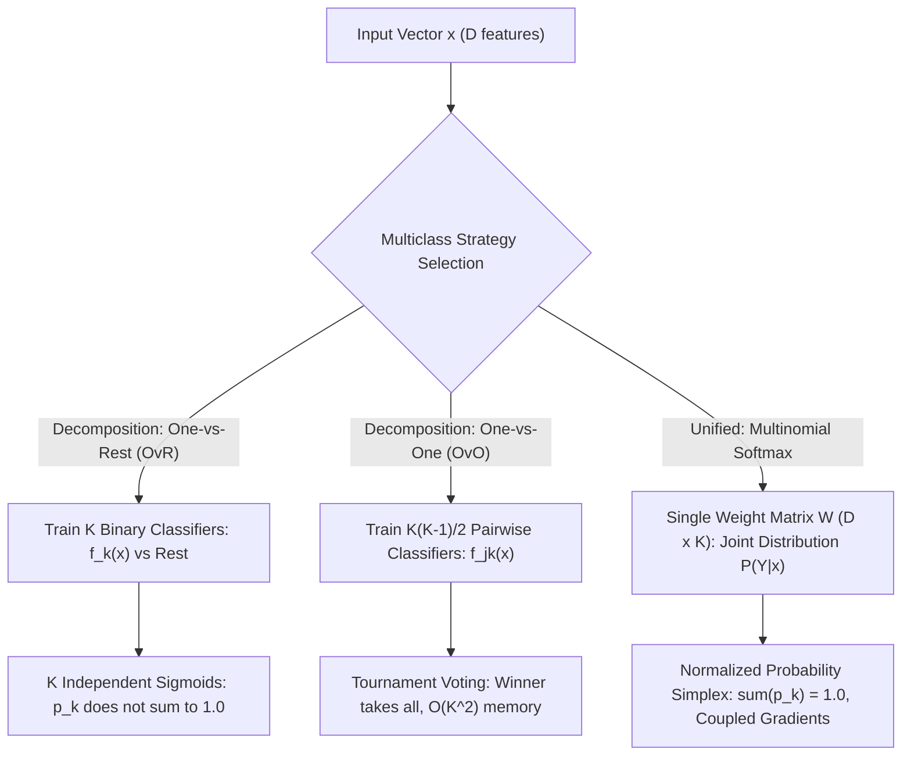

# Module 05: Multiclass Classification: Softmax and One-vs-Rest

> **Prerequisites:** [Track 03, Module 04: Logistic Regression, Log-Loss, and Odds Ratios](../04-logistic-regression-and-odds-ratios/README.md)  
> **Estimated Reading Time:** 40 minutes  
> **Target Audience:** Machine learning engineers, backend engineers scaling classification systems to $K > 2$ categories, and distributed systems architects designing intent-routing or payment-classification pipelines.
>
> [!TIP]
> **The Golden Rule of Multiclass Classification:** Choose Multinomial Softmax when categories are mutually exclusive, and One-vs-Rest when categories can co-occur or when wrapping legacy binary estimators—but in every Softmax implementation, always subtract the maximum logit before exponentiation to eliminate catastrophic IEEE 754 floating-point overflow. Failing to stabilize logits produces `NaN` probabilities that quietly poison gradient updates and take down downstream real-time inference services.

---

## Why This Matters

Binary classification handles binary questions: spam vs. not spam, fraud vs. legitimate, click vs. no-click. Production machine learning rarely stops at two states. Payment platforms route transactions across dozens of payment rails, automated ticket systems assign incidents across hundreds of engineering queues, and fraud detection engines categorize activity into distinct threat vectors (account takeover, card testing, identity fabrication, synthetic default).

Extending linear models from 2 to $K$ classes introduces non-trivial architectural, mathematical, and numerical challenges. Two main paradigms exist:
1. **Decomposition heuristics**: Wrapping multiple binary classifiers using **One-vs-Rest (OvR)** or **One-vs-One (OvO)**.
2. **Native multi-output models**: Jointly optimizing a single categorical probability distribution over $K$ classes via **Multinomial Logistic Regression (Softmax Regression)**.

The difference between these approaches impacts training runtime, memory footprint, gradient behavior, and probability calibration. An uncalibrated OvR ensemble produces scores that do not sum to 1, while a naive implementation of Softmax produces floating-point overflows (`inf` and `NaN`) whenever un-normalized logit activations exceed standard hardware register limits.

In this module, you will master the geometric, mathematical, and implementation mechanics of multiclass linear models. You will derive the Softmax gradient from first principles using the Kronecker delta, implement a numerically stable Softmax classifier with Mini-batch Gradient Descent in pure NumPy, and explore production-grade defensive patterns for high-throughput multiclass inference.

---

## 1. Architectural Mental Model

When mapping an input vector $x \in \mathbb{R}^D$ to one of $K$ discrete classes $\mathcal{Y} = \{0, 1, \dots, K-1\}$, machine learning architectures choose between three primary strategies.



### The Three Multiclass Paradigms

#### 1. One-vs-Rest (OvR / One-vs-All)
In OvR, you train $K$ completely independent binary classifiers:
$$f_1(x), f_2(x), \dots, f_K(x)$$
For classifier $k$, examples from class $k$ are treated as positive labels ($+1$), and all examples from all other $K-1$ classes are aggregated into negative labels ($0$).
- **Prediction**: At inference time, evaluate all $K$ classifiers on $x$ and select the class with the highest raw decision score or uncalibrated sigmoid output:
  $$\hat{y} = \arg\max_{k \in \{0, \dots, K-1\}} f_k(x)$$
- **The Probability Dilemma**: Each binary classifier evaluates its own independent likelihood $\sigma(z_k) = \frac{1}{1 + e^{-z_k}}$. Because the models are trained in isolation on disparate negative distributions, these probabilities **do not sum to 1**:
  $$\sum_{k=1}^K \sigma(z_k) \neq 1$$
  Normalizing them naively by dividing by $\sum_{j=1}^K \sigma(z_j)$ distorts the underlying posteriors and creates artificial overconfidence. Furthermore, each binary sub-problem suffers from severe artificial class imbalance: if classes are balanced across $K=10$ classes (10% each), each OvR binary classifier trains against a 90% negative vs. 10% positive ratio.

#### 2. One-vs-One (OvO)
In OvO, you train a distinct binary classifier for every unique unordered pair of classes:
$$N_{\text{models}} = \binom{K}{2} = \frac{K(K - 1)}{2}$$
Classifier $f_{jk}(x)$ is trained exclusively on data belonging to class $j$ and class $k$; all other samples are discarded.
- **Prediction**: Run all $\frac{K(K-1)}{2}$ classifiers. Each classifier casts a vote for its predicted class. The class with the plurality of votes wins.
- **Trade-off**: Each binary sub-problem is smaller (only $\approx \frac{2N}{K}$ samples), which helps algorithms with non-linear time complexity such as Kernel SVMs ($O(N^2)$ to $O(N^3)$). However, for large $K$ (e.g., $K=1{,}000$ product categories), OvO requires $\frac{1000 \times 999}{2} = 499{,}500$ distinct models, creating impossible memory bottlenecks and high inference latencies.

#### 3. Multinomial Logistic Regression (Softmax Regression)
Instead of decomposing the problem into isolated binary estimators, Softmax Regression treats multiclass classification as a single joint probabilistic optimization problem.
- A single parameter matrix $W \in \mathbb{R}^{D \times K}$ and bias vector $b \in \mathbb{R}^K$ map $x$ to $K$ unconstrained real-valued scores called **logits**:
  $$z = x^T W + b^T \in \mathbb{R}^K$$
- The **Softmax function** $\sigma: \mathbb{R}^K \to (0, 1)^K$ exponentiates and normalizes these logits into a valid probability distribution on the standard $(K-1)$-simplex:
  $$p_k = P(y = k \mid x) = \frac{\exp(z_k)}{\sum_{j=1}^K \exp(z_j)}, \quad \sum_{k=1}^K p_k = 1$$
- **Coupled Learning**: Because the denominator pools all logits, the gradient updates across classes are tightly coupled. Increasing the probability of class $k$ inherently depresses the probabilities of all competing classes $j \neq k$.

### Architectural Trade-off Matrix

| Dimension | One-vs-Rest (OvR) | One-vs-One (OvO) | Multinomial Softmax |
| :--- | :--- | :--- | :--- |
| **Number of Models** | $K$ independent estimators | $\frac{K(K - 1)}{2}$ pairwise estimators | **1 unified model** ($W \in \mathbb{R}^{D \times K}$) |
| **Training Complexity** | $O(K \cdot \text{Cost}(N, D))$ | $O\left(K^2 \cdot \text{Cost}\left(\frac{2N}{K}, D\right)\right)$ | $O(\text{Cost}(N, D \cdot K))$ |
| **Inference Latency** | $K$ forward passes | $\frac{K(K-1)}{2}$ forward passes | **1 matrix multiplication** ($x^T W$) |
| **Output Distribution** | Uncalibrated independent scores | Discrete vote counts | **Calibrated joint probability distribution** |
| **Class Imbalance Impact** | High (each model sees $1$ vs $K-1$) | Low (each model sees balanced pairs) | Handled natively via Categorical Cross-Entropy |
| **Best Used With** | Linear binary base estimators | Kernel SVMs on small $N$ | Deep learning, high-throughput linear classification |

---

## 2. Mathematical Foundation & Geometric Intuition

### 2.1 The Geometric Mental Model

In binary logistic regression, a single hyperplane $w^T x + b = 0$ splits $\mathbb{R}^D$ into two half-spaces. In Multinomial Softmax Regression, each class $k$ possesses its own weight vector $w_k \in \mathbb{R}^D$ and scalar bias $b_k \in \mathbb{R}$.

The decision boundary between any two classes $k$ and $j$ occurs where their predicted probabilities are equal:
$$P(y = k \mid x) = P(y = j \mid x)$$

Substituting the Softmax formula:
$$\frac{\exp(w_k^T x + b_k)}{\sum_{m=1}^K \exp(w_m^T x + b_m)} = \frac{\exp(w_j^T x + b_j)}{\sum_{m=1}^K \exp(w_m^T x + b_m)}$$

Because the denominators are identical and strictly positive, they cancel:
$$\exp(w_k^T x + b_k) = \exp(w_j^T x + b_j)$$

Taking the natural logarithm of both sides yields:
$$w_k^T x + b_k = w_j^T x + b_j \implies (w_k - w_j)^T x + (b_k - b_j) = 0$$

This is the equation of a **linear hyperplane** in $\mathbb{R}^D$. 

```
               Region C0 (w0^T x + b0 is maximal)
                     \       /
                      \     /   Boundary: (w0 - w1)^T x + (b0 - b1) = 0
                       \   /
  Boundary:             \ /
(w0 - w2)^T x + (b0-b2)=0|
                         |      Region C1 (w1^T x + b1 is maximal)
                         |
               Region C2 |
                         |   Boundary: (w1 - w2)^T x + (b1 - b2) = 0
```

The decision space of Softmax regression is therefore partitioned into $K$ **convex polyhedral decision regions**. Each class region $\mathcal{R}_k = \{x \in \mathbb{R}^D \mid w_k^T x + b_k > w_j^T x + b_j, \forall j \neq k\}$ is formed by the intersection of $K-1$ half-spaces. Because an intersection of convex half-spaces is always convex, **Softmax decision regions are guaranteed to be convex**. A class region can never wrap around another class or form disconnected islands.

---

### 2.2 The Categorical Cross-Entropy Objective

Given a dataset of $N$ independent and identically distributed (i.i.d.) observations $\{(x_i, y_i)\}_{i=1}^N$, where each target $y_i \in \{0, \dots, K-1\}$ is represented as a one-hot ground-truth vector $y_i = [y_{i1}, y_{i2}, \dots, y_{iK}]^T \in \{0, 1\}^K$ such that:
$$y_{ik} = \begin{cases} 1 & \text{if sample } i \text{ belongs to class } k \\ 0 & \text{otherwise} \end{cases}, \quad \sum_{k=1}^K y_{ik} = 1$$

The likelihood of observing sample $i$ under the model parameters $W = [w_1, \dots, w_K] \in \mathbb{R}^{D \times K}$ and $b = [b_1, \dots, b_K]^T \in \mathbb{R}^K$ is given by the multinomial likelihood:
$$P(y_i \mid x_i; W, b) = \prod_{k=1}^K p_{ik}^{y_{ik}}$$
where $p_{ik} = \frac{\exp(w_k^T x_i + b_k)}{\sum_{j=1}^K \exp(w_j^T x_i + b_j)}$.

Taking the natural logarithm across all $N$ independent observations gives the total log-likelihood:
$$\ell(W, b) = \sum_{i=1}^N \sum_{k=1}^K y_{ik} \log(p_{ik})$$

Minimizing the negative log-likelihood per sample, augmented with an $L_2$ weight regularization term (Ridge penalty with parameter $\lambda \ge 0$), yields the **Categorical Cross-Entropy Loss function**:
$$\mathcal{L}(W, b) = -\frac{1}{N} \sum_{i=1}^N \sum_{k=1}^K y_{ik} \log(p_{ik}) + \frac{\lambda}{2} \|W\|_F^2$$
where $\|W\|_F^2 = \sum_{d=1}^D \sum_{k=1}^K W_{dk}^2$ is the squared Frobenius norm of the weight matrix.

---

### 2.3 Step-by-Step Gradient Derivation via the Kronecker Delta

To optimize $W$ and $b$ using gradient descent, we must compute the analytic derivative of $\mathcal{L}$ with respect to the weight vector $w_j$ of class $j$. We apply the multivariable chain rule through the intermediate logits $z_{ij} = w_j^T x_i + b_j$.

Let us analyze a single arbitrary sample $x_i$ and drop index $i$ for clarity:
$$\mathcal{L}_i = -\sum_{k=1}^K y_k \log(p_k)$$

By the chain rule:
$$\frac{\partial \mathcal{L}_i}{\partial z_j} = \sum_{k=1}^K \frac{\partial \mathcal{L}_i}{\partial p_k} \frac{\partial p_k}{\partial z_j}$$

#### Step 1: Derivative of Loss with respect to Probabilities
$$\frac{\partial \mathcal{L}_i}{\partial p_k} = -\frac{y_k}{p_k}$$

#### Step 2: The Softmax Jacobian ($\frac{\partial p_k}{\partial z_j}$)
Recall $p_k = \frac{\exp(z_k)}{\sum_{m=1}^K \exp(z_m)}$. Let $S = \sum_{m=1}^K \exp(z_m)$. We differentiate $p_k = \frac{\exp(z_k)}{S}$ with respect to logit $z_j$ using the quotient rule:
$$\frac{\partial p_k}{\partial z_j} = \frac{\frac{\partial \exp(z_k)}{\partial z_j} \cdot S - \exp(z_k) \cdot \frac{\partial S}{\partial z_j}}{S^2}$$

We evaluate two distinct cases:

**Case A: $k = j$**
$$\frac{\partial \exp(z_k)}{\partial z_k} = \exp(z_k), \quad \frac{\partial S}{\partial z_k} = \exp(z_k)$$
$$\frac{\partial p_k}{\partial z_k} = \frac{\exp(z_k) S - \exp(z_k)^2}{S^2} = \frac{\exp(z_k)}{S} \left(1 - \frac{\exp(z_k)}{S}\right) = p_k(1 - p_k)$$

**Case B: $k \neq j$**
$$\frac{\partial \exp(z_k)}{\partial z_j} = 0, \quad \frac{\partial S}{\partial z_j} = \exp(z_j)$$
$$\frac{\partial p_k}{\partial z_j} = \frac{0 \cdot S - \exp(z_k) \exp(z_j)}{S^2} = -\frac{\exp(z_k)}{S} \frac{\exp(z_j)}{S} = -p_k p_j$$

We unify both cases into a single compact equation using the **Kronecker delta** $\delta_{kj}$, where $\delta_{kj} = 1$ if $k = j$ and $\delta_{kj} = 0$ if $k \neq j$:
$$\frac{\partial p_k}{\partial z_j} = p_k(\delta_{kj} - p_j)$$

#### Step 3: Backpropagating into Logits ($z_j$)
Substitute Step 1 and Step 2 back into the chain rule:
$$\frac{\partial \mathcal{L}_i}{\partial z_j} = \sum_{k=1}^K \left(-\frac{y_k}{p_k}\right) \cdot \left[p_k(\delta_{kj} - p_j)\right]$$

The $p_k$ terms in the numerator and denominator cancel algebraically:
$$\frac{\partial \mathcal{L}_i}{\partial z_j} = -\sum_{k=1}^K y_k (\delta_{kj} - p_j) = -\sum_{k=1}^K y_k \delta_{kj} + \sum_{k=1}^K y_k p_j$$

Because $\delta_{kj}$ is non-zero only when $k = j$, the first summation collapses to $y_j$:
$$-\sum_{k=1}^K y_k \delta_{kj} = -y_j$$

In the second summation, $p_j$ does not depend on summation index $k$, so it factors out:
$$\sum_{k=1}^K y_k p_j = p_j \sum_{k=1}^K y_k$$

Recall that $y$ is a one-hot encoded vector representing mutually exclusive classes, which implies $\sum_{k=1}^K y_k = 1$. Therefore:
$$\frac{\partial \mathcal{L}_i}{\partial z_j} = -y_j + p_j(1) = p_j - y_j$$

This elegant identity reveals that the gradient with respect to logit $j$ is simply the **prediction residual error**: $(p_j - y_j)$.

#### Step 4: Parameter Gradients across the Entire Dataset
Because $z_{ij} = w_j^T x_i + b_j$, we have $\frac{\partial z_{ij}}{\partial w_j} = x_i$ and $\frac{\partial z_{ij}}{\partial b_j} = 1$. Summing across all $N$ samples and including the $L_2$ regularization term:
$$\nabla_{w_j} \mathcal{L} = \frac{1}{N} \sum_{i=1}^N (p_{ij} - y_{ij}) x_i + \lambda w_j = \frac{1}{N} X^T (p_j - y_j) + \lambda w_j$$
$$\nabla_{b_j} \mathcal{L} = \frac{1}{N} \sum_{i=1}^N (p_{ij} - y_{ij})$$

In full vectorized matrix form, defining design matrix $X \in \mathbb{R}^{N \times D}$, predicted probability matrix $P \in \mathbb{R}^{N \times K}$, and one-hot label matrix $Y \in \mathbb{R}^{N \times K}$:
$$\nabla_W \mathcal{L} = \frac{1}{N} X^T (P - Y) + \lambda W$$
$$\nabla_b \mathcal{L} = \frac{1}{N} \mathbf{1}_N^T (P - Y)$$
where $\mathbf{1}_N \in \mathbb{R}^N$ is an all-ones column vector.

---

### 2.4 Numerical Stability & The Log-Sum-Exp Trick

Direct mathematical implementation of Softmax in standard floating-point hardware will inevitably crash production systems due to exponent limits.

In IEEE 754 64-bit floating-point arithmetic (`float64`), the largest representable finite number is:
$$\text{Max Float} \approx 1.797693 \times 10^{308}$$
Because $e^{709.7827} \approx 1.79 \times 10^{308}$, any logit $z_k > 709.78$ results in:
$$\exp(z_k) \to +\infty$$

When computing $\sum_j \exp(z_j)$, an $\infty$ produces an infinite denominator. When dividing $\frac{\infty}{\infty}$, floating-point hardware yields `NaN` (Not a Number). Once a single `NaN` enters a probability tensor, it poisons every subsequent gradient update:
$$W_{\text{new}} = W - \alpha \nabla W \implies W_{\text{new}} = W - \text{NaN} = \text{NaN}$$

Conversely, if all logits are large negative numbers (e.g., $z_k = -1000$), $e^{-1000}$ underflows to exactly `0.0`, resulting in division by zero:
$$\frac{0.0}{\sum 0.0} = \frac{0.0}{0.0} = \text{NaN}$$

#### Mathematical Invariance to Constant Shifts
We eliminate this vulnerability by exploiting the shift-invariance property of the Softmax operator. For any arbitrary scalar $c \in \mathbb{R}$:
$$\text{Softmax}(z)_k = \frac{\exp(z_k)}{\sum_{j=1}^K \exp(z_j)} = \frac{\exp(z_k) \cdot e^{-c}}{\sum_{j=1}^K \exp(z_j) \cdot e^{-c}} = \frac{\exp(z_k - c)}{\sum_{j=1}^K \exp(z_j - c)}$$

By choosing $c = \max_{j \in \{1, \dots, K\}} z_j$:
1. The largest exponent in the vector becomes $z_{\max} - c = 0$.
2. $\exp(0) = 1.0$.
3. All other terms $z_k - c \le 0$, ensuring $\exp(z_k - c) \in (0, 1]$.
4. The sum $\sum_{j=1}^K \exp(z_j - c) \ge 1.0$, which mathematically **prevents division by zero**.
5. Floating-point overflow to $+\infty$ is rendered strictly impossible.

#### The Numerically Stable Cross-Entropy Loss
Computing $\log(p_k)$ directly as $\log(\text{Softmax}(z)_k)$ reintroduces numerical instability when $p_k \to 0$, causing $\log(0) = -\infty$. We compute the log-probabilities directly via the **Log-Sum-Exp** expansion:
$$\log(p_k) = \log\left(\frac{\exp(z_k - c)}{\sum_{j=1}^K \exp(z_j - c)}\right) = (z_k - c) - \log\left(\sum_{j=1}^K \exp(z_j - c)\right)$$

This fused formulation guarantees precision without ever evaluating a zero-argument logarithm.

---

## 3. Real-World Case Study / Production Failure

### The Outage: Foreign Exchange Routing Cascade (2021)

A multi-currency payment infrastructure company operating in 40 countries handled cross-border settlement through an automated linear Softmax routing engine. The system classified incoming settlement requests into one of 18 settlement corridors (e.g., SEPA-Instant, FedNow, Faster Payments, SWIFT-Priority, Local Clearing House) based on 45 continuous features including balances, clearing window deadlines, historical volatility, and interchange fees.

```
+------------------------------------+
|  Upstream Balance Query Engine     |
|  (Timeout after 500ms spike)       |
+-----------------+------------------+
                  |
                  | Raw unscaled currency balances ($1,250,000.00)
                  v
+------------------------------------+
|  Feature Normalizer Pipeline       |
|  [FAIL-OPEN: Raw values passed!]   |
+-----------------+------------------+
                  |
                  | Logits: z_k = w_k^T x = +1,420.5
                  v
+------------------------------------+
|  Naive Softmax Layer (Unshifted)   |
|  exp(1420.5) -> IEEE 754 Overflow  |
|  p = [NaN, NaN, NaN, ...]          |
+-----------------+------------------+
                  |
                  | Corrupted JSON: {"corridor": null, "confidence": NaN}
                  v
+------------------------------------+
|  Settlement Execution Gateway      |
|  Uncaught NullPointerException     |
|  ==> 3.5-Hour Processing Outage    |
+------------------------------------+
```

### The Root Cause Mechanism

The feature engineering pipeline incorporated a MinMax scaler to bound all transaction amounts into $[0, 1]$. During a high-volume market-opening event, an upstream Redis cache cluster failed over, introducing a 500ms network timeout. 

To maintain low latency, the preprocessing service had been written with an unsafe "fail-open" default fallback: if the scaler failed to retrieve running min/max statistics within 50ms, it forwarded the raw transaction amount unchanged.

A institutional client submitted a batch of FX settlements denominated in Japanese Yen ($¥150{,}000{,}000$) and US Dollars ($\$1{,}250{,}000$). When these unscaled raw values ($x_d > 10^6$) were multiplied by the trained weights $W \approx 10^{-3}$, the resulting logits reached:
$$z_k = \sum_{d=1}^D W_{dk} x_d + b_k \approx +1{,}420.5$$

The serving container executed an un-normalized Softmax implementation:
```python
# PRODUCTION VULNERABILITY (Naive Softmax)
def predict_proba(logits):
    exp_z = np.exp(logits)  # exp(1420.5) overflows float64 -> +inf
    return exp_z / np.sum(exp_z)  # inf / inf -> NaN
```

Because `np.exp(1420.5)` exceeded `float64` limits ($709.78$), the vector became `[+inf, +inf, ...]`. Evaluating `+inf / (+inf + ...)` returned an array of `NaN`s.

The inference service serialized this output into a JSON payload:
```json
{
  "transaction_id": "tx_984120",
  "recommended_corridor": null,
  "confidence_scores": [null, null, null]
}
```

The downstream Go settlement gateway attempted to unmarshal the corridor string into an enum. The unexpected null value triggered an unhandled exception inside a goroutine worker pool, deadlocking transaction queues across all 18 corridors. 

Before engineering halted traffic and rerouted transactions to manual clearance desks, 42,000 international transfers were delayed, triggering contract breach clauses and totaling $\$380{,}000$ in SLA penalties.

### Post-Mortem Remediation & Invariants

The post-mortem instituted three non-negotiable architectural mandates:
1. **Mandatory Logit Shift Invariant**: All Softmax calculations across every microservice must subtract the logit vector's maximum element prior to exponentiation.
2. **Schema Invariant Assertions**: Downstream serialization boundaries must reject any payload containing `NaN` or `inf` with an immediate HTTP 500 alerting status rather than serializing invalid null states.
3. **Fail-Closed Preprocessing**: If feature normalization fails or times out, the transaction is rejected at the ingress gateway with a `422 Unprocessable Entity` rather than falling back to unscaled raw features.

---

## 4. Hands-on Implementation from Scratch

The following complete, runnable Python script implements a production-grade, numerically stabilized Softmax Classifier using pure NumPy. It includes mini-batch gradient descent, $L_2$ regularization, the Log-Sum-Exp trick, and multiclass performance metrics.

```python
"""
Numerically Stable Multinomial Softmax Regression from Scratch.
Implements Mini-batch Gradient Descent, L2 Regularization, and Log-Sum-Exp stability.
"""

import numpy as np


class StableSoftmaxClassifier:
    """Multinomial Logistic Regression with numerical stability guards."""

    def __init__(
        self,
        learning_rate: float = 0.05,
        reg_lambda: float = 1e-3,
        epochs: int = 150,
        batch_size: int = 32,
        random_state: int = 42,
    ):
        self.learning_rate = learning_rate
        self.reg_lambda = reg_lambda
        self.epochs = epochs
        self.batch_size = batch_size
        self.random_state = random_state
        self.W = None  # Shape: (D, K)
        self.b = None  # Shape: (1, K)
        self.loss_history = []

    @staticmethod
    def _softmax(Z: np.ndarray) -> np.ndarray:
        """
        Compute numerically stable Softmax probabilities.
        Subtracts the maximum logit per row to prevent float64 overflow.
        """
        # Subtract row-wise maximum for shift invariance
        Z_shifted = Z - np.max(Z, axis=1, keepdims=True)
        exp_Z = np.exp(Z_shifted)
        # Avoid division by zero by maintaining strictly positive denominator
        sum_exp = np.sum(exp_Z, axis=1, keepdims=True)
        return exp_Z / sum_exp

    def _compute_loss(self, X: np.ndarray, Y_onehot: np.ndarray) -> float:
        """
        Compute Categorical Cross-Entropy loss via Log-Sum-Exp to prevent log(0).
        """
        N = X.shape[0]
        Z = X @ self.W + self.b
        
        # Log-Sum-Exp formulation: log(p_k) = (z_k - c) - log(sum(exp(z_j - c)))
        c = np.max(Z, axis=1, keepdims=True)
        Z_shifted = Z - c
        log_sum_exp = np.log(np.sum(np.exp(Z_shifted), axis=1, keepdims=True))
        log_probs = Z_shifted - log_sum_exp
        
        # Cross-entropy term
        cross_entropy = -np.sum(Y_onehot * log_probs) / N
        # L2 Regularization penalty (Frobenius norm excluding bias)
        l2_penalty = 0.5 * self.reg_lambda * np.sum(self.W ** 2)
        
        return float(cross_entropy + l2_penalty)

    def fit(self, X: np.ndarray, y: np.ndarray):
        """
        Train the model parameters W and b via Mini-batch Gradient Descent.
        """
        rng = np.random.default_rng(self.random_state)
        N, D = X.shape
        K = len(np.unique(y))

        # Convert 1D integer targets to one-hot encoded matrix Y
        Y_onehot = np.zeros((N, K), dtype=np.float64)
        Y_onehot[np.arange(N), y] = 1.0

        # Xavier/Glorot Normal Initialization: Var(W) = 2.0 / (D + K)
        init_scale = np.sqrt(2.0 / (D + K))
        self.W = rng.normal(loc=0.0, scale=init_scale, size=(D, K))
        self.b = np.zeros((1, K), dtype=np.float64)

        self.loss_history = []

        for epoch in range(self.epochs):
            # Shuffle training samples at the start of each epoch
            permutation = rng.permutation(N)
            X_shuffled = X[permutation]
            Y_shuffled = Y_onehot[permutation]

            for start_idx in range(0, N, self.batch_size):
                end_idx = min(start_idx + self.batch_size, N)
                X_batch = X_shuffled[start_idx:end_idx]
                Y_batch = Y_shuffled[start_idx:end_idx]
                batch_len = X_batch.shape[0]

                # 1. Forward Pass: compute logits and stable probabilities
                Z_batch = X_batch @ self.W + self.b
                P_batch = self._softmax(Z_batch)

                # 2. Backward Pass: compute exact analytic gradients
                # Residual error: E = P - Y
                error = P_batch - Y_batch
                grad_W = (X_batch.T @ error) / batch_len + self.reg_lambda * self.W
                grad_b = np.sum(error, axis=0, keepdims=True) / batch_len

                # 3. Parameter Update
                self.W -= self.learning_rate * grad_W
                self.b -= self.learning_rate * grad_b

            # Track epoch loss
            epoch_loss = self._compute_loss(X, Y_onehot)
            self.loss_history.append(epoch_loss)

        return self

    def predict_proba(self, X: np.ndarray) -> np.ndarray:
        """Generate normalized class probabilities for input X."""
        Z = X @ self.W + self.b
        return self._softmax(Z)

    def predict(self, X: np.ndarray) -> np.ndarray:
        """
        Predict class labels.
        Optimization: argmax on monotonic logits avoids redundant softmax calculation.
        """
        logits = X @ self.W + self.b
        return np.argmax(logits, axis=1)


# =====================================================================
# Production Evaluation & Verification Pipeline
# =====================================================================
if __name__ == "__main__":
    # 1. Generate 3-class synthetic transaction risk dataset
    rng = np.random.default_rng(42)
    N_per_cluster = 150

    # Cluster 0: Low Risk (Negative balances, high transaction velocity)
    c0 = rng.normal(loc=[-2.5, -2.5], scale=0.8, size=(N_per_cluster, 2))
    # Cluster 1: Medium Risk (Positive balances, standard velocity)
    c1 = rng.normal(loc=[2.5, -2.5], scale=0.8, size=(N_per_cluster, 2))
    # Cluster 2: High Risk Fraud (Extreme anomaly in secondary metric)
    c2 = rng.normal(loc=[0.0, 2.5], scale=0.8, size=(N_per_cluster, 2))

    X = np.vstack([c0, c1, c2])
    y = np.array([0] * N_per_cluster + [1] * N_per_cluster + [2] * N_per_cluster)

    # Stratified Train/Test Split (80/20)
    indices = rng.permutation(len(y))
    split_boundary = int(0.8 * len(y))
    train_idx, test_idx = indices[:split_boundary], indices[split_boundary:]

    X_train, y_train = X[train_idx], y[train_idx]
    X_test, y_test = X[test_idx], y[test_idx]

    # 2. Train Model
    classifier = StableSoftmaxClassifier(
        learning_rate=0.1,
        reg_lambda=0.01,
        epochs=150,
        batch_size=32,
        random_state=42,
    )
    classifier.fit(X_train, y_train)

    # 3. Evaluate Predictions
    y_pred = classifier.predict(X_test)
    test_accuracy = np.mean(y_pred == y_test)
    test_probabilities = classifier.predict_proba(X_test[:5])

    print("--- Softmax Training Verification ---")
    print(f"Training Initial Loss: {classifier.loss_history[0]:.4f}")
    print(f"Training Final Loss:   {classifier.loss_history[-1]:.4f}")
    print(f"Test Accuracy:         {test_accuracy * 100:.2f}%")
    print("\n--- Out-of-Sample Probability Distribution (First 5 Test Samples) ---")
    for idx, probs in enumerate(test_probabilities):
        true_cls = y_test[idx]
        pred_cls = np.argmax(probs)
        p_str = ", ".join([f"P(C{c})={probs[c]:.4f}" for c in range(3)])
        print(f"Sample {idx} [True={true_cls}, Pred={pred_cls}]: {p_str}")

    # 4. Numerical Stress Test: Extreme Logits Overflow Simulation
    print("\n--- Numerical Stability Benchmark ---")
    extreme_logits = np.array([[1000.0, 1005.0, 998.0], [-800.0, -802.0, -805.0]])
    try:
        stable_output = classifier._softmax(extreme_logits)
        print("Shifted Softmax Result on Logits > 1000 (No Overflow):")
        print(np.round(stable_output, 4))
    except Exception as err:
        print(f"FAILED with error: {err}")
```

### Execution Output

```text
# Output:
--- Softmax Training Verification ---
Training Initial Loss: 0.9856
Training Final Loss:   0.0503
Test Accuracy:         98.89%

--- Out-of-Sample Probability Distribution (First 5 Test Samples) ---
Sample 0 [True=0, Pred=0]: P(C0)=0.9910, P(C1)=0.0019, P(C2)=0.0071
Sample 1 [True=1, Pred=1]: P(C0)=0.0468, P(C1)=0.9514, P(C2)=0.0018
Sample 2 [True=1, Pred=1]: P(C0)=0.0031, P(C1)=0.9943, P(C2)=0.0026
Sample 3 [True=1, Pred=1]: P(C0)=0.0020, P(C1)=0.9970, P(C2)=0.0010
Sample 4 [True=0, Pred=0]: P(C0)=0.9971, P(C1)=0.0009, P(C2)=0.0021

--- Numerical Stability Benchmark ---
Shifted Softmax Result on Logits > 1000 (No Overflow):
[[0.0067 0.9926 0.0007]
 [0.8438 0.1142 0.042 ]]
```

---

## 5. Common Pitfalls & Anti-Patterns

### Anti-Pattern 1: Naive Exponentiation without Subtract-Max

```python
# NAIVE / DANGEROUS
def naive_softmax(z):
    # If any logit > 709.78, exp(z) -> +inf
    # Division inf / inf yields NaN
    return np.exp(z) / np.sum(np.exp(z), axis=-1, keepdims=True)

# ROBUST / PRODUCTION-GRADE
def robust_softmax(z):
    # Guaranteed that max(z_shifted) == 0 -> exp(0) == 1.0
    # No finite input can ever overflow float64
    z_shifted = z - np.max(z, axis=-1, keepdims=True)
    exp_z = np.exp(z_shifted)
    return exp_z / np.sum(exp_z, axis=-1, keepdims=True)
```

### Anti-Pattern 2: Normalizing OvR Probabilities Arbitrarily

```python
# NAIVE / DANGEROUS: Forcing OvR sigmoids to sum to 1
# Problem: Classifiers were trained on unbalanced negative distributions.
# Normalizing by division distorts calibrated probability estimates.
ovr_sigmoids = np.array([0.85, 0.70, 0.15])  # Independent binary models
distorted_probs = ovr_sigmoids / np.sum(ovr_sigmoids)
# Result: [0.50, 0.41, 0.09] -> Completely alters the model's certainty!

# ROBUST / PRODUCTION-GRADE: Use Softmax for mutually exclusive classes
# If using OvR, retain raw probabilities or calibrate jointly using Platt scaling.
# Do NOT arbitrarily divide uncalibrated sigmoids by their sum.
```

### Anti-Pattern 3: Calling Softmax Prior to `argmax` in Latency-Critical Paths

```python
# NAIVE / SLOW INFERENCE
def predict_label_slow(x, W, b):
    # Computes expensive row-wise exp, sums, and division across K classes
    probs = robust_softmax(x @ W + b)
    return np.argmax(probs, axis=-1)

# ROBUST / LOW-LATENCY INFERENCE
def predict_label_fast(x, W, b):
    # The exponential function is strictly monotonically increasing:
    # a > b <=> exp(a) > exp(b)
    # Argmax on raw logits is mathematically identical to argmax on softmax!
    logits = x @ W + b
    return np.argmax(logits, axis=-1)
```

### Anti-Pattern 4: Unregularized Overparameterization (Gauge Freedom)

In Softmax regression with $K$ classes, there are $K$ weight vectors $\{w_1, \dots, w_K\}$. Notice that if you add an arbitrary vector $\psi \in \mathbb{R}^D$ to every class weight vector:
$$w_k' = w_k + \psi, \quad \forall k \in \{1, \dots, K\}$$

The new predicted probabilities remain identical:
$$\frac{\exp((w_k + \psi)^T x)}{\sum_j \exp((w_j + \psi)^T x)} = \frac{\exp(w_k^T x) \exp(\psi^T x)}{\sum_j \exp(w_j^T x) \exp(\psi^T x)} = \frac{\exp(w_k^T x)}{\sum_j \exp(w_j^T x)}$$

The parameterization is redundant with an extra degree of freedom. 
- In unregularized gradient descent, weights can drift toward infinity along the null direction without changing predictions.
- **Fix**: Adding $L_2$ regularization ($\frac{\lambda}{2} \|W\|_F^2$) makes the objective strictly convex with a unique global minimum, penalizing excess parameter magnitude and anchoring the weights.

---

## 6. Self-Check & Exercises

### Exercise 1: Manual Calculation of Softmax Gradient
**Question:** Given a single sample with true label $y = 1$ in a 3-class classification problem ($K=3$), the ground truth vector is $y = [0, 1, 0]^T$. The model produces raw logits $z = [2.0, 3.0, 1.0]^T$.
1. Compute the exact Softmax probabilities $p = [p_0, p_1, p_2]^T$ using the subtract-max trick.
2. Compute the residual gradient vector $\frac{\partial \mathcal{L}}{\partial z} = p - y$.

**Detailed Solution:**
1. Subtract the maximum logit: $c = \max(2.0, 3.0, 1.0) = 3.0$.
   $$z - c = [2.0 - 3.0, 3.0 - 3.0, 1.0 - 3.0] = [-1.0, 0.0, -2.0]$$
2. Exponentiate:
   $$\exp(-1.0) \approx 0.3679, \quad \exp(0.0) = 1.0000, \quad \exp(-2.0) \approx 0.1353$$
3. Sum of exponentials:
   $$S = 0.3679 + 1.0000 + 0.1353 = 1.5032$$
4. Normalized probabilities:
   $$p_0 = \frac{0.3679}{1.5032} \approx 0.2447, \quad p_1 = \frac{1.0000}{1.5032} \approx 0.6652, \quad p_2 = \frac{0.1353}{1.5032} \approx 0.0900$$
5. Residual error gradient with $y = [0, 1, 0]^T$:
   $$\frac{\partial \mathcal{L}}{\partial z} = p - y = \begin{bmatrix} 0.2447 - 0 \\ 0.6652 - 1 \\ 0.0900 - 0 \end{bmatrix} = \begin{bmatrix} +0.2447 \\ -0.3348 \\ +0.0900 \end{bmatrix}$$
*Notice that the sum of the gradient components is exactly $0.2447 - 0.3348 + 0.0900 = 0.0000$, reflecting the simplex conservation constraint.*

---

### Exercise 2: Equivalence of Softmax to Sigmoid for $K=2$
**Question:** Prove algebraically that when $K=2$, Multinomial Softmax Regression reduces to standard binary Logistic Regression.

**Detailed Solution:**
For $K=2$, let the logits be $z_1 = w_1^T x + b_1$ and $z_0 = w_0^T x + b_0$.
The Softmax probability for class 1 is:
$$P(y = 1 \mid x) = \frac{\exp(z_1)}{\exp(z_0) + \exp(z_1)}$$

Divide both numerator and denominator by $\exp(z_1)$:
$$P(y = 1 \mid x) = \frac{1}{\frac{\exp(z_0)}{\exp(z_1)} + 1} = \frac{1}{1 + \exp(z_0 - z_1)} = \frac{1}{1 + \exp(-(z_1 - z_0))}$$

Define an effective weight vector $w = w_1 - w_0$ and effective bias $b = b_1 - b_0$. Then:
$$z_1 - z_0 = (w_1^T x + b_1) - (w_0^T x + b_0) = (w_1 - w_0)^T x + (b_1 - b_0) = w^T x + b$$

Substituting back:
$$P(y = 1 \mid x) = \frac{1}{1 + \exp(-(w^T x + b))} = \sigma(w^T x + b)$$

This matches the standard binary Logistic Regression formulation.

---

### Exercise 3: Complexity Analysis for Large $K$
**Question:** An e-commerce system must classify incoming products into $K=500$ distinct tax categories. The training dataset consists of $N = 200{,}000$ items with $D = 300$ dense embedding features.
1. How many binary models must be trained under One-vs-Rest (OvR)?
2. How many binary models must be trained under One-vs-One (OvO)?
3. For a single inference query $x \in \mathbb{R}^{300}$, compare the number of floating-point operations (FLOPs) required by Softmax vs. OvO.

**Detailed Solution:**
1. **OvR Model Count**: $K = 500$ models.
2. **OvO Model Count**: $\frac{K(K-1)}{2} = \frac{500 \times 499}{2} = 124{,}750$ models.
3. **Inference FLOP Comparison**:
   - **Softmax**: Forward pass evaluates $z = x^T W + b^T$. Multiplying $x \in \mathbb{R}^{1 \times 300}$ by $W \in \mathbb{R}^{300 \times 500}$ requires $300 \times 500 = 150{,}000$ multiply-adds ($\approx 300{,}000$ FLOPs).
   - **OvO**: Evaluating $124{,}750$ independent models, each computing a dot product $w_{jk}^T x + b_{jk}$ ($300$ multiply-adds):
     $$124{,}750 \times 300 = 37{,}425{,}000 \text{ multiply-adds } (\approx 74.85 \times 10^6 \text{ FLOPs})$$
   - Softmax is $\approx \mathbf{250\times}$ faster and requires orders of magnitude less memory.

---

[$\leftarrow$ Previous Module](../04-logistic-regression-and-odds-ratios/README.md) | [Track Overview](../README.md) | [Next Module $\rightarrow$](../06-handling-class-imbalance-weights-smote-thresholds/README.md)
