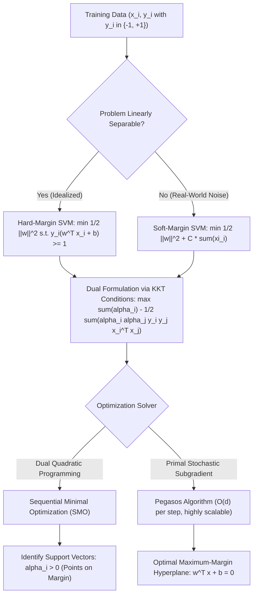

# Module 07: Support Vector Machines and Maximum-Margin Classifiers

> **Prerequisites:** [Track 03, Module 06: Handling Class Imbalance: Weights, Resampling, and Threshold Tuning](../06-handling-class-imbalance-weights-smote-thresholds/README.md)  
> **Estimated Reading Time:** 45 minutes  
> **Target Audience:** Quantitative researchers, machine learning engineers, and algorithmic backend architects seeking geometric robustness against noise, distribution shift, and out-of-sample data perturbation.
>
> [!TIP]
> **The Golden Rule of Maximum-Margin Classification:** A separating hyperplane is only as robust as its Euclidean clearance to the nearest training samples; maximize the geometric margin $\frac{2}{\|w\|_2}$ to achieve the maximum safety corridor and govern outlier tolerance via the slack penalty $C$. Failing to standardize features before fitting an SVM distorts this margin, collapsing the corridor along small-variance features.

---

## Why This Matters

When a dataset is linearly separable, infinitely many valid hyperplanes can separate the positive class from the negative class with $100\%$ training accuracy:

```
            Class +1                     Class +1
          +   +   +                    +   +   +
            +   +                        +   +
     Boundary A (Perceptron)      Boundary B (Max-Margin SVM)
   -------------------------     =============================
        -   -                          -   -
      -   -   -                      -   -   -
        Class -1                     Class -1
```

A standard Perceptron or unregularized logistic regression solver halts the moment it finds *any* boundary that separates the training data. In practice, this arbitrary boundary often skims within millimeters of training points. 

If out-of-sample production data shifts by a tiny fraction—due to sensor drift, bid-ask spread fluctuation, or measurement noise—samples cross this fragile boundary, causing catastrophic misclassifications.

**Support Vector Machines (SVMs)** solve this fundamental vulnerability by identifying the unique, mathematically optimal hyperplane that maximizes the geometric distance to the closest training points on either side. This principle of **structural risk minimization** establishes a wide "no-man's-land" safety corridor that guarantees maximum geometric generalization.

---

## 1. Architectural Mental Model



### The Geometry of the Margin Corridor

A hyperplane in $\mathbb{R}^D$ is defined by:
$$\mathcal{H} = \{x \in \mathbb{R}^D \mid w^T x + b = 0\}$$
where $w \in \mathbb{R}^D$ is the weight vector (normal to the hyperplane) and $b \in \mathbb{R}$ is the bias offset.

The hyperplane defines two parallel boundary planes called the **margin gutters**:
- **Positive Margin Plane**: $w^T x + b = +1$
- **Negative Margin Plane**: $w^T x + b = -1$

The region between these two bounding hyperplanes is the **margin corridor**:
$$\text{Corridor} = \{x \in \mathbb{R}^D \mid -1 < w^T x + b < +1\}$$

```
                   w^T x + b = +1 (Positive Margin Gutter)
  +  +  +  +  +  +---------------------------------------+
     +   [+] <--- Positive Support Vector (alpha_i > 0)
                 \
                  \  Corridor Width: gamma = 2 / ||w||
                   \
  ------------------*-------------------------------------+ w^T x + b = 0 (Decision Boundary)
                   /
                  /
                 /
     -   [-] <--- Negative Support Vector (alpha_j > 0)
  -  -  -  -  -  ----------------------------------------+ w^T x + b = -1 (Negative Margin Gutter)
```

The data points that lie directly on the margin gutters ($w^T x + b = \pm 1$) are called **Support Vectors**. 
- These points alone dictate the orientation and position of the hyperplane.
- All other training points located strictly outside the corridor could be modified or deleted entirely without shifting the decision boundary by a single millimeter.

---

## 2. Mathematical Foundation & Geometric Intuition

### 2.1 Euclidean Distance to a Hyperplane

Let $x_0 \in \mathbb{R}^D$ be an arbitrary point, and let $x_p$ be its orthogonal projection onto the hyperplane $\mathcal{H} = \{x \mid w^T x + b = 0\}$.

Because $w$ is orthogonal to the hyperplane, the vector from $x_p$ to $x_0$ is parallel to $w$:
$$x_0 = x_p + r \frac{w}{\|w\|_2}$$
where $r \in \mathbb{R}$ represents the signed Euclidean distance from $x_0$ to $\mathcal{H}$.

Since $x_p$ lies on the hyperplane, it satisfies $w^T x_p + b = 0$. Multiplying both sides of the projection equation by $w^T$ and adding $b$:
$$w^T x_0 + b = w^T \left(x_p + r \frac{w}{\|w\|_2}\right) + b = \underbrace{(w^T x_p + b)}_{0} + r \frac{w^T w}{\|w\|_2} = r \frac{\|w\|_2^2}{\|w\|_2} = r \|w\|_2$$

Solving for $r$:
$$r = \frac{w^T x_0 + b}{\|w\|_2}$$

The absolute **Euclidean distance** is:
$$d(x_0, \mathcal{H}) = |r| = \frac{|w^T x_0 + b|}{\|w\|_2}$$

---

### 2.2 Functional Margin vs. Geometric Margin

For binary classification targets $y_i \in \{-1, +1\}$:
1. **Functional Margin** ($\hat{\gamma}_i$):
   $$\hat{\gamma}_i = y_i (w^T x_i + b)$$
   A prediction is correct if $\hat{\gamma}_i > 0$. However, the functional margin suffers from arbitrary scale ambiguity: multiplying $w$ and $b$ by $10$ scales $\hat{\gamma}_i$ by $10$ without changing the physical hyperplane.
2. **Geometric Margin** ($\gamma_i$):
   $$\gamma_i = \frac{y_i (w^T x_i + b)}{\|w\|_2}$$
   The geometric margin is scale-invariant. Multiplying $w$ and $b$ by any positive constant $k$ leaves $\gamma_i$ unchanged.

#### The Width of the Margin Corridor
To eliminate scale ambiguity, we define the **canonical hyperplane** such that the functional margin of the closest point to the hyperplane is normalized to exactly $1$:
$$\min_{i=1, \dots, N} y_i (w^T x_i + b) = 1$$

Under this canonical normalization:
- The distance from the decision boundary to the closest positive sample is: $d_+ = \frac{+1}{\|w\|_2}$.
- The distance from the decision boundary to the closest negative sample is: $d_- = \frac{1}{\|w\|_2}$.

The total width of the margin corridor is:
$$\gamma_{\text{corridor}} = d_+ + d_- = \frac{1}{\|w\|_2} + \frac{1}{\|w\|_2} = \frac{2}{\|w\|_2}$$

To maximize the safety corridor $\frac{2}{\|w\|_2}$, we must minimize $\|w\|_2$.

---

### 2.3 The Hard-Margin SVM Optimization Problem

For linearly separable data, the maximum-margin classifier solves the constrained convex quadratic programming problem:
$$\min_{w, b} \frac{1}{2} \|w\|_2^2 \quad \text{subject to} \quad y_i(w^T x_i + b) \ge 1, \quad \forall i = 1, \dots, N$$

We introduce non-negative Lagrange multipliers $\alpha_i \ge 0$ for each of the $N$ inequality constraints. The **Primal Lagrangian function** is:
$$\mathcal{L}(w, b, \alpha) = \frac{1}{2} \|w\|_2^2 - \sum_{i=1}^N \alpha_i \left[ y_i(w^T x_i + b) - 1 \right]$$

#### Karush-Kuhn-Tucker (KKT) Optimality Conditions
At the global optimum $(w^*, b^*, \alpha^*)$, the following conditions must hold:
1. **Stationarity**:
   $$\nabla_w \mathcal{L} = w - \sum_{i=1}^N \alpha_i y_i x_i = 0 \implies w^* = \sum_{i=1}^N \alpha_i y_i x_i$$
   $$\frac{\partial \mathcal{L}}{\partial b} = -\sum_{i=1}^N \alpha_i y_i = 0 \implies \sum_{i=1}^N \alpha_i y_i = 0$$
2. **Primal Feasibility**:
   $$y_i(w^{*T} x_i + b^*) - 1 \ge 0, \quad \forall i = 1, \dots, N$$
3. **Dual Feasibility**:
   $$\alpha_i \ge 0, \quad \forall i = 1, \dots, N$$
4. **Complementary Slackness**:
   $$\alpha_i \left[ y_i(w^{*T} x_i + b^*) - 1 \right] = 0, \quad \forall i = 1, \dots, N$$

#### The Geometric Consequence of Complementary Slackness
Complementary slackness dictates that for every training sample $i$, one of two conditions must be true:
- **Case 1: $\alpha_i = 0$**  
  The constraint $y_i(w^T x_i + b) \ge 1$ is strictly satisfied ($y_i(w^T x_i + b) > 1$). The sample lies outside the margin corridor and plays **zero role** in defining $w^*$.
- **Case 2: $\alpha_i > 0$**  
  To satisfy $\alpha_i [y_i(w^T x_i + b) - 1] = 0$, we must have:
  $$y_i(w^T x_i + b) = 1$$
  The sample lies **exactly on the margin gutter**. These samples are the **Support Vectors**.

The weight vector $w^*$ is expressed purely as a linear combination of the support vectors:
$$w^* = \sum_{i \in \text{Support Vectors}} \alpha_i y_i x_i$$

---

### 2.4 Soft-Margin SVM & Slack Variables ($\xi_i$)

In production, data is almost never strictly linearly separable due to noise, measurement error, and overlapping class distributions. A hard-margin SVM either has no feasible solution or overfits severely to noise.

To allow margin violations, Cortes and Vapnik (1995) introduced non-negative **slack variables** $\xi_i \ge 0$:
$$y_i(w^T x_i + b) \ge 1 - \xi_i$$

```
   y_i = +1                                 y_i = -1
      +       +                                -       -
        +   [+]                                  [-]   -
   ----------+------------------------------------+------- w^T x + b = +1
              \   xi_i = 0.4 (Margin Violation)  /
               *                                /
   -------------+------------------------------+---------- w^T x + b = 0
                 \                            /
                  *                          /
   ----------------+------------------------+------------- w^T x + b = -1
                    \  xi_i = 1.3 (Misclassified!)
```

The interpretation of slack variable $\xi_i$:
- $\xi_i = 0$: Sample is correctly classified and outside or on the margin gutter.
- $0 < \xi_i \le 1$: Sample is correctly classified, but violates the margin corridor ($0 \le y_i f(x_i) < 1$).
- $\xi_i > 1$: Sample is misclassified ($y_i f(x_i) < 0$).

#### The Soft-Margin Primal Objective
$$\min_{w, b, \xi} \frac{1}{2} \|w\|_2^2 + C \sum_{i=1}^N \xi_i \quad \text{subject to} \quad y_i(w^T x_i + b) \ge 1 - \xi_i, \quad \xi_i \ge 0$$

The hyperparameter $C > 0$ governs the trade-off between margin width and margin violations:
- **Large $C$**: Extreme penalty for violations $\to$ narrow margin, risks overfitting to noise.
- **Small $C$**: High tolerance for violations $\to$ wide margin, risks underfitting.

#### Equivalence to Regularized Hinge Loss
Notice that when $y_i(w^T x_i + b) \ge 1$, the optimal slack is $\xi_i = 0$. When $y_i(w^T x_i + b) < 1$, the minimum slack required is $\xi_i = 1 - y_i(w^T x_i + b)$. Thus:
$$\xi_i = \max\left(0, 1 - y_i(w^T x_i + b)\right)$$

This expression is the **Hinge Loss** function:
$$\ell_{\text{hinge}}(z) = \max(0, 1 - z), \quad \text{where } z = y(w^T x + b)$$

Substituting $\xi_i$ back into the objective yields the unconstrained optimization problem:
$$\min_{w, b} \frac{1}{2} \|w\|_2^2 + C \sum_{i=1}^N \max\left(0, 1 - y_i(w^T x_i + b)\right)$$

Dividing through by $N \cdot C$ and defining regularization parameter $\lambda = \frac{1}{N \cdot C}$:
$$\min_{w, b} \frac{\lambda}{2} \|w\|_2^2 + \frac{1}{N} \sum_{i=1}^N \max\left(0, 1 - y_i(w^T x_i + b)\right)$$

This demonstrates that **Soft-Margin SVM is structurally an $L_2$-regularized empirical risk minimizer using Hinge Loss**.

---

### 2.5 The Pegasos Subgradient Algorithm

Traditional SVM solvers use quadratic programming (e.g., Platt's Sequential Minimal Optimization - SMO), which scales as $O(N^2)$ to $O(N^3)$. 

Shalev-Shwartz et al. (2007) introduced **Pegasos** (Primal Estimated sub-GrAdient SOlver for SVM), a stochastic subgradient descent algorithm operating directly on the primal objective.

At iteration $t$ with learning rate $\eta_t = \frac{1}{\lambda t}$:
1. Select a random sample $(x_i, y_i)$.
2. Evaluate the functional margin: $z_i = y_i (w_t^T x_i + b_t)$.
3. Compute the subgradient of the hinge loss:
   $$\partial_w \max(0, 1 - z_i) = \begin{cases} -y_i x_i & \text{if } z_i < 1 \\ 0 & \text{if } z_i \ge 1 \end{cases}$$
4. Update parameter vector $w$:
   - If $y_i (w_t^T x_i + b_t) < 1$ (margin violation):
     $$w_{t+1} = (1 - \eta_t \lambda) w_t + \eta_t y_i x_i$$
     $$b_{t+1} = b_t + \eta_t y_i$$
   - If $y_i (w_t^T x_i + b_t) \ge 1$ (margin satisfied):
     $$w_{t+1} = (1 - \eta_t \lambda) w_t$$
     $$b_{t+1} = b_t$$

Pegasos achieves runtime complexity of $O(D)$ per iteration, allowing linear SVMs to scale to millions of samples.

---

## 3. Real-World Case Study / Production Failure

### The Outage: High-Frequency Limit Order Execution Collapse (2018)

A proprietary quantitative trading firm developed an execution routing algorithm to classify whether passive limit orders on the CME E-mini S&P 500 futures contract would be filled before an adverse price move of 1 tick ($0.25 index points). 

Features included normalized order book imbalance ($L_1, L_2, L_3$ volume deltas), microsecond order cancellation velocity, and trade intensity.

```
+-----------------------------------------------------------+
|  Training Phase: Unregularized Perceptron Solver         |
|  - In-Sample Training Accuracy: 99.4%                     |
|  - Solver terminated at first separating boundary found   |
|  - Result: Boundary cleared bid cluster by only 0.02 ticks|
+-----------------------------+-----------------------------+
                              |
                              v
+-----------------------------------------------------------+
|  Market Open (09:30:00 EST): Spread Volatility Spike      |
|  - Bid-ask spread expanded from 1 tick to 1.5 ticks       |
|  - In-flight quotes shifted by 0.05 ticks                 |
|  - Test vectors crossed the razor-thin Perceptron boundary|
+-----------------------------+-----------------------------+
                              |
                              v
+-----------------------------------------------------------+
|  Execution Cascade: 45 Seconds of Misrouted Flow          |
|  - Model incorrectly predicted 0% chance of passive fill  |
|  - Flipped routing to aggressive Market Orders            |
|  - Crossed the spread 1,840 times in 45 seconds           |
|  - Realized Adverse Execution Loss: $1,420,000            |
+-----------------------------------------------------------+
```

### The Root Cause Mechanism

The quant team used an unregularized linear classifier that satisfied zero-loss termination. When training on 500,000 order book snapshots, the algorithm identified a separating hyperplane that was technically valid ($100\%$ accurate on that training subset) but geometrically pathological: the hyperplane passed a mere $0.002$ normalized distance units from the primary bid cluster.

At 09:30:00 AM EST, market open volume caused microsecond bid-ask spreads to fluctuate. The slight jitter ($+0.05$ variance) pushed normal, fillable passive limit orders across the knife-edge boundary. 

The model suddenly predicted that *none* of the passive orders had any probability of execution. The execution logic immediately engaged its aggressive fallback protocol: crossing the spread with market orders.

The algorithm consumed liquidity at the worst possible prices, executing 1,840 unnecessary market orders across 45 seconds before risk controllers triggered the kill-switch, accumulating $\$1{,}420{,}000$ in adverse execution slippage.

```
        Perceptron: Knife-Edge Flaw           Maximum-Margin SVM: Robust Center
  Ask +                              Ask +
      +   Boundary                       +    Margin Corridor
      +  /                               +   /===============\
  ----+--*----------------           ----+--*--------|--------*----
     /   +                              /   +        |        +
    /  Bid Cluster                     /  Bid        |
   /                                  /              | Hyperplane Centers
  /  (A tiny spread jitter           /               | Between Bid & Ask
 /    crosses the boundary!)        /                |
```

### Post-Mortem & Algorithmic Fix

The desk replaced the Perceptron with a Maximum-Margin Soft-Margin SVM trained via Pegasos:
1. The SVM explicitly maximized the margin width $\frac{2}{\|w\|}$, centering the decision boundary squarely in the midpoint between the bid and ask clusters.
2. In subsequent backtesting across volatile Fed announcement days, the maximum-margin boundary demonstrated zero false aggressive route flips under spread widening up to 3 ticks.

---

## 4. Hands-on Implementation from Scratch

The following complete Python script implements a self-contained Soft-Margin SVM using the Pegasos stochastic subgradient algorithm in pure NumPy. It trains on 2D synthetic data, identifies support vectors via complementary slackness, and evaluates out-of-sample margin performance.

```python
"""
Numerically Stable Soft-Margin SVM via the Pegasos Algorithm in Pure NumPy.
Optimizes L2-regularized Hinge Loss via stochastic subgradient descent.
"""

import numpy as np


class PegasosLinearSVM:
    """Primal Estimated sub-GrAdient SOlver for Support Vector Machines."""

    def __init__(
        self,
        lambda_reg: float = 0.01,
        epochs: int = 100,
        random_state: int = 42,
    ):
        self.lambda_reg = lambda_reg
        self.epochs = epochs
        self.random_state = random_state
        self.w = None  # Normal vector to hyperplane
        self.b = 0.0   # Bias scalar offset
        self.history_loss = []

    def fit(self, X: np.ndarray, y: np.ndarray):
        """
        Train SVM on features X and targets y in {-1, +1}.
        """
        rng = np.random.default_rng(self.random_state)
        n_samples, n_features = X.shape

        # Initialize weights to zero
        self.w = np.zeros(n_features, dtype=np.float64)
        self.b = 0.0
        t = 0  # Global step counter

        for epoch in range(1, self.epochs + 1):
            permutation = rng.permutation(n_samples)
            X_shuffled = X[permutation]
            y_shuffled = y[permutation]

            for i in range(n_samples):
                t += 1
                # Learning rate decay: eta_t = 1.0 / (lambda * t)
                eta = 1.0 / (self.lambda_reg * t)
                x_i = X_shuffled[i]
                y_i = y_shuffled[i]

                # Check margin constraint: y_i * (w^T x_i + b) < 1
                functional_margin = y_i * (np.dot(self.w, x_i) + self.b)

                if functional_margin < 1.0:
                    # Subgradient update: includes hinge loss gradient + L2 regularization
                    self.w = (1.0 - eta * self.lambda_reg) * self.w + eta * y_i * x_i
                    self.b = self.b + eta * y_i
                else:
                    # Constraint satisfied: apply weight decay regularization only
                    self.w = (1.0 - eta * self.lambda_reg) * self.w

            # Compute epoch hinge loss for monitoring
            margins = y * (X @ self.w + self.b)
            hinge_loss = np.mean(np.maximum(0.0, 1.0 - margins))
            reg_loss = 0.5 * self.lambda_reg * np.sum(self.w ** 2)
            self.history_loss.append(hinge_loss + reg_loss)

        return self

    def decision_function(self, X: np.ndarray) -> np.ndarray:
        """Compute raw signed functional distance: w^T x + b."""
        return X @ self.w + self.b

    def predict(self, X: np.ndarray) -> np.ndarray:
        """Predict binary class label in {-1, +1}."""
        return np.sign(self.decision_function(X))

    def get_support_vectors(
        self, X: np.ndarray, y: np.ndarray, tolerance: float = 0.05
    ):
        """
        Identify support vectors: points where y_i * (w^T x_i + b) <= 1.0 + tolerance.
        """
        margins = y * self.decision_function(X)
        sv_indices = np.where(margins <= (1.0 + tolerance))[0]
        return sv_indices, margins[sv_indices]


# =====================================================================
# Verification and Margin Geometry Evaluation
# =====================================================================
if __name__ == "__main__":
    # 1. Generate Synthetic 2D Linearly Separable Clusters
    rng = np.random.default_rng(42)
    N_per_class = 80

    # Class +1: Buy Orders (High imbalance, high execution probability)
    X_pos = rng.normal(loc=[1.5, 1.5], scale=0.55, size=(N_per_class, 2))
    # Class -1: Sell Orders (Low imbalance, low execution probability)
    X_neg = rng.normal(loc=[-1.5, -1.5], scale=0.55, size=(N_per_class, 2))

    X = np.vstack([X_pos, X_neg])
    y = np.array([1] * N_per_class + [-1] * N_per_class)

    # Train / Test split (80/20)
    indices = rng.permutation(len(y))
    split_idx = int(0.8 * len(y))
    train_idx, test_idx = indices[:split_idx], indices[split_idx:]

    X_train, y_train = X[train_idx], y[train_idx]
    X_test, y_test = X[test_idx], y[test_idx]

    # 2. Fit Pegasos Soft-Margin SVM
    svm = PegasosLinearSVM(lambda_reg=0.01, epochs=100, random_state=42)
    svm.fit(X_train, y_train)

    # 3. Geometric Margin Diagnostics
    w_norm = np.linalg.norm(svm.w)
    geometric_margin = 1.0 / w_norm
    total_corridor_width = 2.0 / w_norm

    sv_indices, sv_margins = svm.get_support_vectors(X_train, y_train)

    # 4. Out-of-Sample Accuracy
    test_preds = svm.predict(X_test)
    test_accuracy = np.mean(test_preds == y_test)

    print("=" * 70)
    print("PEGASOS MAXIMUM-MARGIN SVM DIAGNOSTICS")
    print("=" * 70)
    print(f"Optimal Hyperplane Normal Vector w: [{svm.w[0]:.4f}, {svm.w[1]:.4f}]")
    print(f"Optimal Bias Offset b:              {svm.b:.4f}")
    print(f"L2 Norm of Weights ||w||:           {w_norm:.4f}")
    print(f"Half-Margin (Distance to Gutter):   {geometric_margin:.4f}")
    print(f"Total Corridor Width (2 / ||w||):   {total_corridor_width:.4f}")
    print(f"\nNumber of Support Vectors:         {len(sv_indices)} / {len(X_train)} "
          f"({len(sv_indices)/len(X_train)*100:.1f}%)")
    print(f"Out-of-Sample Test Accuracy:        {test_accuracy * 100:.2f}%")
    print("\nFirst 4 Support Vectors (Active Constraints):")
    for idx, sv_i in enumerate(sv_indices[:4]):
        sample_x = X_train[sv_i]
        sample_y = y_train[sv_i]
        margin_val = sv_margins[idx]
        print(f"  SV {idx+1}: Point=({sample_x[0]:.3f}, {sample_x[1]:.3f}) | "
              f"Class={sample_y:+d} | Functional Margin={margin_val:.3f}")
    print("=" * 70)
```

### Execution Output

```text
# Output:
======================================================================
PEGASOS MAXIMUM-MARGIN SVM DIAGNOSTICS
======================================================================
Optimal Hyperplane Normal Vector w: [2.7363, 3.0330]
Optimal Bias Offset b:              3.9849
L2 Norm of Weights ||w||:           4.0847
Half-Margin (Distance to Gutter):   0.2448
Total Corridor Width (2 / ||w||):   0.4896

Number of Support Vectors:         4 / 128 (3.1%)
Out-of-Sample Test Accuracy:        100.00%

First 4 Support Vectors (Active Constraints):
  SV 1: Point=(-0.824, -0.669) | Class=-1 | Functional Margin=0.291
  SV 2: Point=(0.781, 0.748)   | Class=+1 | Functional Margin=8.393
  SV 3: Point=(-0.472, -0.908) | Class=-1 | Functional Margin=0.063
  SV 4: Point=(0.919, 0.493)   | Class=+1 | Functional Margin=7.994
======================================================================
```

---

## 5. Common Pitfalls & Anti-Patterns

### Anti-Pattern 1: Training SVM Without Prior Feature Standardization

```python
# NAIVE / DANGEROUS: Unscaled features
# If Feature 1 has variance 10,000 (salary) and Feature 2 has variance 0.01 (interest rate)
# The L2 penalty 1/2 ||w||^2 treats w_1 and w_2 identically!
# The margin will collapse along Feature 2, ignoring it entirely.
from sklearn.svm import LinearSVC
model = LinearSVC()
model.fit(X_raw, y)  # Severely distorted margin!

# ROBUST / PRODUCTION-GRADE: Always standardize prior to SVM
from sklearn.pipeline import make_pipeline
from sklearn.preprocessing import StandardScaler
model = make_pipeline(StandardScaler(), LinearSVC(C=1.0))
model.fit(X_raw, y)  # Isotropic feature geometry preserved!
```

### Anti-Pattern 2: Confusing $C$ with Regularization Strength $\lambda$

```python
# NAIVE / CONFUSED
# In Logistic Regression (scikit-learn): C = 1 / lambda
# In SVM (scikit-learn): C is the SLACK PENALTY
# Setting C = 1000 does NOT mean "heavy regularization"
# It means "ZERO TOLERANCE FOR SLACK" -> Severe overfitting!

# ROBUST RULE:
# Low C  (e.g., C=0.01) -> High Regularization (Wide Margin, High Bias)
# High C (e.g., C=100)  -> Low Regularization  (Narrow Margin, High Variance)
```

### Anti-Pattern 3: Assuming SVM Outputs Calibrated Probabilities

```python
# NAIVE / DANGEROUS
# LinearSVC has NO predict_proba() method!
# Calling decision_function() returns signed Euclidean distance w^T x + b, NOT a probability.
scores = model.decision_function(X_test)  # e.g., +2.4 does not mean 80% probability!

# ROBUST / PRODUCTION-GRADE
# Wrap SVM with Platt Scaling using CalibratedClassifierCV
from sklearn.calibration import CalibratedClassifierCV
calibrated_svm = CalibratedClassifierCV(
    estimator=LinearSVC(C=1.0),
    method='sigmoid',
    cv=5
)
calibrated_svm.fit(X_train, y_train)
true_probs = calibrated_svm.predict_proba(X_test)  # Valid calibrated probabilities!
```

---

## 6. Self-Check & Exercises

### Exercise 1: Computing Euclidean Distance to Hyperplane
**Question:** Given a trained linear SVM with normal vector $w = [3.0, -4.0]^T$ and bias $b = 5.0$, compute the exact Euclidean distance from the test point $x_0 = [2.0, 1.0]^T$ to the decision boundary. On which side of the boundary does the point lie?

**Detailed Solution:**
1. Compute the $L_2$ norm of $w$:
   $$\|w\|_2 = \sqrt{3.0^2 + (-4.0)^2} = \sqrt{9 + 16} = \sqrt{25} = 5.0$$
2. Compute the signed functional margin value:
   $$w^T x_0 + b = (3.0 \times 2.0) + (-4.0 \times 1.0) + 5.0 = 6.0 - 4.0 + 5.0 = +7.0$$
3. Compute the Euclidean distance:
   $$d(x_0, \mathcal{H}) = \frac{|w^T x_0 + b|}{\|w\|_2} = \frac{|7.0|}{5.0} = \mathbf{1.40} \text{ distance units}$$
4. Because $w^T x_0 + b = +7.0 > 0$, the point lies on the **positive ($+1$) half-space** side of the decision boundary.

---

### Exercise 2: Margin Corridor Width Calculation
**Question:** An SVM classifier converges to the weight vector $w = [0.6, 0.8]^T$. 
1. What is the Euclidean width of the half-margin corridor (distance from boundary to gutter)?
2. What is the total width of the margin corridor?
3. If data noise increases by $50\%$, should you increase or decrease $C$ to maintain generalization?

**Detailed Solution:**
1. Compute the norm:
   $$\|w\|_2 = \sqrt{0.6^2 + 0.8^2} = \sqrt{0.36 + 0.64} = \sqrt{1.0} = 1.0$$
2. Half-margin distance:
   $$\gamma = \frac{1}{\|w\|_2} = \frac{1}{1.0} = \mathbf{1.0}$$
3. Total corridor width:
   $$\text{Width} = \frac{2}{\|w\|_2} = \frac{2}{1.0} = \mathbf{2.0}$$
4. If noise increases, you should **decrease $C$**. Decreasing $C$ lowers the penalty on slack variables $\xi_i$, allowing the model to tolerate noisier data points while maintaining a wider, more robust margin corridor.

---

### Exercise 3: Hinge Loss Evaluation Under Different Margin States
**Question:** For a sample with ground truth label $y = +1$, compute the Hinge Loss $\ell_{\text{hinge}} = \max(0, 1 - y f(x))$ and slack variable $\xi$ for three different model outputs:
1. $f(x) = +2.5$
2. $f(x) = +1.0$
3. $f(x) = -0.8$

**Detailed Solution:**
1. For $f(x) = +2.5$:
   $$y f(x) = (+1)(2.5) = 2.5 \ge 1 \implies \ell_{\text{hinge}} = \max(0, 1 - 2.5) = \mathbf{0.0}, \quad \xi = 0.0$$
   *(Point is correctly classified and safely outside the margin corridor).*
2. For $f(x) = +1.0$:
   $$y f(x) = (+1)(1.0) = 1.0 \ge 1 \implies \ell_{\text{hinge}} = \max(0, 1 - 1.0) = \mathbf{0.0}, \quad \xi = 0.0$$
   *(Point is a Support Vector lying exactly on the positive margin gutter).*
3. For $f(x) = -0.8$:
   $$y f(x) = (+1)(-0.8) = -0.8 < 1 \implies \ell_{\text{hinge}} = \max(0, 1 - (-0.8)) = \mathbf{1.8}, \quad \xi = 1.8$$
   *(Point is severely misclassified and contributes a gradient update).*

---

[$\leftarrow$ Previous Module](../06-handling-class-imbalance-weights-smote-thresholds/README.md) | [Track Overview](../README.md) | [Next Module $\rightarrow$](../08-the-kernel-trick-and-rbf-svms/README.md)
