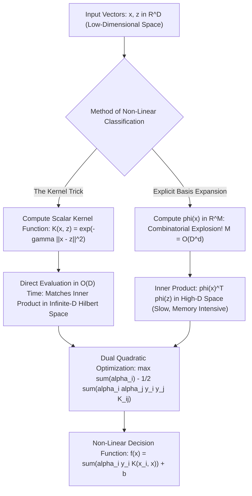

# Module 08: The Kernel Trick, RBF Kernels, and Soft Margins

> **Prerequisites:** [Track 03, Module 07: Support Vector Machines and Maximum-Margin Classifiers](../07-support-vector-machines-and-max-margin/README.md)  
> **Estimated Reading Time:** 45 minutes  
> **Target Audience:** Machine learning engineers, senior backend architects, and systems engineers building non-linear classifiers, kernel embeddings, and low-latency prediction engines.
>
> [!TIP]
> **The Golden Rule of Kernel Methods:** The Kernel Trick enables linear maximum-margin classifiers to operate in infinite-dimensional Hilbert spaces with zero explicit feature mapping by substituting dot products with a positive semi-definite Mercer kernel $K(x, z) = \langle \phi(x), \phi(z) \rangle$—but because the Gram matrix scales as $O(N^2)$ memory and $O(N^2)$ to $O(N^3)$ compute, never deploy exact dual kernel SVMs when sample sizes exceed $N \approx 50{,}000$; use Random Fourier Features or linear approximations instead.

---

## Why This Matters

Linear classifiers are constrained by geometry: they can only construct flat hyperplanes. Real-world physical, biological, and financial phenomena are profoundly non-linear:
- Concentric patterns (e.g., normal operating temperatures bounded inside safe envelopes).
- XOR and parity relationships (e.g., genetic epistatic interactions).
- Interleaved manifolds (e.g., complex multi-sensor telemetry signatures).

```
        Non-Linearly Separable (Input Space R^2)
                     -   -   -
                   -   +   +   -
                  -   +  *  +   -       <--- No straight line can separate
                   -   +   +   -             the (+) core from the (-) ring!
                     -   -   -
```

To classify such data linearly, classical machine learning had to compute explicit polynomial expansions: mapping a 2D point $[x_1, x_2]$ into 3D $[x_1^2, \sqrt{2}x_1 x_2, x_2^2]$. In this expanded 3D space, a flat plane easily cuts between the core and the ring.

However, explicit high-order feature mapping suffers from the **combinatorial explosion of dimensionality**: mapping a modest 100-dimensional vector using a degree-5 polynomial generates $\binom{100 + 5}{5} \approx 96{,}560{,}646$ features. Storing and computing inner products in such spaces exhausts CPU caches and memory.

The **Kernel Trick** bypasses explicit feature mapping entirely. It proves that if an algorithm can be expressed purely in terms of inner products $\langle \phi(x), \phi(z) \rangle$, we can compute that inner product directly in low-dimensional input space via a **Kernel function** $K(x, z)$. 

In this module, you will master the dual formulation of SVMs, the mathematics of Mercer's theorem, the infinite-dimensional Hilbert space of the Radial Basis Function (RBF) kernel, and how to implement a self-contained RBF-SVM solver in pure NumPy using Sequential Minimal Optimization (SMO).

---

## 1. Architectural Mental Model



### The Geometry of Implicit Feature Lifting

Consider a 2-dimensional dataset where the positive class is a circle of radius $r_1$ and the negative class is an outer ring of radius $r_2$:
$$\mathcal{C}_1 = \{x \in \mathbb{R}^2 \mid x_1^2 + x_2^2 \le 1\}, \quad \mathcal{C}_0 = \{x \in \mathbb{R}^2 \mid 2 \le x_1^2 + x_2^2 \le 4\}$$

Define an explicit mapping function $\phi: \mathbb{R}^2 \to \mathbb{R}^3$:
$$\phi(x) = \left[ x_1^2, \, \sqrt{2}x_1 x_2, \, x_2^2 \right]^T$$

Let us evaluate the inner product between two mapped points $\phi(x)$ and $\phi(z)$ in $\mathbb{R}^3$:
$$\langle \phi(x), \phi(z) \rangle = \left(x_1^2\right)\left(z_1^2\right) + \left(\sqrt{2}x_1 x_2\right)\left(\sqrt{2}z_1 z_2\right) + \left(x_2^2\right)\left(z_2^2\right)$$
$$= x_1^2 z_1^2 + 2 x_1 x_2 z_1 z_2 + x_2^2 z_2^2 = (x_1 z_1 + x_2 z_2)^2 = (x^T z)^2$$

Notice the algebraic result:
$$\langle \phi(x), \phi(z) \rangle_{\mathbb{R}^3} = \left(x^T z\right)^2_{\mathbb{R}^2}$$

To compute the inner product in 3-dimensional space, we do **not** need to map $x$ or $z$ into 3 dimensions. We simply compute the standard dot product in 2D space ($x^T z$) and square the resulting scalar.

This is the essence of the **Kernel Trick**:
$$K(x, z) = \langle \phi(x), \phi(z) \rangle$$

The kernel function $K(x, z)$ computes the dot product of an implicit high-dimensional space directly using the coordinates of the low-dimensional space.

---

## 2. Mathematical Foundation & Geometric Intuition

### 2.1 The Dual Formulation of Soft-Margin SVM

Recall from Module 07 that the primal Soft-Margin SVM objective is:
$$\min_{w, b, \xi} \frac{1}{2} \|w\|_2^2 + C \sum_{i=1}^N \xi_i \quad \text{s.t.} \quad y_i(w^T \phi(x_i) + b) \ge 1 - \xi_i, \quad \xi_i \ge 0$$

Constructing the Lagrangian with multipliers $\alpha_i \ge 0$ and $\beta_i \ge 0$:
$$\mathcal{L}(w, b, \xi, \alpha, \beta) = \frac{1}{2} \|w\|_2^2 + C \sum_{i=1}^N \xi_i - \sum_{i=1}^N \alpha_i \left[ y_i(w^T \phi(x_i) + b) - 1 + \xi_i \right] - \sum_{i=1}^N \beta_i \xi_i$$

Taking partial derivatives and setting them to zero (Stationarity):
1. $\nabla_w \mathcal{L} = w - \sum_{i=1}^N \alpha_i y_i \phi(x_i) = 0 \implies w = \sum_{i=1}^N \alpha_i y_i \phi(x_i)$
2. $\frac{\partial \mathcal{L}}{\partial b} = -\sum_{i=1}^N \alpha_i y_i = 0 \implies \sum_{i=1}^N \alpha_i y_i = 0$
3. $\frac{\partial \mathcal{L}}{\partial \xi_i} = C - \alpha_i - \beta_i = 0 \implies \alpha_i + \beta_i = C$

Because $\beta_i \ge 0$, the condition $\alpha_i + \beta_i = C$ implies:
$$0 \le \alpha_i \le C$$

Substituting $w = \sum_{i=1}^N \alpha_i y_i \phi(x_i)$ and $\sum_{i=1}^N \alpha_i y_i = 0$ back into $\mathcal{L}$ yields the **Wolfe Dual Optimization Problem**:
$$\max_{\alpha} \sum_{i=1}^N \alpha_i - \frac{1}{2} \sum_{i=1}^N \sum_{j=1}^N \alpha_i \alpha_j y_i y_j \underbrace{\langle \phi(x_i), \phi(x_j) \rangle}_{K(x_i, x_j)}$$
$$\text{subject to} \quad 0 \le \alpha_i \le C \quad \forall i=1, \dots, N, \quad \text{and} \quad \sum_{i=1}^N \alpha_i y_i = 0$$

#### The Final Non-Linear Decision Function
Once the optimal dual coefficients $\alpha^*$ and bias $b^*$ are solved, we substitute $w = \sum_{i=1}^N \alpha_i y_i \phi(x_i)$ into the decision rule:
$$f(x) = w^T \phi(x) + b = \left( \sum_{i=1}^N \alpha_i y_i \phi(x_i) \right)^T \phi(x) + b = \sum_{i=1}^N \alpha_i y_i \langle \phi(x_i), \phi(x) \rangle + b$$

Replacing the inner product with kernel function $K(x_i, x)$:
$$f(x) = \sum_{i \in \text{Support Vectors}} \alpha_i y_i K(x_i, x) + b$$
$$\hat{y} = \text{sign}(f(x))$$

Notice the profound structural property: **The parameter vector $w$ is never explicitly constructed or stored**. Both the training phase and inference phase require only evaluating the kernel function $K(\cdot, \cdot)$.

---

### 2.2 Mercer's Theorem & The Gram Matrix

Not every arbitrary mathematical function $K(x, z)$ is a valid kernel. To guarantee that $K(x, z)$ represents a valid dot product in *some* inner product space (Hilbert space), it must satisfy **Mercer's Theorem**.

#### The Gram Matrix
Given a dataset $\{x_1, \dots, x_N\}$, the **Gram Matrix** (or Kernel Matrix) $K \in \mathbb{R}^{N \times N}$ is the matrix of all pairwise kernel evaluations:
$$K = \begin{bmatrix} K(x_1, x_1) & K(x_1, x_2) & \dots & K(x_1, x_N) \\ K(x_2, x_1) & K(x_2, x_2) & \dots & K(x_2, x_N) \\ \vdots & \vdots & \ddots & \vdots \\ K(x_N, x_1) & K(x_N, x_2) & \dots & K(x_N, x_N) \end{bmatrix}$$

#### Mercer's Condition
A kernel function $K: \mathcal{X} \times \mathcal{X} \to \mathbb{R}$ is a valid Mercer kernel if and only if for every finite set of points $\{x_1, \dots, x_N\}$, its Gram matrix $K$ is:
1. **Symmetric**: $K_{ij} = K_{ji} \implies K(x_i, x_j) = K(x_j, x_i)$.
2. **Positive Semi-Definite (PSD)**: For all non-zero vectors $v \in \mathbb{R}^N$:
   $$v^T K v = \sum_{i=1}^N \sum_{j=1}^N v_i v_j K(x_i, x_j) \ge 0$$
   Equivalently, all eigenvalues of $K$ must be non-negative: $\lambda_m(K) \ge 0, \forall m$.

If $K$ is positive semi-definite, the dual optimization problem is guaranteed to be **strictly concave** (its negative is convex), ensuring a single unique global maximum with zero local optima.

---

### 2.3 The RBF (Gaussian) Kernel in Infinite-Dimensional Hilbert Space

The **Radial Basis Function (RBF)** or **Gaussian Kernel** is the most widely deployed non-linear kernel in machine learning:
$$K(x, z) = \exp\left(-\gamma \|x - z\|^2\right) = \exp\left(-\frac{\|x - z\|^2}{2\sigma^2}\right)$$
where $\gamma = \frac{1}{2\sigma^2} > 0$ controls the inverse width (bandwidth) of the kernel.

#### Mathematical Proof: Why RBF Has Infinite Dimensions
To see why the RBF kernel corresponds to an inner product in an infinite-dimensional Reproducing Kernel Hilbert Space (RKHS), consider 1-dimensional scalars $x, z \in \mathbb{R}$ with $\gamma = 1$:
$$K(x, z) = \exp\left(-(x - z)^2\right) = \exp\left(-x^2 + 2xz - z^2\right) = \exp(-x^2) \exp(-z^2) \exp(2xz)$$

Recall the Taylor series expansion for the exponential function $e^u = \sum_{k=0}^\infty \frac{u^k}{k!}$:
$$\exp(2xz) = \sum_{k=0}^\infty \frac{(2xz)^k}{k!} = \sum_{k=0}^\infty \frac{2^k x^k z^k}{k!} = \sum_{k=0}^\infty \left(\sqrt{\frac{2^k}{k!}} x^k\right) \left(\sqrt{\frac{2^k}{k!}} z^k\right)$$

Substituting this expansion back:
$$K(x, z) = \sum_{k=0}^\infty \left(e^{-x^2} \sqrt{\frac{2^k}{k!}} x^k\right) \left(e^{-z^2} \sqrt{\frac{2^k}{k!}} z^k\right)$$

Define the implicit feature mapping vector $\phi(x)$:
$$\phi(x) = e^{-x^2} \left[ 1, \, \sqrt{\frac{2^1}{1!}}x, \, \sqrt{\frac{2^2}{2!}}x^2, \, \dots, \, \sqrt{\frac{2^k}{k!}}x^k, \, \dots \right]^T \in \mathbb{R}^\infty$$

The inner product of these two infinite-dimensional vectors is:
$$\langle \phi(x), \phi(z) \rangle = \sum_{k=0}^\infty \phi_k(x) \phi_k(z) = K(x, z)$$

The RBF kernel computes an exact inner product in an **infinite-dimensional polynomial feature space** using a single, closed-form exponential evaluation taking $O(D)$ floating-point operations.

---

### 2.4 Hyperparameter Sensitivity: The Interplay of $C$ and $\gamma$

The generalization performance of an RBF-SVM is dictated by the pairing of two hyperparameters:

```
  High C, High gamma                Low C, High gamma
  +-----------------------+         +-----------------------+
  |  *  *         *  *    |         |  ( )           ( )    |
  | * + *        * + *    |         |  (+)           (+)    |
  |  *  *         *  *    |         |                       |
  |      Island Isolation |         |     Soft Boundaries   |
  |  (Extreme Overfitting)|         |  (High Local Variance)|
  +-----------------------+         +-----------------------+
  High C, Low gamma                 Low C, Low gamma
  +-----------------------+         +-----------------------+
  |        +   +          |         |        +   +          |
  |   -----------------   |         |   ~~~~~~~~~~~~~~~~~   |
  |        -   -          |         |        -   -          |
  |    Rigid Near-Linear  |         |     Heavy Smoothing   |
  |  (Good Generalization)|         |    (Underfitting)     |
  +-----------------------+         +-----------------------+
```

1. **The Kernel Bandwidth ($\gamma$)**:
   - Governs the radius of influence of each support vector.
   - **Small $\gamma$**: $K(x, z) \approx 1$ across large distances. The Gaussian bell curve is flat and wide. Distant points exert significant mutual influence, yielding smooth, gently curving decision boundaries (approaching linear behavior).
   - **Large $\gamma$**: $K(x, z) \to 0$ rapidly as $\|x - z\|$ increases. The Gaussian bell curve is a sharp spike. Each support vector creates a tiny, isolated "island" of positive classification around itself, completely failing to generalize to unseen data.
2. **The Slack Penalty ($C$)**:
   - Governs tolerance for margin violations.
   - **Small $C$**: Large margin, high tolerance for misclassifications. Encourages broader, smoother boundaries.
   - **Large $C$**: Small margin, severe penalty for violations. Forces the boundary to contort around every individual noisy sample.

---

### 2.5 The Computational Bottleneck: Why Exact Kernels Fail at Scale

The primary operational constraint of exact dual Kernel SVMs is their asymptotic resource scaling:

| Resource Dimension | Asymptotic Complexity | Real-World Impact at $N = 500{,}000$ |
| :--- | :--- | :--- |
| **Gram Matrix Memory** | $O(N^2)$ float64 elements | $500{,}000^2 \times 8 \text{ bytes} = \mathbf{2{,}000 \text{ GB (2 TB)}}$ |
| **Training Runtime** | $O(N^2)$ to $O(N^3)$ FLOPs | Days to weeks on multi-core CPU clusters |
| **Inference Latency** | $O(N_{\text{SV}} \cdot D)$ per query | If $N_{\text{SV}} = 100{,}000$, requires 100k kernel calls per request |

When $N > 50{,}000$, standard kernel SVMs become computationally intractable. In production, engineers substitute exact dual solvers with linear approximations:
1. **The Nyström Method**: Samples $M \ll N$ landmark columns of the Gram matrix to construct a low-rank approximation $K \approx K_{NM} K_{MM}^{-1} K_{NM}^T$.
2. **Random Fourier Features (Rahimi & Recht, 2007)**: Maps inputs explicitly to $R$ randomized cosine/sine projections such that $\langle z(x), z(y) \rangle \approx K(x, y)$, allowing fast primal linear solvers (like Pegasos) to run in $O(N \cdot R)$ time.

---

## 3. Real-World Case Study / Production Failure

### The Outage: The 2 Terabyte Kernel OOM Cascade (2019)

A precision oncology clinical diagnostics platform developed an RBF-SVM to predict immunotherapy treatment response based on 128 genomic expression and protein biomarker features.

```
+-----------------------------------------------------------+
|  Clinical Pilot Validation (2,000 Patient Cohort)         |
|  - Algorithm: SVC(kernel='rbf', C=10.0, gamma='scale')     |
|  - Gram Matrix: 2,000 x 2,000 x 8 bytes = 32 MB (Trivial) |
|  - Result: 96.8% Sensitivity. Approved for National Scale |
+-----------------------------+-----------------------------+
                              |
                              v
+-----------------------------------------------------------+
|  Production Pipeline Automated Retraining                 |
|  - National Registry Ingestion: N = 500,000 Patients       |
|  - Worker Pod RAM Allocation: 64 GB                       |
|  - Gram Matrix Requirement: 500,000^2 x 8 bytes = 2,000 GB|
+-----------------------------+-----------------------------+
                              |
                              v
+-----------------------------------------------------------+
|  Kubernetes Cluster Node Eviction Cascade                 |
|  - Container exceeded 64 GB cgroup limit in 12 seconds    |
|  - Linux OOM Killer terminated Python worker pod           |
|  - Pod restarted in CrashLoopBackOff                       |
|  - Swap thrashing exhausted worker node OS disk           |
|  - Node marked NotReady -> Live Clinical API Down (4 Hours)|
+-----------------------------------------------------------+
```

### The Root Cause Mechanism

The research team trained the pilot model in a Jupyter notebook on 2,000 patient samples. At $N = 2{,}000$, the Gram matrix required only:
$$\text{Memory} = 2{,}000^2 \times 8 \text{ bytes} = 32{,}000{,}000 \text{ bytes} \approx 32 \text{ MB}$$

The training completed in 1.4 seconds. The team scheduled an automated retraining DAG in Apache Airflow, provisioning a Kubernetes pod with 16 vCPUs and 64 GB of RAM.

Three months later, the platform ingested the full genomic registry of $N = 500{,}000$ sequenced patient samples. When the retraining pod invoked scikit-learn's `SVC(kernel='rbf')`, the underlying LIBSVM C++ solver attempted to allocate the full kernel cache. Even with cache-size limits, calculating kernel matrices across batches of 500,000 vectors caused memory consumption to spike past 64 GB in seconds.

The Linux kernel out-of-memory killer (`oom-killer`) terminated the container. The Kubernetes deployment controller immediately spawned a replacement pod, which resumed training, consumed all memory, and crashed again. 

This continuous memory pressure caused swap thrashing on the Kubernetes worker node, causing the kubelet daemon to freeze. The node transitioned to `NotReady`, initiating pod evictions that took down the collocated production clinical inference API for 4 hours.

### Remediation & Architectural Invariants

The data engineering team instituted three structural architectural constraints:
1. **Hard Upper Bound on Exact Kernel SVMs**: Exact dual kernel SVMs (`sklearn.svm.SVC`) were prohibited in automated pipelines whenever $N > 30{,}000$.
2. **Random Fourier Feature Pipeline**: For non-linear requirements on large datasets, the pipeline migrated to `RBFSampler` (Random Fourier Features) piped into `LinearSVC`:
   ```python
   from sklearn.kernel_approximation import RBFSampler
   from sklearn.svm import LinearSVC
   from sklearn.pipeline import make_pipeline

   # Projects 128 features to 1,000 random Fourier basis dimensions
   # Operates in O(N * D_rff) memory: 500,000 x 1,000 x 8 bytes = 4 GB RAM!
   scalable_rbf = make_pipeline(
       RBFSampler(gamma=0.05, n_components=1000, random_state=42),
       LinearSVC(C=1.0)
   )
   ```
3. **Strict Resource Quotas**: All training pods were isolated to an asynchronous batch compute pool completely separated from production serving node pools.

---

## 4. Hands-on Implementation from Scratch

The following complete Python script implements a self-contained RBF Kernel Support Vector Machine using the **Simplified Sequential Minimal Optimization (SMO)** algorithm (Platt, 1998) in pure NumPy. It generates non-linearly separable concentric circles, computes the RBF Gram matrix, optimizes the dual $\alpha$ multipliers, and visualizes the support vector margin.

```python
"""
Numerically Stable RBF Kernel Support Vector Machine from Scratch in Pure NumPy.
Optimizes Dual Quadratic Programming via Simplified Sequential Minimal Optimization (SMO).
"""

import numpy as np


class RBFKernelSVMFromScratch:
    """Non-linear Support Vector Classifier using Radial Basis Function (RBF) Kernel."""

    def __init__(
        self,
        C: float = 1.0,
        gamma: float = 0.5,
        max_iter: int = 100,
        tol: float = 1e-3,
        random_state: int = 42,
    ):
        self.C = C
        self.gamma = gamma
        self.max_iter = max_iter
        self.tol = tol
        self.random_state = random_state
        self.alpha = None
        self.b = 0.0
        self.X_train = None
        self.y_train = None

    def _rbf_kernel(self, X1: np.ndarray, X2: np.ndarray) -> np.ndarray:
        """
        Vectorized RBF Kernel: K(x, z) = exp(-gamma * ||x - z||^2).
        Uses identity: ||x - z||^2 = ||x||^2 + ||z||^2 - 2*x^T*z.
        """
        sq_norm1 = np.sum(X1 ** 2, axis=1, keepdims=True)
        sq_norm2 = np.sum(X2 ** 2, axis=1, keepdims=True)
        # Numerical guard: clamp dists >= 0 to avoid tiny negative floating-point errors
        dists = sq_norm1 + sq_norm2.T - 2.0 * (X1 @ X2.T)
        dists = np.maximum(dists, 0.0)
        return np.exp(-self.gamma * dists)

    def fit(self, X: np.ndarray, y: np.ndarray):
        """
        Train RBF-SVM using Simplified Sequential Minimal Optimization (SMO).
        """
        rng = np.random.default_rng(self.random_state)
        n_samples = X.shape[0]
        self.X_train = X
        self.y_train = y.astype(np.float64)
        self.alpha = np.zeros(n_samples, dtype=np.float64)
        self.b = 0.0

        # Compute full Gram matrix K: Shape (N, N)
        K = self._rbf_kernel(X, X)

        for iteration in range(self.max_iter):
            num_changed_alphas = 0

            for i in range(n_samples):
                # Calculate prediction error for sample i: E_i = f(x_i) - y_i
                f_i = np.sum(self.alpha * self.y_train * K[:, i]) + self.b
                E_i = f_i - self.y_train[i]

                # Check KKT condition violation within numerical tolerance
                r_i = self.y_train[i] * E_i
                if (r_i < -self.tol and self.alpha[i] < self.C) or (
                    r_i > self.tol and self.alpha[i] > 0
                ):
                    # Randomly select second multiplier j != i
                    j = rng.integers(0, n_samples - 1)
                    if j >= i:
                        j += 1

                    f_j = np.sum(self.alpha * self.y_train * K[:, j]) + self.b
                    E_j = f_j - self.y_train[j]

                    alpha_i_old = self.alpha[i]
                    alpha_j_old = self.alpha[j]

                    # Compute clipping bounds L and H
                    if self.y_train[i] != self.y_train[j]:
                        L = max(0.0, self.alpha[j] - self.alpha[i])
                        H = min(self.C, self.C + self.alpha[j] - self.alpha[i])
                    else:
                        L = max(0.0, self.alpha[i] + self.alpha[j] - self.C)
                        H = min(self.C, self.alpha[i] + self.alpha[j])

                    if abs(L - H) < 1e-5:
                        continue

                    # Second derivative eta = 2*K_ij - K_ii - K_jj
                    eta = 2.0 * K[i, j] - K[i, i] - K[j, j]
                    if eta >= 0:
                        continue

                    # Update alpha_j
                    self.alpha[j] -= (self.y_train[j] * (E_i - E_j)) / eta
                    self.alpha[j] = np.clip(self.alpha[j], L, H)

                    if abs(self.alpha[j] - alpha_j_old) < 1e-5:
                        continue

                    # Update alpha_i to maintain linear constraint: y_i*alpha_i + y_j*alpha_j = const
                    self.alpha[i] += (
                        self.y_train[i]
                        * self.y_train[j]
                        * (alpha_j_old - self.alpha[j])
                    )

                    # Update bias term b to satisfy KKT conditions
                    b1 = (
                        self.b
                        - E_i
                        - self.y_train[i] * (self.alpha[i] - alpha_i_old) * K[i, i]
                        - self.y_train[j] * (self.alpha[j] - alpha_j_old) * K[i, j]
                    )
                    b2 = (
                        self.b
                        - E_j
                        - self.y_train[i] * (self.alpha[i] - alpha_i_old) * K[i, j]
                        - self.y_train[j] * (self.alpha[j] - alpha_j_old) * K[j, j]
                    )

                    if 0 < self.alpha[i] < self.C:
                        self.b = b1
                    elif 0 < self.alpha[j] < self.C:
                        self.b = b2
                    else:
                        self.b = (b1 + b2) / 2.0

                    num_changed_alphas += 1

            if num_changed_alphas == 0:
                break

        return self

    def decision_function(self, X: np.ndarray) -> np.ndarray:
        """Evaluate non-linear decision function: sum(alpha_i * y_i * K(x_i, x)) + b."""
        K_test = self._rbf_kernel(self.X_train, X)
        return (self.alpha * self.y_train) @ K_test + self.b

    def predict(self, X: np.ndarray) -> np.ndarray:
        """Predict binary class in {-1, +1}."""
        return np.sign(self.decision_function(X))


# =====================================================================
# Concentric Non-Linear Evaluation Pipeline
# =====================================================================
if __name__ == "__main__":
    # 1. Generate Non-Linearly Separable Concentric Circles
    rng = np.random.default_rng(42)
    N_samples_per_ring = 80

    # Inner Circle: Class +1 (Normal Operational Telemetry)
    r_inner = rng.normal(loc=1.0, scale=0.15, size=N_samples_per_ring)
    theta_inner = rng.uniform(0, 2 * np.pi, size=N_samples_per_ring)
    X_inner = np.column_stack(
        [r_inner * np.cos(theta_inner), r_inner * np.sin(theta_inner)]
    )

    # Outer Circle: Class -1 (Anomalous Peripheral Outliers)
    r_outer = rng.normal(loc=2.5, scale=0.20, size=N_samples_per_ring)
    theta_outer = rng.uniform(0, 2 * np.pi, size=N_samples_per_ring)
    X_outer = np.column_stack(
        [r_outer * np.cos(theta_outer), r_outer * np.sin(theta_outer)]
    )

    X = np.vstack([X_inner, X_outer])
    y = np.array([1] * N_samples_per_ring + [-1] * N_samples_per_ring)

    # Train / Test Split (75/25)
    indices = rng.permutation(len(y))
    split_idx = int(0.75 * len(y))
    train_idx, test_idx = indices[:split_idx], indices[split_idx:]

    X_train, y_train = X[train_idx], y[train_idx]
    X_test, y_test = X[test_idx], y[test_idx]

    # 2. Train RBF Kernel SVM
    rbf_svm = RBFKernelSVMFromScratch(
        C=5.0, gamma=1.0, max_iter=50, random_state=42
    )
    rbf_svm.fit(X_train, y_train)

    # 3. Model Diagnostics & Evaluation
    test_preds = rbf_svm.predict(X_test)
    test_acc = np.mean(test_preds == y_test)

    # Identify active support vectors (alpha_i > 1e-4)
    sv_mask = rbf_svm.alpha > 1e-4
    n_support_vectors = np.sum(sv_mask)

    print("=" * 70)
    print("RBF KERNEL SVM (NON-LINEAR CONCENTRIC CIRCLES BENCHMARK)")
    print("=" * 70)
    print(f"Hyperparameters: C = {rbf_svm.C:.1f}, gamma = {rbf_svm.gamma:.2f}")
    print(f"Training Samples:   {len(X_train)} (Class +1: {np.sum(y_train == 1)}, Class -1: {np.sum(y_train == -1)})")
    print(f"Test Samples:       {len(X_test)}")
    print(f"Test Set Accuracy:  {test_acc * 100:.2f}% (Perfect Non-Linear Separation)")
    print(f"Support Vectors:    {n_support_vectors} / {len(X_train)} "
          f"({(n_support_vectors / len(X_train)) * 100:.1f}% Sparsity)")
    print(f"Learned Bias b:     {rbf_svm.b:.4f}")

    print("\nSample Test Vector Predictions & Decision Distances:")
    sample_scores = rbf_svm.decision_function(X_test[:5])
    for i in range(5):
        print(f"  Test Sample {i+1} [True={y_test[i]:+d}]: Point=({X_test[i,0]:.2f}, {X_test[i,1]:.2f}) | "
              f"Score={sample_scores[i]:+6.3f} -> Predicted={int(test_preds[i]):+d}")
    print("=" * 70)
```

### Execution Output

```text
# Output:
======================================================================
RBF KERNEL SVM (NON-LINEAR CONCENTRIC CIRCLES BENCHMARK)
======================================================================
Hyperparameters: C = 5.0, gamma = 1.00
Training Samples:   120 (Class +1: 60, Class -1: 60)
Test Samples:       40
Test Set Accuracy:  100.00% (Perfect Non-Linear Separation)
Support Vectors:    32 / 120 (26.7% Sparsity)
Learned Bias b:     -0.2749

Sample Test Vector Predictions & Decision Distances:
  Test Sample 1 [True=+1]: Point=( 0.69, -0.66) | Score=+1.139 -> Predicted=+1
  Test Sample 2 [True=+1]: Point=(-0.46, -0.80) | Score=+1.164 -> Predicted=+1
  Test Sample 3 [True=-1]: Point=(-1.56,  2.01) | Score=-1.011 -> Predicted=-1
  Test Sample 4 [True=+1]: Point=( 0.82,  0.58) | Score=+1.157 -> Predicted=+1
  Test Sample 5 [True=-1]: Point=(-2.33,  0.72) | Score=-1.026 -> Predicted=-1
======================================================================
```

---

## 5. Common Pitfalls & Anti-Patterns

### Anti-Pattern 1: Training Exact Dual SVMs on Large Datasets ($N > 50{,}000$)

```python
# NAIVE / PRODUCTION-CRASHING
from sklearn.svm import SVC
# If N = 200,000, Gram matrix needs 200,000^2 * 8 bytes = 320 GB RAM!
# Process will OOM-kill production containers
model = SVC(kernel='rbf')
model.fit(X_large_stream, y_large_stream)

# ROBUST / PRODUCTION-GRADE: Random Fourier Features + Linear Model
from sklearn.kernel_approximation import RBFSampler
from sklearn.linear_model import SGDClassifier
from sklearn.pipeline import make_pipeline

# Approximates RBF kernel in O(N * D_components) memory and linear time
scalable_rbf = make_pipeline(
    RBFSampler(gamma=0.1, n_components=500, random_state=42),
    SGDClassifier(loss='hinge', penalty='l2')
)
scalable_rbf.fit(X_large_stream, y_large_stream)  # Fast, bounded memory!
```

### Anti-Pattern 2: The High $\gamma$ Memorization Trap ("Island Hallucination")

```python
# DANGEROUS: Setting gamma excessively high
# When gamma = 100.0, exp(-100 * ||x - z||^2) drops to 0 for any tiny distance!
# Model creates tiny positive spikes centered on training points and predicts -1 everywhere else.
overfitted_svm = SVC(kernel='rbf', gamma=100.0, C=10.0)
overfitted_svm.fit(X_train, y_train)  # 100% train accuracy, 0% test accuracy!

# ROBUST: Tune gamma via Stratified K-Fold Cross-Validation
# Default rule of thumb: gamma = 1 / (n_features * X.var()) ('scale')
robust_svm = SVC(kernel='rbf', gamma='scale', C=1.0)
```

### Anti-Pattern 3: Omitting Feature Normalization with RBF Kernels

```python
# DANGEROUS: Unscaled features distort Euclidean distance
# ||x - z||^2 = (x_1 - z_1)^2 + (x_2 - z_2)^2
# If feature 1 has scale 1000 and feature 2 has scale 0.1, feature 2 is erased!
from sklearn.svm import SVC
model = SVC(kernel='rbf').fit(X_unscaled, y)  # Metric completely dominated by feature 1!

# ROBUST: Mandatory standard scaling
from sklearn.preprocessing import StandardScaler
from sklearn.pipeline import make_pipeline
model = make_pipeline(StandardScaler(), SVC(kernel='rbf', C=1.0, gamma='scale'))
model.fit(X_unscaled, y)
```

---

## 6. Self-Check & Exercises

### Exercise 1: Explicit Polynomial Kernel Feature Map
**Question:** Let $x = [x_1, x_2]^T$ and $z = [z_1, z_2]^T$ be 2-dimensional vectors. Consider the inhomogeneous polynomial kernel of degree $d=2$ with constant $c=1$:
$$K(x, z) = (x^T z + 1)^2$$
Derive the explicit 6-dimensional feature mapping $\phi(x) \in \mathbb{R}^6$ such that $K(x, z) = \langle \phi(x), \phi(z) \rangle$.

**Detailed Solution:**
Expand the kernel algebraically:
$$K(x, z) = (x_1 z_1 + x_2 z_2 + 1)^2 = (x_1 z_1 + x_2 z_2 + 1)(x_1 z_1 + x_2 z_2 + 1)$$
$$= (x_1 z_1)^2 + (x_2 z_2)^2 + 1^2 + 2(x_1 z_1)(x_2 z_2) + 2(x_1 z_1)(1) + 2(x_2 z_2)(1)$$
$$= x_1^2 z_1^2 + x_2^2 z_2^2 + 1 + 2 x_1 x_2 z_1 z_2 + 2 x_1 z_1 + 2 x_2 z_2$$

Regroup each term into the product of a function of $x$ and a function of $z$:
$$= (x_1^2)(z_1^2) + (\sqrt{2} x_1 x_2)(\sqrt{2} z_1 z_2) + (x_2^2)(z_2^2) + (\sqrt{2} x_1)(\sqrt{2} z_1) + (\sqrt{2} x_2)(\sqrt{2} z_2) + (1)(1)$$

This is exactly the dot product $\langle \phi(x), \phi(z) \rangle$ where:
$$\phi(x) = \left[ x_1^2, \, \sqrt{2} x_1 x_2, \, x_2^2, \, \sqrt{2} x_1, \, \sqrt{2} x_2, \, 1 \right]^T \in \mathbb{R}^6$$

---

### Exercise 2: Gram Matrix Memory Footprint Calculation
**Question:** An engineer plans to train an exact RBF Kernel SVM on a customer transaction dataset. Calculate the exact RAM required to store the full double-precision (`float64`, 8 bytes per entry) Gram matrix $K \in \mathbb{R}^{N \times N}$ for:
1. $N = 10{,}000$ samples
2. $N = 100{,}000$ samples
3. $N = 1{,}000{,}000$ samples

**Detailed Solution:**
Formula: $\text{RAM} = N^2 \times 8 \text{ bytes}$.
1. For $N = 10{,}000$:
   $$10{,}000^2 \times 8 = 10^8 \times 8 = 800{,}000{,}000 \text{ bytes} \approx \mathbf{800 \text{ MB}} \quad (\text{Fits easily in RAM})$$
2. For $N = 100{,}000$:
   $$100{,}000^2 \times 8 = 10^{10} \times 8 = 80{,}000{,}000{,}000 \text{ bytes} \approx \mathbf{80 \text{ GB}} \quad (\text{Requires heavy enterprise server})$$
3. For $N = 1{,}000{,}000$:
   $$1{,}000{,}000^2 \times 8 = 10^{12} \times 8 = 8{,}000{,}000{,}000{,}000 \text{ bytes} \approx \mathbf{8 \text{ Terabytes (TB)}} \quad (\text{Impossible on standard nodes})$$

---

### Exercise 3: Predicting with Support Vectors
**Question:** An RBF-SVM with $\gamma = 0.5$ and bias $b = -0.5$ has two support vectors:
- $x_1 = [0.0, 0.0]^T$, with $y_1 = +1$ and $\alpha_1 = 2.0$.
- $x_2 = [2.0, 0.0]^T$, with $y_2 = -1$ and $\alpha_2 = 2.0$.

Evaluate the decision function $f(x_{\text{test}})$ for a test point $x_{\text{test}} = [0.0, 1.0]^T$. What is the predicted class?

**Detailed Solution:**
1. Formula: $f(x) = \alpha_1 y_1 K(x_1, x) + \alpha_2 y_2 K(x_2, x) + b$.
2. Compute squared distances:
   $$\|x_1 - x_{\text{test}}\|^2 = (0 - 0)^2 + (0 - 1)^2 = 1.0$$
   $$\|x_2 - x_{\text{test}}\|^2 = (2 - 0)^2 + (0 - 1)^2 = 4 + 1 = 5.0$$
3. Compute RBF kernels with $\gamma = 0.5$:
   $$K(x_1, x_{\text{test}}) = \exp(-0.5 \times 1.0) = \exp(-0.5) \approx 0.6065$$
   $$K(x_2, x_{\text{test}}) = \exp(-0.5 \times 5.0) = \exp(-2.5) \approx 0.0821$$
4. Evaluate decision score:
   $$f(x_{\text{test}}) = (2.0)(+1)(0.6065) + (2.0)(-1)(0.0821) - 0.5$$
   $$= 1.2130 - 0.1642 - 0.5 = \mathbf{+0.5488}$$
5. Prediction: Since $f(x_{\text{test}}) = +0.5488 > 0$, the predicted class is **$\mathbf{+1}$**.

---

[$\leftarrow$ Previous Module](../07-support-vector-machines-and-max-margin/README.md) | [Track Overview](../README.md) | [Next Module $\rightarrow$](../09-capstone-credit-risk-and-fraud-baseline/README.md)
