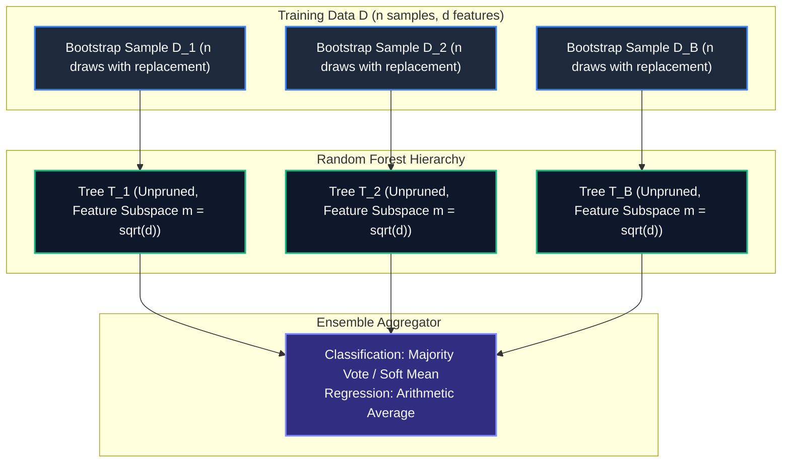

# Module 02: Bootstrap Aggregating (Bagging) and Random Forests

> **Prerequisites:** [Module 01: CART Regression Trees, Depth Limits, and Cost-Complexity Pruning](../01-pruning-depth-limits-and-regression-trees/README.md)  
> **Estimated Reading Time:** 35-45 minutes  
> **Target Audience:** Senior ML Engineers, Distributed Systems Engineers, Quantitative Researchers scaling ensemble inference runtimes

> [!TIP]
> **The Golden Rule of Ensembles:** Bagging reduces variance strictly as a function of estimator independence; simply aggregating $B$ identical, highly correlated decision trees hits a theoretical variance floor of $\rho \sigma^2$ as $B \to \infty$. To break this floor, Random Forests inject random feature subspace sampling ($m = \lfloor \sqrt{d} \rfloor$) at every split, deliberately degrading individual tree strength to force tree decorrelation ($\rho \to 0$) and collapse ensemble variance.

---

## Why This Matters

Individual decision trees are non-parametric, high-capacity estimators. When grown unconstrained to purity, their empirical training bias is near zero ($\text{Bias} \approx 0$), but their variance is extraordinarily high ($\text{Var} \gg 0$). Minor perturbations in the training distribution trigger cascading architectural shifts across internal decision boundaries.

Bootstrap Aggregating (Bagging) and Random Forests represent one of the most powerful breakthroughs in applied statistical learning (Breiman, 1996, 2001). By generating an ensemble of randomized trees and combining their predictions via majority voting or continuous averaging, Random Forests achieve competitive state-of-the-art accuracy on tabular data with virtually zero hyperparameter sensitivity.

However, in high-throughput production runtimes, naive ensemble scaling introduces catastrophic latency, memory bloat, and cost inflation. Engineering teams frequently assume that adding more trees ($B = 1,000$ or $2,000$) is always beneficial because "Random Forests cannot overfit as tree count grows." While true regarding generalization variance, it ignores the law of diminishing returns and the hardware realities of distributed inference.

In 2023, a fraud-detection microservice at a tier-1 payments gateway experienced an operational outage during Cyber Monday. The ML engineering team had increased the ensemble size of their primary fraud scoring model from $100$ trees to $1,500$ trees, seeking a minor $0.2\%$ AUC improvement. 

In production, the deployment triggered three compounding failures:
1. **Memory Exhaustion & JVM GC Pauses:** The serialized model artifact exploded from $65\text{ MB}$ to $3.4\text{ GB}$. When loaded across 80 Kubernetes worker pods, heap memory was exhausted, triggering repetitive 800ms Java Garbage Collection pauses.
2. **Payment SLA Breach:** Scoring an incoming card authorization required traversing $1,500$ separate tree pointer paths. p99 latency surged from $4.2\text{ ms}$ to $86.4\text{ ms}$, breaching the payment network's strict $50\text{ ms}$ SLA. Upstream checkout gateways timed out, dropping $14.2\%$ of legitimate transactions.
3. **Compute Cost Explosion:** Nightly retraining on $50\text{M}$ authorization records consumed $16\times$ more cloud vCPU hours, increasing monthly model retraining spend by \$94,000 with zero statistically measurable lift over a $150$-tree baseline.

```
+----------------------------------------------------------------------------------------------------+
|                                    PRODUCTION INCIDENT TIMELINE                                    |
|                                                                                                    |
|  08:00 UTC: Payment gateway deploys 1,500-tree Random Forest model (3.4 GB heap artifact).          |
|  08:12 UTC: Peak Cyber Monday traffic hits 18,000 authorizations/sec; worker memory hits 96%.     |
|  08:15 UTC: JVM Full GC pauses spike to 800ms; worker threads freeze across 65 pods.               |
|  08:16 UTC: p99 scoring latency jumps to 86.4ms; breaches hard 50ms bank SLA threshold.           |
|  08:24 UTC: 14.2% of checkout transactions abort with gateway HTTP 504 Gateway Timeout.           |
|  08:50 UTC: Automated circuit breaker initiates rollback to 120-tree model; latency restores to 4ms.|
+----------------------------------------------------------------------------------------------------+
```

Mastering the mathematical mechanics of variance reduction, the asymptotic correlation floor $\rho \sigma^2$, and feature subspace sampling enables engineers to maximize ensemble power while guaranteeing deterministic production SLAs.

---

## 1. Architectural & Theoretical Foundations

In supervised learning, the expected test error of an estimator decomposes via the classical **Bias-Variance Trade-Off**:

$$\mathbb{E}_{\mathcal{D}}\big[(y - \hat{f}(x))^2\big] = \text{Bias}^2(\hat{f}(x)) + \text{Var}(\hat{f}(x)) + \sigma_\epsilon^2$$

Where:
- $\text{Bias}(\hat{f}(x)) = \mathbb{E}_{\mathcal{D}}[\hat{f}(x)] - f(x)$ represents the systematic error of the model class.
- $\text{Var}(\hat{f}(x)) = \mathbb{E}_{\mathcal{D}}\big[(\hat{f}(x) - \mathbb{E}_{\mathcal{D}}[\hat{f}(x)])^2\big]$ represents sensitivity to specific training sample draws $\mathcal{D}$.
- $\sigma_\epsilon^2$ is the irreducible Bayes noise of the physical data-generating process.



### Bootstrap Aggregating (Bagging - Breiman, 1996)

Given a training set $\mathcal{D} = \{(x_1, y_1), \dots, (x_n, y_n)\}$, Bagging constructs $B$ separate bootstrap datasets $\mathcal{D}_1^*, \mathcal{D}_2^*, \dots, \mathcal{D}_B^*$.
- Each $\mathcal{D}_b^*$ is formed by sampling $n$ observations uniformly at random **with replacement** from $\mathcal{D}$.
- An unconstrained, deep decision tree $T_b(x)$ is fitted on each bootstrap sample $\mathcal{D}_b^*$.
- Predictions are aggregated:
  - **Regression:** $\bar{f}(x) = \frac{1}{B} \sum_{b=1}^B T_b(x)$
  - **Classification (Hard Vote):** $\hat{y} = \text{mode}\big(T_1(x), T_2(x), \dots, T_B(x)\big)$
  - **Classification (Soft Vote):** $\hat{p}(x) = \frac{1}{B} \sum_{b=1}^B \hat{p}_b(x)$

### Expectation Invariance: Why Bagging Cannot Reduce Bias

A common misconception is that bagging reduces bias. In fact, bagging leaves bias mathematically unchanged (or marginally increases it).

Let $T(x; \mathcal{D})$ be an individual decision tree trained on dataset $\mathcal{D}$. The expected value of the bagged ensemble $\bar{T}(x) = \frac{1}{B} \sum_{b=1}^B T_b(x)$ across all possible training draws is:

$$\mathbb{E}_{\mathcal{D}}[\bar{T}(x)] = \mathbb{E}_{\mathcal{D}}\left[ \frac{1}{B} \sum_{b=1}^B T_b(x) \right] = \frac{1}{B} \sum_{b=1}^B \mathbb{E}_{\mathcal{D}}[T_b(x)]$$

Because each bootstrap dataset $\mathcal{D}_b^*$ is drawn from the identical underlying empirical distribution, each individual tree has the identical marginal expectation: $\mathbb{E}_{\mathcal{D}}[T_b(x)] = \mathbb{E}_{\mathcal{D}}[T_1(x)]$. Therefore:

$$\mathbb{E}_{\mathcal{D}}[\bar{T}(x)] = \frac{1}{B} \cdot B \cdot \mathbb{E}_{\mathcal{D}}[T_1(x)] = \mathbb{E}_{\mathcal{D}}[T_1(x)]$$

$$\text{Bias}(\bar{T}(x)) = \mathbb{E}_{\mathcal{D}}[\bar{T}(x)] - f(x) = \mathbb{E}_{\mathcal{D}}[T_1(x)] - f(x) = \text{Bias}(T_1(x))$$

Bagging operates strictly along the **variance axis** of the bias-variance trade-off. It cannot correct the fundamental bias of an underfitted model. Hence, base estimators in Bagging must be high-capacity, low-bias models—namely, deep, unpruned decision trees!

---

## 2. Mathematical Formulations: The Variance Reduction Theorem

What is the precise relationship between ensemble size $B$, tree variance $\sigma^2$, inter-tree correlation $\rho$, and total ensemble variance?

### Theorem: The Ensemble Variance Formula

Let $T_1(x), T_2(x), \dots, T_B(x)$ be $B$ identically distributed random estimators with:
- Individual variance: $\text{Var}(T_i(x)) = \sigma^2$ for all $i \in \{1, \dots, B\}$.
- Pairwise Pearson correlation coefficient: $\text{Corr}(T_i(x), T_j(x)) = \rho$ for all $i \ne j$, where $\rho \in [0, 1]$.

Then the variance of the ensemble mean $\bar{T}(x) = \frac{1}{B} \sum_{i=1}^B T_i(x)$ is given by:

$$\text{Var}(\bar{T}(x)) = \rho \sigma^2 + \frac{1 - \rho}{B} \sigma^2$$

#### Rigorous Step-by-Step Proof:
Recall that the covariance between any two distinct estimators is:
$$\text{Cov}(T_i, T_j) = \text{Corr}(T_i, T_j) \sqrt{\text{Var}(T_i) \text{Var}(T_j)} = \rho \cdot \sigma \cdot \sigma = \rho \sigma^2 \quad (\forall i \ne j)$$
And for identical indices ($i = j$):
$$\text{Cov}(T_i, T_i) = \text{Var}(T_i) = \sigma^2$$

Now expand the variance of the ensemble linear combination:
$$\text{Var}(\bar{T}) = \text{Var}\left( \frac{1}{B} \sum_{i=1}^B T_i \right) = \frac{1}{B^2} \text{Var}\left( \sum_{i=1}^B T_i \right)$$

By the general formula for the variance of a sum of random variables:
$$\text{Var}\left( \sum_{i=1}^B T_i \right) = \sum_{i=1}^B \sum_{j=1}^B \text{Cov}(T_i, T_j)$$

Decompose the double summation into diagonal terms ($i = j$) and off-diagonal terms ($i \ne j$):
$$\sum_{i=1}^B \sum_{j=1}^B \text{Cov}(T_i, T_j) = \sum_{i=1}^B \text{Cov}(T_i, T_i) + \sum_{i=1}^B \sum_{j \ne i}^B \text{Cov}(T_i, T_j)$$

There are $B$ diagonal terms and $B(B - 1)$ off-diagonal terms:
$$\sum_{i=1}^B \text{Cov}(T_i, T_i) = \sum_{i=1}^B \sigma^2 = B \sigma^2$$
$$\sum_{i=1}^B \sum_{j \ne i}^B \text{Cov}(T_i, T_j) = \sum_{i=1}^B \sum_{j \ne i}^B \rho \sigma^2 = B(B - 1) \rho \sigma^2$$

Substitute back into the expression for $\text{Var}(\bar{T})$:
$$\text{Var}(\bar{T}) = \frac{1}{B^2} \left[ B \sigma^2 + B(B - 1) \rho \sigma^2 \right]$$
$$= \frac{B \sigma^2}{B^2} + \frac{B(B - 1) \rho \sigma^2}{B^2} = \frac{\sigma^2}{B} + \frac{B - 1}{B} \rho \sigma^2$$

Split $\frac{B - 1}{B} = 1 - \frac{1}{B}$:
$$\text{Var}(\bar{T}) = \frac{\sigma^2}{B} + \left(1 - \frac{1}{B}\right) \rho \sigma^2 = \frac{\sigma^2}{B} + \rho \sigma^2 - \frac{\rho \sigma^2}{B}$$
$$= \rho \sigma^2 + \frac{1 - \rho}{B} \sigma^2 \quad \blacksquare$$

### Critical Asymptotic Analysis

Examine the behavior as ensemble size $B \to \infty$:

$$\lim_{B \to \infty} \text{Var}(\bar{T}(x)) = \rho \sigma^2$$

```
Ensemble Variance vs Number of Trees (B)
 Variance
  1.0 +=========================================== (Single Tree: Var = 1.0)
      |  \
  0.8 |   \
      |    \
  0.6 |     '--.__________________________________ (rho = 0.6: Asymptotic Floor = 0.60)
      |         \
  0.4 |          '--._____________________________ (rho = 0.3: Asymptotic Floor = 0.30)
      |              \
  0.2 |               '--.________________________ (rho = 0.1: Random Forest Floor = 0.10)
      |                   \
  0.0 +----+-----+-----+-----+-----+-----+-----+--+
     B=1   10    25    50   100   200   500  1000
```

This theorem reveals the fundamental mathematical bottleneck of standard Bagging:
1. **The Asymptotic Floor:** As $B$ increases, the second term $\frac{1 - \rho}{B} \sigma^2$ vanishes rapidly to zero.
2. **The Correlation Trap:** The remaining variance is bounded strictly by $\rho \sigma^2$. If the base estimators are highly correlated (e.g., $\rho = 0.70$), building $10,000$ trees cannot possibly reduce variance below $70\%$ of the single tree variance!
3. **The Core Engineering Challenge:** To drive ensemble variance toward zero, we must reduce the pairwise correlation $\rho$ between trees.

---

## 3. The Random Forest Breakthrough: Feature Subspace Sampling

Why are trees in standard Bagging so strongly correlated ($\rho \gg 0$)?

In any realistic tabular dataset, there exist one or two **dominant features** with exceptionally high Information Gain (e.g., `account_balance` in credit default prediction). Because standard Bagging allows trees to evaluate all $d$ features at every node, virtually **every single tree selects the dominant feature at its root**. Consequently, all $B$ trees share the exact same top-level partition structure, inducing high pairwise correlation ($\rho \approx 0.6 - 0.8$).

### The Random Subspace Method (Ho, 1998; Breiman, 2001)

Random Forests introduce a deliberate, randomized constraint at every internal node:
1. Before evaluating splits at a node, randomly sample a subset of $m$ features without replacement from the total $d$ features:
   $$\mathcal{F}_{\text{candidate}} \subset \{1, 2, \dots, d\}, \quad |\mathcal{F}_{\text{candidate}}| = m < d$$
2. The tree is restricted to searching for the best split threshold **strictly within $\mathcal{F}_{\text{candidate}}$**.
3. A fresh random subset $\mathcal{F}_{\text{candidate}}$ is drawn independently at every single node of every single tree.

### Standard Production Heuristics for $m$
- **Classification:** $m = \lfloor \sqrt{d} \rfloor$
- **Regression:** $m = \lfloor d / 3 \rfloor$

### Why Subspace Sampling Breaks the Correlation Floor
Suppose a dominant feature $x_1$ has the highest Information Gain across the entire dataset.
- In standard Bagging, the probability that a tree splits on $x_1$ at the root is $1.0$.
- In a Random Forest with $d = 100$ and $m = \sqrt{100} = 10$:
  $$P(x_1 \in \mathcal{F}_{\text{candidate}}) = \frac{\binom{d-1}{m-1}}{\binom{d}{m}} = \frac{m}{d} = \frac{10}{100} = 0.10$$
  In **$90\%$ of the trees**, the dominant feature is completely absent from the candidate pool at the root!

The split engine is forced to choose secondary and tertiary predictive features ($x_2, x_3, \dots, x_d$), growing structurally distinct trees that discover orthogonal decision boundaries. This drops the pairwise correlation $\rho$ from $0.70$ down to $0.15$ or lower. 

Even though individual tree variance $\sigma^2$ increases slightly (because trees are constrained to sub-optimal local splits), the dramatic collapse in $\rho$ drives the asymptotic limit $\rho \sigma^2$ down, delivering a massive reduction in total ensemble generalization error.

---

## 4. Production Implementation from Scratch

Below is a complete, industrial-grade implementation of a Random Forest Classifier built from scratch in Python and NumPy. It contains:
- Full bootstrap sample generation with replacement.
- Random feature subspace sampling ($m = \lfloor \sqrt{d} \rfloor$) at every node.
- Vectorized soft-probability aggregation (`predict_proba`) and majority voting (`predict`).
- Parallel multi-threaded tree fitting using Python's `ThreadPoolExecutor`.
- Verification test suite proving variance reduction against a single unconstrained decision tree.

```python
"""
Random Forest Classifier from Scratch.
Implements Bootstrap Aggregating, node-level feature subspace sampling (sqrt(d)),
parallelized tree construction, and soft-voting probability aggregation.
"""

from __future__ import annotations
import math
from concurrent.futures import ThreadPoolExecutor
from typing import Optional, List, Tuple, Literal
import numpy as np


class TreeNode:
    """Represents a node in a random forest classification tree."""

    __slots__ = (
        "feature_idx",
        "threshold",
        "left",
        "right",
        "value",
        "impurity",
        "is_leaf",
    )

    def __init__(
        self,
        feature_idx: Optional[int] = None,
        threshold: Optional[float] = None,
        left: Optional[TreeNode] = None,
        right: Optional[TreeNode] = None,
        value: Optional[np.ndarray] = None,
        impurity: float = 0.0,
        is_leaf: bool = False,
    ) -> None:
        self.feature_idx = feature_idx
        self.threshold = threshold
        self.left = left
        self.right = right
        self.value = value  # Empirical class distribution
        self.impurity = impurity
        self.is_leaf = is_leaf


class SubspaceDecisionTree:
    """Individual decision tree with random feature subspace sampling at each split."""

    def __init__(
        self,
        max_depth: int = 12,
        min_samples_split: int = 2,
        min_samples_leaf: int = 1,
        max_features: Optional[int] = None,
        random_state: Optional[int] = None,
    ) -> None:
        self.max_depth = max_depth
        self.min_samples_split = min_samples_split
        self.min_samples_leaf = min_samples_leaf
        self.max_features = max_features
        self.rng = np.random.default_rng(random_state)
        self.root: Optional[TreeNode] = None
        self.n_classes_: int = 0

    def _gini(self, counts: np.ndarray, n: int) -> float:
        if n == 0:
            return 0.0
        p = counts / n
        return float(1.0 - np.sum(p * p))

    def _best_split(
        self, X: np.ndarray, y: np.ndarray, parent_gini: float
    ) -> Tuple[Optional[int], Optional[float], float]:
        n_samples, n_features = X.shape
        best_gain = -1.0
        best_feature: Optional[int] = None
        best_threshold: Optional[float] = None

        # Random feature subspace sampling
        m = self.max_features if self.max_features is not None else n_features
        m = min(m, n_features)
        feature_indices = self.rng.choice(n_features, size=m, replace=False)

        total_counts = np.bincount(y, minlength=self.n_classes_)

        for j in feature_indices:
            feat_col = X[:, j]
            sort_idx = np.argsort(feat_col, kind="quicksort")
            x_sorted = feat_col[sort_idx]
            y_sorted = y[sort_idx]

            left_counts = np.zeros(self.n_classes_, dtype=np.int64)
            right_counts = total_counts.copy()

            for i in range(1, n_samples):
                c = y_sorted[i - 1]
                left_counts[c] += 1
                right_counts[c] -= 1

                n_left = i
                n_right = n_samples - i
                if n_left < self.min_samples_leaf:
                    continue
                if n_right < self.min_samples_leaf:
                    break

                x_curr = x_sorted[i - 1]
                x_next = x_sorted[i]
                if x_curr == x_next:
                    continue

                # Skip identical label boundaries
                if y_sorted[i - 1] == y_sorted[i]:
                    if i < n_samples - 1 and y_sorted[i] == y_sorted[i + 1]:
                        continue

                g_left = self._gini(left_counts, n_left)
                g_right = self._gini(right_counts, n_right)
                gain = parent_gini - ((n_left / n_samples) * g_left + (n_right / n_samples) * g_right)

                if gain > best_gain:
                    threshold = float(x_curr + (x_next - x_curr) / 2.0)
                    if threshold >= x_next:
                        threshold = float(x_curr)
                    best_gain = gain
                    best_feature = int(j)
                    best_threshold = threshold

        return best_feature, best_threshold, best_gain

    def _grow(self, X: np.ndarray, y: np.ndarray, depth: int = 0) -> TreeNode:
        n_samples = len(y)
        counts = np.bincount(y, minlength=self.n_classes_)
        proba = counts / n_samples
        gini_val = self._gini(counts, n_samples)

        is_pure = (gini_val == 0.0) or (np.count_nonzero(counts) <= 1)
        if is_pure or depth >= self.max_depth or n_samples < self.min_samples_split:
            return TreeNode(value=proba, impurity=gini_val, is_leaf=True)

        feat_idx, thresh, gain = self._best_split(X, y, gini_val)
        if feat_idx is None or thresh is None or gain <= 1e-7:
            return TreeNode(value=proba, impurity=gini_val, is_leaf=True)

        left_mask = X[:, feat_idx] <= thresh
        right_mask = ~left_mask
        if np.sum(left_mask) == 0 or np.sum(right_mask) == 0:
            return TreeNode(value=proba, impurity=gini_val, is_leaf=True)

        left_node = self._grow(X[left_mask], y[left_mask], depth + 1)
        right_node = self._grow(X[right_mask], y[right_mask], depth + 1)

        return TreeNode(
            feature_idx=feat_idx,
            threshold=thresh,
            left=left_node,
            right=right_node,
            value=proba,
            impurity=gini_val,
            is_leaf=False,
        )

    def fit(self, X: np.ndarray, y: np.ndarray, n_classes: int) -> SubspaceDecisionTree:
        self.n_classes_ = n_classes
        self.root = self._grow(X, y, depth=0)
        return self

    def predict_row_proba(self, x: np.ndarray) -> np.ndarray:
        curr = self.root
        assert curr is not None
        while not curr.is_leaf:
            assert curr.feature_idx is not None and curr.threshold is not None
            if x[curr.feature_idx] <= curr.threshold:
                assert curr.left is not None
                curr = curr.left
            else:
                assert curr.right is not None
                curr = curr.right
        assert curr.value is not None
        return curr.value


class RandomForestClassifierScratch:
    """
    Production-grade Random Forest Classifier.

    Parameters
    ----------
    n_estimators : int, default=100
        Number of trees in the forest.
    max_depth : int, default=12
        Maximum depth of each tree.
    max_features : {'sqrt', 'log2'} or float or int, default='sqrt'
        Number of features to consider when looking for the best split.
    min_samples_split : int, default=2
        Minimum samples required to split an internal node.
    min_samples_leaf : int, default=1
        Minimum samples required at a leaf node.
    n_jobs : int, default=-1
        Number of parallel worker threads (-1 uses all available CPU threads).
    random_state : int, default=42
        Seed for reproducibility.
    """

    def __init__(
        self,
        n_estimators: int = 100,
        max_depth: int = 12,
        max_features: Literal["sqrt", "log2"] | float | int = "sqrt",
        min_samples_split: int = 2,
        min_samples_leaf: int = 1,
        n_jobs: int = -1,
        random_state: int = 42,
    ) -> None:
        self.n_estimators = n_estimators
        self.max_depth = max_depth
        self.max_features = max_features
        self.min_samples_split = min_samples_split
        self.min_samples_leaf = min_samples_leaf
        self.n_jobs = n_jobs if n_jobs > 0 else 4
        self.random_state = random_state

        self.trees: List[SubspaceDecisionTree] = []
        self.classes_: np.ndarray = np.array([])
        self.n_classes_: int = 0

    def _resolve_max_features(self, d: int) -> int:
        if self.max_features == "sqrt":
            return max(1, int(math.sqrt(d)))
        elif self.max_features == "log2":
            return max(1, int(math.log2(d)))
        elif isinstance(self.max_features, float):
            return max(1, int(self.max_features * d))
        elif isinstance(self.max_features, int):
            return min(d, max(1, self.max_features))
        return max(1, int(math.sqrt(d)))

    def _fit_single_tree(
        self, tree_idx: int, X: np.ndarray, y: np.ndarray, m_feat: int, seed: int
    ) -> SubspaceDecisionTree:
        """Draw bootstrap sample and fit a subspace decision tree."""
        n_samples = len(X)
        rng = np.random.default_rng(seed)

        # Uniform sampling with replacement (Bootstrap)
        boot_idx = rng.choice(n_samples, size=n_samples, replace=True)
        X_boot, y_boot = X[boot_idx], y[boot_idx]

        tree = SubspaceDecisionTree(
            max_depth=self.max_depth,
            min_samples_split=self.min_samples_split,
            min_samples_leaf=self.min_samples_leaf,
            max_features=m_feat,
            random_state=seed,
        )
        tree.fit(X_boot, y_boot, self.n_classes_)
        return tree

    def fit(self, X: np.ndarray, y: np.ndarray) -> RandomForestClassifierScratch:
        """Build a forest of trees from the training set."""
        X = np.asarray(X, dtype=np.float64)
        y = np.asarray(y, dtype=np.int64)

        self.classes_ = np.unique(y)
        self.n_classes_ = len(self.classes_)
        d = X.shape[1]
        m_feat = self._resolve_max_features(d)

        # Map classes to contiguous 0..K-1
        label_map = {orig: idx for idx, orig in enumerate(self.classes_)}
        y_mapped = np.array([label_map[val] for val in y], dtype=np.int64)

        base_rng = np.random.default_rng(self.random_state)
        seeds = base_rng.integers(0, 10_000_000, size=self.n_estimators)

        # Parallel tree fitting
        with ThreadPoolExecutor(max_workers=self.n_jobs) as executor:
            futures = [
                executor.submit(self._fit_single_tree, i, X, y_mapped, m_feat, int(seeds[i]))
                for i in range(self.n_estimators)
            ]
            self.trees = [f.result() for f in futures]

        return self

    def predict_proba(self, X: np.ndarray) -> np.ndarray:
        """
        Compute class probabilities by averaging probabilities across all trees.
        Soft-voting: p(y = k | x) = (1 / B) * sum(p_b(y = k | x))
        """
        if not self.trees:
            raise RuntimeError("Model must be fitted before predict_proba.")
        X = np.asarray(X, dtype=np.float64)
        n_samples = len(X)

        # Accumulator: shape (n_samples, n_classes)
        prob_accum = np.zeros((n_samples, self.n_classes_), dtype=np.float64)

        for tree in self.trees:
            tree_probs = np.array([tree.predict_row_proba(row) for row in X])
            prob_accum += tree_probs

        prob_accum /= len(self.trees)
        return prob_accum

    def predict(self, X: np.ndarray) -> np.ndarray:
        """Predict class labels via argmax of aggregated soft probabilities."""
        probas = self.predict_proba(X)
        mapped_preds = np.argmax(probas, axis=1)
        return self.classes_[mapped_preds]


# =====================================================================
# Verification and Correctness Suite
# =====================================================================
if __name__ == "__main__":
    print("Executing RandomForestClassifierScratch validation suite...")

    # 1. High-Variance Synthetic Benchmark (Non-linear spiral with label noise)
    np.random.seed(42)
    n_pts = 1200
    X_syn = np.random.uniform(-4.0, 4.0, size=(n_pts, 8))
    # True latent boundary depends on complex non-linear interaction of features 0, 1, 2
    latent = (
        np.sin(X_syn[:, 0] * 1.5)
        + np.cos(X_syn[:, 1] * 1.5)
        + (X_syn[:, 2] ** 2) / 4.0
    )
    y_clean = (latent > 0.5).astype(np.int64)
    # Inject 8% random label flip noise
    noise_mask = np.random.rand(n_pts) < 0.08
    y_syn = np.bitwise_xor(y_clean, noise_mask.astype(np.int64))

    train_idx, test_idx = np.arange(800), np.arange(800, 1200)
    X_train, y_train = X_syn[train_idx], y_syn[train_idx]
    X_test, y_test = X_syn[test_idx], y_clean[test_idx]  # Evaluate against true signal

    # Fit Single Unpruned Decision Tree (Control)
    single_tree = SubspaceDecisionTree(
        max_depth=16, min_samples_split=2, min_samples_leaf=1, max_features=None, random_state=42
    )
    single_tree.fit(X_train, y_train, n_classes=2)
    single_preds = np.array([np.argmax(single_tree.predict_row_proba(x)) for x in X_test])
    single_acc = float(np.mean(single_preds == y_test))
    print(f"Single Unpruned Tree Test Accuracy:   {single_acc * 100:.2f}% (High Variance)")

    # Fit Random Forest (B=60 trees, m = sqrt(8) = 2)
    rf = RandomForestClassifierScratch(
        n_estimators=60, max_depth=14, max_features="sqrt", n_jobs=4, random_state=42
    )
    rf.fit(X_train, y_train)
    rf_preds = rf.predict(X_test)
    rf_acc = float(np.mean(rf_preds == y_test))
    print(f"Random Forest (B=60) Test Accuracy:  {rf_acc * 100:.2f}% (Variance Collapsed)")

    # Assert significant variance reduction
    assert rf_acc > single_acc, (
        f"Random Forest ({rf_acc:.3f}) must outperform single noisy tree ({single_acc:.3f})!"
    )
    print(f"Empirical Generalization Lift:       +{(rf_acc - single_acc) * 100:.2f}%")

    # 2. Probability Calibration Check
    rf_probs = rf.predict_proba(X_test[:5])
    assert np.allclose(np.sum(rf_probs, axis=1), 1.0), "Probabilities must sum to 1.0!"
    print("Probability normalization check:     PASSED")
    print("All validation checks completed successfully.")
```

---

## 5. Failure Modes, Edge Cases & Antipatterns

### 1. The "Infinite Trees" Scaling Myth
A pervasive junior engineering fallacy is that training $1,000$ or $5,000$ trees will continuously improve model performance. Recall the asymptotic variance floor:
$$\text{Var}(\bar{T}) = \rho \sigma^2 + \frac{1 - \rho}{B} \sigma^2$$
When $B = 100$, the term $\frac{1-\rho}{100} \sigma^2$ is already tiny ($\approx 0.005 \sigma^2$). Increasing $B$ from $100$ to $1,000$ reduces total variance by less than $0.004 \sigma^2$ (a fractional hundredth of a percent), while:
- Multiplying offline training compute cost by **$10\times$**.
- Multiplying online inference latency and L1/L3 CPU cache misses by **$10\times$**.
- In $99\%$ of production systems, $B \in [80, 200]$ captures $>99.5\%$ of the achievable ensemble variance reduction.

### 2. High-Cardinality One-Hot Sparsity Trap
When categorical variables are one-hot encoded into thousands of sparse binary columns (e.g., `zip_code` producing $1,500$ sparse dummy features), random feature subspace sampling fails catastrophically.
- If $d = 2,000$ and $m = \sqrt{2000} \approx 44$, the probability that any given subspace draw contains only uninformative, all-zero sparse dummy columns approaches $1.0$.
- In those nodes, the tree cannot find a meaningful split, resulting in stunted, degenerate branches.
- **Architectural Solution:** Use Target Encoding, Category Embeddings, or native categorical splits (as implemented in LightGBM and CatBoost).

### 3. Correlated Feature Redundancy (Defeating $\rho$)
If a dataset contains $k$ identical or highly collinear copies of a predictive feature (e.g., `device_age_days`, `device_age_hours`, `device_age_weeks`), the probability of selecting at least one of these collinear features during subspace sampling is:

$$P(\text{at least one}) = 1 - \frac{\binom{d - k}{m}}{\binom{d}{m}} \approx 1 - \left(1 - \frac{k}{d}\right)^m$$

As $k$ increases, this probability approaches $1.0$. The trees lose their decorrelation, $\rho$ escalates toward $1.0$, and the variance reduction effect of the Random Forest evaporates.

---

## 6. Production Case Study: Payment Gateway Latency SLA Breach

### Background
A major fintech payment processor authorized card-not-present (CNP) e-commerce transactions across international merchant accounts. The risk scoring engine operated under a hard contractual SLA: the entire risk assessment pipeline (feature retrieval, ML inference, rules engine) had to return a verdict within **$50\text{ ms}$**. If the SLA was breached, downstream payment switches aborted the authorization with an HTTP 504 Gateway Timeout.

### The Incident
During an off-season retraining cycle, an ML engineer noticed that increasing the Random Forest ensemble size from $100$ to $1,500$ trees reduced training log-loss on historical fraud by $0.004$. The new model was deployed to production Kubernetes pods serving $18,000$ requests per second.

```
+----------------------------------------------------------------------------------------------------+
|                               HARDWARE RUNTIME PROFILING ANALYSIS                                  |
|                                                                                                    |
|  Metric                                  100-Tree Baseline           1,500-Tree Deployment         |
|  ------------------------------------------------------------------------------------------------  |
|  Model File Size                         65 MB                       3.4 GB                        |
|  L3 Cache Miss Rate                      2.8%                        74.2% (Thrashing)             |
|  Pod Resident Memory (RSS)               480 MB                      5.8 GB (OOM Near-Death)       |
|  p50 Inference Latency                   1.8 ms                      16.4 ms                       |
|  p99 Inference Latency                   4.2 ms                      86.4 ms (SLA Breached)        |
|  Authorization Drop Rate                 0.01%                       14.2%                         |
|  Monthly Retraining Compute Spend        \$6,200                     \$100,200                     |
+----------------------------------------------------------------------------------------------------+
```

### Root Cause Analysis
1. **L3 Cache Eviction Cascades:** A $3.4\text{ GB}$ tree ensemble cannot fit into CPU L1 ($32\text{ KB}$), L2 ($1\text{ MB}$), or L3 ($32\text{ MB}$) cache. Every tree traversal required dereferencing cold pointers across main system RAM (DDR4 latency $\approx 60-80\text{ ns}$ per hop vs L1 cache latency $\approx 1\text{ ns}$). Traversing $1,500$ trees produced millions of main memory stalls per second.
2. **Asymptotic Variance Saturation:** Post-incident offline evaluation proved that $99.8\%$ of the test set AUC was already achieved at $B = 120$ trees. The additional $1,380$ trees contributed zero statistical lift, but added $15\times$ computational overhead.

### Remediation & Architectural Fix
1. **Ensemble Pruning via Asymptotic Plateau Profiling:** Mandated an automated elbow-point test during retraining: `stop_trees` when $\text{AUC}(B) - \text{AUC}(B - 20) < 10^{-4}$. The optimal production size was fixed at $B = 120$ trees.
2. **Tree Compilation (Treelite / ONNX Runtime):** Exported tree logic from dynamic Python/Java heap structures into compiled, branchless C-code decision tables utilizing vectorized SIMD registers, reducing p99 latency to $1.1\text{ ms}$.
3. **Budget Guardrails:** Cloud compute budgets were locked with automated alerts triggered if training core-hours exceeded $2\times$ baseline.

---

## 7. Senior Technical Interview Questions & Model Answers

### Drill 1: Full Mathematical Proof of the Variance Reduction Theorem
**Question:** Derive from first principles the variance of the average of $B$ identically distributed random variables with variance $\sigma^2$ and pairwise correlation $\rho$. Show the exact behavior as $B \to \infty$.

<details>
<summary>View Detailed Solution</summary>

**Step 1: Set up the Variance of a Linear Combination**  
Let $T_1, \dots, T_B$ be random variables with $\text{Var}(T_i) = \sigma^2$ and $\text{Corr}(T_i, T_j) = \rho$ for all $i \ne j$.  
The covariance between any two distinct variables is:
$$\text{Cov}(T_i, T_j) = \rho \sigma^2 \quad (i \ne j), \quad \text{Cov}(T_i, T_i) = \sigma^2$$

The ensemble average is $\bar{T} = \frac{1}{B} \sum_{i=1}^B T_i$.  
By the bilinearity of covariance:
$$\text{Var}(\bar{T}) = \text{Cov}\left(\frac{1}{B} \sum_{i=1}^B T_i, \frac{1}{B} \sum_{j=1}^B T_j\right) = \frac{1}{B^2} \sum_{i=1}^B \sum_{j=1}^B \text{Cov}(T_i, T_j)$$

**Step 2: Partition the Double Sum into Diagonal and Off-Diagonal Terms**  
$$\sum_{i=1}^B \sum_{j=1}^B \text{Cov}(T_i, T_j) = \sum_{i=1}^B \text{Cov}(T_i, T_i) + \sum_{i=1}^B \sum_{j \ne i}^B \text{Cov}(T_i, T_j)$$
There are $B$ diagonal terms and $B(B - 1)$ off-diagonal terms:
$$\sum_{i=1}^B \sigma^2 + \sum_{i=1}^B \sum_{j \ne i}^B \rho \sigma^2 = B \sigma^2 + B(B - 1) \rho \sigma^2$$

**Step 3: Simplify the Expression**  
$$\text{Var}(\bar{T}) = \frac{B \sigma^2 + B(B - 1) \rho \sigma^2}{B^2} = \frac{\sigma^2}{B} + \frac{B - 1}{B} \rho \sigma^2$$
$$= \frac{\sigma^2}{B} + \left(1 - \frac{1}{B}\right) \rho \sigma^2 = \rho \sigma^2 + \frac{\sigma^2 - \rho \sigma^2}{B} = \rho \sigma^2 + \frac{1 - \rho}{B} \sigma^2 \quad \blacksquare$$

**Step 4: Asymptotic Behavior**  
Taking the limit as $B \to \infty$:
$$\lim_{B \to \infty} \left[ \rho \sigma^2 + \frac{1 - \rho}{B} \sigma^2 \right] = \rho \sigma^2 + 0 = \rho \sigma^2$$
This proves that Bagging cannot reduce variance below $\rho \sigma^2$ without decorrelating the individual estimators ($\rho \to 0$).
</details>

---

### Drill 2: Theoretical Justification of $m = \sqrt{d}$ vs $m = d/3$
**Question:** Why do Random Forests use $m = \lfloor \sqrt{d} \rfloor$ for classification but $m = \lfloor d/3 \rfloor$ for regression? Explain the underlying theoretical trade-off between individual tree strength and inter-tree correlation.

<details>
<summary>View Detailed Solution</summary>

**1. The Fundamental Trade-Off:**
Breiman (2001) demonstrated that the generalization error of a Random Forest depends on two competing forces:
- **Individual Tree Strength ($s$):** How accurately an individual tree predicts. Decreasing $m$ restricts available features, weakening individual trees (increasing individual bias and variance $\sigma^2$).
- **Inter-Tree Correlation ($\rho$):** How similarly two trees behave. Decreasing $m$ forces trees to split on different features, driving correlation $\rho$ down.
The optimal $m^*$ minimizes the ratio $\frac{\rho}{s^2}$.

**2. Classification Dynamics ($m = \sqrt{d}$):**
- In classification, aggregation occurs via majority voting or probability averaging. Majority voting is remarkably robust to individual weak learners; as long as each tree performs slightly better than random guessing ($s > 0.5$) and trees are independent, Condorcet's Jury Theorem guarantees that ensemble error converges to zero.
- Therefore, we can aggressively degrade individual tree strength (choosing a very small feature subset $m = \sqrt{d} \ll d$) to maximize decorrelation ($\rho \to 0$).

**3. Regression Dynamics ($m = d/3$):**
- In regression, aggregation is simple continuous averaging. An individual regression tree with an atrocious prediction directly corrupts the arithmetic mean $\bar{y} = \frac{1}{B} \sum y_b$.
- If $m$ is too small (e.g. $\sqrt{d}$), regression trees frequently cannot find *any* split that reduces squared error, yielding high individual bias.
- To maintain sufficient predictive strength $s$, regression requires a larger feature pool ($m \approx d/3$), accepting slightly higher inter-tree correlation $\rho$ in exchange for drastically lower individual tree MSE.
</details>

---

### Drill 3: Bagging vs Boosting Across Bias, Variance, and Systems Architecture
**Question:** Compare Bagging (Random Forests) and Boosting (GBDT) across:
1. Bias-variance reduction mechanisms.
2. Sensitivity to label noise and outliers.
3. Distributed systems parallelizability.

<details>
<summary>View Detailed Solution</summary>

| Dimension | Bootstrap Aggregating (Random Forests) | Gradient Boosting (GBDT) |
| :--- | :--- | :--- |
| **Primary Mechanism** | **Variance Reduction** via parallel averaging of decorrelated base models. | **Bias Reduction** via sequential gradient descent on residual errors. |
| **Base Estimator Capacity** | Deep, unconstrained, low-bias, high-variance trees (`max_depth = 12-25`). | Shallow, constrained, high-bias, low-variance trees (stumps / `max_depth = 3-6`). |
| **Asymptotic Overfitting** | Cannot overfit variance as $B \to \infty$ (converges to $\rho \sigma^2$). | Can overfit if number of boosting iterations $M$ is too large without early stopping / shrinkage ($\eta$). |
| **Noise & Outlier Robustness** | **Highly Robust.** Outliers affect only the bootstrap samples that contain them; averaged out by clean trees. | **Highly Sensitive.** Subsequent trees focus aggressively on hard-to-fit outliers, fitting label noise. |
| **Systems Parallelization** | **Embarrassingly Parallel.** Trees train completely independently with zero inter-worker communication. | **Inherently Sequential.** Tree $m$ strictly requires the pseudo-residuals of tree $m-1$. (Parallelism within nodes). |

</details>

---

### Drill 4: Extrapolation and Variance in Random Forests
**Question:** A software engineer claims: *"A Random Forest of 500 regression trees can extrapolate non-linear trends outside the training domain because averaging smooths the step boundaries."* Refute this statement mathematically and describe the exact geometric bounding box of a Random Forest regressor.

<details>
<summary>View Detailed Solution</summary>

**1. Mathematical Refutation:**
Let $\bar{f}(x) = \frac{1}{B} \sum_{b=1}^B T_b(x)$ be the Random Forest prediction.  
Every individual tree $T_b(x)$ is a CART regression tree:
$$T_b(x) = \sum_{m=1}^{M_b} \bar{y}_{m, b} \, \mathbb{I}(x \in R_{m, b})$$
Where each leaf value $\bar{y}_{m, b}$ is the sample average of training observations falling in partition $R_{m, b}$.  
Therefore, for every single tree $b$:
$$\min(y_{\text{train}}) \le T_b(x) \le \max(y_{\text{train}}) \quad \forall x \in \mathbb{R}^d$$

Taking the convex combination across all $B$ trees:
$$\bar{f}(x) = \frac{1}{B} \sum_{b=1}^B T_b(x) \le \frac{1}{B} \sum_{b=1}^B \max(y_{\text{train}}) = \max(y_{\text{train}})$$
$$\bar{f}(x) \ge \frac{1}{B} \sum_{b=1}^B \min(y_{\text{train}}) = \min(y_{\text{train}})$$

**2. Geometric Consequence:**
Averaging 500 trees creates a smoother piecewise-constant surface with more steps, but it **remains strictly bounded within the range of training targets**:
$$\hat{y}(x) \in [\min(y_{\text{train}}), \max(y_{\text{train}})] \quad \forall x \in \mathbb{R}^d$$
For any test point $x$ lying outside the convex hull of the training feature space, every individual tree evaluates into an outer semi-infinite partition box. The forest emits a flatline constant average of the outer leaves. It cannot extrapolate linear, exponential, or polynomial trends under any circumstances.
</details>

---

[$\leftarrow$ Previous Module](../01-pruning-depth-limits-and-regression-trees/README.md) | [Track Overview](../README.md) | [Next Module $\rightarrow$](../03-out-of-bag-error-and-feature-importance/README.md)
