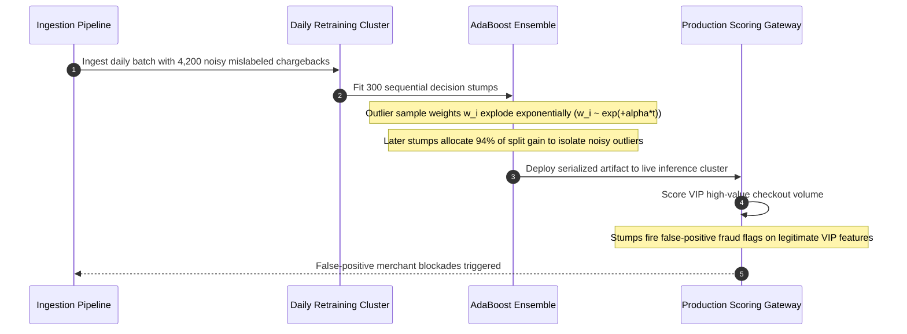
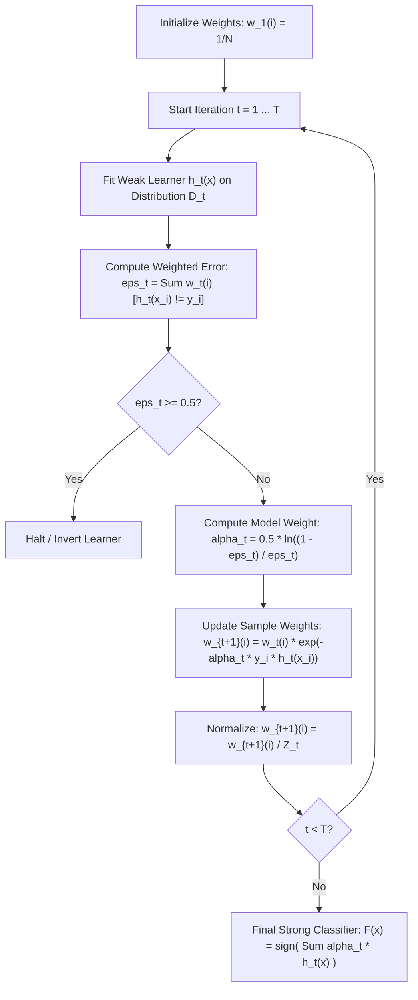
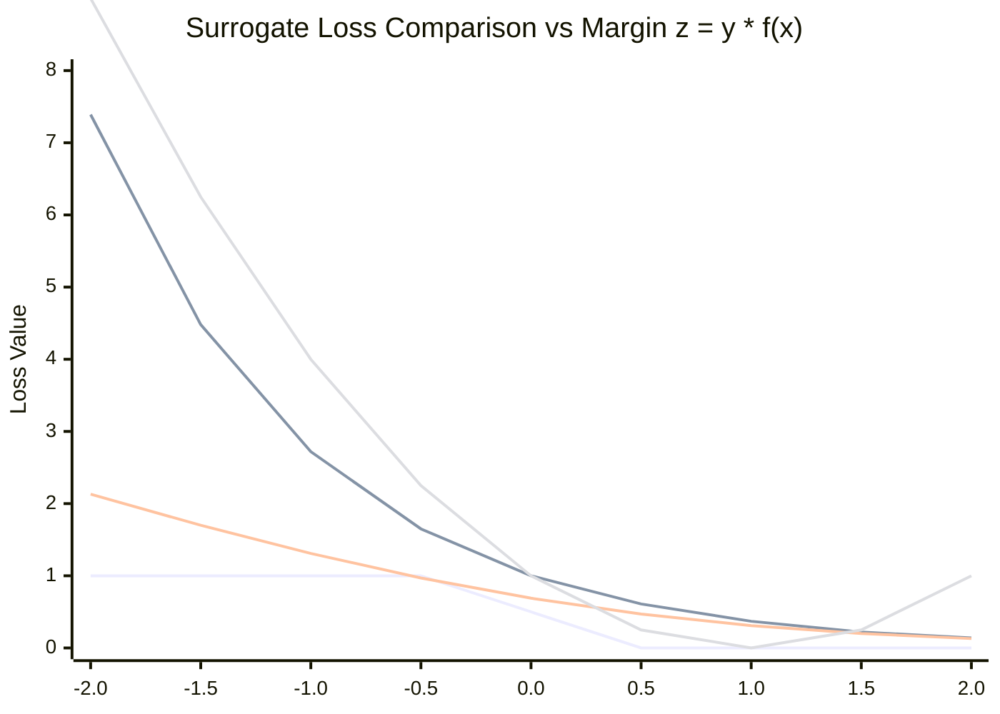

# Module 04: Boosting Intuition: From AdaBoost to Residual Fitting

> **Prerequisites:** [Module 00: Decision Trees: Gini Impurity, Entropy, and Information Gain](../00-decision-trees-gini-entropy-and-information-gain/README.md), [Module 01: CART Regression Trees, Depth Limits, and Cost-Complexity Pruning](../01-pruning-depth-limits-and-regression-trees/README.md), [Module 02: Bootstrap Aggregating (Bagging) and Random Forests](../02-bagging-and-random-forests/README.md), and [Track 04 Overview](../README.md).  
> **Estimated Reading Time:** 35 minutes  
> **Target Audience:** Staff Machine Learning Engineers, Quantitative Researchers, and Backend Engineers architecting tabular scoring and ranking pipelines.

> [!TIP]
> **The Golden Rule of Boosting:** While bagging reduces ensemble variance through parallel, uniform averaging over independent bootstrap samples, **boosting reduces ensemble bias through sequential error correction**. In boosting, every successive base learner does not fit target labels directly; instead, it focuses its finite capacity exclusively on the residual failures and hard-to-predict margins left behind by the prior ensemble.

---

## Why This Matters & Production Context

In production machine learning on structured tabular data—ranging from high-frequency credit card fraud scoring and ad click-through rate (CTR) prediction to dynamic pricing—boosting algorithms consistently outperform deep neural networks in sample efficiency, inference latency, and discriminative precision.

Understanding boosting begins with a fundamental question posed by Michael Kearns and Leslie Valiant (1988): *Can a collection of weak learners—models performing only marginally better than random chance—be systematically combined into an arbitrarily strong learner?* In 1990, Robert Schapire proved constructively that weak and strong learnability are equivalent. In 1995, Yoav Freund and Robert Schapire introduced **AdaBoost (Adaptive Boosting)**, formalizing modern ensemble theory.

Deploying boosting in mission-critical infrastructure requires understanding its mathematical foundations and operational failure modes:
1. **The Exponential Loss Hazard:** AdaBoost optimizes an exponential surrogate loss. Under extreme label noise or adversarial feature corruption (e.g., bot fraud clicks), the exponential penalty violently overweights misclassified outliers, causing the decision boundary to destabilize and collapse into high-variance overfit.
2. **The Paradigm Shift to Residual Fitting:** By reinterpreting boosting through Jerome Friedman's framework of **Forward Stagewise Additive Modeling (FSAM)** and gradient descent in function space, modern engineering shifted from heuristic sample reweighting to direct optimization of arbitrary differentiable convex losses (Log-Loss, Huber, Poisson) via pseudo-residuals.

Mastering this trajectory—from AdaBoost sample reweighting to function-space residual fitting—is the prerequisite for reasoning about Gradient Boosted Decision Trees (GBDT), XGBoost, LightGBM, and CatBoost.

---

## Production Incident Post-Mortem: The \$1.4M Outlier Detonation

### Incident Context
An algorithmic merchant risk platform processed \$120M in daily cross-border payments. The core risk pipeline utilized an AdaBoost ensemble comprising 300 decision stumps to classify transactions as legitimate ($y = -1$) or fraudulent ($y = +1$). A continuous rule engine routed high-risk transactions ($f(x) > 0$) to automated verification or immediate authorization rejection.

### The Trigger & Failure Sequence
During a scheduled marketing holiday, an overseas partner bank misconfigured its fraud reporting webhook, transmitting 4,200 mislabeled transactions: legitimate high-value purchases (\$2,500 to \$15,000) were flagged as confirmed chargebacks ($y = +1$).



### Root Cause Analysis (RCA)
Because AdaBoost minimizes the exponential loss $L(y, f(x)) = \exp(-y f(x))$, each iteration updates sample weights via:
$$w_{t+1}(i) = \frac{w_t(i)}{Z_t} \exp\left(-\alpha_t y_i h_t(x_i)\right)$$

For clean separable data, $\exp(-\alpha_t) < 1$ shrinks the weight of correct predictions while $\exp(+\alpha_t) > 1$ amplifies mistakes. But for persistent mislabeled noise where true $y_i = -1$ but the noisy label forced $y_i = +1$, the weak learners could never separate the outlier from its dense neighborhood of legitimate transactions. Over 300 iterations, the sample weights $w(i)$ for these 4,200 noisy points exploded by a factor exceeding $10^6$.

The final 180 decision stumps focused almost exclusively on isolating these individual corrupted points. When deployed, the model exhibited pathological boundary distortions: legitimate high-value shopping carts triggered false-positive fraud blockades, causing \$1.4M in abandoned checkouts and merchant chargeback penalties over a 6-hour window.

### Engineering Resolution
The risk engineering team:
1. Replaced the exponential loss function with a robust surrogate loss (LogitBoost/Log-Loss and Huber pseudo-residuals), bounding the loss gradient $|\nabla_f L| \le 1.0$.
2. Introduced hard weight-clipping guards ($\max_i w_t(i) \le 10 \cdot \frac{1}{N}$) during boosting iterations.
3. Implemented a canary validation gate calculating the divergence between ensemble tree feature importances on clean holdout sets versus noisy retraining buffers before promoting artifacts to live gateways.

---

## 1. Mathematical Mental Model: Foundations of Boosting

### 1.1 PAC Learning Foundations & The Weak Learning Hypothesis

In Probably Approximately Correct (PAC) learning theory (Valiant, 1984), a concept class $\mathcal{C}$ is **strongly PAC-learnable** if an algorithm $\mathcal{A}$ outputs hypothesis $H$ satisfying $\mathbb{P}[\mathcal{E}_{\mathcal{D}}(H) \le \epsilon] \ge 1 - \delta$ for arbitrary $\epsilon, \delta \in (0, 1/2)$ in polynomial sample size.

A concept class $\mathcal{C}$ is **weakly PAC-learnable** if the condition holds only for a fixed edge $\gamma > 0$ such that $\epsilon \le \frac{1}{2} - \gamma$. Schapire (1990) proved that weak and strong learnability are equivalent: weak learners with edge $\gamma > 0$ can be boosted into a strong learner by adaptively shifting training sample distributions.

---

### 1.2 AdaBoost.M1 Formulation and Step-by-Step Derivation

Given training dataset $\mathcal{D}_{\text{train}} = \{(x_1, y_1), \dots, (x_N, y_N)\}$ where $x_i \in \mathbb{R}^d$ and binary labels $y_i \in \{-1, +1\}$.

The goal is to construct an additive strong classifier:
$$F_T(x) = \text{sign}\left( \sum_{t=1}^T \alpha_t h_t(x) \right)$$
where $h_t: \mathcal{X} \to \{-1, +1\}$ is a weak classifier and $\alpha_t \in \mathbb{R}$ is its voting weight.



#### Step 1: Distribution Initialization
Initialize the sample distribution uniformly: $w_1(i) = \frac{1}{N}, \forall i \in \{1, \dots, N\}$.

#### Step 2: Training the Weak Learner
Fit $h_t(x)$ to minimize weighted error $\epsilon_t = \sum_{i=1}^N w_t(i) \mathbf{1}(y_i \neq h_t(x_i))$. We assume $\epsilon_t < 0.5$, defining edge $\gamma_t = \frac{1}{2} - \epsilon_t > 0$.

#### Step 3: Deriving the Optimal Learner Weight $\alpha_t$
AdaBoost minimizes the empirical exponential loss of the additive ensemble $f_t(x) = f_{t-1}(x) + \alpha_t h_t(x)$:
$$E_t = \sum_{i=1}^N \exp\left( -y_i [f_{t-1}(x_i) + \alpha_t h_t(x_i)] \right) = \sum_{i=1}^N \tilde{w}_t(i) \exp\left( -\alpha_t y_i h_t(x_i) \right)$$
where $\tilde{w}_t(i) = \exp(-y_i f_{t-1}(x_i))$. Partitioning into correct set $\mathcal{C}_t = \{i : y_i = h_t(x_i)\}$ and misclassified set $\mathcal{M}_t = \{i : y_i \neq h_t(x_i)\}$:
$$E_t = e^{-\alpha_t} \sum_{i \in \mathcal{C}_t} \tilde{w}_t(i) + e^{+\alpha_t} \sum_{i \in \mathcal{M}_t} \tilde{w}_t(i)$$

Dividing by $\sum_{i=1}^N \tilde{w}_t(i)$ gives weighted error $\epsilon_t$ and $(1 - \epsilon_t)$:
$$\frac{E_t}{\sum \tilde{w}_t(i)} = (1 - \epsilon_t) e^{-\alpha_t} + \epsilon_t e^{+\alpha_t}$$

Setting the derivative with respect to $\alpha_t$ to zero:
$$\frac{\partial}{\partial \alpha_t}\left[ (1 - \epsilon_t) e^{-\alpha_t} + \epsilon_t e^{+\alpha_t} \right] = -(1 - \epsilon_t) e^{-\alpha_t} + \epsilon_t e^{+\alpha_t} = 0$$
$$\epsilon_t e^{+\alpha_t} = (1 - \epsilon_t) e^{-\alpha_t} \implies e^{2\alpha_t} = \frac{1 - \epsilon_t}{\epsilon_t} \implies \alpha_t = \frac{1}{2} \ln\left( \frac{1 - \epsilon_t}{\epsilon_t} \right)$$

#### Step 4: Sample Weight Update Rule
The updated normalized sample weights for round $t+1$ are:
$$w_{t+1}(i) = \frac{w_t(i)}{Z_t} \exp\left( -\alpha_t y_i h_t(x_i) \right)$$
where $Z_t$ is the normalization factor ensuring $\sum_{i=1}^N w_{t+1}(i) = 1$:
$$Z_t = (1 - \epsilon_t) e^{-\alpha_t} + \epsilon_t e^{+\alpha_t} = (1 - \epsilon_t)\sqrt{\frac{\epsilon_t}{1 - \epsilon_t}} + \epsilon_t\sqrt{\frac{1 - \epsilon_t}{\epsilon_t}} = 2\sqrt{\epsilon_t(1 - \epsilon_t)}$$

---

### 1.3 Exponential Convergence of Training Error

#### Theorem: Upper Bound on Training Error
The 0-1 empirical classification error of $F_T(x) = \text{sign}(f_T(x))$ satisfies:
$$\frac{1}{N}\sum_{i=1}^N \mathbf{1}\left( y_i \neq F_T(x_i) \right) \le \prod_{t=1}^T Z_t \le \exp\left( -2 \sum_{t=1}^T \gamma_t^2 \right)$$
where $\gamma_t = \frac{1}{2} - \epsilon_t$ is the edge of weak learner $h_t$.

#### Proof:
1. For any $z = y_i f_T(x_i)$, the indicator $\mathbf{1}(z \le 0) \le \exp(-z)$. Thus:
   $$\frac{1}{N}\sum_{i=1}^N \mathbf{1}(y_i \neq F_T(x_i)) \le \frac{1}{N}\sum_{i=1}^N \exp\left( -y_i f_T(x_i) \right)$$
2. By unrolling the weight update recursion:
   $$w_{T+1}(i) = \frac{w_1(i) \exp\left( -y_i \sum_{t=1}^T \alpha_t h_t(x_i) \right)}{\prod_{t=1}^T Z_t} = \frac{\exp\left( -y_i f_T(x_i) \right)}{N \prod_{t=1}^T Z_t}$$
3. Summing over all $i$:
   $$\sum_{i=1}^N w_{T+1}(i) = 1 \implies \frac{1}{N}\sum_{i=1}^N \exp\left(-y_i f_T(x_i)\right) = \prod_{t=1}^T Z_t$$
4. Substitute $\epsilon_t = \frac{1}{2} - \gamma_t$ into $Z_t$:
   $$Z_t = 2\sqrt{\left(\frac{1}{2} - \gamma_t\right)\left(\frac{1}{2} + \gamma_t\right)} = \sqrt{1 - 4\gamma_t^2}$$
5. Applying $1 - x \le e^{-x}$:
   $$Z_t = \left(1 - 4\gamma_t^2\right)^{1/2} \le \exp\left(-2\gamma_t^2\right) \implies \prod_{t=1}^T Z_t \le \exp\left( -2\sum_{t=1}^T \gamma_t^2 \right) \quad \blacksquare$$

If every learner maintains edge $\gamma_t \ge \gamma > 0$, training error vanishes exponentially in $T$.

---

### 1.4 Statistical View: Forward Stagewise Additive Modeling (FSAM)

Friedman, Hastie, and Tibshirani (2000) proved that AdaBoost is an exact instance of **Forward Stagewise Additive Modeling (FSAM)** minimizing exponential loss:
$$f(x) = \sum_{m=1}^M \beta_m b(x; \theta_m)$$

At stage $m$, FSAM adds one base function without altering prior parameters:
$$(\beta_m, h_m) = \arg\min_{\beta, h} \sum_{i=1}^N \exp\left( -y_i [f_{m-1}(x_i) + \beta h(x_i)] \right) = \arg\min_{\beta, h} \sum_{i=1}^N w_i^{(m)} \exp(-y_i \beta h(x_i))$$
where $w_i^{(m)} = \exp(-y_i f_{m-1}(x_i))$. Splitting into correct and incorrect classifications reveals that the optimal $h_m$ minimizes weighted 0-1 error, and the optimal $\beta_m$ matches $\alpha_m = \frac{1}{2}\ln\frac{1-\epsilon_m}{\epsilon_m}$.

#### Population Minimizer of Exponential Loss
The population loss $\mathbb{E}_{Y|x}[\exp(-Y f(x))]$ is minimized by setting the derivative to zero:
$$\frac{\partial}{\partial f(x)}\left[ P(Y=1|x)e^{-f(x)} + P(Y=-1|x)e^{+f(x)} \right] = -P(Y=1|x)e^{-f(x)} + P(Y=-1|x)e^{+f(x)} = 0$$
$$\implies f^*(x) = \frac{1}{2} \ln \left( \frac{P(Y = 1 | x)}{P(Y = -1 | x)} \right)$$

The optimal population function $f^*(x)$ is **one-half the logit (log-odds)** of the conditional class probability.



---

### 1.5 The Paradigm Shift: From Reweighting to Residual Fitting in Function Space

Why can't we use sample reweighting for arbitrary regression or Poisson objectives?

Consider squared error loss $L(y, f(x)) = \frac{1}{2}(y - f(x))^2$. In the forward stagewise framework:
$$L(y, f_{m-1}(x) + h_m(x)) = \frac{1}{2}\left( [y - f_{m-1}(x)] - h_m(x) \right)^2 = \frac{1}{2}\left( r_i^{(m)} - h_m(x) \right)^2$$
where $r_i^{(m)} = y_i - f_{m-1}(x_i)$. To minimize squared error, **the next base learner simply fits the arithmetic residuals directly via ordinary least squares.**

#### The Unifying Principle: Negative Loss Gradients
Jerome Friedman (2001) recognized that the residual $y_i - f_{m-1}(x_i)$ is simply the negative gradient of the squared error loss:
$$-\left[ \frac{\partial L(y_i, f(x_i))}{\partial f(x_i)} \right]_{f(x_i) = f_{m-1}(x_i)} = y_i - f_{m-1}(x_i)$$

For **any** differentiable convex loss $L(y, f(x))$, the unconstrained steepest descent direction in the $N$-dimensional space of predictions is the negative gradient vector:
$$r_{im} = -\left[ \frac{\partial L(y_i, f(x_i))}{\partial f(x_i)} \right]_{f(x_i) = f_{m-1}(x_i)}$$

These values are termed **pseudo-residuals**. Rather than reweighting samples, general boosting proceeds by fitting a parameterized base learner $h_m(x)$ to predict these pseudo-residuals, bridging boosting directly into continuous optimization.

---

## 2. Systematic Reference & Comparison Grids

### 2.1 Bagging vs. Boosting: Fundamental Architectural Divergence

| Architectural Dimension | Bagging (e.g., Random Forest) | Boosting (e.g., AdaBoost, GBDT) |
| :--- | :--- | :--- |
| **Primary Error Reduction Target** | **Variance reduction** ($\sigma^2 \to \sigma^2/B + \rho \sigma^2$) | **Bias reduction** ($\text{Bias}[F(x)] \ll \text{Bias}[h(x)]$) |
| **Learner Dependency** | **Independent & Parallel** (embarrassingly parallelizable across CPU cores) | **Sequential & Dependent** ($h_t$ strictly requires predictions of $h_{t-1}$) |
| **Base Learner Complexity** | High-capacity, deep trees (low bias, high variance) | Low-capacity, shallow trees/stumps (high bias, low variance) |
| **Data Sampling Mechanism** | Uniform bootstrap sampling with replacement ($N$ from $N$) | Deterministic sample reweighting or pseudo-residual fitting |
| **Aggregation Mechanism** | Uniform majority voting or arithmetic averaging | Weighted linear combination $\sum \alpha_t h_t(x)$ or shrinkage addition |
| **Overfitting Behavior as $T \to \infty$** | Asymptotically bounded; does not overfit with more trees | Prone to overfitting on noise if learning rate is unconstrained |
| **Noise & Outlier Sensitivity** | Robust; outliers are smoothed across independent trees | Highly sensitive under convex exponential loss; robust under bounded losses |
| **Missing Value Handling** | Proximity matrices or pre-imputation | Direct sparsity routing or gradient partitioning |

### 2.2 Loss Functions in Boosting and Their Gradient Signatures

| Loss Formulation | Mathematical Expression $L(y, f)$ | Negative Gradient / Pseudo-Residual $- \frac{\partial L}{\partial f}$ | Outlier Sensitivity | Historical Algorithm |
| :--- | :--- | :--- | :--- | :--- |
| **Exponential Loss** | $\exp(-y f), \quad y \in \{-1, +1\}$ | $y \exp(-y f)$ | **Extreme** (exponential growth for $y f \ll 0$) | AdaBoost.M1 (1995) |
| **Squared Error (L2)** | $\frac{1}{2}(y - f)^2, \quad y \in \mathbb{R}$ | $y - f$ | **High** (linear residual, quadratic loss) | LS-Boost / L2Boost |
| **Absolute Error (L1)** | $|y - f|, \quad y \in \mathbb{R}$ | $\text{sign}(y - f)$ | **Robust** (bounded gradient in $\{-1, +1\}$) | LAD-Boost (Median Trees) |
| **Huber Loss** | $\begin{cases} \frac{1}{2}(y-f)^2 & \|y-f\| \le \delta \\ \delta\|y-f\| - \frac{1}{2}\delta^2 & \text{otherwise} \end{cases}$ | $\begin{cases} y - f & \|y-f\| \le \delta \\ \delta \cdot \text{sign}(y - f) & \text{otherwise} \end{cases}$ | **Robust** (smooth transition from L2 to L1) | Friedman M-Regression |
| **Binomial Deviance (Log-Loss)**| $\ln(1 + \exp(-y f)), \quad y \in \{-1, +1\}$ | $\frac{y}{1 + \exp(y f)} = y(1 - p)$ | **Low/Bounded** ($|\nabla| \le 1.0$) | LogitBoost / Modern GBDT |

---

## 3. Production Implementation from Scratch: AdaBoost & Residual Fitting

Below is a self-contained, production-grade Python implementation authored using NumPy:
1. `DecisionStump`: A vectorized, sample-weighted 1D threshold classifier finding optimal feature, split threshold, and polarity ($\pm 1$).
2. `AdaBoostClassifierScratch`: Exact AdaBoost.M1 engine featuring numerical safeguards against division-by-zero, sample weight underflow, early stopping on zero training error, and probability calibration via sigmoid transform.
3. `ForwardStagewiseResidualRegressor`: A functional stagewise residual fitting engine demonstrating the transition to pseudo-residual optimization.

```python
"""
production_boosting.py
======================
Production implementation of AdaBoost.M1 and Forward Stagewise
Residual Fitting from first mathematical principles using NumPy.
"""

from typing import List
import numpy as np


class DecisionStump:
    """Single-split decision stump weak classifier mapping x to {-1, +1}."""

    def __init__(self) -> None:
        self.polarity: int = 1
        self.feature_idx: int = 0
        self.threshold: float = 0.0
        self.alpha: float = 0.0

    def fit(self, X: np.ndarray, y: np.ndarray, sample_weight: np.ndarray) -> "DecisionStump":
        n_samples, n_features = X.shape
        min_error = float("inf")

        for f_idx in range(n_features):
            x_column = X[:, f_idx]
            sort_indices = np.argsort(x_column)
            x_sorted = x_column[sort_indices]

            unique_mask = np.diff(x_sorted) != 0
            if not np.any(unique_mask):
                continue

            candidate_thresholds = (x_sorted[:-1][unique_mask] + x_sorted[1:][unique_mask]) / 2.0

            for thresh in candidate_thresholds:
                for polarity in [1, -1]:
                    predictions = np.where(x_column >= thresh, polarity, -polarity)
                    error = np.dot(sample_weight, (y != predictions))

                    if error < min_error:
                        min_error = error
                        self.polarity = polarity
                        self.threshold = float(thresh)
                        self.feature_idx = f_idx

        return self

    def predict(self, X: np.ndarray) -> np.ndarray:
        x_col = X[:, self.feature_idx]
        return np.where(x_col >= self.threshold, self.polarity, -self.polarity).astype(np.int8)


class AdaBoostClassifierScratch:
    """Production-grade AdaBoost.M1 binary classifier."""

    def __init__(self, n_estimators: int = 50, learning_rate: float = 1.0) -> None:
        if n_estimators <= 0:
            raise ValueError(f"n_estimators must be > 0, got {n_estimators}")
        if learning_rate <= 0.0 or learning_rate > 1.0:
            raise ValueError(f"learning_rate must be in (0.0, 1.0], got {learning_rate}")

        self.n_estimators = n_estimators
        self.learning_rate = learning_rate
        self.estimators: List[DecisionStump] = []
        self.estimator_weights: List[float] = []

    def fit(self, X: np.ndarray, y: np.ndarray) -> "AdaBoostClassifierScratch":
        X = np.asarray(X, dtype=np.float64)
        y = np.asarray(y, dtype=np.int8)
        n_samples = X.shape[0]

        # Initialize uniform sample weights
        sample_weight = np.full(n_samples, 1.0 / n_samples, dtype=np.float64)
        self.estimators.clear()
        self.estimator_weights.clear()
        eps_guard = 1e-15

        for t in range(self.n_estimators):
            stump = DecisionStump()
            stump.fit(X, y, sample_weight)
            predictions = stump.predict(X)

            # Compute weighted misclassification error
            misclassified = (y != predictions)
            epsilon_t = float(np.dot(sample_weight, misclassified))
            epsilon_t = np.clip(epsilon_t, eps_guard, 1.0 - eps_guard)

            if epsilon_t >= 0.5:
                if t == 0:
                    self.estimators.append(stump)
                    self.estimator_weights.append(1.0)
                break

            if epsilon_t <= eps_guard:
                alpha_t = 1.0
                stump.alpha = alpha_t
                self.estimators.append(stump)
                self.estimator_weights.append(alpha_t)
                break

            # Optimal voting weight alpha_t = 0.5 * ln((1 - eps) / eps)
            alpha_t = 0.5 * np.log((1.0 - epsilon_t) / epsilon_t) * self.learning_rate
            stump.alpha = alpha_t

            # Update and normalize sample weights
            sample_weight *= np.exp(-alpha_t * y * predictions)
            Z_t = np.sum(sample_weight)
            sample_weight = sample_weight / Z_t if Z_t >= eps_guard else np.full(n_samples, 1.0 / n_samples)

            self.estimators.append(stump)
            self.estimator_weights.append(alpha_t)

        return self

    def decision_function(self, X: np.ndarray) -> np.ndarray:
        X = np.asarray(X, dtype=np.float64)
        f_scores = np.zeros(X.shape[0], dtype=np.float64)
        for alpha, stump in zip(self.estimator_weights, self.estimators):
            f_scores += alpha * stump.predict(X)
        return f_scores

    def predict(self, X: np.ndarray) -> np.ndarray:
        return np.where(self.decision_function(X) >= 0.0, 1, -1).astype(np.int8)

    def predict_proba(self, X: np.ndarray) -> np.ndarray:
        f = self.decision_function(X)
        f_clipped = np.clip(2.0 * f, -30.0, 30.0)
        p1 = 1.0 / (1.0 + np.exp(-f_clipped))
        return np.column_stack([1.0 - p1, p1])


class SimpleRegressionStump:
    """1D continuous split regression stump minimizing MSE."""

    def __init__(self) -> None:
        self.feature_idx: int = 0
        self.threshold: float = 0.0
        self.val_left: float = 0.0
        self.val_right: float = 0.0

    def fit(self, X: np.ndarray, y: np.ndarray) -> "SimpleRegressionStump":
        n_samples, n_features = X.shape
        best_mse = float("inf")

        for f_idx in range(n_features):
            x_col = X[:, f_idx]
            sort_idx = np.argsort(x_col)
            x_sort = x_col[sort_idx]
            unique_mask = np.diff(x_sort) != 0
            if not np.any(unique_mask):
                continue

            candidates = (x_sort[:-1][unique_mask] + x_sort[1:][unique_mask]) / 2.0
            for thresh in candidates:
                left_mask = x_col <= thresh
                right_mask = ~left_mask
                if not np.any(left_mask) or not np.any(right_mask):
                    continue

                m_l, m_r = np.mean(y[left_mask]), np.mean(y[right_mask])
                mse = np.sum((y[left_mask] - m_l) ** 2) + np.sum((y[right_mask] - m_r) ** 2)
                if mse < best_mse:
                    best_mse, self.feature_idx, self.threshold = mse, f_idx, float(thresh)
                    self.val_left, self.val_right = float(m_l), float(m_r)

        return self

    def predict(self, X: np.ndarray) -> np.ndarray:
        return np.where(X[:, self.feature_idx] <= self.threshold, self.val_left, self.val_right)


class ForwardStagewiseResidualRegressor:
    """Iteratively fits regression stumps directly to residuals r_i = y_i - f_{m-1}(x_i)."""

    def __init__(self, n_estimators: int = 50, learning_rate: float = 0.1) -> None:
        self.n_estimators = n_estimators
        self.learning_rate = learning_rate
        self.f0: float = 0.0
        self.trees: List[SimpleRegressionStump] = []

    def fit(self, X: np.ndarray, y: np.ndarray) -> "ForwardStagewiseResidualRegressor":
        X, y = np.asarray(X, dtype=np.float64), np.asarray(y, dtype=np.float64)
        self.f0 = float(np.mean(y))
        f_current = np.full_like(y, self.f0)
        self.trees.clear()

        for _ in range(self.n_estimators):
            residuals = y - f_current
            tree = SimpleRegressionStump().fit(X, residuals)
            f_current += self.learning_rate * tree.predict(X)
            self.trees.append(tree)

        return self

    def predict(self, X: np.ndarray) -> np.ndarray:
        X = np.asarray(X, dtype=np.float64)
        y_pred = np.full(X.shape[0], self.f0, dtype=np.float64)
        for tree in self.trees:
            y_pred += self.learning_rate * tree.predict(X)
        return y_pred


if __name__ == "__main__":
    np.random.seed(42)

    # 1. Validate AdaBoost on concentric rings
    N = 400
    r = np.random.uniform(0.5, 3.0, N)
    theta = np.random.uniform(0, 2 * np.pi, N)
    X = np.column_stack([r * np.cos(theta), r * np.sin(theta)])
    y = np.where(r < 1.8, 1, -1).astype(np.int8)

    ada = AdaBoostClassifierScratch(n_estimators=40, learning_rate=0.8).fit(X, y)
    train_acc = np.mean(ada.predict(X) == y)
    print(f"AdaBoost Fitted Stumps: {len(ada.estimators)}, Train Accuracy: {train_acc * 100:.2f}%")
    assert train_acc > 0.90, "AdaBoost separation failed!"

    # 2. Validate Residual Regressor on non-linear sine wave
    x_reg = np.linspace(-3.0, 3.0, 200).reshape(-1, 1)
    y_reg = np.sin(x_reg.ravel()) + np.random.normal(0, 0.1, 200)

    fs_reg = ForwardStagewiseResidualRegressor(n_estimators=60, learning_rate=0.15).fit(x_reg, y_reg)
    final_mse = np.mean((y_reg - fs_reg.predict(x_reg)) ** 2)
    initial_mse = np.mean((y_reg - np.mean(y_reg)) ** 2)
    print(f"Residual Regressor R^2: {1.0 - (final_mse / initial_mse):.4f}")
    assert final_mse < 0.05 * initial_mse, "Residual fitting failed!"
    print("[SUCCESS] All boosting mathematical engines verified.")
```

---

## 4. Common Pitfalls, Failure Modes & Antipatterns

### 4.1 The Exponential Weight Explosion on Noisy Labels
Because the exponential loss weight multiplier is $\exp(+\alpha_t)$ on misclassifications, examples with permanently inverted labels (human annotation errors, adversarial samples, or overlapping class distributions) accumulate exponentially compounding weight. Later decision stumps exhaust their splitting capacity isolating single noise coordinates.
- **Remedy:** Switch from exponential loss to Log-Loss or Huber loss, which possess bounded gradients $\left|\frac{\partial L}{\partial f}\right| \le C$. Alternatively, enforce a sample weight ceiling: $w_t(i) \le \kappa \cdot \frac{1}{N}$.

---

### 4.2 Using High-Capacity Base Learners in AdaBoost
A frequent antipattern in production is replacing simple decision stumps or depth-2 trees with deep CART trees (`max_depth = 10`) inside an AdaBoost loop. If a weak learner $h_t$ is overly expressive, it achieves near-zero error on the weighted training distribution ($\epsilon_t \to 0$). Consequently, its voting weight explodes:
$$\alpha_t = \frac{1}{2}\ln\left(\frac{1 - \epsilon_t}{\epsilon_t}\right) \to +\infty$$
A single tree dominates the entire ensemble, collapsing the boosting process into an overfitted single-tree model.
- **Rule of Thumb:** In AdaBoost, base learners must be constrained to high-bias, low-capacity models (depth-1 stumps or depth-2/3 trees). High-capacity trees are reserved for Random Forests.

---

### 4.3 Target Leakage Across Cross-Validation Folds in Sample Weighting
Computing sample weights $w(i)$ or instance difficulty scores on the entire dataset prior to splitting into cross-validation train/test folds leaks information about which samples were difficult in the training partition, creating optimistic bias in validation metrics.
- **Rule of Thumb:** Every sample distribution initialization $w_1(i) = \frac{1}{N_{\text{train}}}$ and subsequent update must be strictly encapsulated inside the fold pipeline.

---

### 4.4 Disregarding Machine Precision in Weight Normalization
In naive AdaBoost implementations, calculating $Z_t = \sum w_t(i) \exp(-\alpha_t y_i h_t(x_i))$ without protection against floating-point underflow causes silent NaN corruption. In standard IEEE-754 `float32`, numbers below $1.4 \times 10^{-45}$ flush to zero. Once enough samples underflow to $0.0$, $Z_t$ approaches zero, triggering a zero-division exception.
- **Remedy:** Enforce standard `float64` precision for sample weight buffers, clip exponents to $[-30, +30]$, and clamp $Z_t \ge 10^{-15}$.

---

## 5. Senior Technical Interview Questions & Model Answers

### Question 1: The Margin Generalization Paradox
*In classical statistical learning theory, adding parameters to a model after driving training error to zero inevitably causes overfitting. Yet in empirical experiments (Schapire et al., 1998), AdaBoost frequently continues to decrease test error long after the training error has hit zero ($T > 100$). How do you explain this mathematically?*

**Model Answer:**  
This phenomenon is explained by **margin theory**. The 0-1 training error only measures whether an instance is on the correct side of the decision boundary ($y_i f(x_i) > 0$). It does not capture *how far* the instance lies from the boundary.

Define the normalized margin of example $(x_i, y_i)$ with respect to ensemble $F_T(x) = \sum_{t=1}^T \alpha_t h_t(x)$ as:
$$m(x_i, y_i) = \frac{y_i \sum_{t=1}^T \alpha_t h_t(x_i)}{\sum_{t=1}^T \alpha_t} \in [-1, +1]$$

Even when classification error is zero (meaning $m(x_i, y_i) > 0$ for all $i$), continuing to boost forces the ensemble to increase the margin distribution $\min_{i} m(x_i, y_i) \uparrow$. Because AdaBoost minimizes exponential loss $\sum_i \exp\left(-y_i \sum_t \alpha_t h_t(x_i)\right)$, the objective pushes positive margins further into the strictly positive regime.

Schapire et al. proved a PAC-style generalization bound independent of the number of boosting rounds $T$: with probability at least $1 - \delta$, the generalization error satisfies:
$$P_{(x,y)\sim \mathcal{D}}[y F(x) \le 0] \le \frac{1}{N}\sum_{i=1}^N \mathbf{1}(m(x_i, y_i) \le \theta) + \mathcal{O}\left( \frac{1}{\sqrt{N}} \sqrt{\frac{d_{\text{VC}} \ln^2(N / d_{\text{VC}})}{\theta^2} + \ln(1/\delta)} \right)$$
for any margin threshold $\theta > 0$. Because the bound depends inversely on the margin $\theta^2$ rather than the number of trees $T$, pushing the margin distribution higher directly shrinks the capacity penalty, explaining why test generalization improves post-convergence.

---

### Question 2: Distribution Equalization Property of AdaBoost
*Prove that under AdaBoost's sample weight update rule, the error of the current weak learner $h_t$ evaluated on the newly updated distribution $D_{t+1}$ is identically equal to 0.5.*

**Model Answer:**  
Recall the sample weight update rule:
$$w_{t+1}(i) = \frac{w_t(i)}{Z_t} \exp\left( -\alpha_t y_i h_t(x_i) \right)$$
with $\alpha_t = \frac{1}{2}\ln\left(\frac{1 - \epsilon_t}{\epsilon_t}\right)$ and normalization constant $Z_t = 2\sqrt{\epsilon_t(1 - \epsilon_t)}$.

The error of weak learner $h_t$ on distribution $D_{t+1}$ is:
$$\epsilon_{t+1}(h_t) = \sum_{i: y_i \neq h_t(x_i)} w_{t+1}(i)$$

For misclassified examples ($y_i \neq h_t(x_i)$), $y_i h_t(x_i) = -1$. Therefore:
$$\exp(-\alpha_t y_i h_t(x_i)) = \exp(+\alpha_t) = \sqrt{\frac{1 - \epsilon_t}{\epsilon_t}}$$

Substituting this into the error formula:
$$\epsilon_{t+1}(h_t) = \sum_{i: y_i \neq h_t(x_i)} \frac{w_t(i)}{Z_t} \sqrt{\frac{1 - \epsilon_t}{\epsilon_t}} = \frac{1}{Z_t} \sqrt{\frac{1 - \epsilon_t}{\epsilon_t}} \sum_{i: y_i \neq h_t(x_i)} w_t(i)$$

By definition, $\sum_{i: y_i \neq h_t(x_i)} w_t(i) = \epsilon_t$. Substituting $\epsilon_t$ and the explicit formula for $Z_t$:
$$\epsilon_{t+1}(h_t) = \frac{\epsilon_t}{2\sqrt{\epsilon_t(1 - \epsilon_t)}} \sqrt{\frac{1 - \epsilon_t}{\epsilon_t}} = \frac{\epsilon_t \sqrt{1 - \epsilon_t}}{2 \sqrt{\epsilon_t}\sqrt{1 - \epsilon_t}\sqrt{\epsilon_t}} = \frac{\epsilon_t}{2 \epsilon_t} = \frac{1}{2} \quad \blacksquare$$

This proves that AdaBoost completely neutralizes the current weak learner on the next round: on distribution $D_{t+1}$, learner $h_t$ performs no better than a random coin toss ($\epsilon = 0.5$). The subsequent learner $h_{t+1}$ is mathematically forced to extract orthogonal information from the data.

---

### Question 3: Functional Gradient Descent vs. Pointwise Updating
*In standard gradient descent on parameter vectors $\theta \in \mathbb{R}^p$, we update $\theta^{(m)} = \theta^{(m-1)} - \eta \nabla_\theta L$. In Friedman's Gradient Boosting, why can we not simply update our predictions directly as $F_m(x_i) = F_{m-1}(x_i) - \eta g_i$ on the training samples? Why do we need to fit a decision tree to the gradient values?*

**Model Answer:**  
Updating discrete points directly via $F_m(x_i) = F_{m-1}(x_i) - \eta g_i$ performs unconstrained point-wise optimization in $\mathbb{R}^N$. While this minimizes empirical loss on the $N$ training points, **it yields zero generalization ability to unseen data points $x \notin \{x_1, \dots, x_N\}$.** Predictions at novel inputs $F(x_{\text{test}})$ would remain completely undefined.

To achieve generalization across continuous input domain $\mathcal{X}$, we must constrain the step direction to belong to a parameterized hypothesis class $\mathcal{H}$ (such as decision trees). We treat the negative gradient vector:
$$-g = (-g_1, -g_2, \dots, -g_N)^T \in \mathbb{R}^N$$
as a synthetic continuous target vector, and project $-g$ onto hypothesis space $\mathcal{H}$ by fitting a decision tree $h_m(x)$ to minimize squared error:
$$h_m = \arg\min_{h \in \mathcal{H}} \sum_{i=1}^N \left( (-g_i) - h(x_i) \right)^2$$

The fitted tree $h_m(x)$ acts as a function approximator that generalizes the negative gradient direction across the entire feature space $\mathbb{R}^d$, allowing unseen test instances to be evaluated.

---

### Question 4: Multi-Class Boosting (SAMME vs. SAMME.R)
*Standard AdaBoost.M1 requires $\epsilon_t < 0.5$. In a $K$-class classification problem with $K = 10$, a random guess has error $\frac{K-1}{K} = 0.9$. A weak learner with error $\epsilon_t = 0.4$ is substantially better than random guessing, yet AdaBoost.M1 would reject it because $\epsilon_t \ge 0.5$. How does the SAMME algorithm resolve this?*

**Model Answer:**  
Hastie, Rosset, Zhu, and Zou (2009) introduced **SAMME (Stagewise Additive Modeling using a Multi-class Exponential loss)** to extend AdaBoost to $K > 2$ classes.

In SAMME, the weak learner weight is modified to:
$$\alpha_t = \ln\left( \frac{1 - \epsilon_t}{\epsilon_t} \right) + \ln(K - 1)$$

Analyze the condition for positive voting weight ($\alpha_t > 0$):
$$\ln\left( \frac{1 - \epsilon_t}{\epsilon_t} \right) + \ln(K - 1) > 0 \iff \frac{1 - \epsilon_t}{\epsilon_t} (K - 1) > 1 \iff \epsilon_t < \frac{K - 1}{K}$$

- For $K = 2$, this recovers classic AdaBoost: $\epsilon_t < \frac{2-1}{2} = 0.5$.
- For $K = 10$, the requirement becomes $\epsilon_t < \frac{10-1}{10} = 0.9$. A weak learner with error $0.4$ now receives a strictly positive weight $\alpha_t = \ln(0.6 / 0.4) + \ln(9) \approx 0.405 + 2.197 = 2.602$.

**SAMME.R (Real SAMME):**  
Instead of discrete class predictions $h_t(x) \in \{1, \dots, K\}$, SAMME.R leverages weighted class probability estimates $p_k(x) = P(Y = k | x)$. The additive update for class $k$ is:
$$f_k^{(t)}(x) = f_k^{(t-1)}(x) + (K - 1)\left( \ln p_k(x) - \frac{1}{K}\sum_{j=1}^K \ln p_j(x) \right)$$
SAMME.R converges significantly faster than discrete SAMME because continuous probabilities convey confidence margins, eliminating sensitivity to hard 0-1 misclassification thresholds.

---

## Module Summary & Key Takeaways

1. **Bias Reduction via Sequential Correction:** Boosting constructs a strong learner by sequentially chaining weak learners, where each step corrects the errors of its predecessor.
2. **AdaBoost Optimizes Exponential Loss:** AdaBoost.M1 is an exact realization of Forward Stagewise Additive Modeling (FSAM) under $L(y, f) = \exp(-y f)$, estimating one-half the population log-odds.
3. **Training Error Decays Exponentially:** With weak learner edge $\gamma_t = \frac{1}{2} - \epsilon_t > 0$, training error is bounded by $\prod Z_t \le \exp\left(-2 \sum \gamma_t^2\right)$.
4. **Generalization Beyond Zero Error:** Due to margin maximization, AdaBoost continues to widen test margins even after training error vanishes.
5. **The Gateway to GBDT:** Because exponential loss is brittle to outliers, modern ML generalizes boosting by interpreting residuals as negative loss gradients, fitting trees to pseudo-residuals in arbitrary function spaces.
