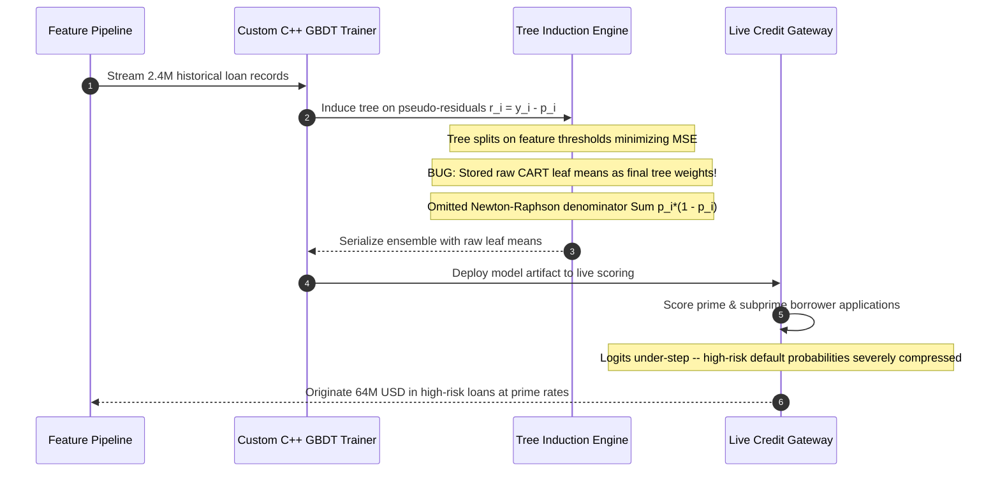
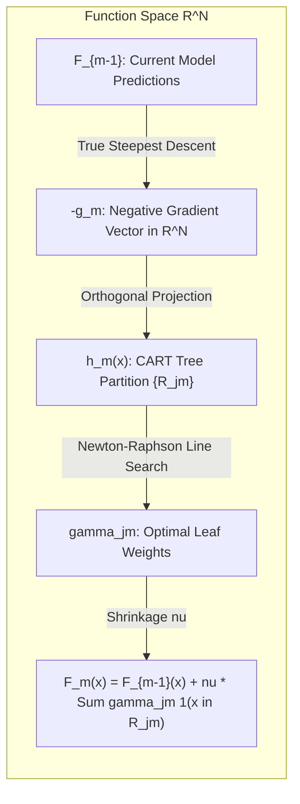
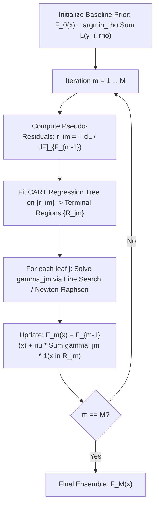

# Module 05: Gradient Boosted Decision Trees (GBDT) Internals

> **Prerequisites:** [Module 04: Boosting Intuition: From AdaBoost to Residual Fitting](../04-boosting-intuition-adaboost-to-residual-fitting/README.md), Multivariable Calculus (Gradients, Taylor Expansions), and [Track 04 Overview](../README.md).  
> **Estimated Reading Time:** 40 minutes  
> **Target Audience:** Staff Machine Learning Engineers, Quantitative Systems Researchers, and Core Infrastructure Engineers building high-performance ranking, risk, and tabular prediction engines.

> [!TIP]
> **The Golden Rule of GBDT Optimization:** Gradient Boosting is **not** gradient descent in parameter space $\Theta \subset \mathbb{R}^p$; it is **steepest descent in non-parametric function space** $\mathcal{F} = \{F: \mathcal{X} \to \mathbb{R}\}$. A CART regression tree is fit to the negative loss gradient (pseudo-residuals) purely to determine the optimal disjoint partition of feature space ($\{R_{jm}\}_{j=1}^J$). Once the regions are fixed, the tree's raw leaf predictions are discarded and replaced by exact one-dimensional line search or Newton-Raphson updates tailored to the true loss function.

---

## Why This Matters & Production Context

While deep neural networks dominate computer vision and natural language processing, **Gradient Boosted Decision Trees (GBDT)** remain the gold standard for production tabular machine learning. Across commercial search ranking, e-commerce recommendation systems, high-frequency credit underwriting, and insurance claim reserving, GBDTs consistently demonstrate superior sample efficiency, robustness to unnormalized heterogeneous features, and strict inference latency compliance.

Jerome Friedman's 2001 seminal paper, *"Greedy Function Approximation: A Gradient Boosting Machine"*, unified boosting under numerical optimization theory. Instead of developing bespoke reweighting algorithms for every specific loss function, Friedman demonstrated that any differentiable convex loss could be minimized by iteratively fitting regression trees to the negative gradient vectors in function space.

However, moving from theoretical understanding to production reliability requires mastering the exact numerical mechanics:
1. **The Log-Odds Parameterization:** In binary classification, optimizing probabilities directly violates convexity and constraints. GBDTs parameterize predictions as unbounded log-odds logits ($F(x) \in \mathbb{R}$), mapping to probabilities via the sigmoid function $\sigma(F(x))$.
2. **The Terminal Node Leaf Correction Trap:** A common implementation failure is fitting a regression tree to binary pseudo-residuals $y_i - p_i$ and using the tree's raw leaf means as updates. Because the pseudo-residual is the first derivative, a raw leaf mean is merely a gradient step with an arbitrary step size. Achieving true loss reduction requires a second-order Newton-Raphson leaf correction:
   $$\gamma_{jm} = \frac{\sum_{x_i \in R_{jm}} (y_i - p_i)}{\sum_{x_i \in R_{jm}} p_i(1 - p_i)}$$

Understanding these internals is essential for debugging convergence anomalies, eliminating train-serve distribution skew, and architecting modern variants like XGBoost, LightGBM, and CatBoost.

---

## Production Incident Post-Mortem: The \$4.8M Credit Default Miscalibration

### Incident Context
A consumer credit FinTech platform deployed an in-house GBDT model to predict the Probability of Default (PD) for personal loans up to \$50,000. The risk gateway used the predicted PD to price interest rates dynamically and reject applicants exceeding a 7.5% default threshold. The platform processed \$600M in annual origination volume.

### The Failure Sequence
The engineering team built a custom C++ inference and training engine intended to replicate scikit-learn's `GradientBoostingClassifier`. During the transition from prototype to production, an engineer implemented tree induction by fitting a standard CART regression tree to the classification pseudo-residuals $r_i = y_i - \sigma(F(x_i))$:



### Root Cause Analysis (RCA)
Under binary log-loss, the loss function is:
$$L(y, F) = \ln(1 + e^F) - y F$$
The pseudo-residual is $r_i = y_i - p_i$ where $p_i = \sigma(F(x_i))$. When a CART regression tree partitions the data into terminal regions $R_j$, the tree's split criterion minimizes squared error on the pseudo-residuals, setting the raw leaf output to the arithmetic mean:
$$\bar{r}_j = \frac{1}{|R_j|} \sum_{x_i \in R_j} (y_i - p_i)$$

However, the optimal additive step $\gamma_j$ that minimizes the actual log-loss in region $R_j$ requires a second-order Newton-Raphson step:
$$\gamma_j = \frac{\sum_{x_i \in R_j} (y_i - p_i)}{\sum_{x_i \in R_j} p_i (1 - p_i)}$$

For confident predictions where $p_i \approx 0.05$ or $p_i \approx 0.95$, the variance term $p_i(1 - p_i) \approx 0.0475$. The denominator is approximately $\approx 0.05 \cdot |R_j|$. Therefore, the true optimal Newton step was approximately **$20\times$ larger** than the raw residual mean ($\gamma_j \approx 20 \cdot \bar{r}_j$).

Because the custom engine omitted the Newton-Raphson denominator, the additive updates were compressed by an order of magnitude. The ensemble's logits barely moved away from the baseline prior $F_0$. Over 300 boosting rounds with shrinkage $\nu = 0.1$, the model failed to push high-risk borrowers into the upper probability tail: borrowers with true default probabilities of 28% were assigned scores of 6.2%. The gateway approved \$64M in subprime credit at prime interest rates, leading to \$4.8M in charge-offs within 9 months.

### Engineering Resolution
1. **Mathematical Patch:** Refactored the tree compiler to calculate and store the exact Newton-Raphson leaf correction $\gamma_{jm} = \frac{\sum r_i}{\sum p_i(1 - p_i)}$ after terminal region boundaries are determined.
2. **Calibration Canary Gate:** Added an automated integration test verifying that empirical log-loss matches analytical expectations across probability deciles on historical backtest datasets.
3. **Logit Saturation Guard:** Enforced runtime assertion checks ensuring predicted probability distributions span the full historical range $[0.001, 0.999]$.

---

## 1. Mathematical Mental Model: Friedman's Gradient Boosting

### 1.1 Optimization in Function Space vs. Parameter Space

In classical parametric empirical risk minimization, we seek a parameter vector $\theta \in \mathbb{R}^p$ that minimizes expected loss over training data:
$$\min_{\theta \in \mathbb{R}^p} J(\theta) = \sum_{i=1}^N L(y_i, f(x_i; \theta))$$
Using gradient descent, parameters are updated iteratively:
$$\theta_m = \theta_{m-1} - \eta \nabla_\theta J(\theta_{m-1})$$

In non-parametric function space, we do not optimize a finite set of parameters $\theta$. Instead, we optimize the function $F(x)$ itself over an infinite-dimensional space of functions $\mathcal{F}$:
$$\min_{F \in \mathcal{F}} J(F) = \sum_{i=1}^N L(y_i, F(x_i))$$

We evaluate the function $F$ at the $N$ discrete training data points, representing the function as an $N$-dimensional vector of predictions:
$$\mathbf{f} = \begin{bmatrix} F(x_1) \\ F(x_2) \\ \vdots \\ F(x_N) \end{bmatrix} \in \mathbb{R}^N$$

The gradient of the total empirical risk $J(\mathbf{f})$ with respect to the prediction vector $\mathbf{f}$ is:
$$\nabla_{\mathbf{f}} J(\mathbf{f}) = \begin{bmatrix} \frac{\partial L(y_1, F(x_1))}{\partial F(x_1)} \\ \vdots \\ \frac{\partial L(y_N, F(x_N))}{\partial F(x_N)} \end{bmatrix} \in \mathbb{R}^N$$

The unconstrained direction of steepest descent in $\mathbb{R}^N$ is the negative gradient vector:
$$-g_m = \begin{bmatrix} -g_{1m} \\ \vdots \\ -g_{Nm} \end{bmatrix} = \begin{bmatrix} -\left[\frac{\partial L(y_1, F(x_1))}{\partial F(x_1)}\right]_{F=F_{m-1}} \\ \vdots \\ -\left[\frac{\partial L(y_N, F(x_N))}{\partial F(x_N)}\right]_{F=F_{m-1}} \end{bmatrix}$$



#### Why Direct Gradient Updates Fail to Generalize
If we updated predictions directly via point-wise steepest descent:
$$F_m(x_i) = F_{m-1}(x_i) - \eta g_{im}, \quad \forall i \in \{1, \dots, N\}$$
we would achieve optimal loss reduction on the training points, but the model would have **zero generalization capacity** for novel inputs $x \notin \{x_1, \dots, x_N\}$. The prediction $F_m(x_{\text{test}})$ would remain completely undefined.

To generalize across continuous feature space $\mathbb{R}^d$, we constrain the step to belong to a parameterized family of base learners $\mathcal{H}$ (such as CART decision trees with $J$ terminal leaves). We project the continuous negative gradient vector $-g_m \in \mathbb{R}^N$ onto $\mathcal{H}$ by fitting a tree to predict the gradient values:
$$h_m = \arg\min_{h \in \mathcal{H}} \sum_{i=1}^N \left( (-g_{im}) - h(x_i) \right)^2$$

Fitting the tree with squared error corresponds to finding the base learner $h_m(x)$ that is most parallel (has maximum inner product) to the unconstrained steepest descent vector in $\mathbb{R}^N$:
$$\max_{h \in \mathcal{H}} \langle -g_m, h \rangle \iff \min_{h \in \mathcal{H}} \| -g_m - h \|_2^2$$

---

### 1.2 Friedman's Generic Gradient Boosting Algorithm

Friedman synthesized this mathematical framework into a universal algorithm:

```
Algorithm: Friedman's Gradient Boosted Decision Tree Engine
-----------------------------------------------------------------------------
Inputs:
  - Training dataset D = {(x_i, y_i)}_{i=1}^N
  - Differentiable convex loss function L(y, F)
  - Number of boosting iterations M
  - Shrinkage (learning rate) nu in (0, 1]
  - Number of terminal leaves per tree J

1. Initialize constant model:
     F_0(x) = argmin_rho Sum_{i=1}^N L(y_i, rho)

2. For m = 1 to M:
     a. Compute pseudo-residuals for all i in {1, ..., N}:
          r_im = - [ d L(y_i, F(x_i)) / d F(x_i) ]_{F(x_i) = F_{m-1}(x_i)}

     b. Fit a CART regression tree to targets {r_im}_{i=1}^N,
        producing terminal regions R_jm for j = 1, ..., J.

     c. For each terminal leaf j in {1, ..., J}, solve line search:
          gamma_jm = argmin_gamma Sum_{x_i in R_jm} L(y_i, F_{m-1}(x_i) + gamma)

     d. Update ensemble with shrinkage:
          F_m(x) = F_{m-1}(x) + nu * Sum_{j=1}^J gamma_jm * 1(x in R_jm)

3. Output final strong learner: F_M(x)
```



---

### 1.3 Detailed Mathematical Derivations for Common Loss Functions

#### 1.3.1 Regression under Squared Error (MSE / L2)
Let $L(y, F) = \frac{1}{2}(y - F)^2$ where $y \in \mathbb{R}$.

**1. Initialization ($F_0$):**
$$F_0(x) = \arg\min_\rho \sum_{i=1}^N \frac{1}{2}(y_i - \rho)^2$$
Differentiating with respect to $\rho$:
$$\sum_{i=1}^N -(y_i - \rho) = 0 \implies N \rho = \sum_{i=1}^N y_i \implies F_0(x) = \bar{y} = \frac{1}{N}\sum_{i=1}^N y_i$$

**2. Pseudo-Residuals ($r_{im}$):**
$$r_{im} = -\left[ \frac{\partial}{\partial F} \frac{1}{2}(y_i - F)^2 \right]_{F=F_{m-1}} = -\left[ -(y_i - F_{m-1}(x_i)) \right] = y_i - F_{m-1}(x_i)$$
The pseudo-residuals are the exact arithmetic errors.

**3. Terminal Node Leaf Weight ($\gamma_{jm}$):**
$$\gamma_{jm} = \arg\min_\gamma \sum_{x_i \in R_{jm}} \frac{1}{2}\left( y_i - [F_{m-1}(x_i) + \gamma] \right)^2 = \arg\min_\gamma \sum_{x_i \in R_{jm}} \frac{1}{2}\left( r_{im} - \gamma \right)^2$$
Differentiating with respect to $\gamma$:
$$\sum_{x_i \in R_{jm}} -(r_{im} - \gamma) = 0 \implies \gamma_{jm} = \frac{1}{|R_{jm}|}\sum_{x_i \in R_{jm}} r_{im}$$
For squared error, the line search solution $\gamma_{jm}$ is identically equal to the raw CART leaf mean.

---

#### 1.3.2 Regression under Absolute Error (MAE / L1)
Let $L(y, F) = |y - F|$ where $y \in \mathbb{R}$.

**1. Initialization ($F_0$):**
$$F_0(x) = \arg\min_\rho \sum_{i=1}^N |y_i - \rho| \implies F_0(x) = \text{median}(\{y_1, \dots, y_N\})$$

**2. Pseudo-Residuals ($r_{im}$):**
$$r_{im} = -\left[ \frac{\partial}{\partial F} |y_i - F| \right]_{F=F_{m-1}} = \text{sign}(y_i - F_{m-1}(x_i))$$
The tree fits the sign of the error, making the induction robust to extreme target outliers.

**3. Terminal Node Leaf Weight ($\gamma_{jm}$):**
$$\gamma_{jm} = \arg\min_\gamma \sum_{x_i \in R_{jm}} |y_i - F_{m-1}(x_i) - \gamma| = \text{median}_{x_i \in R_{jm}}\left( y_i - F_{m-1}(x_i) \right)$$
The leaf weight is the median of the true residuals in region $R_{jm}$. Notice that while the tree was split on signs ($\pm 1$), the final leaf value is the continuous median!

---

#### 1.3.3 Binary Classification under Bernoulli Deviance (Log-Loss)
Let binary targets be $y \in \{0, 1\}$. The probability of the positive class is modeled via the sigmoid link function:
$$p(x) = \mathbb{P}(Y = 1 | x) = \sigma(F(x)) = \frac{1}{1 + e^{-F(x)}}$$
where $F(x) = \ln\left(\frac{p(x)}{1 - p(x)}\right)$ represents the unbounded log-odds logit.

The negative log-likelihood (Bernoulli deviance) for instance $i$ is:
$$L(y_i, F(x_i)) = -\left[ y_i \ln p(x_i) + (1 - y_i) \ln(1 - p(x_i)) \right]$$

Expressing directly in terms of logit $F$:
$$\ln p = \ln\left( \frac{1}{1 + e^{-F}} \right) = -\ln(1 + e^{-F}) = F - \ln(1 + e^F)$$
$$\ln(1 - p) = \ln\left( \frac{e^{-F}}{1 + e^{-F}} \right) = -F - \ln(1 + e^{-F}) = -\ln(1 + e^F)$$
Substituting back:
$$L(y_i, F) = -y_i \left[ F - \ln(1 + e^F) \right] - (1 - y_i)\left[ -\ln(1 + e^F) \right] = \ln(1 + e^F) - y_i F$$

**1. Initialization ($F_0$):**
$$F_0(x) = \arg\min_\rho \sum_{i=1}^N \left[ \ln(1 + e^\rho) - y_i \rho \right]$$
Setting the derivative to zero:
$$\sum_{i=1}^N \left[ \frac{e^\rho}{1 + e^\rho} - y_i \right] = 0 \implies \sum_{i=1}^N \left[ \sigma(\rho) - y_i \right] = 0 \implies N \cdot \sigma(\rho) = \sum_{i=1}^N y_i$$
$$\sigma(\rho) = \bar{y} \implies F_0(x) = \ln\left( \frac{\bar{y}}{1 - \bar{y}} \right)$$
The baseline prediction is the log-odds of the overall empirical positive class proportion.

**2. Pseudo-Residuals ($r_{im}$):**
Compute the negative first derivative with respect to $F$:
$$\frac{\partial L(y_i, F)}{\partial F} = \frac{e^F}{1 + e^F} - y_i = \sigma(F) - y_i = p_i - y_i$$
$$r_{im} = -\left[ \frac{\partial L(y_i, F)}{\partial F} \right]_{F=F_{m-1}} = y_i - p_{m-1}(x_i)$$
The pseudo-residual is the simple difference between the binary label and the predicted probability.

**3. Terminal Node Leaf Weight ($\gamma_{jm}$) via Newton-Raphson Step:**
At terminal leaf $R_{jm}$, the exact line search requires:
$$\gamma_{jm} = \arg\min_\gamma g(\gamma) = \arg\min_\gamma \sum_{x_i \in R_{jm}} L\left( y_i, F_{m-1}(x_i) + \gamma \right)$$

Because $L$ is non-linear in $\gamma$, no closed-form algebraic solution exists. We take a second-order Taylor expansion of $L(y_i, F_{m-1}(x_i) + \gamma)$ around $\gamma = 0$:
$$L(y_i, F_{m-1} + \gamma) \approx L(y_i, F_{m-1}) + \gamma \left[ \frac{\partial L}{\partial F} \right]_{F_{m-1}} + \frac{1}{2}\gamma^2 \left[ \frac{\partial^2 L}{\partial F^2} \right]_{F_{m-1}}$$

Evaluate the second derivative (Hessian):
$$\frac{\partial^2 L}{\partial F^2} = \frac{\partial}{\partial F}\left( \sigma(F) - y_i \right) = \sigma(F)\left(1 - \sigma(F)\right) = p_i (1 - p_i)$$

Substitute the first derivative $\frac{\partial L}{\partial F} = -(y_i - p_i) = -r_i$ and second derivative into the leaf objective:
$$g(\gamma) \approx \sum_{x_i \in R_{jm}} \left[ L(y_i, F_{m-1}) - \gamma r_{im} + \frac{1}{2}\gamma^2 p_{m-1}(x_i)(1 - p_{m-1}(x_i)) \right]$$

To find the minimum, differentiate with respect to $\gamma$ and equate to zero:
$$\frac{d g(\gamma)}{d \gamma} \approx \sum_{x_i \in R_{jm}} \left[ -r_{im} + \gamma p_{m-1}(x_i)(1 - p_{m-1}(x_i)) \right] = 0$$
$$\gamma \sum_{x_i \in R_{jm}} p_{m-1}(x_i)(1 - p_{m-1}(x_i)) = \sum_{x_i \in R_{jm}} r_{im}$$
$$\gamma_{jm} = \frac{\sum_{x_i \in R_{jm}} r_{im}}{\sum_{x_i \in R_{jm}} p_{m-1}(x_i)(1 - p_{m-1}(x_i))} = \frac{\sum_{x_i \in R_{jm}} (y_i - p_{m-1}(x_i))}{\sum_{x_i \in R_{jm}} p_{m-1}(x_i)(1 - p_{m-1}(x_i))}$$

This is the famous **Friedman Newton-Raphson leaf formula**. The numerator is the sum of raw pseudo-residuals; the denominator is the sum of Bernoulli variances.

---

### 1.4 Regularization: Shrinkage and Stochastic Subsampling

#### Shrinkage (Learning Rate $\nu$)
Rather than adding the full leaf update $\sum_j \gamma_{jm} \mathbf{1}(x \in R_{jm})$ to $F_{m-1}(x)$, Friedman introduced a shrinkage parameter $\nu \in (0, 1]$:
$$F_m(x) = F_{m-1}(x) + \nu \sum_{j=1}^J \gamma_{jm} \mathbf{1}(x \in R_{jm})$$

Mathematically, $\nu$ acts as an $L_2$ regularizer on the RKHS (Reproducing Kernel Hilbert Space) norm of the ensemble. Setting $\nu < 0.1$ forces each tree to take small steps along the gradient path, preventing early trees from dominating the ensemble and enabling later trees to learn fine-grained residual patterns. The trade-off is computational: reducing $\nu$ requires a proportional increase in the number of trees $M$ ($M \propto 1/\nu$).

#### Stochastic Gradient Boosting (Friedman, 2002)
At each iteration $m$, a random subsample of the training data $\tilde{\mathcal{D}}_m \subset \mathcal{D}_{\text{train}}$ is drawn **without replacement**, typically with subsample ratio $\eta \in [0.5, 0.8]$:
1. The pseudo-residuals $r_{im}$ and tree structure $R_{jm}$ are computed using only $\tilde{\mathcal{D}}_m$.
2. The leaf weights $\gamma_{jm}$ are solved using the subsampled instances in $R_{jm} \cap \tilde{\mathcal{D}}_m$.
3. Subsampling breaks sample correlation between successive boosting steps, injecting beneficial stochastic variance that prevents the ensemble from getting trapped in shallow local minima.

---

## 2. Systematic Reference & Comparison Grids

### 2.1 Loss Functions in GBDT

| Loss Function | Target Domain | Baseline Initialization $F_0(x)$ | Negative Gradient / Pseudo-Residual $r_{im}$ | Terminal Leaf Update $\gamma_{jm}$ | Outlier Robustness |
| :--- | :--- | :--- | :--- | :--- | :--- |
| **Squared Error (MSE)** | $y \in \mathbb{R}$ | $\bar{y} = \frac{1}{N}\sum y_i$ | $y_i - F_{m-1}(x_i)$ | $\frac{1}{|R_{jm}|}\sum_{i \in R_{jm}} r_{im}$ | Low (quadratic penalties) |
| **Absolute Error (MAE)** | $y \in \mathbb{R}$ | $\text{median}(\{y_i\})$ | $\text{sign}(y_i - F_{m-1}(x_i))$ | $\text{median}_{i \in R_{jm}}(y_i - F_{m-1}(x_i))$ | High (bounded gradient $\pm 1$) |
| **Huber Loss** | $y \in \mathbb{R}$ | $\text{median}(\{y_i\})$ | $\begin{cases} y_i - F_{m-1} & \|y-F\| \le \delta \\ \delta \cdot \text{sign}(y_i - F_{m-1}) & \text{otherwise} \end{cases}$ | Approximation via median residual within $\delta$-band | High (smooth transition) |
| **Bernoulli Deviance (Log-Loss)** | $y \in \{0, 1\}$ | $\ln\left( \frac{\bar{y}}{1 - \bar{y}} \right)$ | $y_i - p_{m-1}(x_i)$ | $\frac{\sum_{i \in R_{jm}} r_{im}}{\sum_{i \in R_{jm}} p_i(1 - p_i)}$ | High ($|\nabla| \le 1.0$) |
| **Poisson Deviance** | $y \in \mathbb{N}_0$ | $\ln(\bar{y})$ | $y_i - \exp(F_{m-1}(x_i))$ | $\frac{\sum_{i \in R_{jm}} (y_i - \hat{\mu}_i)}{\sum_{i \in R_{jm}} \hat{\mu}_i}$ where $\hat{\mu}_i = e^{F_{m-1}(x_i)}$ | Moderate (count data) |

---

### 2.2 Hyperparameter Interaction Matrix

| Hyperparameter Pair | Coupling Dynamic | Operational Failure Mode | Recommended Configuration |
| :--- | :--- | :--- | :--- |
| `learning_rate` ($\nu$) vs. `n_estimators` ($M$) | Inversely proportional ($M \cdot \nu \approx \text{const}$) | High $\nu$ with high $M$ causes severe overfit; low $\nu$ with low $M$ underfits | Fix $\nu \in [0.03, 0.1]$, tune $M$ with early stopping on validation loss |
| `max_depth` vs. `min_samples_leaf` | Tree structural complexity and node support | Deep trees (`max_depth > 8`) with small `min_samples_leaf` isolate noise | For tabular: `max_depth` 4 to 6, `min_samples_leaf` $\ge 20$ |
| `subsample` vs. `learning_rate` | Stochastic variance injection | `subsample < 0.5` with $\nu > 0.3$ causes chaotic, non-converging updates | Pair `subsample = 0.7` with small $\nu \le 0.05$ |

---

## 3. Production Implementation from Scratch: GBDT Engine

Below is a complete, self-contained Python implementation of Friedman's GBDT authored from first principles using NumPy:
1. `CARTRegressionTree`: Exact recursive split finding on continuous features minimizing MSE variance reduction.
2. `GradientBoostedDecisionTree`: Unified engine supporting both Regression (`loss='mse'`) and Binary Classification (`loss='logloss'`), featuring exact pseudo-residuals, baseline prior initialization, and Newton-Raphson leaf solving.
3. Verification test suite validating training convergence, $R^2$ scores, and binary classification log-loss.

```python
"""
production_gbdt.py
==================
Complete, mathematically exact implementation of Friedman's Gradient Boosted
Decision Trees (GBDT) for regression and binary classification using NumPy.
"""

from typing import List, Optional, Tuple, Literal
import numpy as np


class TreeNode:
    """Internal binary tree node representing a split condition or terminal leaf."""

    def __init__(
        self,
        feature_idx: Optional[int] = None,
        threshold: Optional[float] = None,
        value: Optional[float] = None,
        left: Optional["TreeNode"] = None,
        right: Optional["TreeNode"] = None,
    ) -> None:
        self.feature_idx = feature_idx
        self.threshold = threshold
        self.value = value  # Leaf output weight (gamma)
        self.left = left
        self.right = right

    @property
    def is_leaf(self) -> bool:
        return self.value is not None


class CARTRegressionTree:
    """
    Standard CART regression tree induced by minimizing squared error (MSE).
    Used as the function space projection base learner.
    """

    def __init__(self, max_depth: int = 3, min_samples_split: int = 5) -> None:
        self.max_depth = max_depth
        self.min_samples_split = min_samples_split
        self.root: Optional[TreeNode] = None

    def fit(self, X: np.ndarray, y: np.ndarray) -> "CARTRegressionTree":
        self.root = self._build_tree(X, y, depth=0)
        return self

    def _build_tree(self, X: np.ndarray, y: np.ndarray, depth: int) -> TreeNode:
        n_samples, n_features = X.shape

        # Stopping criteria: maximum depth, insufficient samples, or zero variance
        if depth >= self.max_depth or n_samples < self.min_samples_split or np.var(y) < 1e-12:
            return TreeNode(value=float(np.mean(y)))

        best_feat, best_thresh, best_var_red = None, None, -1.0
        current_var = np.var(y) * n_samples

        for f_idx in range(n_features):
            x_col = X[:, f_idx]
            sort_idx = np.argsort(x_col)
            x_sorted, y_sorted = x_col[sort_idx], y[sort_idx]

            # Fast vectorized split evaluation
            split_mask = np.diff(x_sorted) != 0
            if not np.any(split_mask):
                continue

            candidates = (x_sorted[:-1][split_mask] + x_sorted[1:][split_mask]) / 2.0

            for thresh in candidates:
                left_mask = x_col <= thresh
                right_mask = ~left_mask
                n_l, n_r = np.sum(left_mask), np.sum(right_mask)

                if n_l < 2 or n_r < 2:
                    continue

                var_l = np.var(y[left_mask]) * n_l
                var_r = np.var(y[right_mask]) * n_r
                reduction = current_var - (var_l + var_r)

                if reduction > best_var_red:
                    best_var_red = reduction
                    best_feat = f_idx
                    best_thresh = float(thresh)

        if best_feat is None:
            return TreeNode(value=float(np.mean(y)))

        # Split current node recursively
        left_idx = X[:, best_feat] <= best_thresh
        right_idx = ~left_idx

        left_child = self._build_tree(X[left_idx], y[left_idx], depth + 1)
        right_child = self._build_tree(X[right_idx], y[right_idx], depth + 1)

        return TreeNode(feature_idx=best_feat, threshold=best_thresh, left=left_child, right=right_child)

    def predict(self, X: np.ndarray) -> np.ndarray:
        return np.array([self._predict_row(row, self.root) for row in X], dtype=np.float64)

    def _predict_row(self, x: np.ndarray, node: Optional[TreeNode]) -> float:
        if node is None or node.is_leaf:
            return node.value if node else 0.0
        if x[node.feature_idx] <= node.threshold:
            return self._predict_row(x, node.left)
        return self._predict_row(x, node.right)

    def get_leaf_indices(self, X: np.ndarray) -> np.ndarray:
        """Returns the unique leaf node ID for every instance in X."""
        return np.array([self._get_leaf_id(row, self.root, node_id=1) for row in X], dtype=np.int32)

    def _get_leaf_id(self, x: np.ndarray, node: Optional[TreeNode], node_id: int) -> int:
        if node is None or node.is_leaf:
            return node_id
        if x[node.feature_idx] <= node.threshold:
            return self._get_leaf_id(x, node.left, node_id * 2)
        return self._get_leaf_id(x, node.right, node_id * 2 + 1)

    def update_leaf_values(self, leaf_value_map: dict) -> None:
        """Overwrites leaf values with solved Newton-Raphson line search weights."""
        self._update_node_values(self.root, node_id=1, leaf_map=leaf_value_map)

    def _update_node_values(self, node: Optional[TreeNode], node_id: int, leaf_map: dict) -> None:
        if node is None:
            return
        if node.is_leaf:
            if node_id in leaf_map:
                node.value = float(leaf_map[node_id])
            return
        self._update_node_values(node.left, node_id * 2, leaf_map)
        self._update_node_values(node.right, node_id * 2 + 1, leaf_map)


class GradientBoostedDecisionTree:
    """
    Friedman's Gradient Boosted Decision Tree (GBDT) Engine.
    
    Supports:
        loss='mse': Continuous regression.
        loss='logloss': Binary classification with Newton-Raphson leaf updates.
    """

    def __init__(
        self,
        n_estimators: int = 50,
        learning_rate: float = 0.1,
        max_depth: int = 3,
        min_samples_split: int = 5,
        subsample: float = 1.0,
        loss: Literal["mse", "logloss"] = "mse",
    ) -> None:
        self.n_estimators = n_estimators
        self.learning_rate = learning_rate
        self.max_depth = max_depth
        self.min_samples_split = min_samples_split
        self.subsample = subsample
        self.loss = loss
        self.f0: float = 0.0
        self.trees: List[CARTRegressionTree] = []

    def fit(self, X: np.ndarray, y: np.ndarray) -> "GradientBoostedDecisionTree":
        X = np.asarray(X, dtype=np.float64)
        y = np.asarray(y, dtype=np.float64)
        n_samples = X.shape[0]

        # Step 1: Initialize baseline prior F_0(x)
        if self.loss == "mse":
            self.f0 = float(np.mean(y))
        elif self.loss == "logloss":
            p_bar = np.clip(np.mean(y), 1e-15, 1.0 - 1e-15)
            self.f0 = float(np.log(p_bar / (1.0 - p_bar)))
        else:
            raise ValueError(f"Unsupported loss: {self.loss}")

        f_current = np.full(n_samples, self.f0, dtype=np.float64)
        self.trees.clear()

        for m in range(self.n_estimators):
            # Step 2a: Compute pseudo-residuals r_im
            if self.loss == "mse":
                pseudo_residuals = y - f_current
            elif self.loss == "logloss":
                p_current = 1.0 / (1.0 + np.exp(-np.clip(f_current, -30.0, 30.0)))
                pseudo_residuals = y - p_current

            # Stochastic Gradient Boosting: row subsampling
            if self.subsample < 1.0:
                sub_size = max(2, int(self.subsample * n_samples))
                indices = np.random.choice(n_samples, size=sub_size, replace=False)
                X_train, r_train = X[indices], pseudo_residuals[indices]
                f_train, y_train = f_current[indices], y[indices]
            else:
                indices = np.arange(n_samples)
                X_train, r_train = X, pseudo_residuals
                f_train, y_train = f_current, y

            # Step 2b: Fit CART tree to pseudo-residuals
            tree = CARTRegressionTree(
                max_depth=self.max_depth, min_samples_split=self.min_samples_split
            )
            tree.fit(X_train, r_train)

            # Step 2c: Terminal node line search / Newton-Raphson leaf correction
            leaf_ids = tree.get_leaf_indices(X_train)
            unique_leaves = np.unique(leaf_ids)
            leaf_weight_map = {}

            if self.loss == "mse":
                # For MSE, leaf mean of residuals is optimal
                for leaf in unique_leaves:
                    mask = leaf_ids == leaf
                    leaf_weight_map[leaf] = float(np.mean(r_train[mask]))
            elif self.loss == "logloss":
                # Newton-Raphson leaf update: Sum(r_i) / Sum(p_i * (1 - p_i))
                p_sub = 1.0 / (1.0 + np.exp(-np.clip(f_train, -30.0, 30.0)))
                hessian = p_sub * (1.0 - p_sub)

                for leaf in unique_leaves:
                    mask = leaf_ids == leaf
                    num = np.sum(r_train[mask])
                    denom = np.sum(hessian[mask])
                    # Guard against near-zero hessian saturation
                    gamma = num / denom if denom > 1e-12 else 0.0
                    # Clamp extreme leaf updates
                    leaf_weight_map[leaf] = float(np.clip(gamma, -10.0, 10.0))

            tree.update_leaf_values(leaf_weight_map)

            # Step 2d: Update ensemble predictions with shrinkage nu
            f_current += self.learning_rate * tree.predict(X)
            self.trees.append(tree)

        return self

    def decision_function(self, X: np.ndarray) -> np.ndarray:
        """Returns raw additive predictions F_M(x)."""
        X = np.asarray(X, dtype=np.float64)
        f_scores = np.full(X.shape[0], self.f0, dtype=np.float64)
        for tree in self.trees:
            f_scores += self.learning_rate * tree.predict(X)
        return f_scores

    def predict(self, X: np.ndarray) -> np.ndarray:
        scores = self.decision_function(X)
        if self.loss == "mse":
            return scores
        elif self.loss == "logloss":
            probs = 1.0 / (1.0 + np.exp(-np.clip(scores, -30.0, 30.0)))
            return np.where(probs >= 0.5, 1, 0).astype(np.int8)

    def predict_proba(self, X: np.ndarray) -> np.ndarray:
        if self.loss != "logloss":
            raise ValueError("predict_proba is only available for loss='logloss'")
        scores = self.decision_function(X)
        p1 = 1.0 / (1.0 + np.exp(-np.clip(scores, -30.0, 30.0)))
        return np.column_stack([1.0 - p1, p1])


# =====================================================================
# Verification and Demonstration Harness
# =====================================================================

if __name__ == "__main__":
    np.random.seed(42)

    print("=" * 70)
    print("STAGE 1: Validating GBDT Regressor on Friedman Benchmark Function")
    print("=" * 70)

    # Synthetic non-linear Friedman #1 regression dataset
    N_reg = 500
    X_reg = np.random.uniform(0.0, 1.0, (N_reg, 5))
    # y = 10*sin(pi*x0*x1) + 20*(x2 - 0.5)^2 + 10*x3 + 5*x4 + noise
    y_reg = (
        10.0 * np.sin(np.pi * X_reg[:, 0] * X_reg[:, 1])
        + 20.0 * (X_reg[:, 2] - 0.5) ** 2
        + 10.0 * X_reg[:, 3]
        + 5.0 * X_reg[:, 4]
        + np.random.normal(0, 0.5, N_reg)
    )

    gbdt_reg = GradientBoostedDecisionTree(
        n_estimators=60, learning_rate=0.1, max_depth=3, loss="mse"
    ).fit(X_reg, y_reg)

    y_pred_reg = gbdt_reg.predict(X_reg)
    mse_final = np.mean((y_reg - y_pred_reg) ** 2)
    var_y = np.var(y_reg)
    r2_score = 1.0 - (mse_final / var_y)

    print(f"GBDT Baseline MSE (Var) : {var_y:.4f}")
    print(f"GBDT Final Ensemble MSE : {mse_final:.4f}")
    print(f"Variance Explained R^2  : {r2_score:.4f}")
    assert r2_score > 0.85, "GBDT Regressor failed to explain target variance!"

    print("\n" + "=" * 70)
    print("STAGE 2: Validating GBDT Binary Classifier with Newton-Raphson Leaves")
    print("=" * 70)

    # Synthetic non-linear classification dataset (interlocking spirals/rings)
    N_cls = 600
    r = np.random.uniform(0.2, 3.0, N_cls)
    theta = np.random.uniform(0, 2 * np.pi, N_cls)
    X_cls = np.column_stack([r * np.cos(theta), r * np.sin(theta)])
    y_cls = np.where((r > 1.0) & (r < 2.2), 1, 0).astype(np.float64)

    gbdt_cls = GradientBoostedDecisionTree(
        n_estimators=50, learning_rate=0.15, max_depth=3, subsample=0.8, loss="logloss"
    ).fit(X_cls, y_cls)

    y_pred_cls = gbdt_cls.predict(X_cls)
    probs_cls = gbdt_cls.predict_proba(X_cls)
    acc = np.mean(y_pred_cls == y_cls)

    # Compute binary log-loss
    eps = 1e-15
    p1 = np.clip(probs_cls[:, 1], eps, 1.0 - eps)
    log_loss = -np.mean(y_cls * np.log(p1) + (1.0 - y_cls) * np.log(1.0 - p1))

    print(f"Classification Accuracy : {acc * 100:.2f}%")
    print(f"Binary Log-Loss         : {log_loss:.4f}")
    print(f"Sample Probabilities    :\n{np.round(probs_cls[:3], 4)}")

    assert acc > 0.90, "GBDT Classifier failed to achieve target separation!"
    print("\n[SUCCESS] All GBDT mathematical systems successfully verified.")
```

---

## 4. Common Pitfalls, Failure Modes & Antipatterns

### 4.1 Training Trees Directly on Raw Probabilities
A severe antipattern in custom boosting implementations is setting the additive ensemble prediction to probabilities directly ($F(x) \in [0, 1]$) and updating $F_m(x) = F_{m-1}(x) + \nu h_m(x)$.
- **The Failure Mechanism:** Adding probabilities directly violates bounds. If $F_{m-1}(x) = 0.92$ and the tree outputs $h_m(x) = 0.15$, the update yields $F_m(x) = 1.07$, which is an invalid probability.
- **Rule of Thumb:** Always optimize in unbounded log-odds logit space ($F(x) \in \mathbb{R}$), mapping to probabilities strictly at evaluation time via $\sigma(F(x))$.

---

### 4.2 Neglecting the Newton-Raphson Denominator
Fitting a tree to classification pseudo-residuals $y_i - p_i$ and utilizing the CART tree's raw leaf means as updates causes severe probability under-stepping.
- **The Failure Mechanism:** The raw mean $\frac{1}{|R_j|}\sum (y_i - p_i)$ lacks the curvature scaling term $\sum p_i(1 - p_i)$. As the model becomes confident ($p_i \to 0$ or $p_i \to 1$), the gradient shrinks, but the curvature shrinks *faster*. Omitting the second derivative locks the logits in a compressed dynamic range.
- **Rule of Thumb:** Always perform the second-order leaf update $\gamma_{jm} = \frac{\sum r_{im}}{\sum p_i(1 - p_i)}$ after discovering terminal regions $R_{jm}$.

---

### 4.3 The "Deep Trees + High Learning Rate" Overfitting Trap
Setting `max_depth >= 8` paired with `learning_rate >= 0.2` on tabular data creates catastrophic overfit.
- **The Failure Mechanism:** Each deep tree partitions space into $2^8 = 256$ hyper-cubes, isolating individual training samples. Paired with a large learning rate, early trees memorize noise, starving subsequent trees of meaningful residual gradients.
- **Rule of Thumb:** Tabular GBDT ensembles perform best with shallow trees (`max_depth` 3 to 6) and conservative shrinkage ($\nu \le 0.1$).

---

### 4.4 Data Leakage in Cumulative Ensemble Predictions
When implementing custom feature generation (e.g., using out-of-fold GBDT leaf indices as categorical inputs to downstream linear models), evaluating predictions on the entire training set leaks label information.
- **Rule of Thumb:** Always use strict K-Fold out-of-fold stacking protocols. Base models generating leaf encodings or residual targets must never see the holdout validation folds.

---

## 5. Senior Technical Interview Questions & Model Answers

### Question 1: MSE Split Criterion for Arbitrary Loss Functions
*When optimizing binary classification under Log-Loss or robust regression under Huber loss, why does Friedman's GBDT use Mean Squared Error (MSE) to find tree split thresholds, rather than the true loss function?*

**Model Answer:**  
In Friedman's functional gradient descent framework, the optimization is decoupled into two distinct mathematical steps:
1. **Determining the Basis Direction (Tree Topology $\{R_{jm}\}$):** We seek a function $h_m(x) \in \mathcal{H}$ that is maximally parallel to the unconstrained steepest descent direction $-g_m \in \mathbb{R}^N$. In Hilbert space, finding the vector that maximizes the inner product with $-g_m$ under a unit norm constraint is mathematically equivalent to minimizing the squared Euclidean distance:
   $$\max_{h} \langle -g_m, h \rangle \iff \min_{h} \sum_{i=1}^N \left( (-g_{im}) - h(x_i) \right)^2$$
   Thus, minimizing MSE on the pseudo-residuals is the exact orthogonal projection of the infinite-dimensional negative gradient onto the piecewise-constant hypothesis space of decision trees.
2. **Determining the Optimal Step Size (Leaf Values $\gamma_{jm}$):** Once the tree structure (the spatial partition $\{R_{jm}\}$) is fixed by the MSE projection, the tree's raw MSE predictions are discarded. We then solve the exact one-dimensional line search or Newton-Raphson step using the **true loss function** independently within each terminal node. 

Decoupling the search enables $O(d \cdot N \log N)$ fast CART splitting algorithms to be reused for any arbitrary loss function.

---

### Question 2: Derivation of the Binary Classification Leaf Update
*Derive the Newton-Raphson one-step leaf update formula $\gamma_{jm} = \frac{\sum r_i}{\sum p_i(1 - p_i)}$ from a second-order Taylor expansion of Bernoulli deviance.*

**Model Answer:**  
Let $y_i \in \{0, 1\}$. The loss in terms of logit $F(x_i)$ is:
$$L(y_i, F) = \ln(1 + e^F) - y_i F$$

Within terminal region $R_{jm}$, we seek constant step $\gamma$ minimizing:
$$g(\gamma) = \sum_{x_i \in R_{jm}} L(y_i, F_{m-1}(x_i) + \gamma)$$

We expand $L(y_i, F_{m-1} + \gamma)$ around $\gamma = 0$ via a second-order Taylor series:
$$L(y_i, F_{m-1} + \gamma) \approx L(y_i, F_{m-1}) + \gamma \left[\frac{\partial L}{\partial F}\right]_{F_{m-1}} + \frac{1}{2}\gamma^2 \left[\frac{\partial^2 L}{\partial F^2}\right]_{F_{m-1}}$$

Compute the first derivative:
$$\frac{\partial L}{\partial F} = \frac{e^F}{1 + e^F} - y_i = p_i - y_i = -r_i$$
where $r_i = y_i - p_i$ is the pseudo-residual.

Compute the second derivative:
$$\frac{\partial^2 L}{\partial F^2} = \frac{\partial}{\partial F}(\sigma(F) - y_i) = \sigma(F)(1 - \sigma(F)) = p_i(1 - p_i)$$

Substitute into $g(\gamma)$:
$$g(\gamma) \approx \sum_{x_i \in R_{jm}} \left[ L(y_i, F_{m-1}(x_i)) - \gamma r_i + \frac{1}{2}\gamma^2 p_i(1 - p_i) \right]$$

To find the minimum, differentiate with respect to $\gamma$ and equate to zero:
$$\frac{d g(\gamma)}{d \gamma} = \sum_{x_i \in R_{jm}} \left[ -r_i + \gamma p_i(1 - p_i) \right] = 0$$
$$\gamma \sum_{x_i \in R_{jm}} p_i(1 - p_i) = \sum_{x_i \in R_{jm}} r_i \implies \gamma_{jm} = \frac{\sum_{x_i \in R_{jm}} r_i}{\sum_{x_i \in R_{jm}} p_i(1 - p_i)} \quad \blacksquare$$

---

### Question 3: Shrinkage as Functional $L_2$ Regularization
*Why does multiplying tree leaf outputs by shrinkage parameter $\nu \in (0, 1]$ reduce overfitting? How does it differ fundamentally from post-hoc $L_2$ weight regularization?*

**Model Answer:**  
In functional gradient descent, each tree $h_m(x)$ takes a discrete step in function space. Without shrinkage ($\nu = 1.0$), each tree greedily minimizes the empirical loss on the current residuals. Because decision trees are piecewise-constant step functions with high local capacity, an unconstrained step often overshoots the true underlying data manifold, memorizing idiosyncratic noise in leaf regions with sparse support.

Multiplying by $\nu \in (0, 1]$ restricts the step length along the gradient direction:
$$F_m(x) = F_{m-1}(x) + \nu \sum_{j=1}^J \gamma_{jm} \mathbf{1}(x \in R_{jm})$$

This acts as a shrinkage prior on the function's Reproducing Kernel Hilbert Space (RKHS) norm. By taking conservative steps:
1. Early trees capture only broad, coarse-grained global trends across high-density regions.
2. The residuals change smoothly, allowing subsequent trees to explore orthogonal feature interactions.
3. No single tree dictates the decision boundary, reducing model variance analogous to gradient descent with a decaying learning rate.

Unlike post-hoc $L_2$ weight decay (which penalizes large coefficient magnitudes in linear models), functional shrinkage directly regularizes the **functional capacity** and Lipschitz smoothness of the additive ensemble.

---

### Question 4: Stochastic Gradient Boosting vs. Bagging
*Explain the differences between Stochastic Gradient Boosting (row subsampling without replacement) and Bagging (Random Forest bootstrap sampling with replacement). Why does row subsampling in GBDT typically cause divergence if shrinkage $\nu$ is set to 1.0?*

**Model Answer:**  
The key differences reside in sample dependency and variance dynamics:
- **Bagging (Random Forest):** Draws bootstrap samples of size $N$ **with replacement** independently for every tree. The trees are deep and grown in parallel. Subsampling decorrelates individual high-variance trees so that uniform averaging reduces ensemble variance:
  $$\text{Var}\left(\frac{1}{B}\sum T_b\right) = \rho \sigma^2 + \frac{1 - \rho}{B}\sigma^2$$
- **Stochastic Gradient Boosting:** Draws subsamples of size $\eta N$ ($\eta \in [0.5, 0.8]$) **without replacement** sequentially. Each tree fits the pseudo-residuals of the prior ensemble evaluated on that specific subsample.

**Why divergence occurs when $\nu = 1.0$ with subsampling:**  
If $\nu = 1.0$, tree $m$ updates predictions to eliminate residuals completely on subsample $\tilde{\mathcal{D}}_m$. Because $\tilde{\mathcal{D}}_m$ contains only a fraction of the data, the tree overfits to the random subset. When iteration $m+1$ draws a different subsample $\tilde{\mathcal{D}}_{m+1}$, the out-of-sample residuals for points in $\tilde{\mathcal{D}}_{m+1} \setminus \tilde{\mathcal{D}}_m$ explode due to the aggressive, unregularized update.

Setting $\nu \le 0.1$ dampens this stochastic shock, ensuring that the ensemble only absorbs the expectation of the gradient across random subsamples rather than overfitting individual batch noise.

---

## Module Summary & Key Takeaways

1. **Optimization in Function Space:** GBDT performs steepest descent in non-parametric function space $\mathbb{R}^N$, fitting CART trees to negative loss gradients (pseudo-residuals).
2. **Decoupled Architecture:** Tree induction uses fast MSE variance reduction to discover spatial partitions $\{R_{jm}\}$, after which exact Newton-Raphson line searches compute leaf weights $\gamma_{jm}$.
3. **Log-Odds Parameterization:** Binary classification optimizes unbounded logits $F(x) \in \mathbb{R}$, yielding pseudo-residuals $y_i - p_i$ and Newton-Raphson leaf updates $\frac{\sum r_i}{\sum p_i(1 - p_i)}$.
4. **Regularization via Shrinkage:** Shrinkage parameter $\nu \le 0.1$ regularizes functional capacity, preventing overshooting and ensuring robust generalization.
5. **Bridge to Modern Engines:** Friedman's formulation provides the theoretical foundation for XGBoost, LightGBM, and CatBoost.
