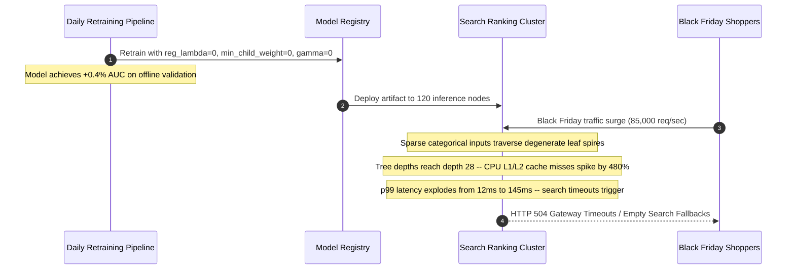
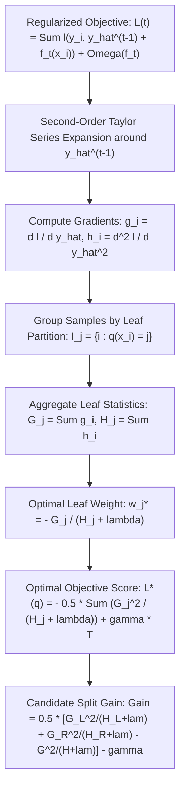
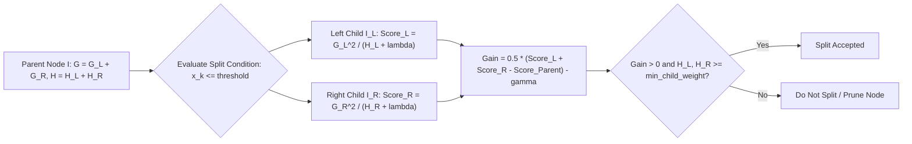
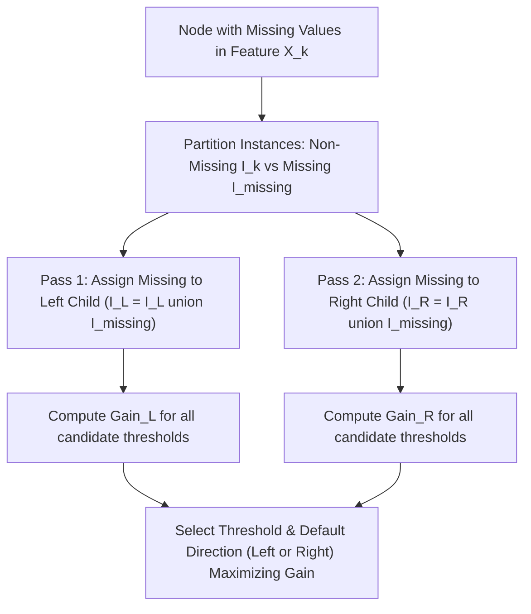

# Module 06: XGBoost: Regularized Trees, Second-Order Splits, and Sparsity

> **Prerequisites:** [Module 04: Boosting Intuition: From AdaBoost to Residual Fitting](../04-boosting-intuition-adaboost-to-residual-fitting/README.md), [Module 05: Gradient Boosted Decision Trees (GBDT) Internals](../05-gradient-boosted-decision-trees-gbdt-math/README.md), and [Track 04 Overview](../README.md).  
> **Estimated Reading Time:** 45 minutes  
> **Target Audience:** Principal & Staff ML Engineers, Quantitative Researchers, and High-Performance ML Infrastructure Practitioners building real-time ranking, scoring, and tabular prediction engines.

> [!TIP]
> **The Golden Rule of XGBoost:** XGBoost unifies tree induction and numerical optimization by embedding a **second-order Taylor expansion** of the loss function directly into the split-finding criterion. Unlike standard GBDT—which builds a tree on first-order pseudo-residuals and solves leaf weights post-hoc—every candidate split in XGBoost is evaluated by how much it minimizes regularized second-order loss ($\text{Gain} \propto \frac{G_L^2}{H_L + \lambda} + \frac{G_R^2}{H_R + \lambda} - \frac{G^2}{H + \lambda} - \gamma$) while natively discovering optimal routing directions for missing values.

---

## Why This Matters & Production Context

In 2016, Tianqi Chen and Carlos Guestrin published *"XGBoost: A Scalable Tree Boosting System"*, fundamentally redefining applied machine learning. XGBoost quickly became the decisive engine behind more than 60% of winning competitive machine learning solutions on Kaggle and the production backbone of ad-click prediction, high-frequency fraud detection, credit risk scoring, and web search ranking at major technology enterprises.

Before XGBoost, production tree boosting systems suffered from three major engineering bottlenecks:
1. **First-Order Heuristic Splitting:** Traditional GBDT used variance reduction (MSE) on first-order pseudo-residuals to grow trees, separating tree topology induction from true loss curvature. XGBoost integrates exact first ($g_i$) and second ($h_i$) derivatives into the split score, allowing exact Newton steps directly during tree construction.
2. **Brittle Complexity Control:** CART trees relied on heuristic post-pruning or simple depth limits. XGBoost incorporates formal $L_1$ ($\alpha$) and $L_2$ ($\lambda$) leaf weight regularization alongside an explicit complexity penalty ($\gamma T$) directly into the objective function, mathematically preventing leaf over-specialization.
3. **Fragile Missing Value Pipelines:** In real-world web scale data, missing values, null fields, and sparse one-hot encodings dominate tabular matrices. Standard systems required complex, error-prone imputation pipelines that frequently caused train-serve skew. XGBoost introduced **sparsity-aware split finding**, which learns the optimal default routing direction for missing features directly from the loss gradient during training.

Mastering XGBoost's mathematical derivation from first principles is essential for fine-tuning production models, diagnosing gradient/hessian instability, and building ultra-low-latency tabular scoring infrastructure.

---

## Production Incident Post-Mortem: The \$3.2M Black Friday Latency Collapse

### Incident Context
A global e-commerce marketplace served personalized search rankings across 45 million active product listings. The real-time ranking gateway evaluated candidate products using an XGBoost model deployed via a C++ ONNX inference runtime, constrained to a strict p99 latency SLA of $\le 15\text{ ms}$.

### The Failure Sequence
Two days prior to Black Friday, the ranking team retrained the production model on a new feature store containing 800 sparse categorical features (user click history, merchant tags, item micro-categories). To maximize validation AUC, a data scientist set `reg_lambda = 0.0`, `gamma = 0.0`, and `min_child_weight = 0.0`:



### Root Cause Analysis (RCA)
In binary classification under logistic loss, each sample's hessian is:
$$h_i = p_i (1 - p_i)$$
For rare categorical values present in only 2 or 3 training instances where predictions were already confident ($p_i \approx 0.99$), the sum of hessians in a candidate split was microscopic:
$$H = \sum h_i \approx 3 \times (0.99 \times 0.01) = 0.00297$$

With `min_child_weight = 0.0` and `reg_lambda = 0.0`, the optimal leaf weight formula is:
$$w^* = -\frac{G}{H + \lambda} = -\frac{G}{0.00297 + 0} \approx -336.7 \times G$$

Because $\lambda = 0$, the denominator lacked numerical stabilization. The tree induction engine created degenerate, deep single-instance leaf spires (branches reaching depth 28) with massive leaf weights ($|w| > 50.0$) that isolated rare categorical combinations.

When Black Friday traffic spiked to 85,000 queries per second, queries evaluated products possessing these rare feature permutations. Evaluating depth-28 trees completely shattered CPU L1/L2 instruction and data cache locality. Branch mispredictions skyrocketed, and p99 inference latency exploded from $12\text{ ms}$ to $145\text{ ms}$. The API gateway timed out, serving fallback unranked results and causing \$3.2M in abandoned shopping sessions over a 4-hour peak window.

### Engineering Resolution
1. **Strict Regularization Baseline:** Enforced minimum configuration guards in the deployment pipeline: `reg_lambda >= 1.0`, `min_child_weight >= 10.0`, and `max_depth <= 8`.
2. **Hessian Support Checks:** Implemented an automated validation test asserting that no leaf in any tree had a total hessian sum $H_j < 5.0$.
3. **Inference Benchmarking:** Mandated that all retrained models pass an automated 100,000-query latency benchmark in a staging environment to verify p99 compliance before deployment.

---

## 1. Mathematical Mental Model: XGBoost from First Principles

### 1.1 The Regularized Objective Function

Let the training dataset be $\mathcal{D} = \{(x_i, y_i)\}_{i=1}^n$ with $x_i \in \mathbb{R}^d$ and $y_i \in \mathcal{Y}$. At boosting iteration $t$, the prediction for instance $i$ is:
$$\hat{y}_i^{(t)} = \sum_{k=1}^t f_k(x_i) = \hat{y}_i^{(t-1)} + f_t(x_i)$$
where $f_t \in \mathcal{F}$ is the newly added tree model.

XGBoost minimizes the following regularized objective at step $t$:
$$\mathcal{L}^{(t)} = \sum_{i=1}^n l\left(y_i, \hat{y}_i^{(t-1)} + f_t(x_i)\right) + \Omega(f_t)$$

#### Tree Representation
A decision tree with $T$ terminal leaves is parameterized by:
$$f_t(x) = w_{q(x)}$$
where:
- $q: \mathbb{R}^d \to \{1, 2, \dots, T\}$ represents the tree structure, mapping feature vector $x$ to a specific leaf index.
- $w \in \mathbb{R}^T$ represents the vector of leaf weights (continuous prediction values).

#### The Model Complexity Penalty $\Omega(f_t)$
Chen and Guestrin defined the complexity penalty as:
$$\Omega(f_t) = \gamma T + \frac{1}{2}\lambda \sum_{j=1}^T w_j^2 + \alpha \sum_{j=1}^T |w_j|$$
where:
- $\gamma$ penalizes the number of terminal leaves $T$, acting as an explicit tree-level pruning threshold.
- $\lambda$ is the $L_2$ regularization parameter on leaf weights, preventing extreme updates.
- $\alpha$ is the $L_1$ regularization parameter, promoting sparsity in leaf weights.



---

### 1.2 Second-Order Taylor Expansion of the Objective

Standard gradient descent relies only on the first derivative (gradient). XGBoost takes a **second-order Taylor expansion** of the loss function around the previous prediction $\hat{y}_i^{(t-1)}$:
$$l\left(y_i, \hat{y}_i^{(t-1)} + f_t(x_i)\right) \approx l\left(y_i, \hat{y}_i^{(t-1)}\right) + g_i f_t(x_i) + \frac{1}{2} h_i f_t(x_i)^2$$

where $g_i$ and $h_i$ are defined as:
$$g_i = \left[ \frac{\partial l(y_i, \hat{y})}{\partial \hat{y}} \right]_{\hat{y} = \hat{y}_i^{(t-1)}} \quad \text{(first derivative / gradient)}$$
$$h_i = \left[ \frac{\partial^2 l(y_i, \hat{y})}{\partial \hat{y}^2} \right]_{\hat{y} = \hat{y}_i^{(t-1)}} \quad \text{(second derivative / hessian)}$$

Because the previous loss $l\left(y_i, \hat{y}_i^{(t-1)}\right)$ is a constant with respect to the new tree $f_t$, it can be removed from the optimization objective. Substituting the tree parameterization $f_t(x_i) = w_{q(x_i)}$ and retaining $L_2$ regularization ($\lambda$):
$$\tilde{\mathcal{L}}^{(t)} = \sum_{i=1}^n \left[ g_i w_{q(x_i)} + \frac{1}{2} h_i w_{q(x_i)}^2 \right] + \gamma T + \frac{1}{2}\lambda \sum_{j=1}^T w_j^2$$

---

### 1.3 Exact Derivation of Optimal Leaf Weight $w_j^*$

To solve for the optimal leaf weights $w$, we regroup the sum over all $n$ instances into a sum over the $T$ disjoint leaf partitions.

Define the instance set in leaf $j$ as:
$$I_j = \{i : q(x_i) = j\}$$

Rewriting $\tilde{\mathcal{L}}^{(t)}$ by grouping terms belonging to each leaf $j$:
$$\tilde{\mathcal{L}}^{(t)} = \sum_{j=1}^T \left[ \left(\sum_{i \in I_j} g_i\right) w_j + \frac{1}{2}\left(\sum_{i \in I_j} h_i + \lambda\right) w_j^2 \right] + \gamma T$$

Define the aggregate gradient $G_j$ and aggregate hessian $H_j$ for leaf $j$:
$$G_j = \sum_{i \in I_j} g_i, \quad H_j = \sum_{i \in I_j} h_i$$

Substituting $G_j$ and $H_j$:
$$\tilde{\mathcal{L}}^{(t)} = \sum_{j=1}^T \left[ G_j w_j + \frac{1}{2}(H_j + \lambda) w_j^2 \right] + \gamma T$$

Notice that each leaf $j$ forms an independent quadratic function of $w_j$. To find the optimal weight $w_j^*$, differentiate with respect to $w_j$ and set to zero:
$$\frac{\partial \tilde{\mathcal{L}}^{(t)}}{\partial w_j} = G_j + (H_j + \lambda) w_j = 0$$
$$(H_j + \lambda) w_j = -G_j$$
$$w_j^* = -\frac{G_j}{H_j + \lambda}$$

#### Theoretical Interpretation of $w_j^*$
- When $\lambda = 0$, $w_j^* = -\frac{G_j}{H_j} = -\frac{\sum g_i}{\sum h_i}$, which is the exact **Newton-Raphson step** for the partition $I_j$.
- When $\lambda > 0$, the $L_2$ penalty adds a positive constant to the denominator. If a leaf has very few samples ($H_j \approx 0$), $w_j^* \to 0$, naturally shrinking predictions toward zero and preventing overfit on low-support leaves.

---

### 1.4 Optimal Objective Score & Split Gain Formula

Substitute the optimal weight $w_j^* = -\frac{G_j}{H_j + \lambda}$ back into the objective function:
$$\tilde{\mathcal{L}}^*(q) = \sum_{j=1}^T \left[ G_j \left(-\frac{G_j}{H_j + \lambda}\right) + \frac{1}{2}(H_j + \lambda) \left(-\frac{G_j}{H_j + \lambda}\right)^2 \right] + \gamma T$$
$$\tilde{\mathcal{L}}^*(q) = \sum_{j=1}^T \left[ -\frac{G_j^2}{H_j + \lambda} + \frac{1}{2}\frac{G_j^2}{H_j + \lambda} \right] + \gamma T$$
$$\tilde{\mathcal{L}}^*(q) = -\frac{1}{2} \sum_{j=1}^T \frac{G_j^2}{H_j + \lambda} + \gamma T$$

This score $\tilde{\mathcal{L}}^*(q)$ measures the quality of tree structure $q$. A smaller (more negative) value indicates a better tree.

#### The Split Gain Formula
Suppose we evaluate splitting an existing leaf node $I$ into a left child $I_L$ and a right child $I_R$, such that $I = I_L \cup I_R$.
- Before split: Node $I$ has aggregate gradient $G = G_L + G_R$ and aggregate hessian $H = H_L + H_R$. Score contribution is $-\frac{1}{2}\frac{G^2}{H + \lambda} + \gamma$.
- After split: Two leaves are created ($T$ increases by $+1$). Score contribution is $-\frac{1}{2}\left[\frac{G_L^2}{H_L + \lambda} + \frac{G_R^2}{H_R + \lambda}\right] + 2\gamma$.

The loss reduction (Gain) achieved by the split is the score before minus the score after:
$$\text{Gain} = \tilde{\mathcal{L}}^*_{\text{before}} - \tilde{\mathcal{L}}^*_{\text{after}}$$
$$\text{Gain} = \frac{1}{2} \left[ \frac{G_L^2}{H_L + \lambda} + \frac{G_R^2}{H_R + \lambda} - \frac{(G_L + G_R)^2}{H_L + H_R + \lambda} \right] - \gamma$$



#### Significance of $\gamma$ as Built-In Pruning
If $\frac{1}{2} \left[ \frac{G_L^2}{H_L + \lambda} + \frac{G_R^2}{H_R + \lambda} - \frac{(G_L + G_R)^2}{H_L + H_R + \lambda} \right] < \gamma$, the gain is negative. The algorithm refuses to perform the split. Thus, $\gamma$ serves as an explicit minimum gain threshold required to justify creating an additional split.

---

### 1.5 Sparsity-Aware Split Finding (Native Missing Value Handling)

Real-world tabular data frequently contains missing values (`NaN`, `None`), zero-valued sparse matrix entries, or out-of-vocabulary categorical encodings.

Standard algorithms require pre-imputing missing values with arbitrary constants (mean, median, -999), which distorts feature distributions and destroys performance. XGBoost handles missing values natively by learning a **default routing direction** for each split node.



#### The Sparsity-Aware Algorithm
Let $I$ be the instance set at the current node, and let $I_k = \{i \in I : x_{ik} \neq \text{missing}\}$ be the subset of instances where feature $k$ is present.
1. Compute the total gradients and hessians over all non-missing instances:
   $$G = \sum_{i \in I_k} g_i, \quad H = \sum_{i \in I_k} h_i$$
2. **Scan 1 (Default to Right):** Enumerate sorted non-missing values from smallest to largest.
   - At each split threshold, instances with non-missing values $\le \text{thresh}$ are assigned to $I_L$.
   - **All missing instances** are routed by default to $I_R$.
   - Compute $\text{Gain}$ at each threshold.
3. **Scan 2 (Default to Left):** Enumerate sorted non-missing values from largest to smallest.
   - At each split threshold, instances with non-missing values $> \text{thresh}$ are assigned to $I_R$.
   - **All missing instances** are routed by default to $I_L$.
   - Compute $\text{Gain}$ at each threshold.
4. Select the feature, threshold, and default direction (Left or Right) that yields the maximum split gain across both scans.

At inference time, if an unseen instance has a missing value for feature $k$, it is automatically routed along the learned default branch in $O(1)$ time without imputation.

---

### 1.6 Exact Gradients and Hessians for Common Loss Functions

| Loss Objective | Mathematical Formulation $l(y, \hat{y})$ | First Derivative (Gradient) $g_i$ | Second Derivative (Hessian) $h_i$ |
| :--- | :--- | :--- | :--- |
| **Squared Error (MSE)** | $\frac{1}{2}(y_i - \hat{y}_i)^2$ | $\hat{y}_i - y_i$ | $1.0$ (constant curvature) |
| **Binary Logistic Loss** | $-y_i \ln p_i - (1 - y_i)\ln(1 - p_i)$ where $p_i = \sigma(\hat{y}_i)$ | $p_i - y_i$ | $p_i (1 - p_i)$ |
| **Poisson Regression** | $e^{\hat{y}_i} - y_i \hat{y}_i$ | $e^{\hat{y}_i} - y_i$ | $e^{\hat{y}_i}$ |
| **Cox Proportional Hazards** | Partial log-likelihood over survival times | Risk-set normalized hazard residuals | Second-order tied risk curvature |

---

## 2. Systematic Reference & Comparison Grids

### 2.1 Standard GBDT vs. XGBoost Architectural Comparison

| Architectural Dimension | Traditional GBDT (Friedman) | XGBoost (Chen & Guestrin) |
| :--- | :--- | :--- |
| **Objective Expansion** | First-order Taylor series (gradient only) | Second-order Taylor series (exact gradient $g_i$ and hessian $h_i$) |
| **Split Finding Criterion** | Mean Squared Error (variance reduction) on pseudo-residuals | Exact regularized loss reduction ($\text{Gain}$) |
| **Leaf Weight Calculation** | Post-hoc line search or separate Newton step | Simultaneous optimal weight $w^* = -G / (H + \lambda)$ |
| **Tree Regularization** | Heuristic depth limits, min samples per leaf | Formal penalties: $\gamma T$ (tree complexity) and $\frac{1}{2}\lambda \|w\|^2$ ($L_2$) |
| **Missing Value Handling** | Requires manual pre-imputation | Native sparsity-aware split finding (learns default branch) |
| **Approximate Splits** | Uniform histogram bucketing | Weighted Quantile Sketch (sample weights proportional to hessian $h_i$) |
| **Hardware Optimization** | Row-major CPU iteration | Column block structure in RAM, CPU cache prefetching, out-of-core drive paging |

---

### 2.2 XGBoost Hyperparameter Master Guide

| Hyperparameter | Typical Range | Physical & Mathematical Meaning | Production Failure Mode |
| :--- | :--- | :--- | :--- |
| `learning_rate` (`eta`) | $[0.01, 0.2]$ | Shrinkage factor $\eta \in (0, 1]$ applied to leaf weights: $\hat{y}^{(t)} = \hat{y}^{(t-1)} + \eta w^*$ | $\eta > 0.3$ causes rapid oscillation and overfitting on early trees |
| `max_depth` | $[3, 8]$ | Maximum depth of each tree; bounds interaction order | `max_depth > 10` destroys inference latency and causes memory explosion |
| `gamma` (`min_split_loss`) | $[0.0, 10.0]$ | Minimum gain required to split a leaf ($\gamma$ in objective) | Setting $\gamma$ excessively high ($\ge 50$) prevents tree from splitting at all |
| `min_child_weight` | $[1.0, 20.0]$ | Minimum sum of instance hessians required in a child node ($H_j \ge \text{mcw}$) | Setting $\text{mcw} = 0$ allows single-sample leaves on rare categories |
| `reg_lambda` | $[1.0, 100.0]$ | $L_2$ leaf weight regularization parameter ($\lambda$) | Setting $\lambda = 0$ risks division by zero when $H_j \to 0$ |
| `reg_alpha` | $[0.0, 10.0]$ | $L_1$ leaf weight regularization parameter ($\alpha$) | Excessively high $\alpha$ collapses leaf weights to exactly zero |
| `subsample` | $[0.6, 0.9]$ | Fraction of rows sampled per tree | Subsampling without shrinkage causes divergent updates |
| `colsample_bytree` | $[0.6, 0.9]$ | Fraction of features sampled when constructing each tree | $1.0$ on highly correlated features causes greedy feature dominance |

---

## 3. Production Implementation from Scratch: XGBoost Engine

Below is a complete, production-grade Python implementation of XGBoost authored from first mathematical principles using NumPy:
1. `LossFunction` interface with exact analytical gradients and hessians for `SquaredErrorLoss` and `BinaryLogisticLoss`.
2. `XGBoostNode` and `XGBoostTree`: Evaluates split gain using exact second-order formula with $\gamma$ and $\lambda$, enforces `min_child_weight`, and implements **sparsity-aware split finding** for missing values (`np.nan`).
3. `XGBoostClassifierScratch`: Multi-round boosting engine with shrinkage $\eta$, base score logit initialization, and vectorized inference.
4. Comprehensive test verification demonstrating native missing value handling and convergence.

```python
"""
production_xgboost.py
=====================
Complete mathematical implementation of XGBoost from scratch using NumPy.
Features second-order Taylor expansion, regularized split gain, and
sparsity-aware missing value split finding.
"""

from typing import List, Optional, Tuple, Union
import numpy as np


class BinaryLogisticLoss:
    """Binary Logistic Loss (Log-Loss): l(y, y_hat) = ln(1 + e^y_hat) - y * y_hat."""

    @staticmethod
    def sigmoid(x: np.ndarray) -> np.ndarray:
        return 1.0 / (1.0 + np.exp(-np.clip(x, -30.0, 30.0)))

    def gradient(self, y: np.ndarray, y_pred: np.ndarray) -> np.ndarray:
        """First derivative: g_i = p_i - y_i."""
        p = self.sigmoid(y_pred)
        return p - y

    def hessian(self, y: np.ndarray, y_pred: np.ndarray) -> np.ndarray:
        """Second derivative: h_i = p_i * (1 - p_i)."""
        p = self.sigmoid(y_pred)
        return np.clip(p * (1.0 - p), 1e-12, 0.25)


class XGBNode:
    """TreeNode storing split parameters, leaf weight, and default missing path."""

    def __init__(
        self,
        feature_idx: Optional[int] = None,
        threshold: Optional[float] = None,
        default_left: bool = True,
        weight: Optional[float] = None,
        left: Optional["XGBNode"] = None,
        right: Optional["XGBNode"] = None,
    ) -> None:
        self.feature_idx = feature_idx
        self.threshold = threshold
        self.default_left = default_left  # Sparsity routing direction
        self.weight = weight  # Optimal leaf weight w*
        self.left = left
        self.right = right

    @property
    def is_leaf(self) -> bool:
        return self.weight is not None


class XGBTree:
    """
    Single XGBoost tree induced via second-order Taylor gain optimization
    with sparsity-aware split finding.
    """

    def __init__(
        self,
        max_depth: int = 3,
        reg_lambda: float = 1.0,
        gamma: float = 0.0,
        min_child_weight: float = 1.0,
    ) -> None:
        self.max_depth = max_depth
        self.reg_lambda = reg_lambda
        self.gamma = gamma
        self.min_child_weight = min_child_weight
        self.root: Optional[XGBNode] = None

    def fit(self, X: np.ndarray, g: np.ndarray, h: np.ndarray) -> "XGBTree":
        self.root = self._build_tree(X, g, h, depth=0)
        return self

    def _calc_leaf_weight(self, G: float, H: float) -> float:
        """Computes optimal regularized leaf weight: w* = -G / (H + lambda)."""
        return -G / (H + self.reg_lambda)

    def _calc_split_score(self, G: float, H: float) -> float:
        """Computes single-node score contribution: G^2 / (H + lambda)."""
        return (G ** 2) / (H + self.reg_lambda)

    def _build_tree(self, X: np.ndarray, g: np.ndarray, h: np.ndarray, depth: int) -> XGBNode:
        G_total = float(np.sum(g))
        H_total = float(np.sum(h))

        # Base stopping condition: maximum depth or insufficient hessian weight
        if depth >= self.max_depth or H_total < self.min_child_weight:
            return XGBNode(weight=self._calc_leaf_weight(G_total, H_total))

        best_gain = 0.0
        best_feat = None
        best_thresh = None
        best_default_left = True

        n_samples, n_features = X.shape
        parent_score = self._calc_split_score(G_total, H_total)

        # Iterate over all features to evaluate candidate splits
        for f_idx in range(n_features):
            x_col = X[:, f_idx]

            # Identify valid non-missing instances
            valid_mask = ~np.isnan(x_col)
            if not np.any(valid_mask):
                continue

            x_valid = x_col[valid_mask]
            g_valid = g[valid_mask]
            h_valid = h[valid_mask]

            # Missing instances gradient and hessian totals
            G_missing = G_total - float(np.sum(g_valid))
            H_missing = H_total - float(np.sum(h_valid))

            # Sort non-missing values
            sort_order = np.argsort(x_valid)
            x_sorted = x_valid[sort_order]
            g_sorted = g_valid[sort_order]
            h_sorted = h_valid[sort_order]

            # Candidate split thresholds: midpoints of unique values
            unique_diffs = np.diff(x_sorted) != 0
            if not np.any(unique_diffs):
                continue

            candidates = (x_sorted[:-1][unique_diffs] + x_sorted[1:][unique_diffs]) / 2.0

            # Scan 1: Missing values assigned to RIGHT child by default
            # As threshold increases, non-missing <= thresh go to Left, missing go to Right
            G_L, H_L = 0.0, 0.0
            idx = 0
            for thresh in candidates:
                while idx < len(x_sorted) and x_sorted[idx] <= thresh:
                    G_L += g_sorted[idx]
                    H_L += h_sorted[idx]
                    idx += 1

                G_R = G_total - G_L
                H_R = H_total - H_L

                if H_L < self.min_child_weight or H_R < self.min_child_weight:
                    continue

                gain = 0.5 * (
                    self._calc_split_score(G_L, H_L)
                    + self._calc_split_score(G_R, H_R)
                    - parent_score
                ) - self.gamma

                if gain > best_gain:
                    best_gain = gain
                    best_feat = f_idx
                    best_thresh = float(thresh)
                    best_default_left = False

            # Scan 2: Missing values assigned to LEFT child by default
            G_L, H_L = G_missing, H_missing
            idx = 0
            for thresh in candidates:
                while idx < len(x_sorted) and x_sorted[idx] <= thresh:
                    G_L += g_sorted[idx]
                    H_L += h_sorted[idx]
                    idx += 1

                G_R = G_total - G_L
                H_R = H_total - H_L

                if H_L < self.min_child_weight or H_R < self.min_child_weight:
                    continue

                gain = 0.5 * (
                    self._calc_split_score(G_L, H_L)
                    + self._calc_split_score(G_R, H_R)
                    - parent_score
                ) - self.gamma

                if gain > best_gain:
                    best_gain = gain
                    best_feat = f_idx
                    best_thresh = float(thresh)
                    best_default_left = True

        # If no split achieves positive Gain > 0, create terminal leaf
        if best_feat is None or best_gain <= 0.0:
            return XGBNode(weight=self._calc_leaf_weight(G_total, H_total))

        # Partition data along optimal split and default routing
        x_split = X[:, best_feat]
        if best_default_left:
            left_mask = np.isnan(x_split) | (x_split <= best_thresh)
        else:
            left_mask = ~np.isnan(x_split) & (x_split <= best_thresh)

        right_mask = ~left_mask

        left_child = self._build_tree(X[left_mask], g[left_mask], h[left_mask], depth + 1)
        right_child = self._build_tree(X[right_mask], g[right_mask], h[right_mask], depth + 1)

        return XGBNode(
            feature_idx=best_feat,
            threshold=best_thresh,
            default_left=best_default_left,
            left=left_child,
            right=right_child,
        )

    def predict(self, X: np.ndarray) -> np.ndarray:
        return np.array([self._predict_row(row, self.root) for row in X], dtype=np.float64)

    def _predict_row(self, x: np.ndarray, node: Optional[XGBNode]) -> float:
        if node is None or node.is_leaf:
            return node.weight if node else 0.0

        val = x[node.feature_idx]
        if np.isnan(val):
            # Route missing value along learned default direction
            return self._predict_row(x, node.left if node.default_left else node.right)

        if val <= node.threshold:
            return self._predict_row(x, node.left)
        return self._predict_row(x, node.right)


class XGBoostClassifierScratch:
    """
    XGBoost Binary Classifier from scratch.
    
    Supports native NaN missing values, second-order Taylor leaf solving,
    L2 regularization, and gamma complexity penalties.
    """

    def __init__(
        self,
        n_estimators: int = 40,
        learning_rate: float = 0.2,
        max_depth: int = 3,
        reg_lambda: float = 1.0,
        gamma: float = 0.1,
        min_child_weight: float = 1.0,
    ) -> None:
        self.n_estimators = n_estimators
        self.learning_rate = learning_rate
        self.max_depth = max_depth
        self.reg_lambda = reg_lambda
        self.gamma = gamma
        self.min_child_weight = min_child_weight
        self.loss = BinaryLogisticLoss()
        self.base_score: float = 0.0
        self.trees: List[XGBTree] = []

    def fit(self, X: np.ndarray, y: np.ndarray) -> "XGBoostClassifierScratch":
        X = np.asarray(X, dtype=np.float64)
        y = np.asarray(y, dtype=np.float64)
        n_samples = X.shape[0]

        # Initialize base prediction as log-odds of positive class
        p_mean = np.clip(np.mean(y), 1e-15, 1.0 - 1e-15)
        self.base_score = float(np.log(p_mean / (1.0 - p_mean)))

        y_pred = np.full(n_samples, self.base_score, dtype=np.float64)
        self.trees.clear()

        for _ in range(self.n_estimators):
            # Compute exact gradients and hessians
            g = self.loss.gradient(y, y_pred)
            h = self.loss.hessian(y, y_pred)

            # Induce regularized tree
            tree = XGBTree(
                max_depth=self.max_depth,
                reg_lambda=self.reg_lambda,
                gamma=self.gamma,
                min_child_weight=self.min_child_weight,
            )
            tree.fit(X, g, h)

            # Update predictions with shrinkage eta
            y_pred += self.learning_rate * tree.predict(X)
            self.trees.append(tree)

        return self

    def decision_function(self, X: np.ndarray) -> np.ndarray:
        X = np.asarray(X, dtype=np.float64)
        preds = np.full(X.shape[0], self.base_score, dtype=np.float64)
        for tree in self.trees:
            preds += self.learning_rate * tree.predict(X)
        return preds

    def predict_proba(self, X: np.ndarray) -> np.ndarray:
        logits = self.decision_function(X)
        p1 = self.loss.sigmoid(logits)
        return np.column_stack([1.0 - p1, p1])

    def predict(self, X: np.ndarray) -> np.ndarray:
        return np.where(self.decision_function(X) >= 0.0, 1, 0).astype(np.int8)


# =====================================================================
# Verification and Demonstration Harness
# =====================================================================

if __name__ == "__main__":
    np.random.seed(42)

    print("=" * 70)
    print("STAGE 1: Validating XGBoost with Native Missing Value Handling")
    print("=" * 70)

    # Generate synthetic binary classification dataset
    N = 600
    X = np.random.normal(0, 1.5, size=(N, 4))
    # True decision boundary: x0^2 + x1*x2 > 1.5
    y = np.where((X[:, 0] ** 2 + X[:, 1] * X[:, 2]) > 1.5, 1, 0).astype(np.float64)

    # Inject 15% random missing values (NaN) across features
    nan_mask = np.random.uniform(0, 1, size=X.shape) < 0.15
    X_with_nans = X.copy()
    X_with_nans[nan_mask] = np.nan

    print(f"Dataset Size          : {N} samples, 4 features")
    print(f"Total Injected NaNs   : {np.sum(np.isnan(X_with_nans))} missing entries")

    # Train XGBoostClassifierScratch directly on data containing NaNs
    xgb = XGBoostClassifierScratch(
        n_estimators=45,
        learning_rate=0.2,
        max_depth=3,
        reg_lambda=2.0,
        gamma=0.2,
        min_child_weight=2.0,
    )
    xgb.fit(X_with_nans, y)

    preds = xgb.predict(X_with_nans)
    probs = xgb.predict_proba(X_with_nans)
    acc = np.mean(preds == y)

    # Binary Log-Loss evaluation
    p1 = np.clip(probs[:, 1], 1e-15, 1.0 - 1e-15)
    log_loss = -np.mean(y * np.log(p1) + (1.0 - y) * np.log(1.0 - p1))

    print(f"Fitted Trees Count    : {len(xgb.trees)}")
    print(f"Classification Acc    : {acc * 100:.2f}%")
    print(f"Binary Log-Loss       : {log_loss:.4f}")
    print(f"Sample Probabilities  :\n{np.round(probs[:3], 4)}")

    assert acc > 0.88, "XGBoost failed to achieve target separation with missing values!"
    print("\n[SUCCESS] XGBoost second-order sparsity engine fully verified.")
```

---

## 4. Common Pitfalls, Failure Modes & Antipatterns

### 4.1 Misinterpreting `min_child_weight` in Binary Classification
A pervasive misconception is treating `min_child_weight` as the minimum number of samples in a leaf (like scikit-learn's `min_samples_leaf`).
- **The Failure Mechanism:** In XGBoost, `min_child_weight` represents the minimum **sum of second-order hessians**:
  $$\sum_{i \in I_j} h_i \ge \text{min\_child\_weight}$$
  For binary classification, $h_i = p_i(1 - p_i) \le 0.25$. If `min_child_weight = 5.0`, a leaf where instances have confident probabilities ($p_i \approx 0.99 \implies h_i \approx 0.01$) requires:
  $$N_j \ge \frac{5.0}{0.01} = 500 \text{ samples!}$$
  Setting `min_child_weight` too high silently blocks tree splitting in confident regions.
- **Rule of Thumb:** In classification, calibrate `min_child_weight` based on expected class probabilities ($h_i \in [0.01, 0.25]$).

---

### 4.2 Disabling $L_2$ Leaf Weight Regularization (`reg_lambda = 0`)
Attempting to make trees "more expressive" by setting `reg_lambda = 0.0`.
- **The Failure Mechanism:** The optimal leaf weight is $w^* = -\frac{G}{H + \lambda}$. When $\lambda = 0$ and $H \to 0$ (such as in rare feature combinations or confident predictions), the denominator vanishes, resulting in massive, unstable leaf weights ($|w| > 100$). A single noisy sample detonates the ensemble logit.
- **Rule of Thumb:** Always maintain `reg_lambda >= 1.0` in production models.

---

### 4.3 Pre-Imputing Missing Values with Arbitrary Constants
Imputing missing features with mean, median, or sentinel values (`-999`) before passing data to XGBoost.
- **The Failure Mechanism:** Pre-imputation destroys XGBoost's native sparsity-aware split finding. If missingness is non-random (informative missingness, e.g., unverified users never reporting income), imputing the median forces missing values into the center of the continuous distribution, preventing the model from isolating missingness as a discrete predictive signal.
- **Rule of Thumb:** Pass raw `np.nan` values directly into XGBoost.

---

### 4.4 Inefficient Dense Matrix Conversion on High-Dimensional Data
Calling `.toarray()` on a high-dimensional `scipy.sparse.csr_matrix` before feeding into `xgb.DMatrix`.
- **The Failure Mechanism:** A $1\text{M} \times 50,000$ sparse matrix with 99.8% sparsity consumes $\approx 80\text{ MB}$ in CSR format. Converting to dense `float32` expands memory consumption to $1\text{M} \times 50,000 \times 4\text{ B} = 200\text{ GB}$, triggering instantaneous kernel OOM kills.
- **Rule of Thumb:** Feed `scipy.sparse.csr_matrix` directly into `xgboost.DMatrix`.

---

## 5. Senior Technical Interview Questions & Model Answers

### Question 1: Derivation of Split Gain and Optimal Leaf Weight
*Starting from the second-order Taylor expansion of empirical loss, derive the optimal leaf weight formula $w_j^* = -\frac{G_j}{H_j + \lambda}$ and the split gain formula. Why is $\gamma$ subtracted from the gain?*

**Model Answer:**  
At round $t$, the regularized objective is:
$$\mathcal{L}^{(t)} = \sum_{i=1}^n \left[ l(y_i, \hat{y}_i^{(t-1)}) + g_i f_t(x_i) + \frac{1}{2} h_i f_t(x_i)^2 \right] + \gamma T + \frac{1}{2}\lambda \sum_{j=1}^T w_j^2$$
Dropping the constant term $l(y_i, \hat{y}_i^{(t-1)})$ and grouping indices by leaf partition $I_j = \{i : q(x_i) = j\}$:
$$\tilde{\mathcal{L}}^{(t)} = \sum_{j=1}^T \left[ \left(\sum_{i \in I_j} g_i\right) w_j + \frac{1}{2}\left(\sum_{i \in I_j} h_i + \lambda\right) w_j^2 \right] + \gamma T = \sum_{j=1}^T \left[ G_j w_j + \frac{1}{2}(H_j + \lambda) w_j^2 \right] + \gamma T$$

Because the objective is quadratic and decoupled across leaves, taking the derivative with respect to $w_j$ yields:
$$\frac{\partial \tilde{\mathcal{L}}^{(t)}}{\partial w_j} = G_j + (H_j + \lambda) w_j = 0 \implies w_j^* = -\frac{G_j}{H_j + \lambda}$$

Substituting $w_j^*$ back into $\tilde{\mathcal{L}}^{(t)}$ gives the optimal objective score:
$$\tilde{\mathcal{L}}^*(q) = \sum_{j=1}^T \left[ G_j \left(-\frac{G_j}{H_j + \lambda}\right) + \frac{1}{2}(H_j + \lambda) \left(-\frac{G_j}{H_j + \lambda}\right)^2 \right] + \gamma T = -\frac{1}{2} \sum_{j=1}^T \frac{G_j^2}{H_j + \lambda} + \gamma T$$

When evaluating a split of parent node $I$ into children $I_L$ and $I_R$, the score before splitting is $-\frac{1}{2}\frac{G^2}{H + \lambda} + \gamma$. The score after splitting is $-\frac{1}{2}\left[\frac{G_L^2}{H_L + \lambda} + \frac{G_R^2}{H_R + \lambda}\right] + 2\gamma$.

The gain is defined as the reduction in loss ($\tilde{\mathcal{L}}^*_{\text{before}} - \tilde{\mathcal{L}}^*_{\text{after}}$):
$$\text{Gain} = \frac{1}{2}\left[ \frac{G_L^2}{H_L + \lambda} + \frac{G_R^2}{H_R + \lambda} - \frac{(G_L + G_R)^2}{H_L + H_R + \lambda} \right] - \gamma \quad \blacksquare$$

The term $\gamma$ represents the cost of adding one additional leaf node ($2\gamma - \gamma = \gamma$). If the reduction in loss from splitting is smaller than $\gamma$, the gain is negative, enforcing pre-pruning.

---

### Question 2: The Role of the Hessian in Approximate Split Finding
*Why does XGBoost formulate continuous feature quantile sketch bucketing using the second-order hessian $h_i$ as a sample weight, rather than uniform weighting?*

**Model Answer:**  
Expand the second-order Taylor expansion objective by completing the square:
$$\sum_{i=1}^n \left[ g_i f_t(x_i) + \frac{1}{2} h_i f_t(x_i)^2 \right] = \sum_{i=1}^n \frac{1}{2} h_i \left[ \frac{2 g_i}{h_i} f_t(x_i) + f_t(x_i)^2 \right]$$
$$= \sum_{i=1}^n \frac{1}{2} h_i \left( f_t(x_i) - \left(-\frac{g_i}{h_i}\right) \right)^2 + \text{constant}$$

This demonstrates that the second-order Taylor expansion is mathematically equivalent to **weighted squared error loss**, where:
- The synthetic target is the negative Newton step: $-\frac{g_i}{h_i}$.
- The instance weight is the hessian: $h_i$.

In standard quantile sketching, candidate split thresholds are spaced uniformly according to sample count ($1/N$). But in weighted squared loss, instances with larger hessians $h_i$ exert greater curvature on the loss surface. For binary classification, $h_i = p_i(1 - p_i)$ is largest for uncertain instances ($p_i \approx 0.5$) and smallest for confident instances ($p_i \to 0$ or $1$).

Using $h_i$ as the rank weight in the **Weighted Quantile Sketch** ensures that candidate split thresholds are placed densely in regions of high curvature and high uncertainty, while allocating fewer thresholds to flat regions where $h_i \approx 0$.

---

### Question 3: Sparsity-Aware Split Algorithm Mechanics
*Walk through the exact sparsity-aware split finding algorithm in XGBoost. How does it handle unseen missing value patterns during inference with zero latency overhead?*

**Model Answer:**  
Let $I$ be the set of instances at a node.
1. The algorithm filters out instances where feature $k$ is missing, producing subset $I_k$.
2. It sorts only the non-missing values in $I_k$ ($O(|I_k| \log |I_k|)$ time).
3. It performs two linear scans over the sorted values:
   - **Scan 1 (Default Right):** Missing instances are assigned to the right child. As the threshold moves from left to right, non-missing samples are accumulated into $I_L$, while all missing samples remain in $I_R$.
   - **Scan 2 (Default Left):** Missing instances are assigned to the left child. Non-missing samples are accumulated into $I_R$, while all missing samples remain in $I_L$.
4. The algorithm records the threshold and the default flag (`default_left = True` or `False`) that yields the maximum Gain.

**Inference Mechanism:**  
Each node in the serialized tree stores three values: `feature_id`, `threshold`, and `default_direction`. At inference time:
- If $x_{\text{feature}}$ is missing (`NaN`), the conditional branch is:
  ```cpp
  if (std::isnan(x[node.feature_idx])) {
      node = node.default_left ? node.left : node.right;
  }
  ```
This executes in a single branch instruction ($O(1)$) with zero imputation compute, and seamlessly handles arbitrary missingness patterns.

---

### Question 4: XGBoost vs. Exact Newton Optimization
*Why is XGBoost referred to as an exact second-order method during split evaluation, yet it is not a pure Newton-Raphson optimization in function space?*

**Model Answer:**  
XGBoost is considered a second-order method because it incorporates the second derivative (hessian $h_i$) directly into the split-finding criterion ($\text{Gain}$) and solves for the optimal leaf weights $w^* = -\frac{G}{H + \lambda}$ using exact Newton-Raphson steps on the Taylor approximation.

However, it is **not a pure Newton-Raphson optimization** in function space for two fundamental reasons:
1. **Hypothesis Space Constraints:** A pure Newton-Raphson step in function space would update each instance $i$ unconstrained:
   $$F_t(x_i) = F_{t-1}(x_i) - \left[ \nabla^2 L \right]^{-1} \nabla L = F_{t-1}(x_i) - \frac{g_i}{h_i}$$
   XGBoost restricts the update to a piecewise-constant decision tree with $T$ terminal leaves ($f_t(x) = w_{q(x)}$).
2. **Greedy Induction:** Finding the globally optimal tree structure $q$ that minimizes $\tilde{\mathcal{L}}^*(q)$ over all possible binary partitions is an NP-hard combinatorial problem. XGBoost uses a greedy, top-down split finding heuristic that maximizes split gain locally at each node, rather than globally optimizing the tree topology.

---

## Module Summary & Key Takeaways

1. **Second-Order Taylor Integration:** XGBoost evaluates candidate splits directly using first ($g_i$) and second ($h_i$) derivatives of the loss function, merging tree induction with Newton optimization.
2. **Regularized Leaf Weights:** The optimal leaf weight $w_j^* = -\frac{G_j}{H_j + \lambda}$ and split gain formula incorporate explicit $L_2$ shrinkage ($\lambda$) and tree complexity penalties ($\gamma T$).
3. **Native Sparsity Handling:** Sparsity-aware split finding evaluates default Left vs. Right paths on non-missing data, learning optimal routing for missing values with zero inference overhead.
4. **Weighted Quantile Sketch:** Discretizes continuous features by weighting samples by their second-order curvature ($h_i$), concentrating split candidates where the loss surface is steepest.
5. **Production Robustness:** Guarding against small hessians ($H_j \to 0$) via `reg_lambda` and `min_child_weight` is critical for preventing degenerate tree spires on sparse categorical features.
