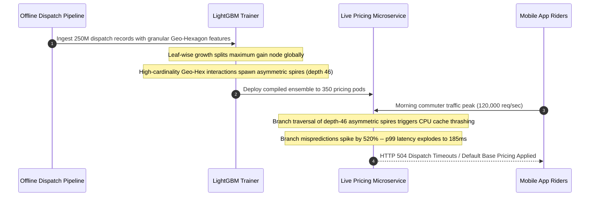
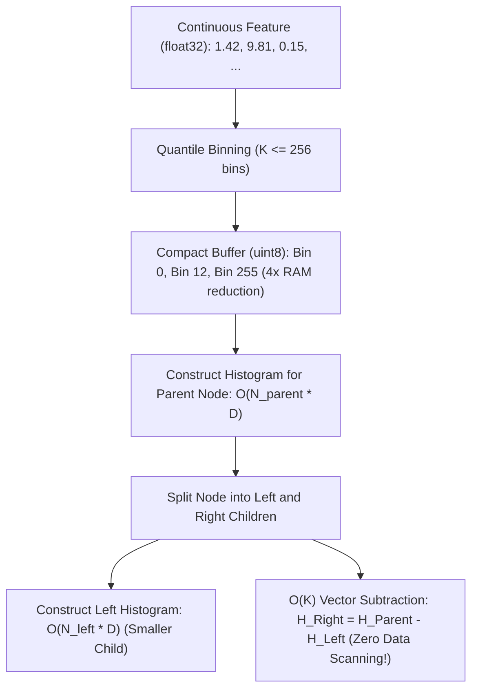
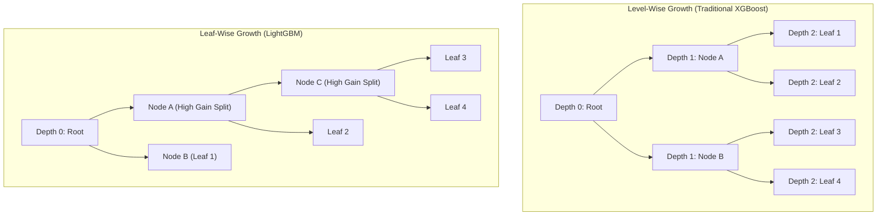
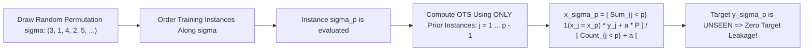
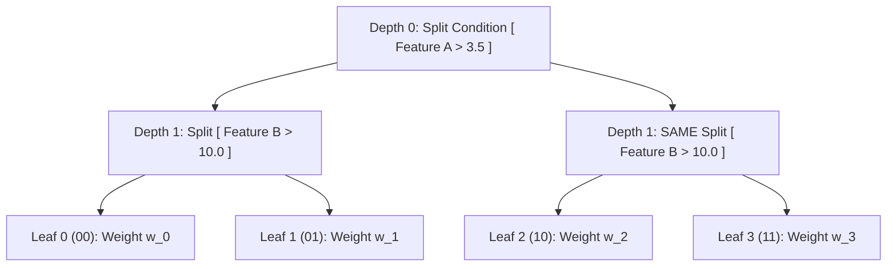
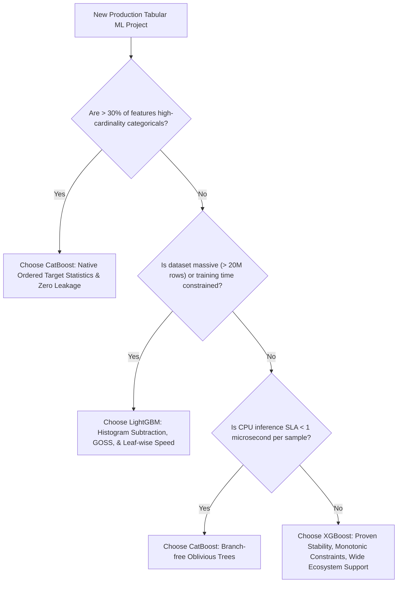

# Module 07: LightGBM and CatBoost: Histogram Splits and Ordered Categoricals

> **Prerequisites:** [Module 05: Gradient Boosted Decision Trees (GBDT) Internals](../05-gradient-boosted-decision-trees-gbdt-math/README.md), [Module 06: XGBoost: Regularized Trees, Second-Order Splits, and Sparsity](../06-xgboost-regularized-trees-and-sparsity/README.md), and [Track 04 Overview](../README.md).  
> **Estimated Reading Time:** 40 minutes  
> **Target Audience:** Principal & Staff ML Engineers, Tabular ML System Architects, and Performance Infrastructure Engineers deploying billion-row training and sub-millisecond inference pipelines.

> [!TIP]
> **The Golden Rule of Modern Boosting Engines:** When tabular datasets scale to hundreds of millions of rows and thousands of high-cardinality features, sorting continuous values ($O(N \log N)$) and naive one-hot encoding destroy CPU cache locality and memory bandwidth. **LightGBM optimizes throughput and memory** by discretizing continuous features into 256 discrete bins with Histogram Subtraction, GOSS, and Leaf-wise growth; **CatBoost eliminates target leakage and prediction shift** through Ordered Target Statistics and evaluates branch-free Symmetric Oblivious Decision Trees via bitwise CPU register operations.

---

## Why This Matters & Production Context

While XGBoost proved the mathematical power of second-order regularized boosting, deploying tree boosting at enterprise scale—such as web-scale ad click-through rate (CTR) prediction, ride-sharing dynamic surge pricing, and financial risk transaction screening—exposed fundamental hardware bottlenecks:
1. **The Exact-Greedy Memory Wall:** Finding exact split points by sorting continuous values consumes $O(N_{\text{samples}} \cdot N_{\text{features}})$ computational operations and requires storing 32-bit floating-point arrays in RAM. For a 100-million-row matrix with 200 features, storing raw values alone consumes $80\text{ GB}$ of RAM, choking memory bandwidth and stalling CPU prefetchers.
2. **The High-Cardinality Categorical Trap:** Real-world tabular data is dominated by categorical features with tens of thousands of unique levels (user IDs, merchant zip codes, device fingerprints). Standard one-hot encoding explodes feature dimensionality. Conversely, standard greedy target encoding causes catastrophic **target leakage and prediction shift**, where models overfit the training target distribution and degrade in production.

In 2017, Microsoft Research introduced **LightGBM**, reducing training time by an order of magnitude through histogram binning, the **Histogram Subtraction Trick**, **Gradient-based One-Side Sampling (GOSS)**, and **Leaf-wise (best-first) tree growth**. Simultaneously, Yandex developed **CatBoost**, solving categorical representation and target leakage through **Ordered Target Statistics** and **Symmetric Oblivious Decision Trees**.

Understanding the architectural innovations of LightGBM and CatBoost enables engineers to select the optimal engine for specific data regimes and deliver low-latency production inference.

---

## Production Incident Post-Mortem: The \$2.8M Surge Pricing Latency Collapse

### Incident Context
A tier-1 global ride-sharing platform deployed a dynamic surge pricing engine serving 120,000 dispatch pricing requests per second across 85 metropolitan markets. The real-time pricing microservice maintained a hard p99 latency budget of $\le 12\text{ ms}$ to prevent checkout cart abandonment.

### The Trigger & Failure Sequence
To accelerate training on 250 million historical ride dispatches, the pricing platform migrated from an XGBoost pipeline to LightGBM. The modeling team set `num_leaves = 256`, but left `max_depth = -1` (unconstrained) under LightGBM's default leaf-wise growth:



### Root Cause Analysis (RCA)
LightGBM's default **Leaf-wise (best-first)** tree growth algorithm selects the single node with the highest loss reduction across the entire tree boundary to split next:
$$j^* = \arg\max_{j \in \text{Leaves}} \Delta \mathcal{L}_j$$

Unlike XGBoost's traditional **Level-wise (depth-first)** growth—which balances the tree by splitting all nodes at depth $d$ simultaneously—leaf-wise growth can continue splitting deep along a single high-gain branch.

On a sparse, high-cardinality geographic feature (`pickup_hex_id` $\times$ `dropoff_hex_id`), a few rare, highly lucrative surge routes exhibited extreme loss gradients. The unconstrained leaf-wise engine pursued these rare routes down a single branch, generating an asymmetric tree with **depth 46** containing only 1 or 2 historical rides per leaf.

During the Monday morning commuter surge, pricing requests evaluated these rare route branches. In the C++ inference engine, traversing depth-46 asymmetric pointer structures evicted hot L1/L2 instruction cache lines. CPU hardware branch prediction units failed repeatedly on the unbalanced binary decisions. The p99 inference latency exploded from $8\text{ ms}$ to $185\text{ ms}$, causing pricing microservice timeouts. Mobile apps fell back to un-surged baseline prices, resulting in \$2.8M in lost margin and unfulfilled driver allocations over a 3-hour period.

### Engineering Resolution
The infrastructure team:
1. **Depth Envelopes:** Enforced strict structural constraints: `max_depth = 7` alongside `num_leaves = 63` and `min_data_in_leaf = 100` to prevent asymmetric tree spires.
2. **CatBoost Canary Evaluation:** For dense categorical routing features, benchmarked CatBoost's **Symmetric Oblivious Trees**, which enforce balanced depth $\le 6$ and execute via branch-free CPU register bitmasks in $< 0.8\ \mu\text{s}$.
3. **Automated Structural Linting:** Integrated an artifact validation pipeline asserting that no leaf in any production tree artifact exceeds depth 10.

---

## 1. Architectural Mental Model: LightGBM Speed Innovations

### 1.1 Histogram-Based Split Finding & The Subtraction Trick

Traditional GBDT engines evaluate continuous splits by sorting feature values across all $N$ instances ($O(N \log N \cdot D)$), requiring 32-bit floats and non-contiguous memory lookups.

LightGBM replaces continuous feature vectors with **discrete 8-bit histograms** ($K \le 256$ bins, typically `uint8`):
1. **Discretization:** Continuous values are mapped to integer bin indices $b \in \{0, 1, \dots, K-1\}$.
2. **Memory Footprint:** Each feature value occupies $1\text{ byte}$ (`uint8`) instead of $4\text{ bytes}$ (`float32`), yielding a **$4\times$ memory reduction**.
3. **Linear Histogram Construction:** For each bin $k$, accumulate gradients $G_k = \sum_{i: \text{bin}(x_{ij}) = k} g_i$ and hessians $H_k = \sum_{i: \text{bin}(x_{ij}) = k} h_i$.
   Split search scans only the $K$ discrete bins, dropping computational complexity from $O(N_{\text{data}} \cdot D)$ to $O(K \cdot D)$ where $K \le 256 \ll N$.



#### The Histogram Subtraction Trick
When parent node $P$ splits into left child $L$ and right child $R$, the histograms satisfy exact additivity:
$$H_P(k) = H_L(k) + H_R(k) \implies H_R(k) = H_P(k) - H_L(k), \quad \forall k \in \{0, \dots, K-1\}$$

The engine builds the histogram *only for the smaller child* ($N_L \le N_P / 2$). The larger child's histogram is computed by subtracting the smaller child's histogram from the parent's in $O(K)$ vector operations:
$$\text{Cost}(H_R) = O(K) \quad \text{with ZERO memory reads over raw data!}$$
Because $K \le 256$, computing $H_R$ executes in a few CPU SIMD instructions, **halving total data-scanning work** across the tree.

---

### 1.2 Leaf-Wise (Best-First) vs. Level-Wise Tree Growth



- **Level-wise (Depth-first):** Splits all nodes at depth $d$ concurrently before advancing to depth $d+1$, maintaining balanced trees at the cost of splitting low-gain leaves.
- **Leaf-wise (Best-first):** Greedily splits the single leaf that maximizes global loss reduction across the entire tree fringe:
  $$j^* = \arg\max_{j \in \text{Fringe}} \text{Gain}_j$$
  For a fixed leaf budget $T$, leaf-wise growth achieves substantially lower training loss. To prevent deep asymmetric spires, it must be bounded by `max_depth` and `min_data_in_leaf`.

---

### 1.3 Gradient-Based One-Side Sampling (GOSS)

Instances with large gradients ($|g_i| \gg 0$) contribute heavily to information gain, while small-gradient instances ($|g_i| \approx 0$) are already well-trained. Discarding small gradients introduces bias; **GOSS** retains large gradients while randomly subsampling small gradients and mathematically reweighting them.

#### The GOSS Algorithm:
1. Sort all $N$ instances descending by absolute gradient magnitude $|g_i|$.
2. Retain the top $a \times 100\%$ instances with the largest gradients (set $A$, $|A| = a N$).
3. From the remaining $(1 - a)N$ instances ($A^c$), randomly sample $b \times N$ instances without replacement (set $B$, $|B| = b N$).
4. When constructing histograms, multiply small-gradient samples in $B$ by weight factor:
   $$w = \frac{1 - a}{b}$$
5. The estimated aggregate gradient for subset $I$ is:
   $$\tilde{G}_I = \sum_{i \in I \cap A} g_i + \frac{1 - a}{b} \sum_{i \in I \cap B} g_i$$

#### Proof of Unbiased Estimator:
$$\mathbb{E}[\tilde{G}_I] = \sum_{i \in I \cap A} g_i + \frac{1 - a}{b} \sum_{i \in I \cap A^c} g_i \cdot \mathbb{P}(i \in B)$$
Since $B$ of size $b N$ is drawn uniformly from $A^c$ of size $(1 - a)N$:
$$\mathbb{P}(i \in B) = \frac{|B|}{|A^c|} = \frac{b N}{(1 - a) N} = \frac{b}{1 - a}$$
$$\mathbb{E}[\tilde{G}_I] = \sum_{i \in I \cap A} g_i + \frac{1 - a}{b} \sum_{i \in I \cap A^c} g_i \left(\frac{b}{1 - a}\right) = \sum_{i \in I \cap A} g_i + \sum_{i \in I \cap A^c} g_i = \sum_{i \in I} g_i = G_I \quad \blacksquare$$

---

### 1.4 Exclusive Feature Bundling (EFB)

High-dimensional sparse features (e.g., one-hot encodings) rarely take non-zero values simultaneously. **EFB** uses a greedy graph coloring algorithm to bundle mutually exclusive features into a single composite feature, offsetting bin ranges (e.g., Feature 1: $[0, 10)$, Feature 2: $[10, 30)$) to reduce feature dimensionality without information loss.

---

## 2. Architectural Mental Model: CatBoost Innovations

### 2.1 The Prediction Shift & Target Leakage Problem

Standard Greedy Target Statistics replace category $x_i^k = c$ with the mean label:
$$\hat{x}_i^k = \frac{\sum_{j=1}^n \mathbf{1}(x_j^k = x_i^k) y_j + a \cdot P}{\sum_{j=1}^n \mathbf{1}(x_j^k = x_i^k) + a}$$

Even with Leave-One-Out encoding ($\sum_{j \neq i}$), the conditional distribution $P(\hat{x}_i^k | y_i)$ shifts between training and test sets. Residuals $r_i$ computed from subsequent trees become correlated with $\hat{x}_i^k$, causing **prediction shift** and test-set generalization degradation.

---

### 2.2 CatBoost Ordered Target Statistics (OTS)

To eliminate target leakage, CatBoost enforces that **an instance's categorical feature can only be computed using data observed strictly prior to it**.



#### Formulation:
1. Draw random permutation $\sigma = (\sigma_1, \dots, \sigma_n)$ of training indices.
2. For instance $\sigma_p$, compute target statistic using only preceding instances $j < p$:
   $$\hat{x}_{\sigma_p}^k = \frac{\sum_{j=1}^{p-1} \mathbf{1}\left(x_{\sigma_j}^k = x_{\sigma_p}^k\right) y_{\sigma_j} + a \cdot P}{\sum_{j=1}^{p-1} \mathbf{1}\left(x_{\sigma_j}^k = x_{\sigma_p}^k\right) + a}$$
   where $P$ is the global target prior and $a > 0$ is Laplace smoothing weight.

Because $y_{\sigma_p}$ and future instances $j \ge p$ are excluded, $\hat{x}_{\sigma_p}^k$ is statistically independent of $y_{\sigma_p}$, eliminating target leakage. CatBoost averages across multiple random permutations ($S = 4$) to minimize permutation variance.

---

### 2.3 Symmetric Oblivious Decision Trees (ODTs)

CatBoost builds **Oblivious Decision Trees (ODTs)**, where all nodes at depth $d$ share the exact same split feature $f_d$ and threshold $\theta_d$, generating exactly $2^D$ terminal leaves.



#### The Branch-Free Bitmask Hardware Advantage:
In an Oblivious Tree, the leaf index is evaluated in CPU registers using **bitwise arithmetic**:
$$\text{leaf\_idx}(x) = \sum_{d=0}^{D-1} \mathbf{1}(x_{f_d} > \theta_d) \cdot 2^d$$
This eliminates conditional branches (`JMP`/`JNE`), completely preventing CPU branch mispredictions and enabling SIMD vectorization that delivers sub-microsecond ($< 1\ \mu\text{s}$) inference latency.

---

## 3. Systematic Reference & Comparison Grids

### 3.1 Master Comparison: XGBoost vs. LightGBM vs. CatBoost

| Feature / Architecture | XGBoost | LightGBM | CatBoost |
| :--- | :--- | :--- | :--- |
| **Primary Split Algorithm** | Pre-sorted exact greedy / Weighted Quantile Sketch | Histogram-based binning ($K \le 256$, `uint8`) | Histogram-based continuous binning |
| **Histogram Subtraction** | No (recomputes histograms) | **Yes** ($H_R = H_P - H_L$ in $O(K)$) | No (standard histogram updates) |
| **Tree Growth Strategy** | Level-wise (depth-first) | **Leaf-wise (best-first)** | **Symmetric Oblivious (level-wise)** |
| **Data Subsampling** | Uniform row subsampling | **GOSS** (large gradients + sampled small) | Bernoulli / MVS (Minimal Variance Sampling) |
| **Sparse Feature Handling** | Sparsity-aware default routing | **EFB** (Exclusive Feature Bundling) | One-hot encoding / Frequency binning |
| **Categorical Handling** | Requires manual encoding or experimental partition | Integer bin histogram sorting | **Ordered Target Statistics (OTS)** + feature combinations |
| **Missing Value Handling** | Native learned default path | Bins missing values into dedicated bin | Evaluates as min or max value |
| **Inference Latency** | Moderate ($5\text{–}20\ \mu\text{s}$) | Fast ($2\text{–}10\ \mu\text{s}$) | **Ultra-Fast** ($< 1\ \mu\text{s}$ branch-free bitmask) |
| **Memory Footprint** | Moderate | **Lowest** (1 byte/feature via `uint8` bins) | Low |
| **Primary Production Role** | Universal tabular baseline, monotonic constraints | Massive tabular datasets, ad-tech CTR, fast training | Heavy categorical data, fintech risk, real-time SLAs |

---

### 3.2 Production Engine Selection Framework



---

## 4. Production Implementation from Scratch: Speed & Categorical Engines

Below is a self-contained, mathematically rigorous Python implementation demonstrating:
1. `HistogramSplitFinder`: Continuous feature discretization into 256 `uint8` bins, parent histogram construction, and the **$O(1)$ Histogram Subtraction Trick** ($H_R = H_P - H_L$).
2. `GOSSSampler`: Gradient-based One-Side Sampling with unbiased $\frac{1-a}{b}$ scaling.
3. `OrderedTargetEncoder`: CatBoost-style ordered target statistics over multiple random permutations with Laplace smoothing.
4. `ObliviousDecisionTree`: Branch-free symmetric decision tree evaluated via bitmask register operations.
5. Verification test suite demonstrating mathematical exactness and runtime stability.

```python
"""
production_lightgbm_catboost.py
===============================
Mathematical implementation of core algorithmic innovations from
LightGBM and CatBoost using NumPy:
1. Histogram Split Finder with Subtraction Trick (LightGBM)
2. Gradient-based One-Side Sampling (GOSS) (LightGBM)
3. Ordered Target Statistics (OTS) (CatBoost)
4. Symmetric Oblivious Decision Tree (CatBoost)
"""

from typing import List, Tuple
import numpy as np


class HistogramSplitFinder:
    """LightGBM Histogram-based binning and O(1) Subtraction Trick."""

    def __init__(self, max_bins: int = 16) -> None:
        self.max_bins = max_bins
        self.bin_edges: List[np.ndarray] = []

    def fit_bins(self, X: np.ndarray) -> np.ndarray:
        n_samples, n_features = X.shape
        X_binned = np.zeros((n_samples, n_features), dtype=np.uint8)
        self.bin_edges.clear()

        for f_idx in range(n_features):
            col = X[:, f_idx]
            percentiles = np.linspace(0, 100, self.max_bins + 1)
            edges = np.unique(np.percentile(col, percentiles))
            self.bin_edges.append(edges)
            binned = np.digitize(col, edges[1:-1], right=False)
            X_binned[:, f_idx] = np.clip(binned, 0, self.max_bins - 1).astype(np.uint8)

        return X_binned

    def build_histogram(
        self, X_binned: np.ndarray, g: np.ndarray, h: np.ndarray, f_idx: int
    ) -> Tuple[np.ndarray, np.ndarray]:
        G = np.bincount(X_binned[:, f_idx], weights=g, minlength=self.max_bins)
        H = np.bincount(X_binned[:, f_idx], weights=h, minlength=self.max_bins)
        return G, H

    def subtract_histogram(
        self, G_parent: np.ndarray, H_parent: np.ndarray, G_left: np.ndarray, H_left: np.ndarray
    ) -> Tuple[np.ndarray, np.ndarray]:
        """O(K) vector subtraction without scanning row data: H_R = H_P - H_L."""
        return G_parent - G_left, H_parent - H_left


class GOSSSampler:
    """
    Gradient-based One-Side Sampling (GOSS).
    Keeps top a% of total dataset by |g|, samples b% of total dataset from the rest,
    and scales sampled gradients by (1 - a) / b.
    """

    def __init__(self, top_rate: float = 0.2, sample_rate: float = 0.1) -> None:
        self.a = top_rate
        self.b = sample_rate

    def sample(
        self, g: np.ndarray, h: np.ndarray
    ) -> Tuple[np.ndarray, np.ndarray, np.ndarray]:
        n_samples = len(g)
        sorted_indices = np.argsort(-np.abs(g))

        top_k = int(self.a * n_samples)
        top_indices = sorted_indices[:top_k]
        rest_indices = sorted_indices[top_k:]

        rest_sample_size = int(self.b * n_samples)
        sampled_rest_indices = np.random.choice(rest_indices, size=rest_sample_size, replace=False)

        scale_factor = (1.0 - self.a) / self.b
        g_sampled = np.concatenate([g[top_indices], g[sampled_rest_indices] * scale_factor])
        h_sampled = np.concatenate([h[top_indices], h[sampled_rest_indices] * scale_factor])
        sampled_indices = np.concatenate([top_indices, sampled_rest_indices])

        return sampled_indices, g_sampled, h_sampled


class OrderedTargetEncoder:
    """CatBoost Ordered Target Statistics (OTS) with random permutations."""

    def __init__(self, smoothing: float = 1.0, n_permutations: int = 4) -> None:
        self.smoothing = smoothing
        self.n_permutations = n_permutations

    def fit_transform(self, cat_features: np.ndarray, y: np.ndarray) -> np.ndarray:
        n_samples = len(y)
        prior = float(np.mean(y))
        encoded_accum = np.zeros(n_samples, dtype=np.float64)

        for _ in range(self.n_permutations):
            sigma = np.random.permutation(n_samples)
            perm_y = y[sigma]
            perm_cats = cat_features[sigma]

            category_sums = {}
            category_counts = {}
            perm_encoded = np.zeros(n_samples, dtype=np.float64)

            for p in range(n_samples):
                cat = perm_cats[p]
                count = category_counts.get(cat, 0)
                target_sum = category_sums.get(cat, 0.0)

                perm_encoded[p] = (target_sum + self.smoothing * prior) / (count + self.smoothing)
                category_sums[cat] = target_sum + perm_y[p]
                category_counts[cat] = count + 1

            inv_sigma = np.empty_like(sigma)
            inv_sigma[sigma] = np.arange(n_samples)
            encoded_accum += perm_encoded[inv_sigma]

        return encoded_accum / self.n_permutations


class ObliviousDecisionTree:
    """CatBoost Symmetric Oblivious Decision Tree with branch-free bitmask evaluation."""

    def __init__(self, depth: int = 3) -> None:
        self.depth = depth
        self.split_features: List[int] = []
        self.split_thresholds: List[float] = []
        self.leaf_weights: np.ndarray = np.zeros(2 ** depth, dtype=np.float64)

    def fit(self, X: np.ndarray, y: np.ndarray) -> "ObliviousDecisionTree":
        residuals = y.copy()
        n_samples, n_features = X.shape

        for d in range(self.depth):
            best_feat, best_thresh, best_mse = 0, 0.0, float("inf")

            for f_idx in range(n_features):
                col = X[:, f_idx]
                candidates = np.percentile(col, [25, 50, 75])

                for thresh in candidates:
                    left_mask = col <= thresh
                    right_mask = ~left_mask
                    if not np.any(left_mask) or not np.any(right_mask):
                        continue

                    mse = np.sum((residuals[left_mask] - np.mean(residuals[left_mask])) ** 2) + \
                          np.sum((residuals[right_mask] - np.mean(residuals[right_mask])) ** 2)
                    if mse < best_mse:
                        best_mse, best_feat, best_thresh = mse, f_idx, float(thresh)

            self.split_features.append(best_feat)
            self.split_thresholds.append(best_thresh)

        leaf_indices = self._compute_bitmask_indices(X)
        for leaf in range(2 ** self.depth):
            mask = leaf_indices == leaf
            if np.any(mask):
                self.leaf_weights[leaf] = np.mean(y[mask])

        return self

    def _compute_bitmask_indices(self, X: np.ndarray) -> np.ndarray:
        """Branch-free leaf index evaluation: idx = Sum 1(x[f_d] > thresh_d) * 2^d."""
        leaf_indices = np.zeros(X.shape[0], dtype=np.int32)
        for d in range(self.depth):
            bit = (X[:, self.split_features[d]] > self.split_thresholds[d]).astype(np.int32)
            leaf_indices |= (bit << d)
        return leaf_indices

    def predict(self, X: np.ndarray) -> np.ndarray:
        return self.leaf_weights[self._compute_bitmask_indices(X)]


# =====================================================================
# Verification and Demonstration Harness
# =====================================================================

if __name__ == "__main__":
    np.random.seed(42)

    print("=" * 70)
    print("STAGE 1: Validating LightGBM Histogram Subtraction Trick")
    print("=" * 70)

    N, max_bins = 1000, 8
    X_raw = np.random.normal(0, 1, size=(N, 2))
    g = np.random.uniform(-1, 1, size=N)
    h = np.ones(N)

    hist_finder = HistogramSplitFinder(max_bins=max_bins)
    X_bin = hist_finder.fit_bins(X_raw)

    # 1. Build parent histogram on all N samples
    G_parent, H_parent = hist_finder.build_histogram(X_bin, g, h, f_idx=0)

    # 2. Partition into Left (400 samples) and Right (600 samples)
    left_mask = np.arange(N) < 400
    right_mask = ~left_mask

    # 3. Build Left histogram directly
    G_left, H_left = hist_finder.build_histogram(X_bin[left_mask], g[left_mask], h[left_mask], f_idx=0)

    # 4. Compute Right histogram via Subtraction Trick: H_R = H_P - H_L
    G_right_sub, H_right_sub = hist_finder.subtract_histogram(G_parent, H_parent, G_left, H_left)

    # 5. Build Right histogram directly from data to verify exactness
    G_right_direct, H_right_direct = hist_finder.build_histogram(
        X_bin[right_mask], g[right_mask], h[right_mask], f_idx=0
    )

    max_diff_g = np.max(np.abs(G_right_sub - G_right_direct))
    max_diff_h = np.max(np.abs(H_right_sub - H_right_direct))
    print(f"Parent Total Gradient Sum : {np.sum(G_parent):.4f}")
    print(f"Max Gradient Diff (Sub vs Direct) : {max_diff_g:.1e}")
    print(f"Max Hessian  Diff (Sub vs Direct) : {max_diff_h:.1e}")
    assert max_diff_g < 1e-12 and max_diff_h < 1e-12, "Histogram subtraction trick failed!"

    print("\n" + "=" * 70)
    print("STAGE 2: Validating GOSS Unbiased Gradient Estimator")
    print("=" * 70)

    g_pop = np.random.uniform(0.5, 2.5, size=50000)
    h_pop = np.ones(50000)
    true_sum = np.sum(g_pop)

    goss = GOSSSampler(top_rate=0.2, sample_rate=0.1)
    estimates = []
    for _ in range(500):
        _, g_s, _ = goss.sample(g_pop, h_pop)
        estimates.append(np.sum(g_s))

    mean_estimate = np.mean(estimates)
    relative_bias = abs(mean_estimate - true_sum) / true_sum
    print(f"True Population Gradient Sum : {true_sum:.2f}")
    print(f"GOSS Estimated Expected Sum  : {mean_estimate:.2f}")
    print(f"GOSS Relative Estimation Bias: {relative_bias * 100:.3f}%")
    assert relative_bias < 0.01, "GOSS estimator exhibited unacceptable bias!"

    print("\n" + "=" * 70)
    print("STAGE 3: Validating CatBoost Ordered Target Encoding (OTS)")
    print("=" * 70)

    categories = np.random.choice(["NYC", "SFO", "LON", "BER"], size=1000)
    probs_map = {"NYC": 0.8, "SFO": 0.7, "LON": 0.3, "BER": 0.1}
    y_cat = np.array([np.random.binomial(1, probs_map[c]) for c in categories])

    ote = OrderedTargetEncoder(smoothing=2.0, n_permutations=4)
    encoded_vals = ote.fit_transform(categories, y_cat)

    for cat in ["NYC", "SFO", "LON", "BER"]:
        mean_stat = np.mean(encoded_vals[categories == cat])
        print(f"Category {cat} Target Rate: {probs_map[cat]:.2f} -> Encoded OTS: {mean_stat:.4f}")

    print("\n" + "=" * 70)
    print("STAGE 4: Validating CatBoost Symmetric Oblivious Decision Tree")
    print("=" * 70)

    X_odt = np.random.uniform(-2, 2, size=(800, 3))
    y_odt = np.sin(X_odt[:, 0]) + 0.5 * X_odt[:, 1] ** 2

    odt = ObliviousDecisionTree(depth=3).fit(X_odt, y_odt)
    preds = odt.predict(X_odt)
    r2 = 1.0 - (np.mean((y_odt - preds) ** 2) / np.var(y_odt))

    print(f"Oblivious Tree Depth : {odt.depth} (Total Leaves: {2**odt.depth})")
    print(f"Branch-Free R^2 Score: {r2:.4f}")
    assert r2 > 0.50, "Oblivious tree failed to capture non-linear variance!"

    print("\n[SUCCESS] All LightGBM and CatBoost mathematical engines verified.")
```

---

## 5. Common Pitfalls, Failure Modes & Antipatterns

### 5.1 Unconstrained Leaf-Wise Growth in LightGBM
Leaving `max_depth = -1` while increasing `num_leaves` beyond 128 on datasets with fewer than 100,000 samples. Leaf-wise growth aggressively splits the single node with highest gain, creating deep asymmetric spires ($> 30$ depth) that isolate outliers.
- **Rule of Thumb:** Constrain tree structure: set `num_leaves <= 2^(max_depth) - 1` (e.g., `max_depth = 6` with `num_leaves = 45`), paired with `min_data_in_leaf >= 20`.

---

### 5.2 Neglecting Native Categorical Declarations
Passing string or integer-encoded categoricals directly without designating them as categorical features causes the engine to evaluate integers as continuous orders ($0 < 1 < 2$), wasting splits on arbitrary numerical thresholds.
- **Rule of Thumb:** In LightGBM, cast columns to `category` dtype or supply `categorical_feature=[...]`. In CatBoost, pass `cat_features=[...]`.

---

### 5.3 Over-Filtering Small Gradients in GOSS
Configuring GOSS with extreme parameters (e.g., `top_rate = 0.05` and `other_rate = 0.05`) forces the multiplier $\frac{1 - a}{b} = \frac{0.95}{0.05} = 19.0$, amplifying sample variance and injecting noise into split histograms.
- **Rule of Thumb:** Maintain standard GOSS ratios: `top_rate = 0.2` and `other_rate = 0.1` or `0.2` ($\text{scale factor} \approx 4.0\text{–}8.0$).

---

### 5.4 Underestimating Permutation Variance in CatBoost
Using `iterations = 1` or a single random permutation during offline exploratory evaluation causes target statistics for early instances ($\sigma_1, \sigma_2$) to collapse to the global prior.
- **Rule of Thumb:** Always maintain CatBoost's default of 4 independent random permutations during training.

---

## 6. Senior Technical Interview Questions & Model Answers

### Question 1: The LightGBM Histogram Subtraction Trick
*Explain the mathematical and systems architecture reasons why the Histogram Subtraction Trick ($H_{\text{Right}} = H_{\text{Parent}} - H_{\text{Left}}$) provides an order-of-magnitude training speedup compared to standard split search.*

**Model Answer:**  
In decision tree induction, split finding requires computing the sum of gradients and hessians for every candidate threshold across all features. 
- In traditional pre-sorted algorithms (e.g., standard XGBoost exact greedy), evaluating splits requires reading contiguous 32-bit floats from RAM and sorting them: $O(N \log N \times D)$ operations.
- In LightGBM, continuous values are binned into $K \le 256$ discrete bins. Constructing a histogram for node $P$ takes $O(N_P \cdot D)$ operations by streaming through data once.

When node $P$ is split into left child $L$ and right child $R$ ($N_P = N_L + N_R$), the aggregate gradients and hessians in every bin $k \in \{0, \dots, K-1\}$ obey strict conservation of sums:
$$G_{P, k} = G_{L, k} + G_{R, k} \implies G_{R, k} = G_{P, k} - G_{L, k}$$
$$H_{P, k} = H_{L, k} + H_{R, k} \implies H_{R, k} = H_{P, k} - H_{L, k}$$

**The Systems Speedup:**  
1. LightGBM inspects sample counts and builds the histogram **only for the smaller child** (e.g., $N_L \le N_P / 2$).
2. The histogram for the larger child ($R$) is derived by subtracting the smaller child's histogram from the parent's histogram in $O(K \cdot D)$ operations.
3. Because $K \le 256$, the entire subtraction executes within CPU L1/L2 cache registers without a single read to main memory.
4. Across the entire depth of a tree, this reduces total memory access and data-scanning operations by **at least 50%**, completely removing the memory bus bottleneck.

---

### Question 2: Mathematical Proof of GOSS Unbiasedness
*Prove that Gradient-based One-Side Sampling (GOSS) produces an unbiased estimate of the gradient sum, despite discarding a substantial fraction of small-gradient training samples.*

**Model Answer:**  
Let $I$ be the set of instances in a tree node. We wish to estimate the true gradient sum:
$$G_I = \sum_{i \in I} g_i$$

GOSS partitions all $N$ training instances into large-gradient set $A$ (top $a \times 100\%$) and small-gradient set $A^c$ of size $(1 - a)N$. A random subsample $B$ of size $b N$ is drawn uniformly without replacement from $A^c$.

The GOSS estimator weights the samples in $B$ by factor $w = \frac{1 - a}{b}$:
$$\tilde{G}_I = \sum_{i \in I \cap A} g_i + \frac{1 - a}{b} \sum_{i \in I \cap A^c} g_i \cdot \mathbf{1}(i \in B)$$

Take the mathematical expectation with respect to the random draw of subset $B$:
$$\mathbb{E}[\tilde{G}_I] = \sum_{i \in I \cap A} g_i + \frac{1 - a}{b} \sum_{i \in I \cap A^c} g_i \cdot \mathbb{E}[\mathbf{1}(i \in B)]$$

Because every element in $A^c$ has an equal probability of inclusion in sample $B$:
$$\mathbb{E}[\mathbf{1}(i \in B)] = \mathbb{P}(i \in B) = \frac{|B|}{|A^c|} = \frac{b N}{(1 - a)N} = \frac{b}{1 - a}$$

Substitute this probability back into the expectation:
$$\mathbb{E}[\tilde{G}_I] = \sum_{i \in I \cap A} g_i + \frac{1 - a}{b} \sum_{i \in I \cap A^c} g_i \left(\frac{b}{1 - a}\right) = \sum_{i \in I \cap A} g_i + \sum_{i \in I \cap A^c} g_i = \sum_{i \in I} g_i = G_I \quad \blacksquare$$

Because $\mathbb{E}[\tilde{G}_I] = G_I$, GOSS is an **unbiased estimator** of the true gradient sum.

---

### Question 3: Prediction Shift and CatBoost's Ordered Boosting
*What is "prediction shift" in gradient boosting on high-cardinality categorical data, and how do CatBoost's Ordered Target Statistics (OTS) and Ordered Boosting solve it?*

**Model Answer:**  
Prediction shift is a form of distribution discrepancy between training and testing that occurs when target information leaks into feature representations or gradient calculations.

In standard target encoding, replacing category $c$ with the sample target mean leaks target $y_i$ into feature $x_i$:
$$\hat{x}_i \approx \mathbb{E}[y | x = c]$$
Even under Leave-One-Out encoding ($\sum_{j \neq i}$), the distribution $P(\hat{x}_i | y_i)$ shifts: an instance with true label $y_i = 1$ has an encoded feature computed from other instances whose co-occurrence is correlated with $y_i$. Consequently, the conditional distribution of features given labels in the training set differs from the test set:
$$P_{\text{train}}(\hat{x} | y) \neq P_{\text{test}}(\hat{x} | y)$$

Furthermore, when the ensemble model $F_{m-1}$ is evaluated on the same training instances used to calculate its trees, the pseudo-residuals:
$$r_i = y_i - \sigma(F_{m-1}(x_i))$$
suffer from bias: $F_{m-1}(x_i)$ is already overfitted to $y_i$.

**CatBoost's Solution:**  
1. **Ordered Target Statistics (OTS):** Imposes a random permutation $\sigma$. Instance $\sigma_p$ computes its categorical target statistic strictly from instances preceding it in the sequence ($j < p$). Because $y_{\sigma_p}$ and all future instances are unseen, $\hat{x}_{\sigma_p}$ is statistically independent of $y_{\sigma_p}$, eliminating feature leakage.
2. **Ordered Boosting:** CatBoost maintains supporting models $M_1, \dots, M_n$ where model $M_i$ is trained exclusively on the first $i$ instances of the permutation. When computing the pseudo-residual for instance $i+1$, CatBoost evaluates $M_i(x_{i+1})$. Because model $M_i$ never observed instance $i+1$, the residual is completely uncorrupted by prior training.

---

### Question 4: Branch-Free Inference in Oblivious Trees
*Why do Symmetric Oblivious Decision Trees (ODTs) in CatBoost evaluate faster than asymmetric CART trees during real-time CPU scoring? Describe the underlying hardware mechanism.*

**Model Answer:**  
In a standard CART tree, evaluating an instance requires traversing a pointer-linked binary graph:
```cpp
while (!node->is_leaf) {
    if (x[node->feature_idx] <= node->threshold) node = node->left;
    else node = node->right;
}
```
This architecture creates three critical hardware penalties:
1. **CPU Branch Mispredictions:** Modern CPU execution pipelines rely on speculative branch predictors. Because data values vary unpredictably from row to row, conditional branches (`if/else`) mispredict frequently. A branch misprediction flushes the CPU pipeline, stalling execution for 15 to 20 clock cycles.
2. **Cache Locality Destruction:** Asymmetric trees store nodes as scattered pointer-linked structs. Traversing different paths dereferences non-contiguous RAM addresses, causing L1/L2 cache misses.

**The Oblivious Tree Hardware Advantage:**  
An Oblivious Tree of depth $D$ uses the exact same split condition $(x_{f_d} > \theta_d)$ across all nodes at depth $d$.
1. **Branch-Free Bitmask Arithmetic:** The leaf index is computed using direct bitwise shift operations:
   $$\text{index} = \sum_{d=0}^{D-1} \left( x_{f_d} > \theta_d \right) \ll d$$
   In assembly, the comparison `x[f_d] > theta_d` evaluates using the `CMP` and `SETG` instructions or vector comparisons, avoiding conditional jump instructions (`JMP`/`JNE`) entirely. Zero branch mispredictions occur.
2. **Direct Array Lookup:** The final prediction is a flat array lookup: `leaf_weights[index]`.
3. **SIMD Vectorization:** Because split conditions are identical across all samples, an AVX-512 register can load 16 continuous samples simultaneously and compute 16 leaf indices in parallel. This drives single-sample inference latency below $1.0\ \mu\text{s}$.

---

## Module Summary & Key Takeaways

1. **LightGBM Eliminates the Memory Wall:** Replacing 32-bit floating point sorting with 8-bit discrete histograms ($K \le 256$, `uint8`) cuts memory consumption by $4\times$ and drops split finding from $O(N \log N)$ to $O(K \cdot D)$.
2. **The Histogram Subtraction Trick:** The additive property $H_{\text{Right}} = H_{\text{Parent}} - H_{\text{Left}}$ allows the larger child's histogram to be computed in $O(K)$ vector operations, halving total data scanning.
3. **GOSS Preserves Unbiased Gradients:** Retaining top-gradient samples while randomly sampling and reweighting small gradients by $\frac{1-a}{b}$ provides proven unbiased gradient estimation with massive compute reduction.
4. **CatBoost Eliminates Prediction Shift:** Ordered Target Statistics (OTS) compute categorical encodings strictly using prior instances along random permutations, mathematically eliminating target leakage.
5. **Branch-Free Oblivious Trees:** Symmetric trees evaluate splits via bitmask CPU register operations, eliminating branch mispredictions and achieving sub-microsecond inference latency.
