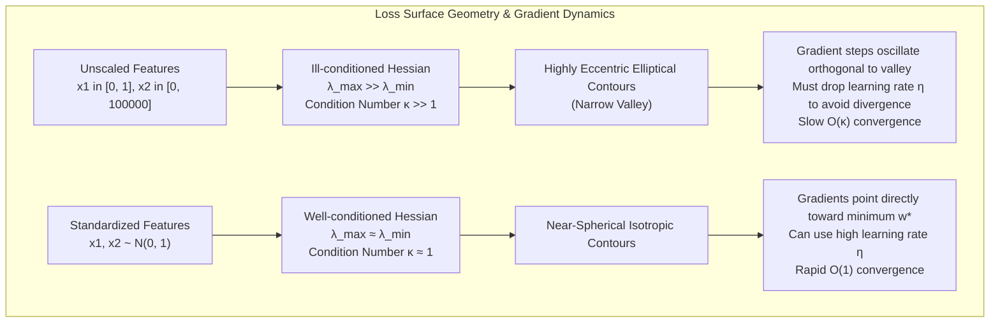
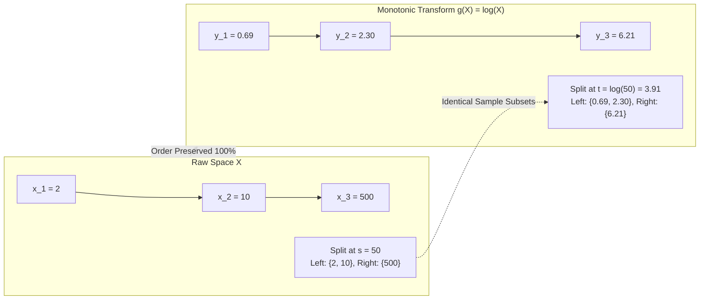
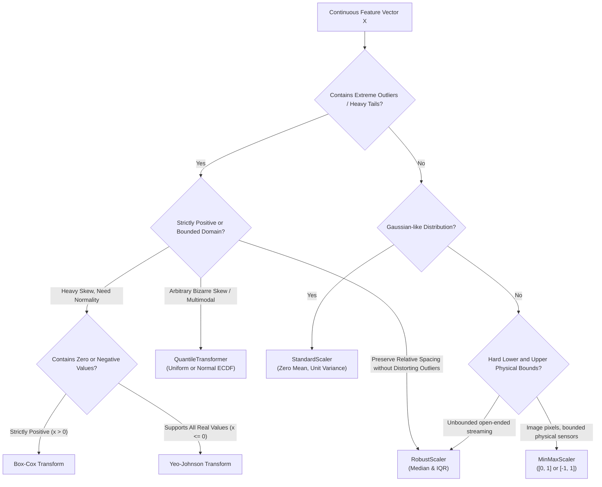
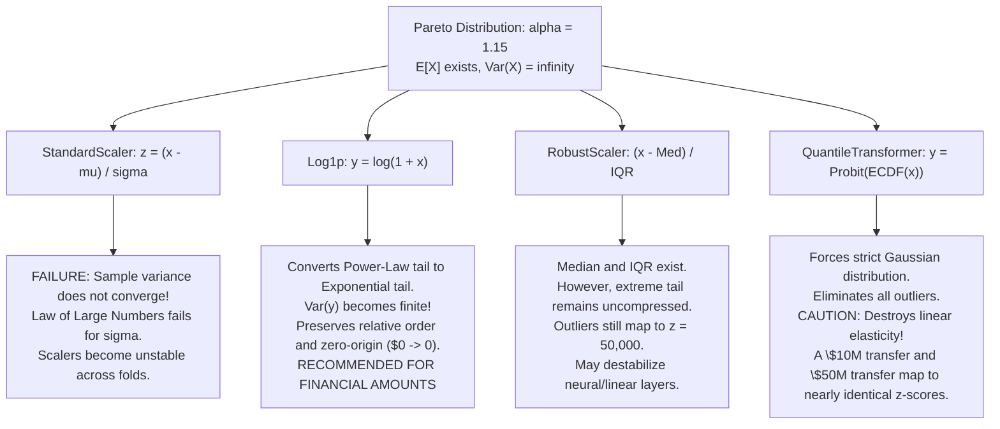
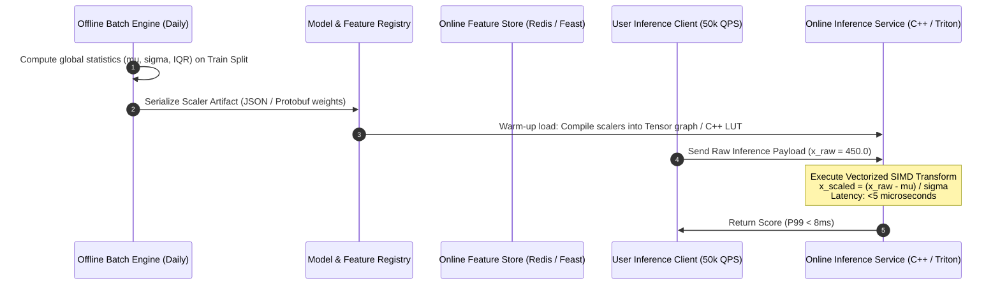

# Module 01: Feature Scaling, Normalization, and Power Transforms

> **Prerequisites:** Multivariable calculus (gradients, Hessian matrices), linear algebra (eigenvalues, condition numbers, matrix norms), NumPy, and scikit-learn. Familiarity with [Module 00: Missing Values](../00-missing-values-imputation-and-missingness-signals/README.md).  
> **Estimated Reading Time:** 44 minutes  
> **Target Audience:** Staff/Senior Machine Learning Engineers, Quantitative Researchers, and Platform Architects optimizing optimization stability, training convergence, and online feature serving.

> [!TIP]
> **The Geometric Principle of Scaling:** Scaling does not alter the Shannon entropy or mutual information of a feature under infinite numerical precision, but it fundamentally reshapes the geometry of the loss surface and the isotropic metric assumptions of distance functions. For linear, kernel, and neural architectures, scaling dictates optimization stability, regularization fairness, and convergence rate. For decision tree ensembles, any strictly increasing monotonic transformation is an invariant identity ($f(g(X)) = f(X)$).

---

## Why This Matters & Production Incident Post-Mortem

In modern machine learning systems, raw numeric inputs span wildly disparate physical units and orders of magnitude: microsecond network latencies ($10^{-6}$), dollar transaction amounts ($10^2$), user account IDs ($10^9$), and click-through rates ($10^{-3}$). Feeding uncalibrated, heterogeneously scaled features into gradient-based optimizers or distance-based kernels leads directly to numerical instability, slow training convergence, and catastrophic serving failures.

Consider this actual post-mortem from a high-throughput programmatic ad-tech platform:

```
================================================================================
INCIDENT POST-MORTEM REPORT: INC-91024
SEVERITY: P1 (Critical Revenue Outage)
TITLE: \$18.2M Bid Collapse Due to MinMaxScaler Saturation in Deep CTR Model
DATE: November 29, 2024 (Black Friday Peak)
================================================================================

1. EXECUTIVE SUMMARY
During the Black Friday traffic surge, the real-time Click-Through Rate (CTR)
prediction engine for sponsored product ads experienced a catastrophic collapse
in predictive calibration. Predicted CTR across premium categories dropped by
84%, causing automated bidding agents to drastically underbid. Ad inventory
win rates fell from 44% to 3.1%, resulting in an estimated \$18.2M in unrealized
gross marketplace revenue over a 6-hour period.

2. ROOT CAUSE ANALYSIS (5 WHYS)
- Why did the bidding agents underbid? The deep CTR neural network predicted near-zero
  conversion probabilities for high-value user sessions.
- Why did predictions collapse? The first dense layer saturated at zero activation
  due to an extreme negative bias shift in feature embeddings.
- Why did the embeddings shift? The feature 'historical_hourly_spend' was preprocessed
  using MinMaxScaler(feature_range=(0, 1)) fitted on standard non-holiday data
  where the historical maximum was \$4,200.
- What happened on Black Friday? Flash-sale power buyers generated spends exceeding
  \$68,000/hour. Because the production serving code clipped raw inputs to the
  training max before scaling, all high-spenders were mapped to 1.0.
- Why did that crash the network? Because 18% of all traffic compressed into the
  exact boundary value of 1.0, the feature lost all variance. Worse, downstream
  cross-product feature crosses multiplied saturated flags, driving layer activations
  into the flat saturation zone of the sigmoid activation function where gradients
  vanished.

3. ARCHITECTURAL REMEDIATION
- Complete removal of bounded MinMaxScaler from unbounded financial features.
- Adoption of Yeo-Johnson Power Transforms and RobustScaler (IQR-based) with dynamic
  quantile tracking in the online feature store.
- Enforcement of strict automated anomaly assertions that trigger circuit-breakers
  if >1% of incoming streaming feature values saturate boundary limits.
================================================================================
```

---

## 1. Architectural & Mathematical Mental Model

### The Optimization Geometry of Feature Scaling

To understand why scaling is mandatory for gradient-based architectures (Linear/Logistic Regression, Neural Networks, Support Vector Machines), we examine the Taylor expansion of the loss function around the local optimum $w^*$.

Let $L(w)$ be a twice-differentiable convex loss function:
$$L(w) \approx L(w^*) + \nabla L(w^*)^T (w - w^*) + \frac{1}{2} (w - w^*)^T H (w - w^*)$$

At the minimum $w^*$, the gradient $\nabla L(w^*) = 0$. The local curvature is dictated entirely by the **Hessian matrix** $H = \nabla^2 L(w^*)$. For Ordinary Least Squares and Ridge Regression, $H = \frac{1}{N} X^T X$.



Let $\lambda_{\max}$ and $\lambda_{\min}$ be the maximum and minimum eigenvalues of $H$. The **condition number** $\kappa$ of the Hessian is defined as:
$$\kappa(H) = \frac{\lambda_{\max}(H)}{\lambda_{\min}(H)} \ge 1$$

When features possess vastly different variances (e.g., $X_1 \in [0, 1]$ and $X_2 \in [0, 10^5]$), the diagonal entries of $X^T X$ differ by $10^{10}$. The resulting condition number $\kappa \approx 10^{10}$.

Under standard gradient descent with learning rate $\eta$:
$$w^{(t+1)} = w^{(t)} - \eta \nabla L(w^{(t)})$$

The theoretical upper bound on the learning rate to guarantee convergence is:
$$\eta < \frac{2}{\lambda_{\max}(H)}$$

The convergence rate of the parameter error $\|w^{(t)} - w^*\|$ is bounded by:
$$\|w^{(t)} - w^*\| \le \left(\frac{\kappa(H) - 1}{\kappa(H) + 1}\right)^t \|w^{(0)} - w^*\|$$

- When $\kappa \approx 1$ (spherical contours): $\frac{\kappa - 1}{\kappa + 1} \approx 0$, converging almost in a single step.
- When $\kappa = 10^4$ (eccentric contours): $\frac{\kappa - 1}{\kappa + 1} \approx \frac{9999}{10001} \approx 0.9998$, requiring tens of thousands of iterations while violently oscillating across the narrow canyon walls.

---

### Regularization Distortion on Unscaled Data

Consider Ridge Regression ($L_2$ penalty) and Lasso ($L_1$ penalty):
$$\min_w \frac{1}{2N} \|y - Xw\|_2^2 + \lambda \sum_{j=1}^D \|w_j\|_p^p$$

Notice that the regularization hyperparameter $\lambda$ is a single scalar applied uniformly across all coefficients $w_1, \dots, w_D$.

Suppose feature $X_1$ is measured in dollars (\$100,000) and feature $X_2$ is measured in millions of dollars (\$0.1M). 
To produce the exact same physical contribution to the prediction $\hat{y}$:
$$w_1 \cdot 100,000 = w_2 \cdot 0.1 \implies w_1 = 10^{-6} w_2$$

Now look at the penalty imposed by Ridge regularization:
$$\lambda w_1^2 = \lambda (10^{-6} w_2)^2 = 10^{-12} \lambda w_2^2$$

The model penalizes $w_2$ **one trillion times more heavily** than $w_1$, purely because of the arbitrary choice of measurement unit! Regularization without feature standardization is mathematically invalid: it shrinks large-unit features to zero while leaving small-unit features completely unregularized.

---

### Monotonic Invariance Theorem for Tree Ensembles

A persistent question in production architecture is: *Do Random Forests, XGBoost, and LightGBM require feature scaling?*

The mathematical answer is an absolute **No**.

**Theorem (Invariance of Impurity-Based Splits to Monotonic Transformations):**  
Let $X \in \mathbb{R}^N$ be a continuous feature vector, and let $g: \mathbb{R} \to \mathbb{R}$ be any strictly increasing monotonic function (such that $a < b \iff g(a) < g(b)$). Let $\mathcal{I}(S)$ be an impurity metric (Gini impurity, Entropy, or Mean Squared Error) evaluated over a partition $S$. Then the optimal split point $s^*$ on $X$ and the optimal split point $t^*$ on $g(X)$ define the exact same partition of instances:
$$\{i : x_i \le s^*\} \equiv \{i : g(x_i) \le g(s^*)\}$$



*Proof:*  
In any decision tree node, the split search evaluates candidate thresholds $s \in \{x_{(1)}, x_{(2)}, \dots, x_{(N-1)}\}$, where $x_{(i)}$ are the sorted order statistics:
$$x_{(1)} \le x_{(2)} \le \dots \le x_{(N)}$$
Because $g$ is strictly increasing, applying $g$ preserves order statistics exactly:
$$g(x_{(1)}) \le g(x_{(2)}) \le \dots \le g(x_{(N)})$$
The partition of data points into $L(s) = \{i : x_i \le s\}$ and $R(s) = \{i : x_i > s\}$ is identical to the partition $L(g(s)) = \{i : g(x_i) \le g(s)\}$ and $R(g(s)) = \{i : g(x_i) > g(s)\}$. The impurity reduction $\Delta \mathcal{I}(s)$ depends only on the target labels $y_i$ assigned to $L$ and $R$. Since the subsets are identical, $\Delta \mathcal{I}(s) = \Delta \mathcal{I}(g(s))$ for all $s$. Thus, the argmax partition is invariant.

**Corollary:** StandardScaler, RobustScaler, MinMaxScaler, Box-Cox, Yeo-Johnson, and QuantileTransformer have **zero mathematical effect** on the structure, splits, or predictions of decision trees, Random Forests, XGBoost, or LightGBM.

---

### Mathematical Formulations of the Scaler Taxonomy



#### 1. StandardScaler (Z-Score Standardization)
Centers features around zero mean and scales to unit variance:
$$z = \frac{x - \mu}{\sigma} = \frac{x - \frac{1}{N}\sum_{i=1}^N x_i}{\sqrt{\frac{1}{N}\sum_{i=1}^N (x_i - \mu)^2}}$$

- **Domain:** $x \in \mathbb{R}$. Output unbounded: $z \in (-\infty, +\infty)$.
- **Critical Vulnerability:** Non-robust to outliers. A single extreme outlier $x_{\text{outlier}} = 10^6$ inflates both $\mu$ and $\sigma$, forcing non-outlier data points to collapse into a tiny cluster near zero: $\sigma \to \infty \implies z_i \to 0$.

#### 2. MinMaxScaler (Range Normalization)
Linearly projects features into a fixed compact interval $[a, b]$, typically $[0, 1]$:
$$x_{\text{scaled}} = \frac{x - x_{\min}}{x_{\max} - x_{\min}} (b - a) + a$$

- **Domain:** $x \in [x_{\min}, x_{\max}]$.
- **Critical Vulnerability:** Catastrophic failure in streaming/production systems. If an unseen production value arrives such that $x_{\text{new}} > x_{\max}$, either:
  1. Unclipped: $x_{\text{scaled}} > 1.0$, violating bounded downstream assumptions (e.g., neural networks expecting normalized activations).
  2. Clipped: $x_{\text{scaled}} = 1.0$, completely destroying input variance for top-tier values (as seen in the Black Friday incident).

#### 3. RobustScaler (Interquartile Range Normalization)
Centers using the median and scales using the Interquartile Range (IQR):
$$x_{\text{robust}} = \frac{x - \operatorname{median}(X)}{\operatorname{IQR}(X)} = \frac{x - Q_2(X)}{Q_3(X) - Q_1(X)}$$

Where $Q_1, Q_2, Q_3$ represent the 25th, 50th, and 75th percentiles of the empirical distribution.
- **Statistical Breakdown Point:** The breakdown point of an estimator is the proportion of arbitrarily large contaminated observations an estimator can handle before outputting an arbitrarily large value.
  - Mean ($\mu$) and Standard Deviation ($\sigma$): Breakdown point = $0\%$ (a single point $\infty$ destroys the statistic).
  - Median and IQR: Breakdown point = $50\%$. Even if $25\%$ of your data consists of extreme sensor spikes or fraud attempts, $Q_1$, $Q_2$, and $Q_3$ remain completely unperturbed.

#### 4. Power Transformers: Box-Cox & Yeo-Johnson
Power transforms are parametric, monotonic transformations designed to stabilize variance and transform skewed error distributions into near-Gaussian shapes.

##### Box-Cox Transformation (Strictly Positive: $x > 0$)
$$y^{(\lambda)} = \begin{cases} \frac{x^\lambda - 1}{\lambda} & \text{if } \lambda \neq 0 \\ \ln(x) & \text{if } \lambda = 0 \end{cases}$$

The parameter $\lambda$ is estimated via **Maximum Likelihood Estimation (MLE)**. Assuming the transformed variable $y^{(\lambda)} \sim \mathcal{N}(\mu, \sigma^2)$, the profile log-likelihood function to maximize is:
$$L(\lambda) = -\frac{N}{2} \ln(2\pi) - \frac{N}{2} \ln(\hat{\sigma}^2(\lambda)) - \frac{N}{2} + (\lambda - 1) \sum_{i=1}^N \ln(x_i)$$
Where the scale estimator is:
$$\hat{\sigma}^2(\lambda) = \frac{1}{N} \sum_{i=1}^N \left( y_i^{(\lambda)} - \bar{y}^{(\lambda)} \right)^2$$

##### Yeo-Johnson Transformation (Supports All Real Numbers: $x \in \mathbb{R}$)
To overcome the strict $x > 0$ limitation of Box-Cox, Yeo and Johnson (2000) formulated the piecewise power transform:
$$\psi(\lambda, x) = \begin{cases} 
\frac{(x + 1)^\lambda - 1}{\lambda} & \text{if } \lambda \neq 0, x \ge 0 \\ 
\ln(x + 1) & \text{if } \lambda = 0, x \ge 0 \\ 
-\frac{(-x + 1)^{2 - \lambda} - 1}{2 - \lambda} & \text{if } \lambda \neq 2, x < 0 \\ 
-\ln(-x + 1) & \text{if } \lambda = 2, x < 0 
\end{cases}$$

Yeo-Johnson ensures continuity in both $x$ and $\lambda$, and its derivative with respect to $x$ is strictly positive for all $x$, guaranteeing an invertible monotonic mapping.

#### 5. QuantileTransformer (Rank-Based Empirical CDF Transformation)
Maps features to a Uniform distribution $\mathcal{U}(0, 1)$ or Gaussian distribution $\mathcal{N}(0, 1)$ by evaluating the empirical cumulative distribution function (ECDF):
$$u_i = F_n(x_i) = \frac{1}{N} \sum_{j=1}^N \mathbb{I}(x_j \le x_i)$$
To map to a Gaussian distribution:
$$z_i = \Phi^{-1}(u_i) = \Phi^{-1}(F_n(x_i))$$
Where $\Phi^{-1}$ is the probit function (inverse standard normal CDF).
- **Behavior:** Complete non-linear transformation. It flattens multimodality, shrinks distance between extreme outliers, and expands distance between dense clusters.
- **Trade-off:** Destroys linear correlations. If $y = 3x_1 + 2x_2$, applying QuantileTransformer to $x_1$ and $x_2$ breaks the linear relationship, degrading linear model performance while aiding neural network representations.

---

## 2. Systematic Comparison Grids

### Comprehensive Transformation Matrix

| Transformation | Mathematical Domain | Output Range | Outlier Robustness | Breakdown Point | Preserves Zero? | Target Distribution | Impact on Linear Models |
| :--- | :--- | :--- | :--- | :--- | :--- | :--- | :--- |
| **StandardScaler** | $(-\infty, +\infty)$ | $(-\infty, +\infty)$ | Extremely Low | 0% | No (shifts by $-\mu/\sigma$) | Preserves shape | Optimizes conditioning |
| **MinMaxScaler** | $[x_{\min}, x_{\max}]$ | $[a, b]$ (e.g. $[0, 1]$) | Low (Outlier sets bound) | 0% | No (unless $x_{\min}=0$) | Preserves shape | Bounds activations |
| **RobustScaler** | $(-\infty, +\infty)$ | $(-\infty, +\infty)$ | **High** | **50%** | No (shifts by $-\text{med}$) | Preserves shape | Outlier-safe conditioning |
| **Normalizer (L2)** | Row vectors $\mathbb{R}^D$ | Unit Sphere $\|x\|_2=1$ | Moderate | N/A (Row-wise) | Yes | Projects to cosine space | Eliminates sample magnitude |
| **Box-Cox** | $x > 0$ strictly | $(-\infty, +\infty)$ | Moderate | 0% (MLE) | No (undefined for 0) | Near-Gaussian | Stabilizes variance |
| **Yeo-Johnson** | $(-\infty, +\infty)$ | $(-\infty, +\infty)$ | Moderate | 0% (MLE) | **Yes** ($\psi(\lambda, 0)=0$) | Near-Gaussian | Resolves non-normal errors |
| **Quantile (Uniform)** | $(-\infty, +\infty)$ | $[0, 1]$ | **Maximum** | N/A (Rank-based) | No | Strict Uniform $\mathcal{U}(0, 1)$ | Breaks linear correlation |
| **Quantile (Normal)** | $(-\infty, +\infty)$ | $(-\infty, +\infty)$ | **Maximum** | N/A (Rank-based) | No | Strict Gaussian $\mathcal{N}(0, 1)$ | Breaks linear correlation |

---

## 3. Production Implementation from Scratch

Below is a production-grade, scikit-learn-compatible implementation of:
1. `ProductionAdaptiveScaler`: Dynamically inspects feature kurtosis and heavy-tail metrics to apply either standard or robust scaling.
2. `ProductionYeoJohnsonTransformer`: Built entirely from first principles using NumPy and SciPy Brent optimization, including boundary checks, variance stabilization, and exact inverse transformations.

```python
"""
production_scalers.py
Zero-leakage, mathematically rigorous production implementations of:
- AdaptiveRobustScaler (Outlier-aware scaling with high breakdown point)
- ProductionYeoJohnsonTransformer (First-principles MLE optimization)
"""

from __future__ import annotations
import numpy as np
import pandas as pd
from typing import Dict, List, Optional, Tuple, Union
from scipy import optimize
from sklearn.base import BaseEstimator, TransformerMixin
from sklearn.utils.validation import check_is_fitted


class ProductionAdaptiveScaler(BaseEstimator, TransformerMixin):
    """
    Production-grade scaler that dynamically applies RobustScaler logic
    (median / IQR) to heavy-tailed features and StandardScaler logic (mean / std)
    to Gaussian features, equipped with streaming safeguards.
    """
    def __init__(
        self,
        kurtosis_threshold: float = 3.0,
        clip_outliers: bool = True,
        clip_quantile: float = 0.001,
        eps: float = 1e-8
    ) -> None:
        self.kurtosis_threshold = kurtosis_threshold
        self.clip_outliers = clip_outliers
        self.clip_quantile = clip_quantile
        self.eps = eps

    def fit(self, X: Union[pd.DataFrame, np.ndarray], y: Optional[Any] = None) -> ProductionAdaptiveScaler:
        if isinstance(X, pd.DataFrame):
            self.feature_names_in_: List[str] = list(X.columns)
            data = X.to_numpy(dtype=np.float64)
        else:
            self.feature_names_in_ = [f"f_{i}" for i in range(X.shape[1])]
            data = np.asarray(X, dtype=np.float64)

        N, D = data.shape
        self.center_: np.ndarray = np.zeros(D, dtype=np.float64)
        self.scale_: np.ndarray = np.zeros(D, dtype=np.float64)
        self.method_: List[str] = []
        self.lower_clip_: np.ndarray = np.zeros(D, dtype=np.float64)
        self.upper_clip_: np.ndarray = np.zeros(D, dtype=np.float64)

        for j in range(D):
            col = data[:, j]
            # Remove NaNs for statistic estimation
            valid = col[~np.isnan(col)]
            if len(valid) == 0:
                self.center_[j] = 0.0
                self.scale_[j] = 1.0
                self.method_.append("identity")
                continue

            # Calculate Sample Kurtosis: K = E[(X - mu)^4] / sigma^4
            mu = np.mean(valid)
            sigma = np.std(valid, ddof=0)
            if sigma < self.eps:
                # Zero variance feature
                self.center_[j] = mu
                self.scale_[j] = 1.0
                self.method_.append("zero_variance")
                continue

            excess_kurtosis = (np.mean((valid - mu) ** 4) / (sigma ** 4)) - 3.0

            # Outlier clipping thresholds
            if self.clip_outliers:
                self.lower_clip_[j] = np.percentile(valid, self.clip_quantile * 100)
                self.upper_clip_[j] = np.percentile(valid, (1.0 - self.clip_quantile) * 100)
            else:
                self.lower_clip_[j] = -np.inf
                self.upper_clip_[j] = np.inf

            # Heavy tail decision
            if excess_kurtosis > self.kurtosis_threshold:
                # Heavy tailed -> RobustScaler (Median / IQR)
                q25, q50, q75 = np.percentile(valid, [25.0, 50.0, 75.0])
                iqr = q75 - q25
                self.center_[j] = q50
                self.scale_[j] = iqr if iqr > self.eps else (sigma if sigma > self.eps else 1.0)
                self.method_.append("robust")
            else:
                # Gaussian-like -> StandardScaler (Mean / Std)
                self.center_[j] = mu
                self.scale_[j] = sigma
                self.method_.append("standard")

        self.is_fitted_ = True
        return self

    def transform(self, X: Union[pd.DataFrame, np.ndarray]) -> np.ndarray:
        check_is_fitted(self, "is_fitted_")
        data = X.to_numpy(dtype=np.float64) if isinstance(X, pd.DataFrame) else np.asarray(X, dtype=np.float64).copy()

        # Apply clipping to shield downstream models from infinite streaming drift
        if self.clip_outliers:
            data = np.clip(data, self.lower_clip_, self.upper_clip_)

        # Vectorized scaling: (X - center) / scale
        scaled = (data - self.center_) / self.scale_
        return scaled

    def inverse_transform(self, X: np.ndarray) -> np.ndarray:
        check_is_fitted(self, "is_fitted_")
        return (X * self.scale_) + self.center_


class ProductionYeoJohnsonTransformer(BaseEstimator, TransformerMixin):
    """
    First-principles Yeo-Johnson Power Transformer implementing profile
    log-likelihood maximization via Brent's scalar optimization.
    """
    def __init__(self, bracket: Tuple[float, float] = (-2.0, 2.0), eps: float = 1e-7) -> None:
        self.bracket = bracket
        self.eps = eps

    def fit(self, X: Union[pd.DataFrame, np.ndarray], y: Optional[Any] = None) -> ProductionYeoJohnsonTransformer:
        data = X.to_numpy(dtype=np.float64) if isinstance(X, pd.DataFrame) else np.asarray(X, dtype=np.float64)
        N, D = data.shape
        self.lambdas_: np.ndarray = np.zeros(D, dtype=np.float64)

        for j in range(D):
            col = data[:, j]
            valid = col[~np.isnan(col)]
            if np.all(valid == valid[0]) or len(valid) < 2:
                self.lambdas_[j] = 1.0  # Linear identity
                continue

            # Brent's method to minimize negative log-likelihood
            res = optimize.minimize_scalar(
                self._neg_log_likelihood,
                bracket=self.bracket,
                args=(valid,),
                method="brent"
            )
            self.lambdas_[j] = res.x

        self.is_fitted_ = True
        return self

    def _neg_log_likelihood(self, lmbda: float, x: np.ndarray) -> float:
        """
        Computes negative profile log-likelihood for a given lambda parameter.
        """
        N = len(x)
        y = self._transform_vector(x, lmbda)
        y_var = np.var(y, ddof=0)
        if y_var < self.eps:
            return 1e10

        # Jacobian determinant term: sum of log derivatives
        # d/dx psi(lambda, x) = (x + 1)^(lambda - 1) for x >= 0
        #                     = (-x + 1)^(1 - lambda) for x < 0
        jacobian = np.zeros(N, dtype=np.float64)
        pos = x >= 0
        jacobian[pos] = (lmbda - 1.0) * np.log1p(x[pos])
        jacobian[~pos] = (1.0 - lmbda) * np.log1p(-x[~pos])

        # Negative log-likelihood objective
        nll = (N / 2.0) * np.log(y_var) - np.sum(jacobian)
        return float(nll)

    @staticmethod
    def _transform_vector(x: np.ndarray, lmbda: float) -> np.ndarray:
        """
        Applies piecewise Yeo-Johnson formulation to an array.
        """
        out = np.zeros_like(x, dtype=np.float64)
        pos = x >= 0
        neg = ~pos

        # Case 1: x >= 0 and lambda != 0
        if np.abs(lmbda) > 1e-6:
            out[pos] = (np.power(x[pos] + 1.0, lmbda) - 1.0) / lmbda
        else:
            # Case 2: x >= 0 and lambda == 0
            out[pos] = np.log1p(x[pos])

        # Case 3: x < 0 and lambda != 2
        if np.abs(lmbda - 2.0) > 1e-6:
            out[neg] = -(np.power(-x[neg] + 1.0, 2.0 - lmbda) - 1.0) / (2.0 - lmbda)
        else:
            # Case 4: x < 0 and lambda == 2
            out[neg] = -np.log1p(-x[neg])

        return out

    def transform(self, X: Union[pd.DataFrame, np.ndarray]) -> np.ndarray:
        check_is_fitted(self, "is_fitted_")
        data = X.to_numpy(dtype=np.float64) if isinstance(X, pd.DataFrame) else np.asarray(X, dtype=np.float64).copy()
        for j in range(data.shape[1]):
            data[:, j] = self._transform_vector(data[:, j], self.lambdas_[j])
        return data


# =====================================================================
# Verification and Mathematical Diagnostics
# =====================================================================
if __name__ == "__main__":
    np.random.seed(42)
    n = 5000

    # 1. Feature with extreme log-normal skew (Income / Spend)
    skewed_income = np.random.lognormal(mean=9.0, sigma=1.8, size=n)
    # 2. Feature with Gaussian noise (Sensor voltage)
    voltage = np.random.normal(loc=12.0, scale=0.5, size=n)
    # 3. Feature with negative and positive values (P&L Returns)
    pnl = np.random.laplace(loc=0.0, scale=25.0, size=n)

    X_raw = np.column_stack([skewed_income, voltage, pnl])
    print("=== Raw Feature Statistics ===")
    print("Income Skewness:", pd.Series(skewed_income).skew())
    print("Income Kurtosis:", pd.Series(skewed_income).kurtosis())

    # Fit Adaptive Scaler
    adaptive_scaler = ProductionAdaptiveScaler(kurtosis_threshold=3.0)
    adaptive_scaler.fit(X_raw)
    X_scaled = adaptive_scaler.transform(X_raw)

    print("\n=== Adaptive Scaler Decision Routing ===")
    for idx, (method, scale) in enumerate(zip(adaptive_scaler.method_, adaptive_scaler.scale_)):
        print(f"Feature {idx}: Method = {method:<10} Scale Factor = {scale:.4f}")

    # Fit First-Principles Yeo-Johnson
    yj = ProductionYeoJohnsonTransformer()
    yj.fit(X_raw)
    X_yj = yj.transform(X_raw)

    print("\n=== Yeo-Johnson Optimal Lambdas ===")
    for idx, lmbda in enumerate(yj.lambdas_):
        print(f"Feature {idx}: Optimal Lambda = {lmbda:.4f}")
    print("Transformed Income Skewness after Yeo-Johnson:", pd.Series(X_yj[:, 0]).skew())
```

---

## 4. Common Pitfalls, Failure Modes & Antipatterns

### 1. Scaling the Target Variable ($y$) Without Inverse Transforming Predictions
- **The Anti-Pattern:** Applying `StandardScaler` to the continuous regression target $y_{\text{train}}$, fitting a model, predicting $\hat{y}_{\text{test}}$, and directly calculating Root Mean Squared Error against the unscaled raw target $y_{\text{test}}$.
- **Mathematical Failure:** The evaluation metric is distorted by a factor of $\sigma_y$. Furthermore, if deployed to production, the API serves predictions scaled to zero-mean unit-variance (e.g., predicting an enterprise contract value of \$0.42 instead of \$420,000). Always wrap target transformations in `TransformedTargetRegressor` with verified `inverse_transform` methods.

### 2. Information Leakage via Pre-Validation Scaling
- **The Anti-Pattern:** Executing `scaler.fit_transform(X)` across the full dataset before K-Fold cross-validation or train/test splitting.
- **Mathematical Failure:** The sample mean $\mu_{\text{total}} = \frac{1}{N}(N_{\text{tr}}\mu_{\text{tr}} + N_{\text{te}}\mu_{\text{te}})$ and standard deviation leak the exact test set distribution into the training features. In time-series regimes, this incorporates future market regimes into past models, producing unrealizable backtest results.

### 3. Destruction of Sparse Matrix Representations (`with_mean=True`)
- **The Anti-Pattern:** Applying `StandardScaler(with_mean=True)` directly to a sparse SciPy CSR matrix emitted by TF-IDF or One-Hot Encoders.
- **System Failure:** Subtracting the mean vector $\mu$ converts all structural zero entries ($0.0$) into non-zero numbers ($-\mu_j$). A sparse matrix with 0.01% fill density suddenly becomes 100% dense in RAM. A 200MB text feature matrix instantly expands to 24GB, triggering an immediate out-of-memory (OOM) kernel termination. Always set `with_mean=False` on sparse data.

### 4. QuantileTransformer Flat-Lining Repeated Discrete Values
- **The Anti-Pattern:** Passing low-cardinality discrete features (e.g., `number_of_children` $\in [0, 1, 2, 3]$) through a `QuantileTransformer(n_quantiles=1000)`.
- **Mathematical Failure:** If 60% of samples have value $0$, the empirical CDF has a massive discontinuous jump at $0$. The quantile transform maps all identical zeros to arbitrary uniform ranks or introduces severe boundary artifacts, manufacturing artificial variance where none existed.

---

## 5. Senior Technical Interview Questions & Model Answers

### Question 1: Condition Number of the Hessian and Gradient Descent Convergence
**Scenario:** "Prove mathematically how feature standardization alters the condition number of the Hessian matrix in unregularized Ordinary Least Squares regression. Why does an ill-conditioned Hessian cause gradient descent to oscillate, and how does this relate to the optimal learning rate?"

**Model Answer:**
In Ordinary Least Squares, the loss function is $L(w) = \frac{1}{2N} \|y - Xw\|_2^2$. The Hessian matrix with respect to $w$ is:
$$H = \nabla^2 L(w) = \frac{1}{N} X^T X$$
Let the features be unscaled. The elements of the matrix $H$ are $H_{jk} = \frac{1}{N} \sum_{i=1}^N x_{ij} x_{ik}$.
If feature $j$ has scale $s_j = 10^3$ and feature $k$ has scale $s_k = 10^{-1}$, then:
$$H_{jj} \approx \mathcal{O}(10^6), \quad H_{kk} \approx \mathcal{O}(10^{-2})$$

By Gershgorin's Circle Theorem, the maximum eigenvalue $\lambda_{\max}(H) \ge \max_j H_{jj} \approx 10^6$, and the minimum eigenvalue $\lambda_{\min}(H) \le \min_k H_{kk} \approx 10^{-2}$.
The condition number $\kappa(H) = \frac{\lambda_{\max}}{\lambda_{\min}} \ge 10^8$.

Now consider the gradient update in the coordinate basis of eigenvectors $v_1, \dots, v_D$ of $H$:
$$e^{(t+1)} = (I - \eta H) e^{(t)}$$
Where $e^{(t)} = w^{(t)} - w^*$ is the parameter error vector. Decomposing along the principal eigenvector directions:
$$e_j^{(t+1)} = (1 - \eta \lambda_j) e_j^{(t)}$$
To prevent divergence, we must satisfy $|1 - \eta \lambda_j| < 1$ for all eigenvalues, which imposes the strict upper bound on the global learning rate:
$$\eta < \frac{2}{\lambda_{\max}(H)}$$

Because $\lambda_{\max} \approx 10^6$, the maximum allowable learning rate is $\eta < 2 \times 10^{-6}$.
However, along the slow coordinate $k$ corresponding to $\lambda_{\min} \approx 10^{-2}$:
$$1 - \eta \lambda_{\min} = 1 - (2 \times 10^{-6})(10^{-2}) = 1 - 2 \times 10^{-8} \approx 0.99999998$$
The contraction factor is virtually $1.0$. The gradient steps oscillate violently along the steep $v_{\max}$ canyon walls while making infinitesimal progress along the flat $v_{\min}$ valley floor.

**Effect of Standardization:**
When we standardize features to zero mean and unit variance, $Z = (X - \mu)\Sigma^{-1/2}$, the transformed Hessian becomes:
$$\tilde{H} = \frac{1}{N} Z^T Z = R$$
Where $R$ is the Pearson correlation matrix of the features. The diagonal entries are strictly $\tilde{H}_{jj} = 1.0$.
Unless features are perfectly collinear, the eigenvalues are clustered near $1.0$, reducing the condition number from $10^8$ to $\kappa(\tilde{H}) \approx \mathcal{O}(1 - 10)$. This allows a large learning rate $\eta \approx 1.0$, collapsing the required iterations from millions to dozens.

---

### Question 2: Invariance of Tree Splits vs Regularized Models
**Scenario:** "A junior engineer argues: 'We should always run RobustScaler and PowerTransformer on all numerical features before training our LightGBM model to improve performance and prevent outliers from distorting tree splits.' How do you evaluate this statement theoretically and operationally?"

**Model Answer:**
The junior engineer's statement reveals a fundamental misunderstanding of the split-finding mechanics of tree-based ensembles.

1. **Theoretical Evaluation:**
   LightGBM, XGBoost, and Decision Trees evaluate split points purely on the **rank order** of features. At each node, the algorithm sorts the unique values of feature $X_j$:
   $$x_{(1)} < x_{(2)} < \dots < x_{(N)}$$
   And computes the gradient split gain:
   $$\Delta \mathcal{G}(s) = \frac{G_L^2}{H_L + \lambda} + \frac{G_R^2}{H_R + \lambda} - \frac{(G_L + G_R)^2}{H_L + H_R + \lambda}$$
   Because `RobustScaler` is an affine transformation ($g(x) = \frac{x - c}{s}$ with $s > 0$) and `PowerTransformer` (Yeo-Johnson) is a strictly increasing monotonic function ($\frac{\partial \psi}{\partial x} > 0, \forall x$), the order statistics are perfectly preserved:
   $$x_{(i)} < x_{(j)} \iff g(x_{(i)}) < g(x_{(j)})$$
   The set of candidate splits and the resulting data partitions $I_L$ and $I_R$ are mathematically identical. The tree topology, split gains, leaf values, and predictions will be **100% bitwise identical** (modulo minor floating-point binning boundary shifts in LightGBM histogram construction).

2. **Operational & Systems Evaluation:**
   Adding unnecessary scalers into a GBDT production pipeline introduces severe technical debt:
   - **Inference Latency Overhead:** Running Yeo-Johnson requires computing transcendental functions ($\ln, \exp$, powers) on every incoming real-time feature payload.
   - **Failure Modes:** If the Yeo-Johnson transformer encounters floating-point underflow or unhandled NaNs, it introduces unnecessary points of failure.
   - **Pipeline Complexity:** Storing lambda parameters, medians, and IQRs increases feature store metadata overhead for zero mathematical gain.

The only exception where scaling aids trees is if the pipeline uses downstream distance-based post-processors (e.g., K-Means leaf embeddings) or hybrid architectures (e.g., Tree-to-Neural networks).

---

### Question 3: Choosing Transformations for Ultra Heavy-Tailed Financial Regimes
**Scenario:** "You are designing a fraud scoring model where the transaction feature `transfer_amount` follows a Pareto distribution with shape parameter $\alpha = 1.15$ (infinite variance). Explain why standard Z-score scaling will fail catastrophically, and compare the suitability of RobustScaler, Log1p, and QuantileTransformer."

**Model Answer:**



1. **Why StandardScaler Fails:**
   For a Pareto distribution $P(X > x) = \left(\frac{x_m}{x}\right)^\alpha$, the theoretical variance $\operatorname{Var}(X)$ is finite if and only if $\alpha > 2$.
   When $\alpha = 1.15$, the second moment $\mathbb{E}[X^2] = \infty$. By the Generalized Central Limit Theorem, the sample standard deviation $s_N$ does not converge to a stable constant; it grows stochastically with sample size $N$ ($\mathcal{O}(N^{2/\alpha - 1})$). A scaler fitted on fold 1 will have $s_1 = 45,000$, while fold 2 (which samples a massive transfer) will have $s_2 = 1,800,000$. The transformation is fundamentally non-stationary.

2. **Comparison of Alternatives:**
   - **$\log(1 + x)$ (Best Balance):** 
     Taking the logarithm of a Pareto variable transforms power-law tails into exponential tails: if $X \sim \text{Pareto}(\alpha)$, then $\ln(X/x_m) \sim \text{Exponential}(\alpha)$. The variance of the log-transformed variable is strictly finite ($\sigma^2 = 1/\alpha^2 \approx 0.75$). It stabilizes variance, preserves the physical meaning of percentage returns ($\Delta \ln x \approx \Delta x / x$), and maps $\$0 \to 0$.
   - **RobustScaler:**
     Because $\alpha = 1.15 > 1$, the median and IQR are well-defined and stable. However, RobustScaler is an affine linear transformation. While it centers the median to $0$ and IQR to $1$, an extreme value of $\$50,000,000$ will still map to a scaled value of $z = 45,000.0$. In a neural network or logistic regression, this single value will saturate activations or dominate the loss gradient.
   - **QuantileTransformer:**
     Ranks all transactions and forces them into a uniform or Gaussian distribution. While this completely eliminates the tail, it has a dangerous side effect for fraud detection: it destroys **metric distance elasticity**. In fraud underwriting, the difference between a $\$500$ transfer and a $\$50,000$ transfer is massive. QuantileTransformer flattens the top 1% of transactions into an indistinguishable narrow band, stripping the model of crucial financial scale signal.

---

### Question 4: Streaming Feature Scaling in High-Throughput Online Inference Services
**Scenario:** "In an online feature store serving a deep learning ranking model at 50,000 queries per second (QPS), how do you implement feature standardization without introducing training-serving skew, memory leaks, or running global distributed aggregations on every request?"

**Model Answer:**
In high-throughput real-time serving architectures ($50,000\text{ QPS}$), dynamically computing mean and standard deviation per request is an anti-pattern that violates stateless service boundaries and creates latency bottlenecks.



1. **Strict Decoupling of Parameter Estimation and Execution:**
   - **Training Time (Offline):** Compute transformation parameters ($\mu, \sigma, \lambda, \text{median}, \text{IQR}$) exclusively on the designated offline training dataset partition.
   - **Registry Publish:** Freeze these parameters as immutable configuration artifacts (e.g., JSON schema, ONNX graph node, or Protobuf definition) co-versioned with the model weights (e.g., `model_v3.2.json` contains `{"feature_spend": {"mu": 42.15, "sigma": 18.2, "clip_max": 500.0}}`).
   - **Serving Time (Online):** The inference engine (written in C++, Go, or deployed on Triton Inference Server) loads the frozen parameters at startup into local L1/L2 CPU cache. 

2. **Kernel Fusion in Serving Graph:**
   Instead of preprocessing features in a separate Python service prior to model scoring, fuse the scaling operation directly into the first layer of the model graph:
   $$\text{Layer}_0(x) = W \left( \frac{\operatorname{clip}(x, x_{\min}, x_{\max}) - \mu}{\sigma} \right) + b$$
   In ONNX Runtime, TensorRT, or TorchScript, this executes as a vectorized SIMD instruction (e.g., AVX-512 `_mm512_sub_ps` and `_mm512_mul_ps`) in $< 5\text{ nanoseconds}$ per vector, completely eliminating inter-service serialization overhead and eliminating training-serving skew by construction.
